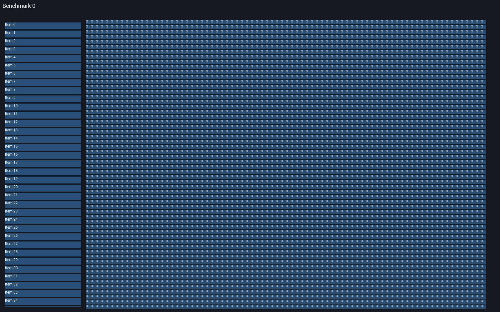

# Первый baseline общей benchmark-сцены FLUI

Дата: 2 ноября 2026 года. Реализация и проверка измерительного пути завершены. **Статус timings: advisory на общей Windows-машине.** В 12 из 16 конфигураций A/A недостаточен для вывода об улучшении на 10%: превышен порог шума 5% либо обнаружена возможная конкуренция со сборкой. Все повторы сохранены. Сравнение с другими frameworks и native presentation — NOT_RUN.

## Что выполнено

Общая невиртуализированная сцена поддерживает 100 / 1k / 10k / 53k элементов отдельно как labels и функционирующие RawButtons. Есть header, sidebar, сетка, clipping и один RepaintBoundary вокруг статичного тела. Шрифт — bundled Roboto Regular. Геометрия, цвета, тексты, размеры viewport и команды описаны в [контракте сцены](../../../../examples/benchmark_grid/README.md). Используются существующие HeadlessBinding и FrameReport; новых API библиотек и зависимостей нет.

Собраны **98 независимых процессов**: 80 основных запусков (4 размера × 2 вида × 2 режима × 5 повторов), 10 forced-rebuild controls и 8 GPU correctness запусков. Основной запуск: 120 warmups + 10 000 samples; control: 120 + 1 000; GPU correctness: 120 + 11. Всего 810 088 workload samples, из них 800 000 основных, и ещё 980 000 пустых измерений для оценки нижней границы overhead таймера. Порядок конфигураций чередуется и разворачивается в чётных повторах. Ошибок/пропущенных запусков нет.

## Что именно измерено

Реальный Instant wall time от начала изменения состояния до возврата HeadlessBinding::pump_frame_report. В это время входит существующая отчётность FrameReport. Виртуальные 16 666 667 ns только продвигают clock драйвера. Сериализация, обход дерева для проверок, screenshots, GPU submission/readback и вычисление статистики находятся снаружи timed closure. Это raw-owner widget pipeline: UiRuntime, native event loop и presentation здесь не выполняются.

Mount — создание модели/owners и initial build/layout/paint одним интервалом. Это не cold process startup и не отдельно измеренные фазы. Перед mount выполняется калибровка таймера; font shaping впервые вызывается при mount. Semantics updates выключены. Process CPU time, CPU%, memory/energy, GPU duration и input-to-present — UNAVAILABLE в этом adapter. Их отсутствие не записано нулями.

## Результаты

В таблице — медиана пяти process p50. Диапазоны p50 и p99 — минимальное/максимальное значение соответствующего percentile среди пяти процессов, не pooled percentile и не доверительный интервал. Mount тоже медиана пяти запусков этой строки. Здесь нет A/B и утверждения об ускорении.

| Items | Вид | Local p50, мкс | p50 по повторам, мкс | p99 по повторам, мкс | Mount, мс | A/A spread | Статус |
|---:|---|---:|---:|---:|---:|---:|:---:|
| 100 | Labels | 18.3 | 18.1–18.7 | 23.6–38.4 | 2.71 | 3.3% | A |
| 100 | Buttons | 18.2 | 18.1–19.1 | 26.5–51.4 | 5.65 | 5.5% | N |
| 1000 | Labels | 18.8 | 18.7–20.6 | 28.9–43.3 | 16.98 | 10.1% | N |
| 1000 | Buttons | 19.3 | 19.2–19.4 | 32.3–47.9 | 48.14 | 1.0% | A |
| 10000 | Labels | 21.4 | 20.4–21.5 | 31.2–45.5 | 165.61 | 5.1% | N |
| 10000 | Buttons | 25.9 | 25.6–28.0 | 48.7–72.9 | 554.56 | 9.3% | N |
| 53000 | Labels | 33.4 | 33.2–35.2 | 66.6–81.3 | 956.54 | 6.0% | N |
| 53000 | Buttons | 110.5 | 106.0–119.7 | 172.0–206.3 | 3341.81 | 12.4% | H |

A — попадает в описательный A/A предел; N — шум выше 5%; H — после одного или нескольких запусков замечен compiler/linker, поэтому строка INCONCLUSIVE_SHARED_HOST_LOAD. Полные 16 строк, render-node counts и имена затронутых прогонов находятся в [analysis.json](baseline-2026-11-02/analysis.json). A не означает статистически доказанное превосходство или пригодность этого host для release gate.

У retained/no-change во всех восьми конфигурациях медиана process p50 — **1,9 мкс**; process p50 отдельных повторов 1,8–2,1 мкс. Все samples этого режима дают 0 rebuild / 0 layout / 0 paint / 0 produced frames. Это стоимость проверки отсутствия работы; из неё нельзя вычислять FPS. Межпроцессный шум и квантование особенно существенны на таком коротком интервале.

Каждый local sample всех размеров: **4 elements rebuilt, 1 node laid out, 9 nodes painted, 1 frame produced**. Тело переиспользует paint. На 53k создаются 159 621 render nodes для labels и 530 621 для buttons; видно 4 676 logical items, включая частично обрезанную последнюю sidebar-строку. Все 53 000 присутствуют в дереве, header считается отдельно.

Положительный контроль forced reassemble на 100 items: labels — медиана p50 0,5958 мс, 557 rebuilt / 329 layout / 329 paint; buttons — 2,1485 мс, 2 057 rebuilt / 1 029 layout / 1 029 paint на каждый вызов. Это искусственная полная перестройка; её цифры не подставляются вместо обычного retained update. Controls используют 1 000 samples, поэтому их tail не используется для сравнительных выводов.

## Корректность и чувствительность

- Каждый процесс сверяет весь multiset текстов и размеры каждого paragraph до/после работы: grid cells 14×14, sidebar 244×22, header 1584×48. Проверяются клики по sidebar, первому/последнему столбцу первой grid-строки и пустому зазору. Проверка выбранных hit targets не является полной accessibility/keyboard conformance.
- Восемь DX12 offscreen запусков проверяют длину RGBA, выбранные fill/background/gap/clip pixels, наличие glyph ink во всех столбцах первой строки, реальное изменение header pixels и побайтовую неизменность тела. Снимки 100 и 53k также просмотрены визуально. Это выборочные pixel oracles, не исчерпывающий golden всей картинки. GPU failures приводят к ошибке; skip-path отсутствует.
- Умышленно отключённое изменение заголовка вызвало падение grid_has_every_item_and_local_change_preserves_body (r8771). Умышленно обнулённое elapsed вызвало падение wall_clock_includes_work_and_percentiles_use_nearest_rank с injected sleep 5 ms (r8774). Обе мутации восстановлены; итоговый nextest — 15/15 PASS.
- Пустой/нулевой буфер и неизменившийся header отклоняются pixel_oracle_rejects_blank_missing_and_stale_captures. Unsupported item count, zero samples и существующий output directory проверены командами: exit != 0; SHA-256 прежнего summary сохранился.
- Независимый JS validator прочитал все 810 088 samples, пересчитал nearest-rank p50/p95/p99/min/max, суммы всех десяти counters и калибровку, проверил mode-specific counts, последовательность процессов, полную матрицу и SHA-256 файлов. Неполная матрица была отклонена; завершённая прошла. После распаковки опубликованного ZIP проверка повторена успешно.

Пустое измерение часто попадает в один clock tick: process p50 = 0 ns, p99 обычно 100 ns. Ноль здесь означает недостаточную разрешающую способность для столь короткого интервала, а не бесплатный таймер. Calibration raw samples сохранены; overhead не вычитался. Это нижняя граница стоимости timer wrapper, а не оценка стоимости FrameReport. Main samples используют тот же wrapper; отдельного варианта без instrumentation пока нет.

## Машина и ограничения

Windows 11 Pro 10.0.26300; Intel Core i9-13900K, 24 cores / 32 logical processors, 68 406 284 288 bytes RAM; power policy Balanced, affinity не закреплена. Rust 1.99.0 (b940084d7), LLVM 23.1.1, x86_64-pc-windows-msvc. Release opt-level 3, thin LTO, codegen-units 1, incremental 0, no-default-features. Сборки идут через heli с cache namespace конкретного checkout. Версии GPU drivers, lock/font/binary hashes, UTC и exact argv каждого процесса сохранены в manifest внутри ZIP.

Период серии: 2026-11-02T11:17:36.436Z — 2026-11-02T11:25:02.364Z. На host есть RTX 3070 Ti и UHD 770. Capture запрашивал DX12/HighPerformance; actual adapter API не раскрывает, поэтому он отмечен UNAVAILABLE. Установленный GPU не выдается за доказанный selected adapter.

Runner ждёт отсутствия rustc/clippy-driver/link перед запуском и сохраняет их состояние после выхода. В пяти primary и одном capture процессе после выхода обнаружены компиляторы. Это свидетельство возможной конкуренции, а не точная трасса пересечения timed span: непрерывного host monitor нет. Чужие jobs не останавливались, медленные samples не удалялись. Даже строки без этого флага не доказывают полностью изолированный host. По этой причине вся серия advisory, а 12/16 ячеек дополнительно помечены INCONCLUSIVE по шуму/нагрузке.

## Артефакты и воспроизведение

- Source: [e3413f98726e9034f31aa4b47febb6f1999137af](https://github.com/vanyastaff/flui/commit/e3413f98726e9034f31aa4b47febb6f1999137af). Checkout был чистым при запуске серии; последующие изменения содержат результаты и документы.
- [Raw results ZIP](baseline-2026-11-02/raw-results.zip) — 2522490 bytes: manifest, все ordered samples, summaries, calibration, 16 PNG, reproduce.cjs и validate.cjs. Временный архив хранится только в разрешённом владельцем draft; перед merge его нужно вынести в постоянное immutable artifact storage.
- [Artifact provenance](baseline-2026-11-02/artifact.json) — SHA-256 архива, бинарника, Cargo.lock и Roboto; [analysis.json](baseline-2026-11-02/analysis.json) — независимый пересчёт. SHA-256 ZIP: `d4652e6196d61ba2182f360b2c5aa1d5a99d33bc239e377ca0b42d4a1e7a1ae4`.
- Для проверки без нового benchmark: распаковать ZIP в новую папку и выполнить `node <folder>/validate.cjs <folder>` (в этой сессии Node 24.19.0). Для нового прогона: чистый checkout указанного source, release build из контракта сцены, затем reproduce.cjs из корня checkout. Script создаёт новую папку результата и отказывается перезаписывать существующую.
- Gates: cargo heli fmt --all; cargo heli clippy --locked -p flui --all-targets --no-default-features -- -D warnings; cargo heli nextest run --locked -p flui --no-default-features; cargo heli xtask checks. [Точные evidence и mutation результаты](../../specs/benchmark-grid/tasks.md). Linux/macOS/native presentation не запускались. Release build имеет существующее предупреждение flui-engine/command_ir.rs об unfulfilled_lint_expectations; его не подавляли.

## Следующие решения по данным

1. Перед A/B закрепить свободный runner и повторить A/A до spread ≤5%; собрать непрерывные данные о конкурирующей нагрузке. На этой серии не утверждать выигрыш 10%. Короткий idle interval дополнить batch measurement для оценки влияния квантования.
2. Профилировать mount 10k/53k и сопутствующую работу local update: counts остаются постоянными, время растёт с размером дерева. Причина этого роста здесь не установлена; profiler должен отделить traversals, bookkeeping, allocation и cache effects. Принимать оптимизацию только с теми же correctness oracles и новым A/A→A/B.
3. Сохранить выбранную границу перерисовки как явную часть common scene. Подключить реальный UiRuntime/native adapter с process CPU и presentation evidence, затем peers в согласованном Linux Wayland cohort. До этого не сопоставлять приведённые microseconds с опубликованными FPS Knots/Raven/egui.
