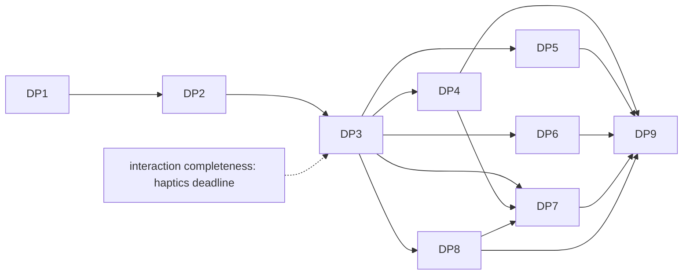

# Display pacing — задачи

- **Статус:** завершена — спека #1716; реализация влита: DP1–DP3 #1721, DP4 #1722, DP5 #1727, DP6 #1725 и #1726, DP7 #1728, DP8 #1724, DP9 — PR закрытия
- **Дата:** 2026-10-17
- **Design:** [design.md](design.md); требования — [requirements.md](requirements.md); ADR —
  [ADR-0236](../../../adr/ADR-0236-display-snapshot-and-refresh-period.md)
- **База:** `main` @ `61f017696`
- **Итог:** 9 задач в 7 PR, 4 из них `[P]`; ≈ 43 инженеро-дня; критический путь 29 дней
  (13 дней до headless- и runtime-acceptance первого PR)

## Правила исполнения

Задача = worktree (`cargo xtask worktree new platform/<slug>`) = PR, `cargo xtask check-changed`
зелёный. **Первый PR — DP1–DP3 вместе:** контракт, хост и потребители land одним PR, поэтому потока
`#[ignore = "contract: …"]` внутри него нет. Каждая строка первого PR показывает, что проверяет
поведение, откатом соответствующего производственного хунка (изолированный checkout). Fix-тест падает с
откатом; имена без номеров задач и требований. Каждая задача добавляет `changelog.d/<branch-slug>.md` и
обновляет строки `docs/platform-parity.md` и `docs/gaps.md` в пределах своей ОС (✅ — только после
прогона по R33; иначе 🟡). Где: L — Linux CI; W — Windows нативно на машине владельца; A — Android по
`adb`; B — Chrome; WSL — WSLg; X — Xvfb в CI.

PR идут в порядке: (1) DP1–DP3 контракт, headless, хост, потребители runtime, оболочки существующих
бэкендов на уже имеющихся данных (macOS, winit; design D-17) и ADR — после него `main` не хуже прежнего:
панели 120/144 Гц на macOS и winit не откатываются на 60 Гц; (2) DP4 Windows; (3) DP5 Android; (4) DP6
Web; (5) DP7 Linux и замена оболочки winit; (6) DP8 macOS и iOS; (7) DP9 живые прогоны и документы.
PR 2–6 независимы друг от друга после PR 1, кроме DP7 (см. граф).

## Граф зависимостей

Кросс-фичевые связи: DP3 даёт спеке interaction completeness значение периода (метрику ADR-0212,
`GestureBinding::set_sampling_clock`); её потребители — читатели, слияние в любом порядке (пунктир).
DP7 зависит от DP4 и DP8, потому что заменяет оболочку winit (`init_displays`, `WinitDisplay`) для всех
ОС, а winit на Windows и macOS получает снимок у нативных модулей, которые приносят DP4 и DP8.

## Задачи

| ID | Задача | Требования | Зависит | P | Где | Дн | Статус |
|---|---|---|---|---|---|---|---|
| DP1 | PR 1. Контракт, ADR, headless, оболочки macOS и winit | R1, R3, R6–R9, R22a, R30 | — | — | L | 5 | сделана, #1721 |
| DP2 | PR 1. Хост: снимок, доставка, наблюдение окна | R1, R2, R10–R15 | DP1 | — | L | 3 | сделана, #1721 |
| DP3 | PR 1. Потребители: `FallbackWake`, бюджет, окно ресэмплера, строка jank devtools (поле span), метрика ADR-0212; период презентации | R4, R16, R19–R21, R20a | DP2 | — | L | 5 | сделана, #1721 |
| DP4 | PR 2. Windows: снимок, ключи, частота, `WM_DISPLAYCHANGE`, дисплей окна, модуль версий | R2, R3, R7, R23, R29, R34 | DP3 | [P] | L, W | 5 | сделана, #1722 |
| DP5 | PR 3. Android: JNI-выборка, `AChoreographer`, модуль API-уровня, запрос частоты по активности | R2, R17, R17a, R26, R34 | DP3 | [P] | L, A | 7 | сделана, #1727 |
| DP6 | PR 4. Web: оценка по rAF, `devicePixelRatio`, `screenschange`, проверка возможностей | R5, R27, R34 | DP3 | [P] | L, B | 4 | сделана, #1725, #1726 |
| DP7 | PR 5. Linux: модуль дисплеев; замена оболочки winit нативными источниками ОС; честные заглушки | R28, R29, R31 | DP3, DP4, DP8 | — | L, X, WSL | 8 | сделана, #1728 |
| DP8 | PR 6. macOS и iOS: замена оболочки macOS (уведомление экранов, инвалидация), iOS: ProMotion, `display_id()`, модуль версий | R18, R24, R25, R34 | DP3 | [P] | L (типы) | 3 | сделана, #1724 |
| DP9 | PR 7. Проба, живые прогоны, parity/gaps, changelog | R32, R33 | DP4–DP8 | — | W, A, B, WSL, X | 3 | сделана, PR закрытия |

## Карточки

**DP1. Контракт и оболочки.** Типы: `flui-platform-api` (`src/display.rs`) — `DisplayId` (непрозрачный
`NonZeroU64`, `get`; значим внутри одного реестра), `DisplayKey` (включая `WindowsInterface`,
`AndroidId`, `Backend`), `DisplayRegistry` (`new`, `mint`), `DisplayIdsExhausted`, `RefreshPeriod`
(`TryFrom<Duration>`, 1 мс…1 с), `DisplayInfo` (+ `with_refresh_rate_mhz`, `with_refresh_ratio`,
`with_refresh_period`), `DisplaySnapshot` (`revision`, `displays`, `get`, `primary`, `window_display`),
`DisplayRevision`, `WindowDisplay` (id и период, без масштаба); `PlatformWindow::{display_id,
on_display_changed}` с умолчаниями `None` и no-op; `Platform::display_snapshot` и
`OwnerPlatform::display_snapshot`. Удаляются `PlatformDisplay`, `Platform::displays`/`primary_display`,
`PlatformWindow::display`/`refresh_period`; их вызывающие (пример `displays.rs`, `desktop.rs:190`/`:265`,
бэкенды) переводятся на новый контракт. Headless: `HeadlessPlatform::with_displays`,
`simulate_display_change`, `HeadlessWindow::simulate_move_to`, `DisplaySpec`; `MockDisplay` удалён.
**Оболочки существующих бэкендов (B2):** macOS — `display_snapshot` из `NSScreen.screens` с периодом
`refresh_period_for_screen` (`macos/display.rs:127`) и `display_id()` окна по его экрану,
`on_display_changed` из `windowDidChangeScreen:`; winit — `display_snapshot` из `available_monitors()`
(перевыбирается при каждой выборке, период `refresh_rate_millihertz`, ключ `DisplayKey::Backend` — он
удаляется из публичного перечисления в DP7),
`display_id()` по `current_monitor()`, `on_display_changed` из `Moved`/`ScaleFactorChanged`/`Resized`;
Windows, Android, iOS, Web отдают снимок с `None` вместо периода (регресса нет: они не сообщали период и
раньше). ADR-0236 в PR спеки остаётся Proposed; **первый PR реализации вносит** `Amended-by: ADR-0236` и
минимальные правки текста в ADR-0058 (решение 2) и ADR-0212 (решение 4), потому что они называют
удаляемый `PlatformWindow::refresh_period`; **тот же PR добавляет датированную заметку** в `docs/BETA.md`
(журнал прогона) о том, что `refresh_period` удалён и период доступен через новый источник, не меняя
исходный текст замера.
Тесты (реализованы целиком, зелёные в PR): `display_identity_contract`,
`display_id_cannot_be_built_from_a_number` (trybuild-фикстура), `refresh_value_classification_table`,
`exhausted_counter_refuses_without_wrapping` (in-src), `macos_and_winit_shims_keep_the_period_they_report_today`
(R22a). Файлы: `crates/flui-platform-api/src/{display.rs, platform_window.rs, lib.rs}`,
`crates/flui-platform-api/tests/compile_fail/`, `crates/flui-platform/src/traits/{platform.rs, owner.rs,
mod.rs}`, `crates/flui-platform/src/platforms/{headless/platform.rs, macos/, winit/}`,
`crates/flui-platform/examples/displays.rs`, `crates/flui-testing/src/lib.rs`,
`docs/adr/{ADR-0236-display-snapshot-and-refresh-period.md, ADR-0058-the-platform-paces-production-not-a-sleep.md,
ADR-0212-system-preferences-for-input.md}`, `docs/BETA.md`; строка в списке `crates/flui-sdk/tests/surface.rs`, если типы
доходят до SDK. Проверка: `cargo xtask check-changed`, `cargo test -p flui-platform-api --doc`,
`cargo xtask cross-typecheck`, `cargo xtask wasm-check`.

**DP2. Хост.** `APP_RUNTIME` хранит принятый `DisplaySnapshot`; `refresh_displays_with(OwnerPlatform::display_snapshot)`
рядом с `refresh_preferences_with` (`host.rs:104`, вызов из `owner.on_wake` на `:282`–`:310` и начальная
выборка у `:383`); ревизия не оборачивается; `observe_display` в `window_install.rs` (рядом с
`observe_appearance`) на **всех** раннерах — рабочий стол (главное и вторичные окна), Android, iOS, Web;
подсказка окна перевыбирает снимок тем же путём `OwnerSignal`; у каждого окна `delivered` обновляется
только после успешного применения; `RuntimeEvent::DisplayChanged` → `WindowObservation::Display(DisplayUpdate)`
и слияние в `PendingWindowState` (`presentation_dispatch.rs`) с явным `DisplayUpdate`, так что новое
«неизвестно» заменяет ожидающее известное (`merge` сегодня берёт `newer.x.or(self.x)`, `:121`).
Тесты: `display_delivery_contract` (включая `apply_panic_keeps_the_debt_and_the_next_equal_change_is_delivered`),
`window_display_observation_contract` (включая `newer_unknown_display_replaces_a_pending_known_one`:
без явного `DisplayUpdate` строка падает — ожидающее известное значение переживает «неизвестно»)
(`crates/flui-app/tests/`). Файлы: `crates/flui-app/src/app/runner/{host.rs, window_install.rs,
owner_dispatch.rs}`, `crates/flui-runtime/src/owner/presentation_dispatch.rs`,
`crates/flui-app/tests/{main.rs, display_delivery.rs}`. Проверка: `cargo nextest run -p flui-app display`,
`cargo nextest run -p flui-runtime`.

**DP3. Потребители runtime.** `PresentationState` хранит `Cell<Option<WindowDisplay>>`;
`DEFAULT_REFRESH_PERIOD`; `UiRuntime::refresh_interval(id)`; `FallbackWake` без собственного периода
(`arm`/`next_wake` получают значение, `set_period` и чтение при изменении размера в
`desktop.rs:265`–`273` удаляются, `DEFAULT_DISPLAY_PERIOD` из `frame_pacing.rs:204` уходит);
`FrameDuration::try_from_period(Duration)` и `UpdateScheduler::set_budget_frame_duration`, вызов **до**
`handle_begin_frame` (кратчайший период среди презентаций кадра); **окно ресэмплера (D-6e):** на
`WindowObservation::Display` runtime выставляет `SamplingClock::Fixed { period }` биндингу жестов
(читатель — `frame.rs:559`); **строка jank devtools (D-20):** поле `period_us` span `frame` в
`UpdateScheduler::drive_frame` и `JankLine` в `packages/flui-devtools/src/{profiler.rs, frame_timing_layer.rs}`
(без представления); поля периода в `FrameTick` и `MediaQueryData` **не** добавляются (D-18);
`refresh_interval` как метрика презентации по ADR-0212 с
`Duration::try_from_secs_f64` и проверкой множителя; барьер перечтения геометрии жестов на
`WindowObservation::Display`. Android и Web получают значение в семя без `FallbackWake`. Тесты:
`display_timing_contract` (`crates/flui-runtime/tests/contracts/display_timing.rs`) целиком; Android-функция
`idle_wait_follows_the_real_period` входит в DP5. Файлы:
`crates/flui-runtime/src/{presentation.rs, ui_runtime/frame_clock.rs}`,
`crates/flui-scheduler/src/{scheduler.rs, budget.rs, duration.rs}`, `packages/flui-devtools/src/`,
`crates/flui-app/src/app/runner/{frame_pacing.rs, desktop.rs, secondary_window.rs}`. Проверка:
`cargo nextest run -p flui-runtime -p flui-scheduler -p flui-devtools display`.
Готово: все строки `display_timing_contract` (включая
`frame_aligned_resampling_window_follows_the_display_period`) и `profiler_jank_line_follows_the_refresh_period`
зелёные; у каждой новой поверхности есть читатель в этом же PR: бюджет — планировщик, окно ресэмплера —
`frame.rs:559`, поле span — слой devtools, метрика — ADR-0212. Читатель на стороне тика не найден (поиск
в `flui-animation` и `flui-interaction`: сглаживание, шаг симуляции, оценка скорости не знают период
дисплея), поэтому поле тика не вводится.

**DP4. Windows.** Один источник на `QueryDisplayConfig` (+ `EnumDisplayMonitors` для сопоставления,
`EnumDisplaySettingsW` и `WindowsInterface` как запасной путь); `DisplayKey::WindowsTarget`;
`display_id()` окна по `MonitorFromWindow(NEAREST)`; `WM_DISPLAYCHANGE` на скрытом приёмнике настроек,
обработчик только инвалидирует; `WM_DPICHANGED` инвалидирует снимок и вместе с перемещением окна даёт
`on_display_changed`; winit-на-Windows получает снимок у этого источника; **модуль версий (D-19):**
`platforms/windows/os_version.rs` — `WindowsBuild` из `RtlGetVersion`, доказательство для флага
`QDC_VIRTUAL_MODE_AWARE` (сборка ≥ 18362); читатель — вызов `QueryDisplayConfig` этой же задачи.
Тесты: `windows_build_below_18362_omits_the_virtual_mode_flag`, нативные строки `mod native_windows` в
`crates/flui-platform/tests/contract.rs` и `display_message_tests.rs` в `src` (W, локально) и чистые строки `os_display_classification` (L): `windows_zero_or_one_hz_is_unknown`,
`rational_refresh_converts_exactly`, `nearest_monitor_resolves_by_native_key` (seam с внедрённым
перечислением). Падают на основе: окно отвечает основным монитором (`windows/window.rs:1067`–`1085`),
`WM_DISPLAYCHANGE` не обрабатывается. Файлы: `crates/flui-platform/src/platforms/windows/{display.rs,
window.rs, platform.rs}`, `crates/flui-platform/Cargo.toml` (`Win32_Devices_Display`),
`crates/flui-platform/tests/`. Проверка: `cargo nextest run -p flui-platform` на W, `cargo xtask
cross-typecheck`. Живое: значения монитора 3440×1440, одно изменение (владелец меняет частоту или
разрешение).

**DP5. Android.** JNI-выборка через `with_activity` (`android/preferences.rs:39`): размер, плотность,
`Display.getMode`, `getRefreshRate`, ключ `getDisplayId` (`getUniqueId` скрыт); `AChoreographer` через
`dlsym` на API 30+; ниже — чтение на `ConfigChanged` и возобновлении, без опроса; зашитый `AndroidDisplay`
удалён (`android/mod.rs:877`–`900`); `Duration::from_millis(16)` (`android/mod.rs:452`) заменён функцией
«интервал ожидания по периоду». **Модуль API-уровня (D-19):** `platforms/android/os_version.rs` —
`AndroidApi` (`android_get_device_api_level()` или свойство `ro.build.version.sdk`; доступность символа на
minSdk 23 проверить здесь), `NdkFn<F>` для `ANativeWindow_setFrameRate` и
`AChoreographer_registerRefreshRateCallback`, `SymbolSource` (настоящий `dlsym` и поддельный);
оба чтения `SDK_INT` (`android/preferences.rs:147`, `:299`) переходят на него. **Запрос частоты (D-21):**
`PlatformWindow::set_frame_rate_hint(FrameRateHint)` (в `flui-platform-api`); **runtime подсказку не
вызывает** (ADR-0083): он хранит `FrameRateDemand`, публикует фронт эффектом `frame_rate_demand_changed`
(`OwnerEffects`) и регистрирует дедлайн пробуждения выдержки 250 мс, чтобы на статичном экране фронт
«покой» наступил без кадров (`crates/flui-runtime/src/ui_runtime/sampling.rs`, `frame_clock.rs`); спрос —
`DemandKind::Animation` либо активный указатель; `flui-app` реализует эффект вызовом
`set_frame_rate_hint` и повторно применяет подсказку к новому окну после возобновления
(`PrimarySurfaceRestored`); Android — `ANativeWindow_setFrameRate` (max из `Display.getSupportedModes`,
при покое `0.0`); снятие callback хореографа до освобождения его данных; дескриптор `dlopen` живёт с
платформой. Тесты: `os_capability_table` (OS-строки: `api_29_resolves_no_set_frame_rate_handle`,
`api_30_resolves_the_set_frame_rate_handle`), отдельное семейство `frame_rate_demand_contract`
(`animation_demand_raises_the_hint`, `active_pointer_contact_raises_the_hint`,
`static_screen_releases_the_hint_after_the_hold_via_a_wake_deadline`,
`hint_is_reapplied_when_the_native_window_is_replaced_after_resume`), `idle_wait_follows_the_real_period`
(L, чистая), `android_refresh_value_table` (L, классификация значений); падают на основе: ожидание 16 мс при
периоде 8,33 мс, запрос частоты не выдаётся. Файлы: `crates/flui-platform/src/platforms/android/{mod.rs, display.rs, preferences.rs}`,
`crates/flui-app/src/app/runner/android.rs`. Проверка: `cargo xtask cross-typecheck` (цель Android),
`cargo clippy --target aarch64-linux-android` где SDK есть. Живое (A): значения S21 и изменение при
переключении «Плавность движения» (Стандартный ↔ Адаптивный), поворот.

**DP6. Web.** Оценщик в цикле rAF (`web/platform.rs:136`), пересчёт после `visibilitychange` и смены
`devicePixelRatio` (`matchMedia` с повторной установкой), `screenschange` при выданном разрешении
(ключ — идентичность JS-объекта в удерживаемом списке), `WebDisplay` кэшируется, не создаётся на каждый
вызов (`web/display.rs:17`). Тесты: `web_refresh_estimate_table` (L, чистая), сборка `cargo xtask
wasm-check`. Падают на основе: период не сообщается, смена масштаба страницы не порождает наблюдения.
**Проверка возможностей (D-19):** `platforms/web/features.rs` — `WebFeature` для `getScreenDetails`,
`matchMedia`; читатель — выбор источника в этой же задаче. Тест `web_feature_absent_gives_no_handle`.
Файлы: `crates/flui-platform/src/platforms/web/{display.rs, features.rs, platform.rs, window.rs}`. Живое (B): оценка в
Chrome на 60 Гц, смена масштаба страницы.

**DP7. Linux и winit.** Модуль `platforms/linux/display/` (D-10): модель, адаптеры, фоновый поток с
дескрипторами и порядок остановки, выбор протокола как у winit; признаки `wayland` и `x11` с
`dep:`-зависимостями в `[workspace.dependencies]` (`x11rb` 0.13 — версия, которую уже тянет winit);
`LinuxPlatform::displays` без `unimplemented!()` (`linux/mod.rs:193`–`203`). **Замена оболочки winit из
DP1:** `WinitDisplay`/`init_displays` удалены (`winit/platform.rs:351`, `:1023`–`1026`, `:2391`),
дисплей окна — по `MonitorHandleExtX11::native_id` / `MonitorHandleExtWayland::native_id` (на Windows и
macOS — по нативному окну через источники DP4 и DP8); триггеры `Moved`, `ScaleFactorChanged`, `Resized`,
смена списка мониторов; перенос между выходами на Wayland без события документирован. Исправлен документ
крейта (`lib.rs:132`) и `linux/mod.rs`. Тесты (in-src, закрытый шов): строки Linux из design, в том числе
`x11_zero_htotal_or_vtotal_is_unknown`, `x11_big_dot_clock_does_not_overflow`,
`x11_monitor_is_keyed_by_its_first_output`, `winit_window_matches_its_output_by_native_id`,
`mirrored_outputs_keep_distinct_ids`; `wayland_output_applies_only_after_done` падает без накопления до
`done`; `x11_refresh_is_dot_clock_over_totals` — при расчёте без двойного сканирования. Живое: X под Xvfb в
CI (`xrandr`), WSLg на машине владельца. Файлы: `crates/flui-platform/src/platforms/linux/`,
`crates/flui-platform/src/platforms/winit/{platform.rs, display.rs, window.rs}`,
`crates/flui-platform/{Cargo.toml, src/lib.rs}`, корневой `Cargo.toml`, `Cargo.lock`. Проверка:
`cargo nextest run -p flui-platform --features wayland,x11`, `cargo xtask live-smoke`,
`cargo xtask deps`, `cargo xtask wasm-check`.

**DP8. macOS и iOS.** macOS (замена оболочки DP1): `NSApplicationDidChangeScreenParametersNotification`,
инвалидация снимка при смене backing/масштаба (`macos/window.rs:2617`), `on_display_changed` из
`windowDidChangeScreen:`, UUID-ключ, кэш периода окна удалён (`macos/window.rs:196`, `:886`); iOS:
`preferredFrameRateRange` на iOS 15+ с запасным `preferredFramesPerSecond` (`ios/window.rs:333`–`348`),
ключ `CADisableMinimumFrameDurationOnPhone` в `Info.plist` CLI (`ios_package.rs:502`–`509`), период из
тиков с гистерезисом ±5 %, `display_id()`, уведомления экрана и сцены, удерживаемый объект экрана как
ключ; **модуль версий (D-19):** `platforms/{macos,ios}/os_version.rs` (`OsVersion` из `NSProcessInfo`,
`Since<F>` для iOS 15; читатель — выбор между `preferredFrameRateRange` и `preferredFramesPerSecond`).
Тесты: `ios_14_uses_preferred_frames_per_second`, `ios_15_uses_the_frame_rate_range`,
чистые `ios_period_follows_link_ticks`, `ios_adaptive_ticks_inside_the_band_publish_nothing`,
`macos_display_key_is_the_display_uuid` (seam); остальное — компиляция и типы. Файлы:
`crates/flui-platform/src/platforms/{macos,ios}/`, `crates/flui-cli/src/build/ios_package.rs`. Проверка:
`cargo xtask cross-typecheck` (цели Apple), `cargo test -p flui-cli`. Не исполняется на этом хосте;
строки parity — 🟡 с пометкой «type-checked».

**DP9. Прогоны и документы.** Проба `displays.rs` печатает снимок и события; живые прогоны на машине
владельца по R33; обновление `docs/platform-parity.md` (три строки «Displays and metrics»),
`docs/gaps.md` (пробел 17 закрывается или сужается), `crates/flui-platform/ARCHITECTURE.md` (источник
на каждой ОС), `docs/testing.md` (живые проверки); changelog-фрагмент. Критерий: значения
напечатаны И одно живое изменение наблюдалось на каждой ОС, получившей ✅; остальное 🟡 с причиной.

## Требование → тест

| R | Тест или прогон | Задача | Где |
|---|---|---|---|
| R1 | `seed_holds_every_display_before_the_first_window` | DP2 | L |
| R2 | `refresh_switch_publishes_a_new_snapshot`; изменение режима на W, A | DP2; DP4, DP5 | L, W, A |
| R3 | `refresh_value_classification_table` | DP1 | L |
| R4 | `fallback_wake_returns_to_60_hz_when_the_period_becomes_unknown` | DP3 | L |
| R5 | `web_refresh_estimate_table`; прогон в Chrome | DP6 | L, B |
| R6 | `display_id_cannot_be_built_from_a_number` (trybuild) | DP1 | L |
| R7 | `same_connector_after_replug_keeps_the_id`, `two_identical_monitors_get_distinct_ids`, `swapped_cables_swap_identities`, `unkeyed_output_mints_a_fresh_id_each_time` | DP1 | L |
| R8 | `exhausted_counter_refuses_without_wrapping`, `known_key_still_resolves_after_exhaustion` | DP1 | L |
| R9 | rustdoc `DisplayInfo` и ADR-0236 | DP1 | — |
| R10 | `a_change_racing_the_sample_still_reaches_the_window` | DP2 | L |
| R11 | `snapshot_is_committed_before_observers_run`, `panicking_window_observer_keeps_the_snapshot_and_the_tail`, `apply_panic_keeps_the_debt_and_the_next_equal_change_is_delivered`, `foreign_thread_invalidation_wakes_the_owner` | DP2 | L |
| R12 | `moving_to_another_display_notifies_once`, `refresh_change_of_own_display_notifies`, `other_displays_change_is_silent`, `unread_field_change_is_silent` | DP2 | L |
| R13 | `several_changes_before_the_turn_deliver_the_last`, `newer_unknown_display_replaces_a_pending_known_one` | DP2 | L |
| R14 | `new_secondary_window_starts_on_its_display`, `window_opened_after_a_change_starts_with_the_new_period` | DP2 | L |
| R15 | `late_callback_cannot_reach_a_replacement_host` | DP2 | L |
| R16 | `fallback_wake_follows_a_refresh_change_without_resize`, `secondary_window_paces_by_its_own_display` | DP3 | L |
| R17 | `idle_wait_follows_the_real_period`; S21 | DP5 | L, A |
| R18 | `ios_period_follows_link_ticks`, `ios_adaptive_ticks_inside_the_band_publish_nothing`; ключ `CADisableMinimumFrameDurationOnPhone` в сборке | DP8 | L (типы) |
| R19 | `jank_is_judged_against_the_current_period`, `shared_frame_budget_uses_the_shortest_period` | DP3 | L |
| R20 | `frame_aligned_resampling_window_follows_the_display_period` | DP3 | L |
| R20a | `profiler_jank_line_follows_the_refresh_period` | DP3 | L |
| R17a | `frame_rate_demand_contract` (`animation_demand_raises_the_hint`, `active_pointer_contact_raises_the_hint`, `static_screen_releases_the_hint_after_the_hold_via_a_wake_deadline`, `hint_is_reapplied_when_the_native_window_is_replaced_after_resume`); S21 | DP5 | L, A |
| R34 | `os_capability_table` (OS-строки: `api_29_resolves_no_set_frame_rate_handle`, `api_30_resolves_the_set_frame_rate_handle`, `absent_symbol_gives_no_handle`, `min_sdk_23_binary_resolves_no_api_30_symbol`, `web_feature_absent_gives_no_handle`, `windows_build_below_18362_omits_the_virtual_mode_flag`, `ios_14_uses_preferred_frames_per_second`, `ios_15_uses_the_frame_rate_range`) | DP4, DP5, DP6, DP8 | L |
| R21 | `refresh_interval_metric_recomputes_on_display_change`, `unknown_refresh_period_uses_the_60_hz_fallback`, `period_product_overflow_is_treated_as_unknown`, `non_finite_factor_is_treated_as_unknown`, `display_change_runs_the_dpi_geometry_barrier` | DP3 | L |
| R22 | структурное свойство, проверяется ревью; строки нет | DP3 | — |
| R22a | `macos_and_winit_shims_keep_the_period_they_report_today` | DP1 | L |
| R23 | нативные строки `native_windows` (`tests/contract.rs`) и `display_message_tests.rs`, `os_display_classification`; прогон | DP4 | L, W |
| R24 | компиляция и типы (`cross-typecheck`), `macos_display_key_is_the_display_uuid` | DP8 | L |
| R25 | компиляция и типы | DP8 | L |
| R26 | `android_refresh_value_table`; прогон на S21 | DP5 | L, A |
| R27 | `web_refresh_estimate_table`; смена масштаба страницы | DP6 | L, B |
| R28 | строки Linux (модель); Xvfb, WSLg | DP7 | L, X, WSL |
| R29 | нативные строки `native_windows` (`tests/contract.rs`), `winit_window_matches_its_output_by_native_id`, `mirrored_outputs_keep_distinct_ids` | DP4, DP7 | L, W |
| R30 | `window_display_observation_contract` через внедрение | DP1, DP2 | L |
| R31 | `no_features_gives_an_empty_snapshot_not_a_panic`; rustdoc `lib.rs` | DP7 | L |
| R32 | пример `displays.rs` | DP9 | W, A, B, WSL |
| R33 | протокол прогона и строки parity | DP9 | — |

## Владельцы общих файлов

| Файл | Владелец | Через владельца |
|---|---|---|
| `crates/flui-platform-api/src/{display.rs, platform_window.rs}` | DP1 | остальные задачи не меняют контракт |
| `crates/flui-platform/src/traits/{platform.rs, owner.rs}` | DP1 | — |
| `docs/adr/ADR-0236-…`, `ADR-0058-…`, `ADR-0212-…` | DP1 | — |
| `crates/flui-app/src/app/runner/{host.rs, window_install.rs}` | DP2 | DP3, DP5 (семя Android) без правок поведения |
| `crates/flui-app/src/app/runner/frame_pacing.rs`, `desktop.rs` | DP3 | — |
| `crates/flui-platform/src/platforms/winit/` | DP1 (оболочка), DP7 (замена), DP4 и DP8 (подключение источника ОС) | порядок DP4 → DP8 → DP7 |
| `Cargo.lock`, корневой `Cargo.toml` | DP7 (Linux-зависимости), DP4 (`windows`-признак) | по порядку слияния |
| `docs/platform-parity.md`, `docs/gaps.md` | каждая ОС-задача своей строкой; DP9 — итог | конфликт разрешает порядок слияния |

## Критический путь

DP1 (5) → DP2 (3) → DP3 (5) = **13 дней** до headless- и runtime-acceptance первого PR (в него входят
потребители периода: бюджет, окно ресэмплера, строка jank, метрика). Далее DP4 (5) → DP7 (8) → DP9 (3) = **29 дней** до живых прогонов и
документов (DP8, 3 дня, идёт параллельно DP4). DP5 (7) и DP6 (4) вне критического пути и ждут только DP3.
Модуль версий ОС (D-19) входит в ближайший PR, где у него есть читатель: Windows — DP4, Android — DP5,
Web — DP6, Apple — DP8; в первом PR читателя у него бы не было. Основной риск — DP7: объём
нового модуля и две живые среды; его чистую модель можно писать сразу после DP3, но PR сливается
после DP4 и DP8, которые отдают winit источники своих ОС.
