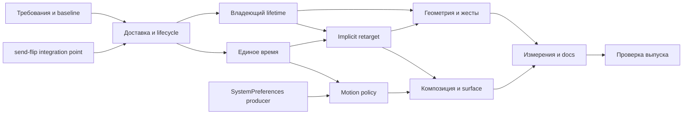

# Animation: план до production ready

- **Дата исходного плана:** 2026-10-08; актуализация: 2026-10-12.
- **Production база выпускной проверки:** `61ea713380a449777ffa791b61a3a01e3fd81c5a`.
  Исторический аудит закреплён на `91bb1fe1d2a349f62915846303f6f25780ae5c6d`.
- **Статус:** A0–A9 завершены в принятом scope; code revision `71f13790b`
  прошла validation CI. Контракт и доказательство каждой
  из 110 строк назначены в актуальной матрице. CPU/allocation измерения,
  Windows native/GPU и локальный consumer gate исполнены 2026-10-12.
  Другие native-платформы и CI каждой validation revision имеют отдельные границы в tasks.md («Выпускные свидетельства»).
- **Основание:** [актуальные контракты](tasks.md#контракты-требований),
  [выпускные свидетельства](tasks.md#выпускные-свидетельства). Исторические
  [аудит](https://github.com/vanyastaff/flui/blob/deb9faea20fe6beb23c9ea0724f5a75e0f42595f/docs/plans/specs/flui-animation/readiness-audit.md), [прогоны](https://github.com/vanyastaff/flui/blob/deb9faea20fe6beb23c9ea0724f5a75e0f42595f/docs/plans/specs/flui-animation/readiness-evidence.md),
  [маршрут требований](https://github.com/vanyastaff/flui/blob/deb9faea20fe6beb23c9ea0724f5a75e0f42595f/docs/plans/specs/flui-animation/readiness-matrix.md) и 12 тематических спек сохраняют исходную постановку.
- **Сравнение:** [анимация у конкурентов](https://github.com/vanyastaff/flui/blob/deb9faea20fe6beb23c9ea0724f5a75e0f42595f/docs/plans/specs/flui-animation/animation-competitors.md), включая проверку утверждений
  приложенного архитектурного обзора. Это источник acceptance-сценариев, не автоматическое
  расширение scope и не основание копировать интерфейсы.
- **Определение готовности:** реальные пользователи animation через widgets/runtime получают
  правильные кадры, отмену и освобождение; принятые требования имеют production consumer и
  действующий тест; native/GPU ограничения явно измерены или приняты владельцем.

## Проблема для пользователя

Аудит 2026-10-08 обнаружил 32 отключённых красных контракта: потерю доставки,
владения, reentry/recovery и численные ошибки; implicit retarget и системная policy
не были сквозными. Это историческое основание плана. В текущем дереве принятые
сценарии проходят через production consumers и публичные тесты; отключённых
контрактов в animation tests нет. Измерения, physical native/GPU execution и
ledger результатов и успешный CI конечной code revision зафиксированы.

## Подход и альтернативы

**Рекомендуется:** закрывать сквозные сценарии на согласованной owner-local модели send-flip,
переиспользуя уже реализованную математику. Владение и доставка создают основу; затем единое
время и retarget; затем policy и геометрия; в конце проверка всего пути и актуальные измерения.

| Подход | Выгода | Цена/причина выбора |
|---|---|---|
| Согласованные сквозные изменения с владельцами send-flip и platform | Один runtime-контракт, меньше ручных обязанностей у виджетов | Требует общих integration points; рекомендован |
| Продолжать чинить Arc/Mutex/atomic протоколы по одному | Быстрый локальный fix конкретного воспроизводимого дефекта | Повторная миграция и новые гонки; допустим только отдельный срочный fix, не финальная архитектура |
| Считать merged PR достаточными и обновить статусы | Минимальные изменения | Отвергнут: 32 воспроизведённых отказа и отсутствующие consumers |

Это исходное обоснование последовательности. Исторические agent assignments и
промежуточные send-flip ветки не служат списком оставшейся реализации; текущая
архитектура и контракты ниже имеют принятую ADR authority.

Для текущей реализации общий owner-local контракт закреплён
[ADR-0175](../../../adr/ADR-0175-owner-local-scheduling-and-animation.md),
а custody первой ошибки —
[ADR-0178](../../../adr/ADR-0178-notification-first-failure-custody.md).
Общий scheduler/notifier/controller путь и его consumers меняются вместе.
Исторический ledger ADR-0136 не заменяет актуальную матрицу и выпускную проверку.
Playback-контракт описан в
[ADR-0176](../../../adr/ADR-0176-presentation-animation-playback.md).

## Рабочие пакеты и зависимости

Пакет — область результата, а не обещание одного маленького коммита. Перед исполнением
разделять его на вертикальные PR с конкретным сценарием, production caller и тестом.
На каждый shared-файл один владелец; чужие worktree не редактировать.

A0–A7 описывают интегрированные результаты и их сохраняемые критерии. Ссылки
send-flip T* в графе — исторический маршрут, не назначения новой реализации.
Приёмка A8–A9 закреплена release checklist и выпускными свидетельствами;
их границы нельзя расширять по одному зелёному library-прогону.

| Пакет | Результат | Зависимость | Владелец/изменяемая область | Приёмка |
|---|---|---|---|---|
| A0 | Восстановленные требования, актуальный baseline и scope | — | docs/specs | Этот аудит + актуальная матрица; не потеряны старые owner decisions |
| A1 | Безопасная доставка и lifecycle контроллера | integration point send-flip T6c/T6b/T6a | animation controller/vsync/proxy/switch и общий notifier/scheduler owner | Красные status_delivery + controller_robustness проходят без ignore; первый failure, healthy tail, следующий кадр; Duration::MAX/NaN |
| A2 | Владеющий lifetime анимации у UI | A1, send-flip T4/T6c | animation builder/handle; animated/widgets, navigation, header, indicators/packages | Все 9 ownership rows; unmount из listener; смена Vsync/GlobalKey; один unregister; completion/cancellation при Drop |
| A3 | Единое типизированное время и playback | A1; совместно с A2 для anchors | motion, vsync, controller, scheduler, runtime, testing, devtools | Два окна с разной скоростью; пауза не держит кадры; step один кадр; adopt_vsync и multi-presentation совпадают; TIME_DILATION удалён |
| A4 | C⁰/C¹ retarget в implicit-виджетах | A1–A3, T4 | common implicit machinery + controller run/velocity | Отображаемая позиция и производная при target/curve/duration update; same target без restart; ранний reverse; .spring() consumer; старый путь удалён |
| A5 | Системная и app motion policy | A1–A3; merged SystemPreferences producer | platform owner → realm projection → animation/widgets | Первый кадр и live update; User/Always/Never; Preserve; конечный scale; completion ровно раз; два realm независимы |
| A6 | Согласованная геометрия paint/hit/semantics и жест→settle | A1/A2; motion часть A4 | objects/rendering + Drawer/Dismissible | Loose/tight/RTL/vertical, resize/cancel; экранная скорость; semantics bounds; hit coordinate snapshot; GPU readback и build count |
| A7 | Замкнуть composition и public surface | A2/A4/A5 | animation/macros/sdk/packages | Каждый сохраняемый pub имеет caller или явное принятое решение; cubic-track consumer; derive nested; indicators Normal и видимая статичная загрузка при Reduce/запрете TickerMode/отсутствии привязки (ADR-0192); delete/migrate старые экспорты |
| A8 | Измерение готового пути и актуальные docs | A1–A7 | benches, perf scenarios, README/GUIDE/PATTERNS/PERFORMANCE | Завершён 2026-10-12: paired registry/primitive/mounted CPU и allocation requests/bytes; результаты и границы в tasks.md («Выпускные свидетельства») |
| A9 | Выпускная проверка | A8 | whole consumer graph + CI/native owners | Завершён в принятом scope: code revision `71f13790b` прошла CI. Required GPU, Windows preferences/input/UIA и code-head consumer gate выполнены; receipts каждой revision и ограничения платформ в tasks.md («Выпускные свидетельства») |

## Первые исполнимые срезы

Эта последовательность сохраняет исходный порядок внедрения A1–A3; перечисленные
пути уже интегрированы и не являются новым handoff. Текущий остаток — release checklist.

1. **A1: status fan-out.** Начать с `status_listener_panic_finishes_the_round` и
   `reentrant_status_keeps_commit_order`; затем конкурирующая паника, remove/dispose,
   sibling/child Vsync и следующий кадр. Не менять ожидания для получения зелёного результата.
2. **A1: lifecycle.** `disposed_set_value_is_refused`, late listeners, is_animating и bounds;
   отказ до мутации, выбытие captures вне guard, единый observable outcome.
3. **A2: ownership на одном реальном caller.** Общий implicit helper как первый consumer,
   unmount/migrate и last-owner cancellation. После подтверждения мигрировать indicators,
   navigation, scroll/header и packages в рамках общего контракта.
4. **A3: один clock через все adapters.** Runtime, обычный headless, adopted Vsync и дополнительная
   presentation должны получать тот же FrameTick-контракт. Затем devtools rate/pause/step
   и per-animation pause у существующего Snackbar-потребителя из motion-clock спеки.

Подготовка контрактов/документации и воспроизведение могут идти до core flip. Не создавать
вторую временную архитектуру, чтобы обойти зависимость. Срочный локальный fix требует
согласования владения файлами, но его тест остаётся полезным и после смены хранилища.

## Naming и правильная доставка — обязательны в каждом срезе

Уточнение владельца от 2026-10-08: naming и правильная доставка входят в готовность,
а не откладываются на косметическую чистку A8. Метод проверки терминов — Matt
`domain-modeling`: имя сверяется с фактическим контрактом и понятиями владельца подсистемы.
Это критерии ревью; конкретные новые имена типов здесь не утверждаются.

**Naming:**

- Различать описание анимации, один активный запуск, его владельца, регистрацию и подписку.
  По имени и типу caller должен понимать, что он держит и что происходит при освобождении.
- Directional status не означает активный run или достижение endpoint. Не обещать этого
  именем, документацией или predicate; activity, outcome и position проверяются отдельно.
- Clock, timestamp, elapsed time и duration не взаимозаменяемы. Область времени и единица
  должны быть выражены типом/контрактом, без скрытого global time и неоднозначных `now`.
- Не смешивать commit состояния, notification delivery, frame request и presentation.
  `scheduled`/`queued` не должны означать «доставлено» или «показано».
- Stop, cancel, finish, dispose и retirement должны иметь разные, явно описанные эффекты,
  если различаются outcome, доступность объекта или судьба listeners/captures.
- Использовать язык действующих ADR и владельцев слоёв. Не переносить имена Flutter
  автоматически и не вводить общие `Manager`/`Context`/`Handle` без определённой роли.
  Переименование завершено только после миграции callers, reexports, serde, docs и tests;
  один rename без изменения обязанностей не считается архитектурным улучшением.

**Доставка — сквозной контракт A1–A6:**

| Сценарий | Наблюдаемая приёмка |
|---|---|
| Commit → notification | Callback видит уже принятый переход; устаревший результат user code не перезаписывает более новый run |
| Reentrant mutation | Принятые переходы приходят в определённом FIFO-порядке, без recursive reorder; value/status/outcome не противоречат друг другу |
| Remove/dispose/unmount во время раздачи | Снятый listener не вызывается позже в том же раунде; новые подписки следуют явно выбранной политике раунда; teardown не вызывает user code под guard |
| Panic и competing failures | Здоровый хвост раунда/кадра исполняется, первая ошибка остаётся авторитетной, retirement следует failure-custody policy; следующая операция работает |
| Subscribe и catch-up | Между чтением состояния и установкой подписки нет потери последнего изменения; старый catch-up не затмевает новую доставку |
| Failed/missing/replaced frame hook | Принятое состояние и долг доставки различимы; неуспешная отправка не очищает долг, повтор того же значения допускает retry |
| A → B → A при незавершённой доставке | Равенство с прежним значением не теряет обязательный последний кадр/notification |
| Completion/cancellation | Каждый run получает ровно один outcome согласно контракту; замена, zero-duration, Drop и dispose не создают дубль или потерю |
| Изоляция presentation/owner | Событие адресуется живому владельцу; смена Vsync/realm и stale registration не доставляют его чужому объекту |

Не все каналы обязаны сохранять каждый промежуточный value sample: coalescing разрешён
только там, где это явно допускает контракт. Нельзя переносить такую политику на status,
completion/cancellation или стирать невыполненный delivery debt. Гарантию «ровно один раз»
не следует объявлять глобальной для всех callbacks вместо определения каждого канала.

Каждый затронутый путь получает публичный сценарий и red→green доказательство. Проверять
не только получателя, но и healthy tail, освобождение captures и следующий кадр. Runtime
preferences → motion policy и animation → render invalidation включены в эту проверку наряду
с listener registry; исправление одного notifier не закрывает всю доставку.

## Нужные тестовые швы

| Шов, которым пользуется caller | Что проверять | Существующая опора |
|---|---|---|
| Public controller/registry/lifetime | Уведомления, future, отмена, Drop, reentry, dt | `animation_it` и child-process harness |
| HeadlessBinding + mounted widget | Реальное значение/paint, отсутствие rebuild, смена ambient-clock | implicit/transitions/indicator tests, `last_frame_report().build` |
| Presentation frame + system preferences | Policy до окна/первого кадра, смена во время run | runtime frame tests и итоговый producer PR1515 |
| Rendering owner traversal | Один transform для paint/hit/coordinate/semantics | render_object_harness, semantic tree assertions |
| Engine readback | Retained layer действительно перемещает пиксели | существующий GPU harness; точки различают before/after |

Private math tests остаются дополнением. Новый внутренний helper, протестированный без
production caller, не закрывает пользовательское требование. Красный прогон/откат проводится
в изолированном checkout, без конкурентной сборки тех же исходников.

## Scope и решения, которые нельзя потерять

Из [historical-orchestration.md](https://github.com/vanyastaff/flui/blob/deb9faea20fe6beb23c9ea0724f5a75e0f42595f/docs/plans/specs/flui-animation/historical-orchestration.md) сохранены owner decisions
2026-10-06: FLIP сверх Hero, full WAAPI, platform spline decay, OkLCh, discrete opt-in,
preferred frame rate и отдельный cross-fade-флаг вынесены. Additive и phase animator
вынесены **условно**, при доказанном покрытии retarget и keyframes соответственно.
CompoundAnimation предписано удалить, а не оставить без тестов. Builder сохраняется.

Принятые уточнения и проверенные контракты:

- M-TIME-12: историческая матрица требует отрицательные rate, более подробный R4 motion-clock
  их отвергает. План следует конечному rate ≥ 0 и явному reverse; обновление матрицы требует
  зафиксировать происхождение уточнения. Не добавлять отрицательный rate по старой строке.
- M-CRV-6: Steps без before flag соответствует принятому отказу от полной WAAPI timing model.
- M-CRV-7/10: владелец разрешил сохранить API до появления реальной потребности в штатном
  consumer. `PiecewiseLinear` и `SpringCurve` реализованы как immutable authoring values,
  с публичной математической и mounted Hero paint-приёмкой (readiness-matrix).
  Они сохраняют принятый Curve-контракт: normalized endpoints, NaN и exterior clamp;
  raw CSS parsing/extrapolation и velocity-inheriting spring retarget здесь не заявлены.
- M-INTP-3: continuous Color и paint/filter consumers реализованы по ADR-0194.
  Fractional-alpha readbacks отличают точный путь от u8 quantization; current-head
  GPU execution фиксируется в выпускных свидетельствах.
- M-INTP-9: component thresholds имеют единицы scalar/geometry и проверены
  independent settlement/invalid admission сценариями по ADR-0186; это отдельный
  контракт от DPR tolerance скролла.
- Исторические номера ADR 0143–0150 не резервировать заново: сверить реестр; сохранить действующие
  ADR-0149 и ADR-0155, новые номера брать из свободных на момент PR.

Эти уточнения отражены в актуальной матрице; precision цвета и sampled easing
не остаются неутверждёнными implementation proposals.

Владелец согласовал 2026-10-11 завершение и слияние проверенных изменений без ожидания
оставшихся решений и полного прохода по acceptance-матрице. Неподтверждённые строки
остаются открытыми для следующей работы; это не отменяет их требований и не означает
полную готовность всей спецификации.

## Release checklist

- [x] Naming соответствует реальным ролям, областям времени, состояниям и outcomes; нет
      ложных обещаний в именах и оставшихся callers старого контракта.
- [x] Матрица доставки выше пройдена для затронутых каналов; FIFO/coalescing, subscribe/catch-up,
      retry debt и failure custody описаны и проверены, включая следующий кадр.
- [x] Исторические 32 отказа связаны с текущими исполняемыми контрактами или
      типизированными ограничениями; 29 имён сохранены, три замены явно отражены
      в tasks.md («Выпускные свидетельства»). Соответствующих ignore нет.
- [x] Все 110 исходных market-ID имеют актуальный consumer/test/evidence либо принятое scope-решение;
      условные исключения имеют доказательство выполнения условия.
- [x] A1–A7 проверены через пользовательские швы; future/cancellation, reentry, competing failures,
      unmount, mutation during build и следующий кадр учтены.
- [x] Полный scope gate зелёный на code head `e0961a73` с base `61ea71338`;
      follow-up gate на code head `b1c8c2fea` с base `e7dadda5c` тоже успешен.
      Package/facade, serde, doctests и SDK surface проверены. Windows self-rebuild
      обойдён byte-identical runner copy с обычным host lock, см. tasks.md («Выпускные свидетельства»).
- [x] Финальная code revision `71f13790b` прошла workspace/wasm/cross-typecheck CI.
      Production-база `61ea71338`, предыдущие validation revisions и конечный
      input driver имеют отдельные успешные receipts в tasks.md («Выпускные свидетельства»).
- [x] Windows native и GPU readback имеют датированные прогоны; другие native-пути обозначены
      как выполненные, только compiled или unavailable, без расширения результатов Linux CI.
- [x] Performance и allocations измерены на одинаковом хосте/профиле; workloads и исходные результаты
      воспроизводимы, параметры не берутся из старых scratch-прототипов.
- [x] Документация не обещает behavior, которого нет; нужные cross-crate ADR приняты; нового
      unwired public surface нет; deprecated path и старые handoff-заметки убраны после миграции.
