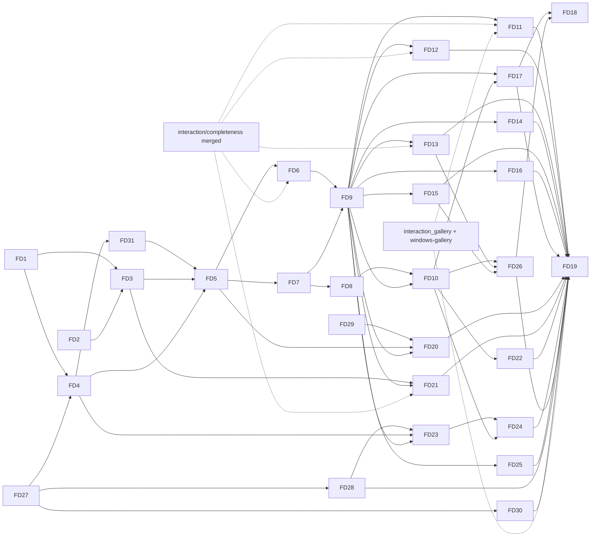

# flui-driver: tasks

- **Status:** approved by the owner (2026-10-20). FD27 (#1773), FD1 (#1782), FD4 (#1796), FD31
  (#1804), FD2 (#1809, #1814) and FD3 (#1890) have merged; FD5 is in progress in steps (the
  locate and actionability jobs (#1968), the snapshot delta (#1980) and the waits (#1995) have
  merged, the events (#2139) have merged, the inspect jobs (#2148) and layers (#2153) have merged, FD9 has merged (#2902), FD10 has merged (#2948), FD11 is built and under review (its runs on the input desktop owed), FD12 is built and under review (its runs in a real headless Chrome owed), FD14 has merged (#2927; its runs on a Mac owed), FD15 is built and under review (its HID spike answered no-go, so the lane sends no input under D23's rule and an input channel is the owner's decision; it reads the app's accessibility tree through the Mac's accessibility API on the Simulator's window; neither Done-when item is met: the HID probe was not built and its runs on a Simulator are owed), FD16 is built and under review (its runs in a real Linux session owed), FD13 is built and under review (its runs on an emulator and a device owed), FD28 has merged (#2163, #2168), FD29 has merged in two parts (#2184 and #2189), FD30 is under way: `CreationSite`, `TreeError` at the pipeline owner and the frame failure report, creation sites in the layout, clip, paint, flex, text, image, icon and semantics widgets (#2229, #2235, #2244), and the ancestor path and site on contained build panics have landed; sites in the other widget families, the macros without a `site` form, and the context in the driver's error details and trace rows follow.
  `interaction/completeness` has merged
  (#1733), so the IC tasks are unblocked.
  `flui run --agent` and `flui mcp` exist on the ADR-0095 endpoint (#1769); the tasks that replace
  that endpoint and `flui mcp` start from them. The owner deleted `interaction_gallery`, the
  probes, `tools/device-checks` and `cargo xtask device` (#1827) to write fresh ones: FD11 and
  FD19 build a new gallery scenario instead of porting `windows-gallery`, and FD19's deletion
  list is already done. The old versions are at
  [`e8a42673a`](https://github.com/vanyastaff/flui/tree/e8a42673ad23a2e88614940a266cd01224dcb25f/examples/interaction_gallery).
- **Date:** 2026-10-17
- **Design:** [design.md](design.md); requirements: [requirements.md](requirements.md); ADRs:
  [ADR-0238](../../../adr/ADR-0238-flui-driver-protocol.md),
  [ADR-0239](../../../adr/ADR-0239-every-debug-app-hosts-the-driver-agent.md),
  [ADR-0240](../../../adr/ADR-0240-semantics-identifier.md),
  [ADR-0241](../../../adr/ADR-0241-driver-trace-format.md),
  [ADR-0242](../../../adr/ADR-0242-typed-inspect-and-tracing-conventions.md),
  [ADR-0400](../../../adr/ADR-0400-a-test-is-one-tester-over-a-connection-and-every-claim-has-one-instrument.md)
  (the Rust front end and the `headless` feature are replaced; the plan is
  [testing-platform](../testing-platform/tasks.md))
- **Base:** `main` @ `0fdd19f1e`. Tasks marked **IC** need `interaction/completeness` merged (its
  recording module, input taps, native recording codec, BiDi and Android drivers). The rest can
  start on `main` now.
- **Total:** 31 tasks in 31 PRs, 16 of them `[P]`; ≈ 161 engineer-days; critical path FD27 → FD4 → FD31
  → FD5 → FD6 → FD9 → FD15 → FD26 → FD18 ≈ 51 days
- **Revised 2026-10-18 (D21, D22):** the self-contained task FD26, plus the introspection and tracing
  tasks FD27–FD30 (`Inspect` replaces `Diagnosticable`, tracing conventions and one span stream,
  creation sites, tree context on errors). FD4, FD20 and FD23 now build on them.
- **Revised:** 2026-10-17, after the owner's review of the first draft (requirements D11–D17):
  - OS input is opt-in, announced, guarded and isolated;
  - MCP gets a core tool set and a snapshot delta;
  - added performance budgets (FD20), the accessibility audit (FD21) and exploration (FD22);
  - added the OS-lane determinism rules;
  - `windows-gallery` is the first scenario ported;
  - added design checks (FD23 layout facts, assertions and lint; FD24 layout snapshot and annotated
    capture) and parity coverage (FD25), after the owner asked that the driver serve interface
    design and prove the whole parity matrix

## Execution rules

- One task is one worktree (`git worktree add`) and one PR, with
  `cargo xtask check-changed` green.
- Each behaviour test fails with its production hunk reverted, run in an isolated checkout.
- Test names carry no task or requirement IDs.
- Each consumer-visible task adds `changelog.d/<branch-slug>.md`. A task that changes what a
  platform supports updates its row in `docs/platform-parity.md` and its entry in `docs/gaps.md`;
  ✅ only after a run on that platform.
- Where it runs: L Linux CI; W Windows on the owner's machine; A Android over `adb`; B Chrome; M macOS;
  S iOS Simulator (macOS); X Xvfb; WL Wayland (WSLg or weston).
- No slicing: everything the design defines is built here; order, not omission.

## Dependency graph

## Tasks

| ID | Task | Requirements | Depends | P | Where | Days | IC |
|---|---|---|---|---|---|---|---|
| FD1 | Protocol 0.5: method table with tiers, locator/condition/input/capture/inspect/delta/perf/audit types, four error codes, schema golden, `BREAKING` renames | R6, R7, R10, R12, R13, R16, R18, R28, R28a | — | [P] | L | 4 | — |
| FD2 | Semantics identifier (ADR-0240): configuration, widget builders, AccessKit `author_id`, wire `Node.identifier` | R8 | — | [P] | L, W | 2 | — |
| FD3 | Locator resolution and actionability facts in `flui-semantics::agent`; render-to-semantics hit mapping | R6, R7, R9, R11 | FD1, FD2 | — | L | 5 | — |
| FD4 | Inspection: `InspectTree` for the element, render and layer trees with typed links; `View::inspect` | R15, R51 | FD1, FD27 | [P] | L | 4 | — |
| FD5 | Runtime agent: owner jobs for locate, act, inspect, actionability, batch; snapshot delta; wait conditions with unsettled causes; events; containment and reentrancy; node refs scoped to their window | R15, R16, R18–R20, F3–F6 | FD3, FD4, FD31 | — | L | 6 | — |
| FD6 | Synthetic input into the host input path; input journal; recording taps (input and native layers); release on close | R10, R12, R13, R24, R26, F2 | FD5 | [P] | L | 5 | IC |
| FD7 | Agent server in `flui-app` (ADR-0239): transports for desktop, iOS, Android and web; launch contract; `EXIT_ON_DISCONNECT`; `driver` feature; devtools `agent` removed | R2–R4, F1, F2, F7 | FD5 | [P] | L, W | 6 | — |
| FD8 | Presented-frame capture in engine and raster lane; `rendered` capture; headless source | R21 | FD7 | — | L, W | 4 | — |
| FD9 | `flui-driver` core: crate and metadata, `Driver`/`Window`/`Element`/`expect` (replaced by `Device` under `flui_testing::Tester`, TP18), connections, coordinates, effects, reports, headless target (replaced by `flui_testing::Headless`, TP18); synthetic-default policy, OS-input announcement, guard trait and isolation modes; window-size and single-step rules; failure matrix | R1, R5, R10, R11, R13, R14a, R14b, R18–R20, R32a, R34, F1–F11 | FD6, FD7 | — | L | 9 | — |
| FD10 | Pixels (stable capture, masks, YIQ, baselines, predicates) and trace (writer, reader, replay, codegen) | R21–R27 | FD8, FD9 | — | L | 6 | — |
| FD11 | Windows lane: SendInput, synthetic pointer injection, UIA, WGC, job object; desktop-mcp safety rules ported; low-level-hook user-activity guard; isolation spikes (Sandbox, second session, loopback RDP); **`windows-gallery` ported first**, then the other `windows-*` scenarios | R14, R14a, R14b, R17, R32, R32a, R33, R35, R36, R36a | FD9 | [P] | L, W | 8 | IC |
| FD12 | Chrome lane: BiDi input with single-step moves, CDP IME, capture, ChromeDriver; `web-input` scenario | R32, R32a, R33, R35 | FD9 | [P] | L, B | 4 | IC |
| FD13 | Android lane: `adb` input, probed `uinput`, `uiautomator` for system UI, `screencap`, forward, `getevent` guard, emulator isolation; order-only fidelity; `android-input` scenario | R14a, R14b, R32, R32a, R33, R35 | FD9 | [P] | L, A | 5 | IC |
| FD14 | macOS lane: CGEvent, AX, ScreenCaptureKit, event-tap guard; `macos-*` scenarios; `tools/device-checks` macOS scripts deleted | R14a, R17, R32, R33, R35 | FD9 | [P] | L (types), M | 5 | — |
| FD15 | iOS Simulator lane: HID spike with go/no-go, then the lane, `simctl` capture and process, `ios-*` scenarios | R32, R33, R35 | FD9 | — | L (types), S | 6 | — |
| FD16 | Linux lanes: X11 (XTEST, AT-SPI, capture, XInput2 guard) and Wayland (libei, portals, isolated compositor only); `live-smoke` migrated | R14a, R14b, R17, R32, R32a, R33, R35 | FD9 | — | L, X, WL | 5 | — |
| FD17 | Front ends: `flui drive` CLI with session file, announcement and `call`; `flui mcp` adapter (MCP 2026-07-28) with the core tool set and `--caps` groups | R28–R30, R28a | FD9, FD10 | — | L | 5 | — |
| FD18 | Inspector app (`tools/flui-inspector`) and `flui inspect`; its own scenario suite; baseline Review view; documented CLI fallback | R25, R31 | FD17, FD26 | — | L, W | 7 | — |
| FD19 | `interaction_gallery` scenario suite on every target; delete desktop-mcp, xtask drivers, probes, device-check scripts; documentation | R35, R36, R36a, R45 | FD11–FD17, FD20–FD30 | — | all | 4 | IC |
| FD20 | (Runtime part in testing-platform TP2, ADR-0400.) Performance: agent frame and journal samples, `PerfReport`, per-target budgets, `perf.expect` | R37, R37a | FD5, FD9, FD29 | [P] | L, W, A | 5 | — |
| FD21 | (Runtime part in testing-platform TP2, ADR-0400.) Accessibility audit: `flui-semantics::audit` rules, `audit.a11y`, `audit.alternatives`, `a11y-audit` scenario; `flui-testing`'s alternatives and target checks moved onto it | R38 | FD3, FD9 | [P] | L, W | 6 | IC |
| FD22 | Exploration: seeded `explore.run` with invariants, delta-debugging `explore.shrink`, replay | R39, F12 | FD10 | — | L | 5 | — |
| FD23 | Layout facts (boxes, clips, text ink bounds, baselines, styles, painted and background colours), `layout.expect` assertions, `audit.layout` lint with finding outcomes, `audit.text_scale`, `audit.screen` with checked and not-checked lists, the layout-defect benchmark | R40, R41, R41a, R41b, R44 | FD4, FD9, FD28 | [P] | L, W | 8 | — |
| FD24 | Layout snapshot golden and `capture.annotated` | R42, R43 | FD10, FD23 | — | L, W | 4 | — |
| FD25 | Parity coverage: scenario `proves` rows, `flui drive report --parity`, the `cargo xtask parity` gate in `checks`, gaps entries naming their scenarios | R45 | FD9 | [P] | L | 3 | — |
| FD26 | Self-contained: baseline review (CLI and inspector), HTML, JUnit and SARIF reports, device management moved into the lanes, `--repeat` flake triage, `--offline` and the no-network-client test | R46–R49 | FD10, FD13, FD15 | [P] | L, W, A | 6 | — |
| FD27 | `Inspect` core (ADR-0242): trait, `Value`, `Meta`, `Sink`, `InspectTree`, `Link`, derive with SDK path, owned snapshot in `flui-protocol`, typed accessors, structural diff, tree renderer, compact geometry `Display` | R50, R51 | — | [P] | L | 6 | — |
| FD28 | Migration: render objects, layers and the GPU profile onto `Inspect` (derive first), consumers (harness, `render_diagnostics`, layer inspection, `agent_workflow.rs`) onto typed access; `Diagnosticable` and its derive deleted; a `Value::Debug` ratchet | R50, R51 | FD27 | — | L | 6 | — |
| FD29 | Tracing conventions: `flui.<subsystem>` targets and a test of `flui-log`'s filter; semantics/commit/submit phase spans; primitive fields and numeric ids; `element_rebuild` at TRACE with reasons; recognizer spans fixed; one capture layer with the `(target, name)` table; `Timeline` over it; `X`-event export | R52, R53 | — | [P] | L, W | 6 | — |
| FD30 | Creation sites (`CreationSite` to `flui-foundation`, `#[track_caller]` constructors and builders, widget derive, element copy at mount) and `TreeError<E>` context at the pipeline and build owners | R54, R55 | FD27 | — | L | 4 | — |
| FD31 | Phase guard: `build` and `inspect` run inside a phase the `WidgetsBinding` and the pipeline owner own; tree entry points answer `TreeBusy` instead of deadlocking or panicking; a panicking `View::inspect` or render-object description is recorded on its node | R15 | FD4 | — | L | 2 | — |

## Cards

### FD1. Protocol 0.5

- **Changes:** `crates/flui-protocol`, new modules `method` (with each method's MCP `tier`),
  `locator`, `input`, `wait`, `inspect`, `capture`, `events`, `snapshot` (`SnapshotDelta`), `perf`
  and `audit`. `error.rs` gains `ambiguous`, `not_actionable`, `stale` and `version`
  with their fields. `tree.rs` gains `ElementRef`. `version.rs` becomes `0.5`, with `BREAKING`
  entries for the op renames.
- **Done when:**
  - `tests/schema/protocol-0.5.json` is golden;
  - a containment test passes for 0.4 → 0.5 except the listed renames;
  - a `METHODS` test checks unique names, `group.verb` spelling, a deterministic order, exactly one
    tier per method and at most 13 `Core` methods;
  - a wire spelling table covers every new enum;
  - nothing upstream appears in a signature (ADR-0089 gate).
- **Evidence (2026-10-20):**
  - `METHODS` has 40 methods, 13 of them `Core`. The rest of the design's table joins with the
    task that brings its types: the OS lanes (`os.*`, `input.os`, `capture.os`), baselines,
    recording and traces, layout, the other audits, reports, devices and exploration.
  - Every tier but `core` is a `--caps` group. `session` was added for session control beyond
    the core (attach, capabilities, window placement, frame and settle waits, `motion.set`), and
    ADR-0238 §9, R28a and the front-end list name it.
  - The table reaches consumers through `for_each_method!` with concrete types, so no serde or
    schemars bound sits in a signature (ADR-0089 §2).
  - The ADR-0095 endpoint in `flui-devtools` still answers `windows`, `read`, `act` and `motion`
    and says protocol 0.4 until the driver agent (FD5) replaces it. Its read replies already
    carry the 0.5 `Tree`, which only adds to the 0.4 one.
  - Tests, in `flui-protocol`'s `protocol_it`:
    - `wire_schema::the_wire_schema_is_the_one_its_version_published` over
      `tests/schema/protocol-0.5.json`;
    - `wire_schema::every_published_schema_is_additive_to_the_next`, with the four renames
      listed in `version::BREAKING`;
    - `wire_schema::the_additivity_check_refuses_a_removed_field_a_respelled_name_and_a_new_required_one`,
      now also for a removed method, a listed rename and a new definition;
    - `method_table::every_method_is_named_group_dot_verb_once_and_listed_in_order`,
      `the_core_set_is_the_thirteen_tools_mcp_lists_by_default`,
      `the_ops_protocol_0_5_renamed_are_methods_now`;
    - `wire_spelling::every_vocabulary_enum_is_spelled_as_it_is_named` and one round-trip table
      per group (locator, element ref, targets, input, outcomes, waits, events, captures, perf,
      audits, errors, hello).
- **Not here:** front-end coverage tests (FD17).

### FD2. Semantics identifier

- **Changes:** `flui-semantics` `SemanticsConfiguration::identifier`, translation to `author_id`
  and the wire `Node.identifier`. `flui-widgets` gets `Semantics::identifier` and an `identifier`
  builder on the interactive widgets that build semantics; `flui-material` and `flui-cupertino`
  widgets forward it.
- **Done when:**
  - a table test covers export, not-announced, not-merged and no-boundary;
  - on W, UIA reads the value as `AutomationId` (a row added to the existing `windows-a11y` check
    until FD11 replaces it).
- **Evidence (2026-10-20):**
  - The identifier is an `Option<Arc<str>>` attribute. Setting it marks nothing annotated and makes
    no boundary, and `absorb` never takes it, so it names only the node its own configuration
    forms; an identifier alone contributes nothing, and a merged parent keeps its own
    (`flui-semantics` ARCHITECTURE.md, "The identifier names only the node its own configuration
    forms"). Translation sets AccessKit `author_id`; the agent read fills `Node.identifier` from it
    and leaves `automation_id` to OS backends.
  - Widgets name the node where it forms: `Semantics::identifier` (on a container),
    `MergeSemantics::identifier` (new `RenderMergeSemantics::set_identifier`), `RawButton`,
    `Disclosure` (through its header's merge), `EditableText`, `RawTextField`; Material's
    `ButtonStyleButton` family, `IconButton`, `Checkbox`, `Switch`, `Radio`, `Chip`,
    `FilterChip`, `TextField`; `CupertinoButton`, whose button semantics moved above its gesture
    detector so its own configuration forms the node; `Slider`, whose semantics moved above its
    `Focus` for the same reason (under it, the focus formed the node and absorbed them).
  - Siblings sharing an identifier break ADR-0240 §4 (amended 2026-10-21: unique among siblings,
    as AccessKit requires of `author_id`). The clash is reported, not repaired: translation
    publishes the identifiers as written, debug builds queue a `SemanticsDiagnostic` for the frame
    driver to log, once per clash and again when its siblings change, and the wire read lists a
    `duplicate_identifier` diagnostic naming the parent and the siblings (protocol `0.6`,
    `Tree.diagnostics`). Both check the siblings an agent sees, after AccessKit's filter lifts
    the children of unlabelled containers.
  - ADR-0240 §3's normalization of an equal `automation_id` does not exist yet: `flui-protocol`
    has no ADR-0095 §4 projection, and `desktop-mcp` reads UIA into its own node type. It lands
    with the locator work (FD3) or the OS lanes.
  - Tests:
    - `flui-semantics`'s `semantics_it`:
      `identifier::the_identifier_is_exported_unannounced_unmerged_and_no_boundary`, a table of
      export (`author_id`, wire `identifier`), not announced (adapter and wire), not merged
      (label without identifier, merged parent keeps its own) and no boundary; the `identifier`
      row of `every_published_attribute_reads_through_the_consumer`;
      `identifier::siblings_sharing_an_identifier_are_reported_and_published_as_written` and
      `identifier::debug_builds_queue_a_published_clash_once_per_shape`;
    - `flui-protocol`: `diagnostics_are_tagged_and_an_unknown_kind_still_reads`, and the `0.6`
      schema golden;
    - `flui-rendering`'s `semantics_assembly_matrix`:
      `an_identifier_names_only_the_node_its_configuration_forms`, through assembly;
    - `flui-widgets`' `semantics_translation_and_routing`:
      `controls_publish_their_identifier_on_the_node_they_form`, whose `Slider` row also requires
      the identified node to be the focusable one with the numeric actions;
    - `flui-material`'s `action_component_contracts`:
      `material_controls_publish_their_identifier`;
    - `flui-cupertino`'s `component_contracts`: `button_publishes_its_identifier`.
  - `windows-a11y` requires the probe's Increment button (`.identifier("increment")`) to report
    that `AutomationId` before invoking it. CI's Native xtask job compiles and lints it on
    `windows-latest`.
- **Evidence (2026-10-29):** `cargo xtask device windows-a11y` went with the device probes
  (#1827), so the live UIA read ran by hand on a Windows 11 desktop: the `counter` example with
  `.identifier("increment")` on its `RawButton`, read through `UIAutomationClient`, showed
  `Button` `Increment` with `AutomationId` `increment`; found by that id and invoked twice
  through `InvokePattern`, the count text read `2`. FD11's Windows lane makes it a scenario.

### FD3. Locator and actionability

- **Changes:** `flui-semantics::agent`: `resolve(&Locator, tree) -> Matches` with strictness and
  `pick`, `actionability(element, point, previous_rect)`, and the render-to-semantics index kept at
  publish time for hit mapping.
- **Done when:** one locator table runs over a fixed tree, covering every criterion, `within`,
  `has`, case folding over Unicode, `ambiguous` candidates and `pick`. One actionability table
  covers covered, clipped by an ancestor, offscreen, disabled ancestor, unstable and zero-size.
- **Evidence (2026-10-26):**
  - `flui-semantics`'s `semantics_it`:
    - `locate::a_locator_matches_what_it_describes_and_nothing_else`, one table over a fixed tree:
      role, name (exact, contains, prefix, case-sensitive and folded, `ß`/`SS`, `É`/`é`), value,
      description, identifier, every state, `within`, `has`, chained, a lifted container, a hidden
      node and the window;
    - `locate::pick_names_one_match_in_tree_order`, `max_matches_keeps_the_first_and_counts_the_rest`,
      `a_match_carries_the_node_and_the_revision_it_was_read_on`,
      `resolving_a_strict_locator_with_several_matches_is_ambiguous`,
      `ambiguity_lists_at_most_ten_candidates`, `a_choice_made_with_pick_resolves`,
      `a_miss_lists_the_nearest_elements`, `a_handle_is_not_rebound_when_a_slot_is_reused`;
    - `actionability::the_first_failed_check_names_why_an_element_cannot_be_acted_on`, one table
      of not in the tree, outside the window, no size, hidden, no earlier reading, moved, a disabled
      ancestor, covered and nothing hit; `what_covers_the_point_is_named_by_its_outline`,
      `the_hit_maps_to_the_nearest_node_the_tree_shows`,
      `the_pointer_aims_at_the_centre_of_what_the_window_shows`,
      `a_hidden_element_is_attached_and_an_absent_one_is_not`,
      `an_element_of_another_window_is_not_attached`,
      `the_facts_carry_the_revision_they_were_read_on`,
      `a_handle_from_before_a_replacement_is_not_attached`;
  - `flui-protocol`'s `protocol_it::text_match::a_text_match_compares_the_way_it_says`.
  - Each table row fails when its rule is broken: I broke `has`, `within`, the case folding,
    `pick last`, the ancestor rule for disabled, the stable comparison, the self-or-under rule, the
    window intersection, the path walk and the visible centre in turn, and each broke a row.
  - As built:
    - `SemanticsOwner::locate_wire` lists matches and `resolve_wire_locator` answers the one element
      or `WireLocateError::{NotFound, Ambiguous}` with outline lines; the agent turns those into the
      protocol's errors (FD5). Strictness is applied by `resolve_wire_locator` only: a strict
      `semantics.locate` lists every match, so a caller can see what is ambiguous (`LocateParams`
      said otherwise and is reworded; the schema golden holds no prose).
    - The actionability check is two pure calls, `actionability_point` and `actionability_wire`,
      with the render hit-test in between run by the caller, so no hit-test (user code) runs under
      a semantics borrow. There is no separate render-to-semantics index: a published node's id is
      its render object's id, so the mapping cannot go stale.
    - `visible` relies on the clip the semantics assembly already applies (a node entirely outside
      its clipping ancestors is not published: `semantics_assembly`'s
      `a_semantics_clip_drops_a_child_that_falls_entirely_outside_it`), narrows by every ancestor
      that publishes `clips_children` (content a scrollable keeps past its viewport:
      `a_reader_reaches_the_row_past_a_scroll_views_edge_and_no_further`), and checks the window's
      region here; the `Edge` row covers a node half outside the window.
    - `SemanticsOwner::revision` counts the publications that delivered something; matches and
      facts carry it. `TextMatch::matches` and `Actionability::new` are new in `flui-protocol`.

### FD4. Inspection

- **Changes:**
  - `flui-view`: `inspect::inspect_elements`, with type names recorded at mount, keys, element
    kind, lifecycle, the render link and `Diagnosticable` properties;
  - `flui-rendering`: `inspect`, structured, from `debug_diagnostics_tree`;
  - `flui-layer`: an `inspect` module out of `testing`, which `testing::inspect` builds on.
- **Done when:**
  - a counter app's three trees link element → render → semantics;
  - budgets truncate with the `omitted_children` counts;
  - a stale id answers `gone`.
- **Evidence (2026-10-20):**
  - `flui-testing`'s `flui_testing_it::inspect`:
    `a_counters_elements_link_to_render_objects_that_link_to_semantics`,
    `budgets_truncate_every_tree_with_omitted_children_counts` (elements, render, layers),
    `an_id_from_before_a_removal_is_gone` (the replacement reuses the slot, so only the
    generation tells the nodes apart), `a_layer_id_names_its_boundary_while_it_stays` (a layer id
    names a retained boundary by slot, generation and lineage, so it outlives a frame that keeps
    the boundary and a retired one is gone), `render_facts_read_back_typed`,
    `a_views_inspect_fields_follow_the_element_facts`;
  - `flui-foundation`'s `foundation_it::inspect`:
    `a_query_from_a_missing_node_is_gone_and_an_empty_tree_is_empty`,
    `a_type_name_spells_its_kind_and_type_arguments`.
  - As built: `ElementTree` and the retained `SceneVersion` implement `InspectTree` themselves, and the render
    tree through `PipelineOwner::inspect`, which carries the render-to-semantics links. An
    element's kind comes from its view's type, which the element knows statically, so nothing is
    recorded at mount. Views carry no `Diagnosticable` properties; `View::inspect` is their
    description, filled by `#[view(inspect)]` on the view derives. A render object's
    `Diagnosticable` lines arrive as one text field, `properties`, until FD28. `snapshot` answers
    `SnapshotError::Gone` for a stale start node; the protocol's `gone` comes with FD5.

### FD5. Runtime agent

- **Changes:** `flui-runtime::ui_runtime::agent` extends `SemanticsAgent` into the agent job set:
  - `locate`, `act`, `inspect_*`, `actionability` and `batch`;
  - the snapshot delta against the action's starting revision (`flui-semantics::agent` diff;
    bounds-only changes left out unless asked);
  - a wait-condition registry evaluated after semantics publish and after input delivery, with
    unsettled causes from the runtime's own predicates;
  - an event fan-out with bounded per-subscriber queues (`gap` on overflow).
  - every node id it answers is a `NodeRef` (`flui-foundation::inspect`): the presentation and
    the tree-local `Link`, printed `p3/v12.4`. The trees below the presentation keep `Link`; a
    ref to another or a closed presentation answers `UnknownPresentation`.

  `flui_view::dev_agent::AgentWindow` grows the matching methods.
- **Done when:** headless tests pass through `HeadlessHost::with_dev_agent` for:
  - a wait satisfied at the exact frame;
  - a timeout with causes;
  - a panic in a semantics action handler answering `platform` and the next job answered;
  - a callback closing the window answering `gone`;
  - a timed-out act running at the next drain;
  - two clients serialized;
  - a delta table: appeared, gone, changed name, value and state; a scroll yields no bounds noise.
  - a node ref read from one window and sent to another answers `UnknownPresentation`.
- **Slices:** the locate and actionability jobs; the snapshot delta; wait conditions; events;
  the inspect jobs and `NodeRef`. Each merges on its own.
- **Evidence, locate and actionability jobs (2026-10-29):**
  - `flui-runtime`'s `ui_runtime::tests::agent_locate`:
    - `a_locator_lists_the_element_a_read_reports_and_an_unknown_name_lists_none`,
      `a_located_element_acts_through_the_owner_and_its_handle_goes_gone_with_it` (the handle a
      locate issued answers `gone`, not `unknown_handle`);
    - `a_button_is_visible_enabled_and_receives_the_pointer_at_its_centre`,
      `a_point_on_another_element_names_what_covers_it`,
      `an_element_is_stable_once_a_frame_has_passed_with_the_same_bounds`,
      `an_element_of_another_window_is_not_attached_here`;
    - `a_render_object_that_panics_in_the_hit_test_answers_platform_before_the_owner_resumes`,
      `a_panic_while_reading_the_facts_is_the_owners_and_answers_platform_first`,
      `locating_before_the_first_semantics_frame_is_busy`,
      `a_development_window_locates_and_reads_facts_until_its_presentation_closes`;
  - `agent_stability::bounds_compare_across_a_frame_or_an_idle_presentation_and_not_otherwise` and
    `elements_are_remembered_apart_and_the_table_stays_bounded`.
  - Breaking the issued-handle record and the hit path each fails a test.
  - As built: `AgentWindow::locate` and `AgentWindow::actionability` (and the same on
    `SemanticsAgent`) are owner jobs; the hit-test runs between the semantics owner's two calls,
    outside every semantics borrow. A `stable` comparison needs a terminal frame since the earlier
    call, or no pending work. The `batch` job and `resolve` (`not_found` and `ambiguous` with
    candidates) come with FD6, which composes them; no server reaches the two calls until FD7
    replaces the ADR-0095 endpoint.
- **Evidence, snapshot delta and act-and-read (2026-10-29):**
  - `flui-semantics`'s `tests/delta`: `a_delta_names_what_appeared_went_and_changed` (table: appeared,
    gone, name, value and state changes, a role change, no bounds noise unless asked),
    `a_delta_carries_the_node_as_it_is_now_and_the_revisions_it_spans`,
    `a_delta_past_its_cap_says_so_and_keeps_the_first_entries`.
  - `flui-runtime`'s `ui_runtime::tests::agent_act_read`:
    `a_delta_is_read_after_the_frame_the_actions_effect_landed_in`,
    `a_full_reading_is_the_tree_the_frame_left`, `no_reading_answers_at_the_drain`,
    `an_action_that_dirtied_nothing_still_reads_back_after_a_frame`,
    `a_window_that_closes_first_leaves_an_outcome_that_ran_without_a_reading`.
  - Dropping the bounds, role and gone arms of the diff, the redraw request, the close abandon and
    the completion call each fails a test.
  - As built: `AgentWindow::act_and_read` and the same on `SemanticsAgent`; no server reaches it
    until FD7 replaces the ADR-0095 endpoint, and FD6 composes it into `act`.
- **Evidence, waits (2026-10-30):**
  - `flui-semantics`'s `tests/wait`: `a_condition_holds_or_not_against_the_published_tree` (table:
    appears, gone, name, value, state, count, focus, settled, frames, all, any, event),
    `a_window_that_has_drawn_nothing_makes_nothing_disappear`,
    `the_observation_names_the_revision_and_the_elements_matched`,
    `a_composite_reports_what_it_needs_from_the_runtime`.
  - `flui-runtime`'s `ui_runtime::tests::agent_wait`:
    `a_wait_is_satisfied_at_the_frame_its_condition_first_holds`,
    `a_condition_that_holds_already_answers_at_the_drain`,
    `a_frame_count_keeps_frames_coming_and_counts_the_ones_after_the_request`,
    `a_wait_that_runs_out_answers_unsatisfied_at_its_deadline_without_a_frame`,
    `a_timeout_names_why_the_window_had_not_settled`,
    `a_timer_the_window_waits_on_is_named_with_when_it_is_due`,
    `a_parked_wait_is_not_a_reason_the_window_has_not_settled`,
    `a_window_admits_a_bounded_number_of_waits_and_refuses_the_next_with_a_typed_error`,
    `a_window_that_closes_first_answers_its_waits_gone`.
  - Skipping the frame evaluation, the deadline wake, the cap, the close answer and the redraw
    request for `Frames` each fails a test.
  - As built: `AgentWindow::wait` and the same on `SemanticsAgent`; `UiRuntime::next_wake` counts
    a parked wait's deadline. Image loads are not among the unsettled causes, since the runtime
    cannot see them; protocol 0.26 carries no value for them (ADR-0368). Evaluating after input
    delivery needs nothing more: the tree changes only in a frame. Moving an act-and-read
    completion into `drive_frame` right after the frame makes it independent of the commit anchor,
    which also runs at the end of a platform entry.
- **Evidence, events (2026-10-31):**
  - `flui-semantics`'s `tests/wait`: the condition table gains the event rows (emitted, another
    kind, nobody emitted, another window, this window, composite with a tree part).
  - `flui-runtime`'s `ui_runtime::tests::agent_events`:
    `a_subscriber_hears_a_frame_then_the_tree_it_published`,
    `a_filter_selects_the_kinds_and_the_window_it_names`,
    `a_subscription_names_at_least_one_event`,
    `a_reader_that_falls_behind_is_told_how_many_events_it_missed`,
    `a_window_admits_a_bounded_number_of_subscriptions_and_a_dropped_stream_frees_its_place`,
    `a_closing_window_ends_every_stream_after_a_last_window_event`,
    `a_wait_on_an_event_is_satisfied_by_the_next_one_the_window_emits`.
  - Dropping the gap, the subscription cap, the dropped-stream check, the end of the streams on
    close and the emission after a frame each fails a test.
  - As built: `AgentWindow::subscribe` and the same on `SemanticsAgent`, answering an
    `EventStream` / `AgentEvents` with `try_next`, `recv_timeout` and `is_finished`. Left for
    FD6: `input` events (the journal). Left for the announcement fan-out: `announcement` events.
    `frame.time_us` is not filled.
- **Evidence, inspect (2026-10-31):**
  - `flui-foundation`'s `inspect::a_node_reference_prints_and_parses_as_one_text`.
  - `flui-runtime`'s `ui_runtime::tests::agent_inspect`: `each_tree_answers_with_its_own_handles`,
    `a_subtree_is_read_by_its_handle_or_by_a_reference_to_this_window`,
    `a_reference_to_another_window_is_unknown_and_never_read_here`,
    `a_root_that_is_not_a_node_of_the_tree_asked_is_refused_or_gone`,
    `the_limits_cut_the_tree_and_say_so`, `a_deeper_level_adds_fields`,
    `the_layers_are_read_from_the_next_scene_the_window_shows`,
    `a_window_parks_a_bounded_number_of_layer_reads`,
    `a_window_that_closed_answers_gone`.
  - As built: `AgentWindow::inspect(InspectTarget, InspectParams)` answering `InspectReading`.
    `inspect.layers` parks on the window and is answered from the next scene it shows; the wire
    ids stay tree-local.

### FD6. Synthetic input, journal, recording (IC)

- **Changes:**
  - `input.inject`: an `ActionSequence` becomes `PlatformInput` through the host input path
    (`flui-app` `OwnerHost`, `HeadlessHost::dispatch`), with ticks mapped to frame boundaries and
    driver device classes;
  - the journal as an `InputTap`;
  - `record.start/stop` over the ADR-0215 tap and the native capture hook;
  - injected contacts and keys released on close.
- **Done when:**
  - every built-in gesture recognized identically through `synthetic` and through
    `HeadlessHost::dispatch` of the same `PointerScript` (a table);
  - the journal matches the injection;
  - a dropped connection mid-drag cancels the contact (a recognizer sees cancel);
  - a recording made through the agent replays to the same decisions.
- **Status:** the input layer has merged: held input (#2291), the journal (#2294), the recording
  wire types (#2295), the taps fan-out (#2298), `record.*` (#2301) and `flui record` (#2305).
  The native layer is in the slices below: slices 1 (#2307), 2 (#2311) and 3 (#2313) merged;
  slice 4 is validated by `a_native_recording_writes_each_stream_with_the_devices_its_rows_read`.
- **Native layer, decided (2026-11-04):**
  - **Capture.** A debug build, a native host's or a page's (ADR-0390), installs one line
    capture (`flui-native` `journal::lines`) on the loop's thread before the platform is
    created, the backend named by `flui_native::current_host()` (`web` for a page), and ends it
    right after the launch is read when no agent is served, or when the platform fails to start
    (`JournalStart`), so only each stream's bounded setup was kept. A served app attaches it to
    each runtime it hands the agent, and `capabilities.record` lists `native` only then.
  - **Join mid-run.** Live recording or not, the runtime's fan-out keeps each stream's header
    and setup rows (devices, click settings, preferences, displays, window states), at most 64
    rows per stream; a recording started later begins each stream with them, and with a `gap`
    when the cap dropped some.
  - **Seam.** `flui-runtime` holds the fan-out and takes the capture's lines from `flui-app`
    through a trait whose values are `flui_protocol::native_recording`'s, so no crate edge is
    added.
  - **Wire.** `RecordLayer::Native`; a native line goes as its own `record_native` event
    `{recording, window, stream, line}`, a line being a stream's header, one of its rows, or a
    `gap` naming the rows that stream lost, so `record` events stay as 0.9 sent them. A recording
    of `native` records `input` too, and ends with the input layer's `end` row; `RecordSummary`
    counts the native losses apart (`native_lost_rows`).
  - **Bounds.** One 1024-row queue per recording; native rows take at most 768 of it, so input
    is never starved, and are dropped first.
  - **CLI.** `flui record <file> --native <dir>` writes each stream to `<dir>/<n>.jsonl`, the
    header's device list taken from the rows at the end, and `<dir>/index.json` naming each
    file's stream, backend and whether it lost rows.
- **Native slices:**
  1. `flui-native`: the capture as a stream of wire lines (`journal::lines`: a header once a
     stream's setup is done, then rows, setup rows flagged), each form made only when asked.
  2. `flui-protocol` and `flui-runtime`: the wire above, the native fan-out beside the input
     taps with the capped setup prefix, the shared queue's reserve and per-stream gaps;
     ADR-0288 §11 rewritten.
  3. `flui-app`: the capture installed before the platform and ended unless the agent is served,
     `flui_native::current_host()` naming the backend, handed to the runtime, and the
     capability gated on it.
  4. `flui-cli`: `--native <dir>` and the index.

### FD7. Agent server in `flui-app`

- **Changes:**
  - `flui-app::app::agent`: framing, hello, blob frames, per-connection queue, connection cap;
  - transports: pipe and socket (moved from `flui-devtools`), Android abstract socket and intent
    extras, the iOS Simulator path, the web export and BiDi channel;
  - every runner drives the host hook;
  - the `driver` feature on `flui-app` and the facade;
  - `EXIT_ON_DISCONNECT`;
  - `flui-devtools` loses `agent`.

  Then update `docs/crates.md` (devtools row, `flui-app` row) and ADR-0095 with `Superseded in part
  by: ADR-0239`.
- **Done when:**
  - no endpoint means nothing is created;
  - the token is refused when short or wrong;
  - remote and other-user access is refused (W);
  - a dropped connection exits under the flag;
  - a Linux CI test launches a debug example and kills it mid-call (`gone`, kind `process`);
  - the Android and web transports compile in `cross-typecheck` and `wasm-check` (live runs are
    FD12 and FD13).
- **Slices:** the desktop transports with the launch contract, the CLI and devtools' removal;
  Android (abstract socket, extras through the Java view); web (`__flui_agent.call`, BiDi).
- **Evidence, desktop (2026-11-02):** `flui_protocol::launch` (`ENDPOINT_ENV`, `TOKEN_ENV`,
  `EXIT_ON_DISCONNECT_ENV`, the Android extras, `MIN_TOKEN_LEN`, `EXIT_DISCONNECTED` = 75) and
  `framing` (`MAX_LINE`, `BlobHeader`, `BlobId`), pinned by
  `a_payload_header_round_trips_and_refuses_what_the_reader_does_not_take` and
  `the_exit_on_disconnect_switch_is_exactly_one`. `flui-app::app::agent` serves 0.8 on desktop
  and iOS; `AppConfig::dev_agent` appends, each hook in a host of its own
  (`every_installed_hook_is_attached_and_one_that_panics_is_dropped_alone`).
  `reads_the_counter_and_taps_it_by_element_and_by_locator` and the 13 rows of
  `the_driver_agent_contains_every_failure` cover no hello, a wrong or short token, another
  protocol, a client leaving mid-request, timeouts by effect, `busy`, malformed and unserved
  requests, a closed window, events, detach, the exit under the flag, a client that stops reading
  and a bind failure. `flui-devtools` lost `agent`, the facade `dev-agent` (now `devtools` and
  `driver`); `flui run --agent` needs no feature in debug and adds `flui/driver` otherwise
  (`an_optimized_agent_build_turns_on_the_driver_feature_and_a_debug_one_needs_none`), and
  `flui mcp` speaks 0.8. The `counter` example launched with the two variables binds its endpoint
  with no code of its own (run by hand: the container has neither a GPU nor
  `libxkbcommon-x11`, so the window never opens). Not yet: the kill-mid-call test, which needs the
  client that reports `gone` with kind `process` (FD9) and a Linux CI job that opens a window;
  remote and other-user refusal on Windows (W).

### FD8. Presented-frame capture

- **Changes:** `flui-engine`: a one-shot copy of the surface texture before present into a staging
  buffer, read back off the frame path, plus a `rendered` re-render of a layer tree at the surface's
  size and format. `flui-app` raster lane: arm and answer per window, with `busy` for a second
  request.
- **Done when:**
  - a GPU readback test (`cargo xtask gpu-test`) captures a known scene through both sources, and
    sample points distinguish them from a blank frame and from each other;
  - an occluded window answers `timeout` with its reason;
  - the surface-without-`COPY_SRC` path answers `rendered`.

### FD9. `flui-driver` core

- **Status (ADR-0400):** the `Window`/`Element`/`expect` front end and the `headless` feature move to docs/plans/specs/testing-platform/tasks.md TP18.
- **Changes:**
  - new `crates/flui-driver`, tier H between `flui-app` and `flui-cli`, Evolving `0.1`,
    `allowed-dependents`, workspace member;
  - the API: `Driver`, `Window`, `Element`, `ElementLocator`, `expect` and `expect_soft`, gesture
    builders, `InputPolicy`;
  - `Connection` implementations for socket and in-process (feature `headless`);
  - the coordinates module;
  - `Error` with the code mapping, and `Report` with its verdict and exit codes;
  - `Launch` with the artifact kinds and `cargo_example`;
  - lane worker threads and the desktop's input lock (one session per user's desktop);
  - `InputPolicy::default()` set to `Synthetic`;
  - the OS-input announcement (scenario-declared devices and duration; the interactive grace
    period and `--yes` are `flui drive`'s, built with the CLI in FD17);
  - the `ActivityGuard` trait lanes implement;
  - `Isolation` (`flui-protocol`'s) in the session and the report, and the refusal of OS input on
    a `shared` desktop without a guard;
  - the scenario window-size rule and splitting moves into single steps.

  The handle API and the `headless` feature above are what `main` has. ADR-0400 replaces them:
  `Device` implements `flui_protocol::client::Connection` for `flui_testing::Tester`, the
  in-process target is `flui_testing::Headless`, and the feature and the handle API are deleted.
  Moved to docs/plans/specs/testing-platform/tasks.md TP18.

  Update `docs/crates.md` and the layer diagram in `docs/architecture.md`.
- **Done when:**
  - the headless failure matrix F1–F11 runs on a counter and on `interaction_gallery` (or a local
    fixture until it lands). F11 runs through a scripted fake lane whose guard reports a foreign
    event;
  - a default session never selects `os`;
  - a wrong window size refuses;
  - the coordinates table passes (scales 0.5–8, negative origins, fractional edges, RTL);
  - the report verdict table passes;
  - the manifest's tier, order, `allowed-dependents` and `reach-forbid`, the crate's globals and
    its dependencies are read against "Rules a reader holds" (the `cargo xtask workspace`,
    `reach`, `globals` and `deps` gates are gone, ADR-0371).
- **Status (2026-11-19):** built; the pull request is under review.
- **Open (2026-11-20):** each a decision of its own, found by the review of the guarded send's
  release:
  - input a sequence left held (its release refused) is still down when the next guarded
    sequence on that lane is checked and sent: whether `send_guarded` releases it first, refuses
    the sequence while it stays held (a key the OS always refuses would then wedge the lane), or
    names it in the next step's report;
  - a send that panics skips `disarm`, so the guard watches until the next `arm` or the lane's
    drop, and its pending `foreign_input` survives; the worker's panicked-job path, which already
    releases, is where it would be disarmed;
  - after a send that went through, `Error::ReleaseFailed` has no `first`, so it carries no
    effect and reads as not run (`may_have_run` false) although the input went out, and its doc
    says a retry does not cure it while the next sequence's release retries what stays held.
- **Evidence (2026-11-19):**
  - `flui-driver`'s `driver_it`:
    - `failure_matrix::every_failure_row_holds_on_every_fixture`: every failure scenario on the
      counter and on a local gallery fixture (`tests/fixtures.rs`, standing in for
      `interaction_gallery`). The app exits mid-command (its window closes in the frame its
      handler runs: `gone` of the process, then and for every later call); the driver goes with a
      contact held (the app sees it cancelled); an accepted tap times out (`may_have_run`, retry
      `never`, and it runs once); app code panics on the semantic path (`platform`) and in a frame
      (contained), and the next request is answered; a callback replaces what was tapped (`ran`);
      a handle outlives its element (`gone`); a second OS-input session on the desktop is `busy`
      until the first ends; a required path the target lacks is `not_supported` naming
      `os_input`, and the report is `cannot_verify` listing it; a point outside the window is
      `outside_target` with nothing sent; a read past its budget is `truncated`; a scripted lane
      whose guard reports a foreign event stops before its next event, releases, and the report
      is `cannot_verify` (`uninterrupted_os_input`).
    - `policy::a_default_session_never_selects_os_input` (a guarded lane attached, a tap, a move
      and a semantic-preferred move all go synthetic, the lane sends nothing and nothing is
      announced), `a_certification_scenario_takes_the_os_path_announced_once_before_its_first_event`,
      `a_scenario_written_for_another_window_size_refuses_to_run` (size and scale, naming both),
      `os_input_without_a_guard_runs_only_where_it_is_isolated`,
      `a_lane_is_admitted_by_its_guard_and_where_its_input_lands_at_every_send` (in process even
      guarded, shared unguarded),
      `an_rtl_windows_button_is_aimed_at_from_the_surfaces_physical_left` (an OS tap on an RTL
      row's first button: the lane gets the point the app published, unmirrored).
    - `coordinates::a_point_maps_to_the_device_pixel_it_covers_or_is_refused` (scales 0.5, 1.25,
      1.5, 2 and 8, negative origins, fractional edges, RTL, overflow, non-finite input).
    - `report::the_verdict_is_fail_then_cannot_verify_then_pass`,
      `a_check_asked_for_and_not_run_keeps_the_report_from_passing`,
      `a_scenario_that_checked_nothing_cannot_be_verified`,
      `the_report_names_the_isolation_and_the_announcements`,
      `an_error_reads_into_its_code_with_the_retry_and_effect_it_carries` (the app's `retry` kept
      for every code).
    - `steps::every_move_is_a_single_step_followed_by_a_pause` (two contacts of one tick step
      together, each at its own pace, steps within one millisecond merged),
      `no_pause_is_shorter_than_a_millisecond_and_a_tick_keeps_its_length`,
      `a_very_long_move_takes_longer_steps_not_more_of_them`,
      `input_no_lane_sends_is_refused_before_any_event`.
    - `socket::a_driver_that_goes_closes_its_connection_on_every_exit` (dropped, closed, and a
      panic unwinding past it: the app sees the connection close),
      `a_connection_the_app_closed_between_calls_answers_gone_at_once`,
      `actionability_is_waited_for_by_the_clock_on_a_window_that_draws_nothing`,
      `os_input_whose_effect_cannot_be_read_back_may_have_run`,
      `the_desktop_lock_is_busy_only_while_another_session_holds_it`,
      `a_lock_file_this_user_may_only_read_still_takes_the_lock`,
      `this_users_lock_is_in_a_directory_only_this_user_can_write`,
      `a_caller_that_stops_reading_stops_the_connection_reading_and_loses_nothing`,
      `lines_the_app_sent_before_it_closed_still_reach_the_caller_after_a_failed_send`,
      `lines_waiting_for_the_caller_still_reach_it_when_a_write_to_the_app_fails`,
      `an_unfinished_last_line_is_named_when_the_app_closes`,
      `an_element_that_turns_actionable_on_the_last_frame_is_acted_on`,
      `an_app_that_closes_mid_call_answers_its_process_gone_then_and_after`,
      `an_app_that_exits_before_its_agent_answers_reports_its_exit_code` (exit code 3, without
      waiting out the connect timeout), `an_artifact_without_its_lane_is_named_as_the_capability_missing`,
      `a_lane_worker_cancels_a_queued_job_and_serves_past_a_panicking_one`,
      `a_driver_moves_to_the_thread_that_runs_it`.
  - Taking out, one at a time, the agent's `window.placement`, the headless frame containment, the
    guard's per-event check, the isolation rule (and its check at every send), the desktop lock
    (its `busy` only for a lock another handle holds, and its directory only the user can write),
    the never-the-OS fallback, the clamp refusal, the empty-report and empty-scenario rules, the
    release frame after the driver goes, the liveness check of a launched app, the kept `retry`,
    the interleaved steps (each move's own pace, and steps within one millisecond merged), the
    effect after unread OS input, the clock-bound actionability wait (and the facts read after its
    last frame), the connection's bound on lines waiting for the caller, the lines kept when a send
    finds the thread ended or a write fails, and the unfinished line named at the end each fails a
    test above; the previous socket transport fails the two connection tests.
  - As built:
    - The isolation mode is `flui_protocol::session::Isolation`, which main already carries.
    - The agent answers `window.placement` now (size and scale from the root media query,
      visibility and focus), without a position; a lane locates its window
      (`Lane::locate_window`), and `Placement::new` is new in `flui-protocol`.
    - The headless target serves the agent's own `Session` in process through
      `flui_testing::HeadlessAgentService`, since `flui-runtime` admits only the hosts.
    - No `batch` method exists: `element.tap` sends `element.actionability`, then `input.inject`,
      and `wait.until` with `Frames(1)` between unstable readings (`wait.frames` is not served).
    - `Lane` carries the input half (`capabilities`, `guard`, `locate_window`, `send`,
      `release_all`); capture, the OS tree and launching through a lane join with FD10 and the
      OS-lane tasks. `Launch::from_env_or_headless` is not built: `Launch::headless`,
      `executable`, `artifact` and `cargo_example` are; an artifact whose lane is absent is
      `not_supported` naming the lane.
    - The kill-mid-call test of FD7 (a FLUI app launched on a Linux CI host and killed) still
      waits for a CI job that opens a window; the driver's `gone` of the process with its exit
      code is held by the socket tests above.
    - `OsInputLock` holds one OS-input session per user's desktop: a file lock in a directory only
      that user can write (`$XDG_RUNTIME_DIR` where it names an existing directory, or else a
      `flui-driver-<uid>` of mode 0700 in the temporary directory that
      `OsInputLock::acquire_in_private_dir` makes, on Unix; the user's own
      temporary directory on Windows), `busy` only while another handle holds it; a lock file this
      user may only read is opened for reading, and one it cannot open is `Error::Io`, never
      retried.
    - Left for later tasks, which take them: `Driver::call_value` (by wire name) is the entry
      `flui drive call` and the MCP adapter use (FD17); `Report::set_trace` is filled by the trace
      writer (FD10); monitor-aware mapping for mixed-DPI desktops comes with the first lane that
      reads monitors (the OS-lane tasks).

### FD10. Pixels and trace

- **Changes:** `flui-driver::pixels` (stable capture, masks, YIQ metric, baselines with `.new`/
  `.diff`, `FLUI_DRIVER_UPDATE_BASELINES` refused under `CI`, predicates). `flui-driver::trace`
  (ADR-0241 writer, reader, `retain_on_failure`, replay with volatile-field normalization, codegen).
- **Done when:**
  - the metric table passes against pixelmatch's reference cases;
  - a mask hides a changing clock;
  - a missing baseline writes `.new`;
  - the trace golden, incompleteness, budget `gap` and redaction tests pass;
  - a headless record → replay round trip has no divergence, and a changed app diverges at the
    expected `seq`;
  - codegen output compiles and passes in a trybuild-style nested test.
- **Status (2026-11-20):** built; the pull request is under review. Two items of the card are met
  another way or in part, and three of R21–R27 wait on other tasks (below).
- **Evidence (2026-11-20, `driver_it` on Windows 11 build 26300 and WSL Ubuntu 24.04):**
  - Metric: `pixels::the_metric_measures_pixelmatchs_yiq_distance` (distances worked out by hand
    from pixelmatch's formula, its `35215` bound), `the_threshold_lets_close_colours_pass_and_far_ones_fail`,
    `anti_aliased_pixels_count_unless_the_tolerance_excuses_them`. pixelmatch's own PNG fixture
    pairs (`1a.png`/`1b.png` and their expected counts) are not in the tree: vendoring them is a
    download the owner approves, so the table pins the formula, not those counts.
  - Masks, baselines and predicates: `pixels::a_mask_hides_a_changing_clock` (the count's bounds
    from the headless counter's semantics, its pixels from a scripted lane's screen that shades
    them anew at every capture; unmasked, the capture never settles),
    `a_missing_baseline_fails_and_leaves_the_capture_as_new`,
    `update_modes_write_baselines_and_a_written_one_still_fails`,
    `an_update_is_refused_in_ci_and_a_misspelled_one_everywhere`,
    `a_baseline_past_its_bounds_or_not_a_png_is_refused_before_it_is_decoded` (a header declaring
    20000 x 20000 refused before any pixel buffer), `a_logical_region_covers_every_device_pixel_it_touches`,
    `the_predicates_check_one_capture_without_a_baseline`,
    `a_window_stable_for_n_frames_passes_and_a_moving_one_names_the_frame`,
    `the_apps_own_sources_are_named_as_not_supported_until_the_app_serves_them`.
  - Trace: `trace::a_headless_trace_matches_its_golden_rows` (`tests/golden/counter.trace.jsonl`),
    `a_trace_records_commands_as_written_with_their_results`, `a_trace_cut_short_reads_as_incomplete`
    (a session ended unfinished, and a last line torn mid-write),
    `a_reader_refuses_a_newer_format_an_unknown_row_and_a_row_after_the_end`,
    `evidence_is_kept_once_and_past_the_budget_becomes_a_gap`,
    `text_is_redacted_unless_the_session_keeps_it`,
    `every_text_field_of_the_wire_is_redacted_or_named_as_kept` (every free string field of
    `protocol-0.28.json` is in `trace::TEXT_FIELDS` or the test's kept list),
    `a_trace_kept_on_failure_goes_with_a_passing_run_and_stays_with_a_failing_one`,
    `a_headless_replay_has_no_divergence_and_a_changed_app_diverges_at_its_wait` (a counter
    stepping by 2 diverges at seq 4, `wait.until`, `/satisfied`),
    `codegen_writes_the_checked_in_test_from_a_trace` with `trace_generated::a_generated_test_taps_the_counter`
    compiled and run in the same suite,
    `a_trace_holds_the_apps_native_recording_and_reads_it_back_without_the_core` (over a scripted
    agent's socket: `record.start{input, native}`, `input.jsonl`, `native/0.jsonl` read back through
    `flui-protocol`, the stream's `gap` in place), `a_native_recording_past_its_bounds_or_of_a_newer_version_is_refused`.
  - After the review of `f45a3b4b`, each with its test failing with the fix taken out by hand:
    `trace_bounds::scripted::events_lost_mid_trace_mark_every_stream_and_the_callers_count`
    (a `gap` in `input.jsonl` and in every native stream, and the caller's dropped count),
    `trace_bounds::scripted::a_trace_that_cannot_start_leaves_the_app_recording_nothing`
    (the trace's files before `record.start`, `record.stop` after a hold that fails),
    `trace_bounds::a_redacted_trace_replay_refuses_the_row_that_would_type_the_redaction`,
    `trace_bounds::scripted::a_replay_maps_handles_where_the_schema_has_them_only` (an input
    source's `id` of `e1` stays text, a node's `id` pairs),
    `trace::no_field_the_trace_redacts_holds_a_handle`,
    `trace_bounds::native_recordings_are_read_from_the_index_under_their_one_name` (another
    name, `../`, a stream twice, past 256 streams, an index past its bytes, no index),
    `trace_bounds::native_streams_past_their_total_budget_are_refused_before_any_is_read`,
    `trace_bounds::a_native_stream_through_a_link_is_refused` and
    `trace_bounds::evidence_through_a_link_is_refused` (a junction on Windows, a symbolic link on
    Unix, and a linked file on Unix), `trace_bounds::a_command_numbered_twice_is_refused`,
    `trace_bounds::a_native_recording_past_its_byte_or_row_budget_or_reading_an_undeclared_device_is_refused`,
    `pixels::an_image_too_large_to_count_is_refused`, `pixels::the_metric_matches_pixelmatch_5_worked_by_hand`
    (deltas worked out by hand from pixelmatch 5's published formula, the arithmetic in the test),
    a `cannot_verify` run keeping its trace in
    `trace::a_trace_kept_on_failure_goes_with_a_passing_run_and_stays_with_a_failing_one`, and the
    codegen golden marking `capture.os` as not generated and sending a control character as a
    Rust literal. The reader's running byte bound (a file that grows as it is read) and the
    linear `Trace::steps` have no test of their own: the first needs a file past 1 GiB, the
    second changes no answer.
- **As built:**
  - `flui_driver::pixels` and `flui_driver::trace`, as the Rust API; their protocol rows
    (`capture.os`, `pixels.*`, `trace.*`) join the method table with the front ends (FD17), as
    FD11's `os.*` rows do, so a replay lists a pixel command as skipped rather than compare it.
  - One image type: `lane::OsCapture` became `pixels::Image`, and `Window::capture_os` became
    `Window::capture(CaptureSource::Os)`.
  - The `presented` and `rendered` sources answer `not_supported` naming the method while the app
    does not serve it (FD8 is not built), and naming `capture_payload` once it does, since the
    connections read no binary frame yet; the headless target has no pixel source until FD8's
    `rendered`, so the pixel tests on it take their pixels from `ScriptedLane::screen`.
  - A comparison records its source, backend, OS and scale; the renderer (adapter, backend) and
    the font set R22 also asks for are not reported by any source yet, and wait for FD8's capture
    answer to carry them.
  - Codegen is held by a checked-in module of the suite (`tests/trace_generated.rs`) that the
    golden test compares and the suite compiles and runs, instead of a nested cargo build: the same
    proof, on every PR. A command codegen cannot write (a pixel command until its row joins the
    method table, a session's start or end) is a `// not generated:` line where it was sent, and
    the file's header counts them, as a replay lists the same commands as skipped: emitting the
    pixel commands would need their masks and tolerance in the trace's parameters, which the
    rows the front ends add will carry.
  - The writer of a recording's native layer moved from `flui-cli` into the driver
    (`trace::native::NativeFiles`), which `flui record --native` and a trace share; its files are
    one per stream (`native/<n>.jsonl` with `index.json`), as ADR-0241 §1 now says.
  - Three parts of ADR-0241 are not built, each a bullet of `docs/gaps.md` ("Accepted ADR
    sections not built yet"): reading a packed trace (§1, with `flui drive trace pack`), the
    header's `target.backend` and `target.profile` (§2, which no app's hello reports yet), and
    tree snapshots as evidence files (§1; a tree stays in its `result` row).
  - `retain_on_failure` writes the trace in place and removes it when the report passes (a `cannot_verify` run keeps it, as a failing one does).
  - Left for later tasks: blessing `flui-native`'s native goldens through the driver in place of
    `FLUI_NATIVE_RECORDING_BLESS` (R26) comes with the scenarios that record through
    `record.start{native}` on each OS (FD11, FD14, FD16, FD19); `flui drive trace replay`,
    `trace codegen`, `trace pack` and the inspector's player (R25) are FD17's and FD18's.

### FD11. Windows lane

- **Changes:** `flui-driver::lane::windows`, from desktop-mcp's `input/`, `os/windows.rs` and
  `a11y/uia.rs` and xtask's `windows_input.rs`, `uia.rs` and `uia_role_table.rs`:
  - SendInput, `InjectSyntheticPointerInput`, `VK_PACKET`;
  - UIA tree and projection;
  - WGC window capture;
  - a kill-on-close job object;
  - the safety rules with their refusal codes;
  - the user-activity guard on `WH_MOUSE_LL`/`WH_KEYBOARD_LL` (`LLMHF_INJECTED`) plus the
    pointer-source check for touch and pen;
  - the isolation spikes come first, one per candidate: Windows Sandbox (`.wsb` generation, the
    driver inside, report out through a mapped folder), a second user session, and a loopback RDP
    session. Each spike shows whether injected input stays out of the host session and whether GPU
    presentation works. The modes that pass are implemented, and the spec drops the ones that fail.

  **`cargo xtask device windows-gallery` is ported first** (IC). It is the gallery scenario the
  integration branch is building, here on `flui-driver`, synthetic by default, with OS input as its
  certification variant and the gallery's ADR-0240 identifiers as selectors. Then `windows-a11y`,
  `windows-input` (with native goldens through `record.start{native}`) and `windows-notes` replace
  the xtask drivers.
- **Done when:**
  - `windows-gallery` passes on W with every check of the integration-branch version;
  - an OS run is announced, and moving the mouse mid-run ends it `cannot_verify` with input
    released;
  - the other scenarios run on W, and each check that existed before is present;
  - the pure mapping tables run on L.
- **Status (2026-11-19):** built; the pull request is under review. Open until the runs on the
  input desktop below are made, which this host's owner does not run by hand: they are the
  `OS input through the driver` and `assistive technology conformance` rows of
  `crates/flui-native/platform-parity.toml`.
- **Evidence (2026-11-19):**
  - On every host (`driver_it`, the tables): `windows_lane::a_key_name_maps_to_its_virtual_key_or_to_the_layout`,
    `text_is_typed_as_packets_and_line_breaks_as_keys`,
    `the_role_table_was_read_against_the_locked_adapter`,
    `every_role_that_publishes_a_node_has_a_row_in_vocabulary_order`,
    `a_control_type_reads_back_from_its_id`,
    `a_control_type_folds_to_its_wire_role_with_its_aria_role_and_flags`,
    `each_safety_rule_refuses_with_its_code`, `shell_hotkeys_are_refused_and_app_chords_are_not`,
    `the_lane_runs_on_the_shared_desktop_and_refuses_unproven_isolation`,
    `only_input_with_both_of_the_lanes_marks_is_its_own`,
    `touch_and_pen_frames_carry_every_contact_and_their_phases`,
    `a_client_origin_maps_back_to_its_device_pixel_at_every_scale`,
    `an_absolute_move_lands_on_the_pixel_it_names`,
    `the_projection_drops_what_one_backend_reports_and_names_the_differences`,
    `a_release_that_would_complete_a_shell_shortcut_is_masked`,
    `typed_text_goes_through_the_shell_hotkey_check_as_the_keys_it_sends`,
    `keys_and_text_are_planned_against_what_the_lane_holds`, `a_release_windows_refused_stays_held`,
    `a_pause_is_waited_out_whole_in_watched_slices`, `a_contact_is_held_only_once_windows_took_it`,
    `the_primary_contact_is_the_first_down_and_stays_so`,
    `a_long_text_is_cut_at_the_same_place_on_both_sides`,
    `the_walk_reads_the_window_and_leaves_a_gone_element_out`,
    `a_provider_that_times_out_fails_the_read_with_a_timeout`,
    `the_search_for_an_automation_id_is_bounded_and_tells_its_failures_apart`,
    `the_shortcut_check_follows_every_key_the_os_saw_a_release_of_everything_included`,
    `a_key_windows_took_is_held_even_when_its_echo_never_comes`,
    `no_property_is_read_after_the_first_timeout`,
    `a_pattern_request_and_an_invoke_tell_their_failures_apart`;
    `policy::a_sequence_the_lane_cannot_send_is_refused_before_any_event`;
    `steps::small_scrolls_add_up_and_a_part_of_a_pixel_is_carried`;
    `socket::a_lane_worker_tries_once_more_to_release_when_it_ends`,
    `a_panicking_release_after_a_panicking_job_keeps_the_jobs_panic`.
  - The scenarios on the headless target (CI): `scenarios::the_gallery_scenario_passes_on_the_headless_target`,
    `the_accessibility_scenario_passes_on_the_headless_target`,
    `each_role_publishes_the_wire_role_ui_automation_folds_it_to` (the role table against
    `flui-semantics`' own fold, through the agent), `the_input_scenario_passes_on_the_headless_target`,
    `the_notes_scenario_passes_on_the_headless_target`,
    `the_conformance_scenario_passes_on_the_headless_target` (the conformance scenario the quality
    rows of `crates/flui-native/platform-parity.toml` name).
  - On W, a nextest desktop of its own (Windows 11 build 26300): `windows_desktop::ui_automation_reads_and_invokes_the_app_as_a_screen_reader_does`
    (the scenario app's UI Automation tree projects equal to its semantics, `AutomationId` is the
    identifier, an `InvokePattern` invoke acts, an unknown id is `not_found`),
    `every_role_reads_back_as_its_control_type_through_ui_automation`,
    `the_guard_watches_and_stops_on_a_desktop_of_its_own`,
    `a_guard_whose_watcher_died_ends_the_run`,
    `the_lanes_check_refuses_typed_text_that_completes_a_shell_hotkey`,
    `the_lanes_check_allows_chords_whose_release_is_masked`,
    `a_job_ends_its_processes_when_it_closes`,
    `a_process_joins_its_job_before_it_runs`,
    `a_launched_app_ends_with_its_session`; `the_conformance_scenario_runs_through_the_os_lane` and
    `the_device_check_scenarios_run_through_the_os_lane` announce their OS run and come out
    `cannot_verify` (`windows_lane`) with nothing sent, `windows-a11y`, which sends no OS input,
    passing; `the_compositor_captures_the_apps_window_alone` is `cannot_verify` (a window there has
    no compositor area); `a_foreign_mouse_move_mid_run_ends_it_and_releases_its_input` reports
    `CANNOT_VERIFY`.
  - Taken out one at a time, each fails a test above: the check before the first event, the
    millionth-of-a-pixel origin lift, the headless window's text input, the framework
    namespace in the projection, recording a key or button before its echo is confirmed, a
    release of everything reaching the shortcut counts, the refusal of a chord left down, the
    mask key and the refusal of a completing release in the release of everything, a pointer
    press not resetting the run of Shift taps, the lane's check reading typed text, the scroll
    remainder carry, the stop at the first property timeout and the pattern request's typed
    failures.
  - Owed on W, by hand on the desktop that takes the user's input (`FLUI_TEST_VISIBLE_DESKTOP=1`;
    no automated run reaches that desktop: `nightly-platforms.yml` runs only `flui-native`
    there): the gallery, input and notes scenarios and the conformance scenario passing through the
    OS lane, a foreign mouse move ending a run `cannot_verify` with its contact released
    (`a_foreign_mouse_move_mid_run_ends_it_and_releases_its_input`), the guard's hook seeing the
    lane's own input come back, the foreground read again before each typed stroke, the mask key
    keeping the release of a held Control+Shift or Alt+Shift from switching the input language
    and the fifth Shift press or release from turning on Sticky Keys (the app sees the mask as a
    key event of virtual key `0xE8`: a scenario that compares the exact keys the app received
    leaves it out; the driver's journal check compares only the kinds of input, so it needs
    nothing),
    Windows
    Graphics Capture of the app's window, a Narrator session over the scenario app, and the
    isolation spikes below.
- **As built:**
  - The lane is `lane::windows`: `keys`, `roles`, `safety`, `held`, `contacts`, `screen`,
    `activity` and `walk` are pure; `win32`, `guard`, `uia`, `capture` and `job` call Windows. Key
    events and typed text go through one plan (`held::HeldKeys`), which the shell-hotkey check
    reads and the lane sends stroke by stroke; held keys, buttons and contacts are recorded once
    Windows took them, before the guard confirms the echo; `HeldKeys` is the one owner of the
    shell's shortcut counts too, and only another key restarts the run of Shift taps (Windows
    documents five presses and nothing about a pause or pointer input between them); a release
    that would complete a shell shortcut, the release of everything's included, is masked with
    the unassigned key `0xE8`, so only a press the shell takes is refused; the worker releases
    once more when it ends after a failed release and logs what stays held; reading an element
    stops at its first property timeout, and an invoke tells a timeout, a gone element (both
    `may_have_run`) and a missing pattern apart; a pause is waited out whole; a launched app starts suspended and joins its
    job before its first instruction. UI Automation, Windows
    Graphics Capture and the job object go through the `windows` crate the workspace already pins,
    not `uiautomation` and `windows-capture`.
  - `Lane` gains `check` (asked by `send_guarded` before the guard arms), `read_tree`, `invoke` and
    `capture_window`, each `not_supported` by default; the Rust API reaches them as
    `Window::os_tree`, `compare_projection`, `os_invoke` and `capture(CaptureSource::Os)` (FD10's
    `os` source). The protocol rows `os.tree`, `os.compare_projection` and `capture.os` are not in
    `flui_protocol::method` yet: they join it with the front ends.
  - ADR-0095 §4's projection is `flui_protocol::tree::normalized_outline`; it leaves out the
    window node, a title bar and the framework's own identifiers (`flui:`, the announcer's live
    regions), and reads an OS automation id as the identifier.
  - The guard watches the low-level hooks and the digitizers' raw input (a synthetic pointer
    device sends no raw input) rather than `GetPointerInfo`, which only the app's window can call;
    an event is the lane's when it is injected and carries the lane's tag, so a second `SendInput`
    caller ends a run too. A hook procedure posts to its own thread's queue: no trampoline.
  - The window is found among the app's visible top-level windows by its client size and DPI
    against the placement; its logical origin is lifted a millionth of a device pixel so it maps
    back to its device column at every scale.
  - A scroll of `n` device pixels turns the wheel `n` wheel units; the app's distance is its own,
    so the scenarios check that a scroll arrived, not how far.
  - A composition goes through `input.inject` on every target, the session's path whatever it is.
  - The device checks became scenarios on the apps in `tests/apps.rs`, which the headless target
    and `examples/scenario_app.rs` (a window, `flui-app` a Windows-only dev-dependency) share:
    the gallery (`windows-gallery`), the accessibility checks with the roles page
    (`windows-a11y`, on a page of every role of the table instead of `a11y_probe`), `windows-input`
    and `windows-notes` (on a note field instead of `two_screens`). DPI after a resize and native
    goldens through `record.start{native}` are not checked: the driver resizes no window, and its
    trace records the native layer (FD10) only from an app built with the `native-capture`
    journal, which no scenario run on Windows has made yet.
  - The headless target's window offers text input (`HeadlessWindow::with_text_input`): without it
    `element.type_text` and a composition reached no field.
  - The isolation modes are refused, `not_supported` naming `windows_isolation_<mode>`
    (`WindowsLane::try_new`), until their spikes pass:
    - **Windows Sandbox.** Generate a `.wsb` that maps the built driver test binary and the
      scenario app read-only and a results folder read-write, with `vGPU` enabled and a logon
      command that runs the `windows_desktop` tests of `driver_it` with
      `FLUI_REQUIRE_INPUT_DESKTOP=1`, writing their output to the results folder. Go when, with the
      host's mouse moved and keys pressed throughout, every certification scenario passes inside
      the Sandbox, the host sees no input it did not make (a hook logger on the host stays empty),
      and `the_compositor_captures_the_apps_window_alone` passes there (GPU presentation); no-go
      otherwise, and the spec drops the mode.
    - **A second interactive session.** A second local user signed in by fast user switching runs
      the same command; go on the same three criteria, the host session's hook logger empty while
      the second session takes input; no-go otherwise.
    - **A loopback RDP session.** An RDP session from the machine to itself (a second user, since
      a session of the same user takes the console) runs the same command; go on the same criteria
      with the RDP window minimized and then restored, since a minimized RDP client stops
      rendering the remote desktop; no-go otherwise.

### FD12. Chrome lane (IC)

- **Changes:** `lane::chrome` from `bidi.rs`, `chrome.rs` and `web_input.rs`: BiDi session,
  `performActions` with single-step moves and explicit pauses, CDP IME, `captureScreenshot`
  clipped to the canvas, the scenario's fixed viewport (800×600 for the drop rows), the preload-script token and
  channel, and serving the bundle. The scenario `web-input` replaces the probe and its JS API.
- **Done when:** the scenario runs on B headless, in CI as well. The goldens `web_bidi_*` are
  re-recorded through the driver and held by the existing test.
- **Status (2026-11-20):** built; the pull request is under review. Open until the runs below are
  made: no real browser has run the lane (this Windows host has Chrome 157 and no ChromeDriver,
  WSL Ubuntu 24.04 neither, and none was fetched), so the scenario has not run on B, CI has no job
  that builds the scenario app for the web and runs it, and the `web_bidi_*` goldens wait for the
  driver's recording (`--record`), which the driver does not have yet.
- **Evidence (2026-11-20):**
  - On every host (`driver_it`, Windows 11 and WSL Ubuntu 24.04), the tables:
    `chrome_lane::a_key_name_is_its_webdriver_value_and_text_its_grapheme_clusters`,
    `chrome_lane::each_event_is_one_command_of_one_instant_action`,
    `chrome_lane::a_composition_step_is_its_devtools_command`,
    `chrome_lane::a_screenshot_is_decoded_to_rgba_within_its_bounds`,
    `chrome_host::the_page_server_serves_its_root_and_nothing_outside_it`,
    `chrome_host::a_request_for_another_host_is_refused`,
    `chrome_host::a_slow_reader_cannot_hold_the_server_past_its_deadline`,
    `chrome_host::chromedriver_versions_ports_archives_and_arguments`,
    `chrome_host::a_chromedriver_is_fetched_with_its_hashes_and_an_unpublished_patch_takes_its_build`,
    `chrome_host::without_a_fetch_allowed_a_missing_chromedriver_is_unavailable`,
    `chrome_host::a_kept_chromedriver_runs_only_while_its_hash_matches_its_record`,
    `chrome_host::parallel_fetches_leave_one_whole_chromedriver` (all fetches against stand-in
    hosts on the loopback).
  - Against a BiDi session the test plays (`testing::ScriptedBrowser`):
    `chrome_lane::a_page_is_reached_through_its_export_and_driven_one_step_a_move`,
    `chrome_lane::a_composition_goes_through_the_devtools_input_method`,
    `chrome_lane::held_input_is_released_and_a_refused_release_names_what_stays_held`,
    `chrome_lane::a_refused_release_names_the_buttons_and_keys_still_down`,
    `chrome_lane::an_open_composition_is_cancelled_by_the_release`,
    `chrome_lane::a_driver_that_leaves_closes_the_pages_connection`,
    `chrome_lane::only_the_pages_own_tab_closing_ends_the_conversation`,
    `chrome_lane::a_canvas_within_a_pixel_and_a_rounded_ratio_is_the_window`,
    `chrome_lane::a_press_the_browser_does_not_answer_is_released_as_possibly_held`,
    `chrome_lane::an_answer_is_matched_by_its_id_and_a_message_past_the_bound_ends_the_session`,
    `chrome_lane::a_page_that_sends_more_lines_than_the_driver_reads_breaks_its_connection`,
    `chrome_lane::the_app_closing_its_connection_ends_the_conversation`,
    `chrome_lane::a_wrong_token_is_refused_at_the_hello`,
    `chrome_lane::the_canvas_is_captured_clipped_to_itself`,
    `chrome_lane::a_canvas_of_another_size_or_ratio_is_refused_before_any_input`,
    `chrome_lane::an_unanswered_text_is_released_and_named_as_possibly_held`,
    `chrome_lane::a_failed_release_keeps_the_verdict_and_effect_of_what_stopped_the_input`,
    `chrome_lane::a_composition_for_a_lane_that_does_not_compose_is_refused_before_the_lock`,
    `chrome_lane::closing_the_pages_connection_is_bounded_when_the_browser_stops_answering`,
    `chrome_lane::a_trace_of_a_page_session_names_the_chrome_lane_and_holds_its_input`;
    `steps::a_composition_reaches_only_a_lane_that_composes`,
    `steps::a_lane_sent_a_composition_directly_refuses_it`.
  - The scenario: `scenarios::the_web_input_scenario_passes_on_the_headless_target`;
    `chrome_browser::the_web_input_scenario_runs_in_headless_chrome` reports `cannot_verify`
    without `FLUI_WEB_INPUT_BUNDLE` and `CHROMEDRIVER` (and fails under `FLUI_REQUIRE_CHROME`).
  - Owed on B, by a run with a web build of the scenario app's `Controls` and a ChromeDriver
    matching the installed Chrome: `chrome_browser::the_web_input_scenario_runs_in_headless_chrome`
    passing, on a desktop and in a CI job that builds the bundle (no job does yet); the
    `web_bidi_*` goldens recorded through the driver once it records native input.
- **As built:**
  - The lane is `lane::chrome` (feature `chrome`): `keys`, `actions`, `ime` and `screenshot` are
    pure; `bidi` owns the WebSocket on a thread of its own and matches each answer to its command
    by id; `chromedriver` finds Chrome, takes the ChromeDriver the launch's `ChromeDriverSource`
    gives, and opens the WebDriver session; `page` serves the build. The page's connection is
    `connection::bidi`. `Driver::launch` of an `Artifact::WasmBundle` and `Driver::attach_page`
    put the lane on the page's tab. `chromedriver` and `page` are crate-private; their tests reach
    them through `testing::chrome`.
  - The ChromeDriver: by default (`ChromeDriverSource::Installed`) the `CHROMEDRIVER` file, the
    directory `CHROMEWEBDRIVER` names (GitHub's runners), or a cached copy whose SHA-256 matches
    the record beside it; nothing else, and no network: a miss is a lane the host cannot run, with
    the install hint. `ChromeDriverSource::FetchAllowed` fetches on a miss, over HTTPS alone, for
    Chrome's version, or the newest release of its build when that patch is not published,
    recording the binary's SHA-256 and the version fetched; each file is staged in a file of its
    own and linked into place without replacing another fetch's (created in place where the
    filesystem refuses links), which a loser takes once its bytes match; a cache that cannot be
    written is a lane the host cannot run. A port 0 in ChromeDriver's startup line is refused.
  - Every event is one `input.performActions` command of one action of zero duration, so a move
    is a single step and a pause the lane's own wait; text is typed a grapheme cluster at a time,
    the unit WebDriver's key action takes.
  - An input method's composition becomes `OsEvent::Composition` steps, which only a lane whose
    capabilities say it composes takes (`LaneCapabilities::compositions`), refused at
    `lane::send_guarded` for every other, and by `compose` before the desktop is locked or the run
    announced; every lane's own `send` refuses one too. Before, `steps::os_events` refused every
    composition.
  - A key, button, contact or composition is held once the browser answered the command that made
    it; an unanswered key, button or text is possibly held, an unanswered composition open. The
    release sends `input.releaseActions` whatever the lane recorded (the browser's state is the
    truth). When a release fails after the send failed, `send_guarded` answers `ReleaseFailed`
    carrying the send's failure as its `first`, from which `Error::effect` and
    `Error::is_cannot_verify` answer, for every lane.
  - The page is served by a loopback server of the lane's own on `std` rather than `tiny_http`,
    which the lockfile does not have: it answers `GET` and `HEAD` of plain names under the root for
    the `Host` it bound alone, one connection at a time, its head within one deadline and the
    whole connection within another, so a slow reader cannot hold it.
  - Chrome starts `--headless=new` always, `--force-device-scale-factor=1`, at the launch's
    viewport (800 by 600 by default, `Launch::viewport`), with `--enable-unsafe-swiftshader` so WebGL
    runs on a host without a GPU, and `--no-sandbox` only as root.
  - The window is the canvas `#flui-canvas`; a canvas of another size or a device pixel ratio
    other than the window's scale is refused before any input.
  - A headless browser takes no desktop OS-input lock: its input lands on no desktop.
  - The lane reads no accessibility tree: the canvas's ARIA mirror is there, and reading it through
    Chrome's accessibility tree (`Accessibility.getFullAXTree` over `goog:cdp`) is not built.
  - The probe's checks a page script made and no agent sees (vibration before and after user
    activation, HTML drag and drop into and out of the canvas, the process nonce between pages,
    the text-area fallback without `EditContext`) are not in `web-input`: they belong to the web
    backend's own browser tests.

### FD13. Android lane (IC)

- **Changes:** `lane::android` from `android_input.rs`: device selection, install, `am start`
  with extras, forward, `input`, `uiautomator` for system UI, `screencap`, `force-stop`, and
  `shell` helpers for `dumpsys` and `settings`, restored after use. It also covers:
  - `uinput` scripts behind a per-device probe, the `uinput_device` capability;
  - a `getevent` user-activity guard on physical devices;
  - emulator isolation;
  - order-only replay fidelity.

  The scenario `android-input` replaces the F-key probe; APK packaging goes through `flui-cli`'s
  build pipeline.
- **Done when:**
  - the scenario runs on A;
  - the device recordings are held by the existing test, comparing order;
  - a device without root `uinput` reports the capability missing and the stylus and touchpad rows
    as cannot-verify.
- **Status (2026-11-20):** built; the pull request is under review. Open until the runs on A
  below are made: the `OS input through the driver` row of `crates/flui-native/platform-parity.toml`
  names them. Of the Done-when items: the scenario is written and passes on the headless target,
  and has not run on A (no device or emulator was taken: the owner runs them); the device
  recordings are not re-recorded through the driver, which records no native input yet
  (`record.start{native}`, FD10), and the existing hold
  (`android_device_recordings_decode_to_their_host_input` in `flui-native`) already compares their
  order; a device without root `uinput` reports `uinput_device` missing and its pen row
  cannot-verify, held on every host against a scripted device; the touchpad row is cannot-verify on
  every device, with or without `uinput`, since no OS lane sends a touchpad gesture
  (`steps::os_events` refuses it) and the headless windows take none either.
- **Evidence (2026-11-20):**
  - On every host (`driver_it`, against the AOSP-format fixtures in `tests/android/` and a scripted
    device): `android_lane::a_key_name_maps_to_its_key_code_and_a_system_key_is_refused`,
    `text_is_typed_as_ascii_runs_and_line_breaks_as_keys`,
    `a_value_from_outside_the_lane_is_one_word_of_the_device_shell`,
    `a_stream_is_cut_into_lines_and_json_objects_and_a_record_is_bounded`,
    `a_command_fails_on_its_exit_code_or_on_what_the_device_printed`,
    `the_devices_listing_is_read_and_only_a_named_ready_device_is_taken`,
    `what_the_device_prints_reads_into_its_facts`, `the_windows_give_the_rotation_and_the_focused_apps_frame`,
    `a_raw_capture_is_read_in_both_header_forms_and_refused_when_it_lies`,
    `a_png_capture_decodes_and_a_window_is_cut_from_it`,
    `getevent_lines_tell_the_lanes_devices_from_everyone_elses`,
    `uinput_lines_register_inject_and_sync`, `a_display_point_lands_on_the_pens_axes_at_every_rotation`,
    `each_safety_rule_refuses_with_its_code`,
    `a_contact_going_down_at_an_edge_of_the_display_is_the_systems_gesture`,
    `a_key_is_sent_at_its_release_alone_or_as_a_chord`, `a_contact_is_held_only_once_the_device_took_it`,
    `a_second_contact_a_press_with_a_key_held_and_other_buttons_are_refused`,
    `a_pen_needs_uinput_and_hovers_presses_and_leaves`,
    `the_lane_connects_reading_the_device_and_probing_uinput`,
    `a_device_without_root_uinput_reports_the_capability_missing_and_refuses_the_pen`,
    `a_tap_goes_out_as_motion_events_each_press_after_the_focus_check`,
    `keys_text_and_a_scroll_go_out_as_input_commands`,
    `the_app_without_the_focus_is_refused_before_its_press`,
    `a_release_failure_names_the_contact_still_held`, `a_timed_out_press_is_held_and_cancelled`,
    `a_key_a_timed_out_command_may_have_left_down_is_named_once`,
    `foreign_input_on_a_device_ends_the_run_and_releases_its_contact`,
    `a_guard_that_stopped_watching_ends_the_run`,
    `a_pen_goes_through_its_uinput_device_and_leaves_at_the_end`,
    `a_pen_whose_device_stopped_answering_is_released_with_it`,
    `the_window_is_captured_from_screencap_and_cut_to_the_surface`,
    `a_capture_in_another_pixel_format_is_taken_again_as_a_png`,
    `a_window_the_device_does_not_show_is_not_in_front`,
    `starting_the_app_hands_it_its_endpoint_and_token_and_forwards_a_port`,
    `an_app_that_does_not_start_is_stopped_and_reports_why`, `a_device_gone_mid_run_is_unavailable`;
    `android_edges::*` (the exact `uinput` lines, the bounds of every parser at their edges, the
    plan's orders of events, the parts of a release, a late `uinput` answer refused by its token,
    a guard that waits for and loses `getevent`, a pause cut short by the person's input);
    on every Unix host `android_host::*` (`HostAdb` against a stand-in program: output, exit code,
    the output bound, the deadline, a missing `adb`, streams cut into records);
    `android_rules::a_press_of_every_pointer_at_an_edge_of_the_display_is_the_systems`,
    `every_fallback_that_leaves_the_app_is_refused`, `a_device_is_driven_only_by_its_serial`,
    `arming_forgets_every_line_that_came_while_the_guard_was_disarmed`,
    `a_capture_is_read_and_cut_in_the_buffer_it_came_in`, `each_session_dumps_to_a_file_of_its_own`,
    `a_release_that_fails_after_the_run_did_keeps_the_runs_effect_and_verdict`;
    `android_edges::a_sequence_that_ends_with_a_key_down_is_refused_naming_it`,
    `a_key_an_aborted_sequence_left_held_is_forgotten_with_it`,
    `a_lane_that_started_no_app_stops_nothing_when_it_ends` (a forward `adb` refused is removed by
    its port); each fails with its fix taken out by hand;
    `policy::a_lane_is_admitted_by_its_guard_and_where_its_input_lands_at_every_send` (a device in
    someone's hands without a guard is refused); `policy::input_left_held_is_named_whatever_ended_the_run`
    (a run that failed or was interrupted and then left input held answers `ReleaseFailed`, on
    every lane); `socket::an_artifact_without_its_lane_is_named_as_the_capability_missing`.
  - The scenario on the headless target (CI):
    `scenarios::the_android_input_scenario_passes_on_the_headless_target_but_its_touchpad_row`.
    `android_device::the_android_input_scenario_runs_through_the_os_lane` takes no device unless
    `FLUI_ANDROID_SERIAL`, `FLUI_ANDROID_SCENARIO_APK` and `FLUI_ANDROID_SCENARIO_PACKAGE` name one
    and the app, and is `cannot_verify` without them.
  - Owed on A (an emulator and a physical device, `FLUI_REQUIRE_ANDROID=1`, the scenario app
    packaged for Android by `flui-cli`): the `android-input` scenario through the lane; whether
    `input mouse motionevent` delivers a primary-button press the app reads as the mouse; the
    `uinput` probe and the pen's hover, press and leave on a device that allows it, and the probe's
    refusal on one that does not; the pen's axes at each rotation and under a `wm size` override;
    `getevent -l` over `adb shell -tt` seeing the person's touch and not the lane's `input`
    commands; the window's frame and rotation as the device's `dumpsys window` prints them (the
    window's `mDisplayId=` and `frame=` or `mFrame=`, the default display's `mRotation=`); the
    reply's `WINDOW MANAGER` part headers and where the focus is printed on each Android version
    (the default display's section from Android 10, the windows' part before), with a `LAST ANR`
    part in the reply; the windows' frames present in the one `dumpsys window -a` reading, its
    `mTopFocusedDisplayId=`, and what that dump under the window manager's lock costs before each
    press;
    `uiautomator dump` answering while the app animates; `screencap`'s raw header and
    format on the device; the gesture margin (48 dp) against the device's bars and back inset; the
    endpoint forward and the app's exit when the session ends; which window is under the point
    before a press (a heads-up notification, the input method, an overlay), which the lane does
    not check yet; whether the pen's first report after its device registers reaches the app
    before `InputReader` opens the device. The old probe's gesture-exclusion,
    preference, haptics, drag-and-drop and soft-keyboard checks need fixtures in the scenario app
    and a way for a scenario to reach the lane's shell; neither exists, so they are not carried yet.
- **As built:**
  - The lane is `lane::android`, host code that builds on every host: `adb` (the one door: a
    deadline and an output bound on every command, quoting for the device's shell, bounded
    streams), `device`, `keys`, `held`, `safety`, `getevent`, `uinput`, `uiautomator` and
    `screencap` are pure; `AndroidLane`, `guard` and `adb::HostAdb` run `adb`. A test scripts the
    device with `testing::ScriptedAdb`.
  - `input` holds no key between commands, so a key is sent at its release, alone or as a
    `keycombination` with the modifiers held; a contact is held between commands through
    `motionevent`. What the device holds (the contact, the pen) is recorded once the command
    returned; a timed-out press is held and cancelled at the release (`motionevent CANCEL`), and a
    key a timed-out command may have left down is named in `Error::ReleaseFailed` once, never
    pressed again. A sequence that ends with a key down is refused naming it: that key would never
    be sent.
  - The refusals cover every pointer's press at an edge of the display, the mouse included (the
    three-button bar's Home sits at the bottom), and every key or chord whose fallback in AOSP's
    `Virtual.kcm` or `Generic.kcm` leaves the app (`safety::FALLBACKS`). Escape alone and Control
    and Escape are sent: a `NativeActivity` takes its own input queue, so they reach the app.
  - `send_guarded`'s `ReleaseFailed` keeps the run's own failure as `first`, and `effect` and
    `is_cannot_verify` answer from it.
  - A pen goes only through the lane's `uinput` device (hover, press with pressure, leave), each
    report confirmed by the command's sync answer; `input stylus` is not used, so a device without
    `uinput` refuses the pen. The design's touchpad `uinput` script is not built: no OS lane sends a
    touchpad gesture, and adding one is a change to `steps::os_events` and every lane's check.
  - Where the app's window is and how the display is turned come from `dumpsys window` (the
    focused window's frame, which the app's view covers, and `DisplayRotation`'s rotation), which
    pauses no accessibility service; before every press, key, text and scroll the app's window
    must hold the input focus (`dumpsys window`).
  - A device is someone's: `os_input::admit` admits it only with a guard, as the shared desktop.
  - The capture reads `screencap` raw first and falls back to `-p` for a pixel format it does not
    read raw; the driver's own PNG reader (`pixels::codec`) decodes the PNG within its bounds, and the capture is a `pixels::Image`; `roxmltree` reads the dump.
  - The lane never picks a device: `adb::HostAdb` cannot be built without a serial, and
    `lane::android::host_device` takes the one `FLUI_ANDROID_SERIAL` names and asks `adb` nothing
    without it; AVD lifecycle stays with FD26. A session's window dumps go to a path of its own,
    and its forward from a loopback port the lane picked, asked for with `--no-rebind` and another
    port tried when one is taken, is removed by that port once `adb` made it or may have.
  - `uiautomator dump` suspends every accessibility service running while it dumps, so only the
    read of the tree takes one, and on a device or an emulator it is refused while any service is
    on (`enabled_accessibility_services`, a list never set or emptied being none) or touch
    exploration is, naming `android_tree_dump` and the services (`docs/gaps.md`). Input and
    capture take no dump. The window is the focused one by its hash, on the default display, read
    with the rotation from one `dumpsys window -a`; the focus check before each press, key, text
    and scroll reads it again and compares hash, frame and rotation (another focused display
    `android_default_display`, another window `NotForeground`, the same one moved or turned
    `Busy`, any of them after part of the sequence went out `PartlySent`); a read of the tree
    locates the window again after the
    dump, and a window replaced, moved or turned in between answers `Busy`.
  - The lane reads the tree TalkBack reads (`AccessibilityApi::UiAutomator`): `accesskit_android`
    sets no `viewIdResourceName`, so `lane::android::tree` matches the dump to the app's own tree,
    which `Lane::read_tree` is handed, of one revision with the OS tree: the root is the decor
    view's child where `FluiView.install` puts it, and the children are matched in the order the
    adapter adds them, those `accesskit_consumer`'s filter keeps under a clipping parent first, by
    role (the class `accesskit_android` gives the node's AccessKit role, `lane::android::roles`),
    content description, toggled state where the app's read reports it (a radio button's
    selection included; a grid cell's and another selection role's it does not), enabled state and
    bounds placed at the surface's origin; two candidates the order does not tell apart are
    `Ambiguous`, bounds off the display place a node nowhere, and what a dump cannot show or the
    read does not report (a range's value, the announcers, a selection role's toggled state) is no
    difference (`tree::Unobservable`). `invoke` is refused
    naming `os_invoke`: UI Automator performs no action. Held by `android_tree::*` and, through
    the lane on a scripted emulator answering with literal dumps of the headless app's pages, by
    `scenarios::the_android_roles_scenario_passes_through_the_lane_on_the_headless_app` and
    `scenarios::the_android_accessibility_scenario_passes_through_the_lane_but_its_activation`; the
    device runs are `android_device::the_android_roles_scenario_runs_through_the_os_lane` and
    `android_device::the_android_accessibility_scenario_runs_through_the_os_lane`, owed on an Android device (the
    `assistive technology conformance` row of `crates/flui-native/platform-parity.toml`).
  - `lane::android::launch` installs, starts and attaches; `Artifact::Apk` through `Driver::launch`
    answers `not_supported` naming `android_launch`, since a path names no package or activity.

### FD14. macOS lane

- **Changes:** `lane::macos`: `CGEventPostToPid` (a pen's tablet fields once the AppKit host reads
  them; until then a pen is refused), AX through
  `objc2-application-services`, ScreenCaptureKit, process group, and a listen-only `CGEventTap`
  user-activity guard. The `macos-*` scenarios replace the Python and Swift scripts, which #1827
  already deleted.
- **Done when:** clippy is clean for `aarch64-apple-darwin`, and the scenarios run on M. Without a
  run, parity rows stay 🟡 and the PR says "not run on this host".
- **Status (2026-11-20):** built; the pull request is under review. The macOS code is written
  against the bindings' sources; its compile is the `aarch64-apple-darwin` cross-typecheck of CI's
  full lane, and no Mac has run it. Open until the runs on a Mac below are made: the
  `OS input through the driver` and `assistive technology conformance` rows of
  `crates/flui-native/platform-parity.toml`.
- **Evidence (2026-11-19):**
  - On every host (`driver_it`, the tables): `macos_lane::a_key_name_maps_to_its_key_code_and_the_character_it_types`,
    `text_is_typed_in_runs_of_at_most_twenty_units_and_line_breaks_as_keys`,
    `the_role_table_was_read_against_the_locked_adapter`,
    `every_role_has_a_row_in_the_order_of_the_windows_table`,
    `an_ax_role_folds_to_its_wire_role_with_its_subrole`,
    `the_accessibility_api_folds_each_role_as_ui_automation_does_but_these`,
    `each_safety_rule_refuses_with_its_code` (the three permissions among them),
    `the_lane_runs_on_the_shared_desktop_and_refuses_unproven_isolation`,
    `system_shortcuts_are_refused_and_app_chords_are_not`,
    `lone_modifier_taps_that_toggle_a_system_feature_are_refused`,
    `keys_and_text_are_planned_against_what_the_lane_holds`,
    `every_event_carries_the_modifiers_the_lane_holds`, `a_key_is_held_only_once_its_event_was_posted`,
    `a_release_that_would_complete_a_tap_shortcut_is_not_posted`,
    `only_events_with_all_three_marks_of_the_lanes_source_are_its_own`,
    `a_move_with_a_button_down_is_a_drag_and_a_press_lands_where_the_pointer_went`,
    `input_the_app_would_not_read_as_itself_is_refused_before_any_event` (touch and the pen),
    `a_pointer_change_is_held_only_once_its_event_was_posted`,
    `a_scroll_turns_the_wheels_by_points_the_other_way` (1x and 2x, the part of a point carried),
    `a_release_without_accessibility_is_refused_and_names_what_stays_held`,
    `a_callback_that_panics_answers_its_failure`,
    `a_guard_that_stopped_watching_ends_the_run_as_cannot_verify` (a tap turned off, a watcher
    gone, a panic reading an event), `the_held_scan_leaves_out_the_modifiers_and_caps_lock`,
    `a_surface_point_lands_in_the_backing_pixel_it_was_aimed_at_on_every_display` (scales 1, 2
    and 3, displays left of and above the main one, a content edge half a point into a pixel),
    `the_content_sits_at_the_bottom_left_of_its_window_frame`,
    `the_window_under_a_point_is_the_frontmost_that_shows_there`,
    `a_window_capture_is_cut_to_its_content`,
    `the_frame_controls_are_left_out_and_the_content_root_gives_the_window_its_children`,
    `a_release_is_read_by_its_version_and_gates_its_calls`; on every Unix host,
    `launch::a_launched_apps_process_group_ends_with_its_session` (a grandchild ends with the
    session).
  - The scenarios on the headless target (CI): `scenarios::the_macos_input_scenario_and_the_published_roles_pass_on_the_headless_target`,
    `the_macos_notes_scenario_passes_with_the_macos_conventions_on_the_headless_target` (Command
    and A select the note under macOS's conventions; Control and A fail there), and the shared
    `gallery`, `accessibility` and `conformance` runs FD11 lists.
  - Taken out one at a time, each fails a test above: the post point inside the content (a
    pixel's own centre left a content edge at half a point), a modifier's own flag on its press,
    the pending fifth tap, the refusal of a completing release in the release of everything,
    the frame's content root lifted into the window, the macOS select-all chord, the scroll in
    points, the permission asked before a release, the gone watcher's stop, Caps Lock left out
    of the held scan and the pen's refusal.
  - Owed on M (`cargo heli nextest run -p flui-driver -E 'test(/macos_desktop/)'` with
    Accessibility, Input Monitoring and Screen Recording granted to the terminal, and
    `FLUI_REQUIRE_MACOS_PERMISSIONS=1` so a missing one fails): `macos_desktop::the_accessibility_api_reads_and_presses_the_app_as_voiceover_does`,
    `every_role_reads_back_as_its_ax_role_through_the_accessibility_api`,
    `the_window_server_captures_the_apps_window_alone`, `the_guard_listens_and_stops`,
    `the_lanes_check_refuses_typed_text_that_completes_a_system_shortcut`,
    `a_launched_app_ends_with_its_session`, `the_conformance_scenario_runs_through_the_os_lane`,
    `the_device_check_scenarios_run_through_the_os_lane` (`macos-gallery`, `macos-a11y`,
    `macos-input`, `macos-notes`), `a_foreign_mouse_move_mid_run_ends_it_and_releases_its_input`;
    a VoiceOver session over the scenario app; whether a session tap sees the lane's own
    `CGEventPostToPid` events and whether they carry the private state (`-1`), without which the
    guard stops on the lane's own input; whether `CGEventSourceKeyState` reads a locked Caps Lock
    as held; a second session and a virtual machine as isolation modes.
- **As built:**
  - The lane is `lane::macos`: `keys`, `held`, `pointer`, `roles`, `safety`, `screen`, `activity`,
    `frame`, `callback` and `version` are pure; `quartz`, `ax`, `guard`, `capture` and `MacosLane`
    call macOS. Events go out through `CGEventPostToPid` from a `kCGEventSourceStatePrivate` source
    tagged with the lane's user data, each carrying the held modifiers as its flags; a modifier is
    a flags-changed event. A character key is its ANSI key code with the character as the event's
    text; a character no ANSI key types is typed as text, never pressed. Text goes out in runs of
    at most twenty UTF-16 units. The mouse is the one pointer: touch has no Quartz event, and a pen
    is refused while the AppKit host reads tablet events as the mouse. A scroll goes out in
    points, the unit a pixel-unit Quartz scroll counts, its part of a point carried.
  - Accessibility is asked before every event and release, not only before a sequence: a release
    refused for it leaves its key or button held and named (`Error::ReleaseFailed`). The guard's
    tap callback and ScreenCaptureKit's completion handlers run under `FirstPanic`
    (`callback::contained_or`); a tap turned off, a watcher gone and a panicking callback stop
    the guard (`activity::tap_report`, `guard_report`).
  - The lane posts at the centre of the part of the aimed device pixel inside the window's
    content. Every source it reads (the window list, the accessibility API, Quartz events) is in
    global display points from the main display's top left, so nothing is flipped; the content
    sits at the bottom left of the window frame.
  - The safety rules read the hardware's held state (`kCGEventSourceStateHIDSystemState`), which
    the lane's own events never reach, so anything held there refuses the event. The foreground
    is the frontmost ordinary window and the focused application together; the window under the
    point is read from the window server's order.
  - The privacy permissions are preflighted from macOS 10.15 (below it, posting needs the
    accessibility trust and nothing guards listening or capture) and refused as `not_supported`
    naming `macos_permission_<name>`.
  - The AX tree is walked through the bounded walk every reader shares (`lane::walk`), each
    child read alone by index (`AXUIElementCopyAttributeValues`) so the walk's budget bounds what
    is copied, the frame's close, minimize, zoom and full-screen buttons left out and the
    adapter's untitled root group lifted into the window. `native_role` reads `AXRole` or
    `AXRole/AXSubrole`. The macOS and X11 lanes fold their releases with
    `lane::release_outcome`; the Windows lane folds its three with `.and`, which a follow-up moves
    onto it.
  - ScreenCaptureKit is loaded by path and its classes found by name, since FLUI runs on releases
    without it; `SCScreenshotManager` (macOS 14) captures the window's frame without its shadow,
    and the lane cuts it to the content. `objc2-screen-capture-kit` is not a dependency.
  - The macOS scenarios are the FD11 set with `macos_input` (the mouse alone: Quartz has no touch,
    and the AppKit host reads a pen's tablet events as the mouse), `macos_notes` (Command and A)
    and `roles`, which reads the accessibility API's roles where the lane's capabilities name AX
    (`AccessibilityApi::Ax`); the old `tools/device-checks` macOS scripts
    were already deleted (#1827), and the AppKit exit, reopen and workload probes they drove are no
    driver scenarios.
  - Isolation: a second session and a virtual machine are refused (`macos_isolation_<mode>`)
    until a run on a Mac shows the lane's input stays out of the host session there.
  - On every Unix host a launched app leads a process group of its own (`process_group(0)`),
    which the session kills whole while its leader runs unreaped.
  - The held-input scan leaves out Caps Lock: Apple does not document whether a locked Caps Lock
    reads as held, which a run on a Mac settles.

### FD15. iOS Simulator lane

- **Changes:** first a spike, as a throwaway prototype outside the repo: drive a tap, a key and the
  home button through `SimulatorKit` HID from Rust on the current Xcode. **Go** builds
  `lane::ios_sim` (HID through `objc2` dynamic loading with a selector probe, `simctl`
  install/launch/terminate/screenshot) and the `ios-*` scenarios replacing `check-ios-*.py` and the
  Swift probe. **No-go** stops and escalates to the owner with the findings; there is no silent
  fallback.
- **Done when:** the scenarios run on S, and the probe answers `not_supported` with the Xcode
  version on a mismatched runtime (a test with a mocked selector table).
- **Status (2026-11-20):** built; the pull request is under review. The spike answered no-go, and
  D23 (the session lead's change of 2026-11-20, for the owner to confirm) states the rule: the lane
  sends no OS input, each input refused as `not_supported` naming `ios_simulator_hid`, until a
  supported channel exists, which the owner chooses. Neither Done-when item is met:
  - **The HID probe on a mismatched runtime: not met.** It belongs to the go branch, which was not
    built: no HID channel is used, so there is no selector table to mock and no runtime to mismatch.
    What runs instead is the refusal of every input under every Xcode, naming the Xcode and the
    runtime (`every_input_is_refused_naming_the_xcode_and_the_runtime_before_anything_is_sent`),
    which is the rule D23 states, not this item.
  - **The scenarios on S: not met.** No Mac was at hand; the runs are owed (below).
  - **The accessibility read (2026-11-24): built, not run on S.** The Simulator bridges the iOS
    app's elements into the Mac's accessibility API on the device's window (Apple's
    `AccessibilityPlatformTranslation`, which `idb` reads through the framework and which
    Simulator.app serves to any public `AXUIElement` client, as `ldomaradzki/xctree` and
    `mgcrea/cupertino` read it), so the lane reads the app's tree there and presses through
    `AXPress`, and the `ios-roles` and `ios-a11y` scenarios exist with their headless halves.
- **Spike (2026-11-20), no-go.** No Mac was at hand, so the spike read `idb`'s record rather than
  run a prototype; D23 gives the evidence and its scope (Indigo suppressed from Xcode 27, DTUHID the
  default there; no loss recorded before it, where the lane refuses all the same). Besides it:
  `simctl io` has no input operation, and the channels still open are D23's (Quartz events on the
  Simulator's window, an XCUITest runner D5 forbids).
- **Evidence (2026-11-20):**
  - On every host (`driver_it`, against `ScriptedXcrun`; Windows 11 and WSL Ubuntu 24.04):
    `ios_simulator_lane::every_input_is_refused_naming_the_xcode_and_the_runtime_before_anything_is_sent`
    (Xcode 26.4, 27.1 and an unreadable version; a tap, keys, text, a scroll, a pause then text),
    `the_lane_is_the_simulator_and_has_no_guard`, `the_lane_refuses_a_simulator_it_cannot_drive`,
    `the_lane_drives_only_a_listed_available_booted_ios_simulator`,
    `the_listing_is_read_entry_by_entry`, `a_udid_is_a_uuid_and_is_held_in_upper_case`,
    `a_bundle_identifier_is_checked_before_it_becomes_an_argument`,
    `an_apps_environment_takes_variable_names_alone`, `an_ios_runtime_reads_as_its_version`,
    `the_launch_line_gives_the_apps_process`, `the_xcode_version_is_read_from_xcodebuild`,
    `a_capture_is_the_screen_when_the_window_fills_it`,
    `a_screen_of_another_size_than_the_window_is_refused_before_it_is_decoded`,
    `a_pngs_size_is_read_from_its_header`,
    `a_second_session_on_a_simulator_is_refused_while_the_first_holds_it`,
    `a_commands_arguments_keep_its_paths_and_its_forms_keep_its_values_out`; on every Unix host,
    `ios_simulator_lane::start::starting_the_app_hands_it_its_endpoint_and_token_as_launch_values`,
    `the_app_is_always_ended_and_one_that_already_exited_is_no_failure`,
    `a_launch_that_timed_out_still_ends_the_app`, `a_lane_that_started_nothing_ends_nothing`,
    `a_path_that_is_not_utf8_is_passed_as_it_is`, and `HostXcrun` against a stand-in `xcrun`
    (`ios_simulator_host::*`: the launch values in `simctl`'s environment alone and no inherited
    `SIMCTL_CHILD_` one, the screenshot read back from its file and refused past its bound by its
    length or as it grows, the output bound, the deadline, a host without `xcrun`).
  - The accessibility read on every host (`driver_it`, Windows 11 and WSL Ubuntu 24.04,
    2026-11-24): `ios_simulator_tree::each_accesskit_role_takes_the_trait_accesskit_ios_sets`,
    `each_trait_reads_as_the_bridges_role_and_folds_back`,
    `the_role_table_covers_the_vocabulary_once`,
    `the_window_is_titled_by_the_device_and_its_runtime`,
    `every_simulator_sharing_the_title_counts`, `each_read_lists_the_simulators_again`,
    `the_window_is_chosen_by_what_each_window_names`,
    `a_target_renamed_or_removed_since_connecting_is_refused`,
    `a_window_naming_any_other_uuid_is_not_the_devices`,
    `a_level_read_short_is_marked_whatever_stopped_it`,
    `the_walk_reads_its_depth_and_marks_what_lies_past_it`,
    `the_walk_reads_its_budget_and_leaves_out_a_gone_element`,
    `a_child_list_is_cut_only_past_its_bound_or_by_its_parent_gone`,
    `the_search_keeps_to_its_budget_and_depth`,
    `a_group_gone_mid_search_cuts_the_search_short`,
    `the_search_reaches_devicehubs_screen_seven_levels_down`,
    `the_search_reaches_a_screen_inside_simulator_apps_bezel`,
    `the_search_refuses_two_windows_and_finds_none_in_none`,
    `the_screen_is_the_group_with_the_windows_shape`,
    `an_elements_points_land_on_the_windows_pixels`, `a_static_texts_label_is_its_value`,
    `the_screen_projects_to_the_apps_tree`,
    `the_elements_of_a_container_voiceover_skips_find_their_nodes`,
    `an_app_node_is_matched_once`, `an_app_past_the_budget_projects_as_truncated`,
    `an_element_fits_only_the_node_whose_facts_it_shows`, `an_ambiguous_match_is_refused`,
    `a_press_refuses_an_element_it_cannot_tell_apart`,
    `a_permission_taken_back_mid_read_is_named`, `a_press_names_its_own_elements_deadline`,
    `the_lane_reads_and_presses_through_the_simulators_window`,
    `the_lane_presses_nothing_it_cannot_match`,
    `the_lane_refuses_a_window_it_cannot_see_and_a_read_it_was_not_handed`,
    `the_roles_page_has_a_row_for_each_role`; through the lane on a scripted Simulator window
    answering with the headless app's pages written out by hand from `accesskit_ios` 0.2.2's
    rules, `scenarios::the_ios_roles_scenario_passes_through_the_lane_on_the_headless_app`,
    `scenarios::an_ios_role_row_fails_when_the_bridge_serves_another_role` and
    `scenarios::the_ios_accessibility_scenario_passes_through_the_lane_but_the_activations_effect`
    (the press reaches the scripted window, not the headless app); and the shared walk's level
    cut by an element gone, `windows_lane::an_element_gone_mid_walk_cuts_its_level_short`. Each
    fix of the review's rounds taken out by hand fails one of them. The Mac's half
    (`accessibility::MacAccessibility`, the shared client `lane::ax`) type-checks for
    aarch64-apple-darwin (WSL, nightly `cargo check --lib`); its clippy is CI's cross-typecheck.
  - The scenarios on the headless target (CI): `scenarios::the_ios_input_scenario_passes_on_the_headless_target`,
    `the_safe_area_scenario_measures_a_padded_window_on_the_headless_target` (the headless window's
    own safe area, `Launch::window_insets`),
    `the_safe_area_scenario_fails_a_portrait_window_that_reports_no_inset`.
  - Owed on S (`FLUI_IOS_SIMULATOR_UDID`, `FLUI_IOS_SCENARIO_APP`, `FLUI_IOS_SCENARIO_BUNDLE`,
    `FLUI_REQUIRE_IOS_SIMULATOR=1`, Accessibility granted to the process running the tests, the
    device's window on screen): `ios_simulator::the_ios_accessibility_scenario_runs_through_the_simulators_window`
    and `ios_simulator::the_ios_roles_scenario_runs_through_the_simulators_window`, which pin the
    bridge's roles for `accesskit_ios`'s traits, whether it serves `AXIdentifier`, and the screen's
    place in Simulator.app and in DeviceHub; `ios_simulator::the_ios_scenarios_run_on_a_simulator`, which
    needs the scenario apps packaged for the simulator first (`examples/scenario_app.rs` builds
    for the desktops alone); the app reaching the host's socket through `SIMCTL_CHILD_` values;
    `simctl io screenshot`'s size against the window, upright and turned; `simctl launch`'s output
    line; `simctl terminate` ending the app. These are the `OS input through the driver` and
    `assistive technology conformance` rows of `crates/flui-native/platform-parity.toml`.
- **As built:**
  - The lane is `lane::ios_simulator`: `device` (the UDID, the bundle identifier, `simctl list`
    and `simctl launch` read as untrusted input), `xcode` (the version, the refusal and its
    reasons), `screenshot` (the PNG's declared size against the window before decoding) and
    `xcrun` (the one door, `HostXcrun`), all host code built and tested on every host.
  - Isolation is the simulator itself (`Isolation::Simulator`), with no guard; the lane has no
    pointers and no keys in its capabilities, and `Lane::check` refuses every event but a pause.
  - A UIKit window fills its screen, so the screen is the window: the capture and the window's
    place are refused as `not_supported` naming `window_position` when the screen is another size.
  - `IosSimulatorLane::start` installs the `.app` when named and starts the app with
    `simctl launch --terminate-running-process`, its endpoint a Unix socket in a private directory
    of the host and its token as `SIMCTL_CHILD_` variables of `simctl`'s environment (ADR-0239),
    which no command's text or debug form carries, and no `SIMCTL_CHILD_` variable inherited from
    the driver's environment reaches the app. When it ends, the lane always ends the app with
    `simctl terminate`, since the iOS runner does not exit on a disconnect; an answer of `found
    nothing to terminate` is an app that already exited and is not reported, and any other failure
    is logged. It then removes the socket's directory.
  - A session holds its simulator (`SimulatorLock`, an OS file lock named by the UDID): the launch
    and the terminate name the app by its bundle identifier, so a second session on a simulator is
    refused as busy rather than allowed to end the first one's copy. Ending by process id was the
    other option; `simctl` has no terminate by pid, and a pid read after the app exited may name
    another process. Asking `launchctl list` in the simulator whether the app still runs was
    tried and dropped: an output form the lane did not know skipped the terminate and leaked the
    app.
  - The `adb` and `xcrun` doors run their tools through one bounded runner, `lane::tool`.
  - The accessibility read is `lane::ios_simulator::accessibility` (`HostAccessibility`, the
    Mac's `MacAccessibility` on macOS, handed to the lane by `IosSimulatorLane::read_through`),
    `tree` and `roles`. The read hands back the elements as served; naming, placing and matching
    them is pure code the scripted window goes through too. The Simulator's process is not looked
    up by name (AppKit reports DeviceHub's pid as -1): every owner of a window on screen is asked
    within a second for its windows titled `<device> – <runtime>`, taken by an allow-list every
    host goes through (`tree::choose_window`: the one naming the device's UDID, whatever the
    others name; else the one naming no UUID, only while no other listed simulator shares the
    title; any other UUID never; two naming the UDID, or two naming none, refused), and the
    device looked up by its UDID in the listing read before each read, renamed or removed
    refused. The screen is found by walking every group of
    the window within ten levels: an `iOSContentGroup` (DeviceHub) when there is one, else the
    shallowest group of the app's window's shape (Simulator.app, inside its bezel or not), which a
    search left partial by a group gone or its budget does not take.
    `accesskit_ios` serves the elements VoiceOver reads, so an element is matched among the
    descendants of the node its nearest matched ancestor fits. The client is shared with the macOS
    lane as `lane::ax`, and `Lane::invoke` is handed the app's tree as `read_tree` is.
  - The `ios-*` scenarios are `ios_input` (the tap on the pad and the press beside it),
    `accessibility` and `roles` through the lane (`ios-a11y`, `ios-roles`) and
    `safe_area` (a `SafeArea`'s child inset by the padding the window reports, the `Insets` app);
    Home and return need a button the lane cannot press, and the old `ios-execution` delegate
    cases drove a probe binary's own protocol, which is no driver scenario.

### FD16. Linux lanes

- **Changes:**
  - `lane::x11`: XTEST via `x11rb`, AT-SPI via `atspi`, `GetImage`, `PDEATHSIG`, and an XInput2
    user-activity guard;
  - `lane::wayland`: libei via `reis`, from a compositor's EIS socket or through the
    RemoteDesktop portal (asked over zbus, the `atspi` proxies' zbus 5), and portal refusal as
    cannot-verify. It has no guard, so it runs OS input only in an isolated compositor. ScreenCast
    capture needs PipeWire, which no Linux build of the workspace links: it is a `docs/gaps.md`
    entry. `tools/live-smoke` was deleted with the probes (#1827).
- **Done when:** the x11 scenarios run in CI under Xvfb, and the Wayland scenarios run on WL.
- **Status (2026-11-19):** built; the pull request is under review. Open until the runs below that
  need a real session are made: they are the `OS input through the driver` and `assistive
  technology conformance` rows of `crates/flui-native/platform-parity.toml`.
- **Evidence (2026-11-19):**
  - On every host (`driver_it`, the tables): `x11_lane::a_key_name_maps_to_its_keysym_and_a_character_to_its_own`,
    `text_is_typed_as_its_characters_and_line_breaks_as_keys`,
    `the_atspi_role_table_was_read_against_the_locked_adapter`,
    `every_role_that_publishes_a_node_has_an_atspi_row_in_vocabulary_order`,
    `an_atspi_role_reads_back_by_its_name`,
    `an_atspi_role_folds_to_the_wire_role_the_app_publishes_where_atspi_keeps_it_apart`,
    `each_safety_rule_refuses_with_its_code`,
    `the_lane_runs_on_a_desktops_server_or_an_xvfb_and_refuses_other_modes`,
    `the_keymap_says_which_key_and_level_carries_a_keysym`,
    `keys_and_text_are_planned_against_the_keymap_and_what_the_lane_holds`,
    `chords_the_desktop_takes_are_refused_and_app_chords_are_not`,
    `only_the_fifth_shift_tap_in_a_row_is_the_sticky_keys_shortcut`,
    `a_key_the_server_took_is_held_even_when_its_echo_never_comes`,
    `a_release_or_emptying_the_server_refused_stays_held`, `a_scroll_turns_the_wheel_in_whole_clicks`,
    `only_the_xtest_events_the_lane_sent_are_its_own`, `an_image_reads_into_rgba_rows_whatever_its_layout`,
    `a_wheel_click_left_down_is_released_with_the_rest`, `a_scroll_past_the_click_limit_is_refused`,
    `the_release_of_everything_completes_no_sticky_keys_shortcut`,
    `a_release_failure_names_every_key_and_button_still_held`;
    `wayland_lane::the_desktop_sessions_portal_is_refused_for_a_compositor_of_the_runs_own`;
    `wayland_lane::a_device_point_lands_in_the_compositors_logical_space_or_is_refused`,
    `a_button_is_its_evdev_code_and_a_scroll_its_logical_distance`,
    `the_lane_sends_only_into_a_compositor_of_its_own_and_reads_a_shared_session`,
    `a_portal_that_refuses_or_ends_cannot_be_verified`.
  - On Linux (CI's `test` job, which installs Xvfb, `dbus` and at-spi2-core and sets
    `FLUI_REQUIRE_ATSPI`; run in WSL Ubuntu 24.04): each `x11_desktop` test starts its own Xvfb,
    session bus and AT-SPI bus and launches `examples/scenario_app.rs` on them:
    `x11_desktop::at_spi_reads_and_invokes_the_app_as_a_screen_reader_does` (the AT-SPI projection
    equals the app's, `AccessibleId` is the identifier, a click through the AT-SPI action acts, an
    unknown id is `not_found`), `every_role_reads_back_as_its_at_spi_role`,
    `the_server_captures_the_apps_window_alone`,
    `the_guard_takes_input_another_client_fakes_for_the_persons`,
    `the_lanes_check_refuses_what_xtest_cannot_send_or_the_desktop_takes`,
    `the_conformance_scenario_runs_through_the_os_lane` (announced, passing),
    `the_device_check_scenarios_run_through_the_os_lane` (`x11-gallery`, `x11-a11y` and
    `x11-notes`, "Grüße 日本" typed through spare keys, pass; `x11-input` passes for the mouse, the
    wheel and keys and is `cannot_verify` naming `os_input_device` for touch and pen),
    `a_foreign_motion_mid_run_ends_it_and_releases_its_button`,
    `a_launched_app_lives_as_long_as_its_session_whatever_thread_launched_it`;
    `wayland_lane::libei::the_lanes_events_reach_the_compositor_as_ei_events` (an EIS server the test
    plays with `reis`'s server half hears an absolute motion, the primary button by its evdev code,
    a scroll, keys as keysyms and UTF-8 text, then the releases),
    `the_shared_session_takes_no_input_from_the_lane`,
    `a_compositor_that_does_not_answer_cannot_be_verified`,
    `the_lane_refuses_the_desktop_sessions_portal_for_its_own_compositor`;
    `socket::what_an_app_started_ends_with_its_session_after_the_app_exited`.
  - Taken out one at a time, each fails a test above: the count of the lane's own XTEST events
    (the table, the guard and the foreign-motion tests), the session's starter thread (the app
    dies with the thread that launched it), an EI frame after each event (the EIS server hears
    nothing), a wheel click held as a button's press is, the mask key before the release of
    everything, the group killed after the app exited (its child outlives the session), and
    X-Resource's process of a window's client (in WSL, whose apps write no
    `_NET_WM_PID` outside the first PID namespace, every desktop test finds no window).
  - Owed, needing a real session: the X11 lane on a desktop's own X server under a window manager
    (GNOME, KDE); an Orca session over the scenario app; the Wayland lane through the RemoteDesktop
    portal of a GNOME and a KDE session, and into a headless compositor that serves EIS (mutter),
    since neither Weston 13 nor sway (both in WSL and CI) serves EIS, which is why the Wayland
    scenarios have not run on WL.
- **As built:**
  - The lanes are `lane::x11` (`keys`, `held`, `safety`, `activity`, `image` pure; `server`,
    `guard` and `X11Lane` Linux only), `lane::wayland` (`mapping` pure; `libei`, `portal` and
    `WaylandLane` Linux with the `wayland` feature) and `lane::atspi` (`roles` pure, the client
    Linux only), which both read through. The AT-SPI client walks through
    `lane::walk`, the bounded walk every accessibility reader shares, and the lanes map with
    `lane::screen` and wait in `lane::pacing`'s slices.
  - A window is the app's by the process X-Resource reports for its client, else its
    `_NET_WM_PID`: an app outside the first PID namespace (WSL, a container) writes no
    `_NET_WM_PID`.
  - The guard tells the lane's XTEST input from another program's by counting: each faked request
    makes one raw event, and one past the count is foreign, as a second XTEST client must be.
  - A character the keymap carries on no key is typed through a spare key mapped for the text
    (each distinct character its own key), with a pause after mapping and before emptying, since
    an app reads its keymap again only when told it changed; the release of everything empties
    them.
  - XTEST fakes a core pointer and keyboard only: the X11 lane refuses touch and pen before any
    event, so `x11-input`'s touch and pen rows are `cannot_verify` on every X server.
  - The Wayland lane sends keys and text through EI's text interface (keysyms and UTF-8, libei
    1.6), so it reads no keymap; it maps from an origin its owner gives it
    (`WaylandLane::window_origin`), since a Wayland client is told nothing of where its window is,
    and captures nothing (`docs/gaps.md`, "The driver's Wayland lane captures no window and is told
    no window position"). Its positions are order-only until measured on a compositor.
  - AT-SPI off in a session is a lane the host cannot run; the lane never turns it on. The X11
    lane reads AT-SPI through the session bus it is given (`X11Lane::with_session_bus`), which the
    tests point at their private bus.
  - A launched app on Linux leads its own process group and dies when its starter thread ends
    (`PR_SET_PDEATHSIG`); that thread is the session's own, so a driver moved to another thread
    keeps its app. The session kills the group when it ends, what the app started included after
    the app exited: the app is read without being reaped (`waitid` with `WNOWAIT`) until then, so
    its id names its group and no other process's.
  - The release of everything completes no desktop shortcut (a spare key with nothing on it
    pressed and released first while a modifier is held, and a release that would still complete
    StickyKeys not sent), and a release the server refused is `release_failed` naming what stays
    held, in both Linux lanes. A wheel click is held as a button's press is; a scroll of more than
    `MAX_WHEEL_CLICKS` clicks is refused. The Wayland lane refuses the portal of the driver's own
    session bus for a compositor of the run's own, and takes a portal `Response` only from the
    portal's connection.
  - `live-smoke`'s checks are not ported: its launch and its drag and wheel scrolls are the input
    scenario's press and wheel rows; its occlusion gating and its clean and programmatic closes need
    driver operations (occluding, closing a window) that do not exist yet.

### FD17. CLI and MCP

- **Changes:**
  - `flui-cli`: `flui drive <group> <verb>` with typed flags and `flui drive call`;
  - the session file plus a `0600` token file;
  - human and `--json` output, exit codes 0, 1 and 2;
  - `flui drive trace replay|codegen|pack`;
  - the OS-input announcement with its grace period and `--yes`;
  - `flui mcp` over the `flui-driver` `mcp` feature (`rmcp`), with the 13-tool core set listed by
    default and `--caps input,inspect,pixels,record,perf,audit,explore,layout,vision`, `isError` errors,
    snapshot deltas after acts and image content for captures.
- **Done when:**
  - coverage tests show every method has a typed subcommand and is reachable as an MCP tool under
    some tier;
  - `tools/list` without `--caps` lists only the core set;
  - an MCP stdio round trip (the client moved from desktop-mcp's `tests/support`) launches a
    headless-capable example, locates, taps and asserts;
  - CLI calls across invocations reuse handles.

### FD18. Inspector

- **Changes:** `tools/flui-inspector`, a FLUI app with material widgets, built on `flui-driver`:
  - linked tree panes for semantics, widgets, render and layers;
  - a presented-frame view with pick and highlight;
  - a properties pane;
  - a timeline of frames, journal entries and arena decisions;
  - a trace player.

  `flui inspect` launches it. `docs/testing.md` documents the CLI as the fallback when FLUI itself is
  broken.
- **Done when:** its own `flui-driver` scenario suite, headless and W, covers picking a node,
  linking trees and scrubbing a trace.

### FD19. Gallery suite, deletions, docs (IC)

- **Changes:**
  - a test asserts every interactive `interaction_gallery` node carries an identifier (FD11 adds
    them for `windows-gallery`); the scenario suite runs every gesture through each input path on
    each target, and includes the `a11y-audit` scenario and a seeded exploration run per target;
  - deleted: `tools/desktop-mcp`, the drivers in `tools/xtask/src/device/` (`plan.rs` keeps only
    build steps the CLI pipeline does not cover), `android_input_probe`, `web_input_probe` and
    `tools/device-checks/`;
  - docs: `docs/testing.md` (a driver section replaces the live-test sections), `docs/crates.md`,
    `docs/platform-parity.md` and `docs/gaps.md` (no Android/iOS/web accessibility tree; no iOS
    Simulator input, D23), and the AGENTS.md command table.
- **Done when:**
  - the suite runs on every target the owner can reach;
  - each target has a parity row with the run date;
  - `cargo xtask checks` (docs links and paths) is green.

### FD20. Performance

- **Status:** The runtime's part (its answers to the methods, and the rule this task names for the runtime) moved to docs/plans/specs/testing-platform/tasks.md TP2 by ADR-0400; the rest of this task stays open here.
- **Changes:**
  - the agent keeps per-frame `FrameSnapshot` samples and phase durations between `perf.start` and
    `perf.stop`, joined with the journal through `input_epochs`;
  - `PerfReport`: percentiles, dropped and janky frames against the ADR-0236 refresh period,
    input-to-present latency, the worst frames with phases;
  - `PerfBudget` keyed per target, and `perf.expect`; a target with no budget entry is
    cannot-verify.
- **Done when:**
  - a headless table over a known animation checks frame counts and phase work;
  - on W and A a scroll budget passes over 5 iterations (median of p95), and a build with an
    injected busy frame fails it;
  - dropped and janky frames are counted apart, and latency splits into its three phases with
    tagged states;
  - an unknown refresh period reports that jank cannot be judged.

### FD21. Accessibility audit (IC)

- **Status:** The runtime's part (its answers to the methods, and the rule this task names for the runtime) moved to docs/plans/specs/testing-platform/tasks.md TP2 by ADR-0400; the rest of this task stays open here.
- **Changes:**
  - `flui-semantics::audit` rules (unnamed, focus order with text direction, target size by
    `GestureSettings::min_target`, no alternative from the arena's recognizer registry);
  - `audit.a11y` in the agent;
  - `audit.alternatives` composed in the driver (gesture vs alternative, compared by snapshot
    delta);
  - the `a11y-audit` scenario.

  `flui-testing`'s `assert_gesture_alternatives` and its minimum-target checks are rebuilt on the
  same functions.
- **Done when:**
  - one rule table covers an unnamed button, a reversed focus pair in LTR and in RTL, an undersized
    target, and a gesture-only control with and without its alternative;
  - the existing `flui-testing` alternatives tests pass unchanged on the new implementation;
  - the scenario runs over `interaction_gallery` headless and on W.

### FD22. Exploration

- **Changes:** `explore.run` (a `ChaCha8Rng` seed, role-weighted step choice over the
  actionable elements of the current snapshot, the session's input path, invariants after every
  step, `stay_within`) and `explore.shrink` (delta debugging over the action list, replayed from a
  fresh launch, bounded by a replay budget). The trace is always on.
- **Done when:**
  - on a fixture with a planted invariant break (a control that leaves a contact held), a fixed
    seed finds it;
  - shrinking reduces it to the minimal trace;
  - replaying that trace reproduces it;
  - the same seed on an unchanged build gives the same action list.

### FD23. Layout facts, assertions and lint

- **Changes:**
  - `flui-rendering::inspect` gains geometry facts: window-logical box after transforms, clip,
    parent layout kind and alignment;
  - `RenderParagraph` exposes ink bounds, line boxes, baselines, resolved style, alignment,
    ellipsis and line overflow, and painted colour as data;
  - the background colour beneath text comes from the layer tree's opaque paints, sampled from a
    `rendered` capture only when it cannot be determined, and marked so;
  - `flui-rendering::audit` holds the geometry rules: off centre, near-miss alignment, uneven gap,
    overlap, clipped and truncated text, outside window or safe area, WCAG contrast;
  - `layout.facts`, `layout.expect` (the CLI and MCP method; the Rust handle `expect(..)` is
    replaced by `Tester` reads, ADR-0400),
    `audit.layout` with per-app thresholds and waivers;
  - `audit.screen`, and `checked` and `not_checked` in `Report` with the verdict clause;
  - finding outcomes (`error`, `warning`, `needs_review`, `suppressed`);
  - the per-platform target-size profiles with the ATF exemptions;
  - contrast at the WCAG large-text thresholds (24 px, 18.66 px bold) with a 0.01 tolerance;
  - `hit_region`, `duplicate_bounds`, `duplicate_name`, optional `non_text_contrast`;
  - `audit.text_scale` through the preferences override;
  - `benches/layout_defects/` with `cargo xtask layout-benchmark`.
- **Done when:**
  - one rule table covers each fixture with a planted violation and its corrected twin, the twin
    producing no finding;
  - the contrast boundary is pinned at 4.4 vs 4.6;
  - RTL mirrors leading-edge alignment;
  - an assertion failure prints measured numbers;
  - `audit.screen` lists unavailable rules under `not_checked`, and the report is not `pass`;
  - on W, `audit.screen` over `interaction_gallery` and Notes gives no unwaived finding, or files
    the real ones it finds as defects.

### FD24. Layout snapshot and annotated capture

- **Changes:**
  - `layout.snapshot` (JSON per window: identified and role-and-name nodes with rect, ink bounds,
    baseline, font, colours, truncation);
  - `layout.expect_snapshot`, with geometric and ΔE tolerances, a numeric per-node diff, and
    baselines `<name>/<backend>-<os>.layout.json` under the explicit-update rule;
  - `capture.annotated`, drawing boxes, centre lines, baselines, gaps and findings over a capture.
- **Done when:**
  - a 1 px glyph shift within tolerance passes, and a 6 px move fails with the diff naming the
    node and the delta;
  - an annotated capture of a planted off-centre label shows the finding's numbers at the label,
    checked by a readback sample at the overlay's centre line.

### FD25. Parity coverage

- **Changes:**
  - scenarios declare `proves` rows by the row keys of `docs/platform-parity.md`;
  - `flui drive report --parity` prints the proven cells;
  - `cargo xtask parity` (in `checks`, so CI gates it) parses the matrix and refuses a ✅ citing no
    scenario run, or a scenario that does not exist or does not declare the row. Drivable rows with
    no scenario are listed as warnings until FD19, and as errors after;
  - `docs/gaps.md` entries name their closing scenario.
- **Done when:**
  - the gate's self-test finds its planted cells;
  - the current matrix passes with existing ✅ cells mapped to the scenarios that reproduce them,
    or downgraded to 🟡 with a note when none does.

### FD26. Self-contained

- **Changes:**
  - `baselines.list|accept|reject` and `flui drive baselines review` (list-only under `CI`); the
    inspector's Review view (built in FD18 on these methods);
  - `report.write`: a self-contained `report.html` with inline assets under a size cap,
    `junit.xml` (`cannot_verify` as `skipped` with its reason, `flaky` marked), and
    `findings.sarif` with rule ids, node refs and creation sites where recorded;
  - `devices.*`: AVD and simulator lifecycle in the Android and iOS lanes, with
    `flui-cli/src/commands/emulators.rs` reduced to a front end on them, and named device profiles
    in scenario matrices;
  - `--repeat N` with per-check pass rates and worst-outcome verdicts;
  - `--offline`, which refuses every fetch and prints install hints;
  - a dependency test that fails on any network client besides the chrome lane's `ureq`.
- **Done when:**
  - accepting a reviewed `.new` rewrites exactly that baseline, and rejecting deletes only the
    `.new`;
  - the HTML report opens from disk with no network access (checked by a headless Chrome run with
    networking disabled);
  - JUnit and SARIF validate against their schemas;
  - an AVD named in a matrix is created and booted from nothing on A's host;
  - a check that passes 2 of 3 repeats reports `flaky` with its rate and the worst verdict;
  - `--offline` with no ChromeDriver cached is cannot-verify with the hint;
  - adding `reqwest` to the crate fails the dependency test.

### FD27. `Inspect` core

- **Changes:**
  - `flui-foundation::inspect`: `Inspect`, `Value<'a>`, `Field`, `Meta` (level, unit, typed
    default), `Sink`, `Fields`, `InspectTree`, `InspectId`, `Link`;
  - `flui-macros`: `#[derive(Inspect)]` for named, tuple and unit structs and enums, with
    `skip`, `name`, `default`, `level`, `unit`, `with` and `debug`; a compile error with a hint for
    an unmapped field type; paths through `flui_sdk` first;
  - `flui-sdk`: re-exports, plus the `tests/surface.rs` pinned-list lines;
  - `flui-protocol`: the owned snapshot as `InspectNode` (serde and schemars);
  - in `flui-foundation`: typed accessors (`get::<T>`, `find_by_link`,
    `find_by_kind().unique()`), the structural diff with unit tolerances, the role-styled tree
    renderer, and compact pinned `Display` for geometry and colour.

  It lands beside `Diagnosticable`.
- **Done when:**
  - value-mapping and derive tables pass, with trybuild fixtures for the unmapped-field and
    unsupported-shape errors;
  - a counting sink performs zero allocations under an allocation-counting test allocator;
  - renderer and `Display` goldens pass with round-trip tests;
  - the diff reports a moved node with its delta and ignores a sub-tolerance change.
- **Evidence (2026-10-20):**
  - `flui-foundation`'s `foundation_it::inspect`:
    `each_field_type_maps_to_its_value_and_compact_text`,
    `the_derive_describes_every_shape_with_its_attributes`,
    `a_generic_kind_reports_its_type_arguments`,
    `geometry_text_parses_back_to_the_same_values`, `colour_and_duration_text_parse_back`,
    `the_outline_shows_kind_id_fields_and_bounds_and_hides_defaults_at_summary`,
    `a_snapshot_reads_fields_by_type_and_finds_nodes_by_link_and_kind`,
    `the_diff_reports_a_moved_node_with_its_delta_and_ignores_a_sub_tolerance_change`,
    `the_diff_matches_children_by_id_and_reports_additions_and_removals`;
  - `inspect_allocation::a_counting_sink_walks_a_description_without_allocating`, with
    `the_snapshot_sink_is_where_allocation_happens` as its positive control;
  - `flui-sdk`'s `trybuild_ui::ui_tests`: `inspect_through_sdk` (pass),
    `inspect_unmapped_field` and `inspect_unsupported_shape` (compile errors);
  - `flui-protocol`'s `an_inspect_snapshot_keeps_its_wire_spelling`, and
    `color_contract`'s `a_colour_describes_itself_by_its_exact_channels` in `flui-painting`.
  - Not here, by the card: no tree implements `InspectTree` yet (FD4) and nothing converts a
    snapshot to `InspectNode` yet (FD5); `InspectNode` joins the published schema with protocol
    0.5 (FD1).

### FD28. Migration and removal

- **Changes:**
  - `flui-objects`, `flui-rendering`, `flui-layer` and `flui-engine`'s GPU profile describe
    themselves through `Inspect`, by derive where the old body was a field list;
  - render objects require `Inspect` in place of `Diagnosticable`;
  - consumers move to typed access: the render-object harness, `render_diagnostics`, the layer
    inspection, `tests/agent_workflow.rs` and the demo snapshots;
  - `Diagnosticable`, `DiagnosticsNode`, `DiagnosticsBuilder`, `DiagnosticsProperty`, their derive
    and `short_diagnostic_type_name` are deleted;
  - `DebugPaintConfig` moves to `debug_paint`;
  - a ratchet counts `Value::Debug` fields and only shrinks.
- **Done when:**
  - `rg Diagnosticable` finds nothing outside archival docs;
  - no test parses a rendered property;
  - any regenerated snapshots are explained in the PR;
  - `cargo xtask check-changed` is green across the dependents.
- **Evidence:**
  - Render objects, layers, `DisplayList` and the view render adapters implement `Inspect`;
    `RenderObject` requires it. `rg Diagnosticable` finds only archival docs and ADR text.
  - The tree walk takes a render node's kind from the object's own `Inspect::kind`, so generic objects
    (`RenderClip<S>`) keep their name.
  - `Value::Debug` fell from about 97 describing sites to 22 in 13 files; `cargo xtask inspect-debug`
    holds each remaining count with its reason (composites such as `BoxDecoration`, `TextStyle`,
    `ImageFilter`, user delegates and painters).
  - `DebugPaintConfig` was deleted rather than moved: nothing used it.
  - Consumers read typed fields; the facade exports `flui::Inspect`, and `render_snapshot` stays in `flui_rendering::testing::inspect`. Explained field
    changes: `selection` and `composing_range` are start/end pairs, `selection_handles` is
    `start_handle`/`end_handle`, `constraints` is `constraints_min_width`/`constraints_min_height` with `constraints_max_width`/`constraints_max_height` (an unbounded maximum is infinity, carried on the wire as a typed non-finite value), string-valued flags
    are bools or `Option`s.

### FD29. Tracing conventions and one span stream

- **Changes:**
  - [x] targets renamed to `flui.<subsystem>`; the old spellings are not kept (pre-release), after
    a test of `flui-log`'s filter pins prefix matching (`flui-log/tests/contract_targets.rs`);
  - [x] `semantics`, `commit` and `submit` phase spans;
  - [x] primitive fields and `u64` ids on the layout, paint and build paths (error and panic
    reports keep `Debug`);
  - [x] `element_rebuild` at TRACE with a reasons bitmask (`RebuildReasons::bits`);
  - [x] TRACE spans at relayout-boundary roots (`layout_root`);
  - [x] the eight never-entered recognizer spans entered, and the gesture lifecycle events on
    `flui.input`;
  - [x] a disabled level performs no allocation on a relayout
    (`flui-rendering/tests/trace_allocation.rs`); costly fields stay inside the macros, so
    `tracing::enabled!` is needed only where a field is computed outside one;
  - [x] `frame_timing_layer.rs` recognizes a phase by `(target, name)`, so an app span named
    `paint` is not a phase;
  - [x] a capture layer partitioned by runtime and presentation with one `(target, name) → Phase`
    table shared by the profiler and the timeline (`flui-devtools::capture`, `Phase`);
  - [x] `Timeline` as a view over the capture (`Timeline::over`);
  - [x] the Chrome/Perfetto export emits `X` events and counters (`frame_profile_end_to_end.rs`,
    `a_real_runtime_frame_is_partitioned_and_exported`; the driver's `perf` reads the capture in FD20);
  - [x] `flui-log`'s builder documents how to add Tracy or Chrome layers.
- **Done when:**
  - an app span named `paint` is not counted as a phase;
  - a disabled level performs zero allocations on a frame;
  - the exported trace loads in Perfetto with nested phases (checked against its JSON schema);
  - the animation suites of ADR-0202 pass on the new target.

### FD30. Creation sites and tree context on errors

- **Changes:**
  - `CreationSite` moves from `flui-animation` to `flui-foundation`; it is zero-sized in release;
  - `#[track_caller]` on widget constructors and builders, generated by the widget derive;
  - `View::creation_site`, copied by the element at mount;
  - `TreeContext { path, site }` (capped) and `TreeError<E>`, attached by the pipeline owner and
    the build owner;
  - frame containment adds phase and node to an internal-invariant report;
  - context also flows into the driver's error details and trace rows.
- **Done when:**
  - a widget built in a test reports that test's `file:line`;
  - an optimized build without `diagnostics` reports no site, because the release shape is a unit
    type under `cfg`. Per AGENTS.md, no test pins `size_of`;
  - a planted layout cycle reports its ancestor path and creation site;
  - hot-path errors stay id-only: their variants gain no context field, and the context is only on
    the wrapper the owner returns.

### FD31. Phase guard for build and inspection

- **Changes:**
  - `WidgetsBinding` owns a phase (`Idle`, `Building`, `Inspecting`), entered by a guard around a
    frame's build and a snapshot and left in its `Drop`, so a panic in user code does not leave it
    set; no process or thread state;
  - the tree entry points (`with_element_tree`, `with_element_tree_mut`, `draw_frame`,
    `attach_root`, the snapshots) check the phase before taking the lock and answer
    `Err(TreeBusy { phase })`;
  - a snapshot catches a panic in one node's `View::inspect` and records it on that node as the
    fact `inspect_failed`; the other nodes are still read;
  - the render tree's snapshot takes the same guard: a render object's description that reaches
    the pipeline through a retained `WeakPipelineCell` gets `TreeBusy` instead of the
    `PipelineCell` borrow panic.
- **Done when:**
  - a view whose `build` and whose `inspect` call `with_element_tree` through a handle get
    `TreeBusy`; with the guard reverted the test hangs and nextest times it out;
  - a render object whose description calls `with_mut` on its pipeline gets `TreeBusy`;
  - a view whose `inspect` panics leaves its siblings in the snapshot and the binding usable for
    the next frame.
- **Evidence (2026-10-20):**
  - `flui-view`'s `view_it::inspect_reentry`:
    `a_snapshot_asked_for_from_build_or_inspect_answers_busy` (with the phase check reverted the
    nested snapshot recurses until the stack overflows),
    `an_inspect_that_reaches_for_the_tree_is_recorded_on_its_node`;
  - `flui-rendering`'s `rendering_it::render_inspect_reentry`:
    `a_render_snapshot_asked_for_from_a_frame_or_its_own_walk_answers_busy`,
    `a_description_that_checks_the_owner_out_is_recorded_on_its_node`;
  - `flui-foundation`'s `foundation_it::inspect`:
    `a_panicking_description_is_recorded_on_its_node_and_the_walk_goes_on`.
  - As built: the busy answer is `SnapshotError::Busy(phase)` from
    `WidgetsBinding::inspect_elements` and `PipelineCell::inspect_render`, the two snapshot entry
    points the agent will call; `TreeBusy` stays inside `flui-view`. The binding's state moved
    from `Arc<RwLock<_>>` to an `Rc` cell that names its phase (`building`, `inspecting`), so
    `with_element_tree(_mut)` from inside a build or a snapshot panics naming the phase instead of
    deadlocking. A render object's reentrant `with_mut` keeps `PipelineCell`'s panic, which the
    snapshot records on that node as `inspect_failed`.

## Notes for whoever implements this

These facts came from surveying the code on 2026-10-17. They matter when the work starts and are
not obvious from this spec.

- **Base and divergence.**
  - `interaction/completeness` (`4579e0bcf`) and `main` (`0fdd19f1e`) have each changed
    `tools/xtask/src/device/` since their merge base `9bacc1524`, and neither is a superset.
  - Only the integration branch has `android_input.rs`, `bidi.rs`, `chrome.rs`, `web_input.rs`,
    `recording_vocabulary.rs`, `android_dex.rs`, `--bless`, and the `native_recording/` codec and
    goldens (13 files).
  - Only `main` has the `windows-a11y` roles page: `device/uia_role_table.rs`,
    `device/windows_a11y/roles.rs`, `examples/a11y_probe/roles.rs`, and `FLUI_PROBE_FIXTURE=roles`.
    The integration branch deletes all of it.
  - Settle the roles page at the merge before FD11 ports `windows-a11y`. FD11's scenario keeps the
    roles checks.
- **ADR numbers.** `main` has ADR-0236 (display snapshot). The integration branch has a different
  ADR-0236 (arena verdicts) and ADR-0237 (Android Java view). This spec uses 0238–0242. Recheck
  `origin/main` and open branches before the spec PR merges.
- **What exists today:**
  - The agent's ops are `windows`, `read`, `act` and `motion`, over NDJSON on a named pipe or
    Unix socket (`packages/flui-devtools/src/agent/session.rs:254`), at protocol `0.4`.
  - The hook is driven only by the desktop runner, the iOS runner and `HeadlessHost::with_dev_agent`.
    Android and web only log `log_undriven`.
  - `flui-cli` sets no `FLUI_AGENT_*` variable.
  - `tests/agent_workflow.rs` uses none of `SemanticsAgent`, `flui-protocol` or the endpoint.
- **What the drivers do today**, which FD11–FD16 must keep checking:
  - Verdict lines differ per check (`A11Y=`, `INPUT=`, `NOTES=`, per-check `NAME=` on the web,
    free text on Android, `*_PROBE_RESULT=`).
  - Probe steps turn a child's cannot-verify into exit 1 (`device.rs:709`).
  - The `cargo test -p flui-platform --test platform_it --features native-capture` step appears 3
    times, each with a different directory variable (`FLUI_NATIVE_RECORDING_DIR`,
    `FLUI_NATIVE_RECORDING_FRESH`, `FLUI_DEVICE_RECORDING_DIR`). The driver's `record` and
    `--bless` replace all three.
  - The Android probe talks through F12–F5 key events and `status.txt` polled with
    `adb exec-out run-as`. The web probe uses `window.fluiProbe`. The iOS check reads `report.txt`
    from the app container.
- **Reusable pieces:**
  - desktop-mcp: `worker.rs` (job state machine, COM apartment), `input/{mod,device}.rs` and
    `os/windows.rs` (safety checks), `a11y/uia.rs` (UIA backend), `error.rs` (code mapping), and
    `tests/support/mod.rs` (stdio MCP client for FD17's round trip);
  - xtask: `windows_input.rs` (DPI awareness, foreground enforcement, cursor save and restore),
    `uia.rs` (`UOI_IO` locked-desktop check), `chrome.rs` (Chrome for Testing fetch);
  - the engine already configures surfaces with `COPY_SRC` when allowed (`renderer.rs:688`).
- **Gaps the spec relies on closing:** no element-tree dump API in `flui-view`, no live-window
  readback in `flui-engine` (only `HeadlessRenderer`), no semantics identifier, and no Android,
  iOS or web AccessKit adapter in `flui-platform`.
