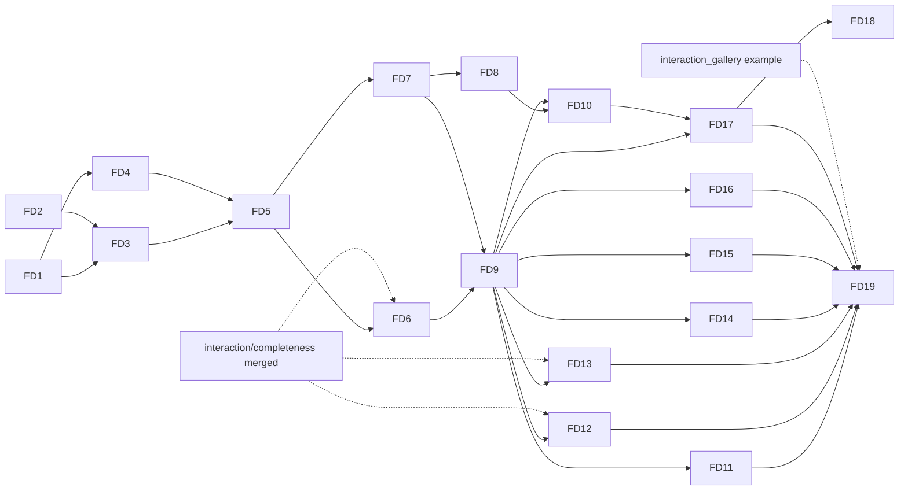

# flui-driver: tasks

- **Status:** draft, awaiting owner approval
- **Date:** 2026-10-17
- **Design:** [design.md](design.md); requirements: [requirements.md](requirements.md); ADRs:
  [ADR-0238](../../../adr/ADR-0238-flui-driver-protocol.md),
  [ADR-0239](../../../adr/ADR-0239-every-debug-app-hosts-the-driver-agent.md),
  [ADR-0240](../../../adr/ADR-0240-semantics-identifier.md),
  [ADR-0241](../../../adr/ADR-0241-driver-trace-format.md)
- **Base:** `main` @ `0fdd19f1e`. Tasks marked **IC** need `interaction/completeness` merged (its
  recording module, input taps, native recording codec, BiDi and Android drivers). The rest can
  start on `main` now.
- **Total:** 19 tasks in 19 PRs, 8 of them `[P]`; ≈ 100 engineer-days; critical path FD1 → FD3 →
  FD5 → FD6 → FD9 → FD10 → FD18 ≈ 40 days

## Execution rules

- One task is one worktree (`cargo xtask worktree new driver/<slug>`) and one PR, with
  `cargo xtask check-changed` green.
- Each behaviour test fails with its production hunk reverted, run in an isolated checkout.
- Test names carry no task or requirement IDs.
- Each consumer-visible task adds `changelog.d/<branch-slug>.md`. A task that changes what a
  platform supports updates its row in `docs/platform-parity.md` and its entry in `docs/gaps.md`;
  ✅ only after a run on that platform.
- Where it runs: L Linux CI; W Windows on the owner's machine; A Android over `adb`; B Chrome; M macOS;
  S iOS Simulator (macOS); X Xvfb; WL Wayland (WSLg or weston).
- No slicing: everything the design defines is built here; order, not omission.

## Dependency graph

## Tasks

| ID | Task | Requirements | Depends | P | Where | Days | IC |
|---|---|---|---|---|---|---|---|
| FD1 | Protocol 0.5: method table, locator/condition/input/capture/inspect types, four error codes, schema golden, `BREAKING` renames | R6, R7, R10, R12, R13, R18, R28 | — | [P] | L | 4 | — |
| FD2 | Semantics identifier (ADR-0240): configuration, widget builders, AccessKit `author_id`, wire `Node.identifier` | R8 | — | [P] | L, W | 2 | — |
| FD3 | Locator resolution and actionability facts in `flui-semantics::agent`; render-to-semantics hit mapping | R6, R7, R9, R11 | FD1, FD2 | — | L | 5 | — |
| FD4 | Inspection: `flui_view::inspect`, structured render and layer inspection | R15 | FD1 | [P] | L | 4 | — |
| FD5 | Runtime agent: owner jobs for locate, act, inspect, actionability, batch; wait conditions with unsettled causes; events; containment and reentrancy | R15, R16, R18–R20, F3–F6 | FD3, FD4 | — | L | 6 | — |
| FD6 | Synthetic input into the host input path; input journal; recording taps (input and native layers); release on close | R10, R12, R13, R24, R26, F2 | FD5 | [P] | L | 5 | IC |
| FD7 | Agent server in `flui-app` (ADR-0239): transports for desktop, iOS, Android and web; launch contract; `EXIT_ON_DISCONNECT`; `driver` feature; devtools `agent` removed | R2–R4, F1, F2, F7 | FD5 | [P] | L, W | 6 | — |
| FD8 | Presented-frame capture in engine and raster lane; `rendered` capture; headless source | R21 | FD7 | — | L, W | 4 | — |
| FD9 | `flui-driver` core: crate and metadata, `Driver`/`Window`/`Element`/`expect`, connections, coordinates, effects, reports, headless target, failure matrix | R1, R5, R10, R11, R13, R18–R20, R34, F1–F10 | FD6, FD7 | — | L | 8 | — |
| FD10 | Pixels (stable capture, masks, YIQ, baselines, predicates) and trace (writer, reader, replay, codegen) | R21–R27 | FD8, FD9 | — | L | 6 | — |
| FD11 | Windows lane: SendInput, synthetic pointer injection, UIA, WGC, job object; desktop-mcp safety rules ported; `windows-*` scenarios | R14, R17, R32, R33, R35 | FD9 | [P] | L, W | 6 | — |
| FD12 | Chrome lane: BiDi input, CDP IME, capture, ChromeDriver; `web-input` scenario | R32, R33, R35 | FD9 | [P] | L, B | 4 | IC |
| FD13 | Android lane: `adb` input, `uinput`, `uiautomator` for system UI, `screencap`, forward; `android-input` scenario | R32, R33, R35 | FD9 | [P] | L, A | 5 | IC |
| FD14 | macOS lane: CGEvent, AX, ScreenCaptureKit; `macos-*` scenarios; `tools/device-checks` macOS scripts deleted | R17, R32, R33, R35 | FD9 | [P] | L (types), M | 5 | — |
| FD15 | iOS Simulator lane: HID spike with go/no-go, then the lane, `simctl` capture and process, `ios-*` scenarios | R32, R33, R35 | FD9 | — | L (types), S | 6 | — |
| FD16 | Linux lanes: X11 (XTEST, AT-SPI, capture) and Wayland (libei, portals); `live-smoke` migrated | R17, R32, R33, R35 | FD9 | — | L, X, WL | 5 | — |
| FD17 | Front ends: `flui drive` CLI with session file and `call`; `flui mcp` adapter (MCP 2026-07-28) | R28–R30 | FD9, FD10 | — | L | 5 | — |
| FD18 | Inspector app (`tools/flui-inspector`) and `flui inspect`; its own scenario suite | R25, R31 | FD17 | — | L, W | 7 | — |
| FD19 | `interaction_gallery` scenario suite on every target; delete desktop-mcp, xtask drivers, probes, device-check scripts; documentation | R35, R36 | FD11–FD17 | — | all | 4 | IC |

## Cards

### FD1. Protocol 0.5

- **Changes:** `crates/flui-protocol`, new modules `method`, `locator`, `input`, `wait`, `inspect`,
  `capture` and `events`. `error.rs` gains `ambiguous`, `not_actionable`, `stale` and `version`
  with their fields. `tree.rs` gains `ElementRef`. `version.rs` becomes `0.5`, with `BREAKING`
  entries for the op renames.
- **Done when:**
  - `tests/schema/protocol-0.5.json` is golden;
  - a containment test passes for 0.4 → 0.5 except the listed renames;
  - a `METHODS` test checks unique names, `group.verb` spelling and a deterministic order;
  - a wire spelling table covers every new enum;
  - nothing upstream appears in a signature (ADR-0089 gate).
- **Not here:** front-end coverage tests (FD17).

### FD2. Semantics identifier

- **Changes:** `flui-semantics` `SemanticsConfiguration::identifier`, translation to `author_id`
  and the wire `Node.identifier`. `flui-widgets` gets `Semantics::identifier` and an `identifier`
  builder on the interactive widgets that build semantics; `flui-material` and `flui-cupertino`
  widgets forward it.
- **Done when:**
  - a table test covers export, not-announced, not-merged and no-boundary;
  - on W, UIA reads the value as `AutomationId` (a row added to the existing `windows-a11y` check
    until FD11 replaces it).

### FD3. Locator and actionability

- **Changes:** `flui-semantics::agent`: `resolve(&Locator, tree) -> Matches` with strictness and
  `pick`, `actionability(element, point, previous_rect)`, and the render-to-semantics index kept at
  publish time for hit mapping.
- **Done when:** one locator table runs over a fixed tree, covering every criterion, `within`,
  `has`, case folding over Unicode, `ambiguous` candidates and `pick`. One actionability table
  covers covered, clipped by an ancestor, offscreen, disabled ancestor, unstable and zero-size.

### FD4. Inspection

- **Changes:**
  - `flui-view`: `inspect::inspect_elements`, with type names recorded at mount, keys, element
    kind, lifecycle, the render link and `Diagnosticable` properties;
  - `flui-rendering`: `inspect`, structured, from `debug_diagnostics_tree`;
  - `flui-layer`: an `inspect` module out of `testing`, which `testing::inspect` builds on.
- **Done when:**
  - a counter app's three trees link element → render → semantics;
  - budgets truncate with the `omitted_children` counts;
  - a stale id answers `gone`.

### FD5. Runtime agent

- **Changes:** `flui-runtime::ui_runtime::agent` extends `SemanticsAgent` into the agent job set:
  - `locate`, `act`, `inspect_*`, `actionability` and `batch`;
  - a wait-condition registry evaluated after semantics publish and after input delivery, with
    unsettled causes from the runtime's own predicates;
  - an event fan-out with bounded per-subscriber queues (`gap` on overflow).

  `flui_view::dev_agent::AgentWindow` grows the matching methods.
- **Done when:** headless tests pass through `HeadlessHost::with_dev_agent` for:
  - a wait satisfied at the exact frame;
  - a timeout with causes;
  - a panic in a semantics action handler answering `platform` and the next job answered;
  - a callback closing the window answering `gone`;
  - a timed-out act running at the next drain;
  - two clients serialized.

### FD6. Synthetic input, journal, recording (IC)

- **Changes:**
  - `input.inject`: an `ActionSequence` becomes `PlatformInput` through the host input path
    (`flui-app` `OwnerHost`, `HeadlessHost::dispatch`), with ticks mapped to frame boundaries and
    driver device classes;
  - the journal as an `InputTap`;
  - `record.start/stop` over the ADR-0215 tap and the native capture hook;
  - injected contacts and keys released on close.
- **Done when:**
  - every built-in gesture recognized identically through `synthetic` and through
    `HeadlessHost::dispatch` of the same `PointerScript` (a table);
  - the journal matches the injection;
  - a dropped connection mid-drag cancels the contact (a recognizer sees cancel);
  - a recording made through the agent replays to the same decisions.

### FD7. Agent server in `flui-app`

- **Changes:**
  - `flui-app::app::agent`: framing, hello, blob frames, per-connection queue, connection cap;
  - transports: pipe and socket (moved from `flui-devtools`), Android abstract socket and intent
    extras, the iOS Simulator path, the web export and BiDi channel;
  - every runner drives the host hook;
  - the `driver` feature on `flui-app` and the facade;
  - `EXIT_ON_DISCONNECT`;
  - `flui-devtools` loses `agent`.

  Then update `docs/crates.md` (devtools row, `flui-app` row) and ADR-0095 with `Superseded in part
  by: ADR-0239`.
- **Done when:**
  - no endpoint means nothing is created;
  - the token is refused when short or wrong;
  - remote and other-user access is refused (W);
  - a dropped connection exits under the flag;
  - a Linux CI test launches a debug example and kills it mid-call (`gone`, kind `process`);
  - the Android and web transports compile in `cross-typecheck` and `wasm-check` (live runs are
    FD12 and FD13).

### FD8. Presented-frame capture

- **Changes:** `flui-engine`: a one-shot copy of the surface texture before present into a staging
  buffer, read back off the frame path, plus a `rendered` re-render of a layer tree at the surface's
  size and format. `flui-app` raster lane: arm and answer per window, with `busy` for a second
  request.
- **Done when:**
  - a GPU readback test (`cargo xtask gpu-test`) captures a known scene through both sources, and
    sample points distinguish them from a blank frame and from each other;
  - an occluded window answers `timeout` with its reason;
  - the surface-without-`COPY_SRC` path answers `rendered`.

### FD9. `flui-driver` core

- **Changes:**
  - new `crates/flui-driver`, tier H between `flui-app` and `flui-cli`, Evolving `0.1`,
    `allowed-dependents`, workspace member;
  - the API: `Driver`, `Window`, `Element`, `ElementLocator`, `expect` and `expect_soft`, gesture
    builders, `InputPolicy`;
  - `Connection` implementations for socket and in-process (feature `headless`);
  - the coordinates module;
  - `Error` with the code mapping, and `Report` with its verdict and exit codes;
  - `Launch` with the artifact kinds and `cargo_example`;
  - lane worker threads and the host-wide input lock.

  Update `docs/crates.md` and `FOUNDATIONS.md` Part IV.
- **Done when:**
  - the headless failure matrix F1–F10 runs on a counter and on `interaction_gallery` (or a local
    fixture until it lands);
  - the coordinates table passes (scales 0.5–8, negative origins, fractional edges, RTL);
  - the report verdict table passes;
  - `cargo xtask workspace`, `reach`, `globals` and `deps` are green.

### FD10. Pixels and trace

- **Changes:** `flui-driver::pixels` (stable capture, masks, YIQ metric, baselines with `.new`/
  `.diff`, `FLUI_DRIVER_UPDATE_BASELINES` refused under `CI`, predicates). `flui-driver::trace`
  (ADR-0241 writer, reader, `retain_on_failure`, replay with volatile-field normalization, codegen).
- **Done when:**
  - the metric table passes against pixelmatch's reference cases;
  - a mask hides a changing clock;
  - a missing baseline writes `.new`;
  - the trace golden, incompleteness, budget `gap` and redaction tests pass;
  - a headless record → replay round trip has no divergence, and a changed app diverges at the
    expected `seq`;
  - codegen output compiles and passes in a trybuild-style nested test.

### FD11. Windows lane

- **Changes:** `flui-driver::lane::windows`, from desktop-mcp's `input/`, `os/windows.rs` and
  `a11y/uia.rs` and xtask's `windows_input.rs`, `uia.rs` and `uia_role_table.rs`:
  - SendInput, `InjectSyntheticPointerInput`, `VK_PACKET`;
  - UIA tree and projection;
  - WGC window capture;
  - a kill-on-close job object;
  - the safety rules with their refusal codes.

  Scenarios `windows-a11y`, `windows-input` (with native goldens through `record.start{native}`)
  and `windows-notes` replace the xtask drivers.
- **Done when:** the scenarios run on W, and each check that existed before is present. The pure
  mapping tables run on L.

### FD12. Chrome lane (IC)

- **Changes:** `lane::chrome` from `bidi.rs`, `chrome.rs` and `web_input.rs`: BiDi session,
  `performActions`, CDP IME, `captureScreenshot` clipped to the canvas, the preload-script token and
  channel, and serving the bundle. The scenario `web-input` replaces the probe and its JS API.
- **Done when:** the scenario runs on B headless, in CI as well. The goldens `web_bidi_*` are
  re-recorded through the driver and held by the existing test.

### FD13. Android lane (IC)

- **Changes:** `lane::android` from `android_input.rs`: device selection, install, `am start`
  with extras, forward, `input` and `uinput` scripts, `uiautomator` for system UI, `screencap`,
  `force-stop`, and `shell` helpers for `dumpsys` and `settings`, restored after use. The scenario
  `android-input` replaces the F-key probe; APK packaging goes through `flui-cli`'s build pipeline.
- **Done when:** the scenario runs on A, and the device recordings are held by the existing test.

### FD14. macOS lane

- **Changes:** `lane::macos`: `CGEventPostToPid` with tablet fields, AX through
  `objc2-application-services`, ScreenCaptureKit, process group. The `macos-*` scenarios replace
  the Python and Swift scripts, which are deleted.
- **Done when:** clippy is clean for `aarch64-apple-darwin`, and the scenarios run on M. Without a
  run, parity rows stay 🟡 and the PR says "not run on this host".

### FD15. iOS Simulator lane

- **Changes:** first a spike, as a throwaway prototype outside the repo: drive a tap, a key and the
  home button through `SimulatorKit` HID from Rust on the current Xcode. **Go** builds
  `lane::ios_sim` (HID through `objc2` dynamic loading with a selector probe, `simctl`
  install/launch/terminate/screenshot) and the `ios-*` scenarios replacing `check-ios-*.py` and the
  Swift probe. **No-go** stops and escalates to the owner with the findings; there is no silent
  fallback.
- **Done when:** the scenarios run on S, and the probe answers `not_supported` with the Xcode
  version on a mismatched runtime (a test with a mocked selector table).

### FD16. Linux lanes

- **Changes:** `lane::x11` (XTEST via `x11rb`, AT-SPI via `atspi`, `GetImage`, `PDEATHSIG`) and
  `lane::wayland` (libei via `reis` through the RemoteDesktop portal with `ashpd`, ScreenCast
  capture, portal refusal as cannot-verify). The `live-smoke` checks become scenarios, and
  `tools/live-smoke` is deleted.
- **Done when:** the x11 scenarios run in CI under Xvfb, and the Wayland scenarios run on WL.

### FD17. CLI and MCP

- **Changes:**
  - `flui-cli`: `flui drive <group> <verb>` with typed flags and `flui drive call`;
  - the session file plus a `0600` token file;
  - human and `--json` output, exit codes 0, 1 and 2;
  - `flui drive trace replay|codegen|pack`;
  - `flui mcp` over the `flui-driver` `mcp` feature (`rmcp`), with tools from `METHODS`, `isError`
    errors, image content for captures and `--caps vision`.
- **Done when:**
  - coverage tests show every method has a typed subcommand and an MCP tool;
  - an MCP stdio round trip (the client moved from desktop-mcp's `tests/support`) launches a
    headless-capable example, locates, taps and asserts;
  - CLI calls across invocations reuse handles.

### FD18. Inspector

- **Changes:** `tools/flui-inspector`, a FLUI app with material widgets, built on `flui-driver`:
  - linked tree panes for semantics, widgets, render and layers;
  - a presented-frame view with pick and highlight;
  - a properties pane;
  - a timeline of frames, journal entries and arena decisions;
  - a trace player.

  `flui inspect` launches it.
- **Done when:** its own `flui-driver` scenario suite, headless and W, covers picking a node,
  linking trees and scrubbing a trace.

### FD19. Gallery suite, deletions, docs (IC)

- **Changes:**
  - `interaction_gallery` gets an identifier on every interactive widget, and a scenario suite
    runs every gesture through each input path on each target;
  - deleted: `tools/desktop-mcp`, the drivers in `tools/xtask/src/device/` (`plan.rs` keeps only
    build steps the CLI pipeline does not cover), `android_input_probe`, `web_input_probe` and
    `tools/device-checks/`;
  - docs: `docs/testing.md` (a driver section replaces the live-test sections), `docs/crates.md`,
    `docs/platform-parity.md` and `docs/gaps.md` (no Android/iOS/web accessibility tree; the iOS
    private HID), `docs/ROADMAP.md` B3, the AGENTS.md command table, and
    `docs/research/desktop-mcp-flui-testing.ru.md` marked historical.
- **Done when:**
  - the suite runs on every target the owner can reach;
  - each target has a parity row with the run date;
  - `cargo xtask checks` (docs links and paths) is green.
