# flui-driver: tasks

- **Status:** draft, awaiting owner approval
- **Date:** 2026-10-17
- **Design:** [design.md](design.md); requirements: [requirements.md](requirements.md); ADRs:
  [ADR-0238](../../../adr/ADR-0238-flui-driver-protocol.md),
  [ADR-0239](../../../adr/ADR-0239-every-debug-app-hosts-the-driver-agent.md),
  [ADR-0240](../../../adr/ADR-0240-semantics-identifier.md),
  [ADR-0241](../../../adr/ADR-0241-driver-trace-format.md)
- **Base:** `main` @ `0fdd19f1e`. Tasks marked **IC** need `interaction/completeness` merged (its
  recording module, input taps, native recording codec, BiDi and Android drivers). The rest can
  start on `main` now.
- **Total:** 25 tasks in 25 PRs, 13 of them `[P]`; ≈ 131 engineer-days; critical path FD1 → FD3 →
  FD5 → FD6 → FD9 → FD10 → FD17 → FD18 ≈ 47 days
- **Revised:** 2026-10-17, after the owner's review of the first draft (requirements D11–D17):
  - OS input is opt-in, announced, guarded and isolated;
  - MCP gets a core tool set and a snapshot delta;
  - added performance budgets (FD20), the accessibility audit (FD21) and exploration (FD22);
  - added the OS-lane determinism rules;
  - `windows-gallery` is the first scenario ported;
  - added design checks (FD23 layout facts, assertions and lint; FD24 layout snapshot and annotated
    capture) and parity coverage (FD25), after the owner asked that the driver serve interface
    design and prove the whole parity matrix

## Execution rules

- One task is one worktree (`cargo xtask worktree new driver/<slug>`) and one PR, with
  `cargo xtask check-changed` green.
- Each behaviour test fails with its production hunk reverted, run in an isolated checkout.
- Test names carry no task or requirement IDs.
- Each consumer-visible task adds `changelog.d/<branch-slug>.md`. A task that changes what a
  platform supports updates its row in `docs/platform-parity.md` and its entry in `docs/gaps.md`;
  ✅ only after a run on that platform.
- Where it runs: L Linux CI; W Windows on the owner's machine; A Android over `adb`; B Chrome; M macOS;
  S iOS Simulator (macOS); X Xvfb; WL Wayland (WSLg or weston).
- No slicing: everything the design defines is built here; order, not omission.

## Dependency graph

```mermaid
graph LR
  FD1 --> FD3 & FD4
  FD2 --> FD3
  FD3 & FD4 --> FD5 --> FD6 & FD7
  FD7 --> FD8
  FD6 & FD7 --> FD9
  FD8 & FD9 --> FD10
  FD9 --> FD11 & FD12 & FD13 & FD14 & FD15 & FD16
  FD9 & FD10 --> FD17 --> FD18
  FD5 & FD9 --> FD20
  FD3 & FD9 --> FD21
  FD10 --> FD22
  FD4 & FD9 --> FD23 --> FD24
  FD10 --> FD24
  FD9 --> FD25
  FD11 & FD12 & FD13 & FD14 & FD15 & FD16 & FD17 & FD20 & FD21 & FD22 & FD24 & FD25 --> FD19
  IC["interaction/completeness merged"] -.-> FD6 & FD11 & FD12 & FD13 & FD21
  GAL["interaction_gallery + windows-gallery"] -.-> FD11 & FD19
```

## Tasks

| ID | Task | Requirements | Depends | P | Where | Days | IC |
|---|---|---|---|---|---|---|---|
| FD1 | Protocol 0.5: method table with tiers, locator/condition/input/capture/inspect/delta/perf/audit types, four error codes, schema golden, `BREAKING` renames | R6, R7, R10, R12, R13, R16, R18, R28, R28a | — | [P] | L | 4 | — |
| FD2 | Semantics identifier (ADR-0240): configuration, widget builders, AccessKit `author_id`, wire `Node.identifier` | R8 | — | [P] | L, W | 2 | — |
| FD3 | Locator resolution and actionability facts in `flui-semantics::agent`; render-to-semantics hit mapping | R6, R7, R9, R11 | FD1, FD2 | — | L | 5 | — |
| FD4 | Inspection: `flui_view::inspect`, structured render and layer inspection | R15 | FD1 | [P] | L | 4 | — |
| FD5 | Runtime agent: owner jobs for locate, act, inspect, actionability, batch; snapshot delta; wait conditions with unsettled causes; events; containment and reentrancy | R15, R16, R18–R20, F3–F6 | FD3, FD4 | — | L | 6 | — |
| FD6 | Synthetic input into the host input path; input journal; recording taps (input and native layers); release on close | R10, R12, R13, R24, R26, F2 | FD5 | [P] | L | 5 | IC |
| FD7 | Agent server in `flui-app` (ADR-0239): transports for desktop, iOS, Android and web; launch contract; `EXIT_ON_DISCONNECT`; `driver` feature; devtools `agent` removed | R2–R4, F1, F2, F7 | FD5 | [P] | L, W | 6 | — |
| FD8 | Presented-frame capture in engine and raster lane; `rendered` capture; headless source | R21 | FD7 | — | L, W | 4 | — |
| FD9 | `flui-driver` core: crate and metadata, `Driver`/`Window`/`Element`/`expect`, connections, coordinates, effects, reports, headless target; synthetic-default policy, OS-input announcement, guard trait and isolation modes; window-size and single-step rules; failure matrix | R1, R5, R10, R11, R13, R14a, R14b, R18–R20, R32a, R34, F1–F11 | FD6, FD7 | — | L | 9 | — |
| FD10 | Pixels (stable capture, masks, YIQ, baselines, predicates) and trace (writer, reader, replay, codegen) | R21–R27 | FD8, FD9 | — | L | 6 | — |
| FD11 | Windows lane: SendInput, synthetic pointer injection, UIA, WGC, job object; desktop-mcp safety rules ported; low-level-hook user-activity guard; isolation spikes (Sandbox, second session, loopback RDP); **`windows-gallery` ported first**, then the other `windows-*` scenarios | R14, R14a, R14b, R17, R32, R32a, R33, R35, R36, R36a | FD9 | [P] | L, W | 8 | IC |
| FD12 | Chrome lane: BiDi input with single-step moves, CDP IME, capture, ChromeDriver; `web-input` scenario | R32, R32a, R33, R35 | FD9 | [P] | L, B | 4 | IC |
| FD13 | Android lane: `adb` input, probed `uinput`, `uiautomator` for system UI, `screencap`, forward, `getevent` guard, emulator isolation; order-only fidelity; `android-input` scenario | R14a, R14b, R32, R32a, R33, R35 | FD9 | [P] | L, A | 5 | IC |
| FD14 | macOS lane: CGEvent, AX, ScreenCaptureKit, event-tap guard; `macos-*` scenarios; `tools/device-checks` macOS scripts deleted | R14a, R17, R32, R33, R35 | FD9 | [P] | L (types), M | 5 | — |
| FD15 | iOS Simulator lane: HID spike with go/no-go, then the lane, `simctl` capture and process, `ios-*` scenarios | R32, R33, R35 | FD9 | — | L (types), S | 6 | — |
| FD16 | Linux lanes: X11 (XTEST, AT-SPI, capture, XInput2 guard) and Wayland (libei, portals, isolated compositor only); `live-smoke` migrated | R14a, R14b, R17, R32, R32a, R33, R35 | FD9 | — | L, X, WL | 5 | — |
| FD17 | Front ends: `flui drive` CLI with session file, announcement and `call`; `flui mcp` adapter (MCP 2026-07-28) with the core tool set and `--caps` groups | R28–R30, R28a | FD9, FD10 | — | L | 5 | — |
| FD18 | Inspector app (`tools/flui-inspector`) and `flui inspect`; its own scenario suite; documented CLI fallback | R25, R31 | FD17 | — | L, W | 7 | — |
| FD19 | `interaction_gallery` scenario suite on every target; delete desktop-mcp, xtask drivers, probes, device-check scripts; documentation | R35, R36, R36a, R45 | FD11–FD17, FD20–FD25 | — | all | 4 | IC |
| FD20 | Performance: agent frame and journal samples, `PerfReport`, per-target budgets, `perf.expect` | R37, R37a | FD5, FD9 | [P] | L, W, A | 5 | — |
| FD21 | Accessibility audit: `flui-semantics::audit` rules, `audit.a11y`, `audit.alternatives`, `a11y-audit` scenario; `flui-testing`'s alternatives and target checks moved onto it | R38 | FD3, FD9 | [P] | L, W | 6 | IC |
| FD22 | Exploration: seeded `explore.run` with invariants, delta-debugging `explore.shrink`, replay | R39, F12 | FD10 | — | L | 5 | — |
| FD23 | Layout facts (boxes, clips, text ink bounds, baselines, styles, painted and background colours), `layout.expect` assertions, `audit.layout` lint with finding outcomes, `audit.text_scale`, `audit.screen` with checked and not-checked lists, the layout-defect benchmark | R40, R41, R41a, R41b, R44 | FD4, FD9 | [P] | L, W | 8 | — |
| FD24 | Layout snapshot golden and `capture.annotated` | R42, R43 | FD10, FD23 | — | L, W | 4 | — |
| FD25 | Parity coverage: scenario `proves` rows, `flui drive report --parity`, the `cargo xtask parity` gate in `checks`, gaps entries naming their scenarios | R45 | FD9 | [P] | L | 3 | — |

## Cards

### FD1. Protocol 0.5

- **Changes:** `crates/flui-protocol`, new modules `method` (with each method's MCP `tier`),
  `locator`, `input`, `wait`, `inspect`, `capture`, `events`, `snapshot` (`SnapshotDelta`), `perf`
  and `audit`. `error.rs` gains `ambiguous`, `not_actionable`, `stale` and `version`
  with their fields. `tree.rs` gains `ElementRef`. `version.rs` becomes `0.5`, with `BREAKING`
  entries for the op renames.
- **Done when:**
  - `tests/schema/protocol-0.5.json` is golden;
  - a containment test passes for 0.4 → 0.5 except the listed renames;
  - a `METHODS` test checks unique names, `group.verb` spelling, a deterministic order, exactly one
    tier per method and at most 13 `Core` methods;
  - a wire spelling table covers every new enum;
  - nothing upstream appears in a signature (ADR-0089 gate).
- **Not here:** front-end coverage tests (FD17).

### FD2. Semantics identifier

- **Changes:** `flui-semantics` `SemanticsConfiguration::identifier`, translation to `author_id`
  and the wire `Node.identifier`. `flui-widgets` gets `Semantics::identifier` and an `identifier`
  builder on the interactive widgets that build semantics; `flui-material` and `flui-cupertino`
  widgets forward it.
- **Done when:**
  - a table test covers export, not-announced, not-merged and no-boundary;
  - on W, UIA reads the value as `AutomationId` (a row added to the existing `windows-a11y` check
    until FD11 replaces it).

### FD3. Locator and actionability

- **Changes:** `flui-semantics::agent`: `resolve(&Locator, tree) -> Matches` with strictness and
  `pick`, `actionability(element, point, previous_rect)`, and the render-to-semantics index kept at
  publish time for hit mapping.
- **Done when:** one locator table runs over a fixed tree, covering every criterion, `within`,
  `has`, case folding over Unicode, `ambiguous` candidates and `pick`. One actionability table
  covers covered, clipped by an ancestor, offscreen, disabled ancestor, unstable and zero-size.

### FD4. Inspection

- **Changes:**
  - `flui-view`: `inspect::inspect_elements`, with type names recorded at mount, keys, element
    kind, lifecycle, the render link and `Diagnosticable` properties;
  - `flui-rendering`: `inspect`, structured, from `debug_diagnostics_tree`;
  - `flui-layer`: an `inspect` module out of `testing`, which `testing::inspect` builds on.
- **Done when:**
  - a counter app's three trees link element → render → semantics;
  - budgets truncate with the `omitted_children` counts;
  - a stale id answers `gone`.

### FD5. Runtime agent

- **Changes:** `flui-runtime::ui_runtime::agent` extends `SemanticsAgent` into the agent job set:
  - `locate`, `act`, `inspect_*`, `actionability` and `batch`;
  - the snapshot delta against the action's starting revision (`flui-semantics::agent` diff;
    bounds-only changes left out unless asked);
  - a wait-condition registry evaluated after semantics publish and after input delivery, with
    unsettled causes from the runtime's own predicates;
  - an event fan-out with bounded per-subscriber queues (`gap` on overflow).

  `flui_view::dev_agent::AgentWindow` grows the matching methods.
- **Done when:** headless tests pass through `HeadlessHost::with_dev_agent` for:
  - a wait satisfied at the exact frame;
  - a timeout with causes;
  - a panic in a semantics action handler answering `platform` and the next job answered;
  - a callback closing the window answering `gone`;
  - a timed-out act running at the next drain;
  - two clients serialized;
  - a delta table: appeared, gone, changed name, value and state; a scroll yields no bounds noise.

### FD6. Synthetic input, journal, recording (IC)

- **Changes:**
  - `input.inject`: an `ActionSequence` becomes `PlatformInput` through the host input path
    (`flui-app` `OwnerHost`, `HeadlessHost::dispatch`), with ticks mapped to frame boundaries and
    driver device classes;
  - the journal as an `InputTap`;
  - `record.start/stop` over the ADR-0215 tap and the native capture hook;
  - injected contacts and keys released on close.
- **Done when:**
  - every built-in gesture recognized identically through `synthetic` and through
    `HeadlessHost::dispatch` of the same `PointerScript` (a table);
  - the journal matches the injection;
  - a dropped connection mid-drag cancels the contact (a recognizer sees cancel);
  - a recording made through the agent replays to the same decisions.

### FD7. Agent server in `flui-app`

- **Changes:**
  - `flui-app::app::agent`: framing, hello, blob frames, per-connection queue, connection cap;
  - transports: pipe and socket (moved from `flui-devtools`), Android abstract socket and intent
    extras, the iOS Simulator path, the web export and BiDi channel;
  - every runner drives the host hook;
  - the `driver` feature on `flui-app` and the facade;
  - `EXIT_ON_DISCONNECT`;
  - `flui-devtools` loses `agent`.

  Then update `docs/crates.md` (devtools row, `flui-app` row) and ADR-0095 with `Superseded in part
  by: ADR-0239`.
- **Done when:**
  - no endpoint means nothing is created;
  - the token is refused when short or wrong;
  - remote and other-user access is refused (W);
  - a dropped connection exits under the flag;
  - a Linux CI test launches a debug example and kills it mid-call (`gone`, kind `process`);
  - the Android and web transports compile in `cross-typecheck` and `wasm-check` (live runs are
    FD12 and FD13).

### FD8. Presented-frame capture

- **Changes:** `flui-engine`: a one-shot copy of the surface texture before present into a staging
  buffer, read back off the frame path, plus a `rendered` re-render of a layer tree at the surface's
  size and format. `flui-app` raster lane: arm and answer per window, with `busy` for a second
  request.
- **Done when:**
  - a GPU readback test (`cargo xtask gpu-test`) captures a known scene through both sources, and
    sample points distinguish them from a blank frame and from each other;
  - an occluded window answers `timeout` with its reason;
  - the surface-without-`COPY_SRC` path answers `rendered`.

### FD9. `flui-driver` core

- **Changes:**
  - new `crates/flui-driver`, tier H between `flui-app` and `flui-cli`, Evolving `0.1`,
    `allowed-dependents`, workspace member;
  - the API: `Driver`, `Window`, `Element`, `ElementLocator`, `expect` and `expect_soft`, gesture
    builders, `InputPolicy`;
  - `Connection` implementations for socket and in-process (feature `headless`);
  - the coordinates module;
  - `Error` with the code mapping, and `Report` with its verdict and exit codes;
  - `Launch` with the artifact kinds and `cargo_example`;
  - lane worker threads and the host-wide input lock;
  - `InputPolicy::default()` set to `Synthetic`;
  - the OS-input announcement (scenario-declared devices and duration, the CLI grace period);
  - the `ActivityGuard` trait lanes implement;
  - `IsolationMode` in the session and the report, and the refusal of OS input on a `shared`
    desktop without a guard;
  - the scenario window-size rule and splitting moves into single steps.

  Update `docs/crates.md` and `FOUNDATIONS.md` Part IV.
- **Done when:**
  - the headless failure matrix F1–F11 runs on a counter and on `interaction_gallery` (or a local
    fixture until it lands). F11 runs through a scripted fake lane whose guard reports a foreign
    event;
  - a default session never selects `os`;
  - a wrong window size refuses;
  - the coordinates table passes (scales 0.5–8, negative origins, fractional edges, RTL);
  - the report verdict table passes;
  - `cargo xtask workspace`, `reach`, `globals` and `deps` are green.

### FD10. Pixels and trace

- **Changes:** `flui-driver::pixels` (stable capture, masks, YIQ metric, baselines with `.new`/
  `.diff`, `FLUI_DRIVER_UPDATE_BASELINES` refused under `CI`, predicates). `flui-driver::trace`
  (ADR-0241 writer, reader, `retain_on_failure`, replay with volatile-field normalization, codegen).
- **Done when:**
  - the metric table passes against pixelmatch's reference cases;
  - a mask hides a changing clock;
  - a missing baseline writes `.new`;
  - the trace golden, incompleteness, budget `gap` and redaction tests pass;
  - a headless record → replay round trip has no divergence, and a changed app diverges at the
    expected `seq`;
  - codegen output compiles and passes in a trybuild-style nested test.

### FD11. Windows lane

- **Changes:** `flui-driver::lane::windows`, from desktop-mcp's `input/`, `os/windows.rs` and
  `a11y/uia.rs` and xtask's `windows_input.rs`, `uia.rs` and `uia_role_table.rs`:
  - SendInput, `InjectSyntheticPointerInput`, `VK_PACKET`;
  - UIA tree and projection;
  - WGC window capture;
  - a kill-on-close job object;
  - the safety rules with their refusal codes;
  - the user-activity guard on `WH_MOUSE_LL`/`WH_KEYBOARD_LL` (`LLMHF_INJECTED`) plus the
    pointer-source check for touch and pen;
  - the isolation spikes come first, one per candidate: Windows Sandbox (`.wsb` generation, the
    driver inside, report out through a mapped folder), a second user session, and a loopback RDP
    session. Each spike shows whether injected input stays out of the host session and whether GPU
    presentation works. The modes that pass are implemented, and the spec drops the ones that fail.

  **`cargo xtask device windows-gallery` is ported first** (IC). It is the gallery scenario the
  integration branch is building, here on `flui-driver`, synthetic by default, with OS input as its
  certification variant and the gallery's ADR-0240 identifiers as selectors. Then `windows-a11y`,
  `windows-input` (with native goldens through `record.start{native}`) and `windows-notes` replace
  the xtask drivers.
- **Done when:**
  - `windows-gallery` passes on W with every check of the integration-branch version;
  - an OS run is announced, and moving the mouse mid-run ends it `cannot_verify` with input
    released;
  - the other scenarios run on W, and each check that existed before is present;
  - the pure mapping tables run on L.

### FD12. Chrome lane (IC)

- **Changes:** `lane::chrome` from `bidi.rs`, `chrome.rs` and `web_input.rs`: BiDi session,
  `performActions` with single-step moves and explicit pauses, CDP IME, `captureScreenshot`
  clipped to the canvas, the scenario's fixed viewport (800×600 for the drop rows), the preload-script token and
  channel, and serving the bundle. The scenario `web-input` replaces the probe and its JS API.
- **Done when:** the scenario runs on B headless, in CI as well. The goldens `web_bidi_*` are
  re-recorded through the driver and held by the existing test.

### FD13. Android lane (IC)

- **Changes:** `lane::android` from `android_input.rs`: device selection, install, `am start`
  with extras, forward, `input`, `uiautomator` for system UI, `screencap`, `force-stop`, and
  `shell` helpers for `dumpsys` and `settings`, restored after use. It also covers:
  - `uinput` scripts behind a per-device probe, the `uinput_device` capability;
  - a `getevent` user-activity guard on physical devices;
  - emulator isolation;
  - order-only replay fidelity.

  The scenario `android-input` replaces the F-key probe; APK packaging goes through `flui-cli`'s
  build pipeline.
- **Done when:**
  - the scenario runs on A;
  - the device recordings are held by the existing test, comparing order;
  - a device without root `uinput` reports the capability missing and the stylus and touchpad rows
    as cannot-verify.

### FD14. macOS lane

- **Changes:** `lane::macos`: `CGEventPostToPid` with tablet fields, AX through
  `objc2-application-services`, ScreenCaptureKit, process group, and a listen-only `CGEventTap`
  user-activity guard. The `macos-*` scenarios replace
  the Python and Swift scripts, which are deleted.
- **Done when:** clippy is clean for `aarch64-apple-darwin`, and the scenarios run on M. Without a
  run, parity rows stay 🟡 and the PR says "not run on this host".

### FD15. iOS Simulator lane

- **Changes:** first a spike, as a throwaway prototype outside the repo: drive a tap, a key and the
  home button through `SimulatorKit` HID from Rust on the current Xcode. **Go** builds
  `lane::ios_sim` (HID through `objc2` dynamic loading with a selector probe, `simctl`
  install/launch/terminate/screenshot) and the `ios-*` scenarios replacing `check-ios-*.py` and the
  Swift probe. **No-go** stops and escalates to the owner with the findings; there is no silent
  fallback.
- **Done when:** the scenarios run on S, and the probe answers `not_supported` with the Xcode
  version on a mismatched runtime (a test with a mocked selector table).

### FD16. Linux lanes

- **Changes:**
  - `lane::x11`: XTEST via `x11rb`, AT-SPI via `atspi`, `GetImage`, `PDEATHSIG`, and an XInput2
    user-activity guard;
  - `lane::wayland`: libei via `reis` through the RemoteDesktop portal with `ashpd`, ScreenCast
    capture, and portal refusal as cannot-verify. It has no guard, so it runs OS input only in an
    isolated compositor. The `live-smoke` checks become scenarios, and
  `tools/live-smoke` is deleted.
- **Done when:** the x11 scenarios run in CI under Xvfb, and the Wayland scenarios run on WL.

### FD17. CLI and MCP

- **Changes:**
  - `flui-cli`: `flui drive <group> <verb>` with typed flags and `flui drive call`;
  - the session file plus a `0600` token file;
  - human and `--json` output, exit codes 0, 1 and 2;
  - `flui drive trace replay|codegen|pack`;
  - the OS-input announcement with its grace period and `--yes`;
  - `flui mcp` over the `flui-driver` `mcp` feature (`rmcp`), with the 13-tool core set listed by
    default and `--caps input,inspect,pixels,record,perf,audit,explore,layout,vision`, `isError` errors,
    snapshot deltas after acts and image content for captures.
- **Done when:**
  - coverage tests show every method has a typed subcommand and is reachable as an MCP tool under
    some tier;
  - `tools/list` without `--caps` lists only the core set;
  - an MCP stdio round trip (the client moved from desktop-mcp's `tests/support`) launches a
    headless-capable example, locates, taps and asserts;
  - CLI calls across invocations reuse handles.

### FD18. Inspector

- **Changes:** `tools/flui-inspector`, a FLUI app with material widgets, built on `flui-driver`:
  - linked tree panes for semantics, widgets, render and layers;
  - a presented-frame view with pick and highlight;
  - a properties pane;
  - a timeline of frames, journal entries and arena decisions;
  - a trace player.

  `flui inspect` launches it. `docs/testing.md` documents the CLI as the fallback when FLUI itself is
  broken.
- **Done when:** its own `flui-driver` scenario suite, headless and W, covers picking a node,
  linking trees and scrubbing a trace.

### FD19. Gallery suite, deletions, docs (IC)

- **Changes:**
  - a test asserts every interactive `interaction_gallery` node carries an identifier (FD11 adds
    them for `windows-gallery`); the scenario suite runs every gesture through each input path on
    each target, and includes the `a11y-audit` scenario and a seeded exploration run per target;
  - deleted: `tools/desktop-mcp`, the drivers in `tools/xtask/src/device/` (`plan.rs` keeps only
    build steps the CLI pipeline does not cover), `android_input_probe`, `web_input_probe` and
    `tools/device-checks/`;
  - docs: `docs/testing.md` (a driver section replaces the live-test sections), `docs/crates.md`,
    `docs/platform-parity.md` and `docs/gaps.md` (no Android/iOS/web accessibility tree; the iOS
    private HID), `docs/ROADMAP.md` B3, the AGENTS.md command table, and
    `docs/research/desktop-mcp-flui-testing.ru.md` marked historical.
- **Done when:**
  - the suite runs on every target the owner can reach;
  - each target has a parity row with the run date;
  - `cargo xtask checks` (docs links and paths) is green.

### FD20. Performance

- **Changes:**
  - the agent keeps per-frame `FrameSnapshot` samples and phase durations between `perf.start` and
    `perf.stop`, joined with the journal through `input_epochs`;
  - `PerfReport`: percentiles, dropped and janky frames against the ADR-0236 refresh period,
    input-to-present latency, the worst frames with phases;
  - `PerfBudget` keyed per target, and `perf.expect`; a target with no budget entry is
    cannot-verify.
- **Done when:**
  - a headless table over a known animation checks frame counts and phase work;
  - on W and A a scroll budget passes over 5 iterations (median of p95), and a build with an
    injected busy frame fails it;
  - dropped and janky frames are counted apart, and latency splits into its three phases with
    tagged states;
  - an unknown refresh period reports that jank cannot be judged.

### FD21. Accessibility audit (IC)

- **Changes:**
  - `flui-semantics::audit` rules (unnamed, focus order with text direction, target size by
    `GestureSettings::min_target`, no alternative from the arena's recognizer registry);
  - `audit.a11y` in the agent;
  - `audit.alternatives` composed in the driver (gesture vs alternative, compared by snapshot
    delta);
  - the `a11y-audit` scenario.

  `flui-testing`'s `assert_gesture_alternatives` and its minimum-target checks are rebuilt on the
  same functions.
- **Done when:**
  - one rule table covers an unnamed button, a reversed focus pair in LTR and in RTL, an undersized
    target, and a gesture-only control with and without its alternative;
  - the existing `flui-testing` alternatives tests pass unchanged on the new implementation;
  - the scenario runs over `interaction_gallery` headless and on W.

### FD22. Exploration

- **Changes:** `explore.run` (a `ChaCha8Rng` seed, role-weighted step choice over the
  actionable elements of the current snapshot, the session's input path, invariants after every
  step, `stay_within`) and `explore.shrink` (delta debugging over the action list, replayed from a
  fresh launch, bounded by a replay budget). The trace is always on.
- **Done when:**
  - on a fixture with a planted invariant break (a control that leaves a contact held), a fixed
    seed finds it;
  - shrinking reduces it to the minimal trace;
  - replaying that trace reproduces it;
  - the same seed on an unchanged build gives the same action list.

### FD23. Layout facts, assertions and lint

- **Changes:**
  - `flui-rendering::inspect` gains geometry facts: window-logical box after transforms, clip,
    parent layout kind and alignment;
  - `RenderParagraph` exposes ink bounds, line boxes, baselines, resolved style, alignment,
    ellipsis and line overflow, and painted colour as data;
  - the background colour beneath text comes from the layer tree's opaque paints, sampled from a
    `rendered` capture only when it cannot be determined, and marked so;
  - `flui-rendering::audit` holds the geometry rules: off centre, near-miss alignment, uneven gap,
    overlap, clipped and truncated text, outside window or safe area, WCAG contrast;
  - `layout.facts`, `layout.expect` (Rust `expect(..).to_be_centered_in(..)` and the rest),
    `audit.layout` with per-app thresholds and waivers;
  - `audit.screen`, and `checked` and `not_checked` in `Report` with the verdict clause;
  - finding outcomes (`error`, `warning`, `needs_review`, `suppressed`);
  - the per-platform target-size profiles with the ATF exemptions;
  - contrast at the WCAG large-text thresholds (24 px, 18.66 px bold) with a 0.01 tolerance;
  - `hit_region`, `duplicate_bounds`, `duplicate_name`, optional `non_text_contrast`;
  - `audit.text_scale` through the preferences override;
  - `benches/layout_defects/` with `cargo xtask layout-benchmark`.
- **Done when:**
  - one rule table covers each fixture with a planted violation and its corrected twin, the twin
    producing no finding;
  - the contrast boundary is pinned at 4.4 vs 4.6;
  - RTL mirrors leading-edge alignment;
  - an assertion failure prints measured numbers;
  - `audit.screen` lists unavailable rules under `not_checked`, and the report is not `pass`;
  - on W, `audit.screen` over `interaction_gallery` and Notes gives no unwaived finding, or files
    the real ones it finds as defects.

### FD24. Layout snapshot and annotated capture

- **Changes:**
  - `layout.snapshot` (JSON per window: identified and role-and-name nodes with rect, ink bounds,
    baseline, font, colours, truncation);
  - `layout.expect_snapshot`, with geometric and ΔE tolerances, a numeric per-node diff, and
    baselines `<name>/<backend>-<os>.layout.json` under the explicit-update rule;
  - `capture.annotated`, drawing boxes, centre lines, baselines, gaps and findings over a capture.
- **Done when:**
  - a 1 px glyph shift within tolerance passes, and a 6 px move fails with the diff naming the
    node and the delta;
  - an annotated capture of a planted off-centre label shows the finding's numbers at the label,
    checked by a readback sample at the overlay's centre line.

### FD25. Parity coverage

- **Changes:**
  - scenarios declare `proves` rows by the row keys of `docs/platform-parity.md`;
  - `flui drive report --parity` prints the proven cells;
  - `cargo xtask parity` (in `checks`, so CI gates it) parses the matrix and refuses a ✅ citing no
    scenario run, or a scenario that does not exist or does not declare the row. Drivable rows with
    no scenario are listed as warnings until FD19, and as errors after;
  - `docs/gaps.md` entries name their closing scenario.
- **Done when:**
  - the gate's self-test finds its planted cells;
  - the current matrix passes with existing ✅ cells mapped to the scenarios that reproduce them,
    or downgraded to 🟡 with a note when none does.
