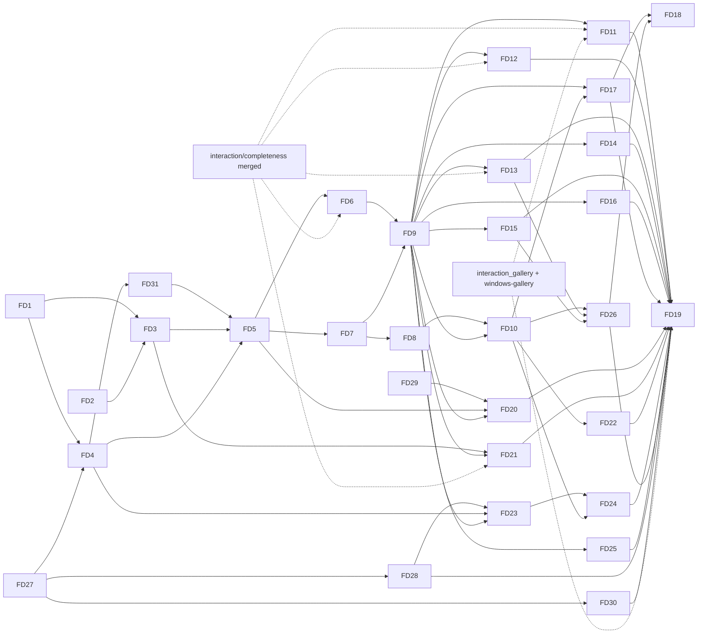

# flui-driver: tasks

- **Status:** approved by the owner (2026-10-20). FD27 (#1773), FD1 (#1782), FD4 (#1796), FD31
  (#1804), FD2 (#1809, #1814) and FD3 (#1890) have merged; FD5 is in progress in steps (the
  locate and actionability jobs (#1968), the snapshot delta (#1980) and the waits (#1995) have
  merged, the events (#2139) have merged, the inspect jobs (#2148) and layers (#2153) have merged, FD28 is in review). FD29 and FD30 can start now.
  `interaction/completeness` has merged
  (#1733), so the IC tasks are unblocked.
  `flui run --agent` and `flui mcp` exist on the ADR-0095 endpoint (#1769); the tasks that replace
  that endpoint and `flui mcp` start from them. The owner deleted `interaction_gallery`, the
  probes, `tools/device-checks` and `cargo xtask device` (#1827) to write fresh ones: FD11 and
  FD19 build a new gallery scenario instead of porting `windows-gallery`, and FD19's deletion
  list is already done. The old versions are at
  [`e8a42673a`](https://github.com/vanyastaff/flui/tree/e8a42673ad23a2e88614940a266cd01224dcb25f/examples/interaction_gallery).
- **Date:** 2026-10-17
- **Design:** [design.md](design.md); requirements: [requirements.md](requirements.md); ADRs:
  [ADR-0238](../../../adr/ADR-0238-flui-driver-protocol.md),
  [ADR-0239](../../../adr/ADR-0239-every-debug-app-hosts-the-driver-agent.md),
  [ADR-0240](../../../adr/ADR-0240-semantics-identifier.md),
  [ADR-0241](../../../adr/ADR-0241-driver-trace-format.md),
  [ADR-0242](../../../adr/ADR-0242-typed-inspect-and-tracing-conventions.md)
- **Base:** `main` @ `0fdd19f1e`. Tasks marked **IC** need `interaction/completeness` merged (its
  recording module, input taps, native recording codec, BiDi and Android drivers). The rest can
  start on `main` now.
- **Total:** 31 tasks in 31 PRs, 16 of them `[P]`; ≈ 161 engineer-days; critical path FD27 → FD4 → FD31
  → FD5 → FD6 → FD9 → FD15 → FD26 → FD18 ≈ 51 days
- **Revised 2026-10-18 (D21, D22):** the self-contained task FD26, plus the introspection and tracing
  tasks FD27–FD30 (`Inspect` replaces `Diagnosticable`, tracing conventions and one span stream,
  creation sites, tree context on errors). FD4, FD20 and FD23 now build on them.
- **Revised:** 2026-10-17, after the owner's review of the first draft (requirements D11–D17):
  - OS input is opt-in, announced, guarded and isolated;
  - MCP gets a core tool set and a snapshot delta;
  - added performance budgets (FD20), the accessibility audit (FD21) and exploration (FD22);
  - added the OS-lane determinism rules;
  - `windows-gallery` is the first scenario ported;
  - added design checks (FD23 layout facts, assertions and lint; FD24 layout snapshot and annotated
    capture) and parity coverage (FD25), after the owner asked that the driver serve interface
    design and prove the whole parity matrix

## Execution rules

- One task is one worktree (`cargo xtask worktree new driver/<slug>`) and one PR, with
  `cargo xtask check-changed` green.
- Each behaviour test fails with its production hunk reverted, run in an isolated checkout.
- Test names carry no task or requirement IDs.
- Each consumer-visible task adds `changelog.d/<branch-slug>.md`. A task that changes what a
  platform supports updates its row in `docs/platform-parity.md` and its entry in `docs/gaps.md`;
  ✅ only after a run on that platform.
- Where it runs: L Linux CI; W Windows on the owner's machine; A Android over `adb`; B Chrome; M macOS;
  S iOS Simulator (macOS); X Xvfb; WL Wayland (WSLg or weston).
- No slicing: everything the design defines is built here; order, not omission.

## Dependency graph

## Tasks

| ID | Task | Requirements | Depends | P | Where | Days | IC |
|---|---|---|---|---|---|---|---|
| FD1 | Protocol 0.5: method table with tiers, locator/condition/input/capture/inspect/delta/perf/audit types, four error codes, schema golden, `BREAKING` renames | R6, R7, R10, R12, R13, R16, R18, R28, R28a | — | [P] | L | 4 | — |
| FD2 | Semantics identifier (ADR-0240): configuration, widget builders, AccessKit `author_id`, wire `Node.identifier` | R8 | — | [P] | L, W | 2 | — |
| FD3 | Locator resolution and actionability facts in `flui-semantics::agent`; render-to-semantics hit mapping | R6, R7, R9, R11 | FD1, FD2 | — | L | 5 | — |
| FD4 | Inspection: `InspectTree` for the element, render and layer trees with typed links; `View::inspect` | R15, R51 | FD1, FD27 | [P] | L | 4 | — |
| FD5 | Runtime agent: owner jobs for locate, act, inspect, actionability, batch; snapshot delta; wait conditions with unsettled causes; events; containment and reentrancy; node refs scoped to their window | R15, R16, R18–R20, F3–F6 | FD3, FD4, FD31 | — | L | 6 | — |
| FD6 | Synthetic input into the host input path; input journal; recording taps (input and native layers); release on close | R10, R12, R13, R24, R26, F2 | FD5 | [P] | L | 5 | IC |
| FD7 | Agent server in `flui-app` (ADR-0239): transports for desktop, iOS, Android and web; launch contract; `EXIT_ON_DISCONNECT`; `driver` feature; devtools `agent` removed | R2–R4, F1, F2, F7 | FD5 | [P] | L, W | 6 | — |
| FD8 | Presented-frame capture in engine and raster lane; `rendered` capture; headless source | R21 | FD7 | — | L, W | 4 | — |
| FD9 | `flui-driver` core: crate and metadata, `Driver`/`Window`/`Element`/`expect`, connections, coordinates, effects, reports, headless target; synthetic-default policy, OS-input announcement, guard trait and isolation modes; window-size and single-step rules; failure matrix | R1, R5, R10, R11, R13, R14a, R14b, R18–R20, R32a, R34, F1–F11 | FD6, FD7 | — | L | 9 | — |
| FD10 | Pixels (stable capture, masks, YIQ, baselines, predicates) and trace (writer, reader, replay, codegen) | R21–R27 | FD8, FD9 | — | L | 6 | — |
| FD11 | Windows lane: SendInput, synthetic pointer injection, UIA, WGC, job object; desktop-mcp safety rules ported; low-level-hook user-activity guard; isolation spikes (Sandbox, second session, loopback RDP); **`windows-gallery` ported first**, then the other `windows-*` scenarios | R14, R14a, R14b, R17, R32, R32a, R33, R35, R36, R36a | FD9 | [P] | L, W | 8 | IC |
| FD12 | Chrome lane: BiDi input with single-step moves, CDP IME, capture, ChromeDriver; `web-input` scenario | R32, R32a, R33, R35 | FD9 | [P] | L, B | 4 | IC |
| FD13 | Android lane: `adb` input, probed `uinput`, `uiautomator` for system UI, `screencap`, forward, `getevent` guard, emulator isolation; order-only fidelity; `android-input` scenario | R14a, R14b, R32, R32a, R33, R35 | FD9 | [P] | L, A | 5 | IC |
| FD14 | macOS lane: CGEvent, AX, ScreenCaptureKit, event-tap guard; `macos-*` scenarios; `tools/device-checks` macOS scripts deleted | R14a, R17, R32, R33, R35 | FD9 | [P] | L (types), M | 5 | — |
| FD15 | iOS Simulator lane: HID spike with go/no-go, then the lane, `simctl` capture and process, `ios-*` scenarios | R32, R33, R35 | FD9 | — | L (types), S | 6 | — |
| FD16 | Linux lanes: X11 (XTEST, AT-SPI, capture, XInput2 guard) and Wayland (libei, portals, isolated compositor only); `live-smoke` migrated | R14a, R14b, R17, R32, R32a, R33, R35 | FD9 | — | L, X, WL | 5 | — |
| FD17 | Front ends: `flui drive` CLI with session file, announcement and `call`; `flui mcp` adapter (MCP 2026-07-28) with the core tool set and `--caps` groups | R28–R30, R28a | FD9, FD10 | — | L | 5 | — |
| FD18 | Inspector app (`tools/flui-inspector`) and `flui inspect`; its own scenario suite; baseline Review view; documented CLI fallback | R25, R31 | FD17, FD26 | — | L, W | 7 | — |
| FD19 | `interaction_gallery` scenario suite on every target; delete desktop-mcp, xtask drivers, probes, device-check scripts; documentation | R35, R36, R36a, R45 | FD11–FD17, FD20–FD30 | — | all | 4 | IC |
| FD20 | Performance: agent frame and journal samples, `PerfReport`, per-target budgets, `perf.expect` | R37, R37a | FD5, FD9, FD29 | [P] | L, W, A | 5 | — |
| FD21 | Accessibility audit: `flui-semantics::audit` rules, `audit.a11y`, `audit.alternatives`, `a11y-audit` scenario; `flui-testing`'s alternatives and target checks moved onto it | R38 | FD3, FD9 | [P] | L, W | 6 | IC |
| FD22 | Exploration: seeded `explore.run` with invariants, delta-debugging `explore.shrink`, replay | R39, F12 | FD10 | — | L | 5 | — |
| FD23 | Layout facts (boxes, clips, text ink bounds, baselines, styles, painted and background colours), `layout.expect` assertions, `audit.layout` lint with finding outcomes, `audit.text_scale`, `audit.screen` with checked and not-checked lists, the layout-defect benchmark | R40, R41, R41a, R41b, R44 | FD4, FD9, FD28 | [P] | L, W | 8 | — |
| FD24 | Layout snapshot golden and `capture.annotated` | R42, R43 | FD10, FD23 | — | L, W | 4 | — |
| FD25 | Parity coverage: scenario `proves` rows, `flui drive report --parity`, the `cargo xtask parity` gate in `checks`, gaps entries naming their scenarios | R45 | FD9 | [P] | L | 3 | — |
| FD26 | Self-contained: baseline review (CLI and inspector), HTML, JUnit and SARIF reports, device management moved into the lanes, `--repeat` flake triage, `--offline` and the no-network-client test | R46–R49 | FD10, FD13, FD15 | [P] | L, W, A | 6 | — |
| FD27 | `Inspect` core (ADR-0242): trait, `Value`, `Meta`, `Sink`, `InspectTree`, `Link`, derive with SDK path, owned snapshot in `flui-protocol`, typed accessors, structural diff, tree renderer, compact geometry `Display` | R50, R51 | — | [P] | L | 6 | — |
| FD28 | Migration: render objects, layers and the GPU profile onto `Inspect` (derive first), consumers (harness, `render_diagnostics`, layer inspection, `agent_workflow.rs`) onto typed access; `Diagnosticable` and its derive deleted; a `Value::Debug` ratchet | R50, R51 | FD27 | — | L | 6 | — |
| FD29 | Tracing conventions: `flui.<subsystem>` targets with aliases and an `EnvFilter` test; semantics/commit/submit phase spans; primitive fields and numeric ids; `element_rebuild` at TRACE with reasons; recognizer spans fixed; one capture layer with the `(target, name)` table; `Timeline` over it; `X`-event export | R52, R53 | — | [P] | L, W | 6 | — |
| FD30 | Creation sites (`CreationSite` to `flui-foundation`, `#[track_caller]` constructors and builders, widget derive, element copy at mount) and `TreeError<E>` context at the pipeline and build owners | R54, R55 | FD27 | — | L | 4 | — |
| FD31 | Phase guard: `build` and `inspect` run inside a phase the `WidgetsBinding` and the pipeline owner own; tree entry points answer `TreeBusy` instead of deadlocking or panicking; a panicking `View::inspect` or render-object description is recorded on its node | R15 | FD4 | — | L | 2 | — |

## Cards

### FD1. Protocol 0.5

- **Changes:** `crates/flui-protocol`, new modules `method` (with each method's MCP `tier`),
  `locator`, `input`, `wait`, `inspect`, `capture`, `events`, `snapshot` (`SnapshotDelta`), `perf`
  and `audit`. `error.rs` gains `ambiguous`, `not_actionable`, `stale` and `version`
  with their fields. `tree.rs` gains `ElementRef`. `version.rs` becomes `0.5`, with `BREAKING`
  entries for the op renames.
- **Done when:**
  - `tests/schema/protocol-0.5.json` is golden;
  - a containment test passes for 0.4 → 0.5 except the listed renames;
  - a `METHODS` test checks unique names, `group.verb` spelling, a deterministic order, exactly one
    tier per method and at most 13 `Core` methods;
  - a wire spelling table covers every new enum;
  - nothing upstream appears in a signature (ADR-0089 gate).
- **Evidence (2026-10-20):**
  - `METHODS` has 40 methods, 13 of them `Core`. The rest of the design's table joins with the
    task that brings its types: the OS lanes (`os.*`, `input.os`, `capture.os`), baselines,
    recording and traces, layout, the other audits, reports, devices and exploration.
  - Every tier but `core` is a `--caps` group. `session` was added for session control beyond
    the core (attach, capabilities, window placement, frame and settle waits, `motion.set`), and
    ADR-0238 §9, R28a and the front-end list name it.
  - The table reaches consumers through `for_each_method!` with concrete types, so no serde or
    schemars bound sits in a signature (ADR-0089 §2).
  - The ADR-0095 endpoint in `flui-devtools` still answers `windows`, `read`, `act` and `motion`
    and says protocol 0.4 until the driver agent (FD5) replaces it. Its read replies already
    carry the 0.5 `Tree`, which only adds to the 0.4 one.
  - Tests, in `flui-protocol`'s `protocol_it`:
    - `wire_schema::the_wire_schema_is_the_one_its_version_published` over
      `tests/schema/protocol-0.5.json`;
    - `wire_schema::every_published_schema_is_additive_to_the_next`, with the four renames
      listed in `version::BREAKING`;
    - `wire_schema::the_additivity_check_refuses_a_removed_field_a_respelled_name_and_a_new_required_one`,
      now also for a removed method, a listed rename and a new definition;
    - `method_table::every_method_is_named_group_dot_verb_once_and_listed_in_order`,
      `the_core_set_is_the_thirteen_tools_mcp_lists_by_default`,
      `the_ops_protocol_0_5_renamed_are_methods_now`;
    - `wire_spelling::every_vocabulary_enum_is_spelled_as_it_is_named` and one round-trip table
      per group (locator, element ref, targets, input, outcomes, waits, events, captures, perf,
      audits, errors, hello).
- **Not here:** front-end coverage tests (FD17).

### FD2. Semantics identifier

- **Changes:** `flui-semantics` `SemanticsConfiguration::identifier`, translation to `author_id`
  and the wire `Node.identifier`. `flui-widgets` gets `Semantics::identifier` and an `identifier`
  builder on the interactive widgets that build semantics; `flui-material` and `flui-cupertino`
  widgets forward it.
- **Done when:**
  - a table test covers export, not-announced, not-merged and no-boundary;
  - on W, UIA reads the value as `AutomationId` (a row added to the existing `windows-a11y` check
    until FD11 replaces it).
- **Evidence (2026-10-20):**
  - The identifier is an `Option<Arc<str>>` attribute. Setting it marks nothing annotated and makes
    no boundary, and `absorb` never takes it, so it names only the node its own configuration
    forms; an identifier alone contributes nothing, and a merged parent keeps its own
    (`flui-semantics` ARCHITECTURE.md, "The identifier names only the node its own configuration
    forms"). Translation sets AccessKit `author_id`; the agent read fills `Node.identifier` from it
    and leaves `automation_id` to OS backends.
  - Widgets name the node where it forms: `Semantics::identifier` (on a container),
    `MergeSemantics::identifier` (new `RenderMergeSemantics::set_identifier`), `RawButton`,
    `Disclosure` (through its header's merge), `EditableText`, `RawTextField`; Material's
    `ButtonStyleButton` family, `IconButton`, `Checkbox`, `Switch`, `Radio`, `Chip`,
    `FilterChip`, `TextField`; `CupertinoButton`, whose button semantics moved above its gesture
    detector so its own configuration forms the node; `Slider`, whose semantics moved above its
    `Focus` for the same reason (under it, the focus formed the node and absorbed them).
  - Siblings sharing an identifier break ADR-0240 §4 (amended 2026-10-21: unique among siblings,
    as AccessKit requires of `author_id`). The clash is reported, not repaired: translation
    publishes the identifiers as written, debug builds queue a `SemanticsDiagnostic` for the frame
    driver to log, once per clash and again when its siblings change, and the wire read lists a
    `duplicate_identifier` diagnostic naming the parent and the siblings (protocol `0.6`,
    `Tree.diagnostics`). Both check the siblings an agent sees, after AccessKit's filter lifts
    the children of unlabelled containers.
  - ADR-0240 §3's normalization of an equal `automation_id` does not exist yet: `flui-protocol`
    has no ADR-0095 §4 projection, and `desktop-mcp` reads UIA into its own node type. It lands
    with the locator work (FD3) or the OS lanes.
  - Tests:
    - `flui-semantics`'s `semantics_it`:
      `identifier::the_identifier_is_exported_unannounced_unmerged_and_no_boundary`, a table of
      export (`author_id`, wire `identifier`), not announced (adapter and wire), not merged
      (label without identifier, merged parent keeps its own) and no boundary; the `identifier`
      row of `every_published_attribute_reads_through_the_consumer`;
      `identifier::siblings_sharing_an_identifier_are_reported_and_published_as_written` and
      `identifier::debug_builds_queue_a_published_clash_once_per_shape`;
    - `flui-protocol`: `diagnostics_are_tagged_and_an_unknown_kind_still_reads`, and the `0.6`
      schema golden;
    - `flui-rendering`'s `semantics_assembly_matrix`:
      `an_identifier_names_only_the_node_its_configuration_forms`, through assembly;
    - `flui-widgets`' `semantics_translation_and_routing`:
      `controls_publish_their_identifier_on_the_node_they_form`, whose `Slider` row also requires
      the identified node to be the focusable one with the numeric actions;
    - `flui-material`'s `action_component_contracts`:
      `material_controls_publish_their_identifier`;
    - `flui-cupertino`'s `component_contracts`: `button_publishes_its_identifier`.
  - `windows-a11y` requires the probe's Increment button (`.identifier("increment")`) to report
    that `AutomationId` before invoking it. CI's Native xtask job compiles and lints it on
    `windows-latest`.
- **Evidence (2026-10-29):** `cargo xtask device windows-a11y` went with the device probes
  (#1827), so the live UIA read ran by hand on a Windows 11 desktop: the `counter` example with
  `.identifier("increment")` on its `RawButton`, read through `UIAutomationClient`, showed
  `Button` `Increment` with `AutomationId` `increment`; found by that id and invoked twice
  through `InvokePattern`, the count text read `2`. FD11's Windows lane makes it a scenario.

### FD3. Locator and actionability

- **Changes:** `flui-semantics::agent`: `resolve(&Locator, tree) -> Matches` with strictness and
  `pick`, `actionability(element, point, previous_rect)`, and the render-to-semantics index kept at
  publish time for hit mapping.
- **Done when:** one locator table runs over a fixed tree, covering every criterion, `within`,
  `has`, case folding over Unicode, `ambiguous` candidates and `pick`. One actionability table
  covers covered, clipped by an ancestor, offscreen, disabled ancestor, unstable and zero-size.
- **Evidence (2026-10-26):**
  - `flui-semantics`'s `semantics_it`:
    - `locate::a_locator_matches_what_it_describes_and_nothing_else`, one table over a fixed tree:
      role, name (exact, contains, prefix, case-sensitive and folded, `ß`/`SS`, `É`/`é`), value,
      description, identifier, every state, `within`, `has`, chained, a lifted container, a hidden
      node and the window;
    - `locate::pick_names_one_match_in_tree_order`, `max_matches_keeps_the_first_and_counts_the_rest`,
      `a_match_carries_the_node_and_the_revision_it_was_read_on`,
      `resolving_a_strict_locator_with_several_matches_is_ambiguous`,
      `ambiguity_lists_at_most_ten_candidates`, `a_choice_made_with_pick_resolves`,
      `a_miss_lists_the_nearest_elements`, `a_handle_is_not_rebound_when_a_slot_is_reused`;
    - `actionability::the_first_failed_check_names_why_an_element_cannot_be_acted_on`, one table
      of not in the tree, outside the window, no size, hidden, no earlier reading, moved, a disabled
      ancestor, covered and nothing hit; `what_covers_the_point_is_named_by_its_outline`,
      `the_hit_maps_to_the_nearest_node_the_tree_shows`,
      `the_pointer_aims_at_the_centre_of_what_the_window_shows`,
      `a_hidden_element_is_attached_and_an_absent_one_is_not`,
      `an_element_of_another_window_is_not_attached`,
      `the_facts_carry_the_revision_they_were_read_on`,
      `a_handle_from_before_a_replacement_is_not_attached`;
  - `flui-protocol`'s `protocol_it::text_match::a_text_match_compares_the_way_it_says`.
  - Each table row fails when its rule is broken: I broke `has`, `within`, the case folding,
    `pick last`, the ancestor rule for disabled, the stable comparison, the self-or-under rule, the
    window intersection, the path walk and the visible centre in turn, and each broke a row.
  - As built:
    - `SemanticsOwner::locate_wire` lists matches and `resolve_wire_locator` answers the one element
      or `WireLocateError::{NotFound, Ambiguous}` with outline lines; the agent turns those into the
      protocol's errors (FD5). Strictness is applied by `resolve_wire_locator` only: a strict
      `semantics.locate` lists every match, so a caller can see what is ambiguous (`LocateParams`
      said otherwise and is reworded; the schema golden holds no prose).
    - The actionability check is two pure calls, `actionability_point` and `actionability_wire`,
      with the render hit-test in between run by the caller, so no hit-test (user code) runs under
      a semantics borrow. There is no separate render-to-semantics index: a published node's id is
      its render object's id, so the mapping cannot go stale.
    - `visible` relies on the clip the semantics assembly already applies (a node entirely outside
      its clipping ancestors is not published: `semantics_assembly`'s
      `a_semantics_clip_drops_a_child_that_falls_entirely_outside_it`), and checks the window's
      region here; the `Edge` row covers a node half outside the window.
    - `SemanticsOwner::revision` counts the publications that delivered something; matches and
      facts carry it. `TextMatch::matches` and `Actionability::new` are new in `flui-protocol`.

### FD4. Inspection

- **Changes:**
  - `flui-view`: `inspect::inspect_elements`, with type names recorded at mount, keys, element
    kind, lifecycle, the render link and `Diagnosticable` properties;
  - `flui-rendering`: `inspect`, structured, from `debug_diagnostics_tree`;
  - `flui-layer`: an `inspect` module out of `testing`, which `testing::inspect` builds on.
- **Done when:**
  - a counter app's three trees link element → render → semantics;
  - budgets truncate with the `omitted_children` counts;
  - a stale id answers `gone`.
- **Evidence (2026-10-20):**
  - `flui-testing`'s `flui_testing_it::inspect`:
    `a_counters_elements_link_to_render_objects_that_link_to_semantics`,
    `budgets_truncate_every_tree_with_omitted_children_counts` (elements, render, layers),
    `an_id_from_before_a_removal_is_gone` (the replacement reuses the slot, so only the
    generation tells the nodes apart), `a_layer_id_from_an_earlier_frame_is_gone` (layer ids
    are minted per frame, so the scene number tells them apart), `render_facts_read_back_typed`,
    `a_views_inspect_fields_follow_the_element_facts`;
  - `flui-foundation`'s `foundation_it::inspect`:
    `a_query_from_a_missing_node_is_gone_and_an_empty_tree_is_empty`,
    `a_type_name_spells_its_kind_and_type_arguments`.
  - As built: `ElementTree` and `LayerTree` implement `InspectTree` themselves, and the render
    tree through `PipelineOwner::inspect`, which carries the render-to-semantics links. An
    element's kind comes from its view's type, which the element knows statically, so nothing is
    recorded at mount. Views carry no `Diagnosticable` properties; `View::inspect` is their
    description, filled by `#[view(inspect)]` on the view derives. A render object's
    `Diagnosticable` lines arrive as one text field, `properties`, until FD28. `snapshot` answers
    `SnapshotError::Gone` for a stale start node; the protocol's `gone` comes with FD5.

### FD5. Runtime agent

- **Changes:** `flui-runtime::ui_runtime::agent` extends `SemanticsAgent` into the agent job set:
  - `locate`, `act`, `inspect_*`, `actionability` and `batch`;
  - the snapshot delta against the action's starting revision (`flui-semantics::agent` diff;
    bounds-only changes left out unless asked);
  - a wait-condition registry evaluated after semantics publish and after input delivery, with
    unsettled causes from the runtime's own predicates;
  - an event fan-out with bounded per-subscriber queues (`gap` on overflow).
  - every node id it answers is a `NodeRef` (`flui-foundation::inspect`): the presentation and
    the tree-local `Link`, printed `p3/v12.4`. The trees below the presentation keep `Link`; a
    ref to another or a closed presentation answers `UnknownPresentation`.

  `flui_view::dev_agent::AgentWindow` grows the matching methods.
- **Done when:** headless tests pass through `HeadlessHost::with_dev_agent` for:
  - a wait satisfied at the exact frame;
  - a timeout with causes;
  - a panic in a semantics action handler answering `platform` and the next job answered;
  - a callback closing the window answering `gone`;
  - a timed-out act running at the next drain;
  - two clients serialized;
  - a delta table: appeared, gone, changed name, value and state; a scroll yields no bounds noise.
  - a node ref read from one window and sent to another answers `UnknownPresentation`.
- **Slices:** the locate and actionability jobs; the snapshot delta; wait conditions; events;
  the inspect jobs and `NodeRef`. Each merges on its own.
- **Evidence, locate and actionability jobs (2026-10-29):**
  - `flui-runtime`'s `ui_runtime::tests::agent_locate`:
    - `a_locator_lists_the_element_a_read_reports_and_an_unknown_name_lists_none`,
      `a_located_element_acts_through_the_owner_and_its_handle_goes_gone_with_it` (the handle a
      locate issued answers `gone`, not `unknown_handle`);
    - `a_button_is_visible_enabled_and_receives_the_pointer_at_its_centre`,
      `a_point_on_another_element_names_what_covers_it`,
      `an_element_is_stable_once_a_frame_has_passed_with_the_same_bounds`,
      `an_element_of_another_window_is_not_attached_here`;
    - `a_render_object_that_panics_in_the_hit_test_answers_platform_before_the_owner_resumes`,
      `a_panic_while_reading_the_facts_is_the_owners_and_answers_platform_first`,
      `locating_before_the_first_semantics_frame_is_busy`,
      `a_development_window_locates_and_reads_facts_until_its_presentation_closes`;
  - `agent_stability::bounds_compare_across_a_frame_or_an_idle_presentation_and_not_otherwise` and
    `elements_are_remembered_apart_and_the_table_stays_bounded`.
  - Breaking the issued-handle record and the hit path each fails a test.
  - As built: `AgentWindow::locate` and `AgentWindow::actionability` (and the same on
    `SemanticsAgent`) are owner jobs; the hit-test runs between the semantics owner's two calls,
    outside every semantics borrow. A `stable` comparison needs a terminal frame since the earlier
    call, or no pending work. The `batch` job and `resolve` (`not_found` and `ambiguous` with
    candidates) come with FD6, which composes them; no server reaches the two calls until FD7
    replaces the ADR-0095 endpoint.
- **Evidence, snapshot delta and act-and-read (2026-10-29):**
  - `flui-semantics`'s `tests/delta`: `a_delta_names_what_appeared_went_and_changed` (table: appeared,
    gone, name, value and state changes, a role change, no bounds noise unless asked),
    `a_delta_carries_the_node_as_it_is_now_and_the_revisions_it_spans`,
    `a_delta_past_its_cap_says_so_and_keeps_the_first_entries`.
  - `flui-runtime`'s `ui_runtime::tests::agent_act_read`:
    `a_delta_is_read_after_the_frame_the_actions_effect_landed_in`,
    `a_full_reading_is_the_tree_the_frame_left`, `no_reading_answers_at_the_drain`,
    `an_action_that_dirtied_nothing_still_reads_back_after_a_frame`,
    `a_window_that_closes_first_leaves_an_outcome_that_ran_without_a_reading`.
  - Dropping the bounds, role and gone arms of the diff, the redraw request, the close abandon and
    the completion call each fails a test.
  - As built: `AgentWindow::act_and_read` and the same on `SemanticsAgent`; no server reaches it
    until FD7 replaces the ADR-0095 endpoint, and FD6 composes it into `act`.
- **Evidence, waits (2026-10-30):**
  - `flui-semantics`'s `tests/wait`: `a_condition_holds_or_not_against_the_published_tree` (table:
    appears, gone, name, value, state, count, focus, settled, frames, all, any, event),
    `a_window_that_has_drawn_nothing_makes_nothing_disappear`,
    `the_observation_names_the_revision_and_the_elements_matched`,
    `a_composite_reports_what_it_needs_from_the_runtime`.
  - `flui-runtime`'s `ui_runtime::tests::agent_wait`:
    `a_wait_is_satisfied_at_the_frame_its_condition_first_holds`,
    `a_condition_that_holds_already_answers_at_the_drain`,
    `a_frame_count_keeps_frames_coming_and_counts_the_ones_after_the_request`,
    `a_wait_that_runs_out_answers_unsatisfied_at_its_deadline_without_a_frame`,
    `a_timeout_names_why_the_window_had_not_settled`,
    `a_timer_the_window_waits_on_is_named_with_when_it_is_due`,
    `a_parked_wait_is_not_a_reason_the_window_has_not_settled`,
    `a_window_admits_a_bounded_number_of_waits_and_refuses_the_next_with_a_typed_error`,
    `a_window_that_closes_first_answers_its_waits_gone`.
  - Skipping the frame evaluation, the deadline wake, the cap, the close answer and the redraw
    request for `Frames` each fails a test.
  - As built: `AgentWindow::wait` and the same on `SemanticsAgent`; `UiRuntime::next_wake` counts
    a parked wait's deadline. Left for the scheduler's decode service (s4-10): `image_loads` among
    the unsettled causes, since the runtime cannot see image loads. Evaluating after input
    delivery needs nothing more: the tree changes only in a frame. Moving an act-and-read
    completion into `drive_frame` right after the frame makes it independent of the commit anchor,
    which also runs at the end of a platform entry.
- **Evidence, events (2026-10-31):**
  - `flui-semantics`'s `tests/wait`: the condition table gains the event rows (emitted, another
    kind, nobody emitted, another window, this window, composite with a tree part).
  - `flui-runtime`'s `ui_runtime::tests::agent_events`:
    `a_subscriber_hears_a_frame_then_the_tree_it_published`,
    `a_filter_selects_the_kinds_and_the_window_it_names`,
    `a_subscription_names_at_least_one_event`,
    `a_reader_that_falls_behind_is_told_how_many_events_it_missed`,
    `a_window_admits_a_bounded_number_of_subscriptions_and_a_dropped_stream_frees_its_place`,
    `a_closing_window_ends_every_stream_after_a_last_window_event`,
    `a_wait_on_an_event_is_satisfied_by_the_next_one_the_window_emits`.
  - Dropping the gap, the subscription cap, the dropped-stream check, the end of the streams on
    close and the emission after a frame each fails a test.
  - As built: `AgentWindow::subscribe` and the same on `SemanticsAgent`, answering an
    `EventStream` / `AgentEvents` with `try_next`, `recv_timeout` and `is_finished`. Left for
    FD6: `input` events (the journal). Left for the announcement fan-out: `announcement` events.
    `frame.time_us` is not filled.
- **Evidence, inspect (2026-10-31):**
  - `flui-foundation`'s `inspect::a_node_reference_prints_and_parses_as_one_text`.
  - `flui-runtime`'s `ui_runtime::tests::agent_inspect`: `each_tree_answers_with_its_own_handles`,
    `a_subtree_is_read_by_its_handle_or_by_a_reference_to_this_window`,
    `a_reference_to_another_window_is_unknown_and_never_read_here`,
    `a_root_that_is_not_a_node_of_the_tree_asked_is_refused_or_gone`,
    `the_limits_cut_the_tree_and_say_so`, `a_deeper_level_adds_fields`,
    `layers_are_not_readable_because_the_sink_takes_the_scene`,
    `a_window_that_closed_answers_gone`.
  - As built: `AgentWindow::inspect(InspectTarget, InspectParams)` answering `InspectReading`.
    Left: `inspect.layers` needs the sink or the presentation to keep the last scene (today
    `not_supported`); the wire ids stay tree-local.

### FD6. Synthetic input, journal, recording (IC)

- **Changes:**
  - `input.inject`: an `ActionSequence` becomes `PlatformInput` through the host input path
    (`flui-app` `OwnerHost`, `HeadlessHost::dispatch`), with ticks mapped to frame boundaries and
    driver device classes;
  - the journal as an `InputTap`;
  - `record.start/stop` over the ADR-0215 tap and the native capture hook;
  - injected contacts and keys released on close.
- **Done when:**
  - every built-in gesture recognized identically through `synthetic` and through
    `HeadlessHost::dispatch` of the same `PointerScript` (a table);
  - the journal matches the injection;
  - a dropped connection mid-drag cancels the contact (a recognizer sees cancel);
  - a recording made through the agent replays to the same decisions.

### FD7. Agent server in `flui-app`

- **Changes:**
  - `flui-app::app::agent`: framing, hello, blob frames, per-connection queue, connection cap;
  - transports: pipe and socket (moved from `flui-devtools`), Android abstract socket and intent
    extras, the iOS Simulator path, the web export and BiDi channel;
  - every runner drives the host hook;
  - the `driver` feature on `flui-app` and the facade;
  - `EXIT_ON_DISCONNECT`;
  - `flui-devtools` loses `agent`.

  Then update `docs/crates.md` (devtools row, `flui-app` row) and ADR-0095 with `Superseded in part
  by: ADR-0239`.
- **Done when:**
  - no endpoint means nothing is created;
  - the token is refused when short or wrong;
  - remote and other-user access is refused (W);
  - a dropped connection exits under the flag;
  - a Linux CI test launches a debug example and kills it mid-call (`gone`, kind `process`);
  - the Android and web transports compile in `cross-typecheck` and `wasm-check` (live runs are
    FD12 and FD13).

### FD8. Presented-frame capture

- **Changes:** `flui-engine`: a one-shot copy of the surface texture before present into a staging
  buffer, read back off the frame path, plus a `rendered` re-render of a layer tree at the surface's
  size and format. `flui-app` raster lane: arm and answer per window, with `busy` for a second
  request.
- **Done when:**
  - a GPU readback test (`cargo xtask gpu-test`) captures a known scene through both sources, and
    sample points distinguish them from a blank frame and from each other;
  - an occluded window answers `timeout` with its reason;
  - the surface-without-`COPY_SRC` path answers `rendered`.

### FD9. `flui-driver` core

- **Changes:**
  - new `crates/flui-driver`, tier H between `flui-app` and `flui-cli`, Evolving `0.1`,
    `allowed-dependents`, workspace member;
  - the API: `Driver`, `Window`, `Element`, `ElementLocator`, `expect` and `expect_soft`, gesture
    builders, `InputPolicy`;
  - `Connection` implementations for socket and in-process (feature `headless`);
  - the coordinates module;
  - `Error` with the code mapping, and `Report` with its verdict and exit codes;
  - `Launch` with the artifact kinds and `cargo_example`;
  - lane worker threads and the host-wide input lock;
  - `InputPolicy::default()` set to `Synthetic`;
  - the OS-input announcement (scenario-declared devices and duration, the CLI grace period);
  - the `ActivityGuard` trait lanes implement;
  - `IsolationMode` in the session and the report, and the refusal of OS input on a `shared`
    desktop without a guard;
  - the scenario window-size rule and splitting moves into single steps.

  Update `docs/crates.md` and the layer diagram in `docs/architecture.md`.
- **Done when:**
  - the headless failure matrix F1–F11 runs on a counter and on `interaction_gallery` (or a local
    fixture until it lands). F11 runs through a scripted fake lane whose guard reports a foreign
    event;
  - a default session never selects `os`;
  - a wrong window size refuses;
  - the coordinates table passes (scales 0.5–8, negative origins, fractional edges, RTL);
  - the report verdict table passes;
  - `cargo xtask workspace`, `reach`, `globals` and `deps` are green.

### FD10. Pixels and trace

- **Changes:** `flui-driver::pixels` (stable capture, masks, YIQ metric, baselines with `.new`/
  `.diff`, `FLUI_DRIVER_UPDATE_BASELINES` refused under `CI`, predicates). `flui-driver::trace`
  (ADR-0241 writer, reader, `retain_on_failure`, replay with volatile-field normalization, codegen).
- **Done when:**
  - the metric table passes against pixelmatch's reference cases;
  - a mask hides a changing clock;
  - a missing baseline writes `.new`;
  - the trace golden, incompleteness, budget `gap` and redaction tests pass;
  - a headless record → replay round trip has no divergence, and a changed app diverges at the
    expected `seq`;
  - codegen output compiles and passes in a trybuild-style nested test.

### FD11. Windows lane

- **Changes:** `flui-driver::lane::windows`, from desktop-mcp's `input/`, `os/windows.rs` and
  `a11y/uia.rs` and xtask's `windows_input.rs`, `uia.rs` and `uia_role_table.rs`:
  - SendInput, `InjectSyntheticPointerInput`, `VK_PACKET`;
  - UIA tree and projection;
  - WGC window capture;
  - a kill-on-close job object;
  - the safety rules with their refusal codes;
  - the user-activity guard on `WH_MOUSE_LL`/`WH_KEYBOARD_LL` (`LLMHF_INJECTED`) plus the
    pointer-source check for touch and pen;
  - the isolation spikes come first, one per candidate: Windows Sandbox (`.wsb` generation, the
    driver inside, report out through a mapped folder), a second user session, and a loopback RDP
    session. Each spike shows whether injected input stays out of the host session and whether GPU
    presentation works. The modes that pass are implemented, and the spec drops the ones that fail.

  **`cargo xtask device windows-gallery` is ported first** (IC). It is the gallery scenario the
  integration branch is building, here on `flui-driver`, synthetic by default, with OS input as its
  certification variant and the gallery's ADR-0240 identifiers as selectors. Then `windows-a11y`,
  `windows-input` (with native goldens through `record.start{native}`) and `windows-notes` replace
  the xtask drivers.
- **Done when:**
  - `windows-gallery` passes on W with every check of the integration-branch version;
  - an OS run is announced, and moving the mouse mid-run ends it `cannot_verify` with input
    released;
  - the other scenarios run on W, and each check that existed before is present;
  - the pure mapping tables run on L.

### FD12. Chrome lane (IC)

- **Changes:** `lane::chrome` from `bidi.rs`, `chrome.rs` and `web_input.rs`: BiDi session,
  `performActions` with single-step moves and explicit pauses, CDP IME, `captureScreenshot`
  clipped to the canvas, the scenario's fixed viewport (800×600 for the drop rows), the preload-script token and
  channel, and serving the bundle. The scenario `web-input` replaces the probe and its JS API.
- **Done when:** the scenario runs on B headless, in CI as well. The goldens `web_bidi_*` are
  re-recorded through the driver and held by the existing test.

### FD13. Android lane (IC)

- **Changes:** `lane::android` from `android_input.rs`: device selection, install, `am start`
  with extras, forward, `input`, `uiautomator` for system UI, `screencap`, `force-stop`, and
  `shell` helpers for `dumpsys` and `settings`, restored after use. It also covers:
  - `uinput` scripts behind a per-device probe, the `uinput_device` capability;
  - a `getevent` user-activity guard on physical devices;
  - emulator isolation;
  - order-only replay fidelity.

  The scenario `android-input` replaces the F-key probe; APK packaging goes through `flui-cli`'s
  build pipeline.
- **Done when:**
  - the scenario runs on A;
  - the device recordings are held by the existing test, comparing order;
  - a device without root `uinput` reports the capability missing and the stylus and touchpad rows
    as cannot-verify.

### FD14. macOS lane

- **Changes:** `lane::macos`: `CGEventPostToPid` with tablet fields, AX through
  `objc2-application-services`, ScreenCaptureKit, process group, and a listen-only `CGEventTap`
  user-activity guard. The `macos-*` scenarios replace
  the Python and Swift scripts, which are deleted.
- **Done when:** clippy is clean for `aarch64-apple-darwin`, and the scenarios run on M. Without a
  run, parity rows stay 🟡 and the PR says "not run on this host".

### FD15. iOS Simulator lane

- **Changes:** first a spike, as a throwaway prototype outside the repo: drive a tap, a key and the
  home button through `SimulatorKit` HID from Rust on the current Xcode. **Go** builds
  `lane::ios_sim` (HID through `objc2` dynamic loading with a selector probe, `simctl`
  install/launch/terminate/screenshot) and the `ios-*` scenarios replacing `check-ios-*.py` and the
  Swift probe. **No-go** stops and escalates to the owner with the findings; there is no silent
  fallback.
- **Done when:** the scenarios run on S, and the probe answers `not_supported` with the Xcode
  version on a mismatched runtime (a test with a mocked selector table).

### FD16. Linux lanes

- **Changes:**
  - `lane::x11`: XTEST via `x11rb`, AT-SPI via `atspi`, `GetImage`, `PDEATHSIG`, and an XInput2
    user-activity guard;
  - `lane::wayland`: libei via `reis` through the RemoteDesktop portal with `ashpd`, ScreenCast
    capture, and portal refusal as cannot-verify. It has no guard, so it runs OS input only in an
    isolated compositor. The `live-smoke` checks become scenarios, and
  `tools/live-smoke` is deleted.
- **Done when:** the x11 scenarios run in CI under Xvfb, and the Wayland scenarios run on WL.

### FD17. CLI and MCP

- **Changes:**
  - `flui-cli`: `flui drive <group> <verb>` with typed flags and `flui drive call`;
  - the session file plus a `0600` token file;
  - human and `--json` output, exit codes 0, 1 and 2;
  - `flui drive trace replay|codegen|pack`;
  - the OS-input announcement with its grace period and `--yes`;
  - `flui mcp` over the `flui-driver` `mcp` feature (`rmcp`), with the 13-tool core set listed by
    default and `--caps input,inspect,pixels,record,perf,audit,explore,layout,vision`, `isError` errors,
    snapshot deltas after acts and image content for captures.
- **Done when:**
  - coverage tests show every method has a typed subcommand and is reachable as an MCP tool under
    some tier;
  - `tools/list` without `--caps` lists only the core set;
  - an MCP stdio round trip (the client moved from desktop-mcp's `tests/support`) launches a
    headless-capable example, locates, taps and asserts;
  - CLI calls across invocations reuse handles.

### FD18. Inspector

- **Changes:** `tools/flui-inspector`, a FLUI app with material widgets, built on `flui-driver`:
  - linked tree panes for semantics, widgets, render and layers;
  - a presented-frame view with pick and highlight;
  - a properties pane;
  - a timeline of frames, journal entries and arena decisions;
  - a trace player.

  `flui inspect` launches it. `docs/testing.md` documents the CLI as the fallback when FLUI itself is
  broken.
- **Done when:** its own `flui-driver` scenario suite, headless and W, covers picking a node,
  linking trees and scrubbing a trace.

### FD19. Gallery suite, deletions, docs (IC)

- **Changes:**
  - a test asserts every interactive `interaction_gallery` node carries an identifier (FD11 adds
    them for `windows-gallery`); the scenario suite runs every gesture through each input path on
    each target, and includes the `a11y-audit` scenario and a seeded exploration run per target;
  - deleted: `tools/desktop-mcp`, the drivers in `tools/xtask/src/device/` (`plan.rs` keeps only
    build steps the CLI pipeline does not cover), `android_input_probe`, `web_input_probe` and
    `tools/device-checks/`;
  - docs: `docs/testing.md` (a driver section replaces the live-test sections), `docs/crates.md`,
    `docs/platform-parity.md` and `docs/gaps.md` (no Android/iOS/web accessibility tree; the iOS
    private HID), and the AGENTS.md command table.
- **Done when:**
  - the suite runs on every target the owner can reach;
  - each target has a parity row with the run date;
  - `cargo xtask checks` (docs links and paths) is green.

### FD20. Performance

- **Changes:**
  - the agent keeps per-frame `FrameSnapshot` samples and phase durations between `perf.start` and
    `perf.stop`, joined with the journal through `input_epochs`;
  - `PerfReport`: percentiles, dropped and janky frames against the ADR-0236 refresh period,
    input-to-present latency, the worst frames with phases;
  - `PerfBudget` keyed per target, and `perf.expect`; a target with no budget entry is
    cannot-verify.
- **Done when:**
  - a headless table over a known animation checks frame counts and phase work;
  - on W and A a scroll budget passes over 5 iterations (median of p95), and a build with an
    injected busy frame fails it;
  - dropped and janky frames are counted apart, and latency splits into its three phases with
    tagged states;
  - an unknown refresh period reports that jank cannot be judged.

### FD21. Accessibility audit (IC)

- **Changes:**
  - `flui-semantics::audit` rules (unnamed, focus order with text direction, target size by
    `GestureSettings::min_target`, no alternative from the arena's recognizer registry);
  - `audit.a11y` in the agent;
  - `audit.alternatives` composed in the driver (gesture vs alternative, compared by snapshot
    delta);
  - the `a11y-audit` scenario.

  `flui-testing`'s `assert_gesture_alternatives` and its minimum-target checks are rebuilt on the
  same functions.
- **Done when:**
  - one rule table covers an unnamed button, a reversed focus pair in LTR and in RTL, an undersized
    target, and a gesture-only control with and without its alternative;
  - the existing `flui-testing` alternatives tests pass unchanged on the new implementation;
  - the scenario runs over `interaction_gallery` headless and on W.

### FD22. Exploration

- **Changes:** `explore.run` (a `ChaCha8Rng` seed, role-weighted step choice over the
  actionable elements of the current snapshot, the session's input path, invariants after every
  step, `stay_within`) and `explore.shrink` (delta debugging over the action list, replayed from a
  fresh launch, bounded by a replay budget). The trace is always on.
- **Done when:**
  - on a fixture with a planted invariant break (a control that leaves a contact held), a fixed
    seed finds it;
  - shrinking reduces it to the minimal trace;
  - replaying that trace reproduces it;
  - the same seed on an unchanged build gives the same action list.

### FD23. Layout facts, assertions and lint

- **Changes:**
  - `flui-rendering::inspect` gains geometry facts: window-logical box after transforms, clip,
    parent layout kind and alignment;
  - `RenderParagraph` exposes ink bounds, line boxes, baselines, resolved style, alignment,
    ellipsis and line overflow, and painted colour as data;
  - the background colour beneath text comes from the layer tree's opaque paints, sampled from a
    `rendered` capture only when it cannot be determined, and marked so;
  - `flui-rendering::audit` holds the geometry rules: off centre, near-miss alignment, uneven gap,
    overlap, clipped and truncated text, outside window or safe area, WCAG contrast;
  - `layout.facts`, `layout.expect` (Rust `expect(..).to_be_centered_in(..)` and the rest),
    `audit.layout` with per-app thresholds and waivers;
  - `audit.screen`, and `checked` and `not_checked` in `Report` with the verdict clause;
  - finding outcomes (`error`, `warning`, `needs_review`, `suppressed`);
  - the per-platform target-size profiles with the ATF exemptions;
  - contrast at the WCAG large-text thresholds (24 px, 18.66 px bold) with a 0.01 tolerance;
  - `hit_region`, `duplicate_bounds`, `duplicate_name`, optional `non_text_contrast`;
  - `audit.text_scale` through the preferences override;
  - `benches/layout_defects/` with `cargo xtask layout-benchmark`.
- **Done when:**
  - one rule table covers each fixture with a planted violation and its corrected twin, the twin
    producing no finding;
  - the contrast boundary is pinned at 4.4 vs 4.6;
  - RTL mirrors leading-edge alignment;
  - an assertion failure prints measured numbers;
  - `audit.screen` lists unavailable rules under `not_checked`, and the report is not `pass`;
  - on W, `audit.screen` over `interaction_gallery` and Notes gives no unwaived finding, or files
    the real ones it finds as defects.

### FD24. Layout snapshot and annotated capture

- **Changes:**
  - `layout.snapshot` (JSON per window: identified and role-and-name nodes with rect, ink bounds,
    baseline, font, colours, truncation);
  - `layout.expect_snapshot`, with geometric and ΔE tolerances, a numeric per-node diff, and
    baselines `<name>/<backend>-<os>.layout.json` under the explicit-update rule;
  - `capture.annotated`, drawing boxes, centre lines, baselines, gaps and findings over a capture.
- **Done when:**
  - a 1 px glyph shift within tolerance passes, and a 6 px move fails with the diff naming the
    node and the delta;
  - an annotated capture of a planted off-centre label shows the finding's numbers at the label,
    checked by a readback sample at the overlay's centre line.

### FD25. Parity coverage

- **Changes:**
  - scenarios declare `proves` rows by the row keys of `docs/platform-parity.md`;
  - `flui drive report --parity` prints the proven cells;
  - `cargo xtask parity` (in `checks`, so CI gates it) parses the matrix and refuses a ✅ citing no
    scenario run, or a scenario that does not exist or does not declare the row. Drivable rows with
    no scenario are listed as warnings until FD19, and as errors after;
  - `docs/gaps.md` entries name their closing scenario.
- **Done when:**
  - the gate's self-test finds its planted cells;
  - the current matrix passes with existing ✅ cells mapped to the scenarios that reproduce them,
    or downgraded to 🟡 with a note when none does.

### FD26. Self-contained

- **Changes:**
  - `baselines.list|accept|reject` and `flui drive baselines review` (list-only under `CI`); the
    inspector's Review view (built in FD18 on these methods);
  - `report.write`: a self-contained `report.html` with inline assets under a size cap,
    `junit.xml` (`cannot_verify` as `skipped` with its reason, `flaky` marked), and
    `findings.sarif` with rule ids, node refs and creation sites where recorded;
  - `devices.*`: AVD and simulator lifecycle in the Android and iOS lanes, with
    `flui-cli/src/commands/emulators.rs` reduced to a front end on them, and named device profiles
    in scenario matrices;
  - `--repeat N` with per-check pass rates and worst-outcome verdicts;
  - `--offline`, which refuses every fetch and prints install hints;
  - a dependency test that fails on any network client besides the chrome lane's `ureq`.
- **Done when:**
  - accepting a reviewed `.new` rewrites exactly that baseline, and rejecting deletes only the
    `.new`;
  - the HTML report opens from disk with no network access (checked by a headless Chrome run with
    networking disabled);
  - JUnit and SARIF validate against their schemas;
  - an AVD named in a matrix is created and booted from nothing on A's host;
  - a check that passes 2 of 3 repeats reports `flaky` with its rate and the worst verdict;
  - `--offline` with no ChromeDriver cached is cannot-verify with the hint;
  - adding `reqwest` to the crate fails the dependency test.

### FD27. `Inspect` core

- **Changes:**
  - `flui-foundation::inspect`: `Inspect`, `Value<'a>`, `Field`, `Meta` (level, unit, typed
    default), `Sink`, `Fields`, `InspectTree`, `InspectId`, `Link`;
  - `flui-macros`: `#[derive(Inspect)]` for named, tuple and unit structs and enums, with
    `skip`, `name`, `default`, `level`, `unit`, `with` and `debug`; a compile error with a hint for
    an unmapped field type; paths through `flui_sdk` first;
  - `flui-sdk`: re-exports, plus the `tests/surface.rs` pinned-list lines;
  - `flui-protocol`: the owned snapshot as `InspectNode` (serde and schemars);
  - in `flui-foundation`: typed accessors (`get::<T>`, `find_by_link`,
    `find_by_kind().unique()`), the structural diff with unit tolerances, the role-styled tree
    renderer, and compact pinned `Display` for geometry and colour.

  It lands beside `Diagnosticable`.
- **Done when:**
  - value-mapping and derive tables pass, with trybuild fixtures for the unmapped-field and
    unsupported-shape errors;
  - a counting sink performs zero allocations under an allocation-counting test allocator;
  - renderer and `Display` goldens pass with round-trip tests;
  - the diff reports a moved node with its delta and ignores a sub-tolerance change.
- **Evidence (2026-10-20):**
  - `flui-foundation`'s `foundation_it::inspect`:
    `each_field_type_maps_to_its_value_and_compact_text`,
    `the_derive_describes_every_shape_with_its_attributes`,
    `a_generic_kind_reports_its_type_arguments`,
    `geometry_text_parses_back_to_the_same_values`, `colour_and_duration_text_parse_back`,
    `the_outline_shows_kind_id_fields_and_bounds_and_hides_defaults_at_summary`,
    `a_snapshot_reads_fields_by_type_and_finds_nodes_by_link_and_kind`,
    `the_diff_reports_a_moved_node_with_its_delta_and_ignores_a_sub_tolerance_change`,
    `the_diff_matches_children_by_id_and_reports_additions_and_removals`;
  - `inspect_allocation::a_counting_sink_walks_a_description_without_allocating`, with
    `the_snapshot_sink_is_where_allocation_happens` as its positive control;
  - `flui-sdk`'s `trybuild_ui::ui_tests`: `inspect_through_sdk` (pass),
    `inspect_unmapped_field` and `inspect_unsupported_shape` (compile errors);
  - `flui-protocol`'s `an_inspect_snapshot_keeps_its_wire_spelling`, and
    `color_contract`'s `a_colour_describes_itself_by_its_exact_channels` in `flui-painting`.
  - Not here, by the card: no tree implements `InspectTree` yet (FD4) and nothing converts a
    snapshot to `InspectNode` yet (FD5); `InspectNode` joins the published schema with protocol
    0.5 (FD1).

### FD28. Migration and removal

- **Changes:**
  - `flui-objects`, `flui-rendering`, `flui-layer` and `flui-engine`'s GPU profile describe
    themselves through `Inspect`, by derive where the old body was a field list;
  - render objects require `Inspect` in place of `Diagnosticable`;
  - consumers move to typed access: the render-object harness, `render_diagnostics`, the layer
    inspection, `tests/agent_workflow.rs` and the demo snapshots;
  - `Diagnosticable`, `DiagnosticsNode`, `DiagnosticsBuilder`, `DiagnosticsProperty`, their derive
    and `short_diagnostic_type_name` are deleted;
  - `DebugPaintConfig` moves to `debug_paint`;
  - a ratchet counts `Value::Debug` fields and only shrinks.
- **Done when:**
  - `rg Diagnosticable` finds nothing outside archival docs;
  - no test parses a rendered property;
  - any regenerated snapshots are explained in the PR;
  - `cargo xtask check-changed` is green across the dependents.
- **Evidence:**
  - Render objects, layers, `DisplayList`, `GpuFrameProfile` and the view render adapters implement `Inspect`;
    `RenderObject` requires it. `rg Diagnosticable` finds only archival docs and ADR text.
  - The tree walk takes a render node's kind from the object's own `Inspect::kind`, so generic objects
    (`RenderClip<S>`) keep their name.
  - `Value::Debug` fell from about 97 describing sites to 22 in 13 files; `cargo xtask inspect-debug`
    holds each remaining count with its reason (composites such as `BoxDecoration`, `TextStyle`,
    `ImageFilter`, user delegates and painters).
  - `DebugPaintConfig` was deleted rather than moved: nothing used it.
  - Consumers read typed fields; the facade exports `flui::Inspect` and `render_snapshot`. Explained field
    changes: `selection` and `composing_range` are start/end pairs, `selection_handles` is
    `start_handle`/`end_handle`, `constraints` is `constraints_min`/`constraints_max`, string-valued flags
    are bools or `Option`s.

### FD29. Tracing conventions and one span stream

- **Changes:**
  - targets renamed to `flui.<subsystem>`, with one-release aliases for `flui::reconcile` and
    `flui_animation`, after an `EnvFilter` test pins prefix matching;
  - `semantics`, `commit` and `submit` phase spans;
  - primitive fields and `u64` ids everywhere on the frame path;
  - `element_rebuild` at TRACE with a reasons bitmask;
  - TRACE spans at relayout-boundary roots;
  - the ten never-entered recognizer spans entered or made events;
  - `tracing::enabled!` gates for costly fields;
  - a capture layer partitioned by runtime and presentation with one `(target, name) → Phase`
    table, replacing name-only matching in `frame_timing_layer.rs`;
  - `Timeline` as a view over the capture;
  - the Chrome/Perfetto export emits `X` events and counters;
  - `flui-log`'s builder documents how to add Tracy or Chrome layers.
- **Done when:**
  - an app span named `paint` is not counted as a phase;
  - a disabled level performs zero allocations on a frame;
  - the exported trace loads in Perfetto with nested phases (checked against its JSON schema);
  - the animation suites of ADR-0202 pass on the new target.

### FD30. Creation sites and tree context on errors

- **Changes:**
  - `CreationSite` moves from `flui-animation` to `flui-foundation`; it is zero-sized in release;
  - `#[track_caller]` on widget constructors and builders, generated by the widget derive;
  - `View::creation_site`, copied by the element at mount;
  - `TreeContext { path, site }` (capped) and `TreeError<E>`, attached by the pipeline owner and
    the build owner;
  - frame containment adds phase and node to an internal-invariant report;
  - context also flows into the driver's error details and trace rows.
- **Done when:**
  - a widget built in a test reports that test's `file:line`;
  - an optimized build without `diagnostics` reports no site, because the release shape is a unit
    type under `cfg`. Per AGENTS.md, no test pins `size_of`;
  - a planted layout cycle reports its ancestor path and creation site;
  - hot-path errors stay id-only: their variants gain no context field, and the context is only on
    the wrapper the owner returns.

### FD31. Phase guard for build and inspection

- **Changes:**
  - `WidgetsBinding` owns a phase (`Idle`, `Building`, `Inspecting`), entered by a guard around a
    frame's build and a snapshot and left in its `Drop`, so a panic in user code does not leave it
    set; no process or thread state;
  - the tree entry points (`with_element_tree`, `with_element_tree_mut`, `draw_frame`,
    `attach_root`, the snapshots) check the phase before taking the lock and answer
    `Err(TreeBusy { phase })`;
  - a snapshot catches a panic in one node's `View::inspect` and records it on that node as the
    fact `inspect_failed`; the other nodes are still read;
  - the render tree's snapshot takes the same guard: a render object's description that reaches
    the pipeline through a retained `WeakPipelineCell` gets `TreeBusy` instead of the
    `PipelineCell` borrow panic.
- **Done when:**
  - a view whose `build` and whose `inspect` call `with_element_tree` through a handle get
    `TreeBusy`; with the guard reverted the test hangs and nextest times it out;
  - a render object whose description calls `with_mut` on its pipeline gets `TreeBusy`;
  - a view whose `inspect` panics leaves its siblings in the snapshot and the binding usable for
    the next frame.
- **Evidence (2026-10-20):**
  - `flui-view`'s `view_it::inspect_reentry`:
    `a_snapshot_asked_for_from_build_or_inspect_answers_busy` (with the phase check reverted the
    nested snapshot recurses until the stack overflows),
    `an_inspect_that_reaches_for_the_tree_is_recorded_on_its_node`;
  - `flui-rendering`'s `rendering_it::render_inspect_reentry`:
    `a_render_snapshot_asked_for_from_a_frame_or_its_own_walk_answers_busy`,
    `a_description_that_checks_the_owner_out_is_recorded_on_its_node`;
  - `flui-foundation`'s `foundation_it::inspect`:
    `a_panicking_description_is_recorded_on_its_node_and_the_walk_goes_on`.
  - As built: the busy answer is `SnapshotError::Busy(phase)` from
    `WidgetsBinding::inspect_elements` and `PipelineCell::inspect_render`, the two snapshot entry
    points the agent will call; `TreeBusy` stays inside `flui-view`. The binding's state moved
    from `Arc<RwLock<_>>` to an `Rc` cell that names its phase (`building`, `inspecting`), so
    `with_element_tree(_mut)` from inside a build or a snapshot panics naming the phase instead of
    deadlocking. A render object's reentrant `with_mut` keeps `PipelineCell`'s panic, which the
    snapshot records on that node as `inspect_failed`.

## Notes for whoever implements this

These facts came from surveying the code on 2026-10-17. They matter when the work starts and are
not obvious from this spec.

- **Base and divergence.**
  - `interaction/completeness` (`4579e0bcf`) and `main` (`0fdd19f1e`) have each changed
    `tools/xtask/src/device/` since their merge base `9bacc1524`, and neither is a superset.
  - Only the integration branch has `android_input.rs`, `bidi.rs`, `chrome.rs`, `web_input.rs`,
    `recording_vocabulary.rs`, `android_dex.rs`, `--bless`, and the `native_recording/` codec and
    goldens (13 files).
  - Only `main` has the `windows-a11y` roles page: `device/uia_role_table.rs`,
    `device/windows_a11y/roles.rs`, `examples/a11y_probe/roles.rs`, and `FLUI_PROBE_FIXTURE=roles`.
    The integration branch deletes all of it.
  - Settle the roles page at the merge before FD11 ports `windows-a11y`. FD11's scenario keeps the
    roles checks.
- **ADR numbers.** `main` has ADR-0236 (display snapshot). The integration branch has a different
  ADR-0236 (arena verdicts) and ADR-0237 (Android Java view). This spec uses 0238–0242. Recheck
  `origin/main` and open branches before the spec PR merges.
- **What exists today:**
  - The agent's ops are `windows`, `read`, `act` and `motion`, over NDJSON on a named pipe or
    Unix socket (`packages/flui-devtools/src/agent/session.rs:254`), at protocol `0.4`.
  - The hook is driven only by the desktop runner, the iOS runner and `HeadlessHost::with_dev_agent`.
    Android and web only log `log_undriven`.
  - `flui-cli` sets no `FLUI_AGENT_*` variable.
  - `tests/agent_workflow.rs` uses none of `SemanticsAgent`, `flui-protocol` or the endpoint.
- **What the drivers do today**, which FD11–FD16 must keep checking:
  - Verdict lines differ per check (`A11Y=`, `INPUT=`, `NOTES=`, per-check `NAME=` on the web,
    free text on Android, `*_PROBE_RESULT=`).
  - Probe steps turn a child's cannot-verify into exit 1 (`device.rs:709`).
  - The `cargo test -p flui-platform --test platform_it --features native-capture` step appears 3
    times, each with a different directory variable (`FLUI_NATIVE_RECORDING_DIR`,
    `FLUI_NATIVE_RECORDING_FRESH`, `FLUI_DEVICE_RECORDING_DIR`). The driver's `record` and
    `--bless` replace all three.
  - The Android probe talks through F12–F5 key events and `status.txt` polled with
    `adb exec-out run-as`. The web probe uses `window.fluiProbe`. The iOS check reads `report.txt`
    from the app container.
- **Reusable pieces:**
  - desktop-mcp: `worker.rs` (job state machine, COM apartment), `input/{mod,device}.rs` and
    `os/windows.rs` (safety checks), `a11y/uia.rs` (UIA backend), `error.rs` (code mapping), and
    `tests/support/mod.rs` (stdio MCP client for FD17's round trip);
  - xtask: `windows_input.rs` (DPI awareness, foreground enforcement, cursor save and restore),
    `uia.rs` (`UOI_IO` locked-desktop check), `chrome.rs` (Chrome for Testing fetch);
  - the engine already configures surfaces with `COPY_SRC` when allowed (`renderer.rs:688`).
- **Gaps the spec relies on closing:** no element-tree dump API in `flui-view`, no live-window
  readback in `flui-engine` (only `HeadlessRenderer`), no semantics identifier, and no Android,
  iOS or web AccessKit adapter in `flui-platform`.
