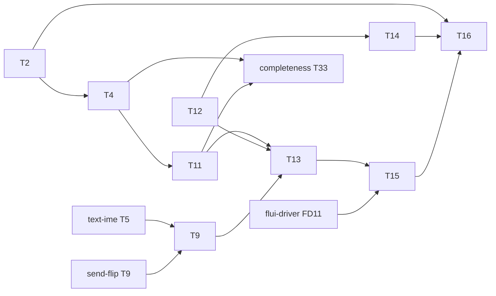

# Фокус и клавиатура в приложении приёмки — задачи (уровень 1)

- **Статус:** утверждена 2026-10-29 (координатор, по делегированию владельца); исполнение. Сделаны T1
  (частью контракта T3 и T8), T3, T5, T6, T7, T8, T10; осталось десять задач (T17 добавлена после утверждения).
- **Дата:** 2026-10-05, переписан 2026-10-29
- **Design:** [design.md](design.md) («Работы» 1–8); требования — [requirements.md](requirements.md)
- **База:** `main` @ `015315508`
- **Итог:** 10 задач, 4 из них `[P]`; ≈ 20 инженеро-дней; критический путь T4 → T11 → T13 → T15 ≈
  13 дней, T15 ещё ждёт FD11 flui-driver и машину владельца

## Правила исполнения

- Задача = worktree = PR прямо в `main`. Перед PR — «Checking a change» из AGENTS.md:
  `cargo fmt --all`, clippy и nextest изменённых крейтов через heli (и зависимых, если менялся
  публичный API).
- Тест пишется через публичный API и падает с откатом production-правки (вывод в PR). Случаи,
  отличающиеся только вводом, — строки существующей таблицы.
- ID требований и задач — только в этом файле: не в именах тестов и не в коммитах.
- Каждый PR с видимым потребителю изменением добавляет `changelog.d/<branch-slug>.md`.
- **Где:** L — Linux CI; W — Windows на машине владельца; G — GPU readback.
- ID прежнего плана сохранены: на них ссылается `flui-interaction/completeness` (T4, T11 → T33;
  T15 → T47).

## Граф зависимостей

## Сделано

| ID | Что | Где на `main` |
|---|---|---|
| T1 | Контракт: типы и сигнатуры | вошёл в T3 и T8 (интеграционная ветка `interaction/completeness`, #1733) |
| T3 | Ядро `flui-interaction`: `Stale`, `NotificationInFlight`, `FocusCause`, модальность, журнал нажатий, единица обхода, маркер осиротевшего primary | `nested_replacement_publishes_no_stale_edge`, `key_repeats_follow_their_key_down`, `input_method_keys_never_reach_the_walk` |
| T5 | Win32: `WM_XBUTTON*` — pointer X1, ответ `TRUE` | `crates/flui-native/src/input/windows/mod.rs` |
| T6, T7 | Рантайм: `note_pointer_input`, X1 → `BrowserBack`, `forget_pressed_keys`, `settle_orphaned_focus` в кадре | `focus_survives_rebuild_and_moves_on_removal` |
| T8 | `flui-widgets/interaction`: `on_release`, интенты, `DefaultFocusTraversal`, `FocusRing`, `RawButton`, `Focus` `Assistive`; no-op интенты в `EditableText` | `keyboard_activation_matches_click`, `raw_button_activates_from_the_keyboard`, `stale_focus_request_is_inert`, `focus_indicator_follows_input_modality`, `keyboard_continues_after_callback_panic`, `keys_typed_in_a_field_stay_in_the_field` |
| T10 | Маршруты: фокусируем только текущий, предварительный push, окончательный pop, Back/Dismiss | `first_tab_enters_the_current_route`, `push_moves_focus_into_the_new_route`, `pop_restores_the_opening_element`, `keys_during_transition_reach_only_the_top_route`, `back_keys_pop_only_the_current_page` |

## Осталось

| ID | Задача | R | Файлы | Зависит | P | Где | Готово, когда | Дн | Статус |
|---|---|---|---|---|---|---|---|---|---|
| T2 | ADR «Pinned lazy children and the focusable list» (номер — следующий свободный на `main`), `Superseded-by` в ADR-0056 в части `Pin` | R5, R6 | `docs/adr/` | — | [P] | L | ADR принят до слияния T4 | 0,5 | в PR: ADR-0265 |
| T4 | `flui-view` + `flui-objects`: аренда `Pin`, `retain_band` не вытесняет закреплённого, закреплённый слот в `RenderSliverList` и `RenderSliverFixedExtentList` (мерка без `set_measured`, якорь и геометрия не меняются, paint и hit-test пропускают явно), строки `render_object_harness`, `## Mapping decisions` в `crates/flui-objects/ARCHITECTURE.md` | R6 | `crates/flui-view/src/owner/keep_alive.rs`, `crates/flui-view/src/element/sparse_children.rs`, `crates/flui-objects/src/sliver/{sliver_list,sliver_fixed_extent_list,virtualized_band}.rs`, тесты harness | T2 | [P] | L | строки закреплённого ребёнка на оба sliver (одна с `Clip::None`) зелёные и падают без явного пропуска paint; `RENDER_OBJECT_TYPES` не меняется | 4 | в PR: и `RenderSliverGrid` (решение координатора), `harness_lazy_slivers_keep_a_pinned_child_out_of_band`, `a_pinned_row_stays_announced_until_its_pin_is_released` |
| T9 | `EditableText`: `autofocus(bool)` с пробросом в `TextField` и `TextFormField`; Alt+Left/Right без Shift вне Apple не поглощается | R7, R9 | `crates/flui-widgets/src/text/editable_text.rs`, `packages/flui-material/src/{text_field,text_form_field}.rs`, `crates/flui-widgets/tests/keyboard_focus/{routes,activation}.rs` | text-ime T5 (#1958), send-flip T9 | — | L | строки «push фокусирует поле с `autofocus`» и «Alt+Left из поля» падают с откатом | 1 | в PR: `autofocus` ещё у `RawTextField` и `RawTextFormField` (общий `TextFormFieldConfig`); строки в `push_moves_focus_into_the_new_route` и `back_keys_pop_only_the_current_page`, `an_autofocus_field_takes_the_focus_on_mount` в flui-material |
| T11 | `flui-widgets/scroll`: `ListView::focusable`, `semantics_label`, `empty_label`; маркер `ListItemFocus` (проброс ключа, `MergeSemantics` + `ListItem`, аренда `Pin`); `ListFocusState`; вход через `register_traversal_entry`; стрелки, PageUp/Down, Home/End, раскрытие | R5, R6, R8, R13b, D6 | `crates/flui-widgets/src/scroll/{list_view,sliver_list,sliver_fixed_extent_list}.rs`, новый `scroll/list_focus.rs`, `crates/flui-widgets/tests/keyboard_focus/list.rs` | T4 | — | L | `list_keyboard_navigation` (10 000 строк, удержание PageDown, предел построения) и `focused_row_is_pinned_while_scrolled_away` падают с откатом; строки списка в `pop_restores_the_opening_element`; первый production-вызов `register_traversal_entry`, и его rustdoc больше не говорит «no widget registers an entry yet» | 4,5 | в PR: `semantics_label` и у `SliverGrid`, `GridView` (решение координатора); имя на узле списка, пустой список — один фокусируемый узел `List`; без `MergeSemantics` + `ListItem` (роли конфликтуют с кнопкой, ADR-0265 §3); строки списка в `pop_restores_the_opening_element` |
| T12 | `flui-material` + `flui-sdk`: `ThemeData::focus_ring`, `Theme` ставит `DefaultFocusRingStyle`, `InkWell` (`Focused` = видимый фокус, кольцо), уровень `Focused` убран из рамп кнопок, Tabs, NavigationBar; Checkbox/Switch/Radio — гало без кольца; поправка ADR-0079 | R4, R17 | `packages/flui-material/src/{theme_data,theme,ink_well,elevated_button,outlined_button,floating_action_button,tabs,navigation_bar,checkbox,switch,radio}.rs`, `packages/flui-material/tests/`, `crates/flui-sdk/tests/surface.rs` | — | [P] | L | `theme_installs_the_focus_ring_style` и строка «клик не включает overlay» в `focus_indicator_follows_input_modality` падают с откатом | 2 | в PR |
| T13 | Приложение приёмки: `ListView::focusable(true).semantics_label("Notes").empty_label("No notes")`, `ValueKey` строк, `TextFormField::autofocus(true)`; модуль `keyboard` рядом с `smoke` | R1, R2, R5, R7–R10, R12, R13b, R15 | `tests/fixtures/acceptance_app/{app,lib,keyboard}.rs` | T9, T11, T12 | — | L | `tab_order_covers_every_screen`, `held_enter_activates_once`, `window_reactivation_restores_focus` и строки R5, R7, R8, R15 зелёные в `facade_consumer`; R2, R5 падают с откатом своих хунков | 2,5 | — |
| T14 | GPU readback `focus_indicator_is_painted`: точки на внешней и внутренней полосе и в центре (строка без отступов, кнопка заголовка) × «в фокусе / без фокуса / нажато», контраст по WCAG | R4 | `tests/gpu_readback/focus_indicator.rs` (или модуль GPU-набора, который назовёт PR) | T12 | [P] | G, W | точки различают три состояния; с overlay вместо кольца и с контрастом < 3:1 тест падает | 1 | — |
| T15 | Нативный сценарий flui-driver на приложении приёмки: первый Tab, обход экранов (UIA `HasKeyboardFocus`), End/PageDown, удержание Enter на строке, правка `Title`, Enter на `Save note`, Alt+Left и XButton1, Alt+Tab туда и обратно, Retry | R18 | сценарий в наборе flui-driver (форму называет FD11) | T13, FD11 | — | W | датированный прогон на SHA, лог в PR; закрыть #1040 и #1092 | 2 | — |
| T16 | Закрытие: `crates/flui-widgets/ARCHITECTURE.md` (фокус, список, кольцо), сверка «Требование → тест», строка в `release/tasks.md`, удаление спеки | — | `crates/flui-widgets/ARCHITECTURE.md`, `docs/plans/specs/` | T2, T14, T15 | — | L | у каждого R тест из таблицы ниже | 0,5 | — |
| T17 | Фокусируемые слайверы: маркеры строк и вход в список для `SliverList`, `SliverFixedExtentList`, `SliverGrid` внутри `CustomScrollView` и для `GridView` (двумерные стрелки) поверх контроллера T11, без привязки к viewport `ListView` | R5, R6 | `crates/flui-widgets/src/scroll/{list_focus,grid_view,custom_scroll_view}.rs`, `crates/flui-widgets/tests/keyboard_focus/list.rs` | T11 | — | L | строки «слайвер в `CustomScrollView`» и «стрелки в `GridView`» в `list_keyboard_navigation` падают с откатом | 2 | — |

## Требование → тест

| R | Тест или прогон | Задача | Статус |
|---|---|---|---|
| R1 | `first_tab_enters_the_current_route`; строка приёмки | T10; T13 | сделано; приёмка — T13 |
| R2 | `tab_order_covers_every_screen` | T13 | — |
| R3 | `keyboard_activation_matches_click`, `raw_button_activates_from_the_keyboard` | T8 | сделано |
| R4 | `focus_indicator_is_painted` | T14 | — |
| R5 | `list_keyboard_navigation`; строка приёмки | T11; T13 | — |
| R6 | `focused_row_is_pinned_while_scrolled_away`; строки harness закреплённого ребёнка | T11; T4 | — |
| R7 | `push_moves_focus_into_the_new_route` (+ строка поля с `autofocus`); строка приёмки | T10, T9; T13 | `Focus::autofocus` сделано |
| R8 | `pop_restores_the_opening_element`, `late_autofocus_does_not_override_the_restored_focus` (+ строки списка); строка приёмки | T10, T11; T13 | обычные элементы сделаны |
| R9 | `back_keys_pop_only_the_current_page` (+ «Alt+Left из поля»), `keys_typed_in_a_field_stay_in_the_field`, `input_method_keys_never_reach_the_walk` | T10, T8, T3; T9 | клавиши, XButton1, Escape и IME сделаны |
| R10 | `window_reactivation_restores_focus`; шаг Alt+Tab | T13; T15 | — |
| R11 | `keys_during_transition_reach_only_the_top_route` | T10 | сделано |
| R12 | `key_repeats_follow_their_key_down`; `held_enter_activates_once`; удержание Enter | T3; T13; T15 | ядро сделано |
| R13a | `reentrant_request_during_notification_is_applied_after_and_published_in_order` | T3 | сделано |
| R13b | проверка `focused` после каждого шага R2 и R5 | T13; T11 | — |
| R13c | `nested_replacement_publishes_no_stale_edge` | T3 | сделано |
| R14 | `stale_focus_request_is_inert` | T3, T8 | сделано |
| R15 | `focus_survives_rebuild_and_moves_on_removal`; строка приёмки «Retry» | T7; T13 | сделано; приёмка — T13 |
| R16 | `keyboard_continues_after_callback_panic` | T8 | сделано |
| R17 | `focus_indicator_follows_input_modality` (+ строки Material) | T8; T12 | `FocusRing` и `RawButton` сделаны |
| R18 | нативный сценарий flui-driver | T15 | — |

## Владельцы общих файлов

| Файл | Правило |
|---|---|
| `crates/flui-widgets/src/text/editable_text.rs` | порядок: text-ime T5 (#1958) → send-flip T9 → **T9** |
| `crates/flui-view/src/owner/keep_alive.rs`, `sparse_children.rs` | **T4**; completeness T33 (`ReorderableList`) после T4 и T11 |
| `crates/flui-widgets/tests/keyboard_focus/` | каждая задача правит свой файл; `mod list;` вносит T11 |
| `tests/fixtures/acceptance_app/` | **T13** добавляет модуль `keyboard`; `smoke.rs` и `testing.rs` не переписывает, а дополняет помощниками клавиш |
| `crates/flui-sdk/tests/surface.rs` | T11 и T12 добавляют свои строки |
