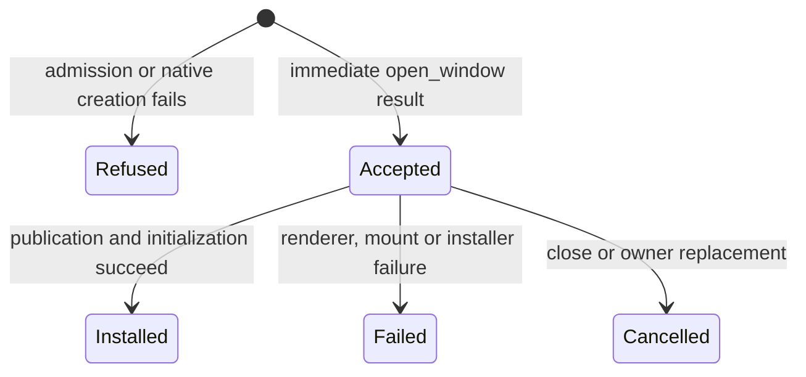

# Host delivery design

- **Status:** Approved design; implemented and reviewed locally, awaiting PR validation and merge.
- **Requirements:** [requirements.md](requirements.md)
- **Tasks:** [tasks.md](tasks.md)
- **Tracker:** [#1546](https://github.com/vanyastaff/flui/issues/1546)
- **Lasting decision:** [ADR-0185](../../../adr/ADR-0185-addressed-host-delivery.md)

## Boundaries and ownership

`flui-app` owns platform resources and binds a window to a runtime wake. A wake
has separate redraw debt and weak window ownership. The loop's infrastructure
notifications have separate scope and are distributed to their runtime consumers.
`flui-runtime` owns presentation execution and typed failure delivery;
`flui-scheduler` owns frame eligibility, execution and observer ordering. Neither
lower layer acquires a platform or GPU dependency.

One owner deadline hook folds logical deadlines, native text sizing and all live
desktop presentation metadata. Metadata stays readable while the driver is leased.
Removing a presentation removes its contribution. Replacing an owner fences the
previous hook by identity. Frame eligibility controls visual deadlines and keeps
native text-sizing progress independent.

Service admission has four boundaries: prepare under storage access, construct
without that access, commit under storage access, execute without it. Commit checks
the prepared owner generation and current admission. Completion state is committed
before a synchronous executor can observe it. Refused futures retire outside the
storage borrow. A factory can replace the owner without transferring its prepared
authority to the successor.

## Delivery and recovery

Lifecycle transitions commit state and eligibility before notification. Delivery
is FIFO; reentrant transitions append behind the current one. Removal before a
listener's turn suppresses that invocation. Failure preserves the first panic and
does not skip the healthy delivery tail.

Lifecycle and timing delivery share failure custody with frame execution,
callbacks, tasks and wake delivery. Nested execution inherits the active receipt
and restores its previous binding. Registration of a replacement execution owner
inherits active custody as well. Opaque captures cannot retire under a preserved
failure merely because a nested panic was caught. A subsequent healthy operation
uses ordinary destruction and makes progress. This does not promise recovery from
a double panic that aborts before a containment boundary can intervene.

Timing collection requires a subscriber, retains the newest 128 records and
automatically flushes at completed idle boundaries after the configured interval
or when full. The batch is drained before callbacks. Final unsubscription clears
pending records before retiring the capture.

An owner-contained callback failure emits a typed report before returning the
runtime lease. Address validation, handler containment and the original failure
remain authoritative. This report does not increment frame-failure streaks.

## Installation state and consumers

`WindowRequest` observes settlement. Discarding the observer leaves accepted
installation in place. Installation success does not promise native focus or
compositor presentation. A receiver waker failure cannot reverse installed state.
Shutdown attempts closing, receipt delivery and reservation settlement independently
for every accepted request, preserving the healthy tail after a competing failure.

The multi-window example retains a task token and awaits installation through its
lifecycle-acquired async driver. It updates opened state on success and exposes
late failure. Managed diagnostics are initialized before platform construction.
Unused fullscreen/debug-paint configuration and scheduler aliases are removed;
unsupported storage configuration receives a typed refusal until persistence host
integration exists.

## Alternatives and acceptance

A shared redraw flag and replaceable per-window deadline hooks require callers
to preserve sibling obligations manually. Addressed wakes and a single owner hook
remove that responsibility. A reentrant mutable service registry introduces shared
mutation where prepare/construct/commit already permits exclusive storage access.
Returning admission alone makes deferred initialization errors unobservable.

Acceptance uses existing host/window, public scheduler and public runtime owner
boundaries. Private host injection is restricted to renderer/installer failure and
leased native-driver cases that the public harness cannot produce. No test-only
public interface is added. The requirements document defines failure/recovery
scenarios and the native execution limits.
