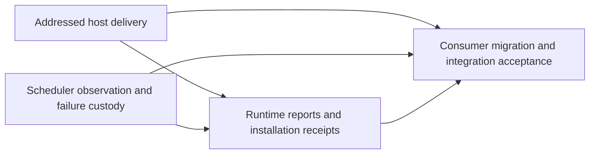

# Host delivery task graph

- **Status:** Implemented and reconciled locally; awaiting integration PR validation and merge.
- **Requirements:** [requirements.md](requirements.md)
- **Design:** [design.md](design.md)
- **Tracker:** [#1546](https://github.com/vanyastaff/flui/issues/1546)
- **Integration branch:** `codex/app-runtime-scheduler-hardening`
- **Baseline:** `2084cbc53589724c09bd37a7eb40c3ddcdb526fc`
- **Implementation commit:** `e7ea484c3`

The approved specification formalizes implementation already performed in the
isolated integration branch. Reconcile existing work against each contract; do not
recreate completed fixes. Local completion is distinct from tracker completion,
which follows the integration PR's merge.

## Dependencies

## Acceptance tasks

| ID | Contract | User stories | Depends on | Existing evidence | Status |
|---|---|---|---|---|---|
| T1 / [#1547](https://github.com/vanyastaff/flui/issues/1547) | Addressed wakes, owner deadlines and reentrant service admission | 1–12 | — | `host_delivery_contract`, `installed_frame_driver_contract` | Implemented and reviewed; awaiting merge |
| T2 / [#1548](https://github.com/vanyastaff/flui/issues/1548) | Ordered lifecycle, bounded automatic timings and first-failure custody | 13–21 | — | `observer_delivery_contract` | Implemented and reviewed; awaiting merge |
| T3 / [#1549](https://github.com/vanyastaff/flui/issues/1549) | Typed owner reports and settled installation receipts | 22–28 | T1, T2 | `owner_delivery_contract`, `secondary_installation_contract` | Implemented and reviewed; awaiting merge |
| T4 / [#1550](https://github.com/vanyastaff/flui/issues/1550) | Real consumer migration, truthful configuration, canonical naming, docs and final acceptance | 29–32 | T1, T2, T3 | multi-window example, changelog, architecture decisions and final gates | Implemented and reviewed; awaiting final PR validation and merge |

For every task inspect the production producer and consumer, failure and reentry
paths, and its existing RED/GREEN evidence. Each behavior test must fail with its
production fix reverted. Existing reversions were restored before final validation.
If reconciliation uncovers a genuine defect, reproduce it first and implement it
on the integration branch before updating acceptance status.

## Recorded verification

For `e7ea484c3`, `cargo xtask check-changed --base
2084cbc53589724c09bd37a7eb40c3ddcdb526fc` passed; `cargo xtask checks` passed
separately. The scoped gate selected the full workspace because of the changed
multi-window example: 860 workspace tests passed, 29 skipped; 46 xtask tests and
one platform compiler-guard test passed. Strict rustdoc and doctests passed.
Windows feature clippy, WASM workspace clippy and WASM hot-reload facade checks
passed. These results predate the formal specification files.

No live OS-window/mobile smoke was executed. macOS/Android source checks lacked
toolchains; the native platform suite requires Linux/Xvfb. Automated SemVer checks
were unavailable locally. API migration and changelog are present. These limits do
not become successful tests by closing a tracker task.

Approved-spec reconciliation found two missing acceptance rows and added them to
the existing tables: `lifecycle_removal_before_delivery_skips_retired_listener`
and `rendered_secondary_installs_after_receipt_observer_is_dropped`. Both tables
passed in the targeted run. Negative controls that bypassed live registration
checking or cancelled installation on observer abandonment failed precisely these
rows. The controls were restored before final validation. These are test-sensitivity
checks for required existing behavior, not evidence of two new baseline defects.
Standards review found no blocker; Spec review cleared the coverage gap after
inspecting the new rows.

After adding only the formal specification files, run `cargo xtask checks` for
documentation links and repository structure. Reuse passing source gates unless
source changes or new evidence justify rerunning them. Standards and Spec review
must both pass before marking the integration PR ready. Do not merge without the
maintainer's explicit merge authorization.
