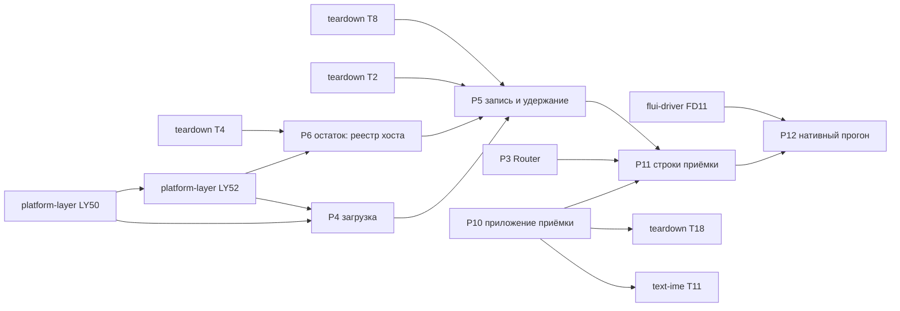

# Persistence — задачи

- **Статус:** Утверждена владельцем 2026-10-28; исполнение
- **Design:** [design.md](design.md) (раздел «Решения владельца 2026-10-28»); требования —
  [requirements.md](requirements.md); контракт закрытия — [teardown/tasks.md](../teardown/tasks.md)
- **Итог:** сделаны P1, P2, P3, P10; P6 сделана в части; P7, P8, P9 (Notes) устарели и
  заменены P10–P12. Осталось пять задач: P4, P5 и остаток P6 строятся на шве
  возможностей после [platform-layer](../platform-layer/tasks.md) LY50 и LY52.
- **Приложение приёмки** — задача P10 этой спеки. Его строки пишут три спеки: persistence (P11),
  teardown (T18), text-ime (T11).

## Правила исполнения

Пункты 1–7 и 9 [«Правил исполнения» platform-layer](../platform-layer/tasks.md#правила-исполнения):
задача = worktree под `.claude/worktrees/<имя>` = ветка = PR; проверки по AGENTS.md «Checking a
change» через `cargo heli`; fix-тест падает при откате исправления в изолированном checkout; ID
задач и требований — только в этом каталоге; `changelog.d/<branch-slug>.md` у каждого PR,
меняющего поверхность. Дополнительно:

- **Контрактные тесты под `ignore`.** Исполнитель снимает `#[ignore = "contract: …"]` со своих
  строк и переносит их в таблицу семейства; это его доказательство.
- **Где:** L — Linux CI; T — только cross-typecheck или `wasm32` без запуска; C — внешний consumer
  через `tests/facade_consumer.rs` (группа nested-cargo, исполняется в L); D — нативный прогон
  процесса через лейн `os` [flui-driver](../flui-driver/tasks.md) (Windows — FD11), датированный
  вывод в PR.

## Граф

Порядок с platform-layer: **сначала LY52** (шов и провайдер `Storage`, удаление
`LifecycleContext::storage`), **затем P4, P5 и остаток P6** на нём. Обратного ребра нет: LY52
опирается только на слитые P1, P2 и сделанную часть P6. LY52 сохраняет второго потребителя
хранилища — `crates/flui-app/src/app/placement_recorder.rs` (#1899).

## Сделано

- [x] **P1** — контракт: `Storage`, `StorageName`, `Persisted<D>`, `Router::from_stack`,
  `MemoryStorage`, контрактные тесты под `ignore` (#1457).
- [x] **P2** — `FileStore`: атомарная запись, блокировка `IfUnchanged`, классификация ошибок ОС
  (#1463); Web — IndexedDB (#1712).
- [x] **P10** — приложение приёмки (#1952): `tests/fixtures/acceptance_app/`. `app.rs` — заметки
  Home, Note, Settings под `Router`; `NoteId(u64)` — идентичность, растёт через `checked_add` и
  не переиспользуется; номер попытки — ключ `FutureBuilder`, Retry переходит к следующему с
  `wrapping_add` (правило в rustdoc `Loader`), начальный — `first_attempt`; `TextFormField`
  Title, «Save note» с отказом на пустом заголовке, черновик переживает Back; «New note»; шов
  отказов — `Faults` из `Fault` (`build-panic`, `save-panic`, `dispose-panic`, имена — только в
  `Fault::name`). `testing.rs` — `AppRun`: старт и перезапуск над тем же `MemoryStorage`,
  `request_close`, `end_session`, `rebuild`, нажатия и клавиши. `lib.rs` — корень consumer'а;
  строки спек — модулями рядом со `smoke.rs`. `acceptance_app_runs_through_the_facade` копирует
  каталог рекурсивно и требует `... ok` у каждой `#[test]` в нём — второго списка нет. Строки:
  `acceptance_app_walks_home_note_settings_and_back`, `acceptance_app_saves_an_edited_title`,
  `acceptance_app_keeps_the_draft_after_back`, `acceptance_app_adds_notes_and_refuses_an_empty_title`,
  `acceptance_app_retries_a_failed_load` (перестройка не перезапускает загрузку, Retry —
  перезапускает), `retry_counter_overflow_still_starts_a_load` (R26: старт на `u32::MAX`). Откаты:
  `pop`, запись заголовка, сброс черновика при открытии, повтор id, ключ, меняющийся на каждой
  перестройке, и `+ 1` вместо `wrapping_add` роняют свою строку. Пускачи
  `examples/acceptance_app.rs` (без отказов) и `examples/acceptance_app_faults.rs` (один `Fault`
  через `FromStr`, ADR-0258 §4). Хранилище — `lay_out_with_storage` (до LY52). Швы, которые
  добавляет P11: загрузчик, несущий данные; начальный стек маршрутов; удаление заметки; исход
  решения о закрытии из `request_close`; сохранение в полёте при завершении сеанса; для T18 —
  крюк счёта `Drop`.

## Сделано в части

- **P6** — хранилище хоста в `flui-app` (`storage_host.rs`): чтение на IO-пуле, полоса записи на
  имя, корни от платформы (#1709). Остаток — production-вызов `FlushHost::new` с писателем на
  IO-пуле: сегодня его зовут только тесты (`flui-view/src/flush_registry.rs`), у реестра нет
  писателя. Остаток — задача P6 ниже.
- **P4** — путь загрузки (`persist/persisted.rs`): `open` берёт `StorageCapability`, `load` —
  чтение с `MAX_BYTES`, заголовок (`Corrupt` для нет/чужого/битого), `NewerVersion` →
  `ReadOnly`, `decode` под `catch_unwind` (`Panicked`, payload — `retain_opaque_payload`),
  поколение (применяется последняя), отмена при `Drop` future; без хранилища —
  `Storage(Unsupported(NotRegistered))` и `Unavailable`. Строки (`tests/persist.rs`):
  `a_load_reports_each_stored_state` (R18, R29, R30, R31), `only_the_latest_of_several_loads_is_applied`
  (R25, R28), `unmount_during_load_releases_requests` (R27), `unavailable_storage_runs_in_memory_with_status`
  (R33). `UnsavedChanges` проверяется в `start_load`, строка — с P5 (нужен `Saving`). Остаток:
  `a_loaded_document_round_trips_through_memory_storage` снимает `ignore` с P5 (нужен `set`);
  doctest с `FutureBuilder` — во `flui-widgets`, когда P11 подключит загрузчик.

## Устаревшие задачи

- **P7, P8, P9** (Notes: `NoteId`, восстановление и UI ошибок в `examples/two_screens`, таблицы
  `notes_restart_matrix`/`notes_storage_failure_matrix` в `tests/fixtures/notes_flow.rs`,
  датированный прогон Windows через `windows-notes`) — Notes, `notes_flow` и `cargo xtask device`
  удалены. Заменены: P10 (приложение приёмки), P11 (строки persistence на нём), P12 (нативный
  прогон через лейн `os` flui-driver).
- **Путь через `LifecycleContext::storage`** для P4 и P5 — снят решением владельца 2026-10-28:
  метод удаляет LY52, документы получают хранилище через шов возможностей.

## Задачи

| ID | Задача | Зависит от | Крейты и файлы | Гейты | Тесты | Где |
|---|---|---|---|---|---|---|
| **P3** [P] | **Router: весь стек.** `Router::from_stack` сегодня берёт только верх (`router.rs`), `RouterHandle::stack` отдаёт `vec![current]` (`handle.rs`); оба — весь стек в порядке Back | — | `crates/flui-widgets/src/router/{router.rs,handle.rs}`, `crates/flui-widgets/tests/contracts.rs`, `changelog.d/` | clippy и nextest: `-p flui-widgets` и зависимые | снимает `ignore` с `from_stack_restores_back_order`, `stack_reads_every_committed_edit` и переносит их в `router_and_widgets_app`; `empty_stack_is_refused` зелёная. Откат — Back ведёт в Home, длина стека 1 | L |
| **P4** | **`Persisted`: путь загрузки на шве** (design «Публичный контракт», «Решения владельца 2026-10-28»). `Persisted::open` берёт `Storage` через шов возможностей (провайдер LY52), `load()` (сегодня `NOT_WIRED` = `UnsupportedReason::NotRegistered`) — owner-local задача в `AsyncDriver`; заголовок `flui-document <name> <version> <revision>`; `Corrupt`, `ReadOnly(NewerVersion)`, `decode` под `catch_unwind` (`Panicked`), `TooLarge`, поколение (применяется последняя), отмена при `Drop`; без провайдера — `StorageError::Unsupported(Unsupported)` с `NotRegistered`; `UnsavedChanges` при `Saving`/`Failed`. Doctest: `FutureBuilder` принимает `data.load()` | LY50, LY52 | `crates/flui-view/src/persist/*`, `crates/flui-view/tests/persist.rs`, `changelog.d/` | clippy и nextest: `-p flui-view` и зависимые; `cargo test -p flui-view --doc`; `cargo heli xtask wasm-check`; `reach` | снимает `ignore` с `a_loaded_document_round_trips_through_memory_storage`; R18 `inaccessible_is_reported_apart_from_corrupt`; R25 `repeated_retries_apply_exactly_one_result`; R27 `unmount_during_load_releases_requests`; R30 `oversized_file_is_refused_unread`; R31 `older_version_decodes_or_reports_without_writing`; R33 `unavailable_storage_runs_in_memory_with_status` | L + T |
| **P6** | **Остаток: реестр сброса хоста.** Провайдер хранилища хоста (после LY52 — `storage_host.rs` как провайдер шва) создаёт `FlushHost::new` с писателем на IO-пуле — первый production-вызов; реестр доступен teardown-сбросу и `Persisted::set` | LY52, teardown T4 | `crates/flui-app/src/app/storage_host.rs`, in-crate тесты рядом с `the_run_storage_dir_reaches_lifecycle_context` (`runner/main_window.rs`: realm runner'а без GPU публично не собрать), `changelog.d/` | clippy и nextest: `-p flui-app -p flui-view`; `cargo heli xtask wasm-check`; `globals` | `a_runner_write_lands_under_the_configured_roots` (R19); `placement_recorder` пишет и читает через тот же провайдер | L + T |
| **P5** | **`Persisted`: запись и удержание закрытия.** `set`: ревизия +1 (`u64::MAX` → `Exhausted` навсегда), `encode` под `catch_unwind` без заимствования `RefCell`, `FlushRegistry::publish` (данные — `IfUnchanged(base)`, сеанс — `Replace`); `committed` и «Saved» — после ответа реестра; повтор `Busy` 50…800 мс по часам UI-runtime; немедленная запись на `Hidden`/`Paused` и на запрос закрытия; `hold()` на `Saving`, `require_decision()` на `Failed`/`ReadOnly`/`NotLoaded` с правками; `retry` публикует актуальное; `start_over` (копия `<name>-corrupt-N`, затем `initial()`); rustdoc о потере без вето | P4, P6, teardown T2, T4, T8 | `crates/flui-view/src/persist/*`, `crates/flui-view/tests/persist.rs`, `changelog.d/` | clippy и nextest: `-p flui-view -p flui-app` | снимает `ignore` с `saved_status_appears_only_after_commit`; R12 `user_close_waits_for_an_in_flight_save`; R14 `a_saving_document_holds_user_close_only`; R15 `drop_before_commit_loses_only_that_edit`; R16 `busy_retry_follows_the_runtime_clock` (49 мс — нет, 50 мс — есть; пять `Busy` → `Failed`); R17 `corrupt_bytes_are_kept_until_start_over`; R20 `retry_after_failure_publishes_the_latest_value`; R24 `no_write_without_a_loaded_base`; R28 `a_later_edit_supersedes_an_unstarted_one`; R29 `codec_panic_is_contained_first_failure_kept`; R30 `full_disk_keeps_memory_and_the_old_file`; R31 `newer_version_is_never_written`; R36 `two_runtimes_keep_independent_documents` | L |
| **P11** | **Строки приёмки persistence.** Приложение P10 хранит данные (`notes`, заметки и compact-флаг) и сеанс (`machine_local`: черновик, стек маршрутов, смещение списка) как `Persisted`-документы; кодек — `serde_json`, зависимость consumer'а (R34, R35); корневой `FutureBuilder`: данные, затем сеанс; `Router::from_stack`, смещение и черновик до первой раскладки; fallback R7; экраны `Corrupt` («Начать заново»), `Inaccessible`, только чтение, баннер «хранение недоступно»; решение при закрытии (`discard_and_close`/`stay_open`). Таблицы «перезапуск» и «отказы хранилища» на `MemoryStorage` | P10, P3, P5 | `tests/fixtures/acceptance_app/` (приложение и модуль строк persistence), `tests/facade_consumer.rs` (список ожидаемых строк, `serde_json` у consumer'а) | clippy и nextest: `-p flui` (nested-cargo) | строки R1–R11, R13, R14, R34 из таблицы ниже; каждая падает на P10 без P11 (хранилище не читается) | C |
| **P12** | **Нативный прогон persistence** через лейн `os` flui-driver на пускаче P10: R1, R12, R13 (сворачивание → `Hidden`), R14 (файл только для чтения), R18, R21 (`taskkill /F` в цикле записей), R22 (держатель без `FILE_SHARE_DELETE`), R23 (не-ASCII профиль, перенаправленный AppData/OneDrive, путь > 260), R32 (два процесса), завершение сеанса во время Save; эксперимент риска 3 design (повтор ≈ 1,5 с, сброс ≤ 3 с). Протокол — в PR, строка в `docs/platform-parity.md` | P11, flui-driver FD11 | шаги лейна `os` (по форме FD11), `docs/platform-parity.md`, `docs/gaps.md` | `cargo heli xtask checks` | датированный вывод каждого шага; ✅ в parity — только после прогона | D |

## Требование → тест

| R | Тест или прогон | Задача | Где |
|---|---|---|---|
| R1 | `saved_title_survives_restart_and_others_stay`; прогон | P11; P12 | C, D |
| R2 | `compact_rows_survive_restart` | P11 | C |
| R3 | `unsaved_draft_reopens_its_note_without_changing_the_list` | P11 | C |
| R4 | `settings_over_editor_restores_and_backs_out_twice`; `from_stack_restores_back_order`, `stack_reads_every_committed_edit`, `empty_stack_is_refused` | P11; P3 | C, L |
| R5 | `list_offset_and_route_are_restored_on_the_first_loaded_frame` | P11 | C |
| R6 | `failed_data_load_leaves_session_unread_and_unwritten` | P11 | C |
| R7 | `deleted_note_then_crash_drops_the_draft_and_trims_the_stack` | P11 | C |
| R8 | `unreadable_session_starts_home_at_zero` | P11 | C |
| R9 | `first_launch_starts_from_initial_state_without_an_error` | P11 | C |
| R10 | `reload_replaces_a_pending_load` (счёт `live_requests`) | P11 | C |
| R11 | `a_held_write_keeps_typing_and_scrolling_live`; `a_blocked_store_keeps_frames_and_input_live` | P11; teardown T4 | C, L |
| R12 | `user_close_waits_for_an_in_flight_save`; прогон | P5; P12 | L, D |
| R13 | `hidden_writes_the_session_and_resume_does_not_reread`; сворачивание | P11; P12 | C, D |
| R14 | `close_with_a_failed_write_requires_a_decision`; `a_saving_document_holds_user_close_only`; README о потере без вето (teardown T17); прогон | P11; P5; P12 | C, L, D |
| R15 | `saved_status_appears_only_after_commit`, `drop_before_commit_loses_only_that_edit`; `taskkill /F` | P5; P12 | L, D |
| R16 | `busy_retry_follows_the_runtime_clock` | P5 | L |
| R17 | `corrupt_bytes_are_kept_until_start_over` | P5 | L |
| R18 | `inaccessible_is_reported_apart_from_corrupt`; `directory_in_place_of_the_file_is_inaccessible`; прогон | P4; P2 (сделано); P12 | L, D |
| R19 | `first_write_creates_the_directory`; `a_runner_write_lands_under_the_configured_roots` | P2 (сделано); P6 | L |
| R20 | `retry_after_failure_publishes_the_latest_value`; `a_failed_write_keeps_its_bytes_until_replaced_or_flushed` | P5; teardown T4 | L |
| R21 | `file_store_interruption_matrix` (in-src); `taskkill /F` в цикле | P2 (сделано); P12 | L, D |
| R22 | `os_error_classification_table`; `busy_retry_follows_the_runtime_clock`; держатель файла | P2 (сделано); P5; P12 | L, D |
| R23 | `long_non_ascii_path_round_trips`; профиль и OneDrive | P2 (сделано); P12 | L, D |
| R24 | `no_write_without_a_loaded_base`; teardown R6 | P5 | L |
| R25 | `repeated_retries_apply_exactly_one_result` | P4 | L |
| R26 | `retry_counter_overflow_still_starts_a_load` | P10 (сделано) | C |
| R27 | `unmount_during_load_releases_requests` | P4 | L |
| R28 | `a_later_edit_supersedes_an_unstarted_one`; `same_writer_edits_rebase_instead_of_conflicting` | P5; teardown T4 | L |
| R29 | `codec_panic_is_contained_first_failure_kept` (паника `encode`, затем `decode`, payload с паникующим `Drop`) | P5 | L |
| R30 | `oversized_file_is_refused_unread`; `full_disk_keeps_memory_and_the_old_file` | P4; P5 | L |
| R31 | `older_version_decodes_or_reports_without_writing`; `newer_version_is_never_written` | P4; P5 | L |
| R32 | `two_threads_interleave_and_exactly_one_conflicts`; два процесса | P2 (сделано); P12 | L, D |
| R33 | `unavailable_storage_runs_in_memory_with_status`; `cargo heli xtask wasm-check`; README (teardown T17) | P4 | L, T |
| R34 | строки «перезапуск» через `acceptance_app_runs_through_the_facade` | P11 | C |
| R35 | `ordinary_facade_graph_excludes_test_support` (без `serde_json`) | P1 (сделано) | C |
| R36 | `two_runtimes_keep_independent_documents` | P5 | L |

Строки реестра при завершении сеанса (`session_end_during_a_write_writes_the_latest_registry_bytes`,
`session_end_never_blocks_for_work_in_progress`) — teardown T14.

## Ход исполнения

- [x] P1 — #1457
- [x] P2 — #1463, #1712
- [x] P3 — #1948. `Router::from_stack` сажает весь стек без перехода (`empty_stack_is_refused`
  по-прежнему отказывает пустому); `RouterHandle::stack` отдаёт все страницы без popup'ов;
  `Clone`, `to_path` и `==` маршрута (последнее — в `go`) вызываются после снятия заимствования
  стека; `Debug` печатает весь стек. `from_stack_restores_back_order` и `stack_reads_every_committed_edit` сняты с `ignore` и
  перенесены в `router_and_widgets_app` вместе с `from_stack_opens_without_a_transition`,
  `stack_leaves_out_popups`, `debug_prints_the_whole_stack`,
  `a_route_clone_may_drive_its_router` и `a_route_eq_may_drive_its_router_during_go`. Откат
  исходников: Back с восстановленного верха — `Ok(false)`, `stack()` — `[Note { id: 1 }]`; клон
  или сравнение в `go` под заимствованием — «RefCell already borrowed»; `Debug` только верха — `initial: ["/tag/x"]`. Проверено (Windows, 2026-10-28):
  clippy `--workspace --all-targets -D warnings`; nextest `-p flui-widgets -p flui-view -p flui-app
  -p flui`; `xtask checks`, `doc-strict`, `wasm-check`.
- [x] P10 — #1952
- [ ] P4 — загрузка на шве (после LY50, LY52)
- [ ] P6 — остаток: реестр сброса хоста (после LY52)
- [ ] P5 — запись и удержание закрытия
- [ ] P11 — строки приёмки persistence
- [ ] P12 — нативный прогон (после flui-driver FD11)
