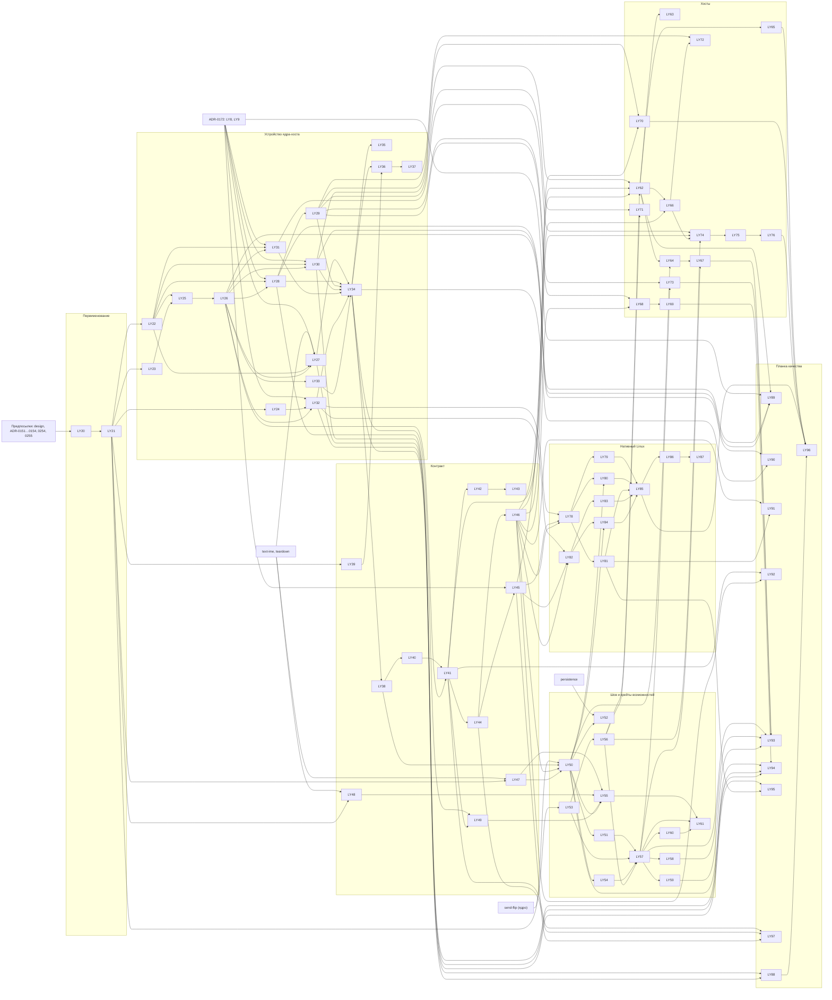

# Платформенный слой — задачи

- **Статус:** черновик, редакция 3; исполнение после утверждения design.md и ADR-0151, 0152, 0153,
  0154, 0254, 0255
- **Ограниченное утверждение:** LY8/LY9 исполняются вместе по
  [ADR-0172](../../../adr/ADR-0172-host-owned-system-preferences.md), используя
  текущие имена крейтов и owner-local runtime. Это не утверждает остальные задачи,
  переименование крейтов или шов возможностей. LY8/LY9 пока не завершены.
- **Дата:** 2026-10-20
- **Design:** [design.md](design.md); требования — [requirements.md](requirements.md)
- **База:** `main` @ `deb9faea2`
- **Итог:** 77 задач LY20–LY97 одной упорядоченной серией (идентификатор LY77 не занят). Порядок
  задаёт колонка «Зависит от»; сроков, выпусков и оценок трудозатрат у задач нет, серия идёт до
  последней задачи. LY8/LY9 — работа вне серии, она уже идёт.

## Правила исполнения

1. Задача = worktree под `.claude/worktrees/<имя>` = ветка = один PR. Агент работает в своём
   worktree и не трогает чужие.
2. Проверки по AGENTS.md «Checking a change»: `cargo fmt --all`, затем clippy heli
   (`--all-targets -- -D warnings`) и nextest на изменённых крейтах и на их зависимых, если
   изменился публичный API; docs-only задача — только `cargo heli xtask checks`. Cargo идёт через
   heli: `cargo heli <аргументы>`, задачи репозитория — `cargo heli xtask <задача>`. Набор
   `flui-native` исполняется на Linux: изменение бэкенда Windows или macOS требует
   `cargo heli nextest run -p flui-native` вручную на этой ОС (до LY20 крейт называется
   `flui-platform`).
3. Fix-тест падает при откате исправления (изолированный checkout). Перемещение без изменения
   поведения доказывается тем же набором тестов, зелёным до и после; список перенесённых тестов — в
   PR.
4. Имена кода и тестов без номеров задач и требований: ID живут только в файлах этой спеки
   (`cargo xtask markers`). Правки файлов — инструментами Read/Edit/Write; массовые механические
   правки — `git mv`, `sd`, `ast-grep`, `rg`, не скрипты на Python, Perl или PowerShell.
5. PR, меняющий поверхность для потребителя, добавляет `changelog.d/<branch-slug>.md`
   (`### Added|Changed|Deprecated|Removed|Fixed|Security`).
6. Новая публичная поверхность сливается вместе с первым production-потребителем (R10.4). Если
   потребитель — следующая задача, PR называет её.
7. Изменение поддержки платформы обновляет `docs/platform-parity.md` и `docs/gaps.md` в том же PR;
   ✅ — только после прогона на этой ОС.
8. Файлы активной ветки не трогаются до её слияния или без согласия владельца. Сейчас их держат:
   send-flip (ядро) — `flui-scheduler`, `flui-runtime/src/{realm_services,presentation}.rs`,
   `ui_realm/*`, `flui-view/src/owner/*`; text-ime и teardown — `text_store/*`, Win32
   `text_services`, Win32 `platform.rs`; persistence — доставка `Storage`; LY8/LY9 — предпочтения.
   Это зависимости по порядку и записаны в колонке «Зависит от», а не окна по датам.
9. **Где:** **L** — Linux CI; **W** — Windows нативно (локальный запуск, вывод в PR); **T** — только
   cross-typecheck или `wasm32` без запуска (так и пишется в PR); **Dev: <ОС>** — прогон на
   устройстве владельца: macOS, iOS, Android, Linux (Wayland, X11), Web (браузер); датированный
   вывод — в PR. «L» без остального — всё доказательство даёт Linux CI.
10. Каждый Rust-набросок в ADR и design собран в scratch-крейте, вывод сборки — в PR. Зелёный CI на
    head — условие слияния.

## Предпосылки

Серия начинается, когда:

1. владелец утвердил design.md и requirements.md редакции 3;
2. ADR-0151…0154, ADR-0254 (контракт окна: D4, D5, D10, D11, D12) и ADR-0255 (хосты Android, iOS
   и Web, мост к хосту: D14–D16, D19, D23) приняты. Каждый записан как «не реализовано»: задачи
   ниже исполняют их, а `Superseded-by` в старых ADR (design §10) проставляют те задачи, которые
   меняют соответствующее место.

Эти два пункта — вход серии, а не задачи в ней; на графике они узел PRE. Формы, которые ADR
оставляют задаче и которые задача называет в своём PR: набор материалов кроссплатформенной команды
фона (ADR-0254 п. 3), слот типизированных опций одной ОС в `WindowOptions` (п. 8), вход ядра для
`AndroidApp`.

## Граф

## Задачи

### Переименование

| ID | Задача | Зависит от | Крейты и файлы | Гейты | Тесты | Где |
|---|---|---|---|---|---|---|
| **LY20** | **Переименование ядра:** `crates/flui-platform` → `crates/flui-native` (D21, design §9.1). `git mv` и `sd` по целому токену, длинное совпадение первым; без ручных правок, кроме ловушек: пакет, библиотека, пути, фичи (`flui-native/a11y`), `allowed-dependents`, `reach.tier.K.forbid` (называет `flui-native`; нового `flui-platform` в нём нет: контракт — tier C), `globals`, пути xtask, `package(flui-native)` в nextest, `--exclude flui-native` в `weekly.yml`, цели `tracing` и `RUST_LOG` (`flui_native=debug` в live-smoke и device-checks), имя потока `flui-native-bg`; trybuild `.stderr` перегенерируются (`TRYBUILD=overwrite`), не заменяются текстом. Не трогать: `flui_native_recording`, `flui-native-library-*`, архивный `docs/plans`, текст ADR-0151, выпущенные записи `CHANGELOG.md`, имя файла ADR-0082, Java-пакет `dev.flui.platform`, цель `"flui.platform"`. Тексты об отношении двух крейтов (README, ARCHITECTURE.md, `docs/crates.md`, `docs/architecture.md`, `docs/testing.md`, `design/*`) переписать по смыслу. Точные команды — в описании PR. Реэкспорты контракта через ядро читаются `flui_native::WindowOptions` до LY23 | PRE | весь workspace: корневой `Cargo.toml`; `crates/{flui-app,flui-runtime,flui-testing}`; `examples/web_demo`; `tools/xtask` (`tasks.rs`, `device.rs`, `change_scope/lane_args.rs`, `workspace/reach*`, `globals*`, `platform_floor.rs`, `android_dex.rs`, allowlists `docs-paths`, `markers`, `testing`); `tools/{live-smoke,device-checks}`; `.github`; `.config/nextest.toml`; `clippy.toml`, `deny.toml`, `typos.toml`; `AGENTS.md`; `docs/*`, `design/*` | `workspace`, `reach`, `globals`, `checks`, `deps`, `cross-typecheck`, `wasm-check`, `key-vocabulary`, `platform-floor`, `android-dex`, `docs-paths`, `docs-links` | весь набор без правок смысла; `compile_fail` перегенерирован; повторный прогон команд PR на его выходе даёт пустой diff | L + T |
| **LY21** | **Переименование контракта:** `crates/flui-platform-api` → `crates/flui-platform` (D21, design §9.2). `flui_platform_api` → `flui_platform`; `SDK_SURFACE` в `tools/xtask/src/workspace/tiers.rs`; генератор `key_vocabulary` (пути записи `src/keyboard/{named_key,code}.rs` и строка `use …::keyboard::{name}` в сгенерированных документах: файлы под git совпадают с выводом генератора); `recording_vocabulary` (26 путей); `binary_id(flui-platform::compile_fail)` в nextest; фичи `flui-platform/serde` (`flui-interaction`, корневой `serde`); `documentation = "https://docs.rs/flui-platform"`; цели `tracing` `flui_platform_api::input_regions`; исключения путей в `typos.toml`; фикстуры `reach` в xtask; README и ARCHITECTURE.md контракта. Фасад `flui::platform` не меняется. Те же приёмы и те же запреты, что в LY20. Начинается с разовой проверки (не гейт): в неархивных файлах не осталось токенов `flui-platform` и `flui_platform` (кроме ADR-0151), иначе строка вроде `--exclude flui-platform` из ветки, написанной до LY20, молча нацелится на контракт; ветка, вливающаяся после LY21, применяет обе карты по порядку | LY20 | весь workspace (9 манифестов с `flui-platform-api = { workspace = true }`, 545 `.rs`-файлов с `flui_platform_api::`), `tools/xtask` (`workspace/tiers.rs`, `key_vocabulary.rs`, `recording_vocabulary.rs`, `workspace/reach*`), `.config/nextest.toml`, `typos.toml`, `docs/*` | те же, что у LY20 | весь набор; `key-vocabulary` и `recording-vocabulary` проверяют сгенерированное; пустой diff при повторном прогоне | L + T |

### Устройство ядра-хоста

| ID | Задача | Зависит от | Крейты и файлы | Гейты | Тесты | Где |
|---|---|---|---|---|---|---|
| **LY22** [P] | **Механизм `rules`/`shell`** (D13, R4.2, R4.3, R4.5). Правило каталога `platforms/<os>/{rules,shell}` и `platforms/apple/{rules,shell}`: `rules` под `cfg(any(<os>, test))` и `#![forbid(unsafe_code)]`, `shell` под `cfg(<os>)` и `#![expect(unsafe_code)]`, один гейт на бэкенд в `platforms/mod.rs`. `cargo xtask module-dag` понимает вторые уровни и `flui-native` включён в него: `owner` и `mapping` не зависят от `platforms`; `platforms/<a>` не зависит от `platforms/<b>`, кроме `macos`/`ios` → `apple`; `rules` не зависит от `shell`; `--self-test` с посаженным нарушением на каждое правило. В scratch-крейте доказаны: посаженный `unsafe` в `rules` под родительским `expect` не компилируется; `const _: () = assert!(..)` в `shell` вычисляется `cross-typecheck`. AGENTS.md «Definition of Done»: тесты правил ОС — модулями рядом с правилами, `tests/` хранит conformance и записи нативных трасс. `docs/extending.md`: строка «новая ОС» (пара каталогов, гейт, нижняя граница в `platform-support.toml`, строки parity и gaps, цель CI, записи `globals`; внешние бэкенды ждут встраивателя, а не разделения крейтов) | LY21 | `tools/xtask/src/module_dag*`, `crates/flui-native/Cargo.toml` (`[package.metadata.flui.modules]`), `AGENTS.md`, `docs/extending.md`, scratch-крейт для доказательств | `module-dag` (+ `--self-test`), `docs-paths`, `checks` | самотест `module-dag`: по плантированному нарушению на каждое правило; вывод scratch-доказательств в PR | L + T |
| **LY23** [P] | **Ядро перестаёт реэкспортировать имена контракта** (D12, R2.9). Удалить список из 64 имён в `traits/mod.rs` и около 50 в корне `lib.rs`; `flui-app` (около 249 мест), `flui-runtime` (26), `flui-testing`, `flui-sdk`, `examples`, `packages` импортируют контрактные имена из `flui_platform`, свои — из `flui_native`. В README и ARCHITECTURE.md обоих крейтов убрана фраза «реэкспортирует всё по старым путям» | LY21 | `crates/flui-native/src/{lib.rs,traits/mod.rs}`; `crates/{flui-app,flui-runtime,flui-testing,flui-sdk}`; `examples/*`; `packages/*` | `workspace`, `reach`, `deps` | компиляция workspace и существующий набор; `rg` по префиксу `flui_native::` с именами контракта (`WindowOptions`, `HostNotice`, `SessionEnd`, `WindowMode`, `WindowReveal`, `WindowCommand`) пуст | L + T |
| **LY24** [P] | **Мёртвое Linux:** удалить `LinuxPlatform` (274 строки, `unimplemented!()` в `run`, `quit`, `open_window`, …) и `LinuxWindowExt` (`window_ext.rs`, 510 строк, нет ни одной реализации) вместе с экспортами `lib.rs:214` и `platforms/mod.rs:59`. Живой слой `platforms/linux` сохраняется: `display/` (Wayland и X11 RandR), `host_notices/` (logind, memory pressure), `lifecycle_model/`, `x11_window_probe.rs`, `accessibility.rs` (AT-SPI). Единственный живой вызов `LinuxPlatform::is_wayland()` (`winit/display_linux.rs:127`) становится функцией этого слоя | LY21 | `crates/flui-native/src/{lib.rs,platforms/mod.rs}`, `platforms/linux/{mod.rs,window_ext.rs}`, `platforms/winit/display_linux.rs` | `workspace`, `globals`; `rg 'unimplemented!'` по `platforms/` | существующие тесты слоя Linux; `winit` по-прежнему выбирается на Linux | L |
| **LY25** | **`traits/` и `owner/`** (D13). `traits/platform.rs` → `platform.rs` (`Platform` запечатан приватным супертрейтом, D6), `traits/host_window.rs` → `host_window.rs` (`HostWindow` запечатан), `traits/owner.rs` (992 строки) и `shared/{owner_signal,owner_slot,panic_boundary}` → `owner/` (`OwnerPlatform`, `SharedPlatform`, `PlatformProxy`, сигнал и слот owner-потока, граница паники); `traits/` исчезает; пять записей `globals` под `shared::` и пути `flui_native::traits::…` (65 мест в 31 файле) заменяются. `current_platform()` остаётся единственной лестницей выбора бэкенда в `lib.rs` | LY22, LY23 | `crates/flui-native/src/{lib.rs,platform.rs,host_window.rs,owner/*}`, `Cargo.toml` (`globals`), `crates/flui-app`, `tools/xtask/allowlists/*` | `module-dag`, `globals`, `workspace`, `reach` | trybuild: внешний `impl Platform` и `impl HostWindow` не компилируются (`tests/ui/*.stderr` перегенерированы); существующий набор | L + T |
| **LY26** | **Одна точка вызова пользовательского кода** (D13, R4.6). В `owner/` единственная функция берёт обработчик из слота, отпускает локи и заёмы, вызывает, возвращает на место (или оставляет замену, сделанную во время вызова) и держит границу паники: первый отказ не теряется (`thread::panicking()` после catch ложно). `shared/handlers.rs` (2 497 строк: `PlatformHandlers`, `WindowCallbacks`, `impl_window_callback_setters!`) переезжает в `owner/` и вызывает только через неё, до LY44 и LY45, которые его удаляют. Удалить шесть аренд (`RunningSessionEndHook`, `CallbackLease`, `InputLease`, `WindowEventLease`, `WindowEventHandlerLease`, `ExitPolicyHookLease`) и ручной take/restore (macOS `loop_control` 8 мест, iOS `platform.rs` 15, Web `platform.rs` 8). Исправить пользовательский код под локом: Android `mod.rs:1010` (`invoke_quit` под мьютексом обработчиков), headless `create_mock_window` (`WindowEvent::Created` под мьютексом состояния) и `Drop` заменённого обработчика под локом (Android `mod.rs:1098,1102,1116`, iOS `platform.rs:514,518,528`, headless `platform.rs:483,525,531,550,584`) | LY25 | `crates/flui-native/src/owner/*`, `platforms/{android/mod.rs,ios/platform.rs,web/platform.rs,macos/loop_control.rs,headless/platform.rs,winit/platform.rs,windows/*}` | `module-dag`, `globals`, `file-length`, `markers` | на каждом бэкенде: обработчик, который изнутри вызова ставит новый обработчик, завершает приложение, открывает окно; обработчик, чей `Drop` вызывает платформу; паника обработчика не теряет первый отказ; все падают без исправления | L + W + T; Dev: Android (выход по системе) |
| **LY27** [P] | **Windows** (D13, R4.1, R4.8). `shared/{direct_manipulation,hwnd_affinity,ole_drag_drop,text_geometry,windows_display,windows_host_messages,windows_memory_watch,windows_window_limits}` (2 477 строк) → `platforms/windows/rules`; FFI → `shell`; `window.rs` (3 176) и `platform.rs` (3 083) делятся по смыслу в пределах 3 000 производственных строк; широковещательное окно выходит из приёмника предпочтений (`preferences/receiver.rs`) в собственный модуль `shell`; тесты правил (`direct_manipulation`, `ole_drag_drop`, `text_geometry`, `hwnd_affinity`) — модулями рядом; записи `globals` переезжают; ARCHITECTURE.md приводится к новому устройству | LY22, LY26, LY9, text-ime и teardown (Win32 `platform.rs`, `text_services`) | `crates/flui-native/src/platforms/windows/*`, `shared/*` (уходят), `tests/*` (уходят перенесённые), `Cargo.toml` (`globals`) | `module-dag`, `file-length`, `globals`, `cross-typecheck`, `markers` | перенесённые тесты правил зелёные на Linux; `tests/` conformance и трассы Windows без правок | L + W |
| **LY28** [P] | **Apple и macOS** (D13). `shared/apple_display_identity` (253) → `platforms/apple/{rules,shell}`; всё, что окажется общим у macOS и iOS, попадает сюда, а не в `mapping/`. macOS: `appkit_window_geometry`, `appkit_window_mode`, `dispatch_memory_pressure`, `display_period`, `terminate_gate`, `keys_macos` (1 596 строк) → `macos/rules`; AppKit FFI → `macos/shell`; `window.rs` (2 996) делится с запасом от предела; `liquid_glass.rs` и `MacOSWindowExt` остаются в `shell` до LY36; тест winit на `keys_macos` переезжает в macOS; записи `globals` переезжают | LY22, LY26, LY9 | `crates/flui-native/src/platforms/{apple,macos}/*`, `shared/*` (уходят), `Cargo.toml` (`globals`) | `module-dag`, `file-length`, `globals`, `cross-typecheck`, `markers` | перенесённые тесты правил зелёные на Linux; AppKit — T | L + T; Dev: macOS (набор `flui-native`) |
| **LY29** | **iOS** (D13). `shared/{apple_scene_error,display_link_rate,screen_edges,window_installation}` (454 строки) → `ios/rules`; UIKit FFI → `ios/shell`, общее с macOS — в `platforms/apple`. Пути, на которые ссылается `flui-app` (`shared::window_installation` в `session_controller.rs`, `shared::events` в `owner_dispatch.rs`), получают место по смыслу в этой задаче: словарь факта — в контракт, остальное — `pub` в ядре без `doc(hidden)`; `platform.rs` (1 243) и `window.rs` (1 350) делятся, если выходят за разумный размер; записи `globals` | LY28 | `crates/flui-native/src/platforms/ios/*`, `shared/*` (уходят), `crates/flui-app/src/app/{session_controller.rs,owner_dispatch.rs}` | `module-dag`, `file-length`, `globals`, `cross-typecheck` | перенесённые тесты `screen_edges`, `window_installation` рядом; iOS — T | L + T; Dev: iOS (Simulator, набор `flui-native`) |
| **LY30** [P] | **Android** (D13). `shared/{android_display,android_drag,android_ime,android_keys,android_lifecycle,android_motion,android_ndk,android_scroll,android_text_weight}` (3 181 строка) → `android/rules`; NDK и JNI → `android/shell`; `mod.rs` (1 181) делится; `include_bytes!("…/android/classes.dex")` в `java_view.rs` и пути в `tools/xtask/src/android_dex.rs` пересчитаны; тесты `android_motion`, `android_ime`, `android_drag`, `android_keys` — рядом с правилами; записи `globals` | LY22, LY26, LY9 | `crates/flui-native/src/platforms/android/*`, `shared/*` (уходят), `tests/*` (уходят перенесённые), `tools/xtask/src/android_dex.rs` | `module-dag`, `file-length`, `globals`, `android-dex`, `cross-typecheck` | перенесённые тесты правил зелёные на Linux; `cargo xtask android-dex` проверяет те же байты | L + T; Dev: Android (`device android-input` без изменения результата) |
| **LY31** [P] | **Web** (D13). `shared/{dppx_query,html_drag_drop,refresh_estimate,screen_identity,web_feature,web_pinch,web_text}` (1 756 строк) → `web/rules`; `web-sys` FFI → `web/shell` под `cfg(target_arch = "wasm32")`; правила собираются и тестируются на хосте; тесты `web_text`, `web_pinch`, `html_drag_drop` — рядом; записи `globals` | LY22, LY26, LY9 | `crates/flui-native/src/platforms/web/*`, `shared/*` (уходят), `tests/*` (уходят перенесённые) | `module-dag`, `file-length`, `globals`, `wasm-check` | перенесённые тесты правил; `wasm-test`, `web_browser` без правок смысла | L (+ wasm32); Dev: Web (Chrome) |
| **LY32** [P] | **Живой слой Linux и winit** (D13). `platforms/linux`: `display/` (модели Wayland `wl_output`, `zxdg_output_v1` и X11 RandR), `host_notices/`, `lifecycle_model/`, `x11_window_probe.rs`, `accessibility.rs` → `linux/{rules,shell}`; правила под `cfg(any(linux, test))`, `#[path]`-подключения в `platforms/mod.rs` исчезают. `winit`: `platform.rs` (3 095) и `events.rs` (1 670) делятся; 138 строк `cfg(feature = "winit-backend")` собираются в один гейт на входе модуля; `real_loop_tests.rs` (1 998) остаётся тестом модуля | LY24, LY26, LY9 | `crates/flui-native/src/platforms/{linux,winit}/*`, `platforms/mod.rs`, `Cargo.toml` (`globals`, features) | `module-dag`, `file-length`, `globals`, `markers` | существующие тесты слоя Linux и winit; `linux_preferences` | L; Dev: Linux (live-smoke под X11) |
| **LY33** [P] | **Headless** (D13, ADR-0243). `platform.rs` (2 454) делится по смыслу (окна, дисплеи, drag, фейки доступности); типы `Fake*`, `Mock*`, `Headless*` (`FakeAccessibility`, `FakeTextInput`, `MockWindow`, `HeadlessInputDevices`, …) проверены правилом комплекта тестов: в `flui-testing` или `pub(crate)`; записи `testing.toml` сокращаются | LY26 | `crates/flui-native/src/platforms/headless/*`, `crates/flui-testing/*`, `tools/xtask/allowlists/testing.toml` | `testing`, `module-dag`, `file-length`, `globals` | существующие headless-наборы и `backend_conformance` | L |
| **LY34** | **`shared/` исчезает; `mapping/`** (D13, R4.1, R4.4). Всё, чем пользуются два и более семейства, — в `mapping/`: `pointer_assembly/` (2 729), `haptic_degradation` (1 242), `os_version/` (689), `keys` (526), `display_source` (460), `system_notice` (321), `window_state` (299), `input_availability` (152), `preference_read`, `keyboard_adapter`, `visibility`, `accessibility_bridge`, `clipboard_lock`, `scroll`, `ime_text` (`events` — по решению LY29). Генерируемый `platform_floor.rs` и путь в `tools/xtask/src/platform_floor.rs` переезжают. 21 файл `tests/` с `flui_native::shared::*` исчезает: тесты правил — рядом, conformance и трассы — через публичный API; форма доступа к `pointer_assembly` для отдельного тестового бинаря со счётчиком аллокаций и признака `native-capture` решается в PR. `shared/mod.rs` с 29 строками `cfg` удалён | LY27, LY28, LY29, LY30, LY31, LY32, LY33 | `crates/flui-native/src/{mapping/*,shared/*}`, `tests/*`, `Cargo.toml` (`globals`), `tools/xtask/src/platform_floor.rs` | `module-dag`, `globals`, `platform-floor`, `file-length`, `markers` | перенесённые тесты; `tests/` не называет `flui_native::shared`; записи нативных трасс без правок | L + T |
| **LY35** | **Слияния дублей** (D13, R4.7). Режим окна из флагов — одно определение вместо четырёх (`shared/window_state.rs` `mode_of`, `appkit_window_mode.rs` `mode_of`, `linux/lifecycle_model/x11_window_mode.rs` `window_mode`, `windows/window.rs` `public()`). Период обновления — один конструктор из Гц, мГц и интервала с одной проверкой (конечное, больше нуля) и один издатель вместо `android_display::refresh_period`, `display_link_rate::period_of`, `macos/display.rs::refresh_period_for_screen`, `linux/display/wayland_model.rs::refresh_period`, `display_period`, `windows_display`, `refresh_estimate`. `Location` клавиши — одна таблица вместо `keyboard_adapter` (6 мест), `keys` (4), `web/events.rs` (4), `windows/events.rs` (1). Шаг колеса и видимость — по одному правилу в `mapping/` вместо `scroll`, `visibility`, `winit/events.rs::wheel_step`, `web/events.rs`, `android_scroll` | LY34 | `crates/flui-native/src/mapping/*`, `platforms/*/{rules,shell}` | `module-dag`, `globals`, `file-length` | табличные тесты `mapping` (одни для всех потребителей); записи нативных трасс проходят без изменений | L + W + T |
| **LY36** | **OS-типы `pub(crate)`** (D11, R4.10, R3.9). Скрыть: `win32::{HWND,DWMWINDOWATTRIBUTE,DwmExtendFrameIntoClientArea,DwmSetWindowAttribute,MARGINS}`, `WindowsWindow::hwnd`, `toggle_fullscreen_for_hwnd`, `WindowsAccessibility::new(HWND)`, `MacOSPlatform::app`, `AndroidPlatform::{new(AndroidApp),app}`, `WebWindow::canvas`, реэкспорты `accesskit` через `PlatformAccessibility`, `FakeAccessibility::published`, `liquid_glass`, а также имена, которые не называет никто вне крейта и которых нет в сигнатурах публичных трейтов (`WindowConfiguration`, `FullscreenMonitor`, `Headless*`); остальные безымянные снаружи имена (`PlatformExecutor`, `PlatformReadyCallback`, `WaitError`, `PlatformResult`) уходят вместе с `Platform::background_executor` в LY61. `AndroidApp` flui-app передаёт через вход ядра, форму которого называет PR. `as_any` переезжает с `PlatformWindow` на `HostWindow`; расширения ОС реализованы поверх него и возвращают `Option`. Гейт API-замыкания проверяет rustdoc-JSON ядра с `--document-hidden-items` | LY34, LY39 | `crates/flui-native/src/{lib.rs,host_window.rs,platforms/*}`, `crates/flui-platform/src/platform_window.rs` (удаляется `as_any`), `crates/flui-app/src/app/runner/*`, `examples/*` | гейт API-замыкания (расширен на ядро), `workspace`, `cross-typecheck` | rustdoc-JSON: пусто; расширение Windows на окне headless даёт `None` | L + W + T |
| **LY37** | **Escape hatch** (D11, R3.9). Фасад публикует `flui::native::<os>` за `cfg` и фичей `native` (Evolving): `WindowsWindowExt`, `MacOSWindowExt` как расширения поверх `dyn HostWindow`, чьи методы принимают и возвращают только типы FLUI (прогресс на панели задач, материал, вкладки macOS), а сырые handle окна и дисплея отдают только через трейты `raw-window-handle` (ADR-0089 §2); опции создания одной ОС — типизированное значение этой ОС в слоте `WindowOptions` (ADR-0254 п. 8; форму слота называет PR); примеры `windows11_demo`, `resize_jitter_probe` переходят на `flui::native::windows`; строка в `docs/extending.md` и в `tests/surface.rs` | LY36 | `src/*` (фасад), `crates/flui-platform/src/window.rs` (слот), `crates/flui-native/src/platforms/{windows,macos}/shell/*_ext.rs`, `examples/*`, `docs/extending.md` | `workspace`, `reach`, `facade-combos`, `doc-strict` | чужой бэкенд → `None`/`Unsupported`, не паника; doctest каждого расширения; фича `native` выключена по умолчанию | L + W + T |

### Контракт

| ID | Задача | Зависит от | Крейты и файлы | Гейты | Тесты | Где |
|---|---|---|---|---|---|---|
| **LY38** | **Один словарь отсутствия; закрытость как решение** (D5, D6, R3.7, R2.5). Модуль `unsupported`: `Unsupported { reason }` (конструируется, не пишется литералом; конструктор с именем возможности `Unsupported::of::<C>` добавляет LY50), `UnsupportedReason { NotOnThisPlatform, NotOnThisDevice, NotDeclared { what }, Unavailable, NotRegistered, NoWindow }` (`NotOnThisDevice` — ОС или железо этого устройства не умеет, номер версии не называется), `Availability`. Встраивается в `WindowCommandError`, `WindowShowError`, `CursorError`, `DragError`, исход haptics, `StorageError`, `PreferenceQueryError`, `TextStoreHostError` вместо девяти unit-вариантов. `clippy::exhaustive_enums` включён на уровне deny; каждое из 26 закрытых перечислений получает `#[non_exhaustive]` или `#[allow]` с причиной (W3C-закрытые `KeyState`, `Location` — кандидаты на `allow`). Версия ОС в контракт не попадает (ADR-0244) | LY34 | `crates/flui-platform/src/{unsupported.rs,window.rs,window_state.rs,drag.rs,haptics/*,storage.rs,preferences/geometry.rs,text_store/host.rs,input_capabilities/*,…}`, бэкенды и потребители ошибок | `workspace`, `reach`, `clippy` (`exhaustive_enums`) | таблица «каждая ошибка несёт причину»; conformance окна и haptics; существующие | L + T |
| **LY39** [P] | **Гейт API-замыкания** (ADR-0089 §6, R2.6). Новая задача xtask по rustdoc-JSON: публичные сигнатуры контракта называют upstream-типы только из ADR-0089 §2; `ui-events`, `keyboard-types`, `dpi` в списке исключений поимённо со ссылкой на спеку pointer-vocabulary, список только сокращается; тот же механизм принимает проверку OS-типов в ядре (LY36). В CI — отчёт `cargo-semver-checks` по контракту (R2.7) | LY21 | `tools/xtask/src/api_closure*` (новый), `.github/workflows/ci.yml`, манифесты контракта (`reach-forbid`) | сама задача: `api-closure` (+ `--self-test`) | самотест: посаженный `ui-events` в публичной сигнатуре и посаженный OS-тип в ядре; исключение, которое больше не нужно, — ошибка | L |
| **LY40** | **Снимок окна: полнота** (D4, R3.1). `WindowState` получает все оконные факты, которые сегодня отдают геттеры или парные `on_*`: размеры и масштаб (`WindowMetrics`), внешний вид, дисплей, safe-area insets, состояние исполнения, фокус, видимость, наведение; каждый факт сохраняет правило своей записи (тема — пользовательская, как применена к окну, ADR-0222; дисплей — по идентичности снимка дисплеев, ADR-0236; состояние исполнения не зависит от фокуса и видимости, ADR-0035; нерисуемое значение — нулевой размер, неконечный или неположительный масштаб — не публикуется); `WindowCapabilities` входит в `WindowState` (токен привязывается к ревизии, LY42); `activates` и сходные признаки — `Availability`, а не `bool`. Одно `on_state_changed` без данных; бэкенд публикует факты одной ревизией и доставляет изменение синхронно внутри OS-колбэка там, где его даёт ОС (Win32 modal loop). Геттеры живут до LY41 (аддитивный шаг) | LY38 | `crates/flui-platform/src/{window_state.rs,platform_window.rs}`, `crates/flui-native/src/platforms/*` | `workspace`, `reach`, `cross-typecheck` | conformance окна: снимок согласован с readback ОС на каждом бэкенде; Windows — живой resize в modal loop | L + W + T |
| **LY41** | **Потребители на снимок; удаление вторых истин** (D4, D10, R3.1). Удалить геттеры `is_focused`, `is_visible`, `physical_size`, `logical_size`, `scale_factor`, `metrics`, `appearance`, `display_id`, `safe_area_insets`, `execution_state`, `is_active`, `is_hovered`, `capabilities`; `mouse_position` и `modifiers` (положение и модификаторы берутся из потока ввода); регистрации `on_resize`, `on_active_status_change`, `on_visibility_status_change`, `on_hover_status_change`, `on_appearance_changed`, `on_display_changed`, `on_safe_area_change`, `on_execution_state_change` (остаются шесть регистраций по обязательствам, их заменит LY44); потребитель, которому нужно знать, какой факт изменился, сравнивает новый снимок с прежним (равенство ревизий); методы-близнецы `show`, `activate`, `close` и `WindowShowError`; `WindowEvent` и `Platform::on_window_event`. `flui-app` (`direct.rs`, `runner/{window_install,desktop,secondary_window,android,ios,web}.rs`) подписывается один раз на запуск; `presentation.rs` читает снимок; 19 тестовых двойников теряют методы; команды show, activate, close идут только через `WindowControl` | LY40, LY26 | `crates/flui-platform/src/{platform_window.rs,window.rs}`, `crates/flui-native/src/platforms/*`, `crates/flui-app/src/app/**`, `crates/flui-runtime/src/presentation.rs`, `crates/flui-interaction`, `crates/flui-testing`, тестовые двойники в `flui-*` | `workspace`, `reach`, `markers` | headless: смена фокуса видна одним `state_changed` и одним снимком; путь вето закрытия (ADR-0123) через `WindowControl`; `rg` по удалённым именам пуст | L + W + T |
| **LY42** | **`AdmittedCommand`** (D4, R3.2). `WindowCommand::admit(&WindowCapabilities)` возвращает `AdmittedCommand`, который строит только `admit`; `apply` принимает его; ошибки разделены: `AdmissionError { Unsupported, InvalidGeometry }` для вызывающего, `ApplyError { Closed, Superseded, Backend }` для бэкенда, где `Superseded` — возможности сменили ревизию между допуском и применением на следующем owner-ходе, команду надо допустить заново (гонка «допустили на ревизии N, применили на N+1» не прячется в `Backend` и отличима от сбоя ОС); токен привязан к ревизии снимка, а ОС оставляет за собой последнее слово через `Backend` и следующий снимок. Место вызова — `WindowControl::submit` в `flui-app`: допуск при подаче против возможностей снимка, применение на следующем ходе владельца в порядке подачи | LY41 | `crates/flui-platform/src/{window_state.rs,platform_window.rs}`, `crates/flui-app/src/app/window_control.rs`, бэкенды (`apply`) | `workspace`, `reach` | trybuild: `AdmittedCommand` нельзя построить снаружи и голую `WindowCommand` нельзя отдать в `apply`; conformance «`Unsupported` ровно тогда, когда возможность ложна»; смена возможностей между допуском и применением даёт `Superseded` | L + W + T |
| **LY43** | **Покадровые глаголы и материал фона** (D4, D10, R3.6). `set_frame_rate_hint` и `set_input_regions` возвращают `Result<(), Unsupported>` и имеют `Availability` в возможностях окна (регионы — в `InputCapabilities`); одна кроссплатформенная команда материала фона вместо `set_background_appearance` с `Availability` в возможностях (набор материалов называет PR; материалы одной ОС достижимы через `flui::native::<os>`, LY37); `WindowBackgroundAppearance` (в т. ч. `MicaBackdrop`, `MicaAltBackdrop`) удалён (ADR-0254 п. 3, 8). Windows: отказ `DwmSetWindowAttribute(DWMWA_SYSTEMBACKDROP_TYPE)` становится `Unsupported(NotOnThisDevice)` вместо записи в журнал; `liquid_glass` остаётся в `shell` macOS | LY42 | `crates/flui-platform/src/{platform_window.rs,window.rs,window_state.rs}`, `crates/flui-native/src/platforms/{windows,macos}/*`, `crates/flui-app` | `workspace`, `reach`, `cross-typecheck` | conformance; тест на таблице версий (`Since<F>`): ниже порога — `NotOnThisDevice`; Windows — живая смена материала | L + W + T |
| **LY44** | **`WindowHandler` при открытии** (D4, R3.3). `open_window(options, Rc<dyn WindowHandler>)`; обязательства: ввод с результатом доставки (`DispatchEventResult`, включая отложенные формы), изменение состояния, запрос кадра, запрос закрытия с решением, закрыто, смена поверхности; каждый метод получает доказательство owner-потока. Отложенное открытие (`PlatformProxy::open_window`) несёт `Send`-фабрику, собирающую обработчик на owner. Удалить `WindowCallbacks`, `impl_window_callback_setters!`, 14 `on_*` с инертными умолчаниями, очередь раннего ввода и снимок «ещё не зарегистрировано» (ADR-0213 §3), защёлку `WindowCallbacks::clear()` (ADR-0063 §5). Бэкенды держат обработчик в слоте и вызывают его через точку LY26; `flui-app` не регистрирует колбэки. `WindowOptions::input_latency`, которую сегодня никто выше бэкенда не задаёт, проводится из конфигурации окна приложения (это её потребитель; D10, R3.10), Web и Android читают значение | LY41 | `crates/flui-platform/src/platform_window.rs`, `crates/flui-native/src/{owner/*,platforms/*}`, `crates/flui-app/src/app/**`, тестовые двойники | `workspace`, `reach`, `globals`, `markers` | conformance: первое событие после `open_window` доходит; повторный вход из каждого метода (как в LY26); вето закрытия; отложенный ввод сохраняет `DEFERRED` | L + W + T; Dev: Android |
| **LY45** | **`AppHandler` при `run`** (D12, R3.4). `run(handler)`: `AppHandler` — трейт ядра (`flui-native`), его реализует только `flui-app`; по обязательству на каждую из `on_quit`, `on_reopen`, `on_session_end`, `on_host_notice`, `on_preferences_changed`; принятое событие не теряется при замене или отсутствии обработчика; `PlatformHandlers` удалён. `on_open_urls` и `on_keyboard_layout_change` регистрациями не заменяются: обязательство `opened(urls, files)` добавится к трейту вместе с фичей активации (инертной реализации сейчас нет, правило 4 design), а `keyboard_layout` и его событие становятся `pub(crate)` ядра (LY55). Доставка предпочтений сохраняет правила ADR-0172 (R9.7) | LY44, LY8 | `crates/flui-native/src/{platform.rs,owner/*,platforms/*}`, `crates/flui-app/src/app/runner/host.rs` | `workspace`, `reach`, `globals` | headless: каждое событие доходит один раз; замена обработчика в вызове; отсутствие обработчика не теряет принятое | L + W + T |
| **LY46** | **`!Send` окно и `SurfaceTarget`** (D4, R3.5). `PlatformWindow` теряет `Send + Sync`; поток растеризации получает `SurfaceTarget: HasWindowHandle + HasDisplayHandle + Send + Sync + 'static`, отвечающий `HandleError::Unavailable` после закрытия; `unsafe impl Send` бэкенда остаётся только на нём, а `SAFETY` называет инвариант (что держит цель и как проверяется жизнь окна), не операцию (macOS); правила `Unavailable` по бэкендам из ADR-0063 п. 5 (Win32 — проба идентичности, AppKit — флаг закрытия, Android — только для завершённого окна, headless — всегда) переезжают на цель. `PendingWindow::wait()` отдаёт рабочему потоку идентификатор, а не `Arc<dyn HostWindow>`. Рассказ в документации `request_redraw` (около 50 строк) превращается в ошибку компиляции; `thread_local!` в `flui-app/src/app/runner/host.rs` теряет свою причину и удаляется, если другой не найдено. Заменяет ADR-0063 в части `Send + Sync` окна | LY44 | `crates/flui-platform/src/platform_window.rs`, `crates/flui-native/src/{owner/*,platforms/*}`, `crates/flui-engine`, `crates/flui-rendering`, `crates/flui-app/src/app/runner/*`, 27 реализаций `PlatformWindow` | `workspace`, `reach`, `globals` | `static_assertions::assert_not_impl_any!`; trybuild; `SurfaceTarget` после закрытия; Win32: `state_changed` синхронно в OS-колбэке живого resize | L + W + T |
| **LY47** [P] | **Машинерия text store — к потребителю** (D7, R2.4). `LockArbiter`, `CompositionLedger`, `EditGeneration`, `byte_range`, `committed_text` (около 1,6 тыс. строк политики) → `flui-interaction::text_input`; `flui-sdk` реэкспортирует их авторам текстовых виджетов. В контракте остаются трейты, значения, `CommitGate`, `OwnerCalls`, `commit_composition_in_place`, `project_ime_event`. `lock.rs` делится по потребителю. Заменяет закрепление ADR-0142 | LY21, text-ime и teardown | `crates/flui-platform/src/text_store/*`, `crates/flui-interaction/src/text_input/*`, `crates/flui-widgets/src/text/*`, `crates/flui-sdk/src/lib.rs`, `tests/lock_gate.rs` | `workspace`, `reach`, `deps` | тесты арбитра и журнала переезжают во `flui-interaction`; строка `tests/surface.rs` | L + T |
| **LY48** [P] | **Тестовые двойники — из контракта** (D9, R2.2). `InMemoryTextStore` (736 строк) → `flui-testing` (комплект `text_store_kit`); `FakeHaptics` делится на две роли, как `InMemoryClipboard` (D9): headless-приёмник в ядре (`pub(crate)`; headless-бэкенд не может зависеть от `flui-testing`) и сценарный двойник во `flui-testing`. `InMemoryClipboard` делится в LY50 | LY21, text-ime и teardown | `crates/flui-platform/src/{text_store/in_memory.rs,haptics/fake.rs}`, `crates/flui-testing/src/*`, `crates/flui-native/src/platforms/headless/*` | `workspace`, `testing`, `reach` | `text_store_kit::assert_conforms`; существующие тесты; Win32 `text_services/{probe,tests}.rs` — W | L + W |
| **LY49** | **Только для бэкенда — в ядро** (D10, R2.2). `OfferTable`, `OfferRecord`, `TransferCompleter`, `TransferUri`, `TransferImage` (вариант без потребителя выше бэкенда удаляется вместе с типом), `device_to_logical`, `logical_to_device`, `offset_from_coords`, `delta_offset_from_coords`, `DeviceInputRegion`, `ProjectedInputRegions` → `mapping/`; удалить `KeyText`. В контракте остаются `PlatformInput`, `DispatchEventResult`, `DragDropEvent`, `InputRegion`, `InputRegionKind` и словарь data transfer | LY34, LY41 | `crates/flui-platform/src/{data_transfer.rs,input.rs,input_regions.rs,keyboard/*}`, `crates/flui-native/src/mapping/*`, `platforms/{windows,web,android,winit,headless}/drag*` | `workspace`, `reach`, `key-vocabulary`, `recording-vocabulary` | существующие drag-тесты (headless, OLE, HTML, Android); таблица ввода | L + W + T |

### Шов и крейты возможностей

| ID | Задача | Зависит от | Крейты и файлы | Гейты | Тесты | Где |
|---|---|---|---|---|---|---|
| **LY50** | **Шов возможностей с первым потребителем — clipboard** (D8, D17, ADR-0152, R5.1–R5.5, R5.7, R5.9). Контракт, модуль `capability`: `Capability` (маркер, `Handle: Clone + 'static`, `NAME`), `CapabilityProvider<C>` (dyn-compatible), `ProviderContext` (`owner()` — `Send`-poster на owner-поток; `window()` — `Option<WindowRef>`), `WindowRef` (id, raw-handles, масштаб), `Completion<T>`, `CapabilityRegistrar` (им `flui-app` регистрирует встроенные провайдеры). `flui-runtime`: реестр per-realm (параметр конструктора realm, `BuildOwner`, `capability_erased`, `LifecycleContextExt`), конфликт и повтор `NAME` → `AppRunError::CapabilityConflict` до первого окна. `ClipboardHandle` во `flui-interaction` (owner-local, на `Completion`); `EditableText` копирует и вставляет через него. OS-объекты clipboard живут в ядре (owner-local, чтение через колбэк), провайдеры шва собирает `flui-app` поверх них: маркер лежит во `flui-interaction`, выше ядра, и ядро провайдеров не держит. Объекты: Windows, macOS, iOS (`UIPasteboard`), Android (`ClipboardManager` через JNI вместо внутрипроцессной заглушки), Web (асинхронный `navigator.clipboard`), winit (arboard), headless (в памяти, `pub(crate)`). Удалить `Clipboard`, `ClipboardItem`, `InMemoryClipboard`, `Platform::{clipboard,write_to_clipboard,read_from_clipboard}`, `clipboard_handle`, `test_clipboard()` в runtime; во `flui-testing` — сценарный провайдер clipboard на минимальном сценарном примитиве фичи `testing` контракта (упорядоченные ответы на запросы, разрешение на границе хода владельца; полный примитив — LY54). `Unsupported::of::<C>` с именем возможности добавляется здесь. AGENTS.md «Extending FLUI», `docs/extending.md` (строка «Platform capability») и `design/architecture.md` получают описание шва. Типы разрешений приходят с первым потребителем (LY64). Заменяет ADR-0039 §5 (`Clipboard` остаётся `Send + Sync`). Сливается в один день с LY51: шов не попадает на `main` без потребителя (ADR-0152 п. 4) | LY38, LY46, LY47, send-flip (ядро) | `crates/flui-platform/src/{capability.rs,clipboard.rs}`, `crates/flui-runtime/src/{capability/*,realm_services.rs,presentation.rs}`, `crates/flui-view/src/{owner/*,element/behavior.rs,context/*}`, `crates/flui-widgets/src/text/editable_text.rs`, `crates/flui-interaction/src/clipboard.rs`, `crates/flui-app/src/app/runner/host.rs`, `crates/flui-app/src/app/capability_providers*` (встроенные провайдеры), `crates/flui-native/src/platforms/*/clipboard*`, `crates/flui-testing` | `workspace`, `reach`, `globals`, `testing` | ADR-0152 §4: копирование и вставка в headless; пустой реестр отвечает `NotRegistered`, не паникой; `NotOnThisPlatform` от провайдера доходит до виджета без изменений; две возможности с одним `NAME` отказывают до окна; результат, доставленный ОС не на owner-потоке, доходит до виджета на границе хода владельца через poster; trybuild E0599 (`BuildContext`), E0277 (`ClipboardHandle: Send` и `Completion<T>: Send`), E0639 (литерал `Unsupported`); dyn-пин; Windows — W | L + W + T; Dev: Android, Web (браузер) |
| **LY51** | **`Plugin` и регистрация приложением** (D17, R5.8). `Plugin` и `CapabilityRegistrar` в контракте; `Application::plugin` и `Application::capability`; `AppRunError::CapabilityConflict`; реэкспорт в `flui-sdk` и строка в `tests/surface.rs`; два fixture-пакета вне зависимостей фреймворка: на `flui-sdk` + контракте и лист-крейт только на контракте. Сливается в один день с LY50 (посадка шва, ADR-0152 п. 4); потребитель в production — `flui-system` (LY57), PR называет его | LY50 | `crates/flui-platform/src/capability.rs`, `crates/flui-app/src/app/application.rs`, `crates/flui-sdk/src/lib.rs`, `tests/fixtures/*` | `workspace`, `reach` (fixture не видит бэкенд) | два плагина на одну возможность и повтор `NAME` отказывают `Application::run` до окна; оба fixture регистрируют и получают свою возможность | L |
| **LY52** | **Storage через шов** (D8, R5.9). Трейт `Storage` остаётся в контракте; встроенный провайдер без окна поверх `FileStore` (и IndexedDB на wasm32); `HostStorage` из `flui-app/src/app/storage_host.rs` становится провайдером; headless `MemoryStorage` во `flui-testing`; `LifecycleContext::storage` удалён (заменяет пункт ADR-0133 о методе) | LY50, persistence | `crates/flui-view/src/persist/*`, `crates/flui-app/src/app/storage_host.rs`, `crates/flui-native/src/storage/*`, `crates/flui-testing/src/storage.rs` | `workspace`, `reach` | сохранение и загрузка без окна; `NotRegistered`; существующие persist-тесты | L + T |
| **LY53** [P] | **Класс `capability` в гейтах** (ADR-0154, R5.10, R5.11). kind-правила `cargo xtask workspace`: крейт возможности зависит от контракта (и `flui-sdk`, если несёт виджеты), не зависит от других крейтов возможностей, ни один крейт фреймворка не зависит от него; reach-таблица; запрет `build.rs`, запускающего `javac`/`swiftc`/`d8`; версия крейта — с поездом, пока версия контракта с поездом (ADR-0153, ADR-0154 п. 1). Сливается в день LY57: правило приходит в PR первого крейта (ADR-0154 п. 12) | LY21 | `tools/xtask/src/workspace/*`, корневой `Cargo.toml` (легенда tier-kind) | `workspace` (+ `--self-test`) | самотест: посаженное нарушение на каждое правило | L |
| **LY54** | **Сценарный примитив** (ADR-0154, R5.13). Расширяет минимальный примитив из LY50. В фиче `testing` контракта (крейт возможности не может зависеть от `flui-testing`): упорядоченный скрипт ответов на запросы, переключатели службы, отзывы разрешений, внедрённые ошибки, потоки событий в виртуальном времени; всё разрешается на границе хода владельца. `flui-testing`: «поставить провайдер для `C`» без ручной сборки runtime; сценарный провайдер clipboard из LY50 переводится на полный примитив (13+ тестов runtime и 2 теста app, которые держал `InMemoryClipboard`) | LY50 | `crates/flui-platform/src/testing/*`, `crates/flui-testing/src/capability.rs`, `crates/flui-runtime` (тесты), `crates/flui-app` (тесты) | `testing`, `workspace` | сценарий «запрос 1 → отказ, запрос 2 → разрешено, через 3 с отзыв» на виртуальном времени; примитив не доступен без фичи | L |
| **LY55** | **Контракт без `tracing` и `parking_lot`; `Platform` без мёртвых методов** (D10, D12, R2.2, R3.8). `tracing`: остатки в `text_store/projection.rs` и `text_store/host.rs` — логирует вызывающий, причина в возвращаемом значении; `parking_lot`: `DisplayRegistry` на `std::sync::Mutex` (отравление — по `docs/PANIC-POLICY.md`); убрать устаревший комментарий манифеста; `reach-forbid` += `tracing`, `parking_lot`. `Platform`: удалить `active_window`, `compositor_name`; `keyboard_layout` и его событие, которых выше бэкенда никто не читает, — `pub(crate)` ядра (их используют раскладка клавиш и TSF), публичными их сделает фича меню, когда появится потребитель (подписи сочетаний) | LY47, LY48, LY49, LY50 | `crates/flui-platform/{Cargo.toml,src/display.rs,src/text_store/*}`, `crates/flui-native/src/platform.rs`, бэкенды | `workspace`, `reach`, `deps` | существующие display-тесты; публичная поверхность контракта по гейту API-замыкания | L + T |
| **LY56** | **Декларации возможностей → манифесты** (D18, R5.12, R6.2). `flui-cli`: строгая схема `[package.metadata.flui.capability]` с фичами; генератор по `cargo metadata` (транзитивные крейты, включённые фичи) пишет `AndroidManifest` (базу FLUI-владельца и блоки крейтов между маркерами), `Info.plist`, entitlements, `PrivacyInfo.xcprivacy` (объединение по приложению), `appxmanifest`; таблица приложения переопределяет usage-строки и отключает возможность; режим verify перечисляет недостающие ключи в проектах, которыми CLI не владеет; `flui add <capability>` (`cargo add`, декларации, строка регистрации); `NotDeclared` — ответ провайдера, не отказ ОС. База манифеста Android — шаблон под владением FLUI (содержимое — LY62, LY63). Ключи схемы фиксирует первый крейт с декларацией — `flui-system` (например `<queries>` Android для URL и share); сливается в день LY57 (ADR-0154 п. 12) | LY53 | `crates/flui-cli/src/{build,add,manifest}*`, `crates/flui-cli/templates/platforms/*`, fixture-крейты | `workspace`, `checks` | golden-тесты генератора на fixture-крейтах (включая транзитивный и фичу); тест verify; тест `NotDeclared` | L |
| **LY57** | **`flui-system`: крейт и Windows** (D18, R5.14). Новый крейт возможностей: маркеры и handle служб (диалоги, URL, файлы, reveal, trash, share, message box, автозапуск, глобальные сочетания, прогресс и значок на панели задач, jump list, пути и сведения об ОС; трей приходит вместе с фичей меню: без модели меню это только значок), `Plugin`, декларации, симулирующий провайдер на LY54, общая conformance-таблица. Провайдеры Windows: файловые диалоги (код `prompt_for_*` и OLE переезжает из бэкенда), URL, открыть путь, reveal, trash, message box, share (где ОС даёт; иначе `Unsupported` с причиной), автозапуск, глобальные сочетания, прогресс и значок, jump list (`ICustomDestinationList`; хосту не нужен), пути и сведения об ОС; родитель диалога — из `WindowRef`; провайдер не имитирует успех, возможность с деградирующей гарантией сообщает уровень на handle | LY51, LY53, LY54, LY56 | `packages/flui-system/*` (новый), `docs/crates.md`, корневой `Cargo.toml` | `workspace`, `reach`, `globals`, `deps` | conformance-таблица против симулятора в CI; Windows против реальной ОС; `NotDeclared`, `NotOnThisPlatform` | L + W |
| **LY58** [P] | **`flui-system`: macOS** (D18). Провайдеры на objc2: `NSOpenPanel`/`NSSavePanel`, `NSWorkspace` (URL, открыть путь, reveal), trash через `NSFileManager`, `NSAlert`, `NSSharingServicePicker`, `SMAppService`, глобальные сочетания, прогресс и значок Dock, пути | LY57 | `packages/flui-system/src/macos/*` | `workspace`, `cross-typecheck` | таблица против симулятора; macOS — T | L + T; Dev: macOS |
| **LY59** [P] | **`flui-system`: Linux** (D18, D19). Порталы через `ashpd`/`zbus`: FileChooser, OpenURI, OpenDirectory (reveal), Trash, GlobalShortcuts, Background (автозапуск); прогресс — сигнал Unity LauncherEntry; message box и share — `Unsupported` с причиной, где портала нет; пути — XDG. Родитель портала из `WindowRef`: `x11:<XID>`; для Wayland — после LY81 | LY57 | `packages/flui-system/src/linux/*` | `workspace`, `reach`, `deps` | таблица против симулятора; портал-заглушка на сессионной шине в CI | L; Dev: Linux |
| **LY60** [P] | **`flui-system`: Web** (D18). Файловые диалоги (`showOpenFilePicker`, где есть, иначе `<input type=file>` и загрузка), `window.open`, share через `navigator.share`, message box через `<dialog>`; reveal, trash, автозапуск, глобальные сочетания, прогресс, jump list — `Unsupported(NotOnThisPlatform)`; пути — `Unsupported` | LY57 | `packages/flui-system/src/web/*` | `workspace`, `wasm-check` | таблица против симулятора; `wasm-test`; браузерные тесты | L (wasm32); Dev: Web |
| **LY61** | **`Platform` без сервисов и исполнителя** (D12, R3.8). `open_url`, `reveal_path`, `open_path`, `prompt_for_paths`, `prompt_for_new_path`, `app_path` — удалены (живут в `flui-system`); `background_executor`, `BackgroundExecutor`, `Task`, `TaskLabel`, `PathPromptOptions`, `PlatformExecutor` — удалены, внутренние пользователи (winit, Linux notices, macOS, Windows, headless, Web, Android, iOS) переведены на собственные нити и каналы бэкенда. Заменяет ADR-0039 §2 | LY55, LY57, LY60 | `crates/flui-native/src/{platform.rs,executor.rs,task.rs,platforms/*}` | `workspace`, `reach`, `globals` | существующие наборы; нить `flui-native-bg` исчезает из тестов | L + W + T |

### Хосты

| ID | Задача | Зависит от | Крейты и файлы | Гейты | Тесты | Где |
|---|---|---|---|---|---|---|
| **LY62** | **Android: `FluiActivity`** (D14, R6.1, ADR-0255). `dev.flui.platform.FluiActivity extends NativeActivity`, `hasCode="true"`, готовый dex в APK. Java-очередь пересылает только записи, у которых есть потребитель в серии: `onActivityResult` (потребитель — `launch_for_result` из LY64 для выбора файла в `flui-system`), `onTrimMemory` (host notice), `onMultiWindowModeChanged`, `onTopResumedActivityChanged`, `onUserLeaveHint` (факты состояния окна); Rust разбирает очередь на owner-потоке и будит его (ADR-0249); очередь буферизует до `android_main`. `onNewIntent` и `onRequestPermissionsResult` не пересылаются: их потребители — фича активации и первая возможность с разрешением ОС (см. «Чего нет в этой серии»). Dex грузит загрузчик Activity: `InMemoryDexClassLoader`, `DexClassLoader` и `code_cache_dex` удалены, библиотека больше не встраивает dex (`include_bytes!` уходит), класс ищется `loadClass`, не `FindClass`; `FluiHost.PROTOCOL` сверяется с константой Rust до `RegisterNatives`, несовпадение называет оба значения. `flui build` кладёт `classes.dex` в APK из каталога крейта той версии, которую разрешает lockfile приложения (`cargo_metadata`, без `javac` и `d8`); база манифеста: `hasCode`, имя Activity, `enableOnBackInvokedCallback`, `configChanges`, `launchMode="singleTop"` (новый intent не запускает вторую Activity и второй runtime), `<queries>`, тема. `onTrimMemory` доходит до приложения как host notice (`AppHandler`). Заменяет ADR-0247 п. 1, 2, 9 | LY30, LY45, LY46, LY56 | `crates/flui-native/android/java/*`, `classes.dex(.toml)`, `crates/flui-native/src/platforms/android/*` (`java_view.rs`), `crates/flui-cli/src/build/android_package.rs`, `crates/flui-cli/templates/platforms/android/*` | `android-dex`, `cross-typecheck`, `workspace` | рукопожатие (несовпадение — ошибка запуска с причиной, не `UnsatisfiedLinkError`); очередь буферизует до `android_main`; golden базы манифеста | L + T; Dev: Android (`device android-input` на Galaxy S21 и на образе API 23–25; записи очереди, пришедшие до `android_main`) |
| **LY63** | **Android: упаковка и версия** (D14, D23, R6.2). `targetSdk` закреплён в `platform-support.toml`, `android_package.rs` берёт его оттуда (не «последний установленный»); путь Gradle: исходники хоста пишутся в генерируемый каталог с заголовком или `sourceSets` указывает на крейт, правила R8 `dev.flui.**`, недостающий `proguard-rules.pro`; список `configChanges` проверен прогоном (смена темы, масштаба шрифта, локали не пересоздаёт Activity); `windowSoftInputMode` выбран по прогону | LY62 | `platform-support.toml`, `crates/flui-cli/src/build/android_package.rs`, `crates/flui-cli/templates/platforms/android/*`, `tools/xtask/src/platform_floor.rs` | `platform-floor`, `workspace`, `checks` | упаковщик берёт закреплённый `targetSdk`; golden манифеста и `build.gradle.kts` | L; Dev: Android (`adb shell cmd uimode night yes`, `settings put system font_scale 1.3`: один `android_main`) |
| **LY64** | **Android: мост результатов activity** (D19, R5.6). `launch_for_result(intent)` возвращает `Completion` и маршрутизируется токеном на вызов, не целым числом, общим для всех крейтов; результат приходит из записи `onActivityResult` очереди LY62; `JavaVM` и текущая Activity — обёртки сырых указателей в контексте провайдера, не `static` (каждый крейт выбирает свою версию `jni`); мост сообщает о замене Activity (Android пересоздаёт её). Потребитель — выбор файла через Storage Access Framework в `flui-system` (LY67). `request_permissions`, `PermissionState`, `Grant`, `Denial` и `Scope` в серию не входят: их форму фиксирует ADR-0152 п. 2.8, а типы приходят с первой возможностью, которой они нужны (уведомления или геолокация) | LY50, LY62 | `crates/flui-platform/src/capability.rs`, `crates/flui-native/android/java/*`, `crates/flui-native/src/platforms/android/*` | `workspace`, `globals`, `android-dex` | токен результата; отказ, отмена пользователем, повторное присоединение после пересоздания Activity | L + T; Dev: Android |
| **LY65** [P] | **Android: доступность** (D14, R6.3). Низкоуровневый `accesskit_android::Adapter` вместо `InjectingAdapter`: около 70 строк Java в `FluiView` (делегат и провайдер узлов); hover из нативной очереди через `Adapter::on_hover_event`; запрос дерева будит owner, ответ не позже следующего обновления дисплея; реализация `PlatformAccessibility`; идентификатор ADR-0240 → `viewIdResourceName` | LY62 | `crates/flui-native/android/java/*`, `crates/flui-native/src/platforms/android/accessibility*`, `crates/flui-semantics` | `android-dex`, `cross-typecheck`, `workspace` | юнит-тесты моста (потоки, пробуждение); Android 6 и 15 | L + T; Dev: Android (TalkBack) |
| **LY66** [P] | **Android: insets и inset клавиатуры** (D14, R6.4). `setOnApplyWindowInsetsListener` и `WindowInsetsAnimation.Callback` (API 30) вместо опроса `getRootWindowInsets` (`safe_area.rs`), каждое изменение постится на owner; уровень API выше нижней границы — гейт `Since<F>` (ADR-0244 п. 4). Safe area и inset клавиатуры доходят через снимок окна до `MediaQuery` (padding и view insets — потребитель); поле inset клавиатуры вносит эта задача, iOS и Web пишут то же поле (LY72, LY74). Регистрация «назад» (`OnBackInvokedCallback`) в серию не входит: производитель бита «можно ли вернуться» — навигатор, вне серии, а регистрация хоста без производителя — неподключённая поверхность (см. «Чего нет в этой серии») | LY62, LY41 | `crates/flui-native/android/java/*`, `crates/flui-native/src/platforms/android/safe_area.rs`, `crates/flui-platform/src/window_state.rs`, `crates/flui-runtime` (`MediaQuery`) | `android-dex`, `workspace`, `cross-typecheck` | юнит-тесты на правилах insets; счётчик `WindowResized` при анимации клавиатуры | L + T; Dev: Android |
| **LY67** | **`flui-system`: Android** (D18). Выбор файла через `launch_for_result` (`ACTION_OPEN_DOCUMENT`, `ACTION_CREATE_DOCUMENT`), URL (`ACTION_VIEW`), share (`ACTION_SEND`), message box (`AlertDialog` на главном потоке Java), пути; reveal, trash, автозапуск, глобальные сочетания, прогресс, jump list — `Unsupported` | LY57, LY64 | `packages/flui-system/src/android/*` | `workspace`, `cross-typecheck` | таблица против симулятора; Android — T | L + T; Dev: Android |
| **LY68** | **iOS: доказательство `UITextInput`** (D15, R6.5). Минимальный невидимый responder-view на `define_class!` с `UITextInput` (около тридцати методов, токенизатор, input delegate), составление текста через CJK-клавиатуру (японская, китайская) на Simulator; результат и вывод прогона — в PR. Если не складывается, меняется ADR-0255, а не задача | LY29, LY46 | `crates/flui-native/src/platforms/ios/shell/*` (спайк), `crates/flui-native/Cargo.toml` (признаки `objc2-ui-kit`) | `cross-typecheck` | прогон составления текста с CJK на Simulator | T; Dev: iOS (Simulator) |
| **LY69** | **iOS: ввод текста** (D15). `UITextInput` и `UITextInteraction` в отдельном невидимом responder-view, backed тем же text-store host, что на других ОС; соответствие `TextInputPurpose` клавиатуре; кандидат-панель CJK; размещение каретки | LY68 | `crates/flui-native/src/platforms/ios/{rules,shell}/text_input*` | `cross-typecheck`, `module-dag` | правила соответствия — на Linux; составление текста — Simulator | T; Dev: iOS |
| **LY70** [P] | **iOS: доступность** (D15). `accesskit_ios::Adapter` (низкоуровневый), вызовы с главного потока; идентификатор ADR-0240 → `accessibilityIdentifier`; две версии objc2 в графе допустимы (пути через сырые указатели) | LY29, LY46 | `crates/flui-native/src/platforms/ios/{rules,shell}/accessibility*` | `cross-typecheck`, `deps` | правила узлов на Linux; VoiceOver — прогон | T; Dev: iOS (VoiceOver) |
| **LY71** [P] | **iOS: Info.plist** (D15, ADR-0255 п. 14). Генерируемый `Info.plist` получает ключи, у которых в серии есть потребитель: `UIApplicationSupportsIndirectInputEvents` (указатель на iPad) и ориентации iPad (геометрия окна); URL-типы и usage-строки пишет генератор LY56 из деклараций крейтов, когда они есть. Колбэки сцены для URL, user activity и shortcut в серию не входят: их потребитель — фича активации (см. «Чего нет в этой серии») | LY29, LY56 | `crates/flui-cli/src/build/ios_package.rs`, `crates/flui-cli/templates/platforms/ios/*` | `workspace`, `checks` | golden Info.plist | L; Dev: iOS (iPad Simulator: указатель и ориентации) |
| **LY72** [P] | **iOS: клавиатура** (D15). Уведомления клавиатуры (граница iOS 13; `UIKeyboardLayoutGuide` от iOS 15 — уточнение за гейтом `Since<F>`, ADR-0244 п. 4) публикуют inset клавиатуры в снимке окна, откуда его читает `MediaQuery` (view insets). Краевой свайп «назад» в серию не входит (см. «Чего нет в этой серии») | LY29, LY66 | `crates/flui-native/src/platforms/ios/{rules,shell}/*` | `cross-typecheck` | правила анимации и inset — на Linux | T; Dev: iOS |
| **LY73** | **`flui-system`: iOS** (D18). Выбор документа (`UIDocumentPickerViewController`), URL, share (`UIActivityViewController`), message box (`UIAlertController`), пути; reveal, trash, автозапуск, глобальные сочетания, прогресс, jump list — `Unsupported` | LY57, LY29 | `packages/flui-system/src/ios/*` | `workspace`, `cross-typecheck` | таблица против симулятора; iOS — T | T; Dev: iOS |
| **LY74** | **Web: корень DOM и страница** (D16, R6.6). Бэкенд создаёт и владеет корнем DOM: canvas, хост ввода текста, хост семантики (в этом порядке); страница с собственным canvas работает как прежде. `flui-cli` генерирует страницу заново при каждой сборке (`<base href>` для размещения под подпутём, `viewport-fit=cover`, manifest, импорт модуля), без отдельных JavaScript-файлов. Safe area — `env(safe-area-inset-*)` (нужен `viewport-fit=cover`); inset клавиатуры — `visualViewport` (`interactive-widget` не используется: Safari его не даёт); публикация в снимке окна (поле вносит LY66). Согласовано со спекой web-canvas-input-ownership | LY31, LY46, LY56, LY66 | `crates/flui-native/src/platforms/web/*`, `crates/flui-cli/templates/platforms/web/*`, `crates/flui-cli/src/build/web.rs` | `wasm-check`, `workspace` | wasm-тесты корня; страница с и без своего canvas | L (wasm32); Dev: Web |
| **LY75** | **Web: textarea — основа** (D16). Шрифт не менее 16 px на iOS (иначе Safari увеличивает страницу), `enterkeyhint` из назначения поля, решение об автозаполнении; фокус внутри пользовательского жеста; `EditContext` остаётся улучшением Chrome | LY74 | `crates/flui-native/src/platforms/web/text_input*` | `wasm-check`, `workspace` | wasm- и браузерные тесты атрибутов | L (wasm32); Dev: Web (Safari iOS, Firefox) |
| **LY76** | **Web: ARIA DOM** (D16). `PlatformAccessibility` для Web: `TreeUpdate` через `accesskit_consumer` в параллельный ARIA DOM в хосте семантики (последним в корне); включается лениво скрытой фокусируемой кнопкой-заглушкой; текстовое поле семантики служит элементом редактирования, когда доступность включена (экран-ридер и IME видят один элемент); текст поля canvas доступен вспомогательным технологиям при любом пути редактирования; идентификатор ADR-0240 → `data-flui-id` | LY75 | `crates/flui-native/src/platforms/web/{rules,shell}/accessibility*`, `crates/flui-semantics` | `wasm-check`, `workspace` | правила отображения узлов — на хосте; браузерные тесты | L (wasm32); Dev: Web (скринридер) |

### Нативный Linux

| ID | Задача | Зависит от | Крейты и файлы | Гейты | Тесты | Где |
|---|---|---|---|---|---|---|
| **LY78** | **Wayland: основа** (D20, R7.1). Соединение, привязки глобалов, цикл событий на owner-потоке с пробуждением (по образцу ADR-0249), окно `xdg-shell`, снимок и команды окна, дисплеи на живом слое `platforms/linux`, `Platform` и `HostWindow`, цель поверхности для wgpu (raw-handles), выбор бэкенда в `current_platform()` | LY32, LY45, LY46 | `crates/flui-native/src/platforms/linux/{rules,shell}/wayland/*`, `lib.rs`, `Cargo.toml` (фичи `wayland`) | `module-dag`, `globals`, `file-length`, `deps` | conformance окна на безголовом композиторе; правила — на хосте | L; Dev: Linux (Wayland) |
| **LY79** | **Wayland: ввод** (D20). Клавиатура (xkb, раскладка), указатель, касание, перо (`tablet-v2`), жесты pinch и pan (`pointer-gestures`), форма курсора (`cursor-shape`), сборка через `pointer_assembly` | LY78 | `crates/flui-native/src/platforms/linux/{rules,shell}/wayland/input*` | `module-dag`, `file-length` | `assert_backend_conforms` (ввод); записи нативных трасс Wayland | L; Dev: Linux (Wayland, сенсорный ввод или перо при наличии) |
| **LY80** | **Wayland: IME, clipboard, drag and drop** (D20, D8). `text-input-v3` и text-store host; провайдер clipboard и primary selection через `wl_data_device`; DnD как цель и источник | LY50, LY78 | `crates/flui-native/src/platforms/linux/{rules,shell}/wayland/{text_input,data}*` | `module-dag`, `file-length` | conformance clipboard и DnD | L; Dev: Linux (Wayland) |
| **LY81** | **Wayland: окно и экран** (D20). Декорации (`xdg-decoration`, запасные клиентские), дробный масштаб, видимость и перекрытие, темп по `frame`-колбэкам, перенос окна между выходами одного масштаба, экспорт `xdg-foreign` для родителя порталов, AT-SPI (живой слой) | LY78 | `crates/flui-native/src/platforms/linux/{rules,shell}/wayland/*` | `module-dag`, `file-length` | conformance окна и дисплеев | L; Dev: Linux (Wayland, два выхода) |
| **LY82** [P] | **X11: основа** (D20). Соединение, цикл событий на owner-потоке, окно, EWMH-состояние и команды, дисплеи (RandR, живой слой), `Platform` и `HostWindow`, цель поверхности, AT-SPI | LY32, LY45, LY46 | `crates/flui-native/src/platforms/linux/{rules,shell}/x11/*`, `Cargo.toml` (фича `x11`) | `module-dag`, `globals`, `file-length`, `deps` | conformance окна на Xvfb с оконным менеджером | L; Dev: Linux (X11) |
| **LY83** | **X11: ввод** (D20). XInput2 (касание, перо, плавная прокрутка), XKB, указатель, курсор | LY82 | `crates/flui-native/src/platforms/linux/{rules,shell}/x11/input*` | `module-dag`, `file-length` | `assert_backend_conforms` (ввод); записи нативных трасс X11 | L; Dev: Linux (X11) |
| **LY84** | **X11: IME, clipboard, drag and drop** (D20, D8). XIM/IBus для IME и text-store host; провайдер clipboard и primary (селекции, INCR); XDND как цель и источник | LY50, LY82 | `crates/flui-native/src/platforms/linux/{rules,shell}/x11/{text_input,selection,dnd}*` | `module-dag`, `file-length` | conformance clipboard и DnD | L; Dev: Linux (X11) |
| **LY85** | **Conformance на обоих и parity** (D20, R7.1). `assert_backend_conforms` и записи нативных трасс на Wayland и X11; `docs/platform-parity.md` и `docs/gaps.md` (запись 5) обновлены по исполненным прогонам; ✅ только после них | LY79, LY80, LY81, LY83, LY84 | `crates/flui-native/tests/*`, `docs/platform-parity.md`, `docs/gaps.md` | `platform-test`, `docs-paths` | вся conformance-таблица на двух бэкендах | L; Dev: Linux (Wayland и X11) |
| **LY86** | **CI на нативном Linux** (D20, R7.2). Задача `live-smoke` и job CI исполняют нативный бэкенд (Wayland и X11) вместо winit | LY85 | `tools/live-smoke/*`, `tools/xtask/src/tasks.rs`, `.github/workflows/*` | `live-smoke`, `ci-verify` | job CI зелёный на нативном бэкенде | L |
| **LY87** | **Удаление winit** (D20, R7.3). Удалить `platforms/winit`, фичу `winit-backend` и зависимости (`winit`, `arboard`, `ui-events-winit`, `crossbeam-channel`, `zbus` и `futures-util`, если больше никому не нужны), `[[test]]` и `[[example]]` с `required-features = ["winit-backend"]`, `WinitPlatform` в xtask, пропуски в `deny.toml`, разделы документов; общие модули, которыми пользовался только winit, упрощаются | LY86 | `crates/flui-native/{Cargo.toml,src/platforms/winit/*,examples/*,tests/*}`, `crates/flui-app/Cargo.toml`, `tools/xtask/*`, `deny.toml`, `docs/*` | `deps`, `workspace`, `globals`, `checks`, `docs-links` | существующие наборы; `rg winit` пуст вне архивных корней и ADR | L |

### Планка качества

Задачи D24 и D25: качества, которые должны быть у каждой ОС сразу. Они не вводят новых пунктов
закрытого списка, а доводят его существующие области до планки с гейтом или прогоном (R11).

| ID | Задача | Зависит от | Крейты и файлы | Гейты | Тесты | Где |
|---|---|---|---|---|---|---|
| **LY88** [P] | **Доступность всегда включена** (D24, R11.1). Удалить фичу `a11y` из `flui-native` (`a11y = [dep:accesskit_unix, dep:accesskit_windows, dep:accesskit_macos]`), `flui-app` (`a11y = ["flui-native/a11y"]`) и фасада: адаптеры AccessKit становятся безусловными зависимостями своих ОС; AT-SPI на Linux идёт по D-Bus, который нативному бэкенду нужен и так (logind, порталы). Мобильные адаптеры (LY65, LY70) и ARIA DOM (LY76) фичи не имеют с самого начала. Убрать `a11y` из `feature-matrix`, `facade-combos`, README и документов | LY32, LY34 | `crates/flui-native/Cargo.toml`, `crates/flui-app/Cargo.toml`, корневой `Cargo.toml`, `crates/flui-native/src/platforms/{windows,macos,linux}/accessibility*`, `mapping/accessibility_bridge*`, `docs/*` | `feature-matrix`, `facade-combos`, `deps`, `workspace`, `cross-typecheck` | `rg` по `feature = "a11y"` пуст; тесты моста доступности идут без `--features`; адаптеры собираются на каждой ОС | L + T |
| **LY89** | **Ноль CPU в простое: предпочтения без опроса** (D25, R11.2). Предпочтения macOS и Android приходят уведомлениями вместо таймера в 500 мс: macOS — `NSWorkspace` и `NSNotificationCenter` (параметры отображения доступности, локаль), Android — `ContentObserver` и `ComponentCallbacks2`/`ConfigChanged` через `FluiView` и очередь LY62; цикл Android после Home не просыпается без события (ADR-0249). Счётчик пробуждений цикла — тест на headless в виртуальном времени и измерение на устройстве | LY8, LY9, LY28, LY30, LY62 | `crates/flui-native/src/platforms/{macos,android}/preferences*`, `crates/flui-native/android/java/*` | `cross-typecheck`, `android-dex`, `globals` | простой N секунд в виртуальном времени — ноль пробуждений; смена предпочтения — ровно одно; тест падает при возврате таймера | L + T; Dev: macOS и Android (пробуждения за минуту после Home) |
| **LY90** [P] | **Гейт границы паники** (D25, R11.3). Новая задача xtask: по AST каждая `extern "C"` и `extern "system"` функция и каждый OS-колбэк в `shell` проходит `owner::panic_boundary`; текущие 210 мест сверяются, пропущенные исправляются; allowlist пуст | LY26, LY34 | `tools/xtask/src/panic_boundary*` (новый), `crates/flui-native/src/platforms/*/shell/*` | сама задача: `panic-boundary` (+ `--self-test`), `markers` | самотест: посаженная `extern "C"` без границы не проходит; существующие тесты границы | L |
| **LY91** | **Один таймлайн и обратная связь о показе кадра** (D25, R11.4, R11.5). `EventTime` — единственная шкала ввода, кадров и показа. Контракт получает обратную связь «кадр показан в момент T» на этой шкале (форму называет PR); источники: Windows — DXGI frame statistics, macOS и iOS — `addPresentedHandler`, Wayland — `wp_presentation_time` (LY81), Android — frame timelines, Web — метки `requestAnimationFrame`; где ОС не даёт (X11) — `Unsupported` с причиной. Frame clock (`flui-scheduler`, `flui-runtime`) использует её для планирования кадра; headless-инъекция | LY46, LY81 | `crates/flui-platform/src/*` (значение обратной связи), `crates/flui-native/src/platforms/*`, `crates/flui-scheduler`, `crates/flui-runtime` | `workspace`, `reach`, гейт API-замыкания, `cross-typecheck` | headless-инъекция: метка показа доходит до frame clock и сравнима с меткой ввода; conformance-строка на каждой ОС | L + W + T; Dev: macOS, iOS, Android, Linux (Wayland), Web |
| **LY92** | **HDR, широкий охват, профиль дисплея** (D25, R11.6). Контракт получает `SurfaceColorSpace`, запрос headroom и событие смены профиля дисплея (в снимке дисплеев); поверхность `flui-engine` читает их при настройке. Источники по возможностям ОС: Windows — цветовое пространство DXGI, macOS — `CAMetalLayer` с EDR, Android — HDR-возможности дисплея и `ColorMode`, Wayland — протокол управления цветом, Web — `matchMedia` по `dynamic-range` и `color-gamut`; где ОС не даёт — `Unsupported` | LY41, LY46 | `crates/flui-platform/src/display*`, `crates/flui-native/src/platforms/*`, `crates/flui-engine/src/*` (настройка поверхности) | `workspace`, `reach`, гейт API-замыкания, `cross-typecheck` | headless-инъекция смены профиля; conformance; `Unsupported` с причиной | L + W + T; Dev: Windows (HDR-монитор), macOS, Android |
| **LY93** | **Файловый доступ с учётом песочницы** (D25, R11.7). Выбор файла возвращает доступ, которым процесс сможет пользоваться и после перезапуска: security-scoped bookmarks (macOS, iOS), URI Storage Access Framework (Android), портал документов (Flatpak), пути с учётом AppContainer и MSIX (Windows); `data_dirs` знает контейнер. Слой не отдаёт путь, который процесс не может открыть | LY57, LY58, LY59, LY67, LY73 | `packages/flui-system/*`, `crates/flui-native/src/storage/*`, `crates/flui-native/src/platforms/*/data_dirs*` | `workspace`, `reach` | таблица `flui-system` на симулируемой песочнице: путь вне песочницы не отдаётся; доступ переживает перезапуск | L + T; Dev: Flatpak, macOS в песочнице, Android |
| **LY94** | **Защищённый ввод и скрытые записи буфера** (D25, R11.8). Назначение поля «пароль» включает `EnableSecureEventInput` (macOS), `isSecureTextEntry` (iOS), `IME_FLAG_NO_PERSONALIZED_LEARNING` (Android); `ClipboardHandle` получает способ записать скрытую запись: Windows — `ExcludeClipboardContentFromMonitorProcessing` и `CanIncludeInClipboardHistory`, macOS — `org.nspasteboard.ConcealedType`, Android — `ClipDescription.EXTRA_IS_SENSITIVE`; `EditableText` со скрытым вводом пользуется ими | LY28, LY30, LY50, LY69 | `crates/flui-interaction/src/clipboard.rs`, `crates/flui-widgets/src/text/editable_text.rs`, `crates/flui-native/src/platforms/*` | `workspace`, `reach`, `cross-typecheck` | таблицы «назначение поля → флаги ОС» на хосте; скрытая запись в headless-провайдере; копирование из скрытого поля не пишет обычную запись | L + T; Dev: macOS, iOS, Android, Windows |
| **LY95** [P] | **Активация по правилам ОС** (D25, R11.9). Wayland — `xdg-activation`: токен берётся из последнего пользовательского ввода, `WindowCommand::Activate` без токена просит внимание, а не крадёт фокус (`Emulated` в `WindowCapabilities.activates`); Windows — право на передний план передаётся явно при активации второго запуска или ссылкой, без слепого `SetForegroundWindow` | LY27, LY81 | `crates/flui-native/src/platforms/{windows,linux}/*` | `workspace`, `cross-typecheck` | тест соответствия токена и порядка команд; Windows — окно не отбирает фокус у другого приложения | L + W; Dev: Linux (Wayland) |
| **LY96** | **Conformance с настоящей ассистивной технологией** (D25, R11.10). Драйверы `cargo heli xtask device` на Rust читают приложение через Narrator (Windows), VoiceOver (macOS, iOS), Orca (Linux, AT-SPI) и TalkBack (Android): имя и роль кнопки, переключатель, поле ввода, список, действие; результат записывается в `docs/platform-parity.md` | LY65, LY70, LY76, LY85, LY88 | `tools/xtask/src/device/*`, `tools/device-checks/*`, `docs/platform-parity.md` | `device`, `docs-paths` | сценарий conformance на каждой ОС; запись прогона | Dev: Windows, macOS, iOS, Linux, Android |
| **LY97** | **Записи нативного ввода: IME, lifecycle, предпочтения, дисплеи** (D25, R11.11). `native_recording` и `recording_vocabulary` расширяются на композицию IME, lifecycle (состояние окна, host notices), предпочтения и дисплеи; `--record` в `cargo xtask device …` пишет их на Windows, macOS, Android и Web; headless воспроизводит детерминированно | LY41, LY44, LY45 | `crates/flui-native/tests/native_recording/*`, `crates/flui-testing/src/*`, `tools/xtask/src/{recording_vocabulary.rs,device/*}` | `recording-vocabulary`, `workspace` | replay-тест на каждый вид записи на headless; `assert_backend_conforms` по ним | L + W; Dev: macOS, Android |

## Работа вне серии: LY8 и LY9

Эти две задачи ведутся по [ADR-0172](../../../adr/ADR-0172-host-owned-system-preferences.md)
независимо от серии и сохраняют свой статус. Пути названы по текущим именам крейтов; после LY20 и
LY21 читать их как `crates/flui-native/…` и `crates/flui-platform/…`. Задачи перекладки по ОС
(LY27, LY28, LY30–LY32) и `AppHandler` (LY45) ждут слияния соответствующих частей LY8/LY9.

| ID | Задача | Зависит от | Крейты и файлы | Гейты | Тесты | Где |
|---|---|---|---|---|---|---|
| **LY8** | `SystemPreferences` (валидированный снимок), принадлежащий host источник и headless-производитель; `flui-app` засевает runtime и рассылает через typed FIFO; `MediaQuery` (text, contrast, bold, locales, motion); `AccessibilityFeatures` удаляется с миграцией потребителей. Сливается вместе с LY9 и production-потребителями | ADR-0172 | `flui-platform-api/src/preferences.rs`, `flui-platform/src/{traits/platform.rs, platforms/headless/*}`, `flui-app/src/app/{runtime.rs, runner/*}`, `flui-runtime/src/{owner/,media_query_root.rs}`, `flui-widgets/src/media_query.rs`, `flui-semantics/src/accessibility.rs` | `workspace`, `reach`, `globals`, thread-boundary; changelog | начальное значение до пользовательского окна; поздние runtime/presentation; FIFO и failure/recovery; реальный text consumer и revert proof | L |
| **LY9** [P] | `GestureSettings` через существующий `GestureArenaScope`, lifecycle consumers и active-sequence policy; native producers Windows, Android, AppKit, iOS, web; winit/Linux сохраняет неизвестные поля вместо фиктивных наблюдений | вместе с LY8; consumer — с владельцем interaction | `flui-interaction/src/{settings,binding}.rs`, `flui-widgets/src/`, `flui-platform/src/platforms/{windows,android,web,macos,ios,winit}/` | `cross-typecheck`, `wasm-check`; Windows native execution | реальные double tap, drag, long press, fling, wheel; DPI-проекция; Windows refresh и teardown; overrides; unavailable platforms явно compile-only | L/W/T |

## Приёмка LY8/LY9

Незавершённые пункты требуют проверки полной цепочки. Нативная проба,
исправление существующего линейного текста или чтение getter не закрывают задачу.

- [ ] Валидация значений и единиц: неизвестно/не поддержано/ошибка обновления;
  диапазоны и промежуточная арифметика; motion duration scale отдельно от rate;
  mouse rectangle отдельно от touch slop; wheel disabled/lines/characters/page.
- [ ] Источник без пользовательского окна: регистрация до sample, invalidation
  во время sample, commit до wake, повтор/замена/отсутствие/panic callback,
  поздний callback после shutdown и новая инкарнация host.
- [ ] Один и два runtime, поздний runtime, поздний presentation, закрытый sibling,
  отказ первого получателя и доставка остальным; старый queued revision не
  переписывает новый seed. Соседние обновления coalesce только до input/frame barrier.
- [ ] Text/RichText/EditableText: styled spans разных размеров, unstyled text,
  layout/intrinsics/hit testing/caret, live change и subtree override. Политика
  sizing зафиксирована по действительным producer mappings без заявления native
  parity из одного scalar; собственные authored стили не масштабируются дважды.
- [x] GestureArenaScope и mounted consumers: double tap/drag/long press/fling/wheel,
  настройки на текущую и следующую последовательность, per-kind fallback,
  авторские overrides, обратная смена настройки.
  Локальная gesture/wheel приёмка: `admitted_gesture_settings_contract`,
  `gesture_lifecycle_matrix`, `pointer_and_gesture_recognition`,
  `scroll_physics_and_activity`, `navigator_and_overlay`, `owner_metrics_contract`
  и `frame_pacing_and_pump_matrix`; детали и native ограничения —
  [приёмка I11](https://github.com/vanyastaff/flui/blob/083b0f75da003030e908d107825e9f4db4e54437/docs/plans/specs/flui-interaction/tasks.md#текущая-локальная-приёмка-i11-gesturewheel).
  All-features clippy/compile-fail и Win32 wheel smoke прошли. Заключительный
  `check-changed` прошёл на `38f9d5238` относительно `b357bc903`; CI ещё ожидается.
  Остальные пункты LY8/LY9 этой отметкой не закрываются.
- [ ] Motion и остальные значения имеют production-потребителей; политика
  приложения остаётся runtime-owned. Существующий animation spec сверяется перед
  реализацией, отдельный SystemMotion producer не появляется.
- [ ] Windows native query/refresh через настоящий owned receiver без изменения
  пользовательских настроек, zero-window lifetime и teardown. Искусственно
  адресованное сообщение доказывает refresh/routing, а не происхождение от ОС.
  Для остальных платформ записываются точные build/execute ограничения.
- [ ] Полный поиск и миграция AccessibilityFeatures, старых источников и exports;
  SDK/facade, docs, optional features, cross-typecheck, meaningful revert proofs,
  self-review и заключительный `cargo xtask check-changed`. CI — отдельное доказательство.

## Чего нет в этой серии

Часть функций из закрытого списка ядра (R1.4) на части ОС ещё отсутствует. Каждая — отдельная
спека функции, ранжированная в [docs/gaps.md](../../../gaps.md). Серия даёт
каждой её место в контракте и ядре (D2): пункт закрытого списка, каталог
`platforms/<os>/{rules,shell}`, `WindowHandler` и `AppHandler`, шов и мост к хосту — и не
реализует её. Это не откладывание содержимого этой спеки: всё, что названо в R1–R11, делают
LY20–LY97. Ниже — то, чего R1–R11 не называют. Публичной поверхности под эти функции серия не
вносит (R10.4): модуль `menu`, например, приходит вместе с первой реализацией и потребителем
(design §5).

| Функция | Запись в gaps.md | Что даёт серия | Что остаётся спеке функции |
|---|---|---|---|
| Нативные меню: строка меню, контекстные меню, меню Dock (его отдаёт app delegate) | 11 | пункт D2; резерв модуля `menu` (design §5); `AppHandler` для команд; `keyboard_layout` и его событие остаются `pub(crate)` ядра (LY55), публичными их сделает эта фича; каталоги `shell` под AppKit и Win32 | модель меню, реализация на каждой ОС, прогоны; трей в `flui-system` приходит вместе с этой фичей: без модели меню он только значок (D18) |
| Дочерние, владеемые и всплывающие окна; свой заголовок (hit-testing заголовка, snap layouts) | 10 | пункты D2 «дочерние и всплывающие окна» и «декорации и свой заголовок»; `WindowOptions`, `WindowCommand` и `Availability` в `WindowCapabilities` (LY38–LY43) | родитель и владелец в опциях, hit-testing заголовка, snap, окна за границей окна приложения |
| Системная «назад» как функция (спека «system back») | 3 | ничего на хосте: производитель бита «можно ли вернуться» — навигатор, вне серии, а регистрация хоста без производителя — неподключённая поверхность; место — `WindowHandler`, `AppHandler` и очередь LY62 | регистрация `OnBackInvokedCallback` на Android (API 33, `OnBackAnimationCallback` с API 34, только пока приложение может вернуться), краевой свайп iOS (`UIScreenEdgePanGestureRecognizer`), History API Web с приёмом «одной записи» и ответом dev-сервера для путей без файла (ADR-0255 п. 3, 14, 19), бит «можно ли вернуться», виджеты, навигатор, прогоны по ОС |
| Клавиатура в раскладке: избегание клавиатуры, прокрутка к полю | 1, 16 | хосты публикуют inset клавиатуры в снимке окна (LY66, LY72, LY74) | поведение виджетов, прокрутка, прогоны |
| Перетаскивание наружу и приём от других приложений | 8 | словарь `drag` и `data_transfer` остаётся в контракте (design §5); таблицы предложений уходят в ядро (LY49) | нативные источники и цели (в т. ч. `NSDraggingDestination`), прогоны с другими приложениями |
| Богатый clipboard: HTML, изображения, файлы | 6 | `ClipboardHandle` на шве, текст на каждой ОС, где она его даёт (LY50, LY80, LY84) | форматы, согласование представлений |
| Активация (спека «activation»): URL-схемы, ассоциации файлов, единственный экземпляр, тёплые ссылки | 13 | место — `AppHandler` (LY45), очередь Activity LY62, манифест с `launchMode="singleTop"`; `AppHandler` не получает пустого обязательства `opened` | обязательство `opened(urls, files)` в `AppHandler` и маршрутизатор, `onNewIntent` Android, колбэки сцены iOS (`scene:willConnectToSession:options:`, `scene:openURLContexts:`, `scene:continueUserActivity:`, `windowScene:performActionForShortcutItem:`), регистрация схем и ассоциаций в упаковке, передача аргументов единственному экземпляру, источники на десктопе и Web |
| Разрешения ОС: запрос, состояние, объём | — (крейты возможностей: уведомления, геолокация) | `launch_for_result` и очередь результатов Activity (LY62, LY64); `onRequestPermissionsResult` не пересылается | `request_permissions`, `PermissionState`, `Grant`, `Denial` и `Scope` в форме ADR-0152 п. 2.8 приходят с первой возможностью, которой они нужны |
| Текстовые сервисы: орфография, системное edit-меню, автозаполнение | 18 | IME и text store (D2); `UITextInput` с `UITextInteraction` на iOS (LY68, LY69); textarea Web (LY75) | сами сервисы |
| Внешний вид окна: набор материалов, прозрачность, значок, исключение из захвата | 20 | команда материала фона с `Availability` (LY43) | набор материалов на каждой ОС, прозрачность, значок, захват |
| Нативные виды внутри UI: web view, карта, видео | 19 | ничего (решение владельца; триггеры ухода с `NativeActivity` — в ADR-0255) | всё |

Записи 1, 2, 5 и 7 серия закрывает по мере исполненных прогонов (R10.2); запись 17 — в части
`flui-system` (без трея); записи 23–27, 30 и 31 (планка качества) — задачами LY89–LY95, запись 28 — в
части проводки `input_latency` (LY44). Остальные записи, не названные выше (в их числе 29 —
упаковка, подпись, нотаризация), остаются своими записями: задачи серии обновляют их строки, когда
меняется поддержка.

## Инструкция для открытых веток (LY20 и LY21)

Переименование — не инструмент `xtask`, а команды в описании PR (D21). После каждого шага:

1. `git fetch origin && git merge origin/main`.
2. Повторить на ветке команды `git mv` и `sd` из описания PR для файлов, которые ветка добавила или
   изменила (`git diff --name-only $(git merge-base HEAD origin/main)`); `.stderr` trybuild —
   `TRYBUILD=overwrite`, не текстовой заменой.
3. `cargo heli xtask checks`, clippy и nextest на изменённых крейтах.

Порядок шагов не менять: шаг LY21 на ветке — только после того, как ветка влила LY20. Ветка,
написанная до LY20 и влитая после LY21, применяет обе карты по порядку: сначала карту LY20, затем
карту LY21; иначе строка вроде `--exclude flui-platform` молча нацелится на контракт. Ветка, которая
не может влить LY20 сразу, сообщает владельцу спеки platform-layer; LY21 сдвигается целиком, а не
по частям.

## Проверка требований

| Требование | Задачи |
|---|---|
| R1.1, R1.2 | LY20, LY21 |
| R1.3 | уже верно (`allowed-dependents`); LY20 и LY21 сохраняют |
| R1.4 | LY57–LY61, LY67, LY73 (сервисы вне списка уходят в `flui-system`); ADR-0151 §3 |
| R1.5 | раздел «Чего нет в этой серии»; правило исполнения 7 в каждой задаче |
| R2.1 | LY47, LY48, LY49, LY55 |
| R2.2 | LY47, LY48, LY49, LY50, LY55 |
| R2.3 | LY38, LY40–LY50 (по модулям design §5) |
| R2.4 | LY47 |
| R2.5 | LY25 (запечатывание `Platform`, `HostWindow`), LY38 (`exhaustive_enums`) |
| R2.6, R2.7 | LY39 |
| R2.8 | уже верно; `workspace` сохраняет |
| R2.9 | LY23 |
| R3.1 | LY40, LY41 |
| R3.2 | LY42 |
| R3.3 | LY44 |
| R3.4 | LY45 |
| R3.5 | LY46 |
| R3.6 | LY43 |
| R3.7 | LY38, LY40 |
| R3.8 | LY41 (`on_window_event`), LY45, LY50 (clipboard), LY55, LY61 |
| R3.9 | LY36, LY37 |
| R3.10 | LY44 |
| R4.1 | LY25, LY27–LY34 |
| R4.2, R4.3 | LY22 (механизм), LY27–LY33 (применение), LY78, LY82 (новые бэкенды) |
| R4.4 | LY22, LY34 |
| R4.5 | LY22, LY27–LY34 |
| R4.6 | LY26; LY44 и LY45 входят в ту же точку |
| R4.7 | LY35 |
| R4.8 | LY27–LY30, LY32, LY33, LY78, LY82 |
| R4.9 | LY24, LY32 |
| R4.10 | LY36 |
| R5.1 | LY50 |
| R5.2 | LY50 |
| R5.3 | LY50 |
| R5.4 | LY50, LY54 |
| R5.5 | LY50, LY52 |
| R5.6 | LY64 |
| R5.7 | LY50, LY51 |
| R5.8 | LY51 |
| R5.9 | LY50, LY52 |
| R5.10 | LY53, LY57 |
| R5.11 | LY53, LY56 |
| R5.12 | LY56 |
| R5.13 | LY54, LY57 |
| R5.14 | LY57–LY60, LY67, LY73 |
| R6.1 | LY62, LY64 |
| R6.2 | LY56, LY62, LY63 |
| R6.3 | LY65 |
| R6.4 | LY66 |
| R6.5 | LY68–LY73 |
| R6.6 | LY74–LY76 |
| R6.7 | LY63 |
| R6.8 | LY62, LY64, LY66, LY71, LY72 (границы названы в строках задач); раздел «Чего нет в этой серии» |
| R7.1 | LY78–LY85 |
| R7.2 | LY85, LY86 |
| R7.3 | LY87 |
| R8.1–R8.5 | LY20, LY21; R8.4 также LY23 (фраза о реэкспорте) |
| R9 | LY8, LY9 (вне серии, ADR-0172); LY45 сохраняет R9.7 при переносе доставки в `AppHandler` |
| R10.1 | каждая задача (правило 5; перечень ADR — design §10) |
| R10.2 | правило 7 в каждой задаче; LY85 |
| R10.3 | правило 2 и перекладка `globals` в LY25, LY27–LY34 |
| R10.4 | правило 6; LY51, LY64 (PR называет потребителя) |
| R10.5 | правило 9 в каждой задаче |
| R10.6 | правило 8 и колонка «Зависит от» |
| R10.7 | правило 10; LY22 |
| R10.8 | правило 3 в каждой задаче |
| R10.9 | правило 4 в каждой задаче |
| R11.1 | LY88 |
| R11.2 | LY89 |
| R11.3 | LY90 |
| R11.4, R11.5 | LY91 |
| R11.6 | LY92 |
| R11.7 | LY93 |
| R11.8 | LY94 |
| R11.9 | LY95 |
| R11.10 | LY96 |
| R11.11 | LY97 |

Каждая задача LY20–LY97, кроме не занятой LY77, названа хотя бы в одной строке.
