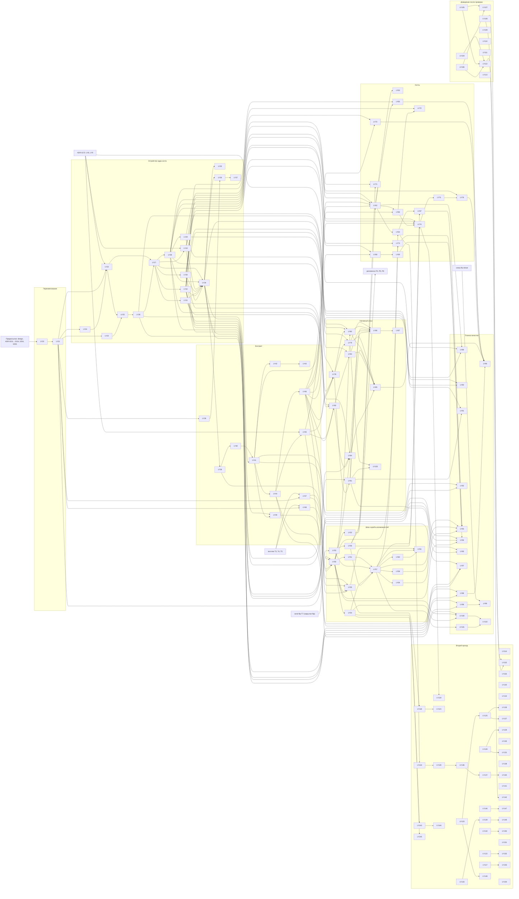

# Платформенный слой — задачи

- **Статус:** редакция 3 утверждена: ADR-0151, 0152, 0153, 0154, 0254 и 0255 приняты 2026-10-21;
  исполнение идёт, ход — в разделе «Ход исполнения»
- **Ограниченное утверждение:** LY8/LY9 исполняются вместе по
  [ADR-0172](../../../adr/ADR-0172-host-owned-system-preferences.md), используя
  текущие имена крейтов и owner-local runtime. Это не утверждает остальные задачи,
  переименование крейтов или шов возможностей. LY8/LY9 завершены: все пункты «Приёмки LY8/LY9»
  отмечены, ход — «Доведение до приёмки». Запуск на Mac — vanyastaff/flui#1840. Суть LY89
  (уведомления вместо опроса на macOS и Android, ноль пробуждений после Home на устройстве)
  сделана вместе с ними; что остаётся за LY89, говорит её запись в «Ходе исполнения».
- **Дата:** 2026-10-20
- **Design:** [design.md](design.md); требования — [requirements.md](requirements.md)
- **База:** `main` @ `deb9faea2`
- **Итог:** 134 задачи LY20–LY154 одной упорядоченной серией (идентификатор LY77 не занят):
  83 задачи LY20–LY103, десять задач доведения LY104–LY113, которые нашла проверка исполненных
  задач 2026-11-15, и 41 задача второго прохода LY114–LY154. Порядок задаёт колонка «Зависит от»; сроков, выпусков и оценок трудозатрат у
  задач нет, серия идёт до последней задачи. LY8/LY9, работа вне серии, завершена.

## Правила исполнения

1. Задача = worktree под `.claude/worktrees/<имя>` = ветка = один PR. Агент работает в своём
   worktree и не трогает чужие.
2. Проверки по AGENTS.md «Checking a change»: `cargo fmt --all`, затем clippy heli
   (`--all-targets -- -D warnings`) и nextest на изменённых крейтах и на их зависимых, если
   изменился публичный API; docs-only задача — только `cargo heli xtask checks`. Cargo идёт через
   heli: `cargo heli <аргументы>`, задачи репозитория — `cargo heli xtask <задача>`. Набор
   `flui-native` исполняется на Linux: изменение хоста Windows или macOS требует
   `cargo heli nextest run -p flui-native` вручную на этой ОС (до LY20 крейт называется
   `flui-platform`).
3. Fix-тест падает при откате исправления (изолированный checkout). Перемещение без изменения
   поведения доказывается тем же набором тестов, зелёным до и после; список перенесённых тестов — в
   PR.
4. Имена кода и тестов без номеров задач и требований: ID живут только в файлах этой спеки
   (`cargo xtask markers`). Правки файлов — инструментами Read/Edit/Write; массовые механические
   правки — `git mv`, `sd`, `ast-grep`, `rg`, не скрипты на Python, Perl или PowerShell.
5. PR, меняющий поверхность для потребителя, добавляет `changelog.d/<branch-slug>.md`
   (`### Added|Changed|Deprecated|Removed|Fixed|Security`).
6. Новая публичная поверхность сливается вместе с первым production-потребителем (R10.4). Если
   потребитель — следующая задача, PR называет её.
7. Изменение поддержки платформы обновляет `docs/platform-parity.md` и `docs/gaps.md` в том же PR;
   ✅ — только после прогона на этой ОС.
8. Файлы активной ветки не трогаются до её слияния или без согласия владельца. Сейчас их держат:
   send-flip — `flui-view/src/{owner,context}/*`, `flui-runtime/src/ui_runtime/commands.rs`,
   `flui-widgets/src/text/controller.rs` и остаток flip по крейтам (её T10); text-ime и
   teardown — `text_store/*`, Win32 `text/windows/tsf/*`,
   `flui-runtime/src/ui_runtime/presentation_lifecycle.rs`; persistence — `flui-view/src/persist/*`
   и `flui-app/src/app/storage_host.rs` (P4, P5, P6 — после LY52); LY8/LY9 — предпочтения.
   Это зависимости по порядку и записаны в колонке «Зависит от», а не окна по датам.
9. **Где:** **L** — Linux CI; **W** — Windows нативно (локальный запуск, вывод в PR); **T** — только
   cross-typecheck или `wasm32` без запуска (так и пишется в PR); **Dev: <ОС>** — прогон на
   устройстве владельца: macOS, iOS, Android, Linux (Wayland, X11), Web (браузер); датированный
   вывод — в PR. «L» без остального — всё доказательство даёт Linux CI.
10. Каждый Rust-набросок в ADR и design собран в scratch-крейте, вывод сборки — в PR. Зелёный CI на
    head — условие слияния.

## Предпосылки

Серия начинается, когда:

1. владелец утвердил design.md и requirements.md редакции 3;
2. ADR-0151…0154, ADR-0254 (контракт окна: D4, D5, D10, D11, D12) и ADR-0255 (хосты Android, iOS
   и Web, мост к хосту: D14–D16, D19, D23) приняты вместе с этой редакцией, и `Superseded-by` в
   старых ADR (design §10) уже проставлены. Каждый записан как «не реализовано»: задачи ниже
   исполняют их.

Эти два пункта — вход серии, а не задачи в ней; на графике они узел PRE. Формы, которые ADR
оставляют задаче и которые задача называет в своём PR: набор материалов кроссплатформенной команды
фона (ADR-0254 п. 3), слот типизированных опций одной ОС в `WindowOptions` (п. 8), вход ядра для
`AndroidApp`.

## Граф

## Задачи

### Переименование

| ID | Задача | Зависит от | Крейты и файлы | Гейты | Тесты | Где |
|---|---|---|---|---|---|---|
| **LY20** | **Переименование ядра:** `crates/flui-platform` → `crates/flui-native` (D21, design §9.1). `git mv` и `sd` по целому токену, длинное совпадение первым; без ручных правок, кроме ловушек: пакет, библиотека, пути, фичи (`flui-native/a11y`), `allowed-dependents`, `reach.tier.K.forbid` (называет `flui-native`; нового `flui-platform` в нём нет: контракт — tier C), `globals`, пути xtask, `package(flui-native)` в nextest, `--exclude flui-native` в `weekly.yml`, цели `tracing` и `RUST_LOG` (`flui_native=debug` в job’ах CI), имя потока `flui-native-bg`; trybuild `.stderr` перегенерируются (`TRYBUILD=overwrite`), не заменяются текстом. Не трогать: `flui_native_recording`, `flui-native-library-*`, архивный `docs/plans`, текст ADR-0151, выпущенные записи `CHANGELOG.md`, имя файла ADR-0082, Java-пакет `dev.flui.platform`, цель `"flui.platform"`. Тексты об отношении двух крейтов (README, ARCHITECTURE.md, `docs/crates.md`, `docs/architecture.md`, `docs/testing.md`, `design/*`) переписать по смыслу. Точные команды — в описании PR. Реэкспорты контракта через ядро читаются `flui_native::WindowOptions` до LY23 | PRE | весь workspace: корневой `Cargo.toml`; `crates/{flui-app,flui-runtime,flui-testing}`; `examples/web_demo`; `tools/xtask` (`tasks.rs`, `change_scope/lane_args.rs`, `workspace/reach*`, `globals*`, `platform_floor.rs`, `android_dex.rs`, allowlists `docs-paths`, `markers`, `testing`); `.github`; `.config/nextest.toml`; `clippy.toml`, `deny.toml`, `typos.toml`; `AGENTS.md`; `docs/*`, `design/*` | `workspace`, `reach`, `globals`, `checks`, `deps`, `cross-typecheck`, `wasm-check`, `key-vocabulary`, `platform-floor`, `android-dex`, `docs-paths`, `docs-links` | весь набор без правок смысла; `compile_fail` перегенерирован; повторный прогон команд PR на его выходе даёт пустой diff | L + T |
| **LY21** | **Переименование контракта:** `crates/flui-platform-api` → `crates/flui-platform` (D21, design §9.2). `flui_platform_api` → `flui_platform`; `SDK_SURFACE` в `tools/xtask/src/workspace/tiers.rs`; генератор `key_vocabulary` (пути записи `src/keyboard/{named_key,code}.rs` и строка `use …::keyboard::{name}` в сгенерированных документах: файлы под git совпадают с выводом генератора); `recording_vocabulary` (26 путей); `binary_id(flui-platform::compile_fail)` в nextest; фичи `flui-platform/serde` (`flui-interaction`, корневой `serde`); `documentation = "https://docs.rs/flui-platform"`; цели `tracing` `flui_platform_api::input_regions`; исключения путей в `typos.toml`; фикстуры `reach` в xtask; README и ARCHITECTURE.md контракта. Фасад `flui::platform` не меняется. Те же приёмы и те же запреты, что в LY20. Начинается с разовой проверки (не гейт): в неархивных файлах не осталось токенов `flui-platform` и `flui_platform` (кроме ADR-0151), иначе строка вроде `--exclude flui-platform` из ветки, написанной до LY20, молча нацелится на контракт; ветка, вливающаяся после LY21, применяет обе карты по порядку | LY20 | весь workspace (9 манифестов с `flui-platform-api = { workspace = true }`, 545 `.rs`-файлов с `flui_platform_api::`), `tools/xtask` (`workspace/tiers.rs`, `key_vocabulary.rs`, `recording_vocabulary.rs`, `workspace/reach*`), `.config/nextest.toml`, `typos.toml`, `docs/*` | те же, что у LY20 | весь набор; `key-vocabulary` и `recording-vocabulary` проверяют сгенерированное; пустой diff при повторном прогоне | L + T |

### Устройство ядра-хоста

Порядок: механизм хоста (LY22), основа `flui-native` (LY23–LY26), цикл каждой платформы в `owner/` (LY27), затем по одной фиче на задачу (LY28–LY33), уборка (LY34) и то, что стоит на готовой раскладке (LY35–LY37). Задачи переноса LY27–LY34 не меняют поведения: перенесённые тесты идут без правок (правило 3), а каталог входит в проверку `module-dag` в той задаче, которая его создаёт. В колонке «Задача» запись «A → B» называет сегодняшний путь относительно `crates/flui-native/src/` (файлы платформ лежат под `platforms/`, общий код — под `shared/`) и путь раскладки design §6; число в скобках — строки файла сегодня. Файл платформы, которого у платформы нет сегодня (drag на macOS и iOS, доступность Android, iOS и Web), не создаётся: позицию таблицы называет `Absent<F>`, пока задача хоста (LY62–LY76, LY78–LY84) не принесёт файл.

| ID | Задача | Зависит от | Крейты и файлы | Гейты | Тесты | Где |
|---|---|---|---|---|---|---|
| **LY22** [P] | **Механизм хоста** (D13, D30, R4.2, R4.3, R4.5, R4.11). `host.rs`: `trait Host` с ассоциированным типом на каждую позицию закрытого списка (`Loop`, `Window`, `Displays`, `Input`, `Text`, `Accessibility`, `Clipboard`, `Drag`, `Haptics`, `Preferences`, `Lifecycle`, `Chrome`, `Storage`; граница позиции — трейт её фичи) и `Absent<F>` — единственный тип «на этой платформе нет»: он отвечает `Unsupported { NotOnThisPlatform }` и реализует трейт каждой фичи. `platform.rs`: `HostPlatform<H: Host>` — единственная реализация `Platform` (проводка `AppHandler`, окон и дисплеев). Семь нынешних `impl Platform` (`WindowsPlatform`, `MacOSPlatform`, `IOSPlatform`, `AndroidPlatform`, `WebPlatform`, `WinitPlatform`, `HeadlessPlatform`) разбираются по позициям: объект позиции остаётся в своём файле, общая обвязка уходит в `HostPlatform<H>`. `hosts/{windows,apple,android,web,winit,headless}.rs` — `impl Host for <Os>` и конструктор, больше ничего; пока файлы лежат под `platforms/`, таблицы называют их сегодняшние типы, а LY27–LY33 меняют в таблицах пути, и позиция, которую сегодня держит loop хоста, получает свой тип, когда фича забирает своё состояние. Позиция, которой у платформы сегодня нет (drag на macOS и iOS, доступность Android, iOS и Web; ввод текста у winit есть — `WinitTextInput`), — `Absent<F>`, а не умолчание метода. `current_platform()` возвращает `Box<dyn Platform>`; трейт — таблица, не generic-ядро: модели фич им не параметризованы. `cargo xtask module-dag` распространён на `flui-native`: `owner/` и `version/` не зависят ни от одной фичи; файл платформы в фиче зависит от модели своей фичи, `owner/`, `version/` и моделей других фич, никогда от файла платформы другой фичи, от файла другой платформы и от `hosts/` (мультиплексоры ОС диспетчируют через трейты-хуки `owner/`, которые регистрирует таблица); `hosts/` зависит от всех фич, от него не зависит никто; исключения — `macos`/`ios` → `apple/mod.rs` и `wayland`/`x11` → `linux/mod.rs` той же фичи и, до LY87, `display/winit.rs` → `display/linux/` (на Linux снимок дисплеев берётся у композитора или X-сервера напрямую, мимо winit); каталог входит в проверку той задачей, которая его создаёт; `--self-test` сажает нарушение на каждое правило. Чистая часть файла платформы — модуль под `cfg(any(<os>, test))` с `forbid(unsafe_code)`, FFI — под `cfg(<os>)`; в scratch-крейте доказаны: посаженный `unsafe` в чистом модуле не компилируется, `const _: () = assert!(..)` в FFI вычисляется `cross-typecheck`, таблица без одного ассоциированного типа не компилируется. AGENTS.md «Definition of Done»: тесты моделей и чистых частей ядра-хоста — модулями рядом (`pub(crate)`), `tests/` хранит conformance и записи нативных трасс. `docs/extending.md`: строка «новая ОС» — слово из словаря std, файл в каждой фиче и таблица `hosts/<os>.rs`, которая начинается с `Absent<F>` во всех незаполненных позициях (строки parity новой платформы читаются из неё, и платформа готова, когда `Absent` не осталось и conformance-строки прошли на ней), нижняя граница в `platform-support.toml`, строки gaps, цель CI, записи `globals`; внешние хосты ждут встраивателя, а не разделения крейтов | LY21, LY24, LY9 | `crates/flui-native/src/{host.rs,platform.rs,hosts/*,lib.rs}`, `impl Platform` в `platforms/*`, `tools/xtask/src/module_dag*`, `crates/flui-native/Cargo.toml` (`[package.metadata.flui.modules]`), `AGENTS.md`, `docs/extending.md`, scratch-крейт для доказательств | `module-dag` (+ `--self-test`), `workspace`, `globals`, `docs-paths`, `checks` | самотест `module-dag`: по плантированному нарушению на каждое правило; trybuild: таблица без одного ассоциированного типа не компилируется (E0046); `rg "impl.* Platform for"` по ядру даёт одну строку; существующие наборы без правок; вывод scratch-доказательств в PR | L + W + T; Dev: macOS, iOS, Android, Web |
| **LY23** [P] | **Ядро перестаёт реэкспортировать имена контракта** (D12, R2.9). Удалить список из 64 имён в `traits/mod.rs` и около 50 в корне `lib.rs`; `flui-app` (около 249 мест), `flui-runtime` (26), `flui-testing`, `flui-sdk`, `examples`, `packages` импортируют контрактные имена из `flui_platform`, свои — из `flui_native`. В README и ARCHITECTURE.md обоих крейтов убрана фраза «реэкспортирует всё по старым путям» | LY21 | `crates/flui-native/src/{lib.rs,traits/mod.rs}`; `crates/{flui-app,flui-runtime,flui-testing,flui-sdk}`; `examples/*`; `packages/*` | `workspace`, `reach`, `deps` | компиляция workspace и существующий набор; `rg` по префиксу `flui_native::` с именами контракта (`WindowOptions`, `HostNotice`, `SessionEnd`, `WindowMode`, `WindowReveal`, `WindowCommand`) пуст | L + T |
| **LY24** [P] | **Мёртвое Linux:** удалить `LinuxPlatform` (274 строки, `unimplemented!()` в `run`, `quit`, `open_window`, …) и `LinuxWindowExt` (`window_ext.rs`, 510 строк, нет ни одной реализации) вместе с экспортами `lib.rs:214` и `platforms/mod.rs:59`. Живой слой `platforms/linux` сохраняется: `display/` (Wayland и X11 RandR), `host_notices/` (logind, memory pressure), `lifecycle_model/`, `x11_window_probe.rs`, `accessibility.rs` (AT-SPI). Единственный живой вызов `LinuxPlatform::is_wayland()` (`winit/display_linux.rs:127`) становится функцией этого слоя | LY21 | `crates/flui-native/src/{lib.rs,platforms/mod.rs}`, `platforms/linux/{mod.rs,window_ext.rs}`, `platforms/winit/display_linux.rs` | `workspace`, `globals`; `rg 'unimplemented!'` по `platforms/` | существующие тесты слоя Linux; `winit` по-прежнему выбирается на Linux | L |
| **LY25** | **`traits/` и `owner/`** (D13). `traits/platform.rs` → `platform.rs` рядом с `HostPlatform<H>` из LY22 (`Platform` запечатан приватным супертрейтом, D6; единственная реализация — `HostPlatform<H>`), `traits/host_window.rs` → `host_window.rs` (`HostWindow` запечатан), `traits/owner.rs` (992 строки) и `shared/{owner_signal,owner_slot,panic_boundary}` → `owner/` (`OwnerPlatform`, `SharedPlatform`, `PlatformProxy`, сигнал и слот owner-потока, граница паники); `traits/` исчезает; пять записей `globals` под `shared::` и пути `flui_native::traits::…` (65 мест в 31 файле) заменяются. `current_platform()` остаётся единственной лестницей выбора хоста в `lib.rs`; `owner/` входит в проверку `module-dag` | LY22, LY23 | `crates/flui-native/src/{lib.rs,platform.rs,host_window.rs,owner/*}`, `Cargo.toml` (`globals`), `crates/flui-app`, `tools/xtask/allowlists/*` | `module-dag`, `globals`, `workspace`, `reach` | trybuild: внешний `impl Platform` и `impl HostWindow` не компилируются (`tests/ui/*.stderr` перегенерированы); существующий набор | L + T |
| **LY26** | **Одна точка вызова пользовательского кода** (D13, R4.6). В `owner/` единственная функция берёт обработчик из слота, отпускает локи и заёмы, вызывает, возвращает на место (или оставляет замену, сделанную во время вызова) и держит границу паники: первый отказ не теряется (`thread::panicking()` после catch ложно). `shared/handlers.rs` (2 497 строк: `PlatformHandlers`, `WindowCallbacks`, `impl_window_callback_setters!`) переезжает в `owner/` и вызывает только через неё, до LY44 и LY45, которые его удаляют. Удалить шесть аренд (`RunningSessionEndHook`, `CallbackLease`, `InputLease`, `WindowEventLease`, `WindowEventHandlerLease`, `ExitPolicyHookLease`) и ручной take/restore (macOS `loop_control` 8 мест, iOS `platform.rs` 15, Web `platform.rs` 8). Исправить пользовательский код под локом: Android `mod.rs:1010` (`invoke_quit` под мьютексом обработчиков), headless `create_mock_window` (`WindowEvent::Created` под мьютексом состояния) и `Drop` заменённого обработчика под локом (Android `mod.rs:1098,1102,1116`, iOS `platform.rs:514,518,528`, headless `platform.rs:483,525,531,550,584`) | LY25 | `crates/flui-native/src/owner/*`, `platforms/{android/mod.rs,ios/platform.rs,web/platform.rs,macos/loop_control.rs,headless/platform.rs,winit/platform.rs,windows/*}` | `module-dag`, `globals`, `file-length`, `markers` | на каждом хосте: обработчик, который изнутри вызова ставит новый обработчик, завершает приложение, открывает окно; обработчик, чей `Drop` вызывает платформу; паника обработчика не теряет первый отказ; все падают без исправления | L + W + T; Dev: Android (выход по системе) |
| **LY27** | **`owner/`: цикл каждой платформы** (D13, R4.1, R4.8). Цикл, пробуждения и владение потоком выходят из файлов платформ в `owner/`; фич они не называют. Windows: цикл сообщений из `windows/platform.rs` (3 083; делится в пределах 3 000 строк, остальное уходит по фичам в LY28–LY33), `windows/platform/{wake_deadline,modal_frame_tests}.rs`, `owner_control.rs` и `owner_control/wake.rs` (584 + 49), `modal_loop.rs` (88), `com_apartment.rs` (162), `util.rs` (125; туда, где используется) и широковещательное окно — скрытый top-level приёмник из `windows/preferences/receiver.rs` (241), который делят предпочтения, дисплеи и lifecycle, поэтому он лежит в `owner/`, а не в фиче, и сообщает им через трейт подписчика, а не по имени фичи, — в `owner/windows.rs`. Там же — класс окна и сырая оконная процедура с трейтом-хуком сообщений, который реализуют файлы платформы фич (окно, ввод, текст, drag, lifecycle) и регистрирует `hosts/windows.rs`; viewport DirectManipulation создаётся тем же хуком при создании окна. Apple: `macos/{platform,loop_control,owner_lane,wake_pump}.rs` (443 + 666 + 267 + 292: цикл AppKit, делегат) и `ios/{platform,native_owner,scene,executor}.rs` (1 243 + 33 + 95 + 45: `UIApplicationMain`, делегат, сцены; `IOSSceneEvent` и `IOSSceneSessionId`, которые называет `flui-app`, остаются `pub` ядра) — в `owner/apple.rs`. Android: `android/mod.rs` (1 181: looper, `AndroidApp`, `JavaVM`), `android/java_view.rs` (693) и `shared/android_ndk` (513) — в `owner/android.rs`; путь `include_bytes!` на `classes.dex` и `tools/xtask/src/android_dex.rs` пересчитываются здесь. Web: `web/{platform,listener,executor}.rs` (488 + 53 + 36: цикл `requestAnimationFrame`) — в `owner/web.rs`. winit: `winit/{platform,control}.rs` (3 095 + 537; делится) и `winit/platform/real_loop_tests.rs` (1 998) — в `owner/winit.rs`. headless: ходы владельца из `headless/platform.rs` (2 454) — в `owner/headless.rs`. `redraw_poll.rs` (93) — в `owner/redraw_poll.rs`. Таблицы `hosts/*` называют новые типы цикла; записи `globals` переезжают; ARCHITECTURE.md приводится к новому устройству. Циклов Linux здесь нет: нативные Wayland и X11 приносят свои в LY78 и LY82 | LY22, LY26 | `crates/flui-native/src/owner/*`, `platforms/{windows,macos,ios,android,web,winit,headless}/*` (уходят перенесённые файлы), `shared/android_ndk.rs`, `redraw_poll.rs`, `hosts/*`, `Cargo.toml` (`globals`), `tools/xtask/src/android_dex.rs` | `module-dag`, `file-length`, `globals`, `android-dex`, `cross-typecheck`, `markers` | перенесённые тесты (`wake_deadline`, `modal_frame_tests`, `real_loop_tests`) без правок; `tests/` conformance и трассы Windows без правок; `cargo xtask android-dex` проверяет те же байты | L + W + T; Dev: macOS, iOS (Simulator), Android (ручной прогон ввода без изменения результата) |
| **LY28** [P] | **`window/`** (D13, R4.1, R4.8). Модель: `shared/window_state` (299; единственный `mode_of`) → `window/state.rs`, `shared/visibility` (130) → `window/visibility.rs`, `shared/window_installation` (92; его называет `flui-app`) → `window/installation.rs` (публичные имена — от корня крейта, `flui-app` называет `flui_native::WindowInstallation`; цикл iOS ждёт установку через свой хук `SceneInstallation`), `config.rs` (240) → `window/config.rs`. Windows: `windows/{window,window_ext,window_frame,window_limits,window_modes,window_placement,window_visibility,appearance}.rs` (3 176 + 368 + 291 + 192 + 94 + 342 + 256 + 58) и `shared/windows_window_limits` (333) → `window/windows/{mod,limits,window,set,proc,backdrop}.rs` (`mod.rs` — корень под `cfg(any(windows, test))`: чистые правила размеров `limits.rs` с `forbid(unsafe_code)` собираются и тестируются на любом хосте, FFI-половины — под `cfg(windows)`; тело окна делится на `window.rs` и `set.rs` (набор окон и расстановка) по пределу 3 000 строк; класс окна и сырая оконная процедура живут в `owner/windows.rs` (LY27), `proc.rs` реализует её хук для сообщений самого окна (`WindowProc`), сообщения ввода — хук `InputMessages` в `platforms/windows/input_messages.rs` до LY29, текст, drag и lifecycle — свои хуки в своих файлах, а `hosts/windows.rs` их регистрирует; каждый хук перечисляет свои сообщения (`WindowMessages::answers`), и наборы хуков таблицы не пересекаются). `shared/hwnd_affinity` (286) — машинерия владельца, не окна: правила привязки окна Win32 к потоку применяют контрол владельца и цикл → `owner/hwnd_affinity.rs` (под `cfg(any(windows, test))`). DirectManipulation (`windows/direct_manipulation.rs`, 758, его `tests.rs` и `shared/direct_manipulation`, 495) — источник ввода и переезжает в LY29. Apple: `macos/{window,window_tiling,window_ext,display_pass,liquid_glass}.rs` (2 994 + 413 + 306 + 85 + 243), `ios/{window,status_bar}.rs` (1 350 + 174) и `shared/{appkit_window_geometry,appkit_window_mode,screen_edges}` (372 + 409 + 43) → `window/apple/{mod,macos,ios,geometry,liquid_glass}.rs` и `window/apple/macos/{ext,delegate}.rs` (`macos.rs` держит окно с его командами и `display_pass`; публичное расширение `MacOSWindowExt` с раскладкой `tiling` и делегат `NSWindowDelegate` — отдельные файлы по пределу 3 000 строк; общее у macOS и iOS — `apple/mod.rs`). Android: `android/{window,safe_area,gesture_exclusion,system_chrome}.rs` (700 + 204 + 63 + 122) → `window/android.rs`. Web: `web/{window,registration}.rs` (881 + 531) → `window/web.rs`. winit: `winit/{window,window_plan}.rs` (914 + 831) → `window/winit.rs`. Linux (живой слой): `linux/x11_window_probe.rs` (387) с тестами и `linux/lifecycle_model/x11_window_mode.rs` (238) → `window/linux/x11.rs`. headless: `headless/window_policy.rs` (36) и `MockWindow` из `headless/platform.rs` → `window/headless.rs`. Системный chrome окна (`android/system_chrome.rs`, `ios/status_bar.rs`, `FakeSystemChrome`) живёт в тех же файлах: позицию `Chrome` таблицы называет `window/`. `liquid_glass` и `MacOSWindowExt` остаются внутри `window/apple/` до LY36. Шов: позиция окна называет общее окон платформы, `host::Window::Shared` (`WindowSet` Win32, конфигурация macOS, фабрика окон UIKit, рамка и вид оконного менеджера winit, модель окон headless, `()` на Android и Web); конструктор хоста строит его один раз, `HostPlatform::from_parts(shared, |shared| Loop::new(..))` (`try_from_parts` для цикла, который может не построиться), и цикл получает тот же экземпляр как хук, который сам объявляет. Хуки циклов объявляет `owner/`, реализует `window/`: `owner::handlers::{CallbackWindow, OpenWindows}`, `owner::windows::ClassWindows`, `owner::apple::macos::WindowRegistry`, `owner::apple::ios::{SceneWindow, SceneWindows, SceneConsumer, SceneInstallation}`, `owner::android::ActivityWindow`, `owner::winit::{LoopWindow, LoopWindows}` (цикл нумерует, регистрирует и доводит окно, хук только строит его из `WindowSeed`), `owner::headless::TrackedWindows`; `owner/` не называет `window/` и в тестах. Рёбра `window/` в `platforms/` и между файлами текста и окна одной платформы — датированные исключения `module-dag` (`exit = "ADR-0151"`), каждое уходит в задаче своей фичи (строки LY29, LY30, LY33); рёбра окна в файлы `accessibility/`, `haptics/` и `drag/` (LY32 влит раньше: окно делает объект фичи на окно) — тоже исключения, их снимает LY38, где оконные позиции таблицы становятся тем, что отдаёт окно. Исключения `retiring` LY32, ребро которых уходит с файлом окна, сняты: `drag::windows` → `platforms::windows::platform` и `haptics::windows` → `platforms::windows::platform` — `WindowRef` стал словарём владельца (`owner::windows::WindowRef`; `with_context` — метод окна в `window/windows/proc.rs`), `drag::web` → `platforms::web::registration` — хук `owner::web::HostDrag::register` получает регистрацию холста как `&mut dyn owner::web::CanvasListeners`, который реализует `window::web::Registration`; три ребра окна в `display/` (iOS, macOS, headless) уходят, когда хук дисплеев своего цикла несёт то, что окно читает. LY33 влит раньше, и окно называет его файлы платформ тоже через исключения: `window::windows` → `preferences::windows` (`mouse_geometry`), `window::windows` → `lifecycle::windows` (`messages`: разбор `WM_WTSSESSION_CHANGE`), `window::android` → `preferences::android` (`night_mode`, `pixel_ratio`, `geometry`); каждое уходит, когда фича отдаёт это через модель или хук `owner/`. Зонд X11 (`WinitLoop::x11_probe`, `WinitApp::refresh_x11_windows`) ушёл в окно: соединения и ячейка — `window/linux/x11.rs` за трейтом модели `WindowManagerView`, окна, которые менеджер окон изменил без события winit, отдаёт хук `LoopWindows::take_unreported`, а перечитывает их сам цикл; в `platforms/winit/linux_unreported.rs` осталась проверка дисплеев. Сигнальная половина правила Activity (`ActivitySignal` в `lifecycle::android::rule`, оконные ветки `ActivityTarget` у `AndroidLoop`, `publish_activity_fact`) в этой ветке не переехала в `window/android.rs`: это меняет путь событий Activity и требует своего прогона на устройстве; записи `globals` переезжают | LY27 | `crates/flui-native/src/window/*`, `platforms/{windows,macos,ios,android,web,winit,linux,headless}/*` (уходят перенесённые файлы), `shared/*` (уходят), `config.rs` (уходит), `tests/*` (уходят перенесённые), `hosts/*`, `Cargo.toml` (`globals`) | `module-dag`, `file-length`, `globals`, `cross-typecheck`, `markers` | перенесённые тесты правил (`hwnd_affinity`, `appkit_window_*`, `screen_edges`, `window_state`, `window_installation`) зелёные на Linux; `tests/` conformance и трассы Windows без правок | L + W + T; Dev: macOS, iOS (Simulator), Android |
| **LY29** | **`input/`** (D13, R4.1, R4.8). Модель: `shared/pointer_assembly/` (9 файлов, 2 729) → `input/assembly/`, `shared/{keys,keyboard_adapter}` (526 + 162) → `input/keys.rs`, `shared/input_availability` (152) → `input/availability.rs`, `shared/scroll` (38) → `input/scroll.rs`, `shared/events` (30: метка времени события и идентичность первичной мыши; её называет `flui-app` в `owner_dispatch.rs`) → `input/mod.rs`. Windows: `windows/events.rs` (1 734) и `windows/platform/{pointer_messages,keystroke_queue}.rs` (144 + 111) → `input/windows/{mod,raw}.rs`; `windows/direct_manipulation.rs` (758), его `tests.rs` и `shared/direct_manipulation` (495) → `input/windows/direct_manipulation.rs` (viewport на окно создаётся хуком `owner/windows.rs` при создании окна; его колбэки — источник pan и zoom для сборки указателя). Apple: `macos/{events,view}.rs` (524 + 755), `ios/events.rs` (284) и `shared/keys_macos` (401) → `input/apple.rs`. Android: `android/input.rs` (550) и `shared/{android_motion,android_keys,android_scroll}` (923 + 45 + 149) → `input/android.rs`. Web: `web/events.rs` (1 544) и `shared/web_pinch` (341) → `input/web.rs`. winit: `winit/events.rs` (1 670) → `input/winit.rs`; тест `winit/events/keyboard_tests.rs` (775) на таблицу `keys_macos` переезжает в `input/apple.rs`: файл платформы не называет другую платформу. headless: `HeadlessInputDevices` из `headless/platform.rs` → `input/headless.rs`. Форма доступа к `assembly/` для отдельного тестового бинаря со счётчиком аллокаций и признака `native-capture` решается в PR. Обратные рёбра, которые оставил LY28 (исключения `module-dag`), уходят здесь: хук `InputMessages` (`platforms/windows/input_messages.rs`: мышь, указатель, колесо, клавиатура, символы, раскладка) → `input/windows/`; `window::windows` → `platforms::windows::{events, direct_manipulation}` (позиции курсора и часы сообщений в процедуре окна; слот viewport тачпада в контексте окна), `window::apple::macos` → `platforms::macos::view` (content view принимает ввод), `window::apple::ios` → `platforms::ios::events`, `window::web` → `platforms::web::events` (слушатели ввода на canvas), а также `text::android` → `platforms::android::input` и `text::web` → `platforms::web::events` из LY30. Целевая форма: состояние фичи на окно (viewport, часы сообщений, слушатели) живёт у фичи по `WindowIdentity`, заводится её хуком `created` и снимается при уничтожении окна; окно его не строит и не держит, а `owner/` даёт хук уничтожения рядом с `created`, если его ещё нет. Ребро в файл LY33, которое снимает переезд ввода (через модель `preferences` или хук `owner/`): `platforms::windows::events` → `preferences::windows::mouse_geometry` (геометрия мыши для колеса и жестов). Снимает исключения `retiring` (LY32) `drag::windows` → `platforms::windows::events` (`MOUSE_BUTTONS`) и `drag::web` → `platforms::web::events` (`answer`, `pointer_position`): что drag берёт у ввода, становится моделью `input/`. Записи `globals` переезжают | LY28 | `crates/flui-native/src/input/*`, `platforms/{windows,macos,ios,android,web,winit,headless}/*` (уходят перенесённые файлы), `shared/*` (уходят), `tests/*` (уходят перенесённые), `crates/flui-app/src/app/runner/owner_dispatch.rs`, `Cargo.toml` (`globals`) | `module-dag`, `file-length`, `globals`, `cross-typecheck`, `markers` | перенесённые тесты (`pointer_assembly`, `direct_manipulation`, `android_motion`, `android_keys`, `web_pinch`, `input_capabilities`) рядом с моделью и чистыми частями; записи нативных трасс проходят без правок | L + W + T; Dev: macOS, iOS, Android, Web |
| **LY30** [P] | **`text/`** (D13, R4.1, R4.8). Модель: `shared/ime_text` (45; зеркало текстового поля Android и Web) → `text/ime.rs`, `text_sizing.rs` (202) → `text/sizing.rs`. Windows: `windows/text_services/{mod,document,input_scope,probe,tests}.rs` (4 534, из них тесты 1 361) и `shared/text_geometry` (143) → `text/windows/{mod.rs,tsf/}`. Apple: `macos/text_input.rs` (781) → `text/apple/macos.rs`, `ios/text_sizing.rs` (58) → `text/apple/ios.rs`. Android: `android/{text_input,text_sizing}.rs` (516 + 619) и `shared/android_ime` (399) → `text/android.rs`. Web: `web/text_input.rs` (1 080) и `shared/web_text` (105) → `text/web.rs`. headless: `FakeTextInput` из `headless/platform.rs` → `text/headless.rs`. winit отдаёт `WinitTextInput` (разрешение IME и область курсора) → `text/winit.rs`, позиция `Text` его таблицы называет его; позиция `Text` получает трейт фичи текста вместо маркера `host::Text`. Тесты `android_ime`, `web_text`, `text_input_mapping` — рядом с моделью и чистыми частями; записи `globals` переезжают. LY30 влит раньше LY28, и с окном его связывают рёбра между файлами одной платформы (исключения `module-dag`): окно строит текстовый ввод и снимает размер текста (`window::{windows, apple::macos, apple::ios, android, web, winit, headless}` → `text::*`: контекст Win32 держит соединение TSF, окно Android — поле IME и захват размера текста), а текст находит своё состояние в окне (`text::windows` → `window::windows`: `WindowRef`, `with_window_context`; `text::android` → `window::android`: работа метода ввода находит поле на окне; `text::web` → `window::web`: `EditorSlot`, `Listener`, `FocusSync`, `effective_focus`). Целевая форма та же, что у остальных фич: текст держит своё состояние на окно по `WindowIdentity`, заводит его в хуке `created` (как `Tsf` уже активирует TSF) и снимает при уничтожении окна; масштаб окна доходит до него через модель окна, а не через контекст | LY27 | `crates/flui-native/src/text/*`, `platforms/{windows,macos,ios,android,web,headless}/*` (уходят перенесённые файлы), `shared/*` (уходят), `text_sizing.rs` (уходит), `tests/*` (уходят перенесённые), `Cargo.toml` (`globals`) | `module-dag`, `file-length`, `globals`, `cross-typecheck` | перенесённые тесты `android_ime`, `web_text`, `text_input_mapping` зелёные на Linux; Win32 `text_services/{probe,tests}.rs` без правок смысла — W | L + W + T; Dev: macOS, Android, Web |
| **LY31** [P] | **`display/`** (D13, R4.1, R4.8). Модель: `shared/display_source` (460: реестр идентичностей и последний снимок, которые держит каждый нативный источник) → `display/source.rs`. Apple: `shared/{apple_display_identity,display_link_rate,display_period}` (253 + 304 + 61), `macos/display.rs` (272) и `ios/display.rs` (298) → `display/apple/{mod,macos,ios}.rs` (общее у macOS и iOS — `apple/mod.rs`). Windows: `windows/display.rs` (572), `windows/platform/display_message_tests.rs` (151) и `shared/windows_display` (184) → `display/windows.rs`. Android: `android/display.rs` (576) и `shared/android_display` (317) → `display/android.rs`. Web: `web/{display,display_events,features}.rs` (375 + 706 + 125) и `shared/{dppx_query,refresh_estimate,screen_identity,web_feature}` (102 + 560 + 187 + 165) → `display/web.rs`. winit: `winit/display_{linux,macos,windows}.rs` (151 + 70 + 65) → `display/winit.rs` (`display_linux.rs` читает источник Linux из `display/linux/`: единственное ребро между файлами платформ, его называет `module-dag` поимённо до LY87). Linux (живой слой): `linux/display/*` (Wayland `wl_output` и `zxdg_output_v1`, X11 RandR; 11 файлов, около 3 500 строк) → `display/linux/`. headless: `headless/display.rs` (191) → `display/headless.rs`. Тесты правил и источников (`windows_display`, `refresh_estimate`, `screen_identity`, `dppx_query`, `display_link_rate`, `display_period`, `android_display`, `apple_display_identity`, `linux/display/*/tests.rs`) — рядом; записи `globals` переезжают. Проверка дисплеев winit на Linux из `platforms/winit/linux_unreported.rs` (`WinitApp::sync_unannounced_displays`, `moves_unannounced`: окно Wayland переходит на другой выход без события winit) → `display/winit.rs` | LY27 | `crates/flui-native/src/display/*`, `platforms/{windows,macos,ios,android,web,winit,linux,headless}/*` (уходят перенесённые файлы), `shared/*` (уходят), `tests/displays.rs`, `Cargo.toml` (`globals`) | `module-dag`, `file-length`, `globals`, `cross-typecheck`, `wasm-check` | перенесённые тесты правил и источников; `tests/displays.rs` без правок смысла; `wasm-test` и `web_browser` без правок смысла | L (+ wasm32) + W + T; Dev: macOS, iOS, Android, Web (Chrome) |
| **LY32** [P] | **`clipboard/`, `drag/`, `accessibility/`, `haptics/`** (D13, R4.1, R4.8). `clipboard/`: `shared/clipboard_lock` (88; общий замок Win32 и winit с `arboard`) → `lock.rs`; `windows/clipboard.rs` (456) → `windows.rs`; `macos/clipboard.rs` (245) и `ios/clipboard.rs` (71) → `apple.rs`; `web/clipboard.rs` (60) → `web.rs`; `winit/clipboard.rs` (128) → `winit.rs`; headless-приёмник в памяти → `headless.rs`; внутрипроцессная заглушка Android остаётся в его таблице до LY50. `drag/`: `windows/drag.rs` (785), `windows/drag/{com,tests}.rs` (557 + 1 395) и `shared/ole_drag_drop` (453) → `windows.rs`; `android/drag.rs` (556) и `shared/android_drag` (307) → `android.rs`; `web/drag.rs` (642) и `shared/html_drag_drop` (296) → `web.rs`; `winit/data_transfer.rs` (484) → `winit.rs`; `headless/drag.rs` (469) → `headless.rs`. `accessibility/`: `shared/accessibility_bridge` (114) → `bridge.rs`; `windows/accessibility.rs` (210) → `windows.rs`; `macos/accessibility.rs` (227) → `apple/macos.rs`; `linux/accessibility.rs` (189; AT-SPI, живой слой) → `linux.rs`; `FakeAccessibility` из `headless/platform.rs` → `headless.rs`. `haptics/`: `shared/haptic_degradation` (1 242) → `degradation.rs`; `windows/haptics.rs` (768) → `windows.rs`; `macos/haptics.rs` (58) и `ios/haptics.rs` (452) → `apple/{macos,ios}.rs`; `android/haptics.rs` (519) → `android.rs`; `web/haptics.rs` (103) → `web.rs`; `FakeHaptics` (headless-приёмник, LY48) → `headless.rs`. Позиции, которых у платформы нет сегодня (drag на macOS и iOS, доступность Android, iOS и Web, haptics Linux и winit), в таблицах — `Absent<F>`. Записи `globals` переезжают | LY27 | `crates/flui-native/src/{clipboard,drag,accessibility,haptics}/*`, `owner/*` (трейты хуков, которыми цикл держит объекты фич, и хост-трейты, которые их делают; состояние drag headless), `hosts/*`, `platforms/{windows,macos,ios,android,web,winit,linux,headless}/*` (уходят перенесённые файлы), `shared/*` (уходят), `tests/*` (уходят перенесённые), `Cargo.toml` (`globals`) | `module-dag`, `file-length`, `globals`, `cross-typecheck`, `markers` | перенесённые тесты (`ole_drag_drop`, `android_drag`, `html_drag_drop`, `haptic_degradation`) рядом с моделью и чистыми частями; тесты слоя Linux (AT-SPI) и `headless_drag` без правок | L + W + T; Dev: macOS, Android, Web |
| **LY33** [P] | **`preferences/` и `lifecycle/`** (D13, R4.1, R4.8). `preferences/`: `shared/preference_read` (196; допуск опроса, общий для ограниченных сэмплеров) → `read.rs`; Windows: `windows/preferences.rs` (457), `windows/preferences/{languages,tests}.rs` (180 + 279) и `windows/platform/preference_retry_tests.rs` (242) → `windows/` (приёмник широковещательных сообщений уже в `owner/windows.rs`, LY27: предпочтения подписываются на него через `owner/`); Apple: `macos/preferences.rs` (115) и `ios/preferences.rs` (128) → `apple/{macos,ios}.rs`; Android: `android/preferences.rs` (445) и `shared/android_text_weight` (82) → `android.rs`, а помощник Activity `with_activity` из него → `owner/android/activity.rs`, и с ним уходит исключение `module-dag` `display::android` → `platforms::android::preferences`; Web: `web/preferences.rs` (83) → `web.rs`; Linux: наблюдение портала Settings из `winit/preferences.rs` (239; D-Bus) → `linux.rs` (им пользуются winit, Wayland и X11); headless: производитель из LY8 в `headless/*` → `headless.rs`. `lifecycle/`: `shared/system_notice` (321; путь, которым уведомления любого хоста доходят до приложения) → `notice.rs`; Windows: `windows/host_events.rs` (481) и `shared/{windows_host_messages,windows_memory_watch}` (376 + 207) → `windows.rs`; Apple: `macos/system_notices.rs` (246), `shared/{terminate_gate,dispatch_memory_pressure}` (277 + 76) и `shared/apple_scene_error` (15; сбой уничтожения сцены UIKit) → `apple/{macos,ios}.rs`; Android: `shared/android_lifecycle` (446) и `android/memory.rs` (37) → `android.rs`; Web: `web/page_events.rs` (87) → `web.rs`; Linux (живой слой): `linux/host_notices/*` (logind, давление памяти), `linux/lifecycle_model/{mod,logind,memory_pressure}.rs` и `winit/platform/linux_notices.rs` (272) → `linux.rs`; headless: `HeadlessHostEvents` → `headless.rs`. Записи `globals` переезжают. Что переехало на деле: `shared/preferred_locales` → `preferences/locales.rs` (модель: его читают Web, Linux, macOS, iOS и Android); один файл на платформу, прежние файлы — его встроенные модули: `preferences/android.rs` (`configuration`, правила `contrast`, `text_weight`), `preferences/web.rs` (`browser`, правило `media` из `shared/browser_preferences`), `lifecycle/windows.rs` (`host_events`, правила `messages`, `memory_watch`; тесты `HostEvents` — `lifecycle/windows/tests.rs`), `lifecycle/apple/macos.rs` (`notices`, правило `memory_pressure`); Linux — `lifecycle/linux.rs` (входящий ящик и источник) и `lifecycle/linux/{logind,pressure}.rs`, каждый со своим правилом (`signals`, `triggers`), `logind/bus_tests.rs`; `preferences/linux.rs` — наблюдение портала без типов winit, связка с winit — свой блок `cfg(feature = "winit-backend")`, Wayland и X11 (LY78, LY82) запускают его так же. `shared/system_notice` → `lifecycle/notice.rs` за трейтом `owner::notices::NoticeChannel`, канал цикла делает таблица. Правило Activity (`shared/android_lifecycle`, `android/memory.rs`) → `lifecycle/android.rs` за хуком лупера `ActivityCallbacks`, словарь колбэков — `owner/android/activity_callbacks.rs`; цикл — позиция lifecycle, у macOS, iOS, Android и winit на Linux через одну обобщённую реализацию в `lifecycle/mod.rs`. В `owner/` остались `shared/terminate_gate` → `owner/apple/terminate_gate.rs` и `shared/apple_scene_error` → `owner/apple/ios/scene_error.rs` (ответ и сцены цикла). `winit/platform/linux_notices.rs`: доставка → `lifecycle::linux`, `WinitLoop::session_end` → `owner/winit/session_end.rs`, остаток (зонд X11 и проверка дисплеев) → `platforms/winit/linux_unreported.rs` (LY28, LY31). Окно (LY28, влито позже) читает эти фичи через исключения `module-dag`: `window::windows` → `preferences::windows` (геометрия мыши), `window::windows` → `lifecycle::windows` (правило `messages` для своей подписки на `WM_WTSSESSION_CHANGE`: каждое окно само регистрируется на уведомления сессии и по блокировке скрывает свою поверхность), `window::android` → `preferences::android` (ночной режим, плотность, геометрия касаний) | LY27, LY9 | `crates/flui-native/src/{preferences,lifecycle}/*`, `platforms/{windows,macos,ios,android,web,winit,linux,headless}/*` (уходят перенесённые файлы), `shared/*` (уходят), `Cargo.toml` (`globals`, features) | `module-dag`, `file-length`, `globals`, `markers` | перенесённые тесты правил и шины logind (`bus_tests`); `linux_preferences`, `preferences`, `windows_host_events` без правок смысла | L + W + T; Dev: macOS, Android, Linux (ручной прогон под X11) |
| **LY34** | **`version/`; `shared/` и `platforms/` исчезают** (D13, R4.1, R4.4). `shared/os_version/` (689; пороги и гейты версий ОС, ADR-0244) и `ios/os_version.rs` (18) → `version/gate.rs` (модули `windows`, `apple`, `android` внутри, под `cfg(any(<os>, test))`); генерируемый `shared/platform_floor.rs` → `version/floor.rs`, а `tools/xtask/src/platform_floor.rs` пишет новый путь; `version/` входит в проверку `module-dag` и не зависит от фич. `storage/` (`file_store.rs`, `page_store.rs`, `os_error.rs`, `user_dirs.rs`) остаётся как есть. Удаляются `shared/mod.rs` (29 строк `cfg`) и `platforms/mod.rs`; на верхнем уровне, кроме механизма хоста (`host.rs`, `platform.rs`, `host_window.rs`), остаются `error.rs`, `table_test.rs` и `executor.rs` с `task.rs`, которые удаляет LY61. `flui-app` называет установку окна от корня крейта (`flui_native::WindowInstallation`, LY28), так что `shared::window_installation` и псевдоним для него не остаются. 21 файл `tests/` с `flui_native::shared::*` исчезает: тесты правил — модулями рядом с моделями и чистыми частями, conformance и трассы — через публичный API. Записи `globals` (19, ключ — путь модуля) и пути в allowlists xtask переехали; `module-dag` охватывает все каталоги ядра; ключ `retiring` и каждое исключение в `platforms::*` удаляются (свои снимают LY28, LY29 и LY33; среди остальных `display::apple::ios` → `platforms::ios::os_version`, когда чтение версии становится `version/gate.rs`). Поправка 2026-10-22 (строка писалась до исключений LY28–LY33, выход части которых — LY38, задача после LY34): исключений в `platforms::*` и ключа `retiring` нет; остаются набор LY38 (32: оконные позиции через таблицу хоста, общие виды AppKit и UIKit, `text::web` → `window::web` и десять рёбер окна и другой фичи одной платформы от LY28, LY30, LY31 и LY33, которые строка LY38 называет с формой снятия) и поимённое ребро `display::winit` → `display::linux`, которое живёт до LY87; путь `include_bytes!` на `classes.dex` и `android_dex.rs` уже указывают на `owner/android/java_view.rs` (LY27), а `android-dex` подтверждает, что ни один путь не ведёт в `platforms/` или `shared/`; ARCHITECTURE.md ядра описывает новое устройство. Тесты `owner/`, которые ещё называют хосты или фичи (унаследованы от `main`: `owner/windows/tests.rs` — `display::windows`, хост-трейт таблицы `hosts::windows` и `WindowsPlatform`; `owner/winit/real_loop_tests.rs` — `WinitPlatform` и `preferences::windows`; тест текстового хоста в `owner/mod.rs` — `HeadlessPlatform`), переходят на заглушки `owner/` (как `owner::winit::testing::QuietHost`) или переезжают к фичам, которые проверяют | LY27, LY28, LY29, LY30, LY31, LY32, LY33 | `crates/flui-native/src/{version/*,hosts/*}`, `shared/*` и `platforms/*` (удаляются), `tests/*`, `Cargo.toml` (`globals`), `tools/xtask/src/platform_floor.rs`, `tools/xtask/allowlists/*` | `module-dag`, `globals`, `platform-floor`, `android-dex`, `file-length`, `markers`; `rg 'unimplemented!'` по `src/` | перенесённые тесты; `tests/` не называет `flui_native::shared` и `flui_native::platforms`; записи нативных трасс без правок | L + T |
| **LY35** | **Слияния дублей** (D13, R4.7). Внутри моделей фич. Режим окна из флагов — одно определение вместо четырёх: `mode_of` в `window/state.rs` остаётся, а `mode_of` в `window/apple/geometry.rs` (было `appkit_window_mode.rs`), `window_mode` в `window/linux/x11.rs` (было `x11_window_mode.rs`) и `public()` в `window/windows/mod.rs` (было `windows/window.rs`) уходят. Период обновления — один конструктор из Гц, мГц и интервала с одной проверкой (конечное, больше нуля) и один издатель в `display/source.rs` вместо `display::android::sample::refresh_period` (`display/android.rs`), `display::apple::link_rate::ScreenPeriods::period_of` и `display::apple::period::core_graphics_refresh_period` (оба в `display/apple/mod.rs`), `refresh_period_for_screen` в `display/apple/macos.rs`, `refresh_period` в `display/linux/wayland_model.rs`, `display::windows::sample::{rational_refresh_period, frequency_period}` (`display/windows.rs`) и `display::web::refresh_estimate` (`display/web.rs`). `Location` клавиши — одна таблица в `input/keys.rs` вместо `keyboard_adapter` (6 мест), `keys` (4), `input/web.rs` (4; было `web/events.rs`) и `input/windows/` (1; было `windows/events.rs`). Шаг колеса — по одному правилу в `input/scroll.rs` вместо `scroll`, `winit/events.rs::wheel_step`, `web/events.rs` и `android_scroll`; видимость — одно правило в `window/visibility.rs` | LY34 | `crates/flui-native/src/{window,display,input}/*` | `module-dag`, `globals`, `file-length` | табличные тесты `mapping` (одни для всех потребителей); записи нативных трасс проходят без изменений | L + W + T |
| **LY36** | **OS-типы `pub(crate)`** (D11, R4.10, R3.9). Скрыть: `win32::{HWND,DWMWINDOWATTRIBUTE,DwmExtendFrameIntoClientArea,DwmSetWindowAttribute,MARGINS}`, `WindowsWindow::hwnd`, `toggle_fullscreen_for_hwnd`, `WindowsAccessibility::new(HWND)`, `MacOSPlatform::app`, `AndroidPlatform::{new(AndroidApp),app}`, `WebWindow::canvas`, реэкспорты `accesskit` через `PlatformAccessibility`, `FakeAccessibility::published`, `liquid_glass`, а также имена, которые не называет никто вне крейта и которых нет в сигнатурах публичных трейтов (`WindowConfiguration`, `FullscreenMonitor`, `Headless*`); `PlatformReadyCallback` становится `AppHandler::ready` (LY45); остальные безымянные снаружи имена (`PlatformExecutor`, `WaitError`, `PlatformResult`) уходят вместе с `Platform::background_executor` в LY61. `AndroidApp` flui-app передаёт через вход ядра, форму которого называет PR. `as_any` переезжает с `PlatformWindow` на `HostWindow`; расширения ОС реализованы поверх него и возвращают `Option`. Гейт API-замыкания проверяет rustdoc-JSON ядра с `--document-hidden-items`; его `entries` держит ровно вход Android, которого требует эта строка, `traits` — методы реализаций `PlatformAccessibility` из `flui-semantics`. Часть R4.10 про тестовые двойники (`FakeAccessibility`, `FakeTextInput`, `MockWindow`, `HeadlessPlatform` и прочие `Headless*` в корне) — LY100 (двойники за фичей `scripted`) и LY48 | LY34, LY39 | `crates/flui-native/src/{lib.rs,host_window.rs,hosts/*,owner/*,window/*,accessibility/*}`, `crates/flui-platform/src/platform_window.rs` (удаляется `as_any`), `crates/flui-app/src/app/runner/*`, `examples/*` | гейт API-замыкания (расширен на ядро), `workspace`, `cross-typecheck` | rustdoc-JSON: пусто; расширение Windows на окне headless даёт `None` | L + W + T |
| **LY37** | **Escape hatch** (D11, R3.9). Фасад публикует `flui::native::<os>` за `cfg` и фичей `native` (Evolving): `WindowsWindowExt`, `MacOSWindowExt` как расширения поверх `dyn HostWindow` (форма LY36: один метод `win32()`/`appkit()` даёт вид окна ОС `Win32Window`/`AppKitWindow` или `None`), чьи методы принимают и возвращают только типы FLUI (вкладки macOS, уровень, тема и углы Windows; прогресс на панели задач — `flui-system`, LY57; материалы одной ОС, ADR-0254 п. 3: Liquid Glass macOS возвращается здесь из git (`window/apple/liquid_glass.rs` до LY36) методами `AppKitWindow`, общий словарь материалов — команда окна LY43; заглушки, отвечавшие успехом без действия, удалены LY36), а сырые handle окна и дисплея отдают только через трейты `raw-window-handle` (ADR-0089 §2); опции создания одной ОС — типизированное значение этой ОС в слоте `WindowOptions` (ADR-0254 п. 8; форму слота называет PR); примеров `windows11_demo` и `resize_jitter_probe` нет с #1827, переводить нечего; строка в `docs/extending.md` и в `tests/surface.rs` | LY36 | `src/*` (фасад), `crates/flui-platform/src/window.rs` (слот), `crates/flui-native/src/window/{windows,apple}/*` (расширения), `examples/*`, `docs/extending.md` | `workspace`, `reach`, `facade-combos`, `doc-strict` | чужой хост → `None`/`Unsupported`, не паника; doctest каждого расширения; фича `native` выключена по умолчанию | L + W + T |

### Контракт

| ID | Задача | Зависит от | Крейты и файлы | Гейты | Тесты | Где |
|---|---|---|---|---|---|---|
| **LY38** | **Один словарь отсутствия; закрытость как решение** (D5, D6, R3.7, R2.5). Модуль `unsupported`: `Unsupported { reason }` (конструируется, не пишется литералом; конструктор с именем возможности `Unsupported::of::<C>` добавляет LY50), `UnsupportedReason { NotOnThisPlatform, NotOnThisDevice, NotDeclared { what }, Unavailable, NotRegistered, NoWindow }` (`NotOnThisDevice` — ОС или железо этого устройства не умеет, номер версии не называется), `Availability`. Встраивается в `WindowCommandError`, `WindowShowError`, `CursorError`, `DragError`, исход haptics, `StorageError`, `PreferenceQueryError`, `TextStoreHostError` вместо девяти unit-вариантов. `Absent<F>` (`host.rs`, LY22) отвечает `Unsupported { NotOnThisPlatform }` в каждой позиции, где сегодня отвечает словарём позиции; оконные позиции таблицы (`Text`, `Accessibility`, `Haptics`, `Chrome`) становятся тем, что отдаёт окно: у `HostWindow::accessibility` и `PlatformWindow::{text_input, haptics, system_chrome}` нет умолчаний, окно без позиции отдаёт `Absent` своей таблицы. Так снимаются рёбра файлов окна в фичи, которые оставили LY32 и LY28 (окно делает объект позиции, называя файл платформы фичи): Win32 — `accessibility::windows`, `haptics::windows` и `drag::windows` (слот и отзыв drop target в контексте окна); macOS — `accessibility::apple`, `haptics::apple`, `text::apple` (текстовый ввод над content view); iOS — `haptics::apple`; Android — `haptics::android`, `drag::android` (источник drag); Web — `haptics::web`, `text::web` (текстовый ввод над canvas); winit — `accessibility::linux`, `text::winit`; headless — `accessibility::headless`, `haptics::headless`, `drag::headless` (источник drag и сторона теста), `text::headless` (двойник текстового ввода). Источник drag и цель Win32 и Web окно уже получает через хук владельца (`HostDrag`). Здесь же уходят рёбра общего вида Apple, оставленные LY29: content view AppKit и касания UIKit становятся мультиплексорами владельца, к которым ввод, текстовый ввод и окно подключаются хуками и держат каждый своё состояние окна по `WindowIdentity` (ADR-0151 §10) — `text::apple::macos` ↔ `input::apple::macos`, `input::apple::macos` → `window::apple::macos`, `window::apple::macos` → `input::apple::macos`, `window::apple::ios` → `input::apple::ios`; нужен прогон на Mac и iPhone. И ребро `text::web` → `window::web`: текстовый ввод регистрирует свой редактор и слушателей через хуки холста (`CanvasRegistration`), как ввод и drag, и держит их по `WindowIdentity`. Здесь же уходят десять рёбер окна и другой фичи одной платформы, которые оставили LY28, LY30, LY31 и LY33 (поправка 2026-10-22 при LY34). Формы снятия три: (a) объект позиции окно получает через таблицу хоста (рёбра оконных позиций выше); (b) фича держит своё состояние окна по `WindowIdentity` и заводит и снимает его своими хуками окна; (c) факт дисплеев, предпочтений или lifecycle окно получает через хук `owner/`. По форме (b): `text::windows` ↔ `window::windows` (соединение TSF — у текста, заводится и снимается его хуком класса, масштаб окна текст слышит шагом окна), `text::android` ↔ `window::android` (поле, которое правит метод ввода, и захват размера текста — у текста, через хуки окна лупера Android), `window::apple::ios` → `text::apple::ios` (захват размера текста по трейтам окна — у текста, через хуки окна цикла UIKit). По форме (c): `window::windows` → `lifecycle::windows` (блокировку и разблокировку сессии окно получает фактом от хука владельца и само не разбирает `WM_WTSSESSION_CHANGE`), `window::android` → `preferences::android` (ночной режим, плотность и геометрию касаний — хуком лупера Android, как их прочёл источник предпочтений), `window::apple::macos` → `display::apple::macos` (границы экрана для `bounds_of` — хуком дисплеев цикла macOS), `window::apple::ios` → `display::apple` (`LinkPeriod` и `change_screen` — хуком дисплеев цикла iOS, как он несёт идентичность экрана), `window::headless` → `display::headless` (разложенные дисплеи — хуком дисплеев цикла headless; отказ `MockWindow::simulate_move_to` — ошибкой самого окна). `reason` каждого исключения в `[package.metadata.flui.modules]` говорит то же; снятие требует прогонов на macOS, iOS и Android. `clippy::exhaustive_enums` действует через линты workspace (ADR-0329); каждое из 26 закрытых перечислений получает `#[non_exhaustive]` или `#[expect]` с причиной (W3C-закрытые `KeyState`, `Location` — кандидаты на `expect`). Версия ОС в контракт не попадает (ADR-0244) | LY34 | `crates/flui-platform/src/{unsupported.rs,window.rs,window_state.rs,drag.rs,haptics/*,storage.rs,preferences/geometry.rs,text_store/host.rs,input_capabilities/*,…}`, хосты и потребители ошибок; `crates/flui-native/src/{window,text,display,preferences,lifecycle,owner}/*` (рёбра окна), `crates/flui-native/Cargo.toml` (исключения `module-dag`) | `workspace`, `reach`, `clippy` (`exhaustive_enums`), `module-dag` | таблица «каждая ошибка несёт причину»; conformance окна и haptics; существующие | L + T; Dev: macOS, iOS, Android |
| **LY39** [P] | **Гейт API-замыкания** (ADR-0089 §6, R2.6). Новая задача xtask по rustdoc-JSON: публичные сигнатуры контракта называют upstream-типы только из ADR-0089 §2; `ui-events`, `keyboard-types`, `dpi` в списке исключений поимённо со ссылкой на спеку pointer-vocabulary, список только сокращается; тот же механизм принимает проверку OS-типов в ядре (LY36). В CI — отчёт `cargo-semver-checks` по контракту (R2.7) | LY21 | `tools/xtask/src/api_closure*` (новый), `.github/workflows/ci.yml`, манифесты контракта (`reach-forbid`) | сама задача: `api-closure` (+ `--self-test`) | самотест: посаженный `ui-events` в публичной сигнатуре и посаженный OS-тип в ядре; исключение, которое больше не нужно, — ошибка | L |
| **LY40** | **Снимок окна: полнота** (D4, R3.1). `WindowState` получает все оконные факты, которые сегодня отдают геттеры или парные `on_*`: размеры и масштаб (`WindowMetrics`), внешний вид, дисплей, safe-area insets, состояние исполнения, фокус, видимость, наведение; каждый факт сохраняет правило своей записи (тема — пользовательская, как применена к окну, ADR-0222; дисплей — по идентичности снимка дисплеев, ADR-0236; состояние исполнения не зависит от фокуса и видимости, ADR-0035; нерисуемое значение — нулевой размер, неконечный или неположительный масштаб — не публикуется); `WindowCapabilities` входит в `WindowState` (токен привязывается к ревизии, LY42); `activates` и сходные признаки — `Availability`, а не `bool`. Одно `on_state_changed` без данных; хост публикует факты одной ревизией и доставляет изменение синхронно внутри OS-колбэка там, где его даёт ОС (Win32 modal loop). Геттеры живут до LY41 (аддитивный шаг) | LY38 | `crates/flui-platform/src/{window_state.rs,platform_window.rs}`, `crates/flui-native/src/window/*` | `workspace`, `reach`, `cross-typecheck` | conformance окна: снимок согласован с readback ОС на каждом хосте; Windows — живой resize в modal loop | L + W + T |
| **LY41** | **Потребители на снимок; удаление вторых истин** (D4, D10, R3.1). Удалить геттеры `is_focused`, `is_visible`, `physical_size`, `logical_size`, `scale_factor`, `metrics`, `appearance`, `display_id`, `safe_area_insets`, `execution_state`, `is_active`, `is_hovered`, `capabilities`; `mouse_position` и `modifiers` (положение и модификаторы берутся из потока ввода); регистрации `on_resize`, `on_active_status_change`, `on_visibility_status_change`, `on_hover_status_change`, `on_appearance_changed`, `on_display_changed`, `on_safe_area_change`, `on_execution_state_change` (остаются шесть регистраций по обязательствам, их заменит LY44); потребитель, которому нужно знать, какой факт изменился, сравнивает новый снимок с прежним (равенство ревизий); методы-близнецы `show`, `activate`, `close` и `WindowShowError`; `WindowEvent` и `Platform::on_window_event`. `flui-app` (`direct.rs`, `runner/{window_install,desktop,secondary_window,android,ios,web}.rs`) подписывается один раз на запуск; `presentation.rs` читает снимок; 15 реализаций `PlatformWindow` вне ядра (ADR-0254) теряют методы; команды show, activate, close идут только через `WindowControl` | LY40, LY26 | `crates/flui-platform/src/{platform_window.rs,window.rs}`, `crates/flui-native/src/window/*`, `crates/flui-app/src/app/**`, `crates/flui-runtime/src/presentation.rs`, `crates/flui-interaction`, `crates/flui-testing`, тестовые двойники в `flui-*` | `workspace`, `reach`, `markers` | headless: смена фокуса видна одним `state_changed` и одним снимком; путь вето закрытия (ADR-0123) через `WindowControl`; `rg` по удалённым именам пуст | L + W + T |
| **LY42** | **`AdmittedCommand`** (D4, R3.2). `WindowCommand::admit(&WindowCapabilities)` возвращает `AdmittedCommand`, который строит только `admit`; `apply` принимает его; ошибки разделены: `AdmissionError { Unsupported, InvalidGeometry }` для вызывающего, `ApplyError { Closed, Superseded, Platform }` для хоста, где `Superseded` — возможности сменили ревизию между допуском и применением на следующем owner-ходе, команду надо допустить заново (гонка «допустили на ревизии N, применили на N+1» не прячется в `Platform` и отличима от сбоя ОС); токен привязан к ревизии снимка, а ОС оставляет за собой последнее слово через `Platform` и следующий снимок. Место вызова — `WindowControl::submit` в `flui-app`: допуск при подаче против возможностей снимка, применение на следующем ходе владельца в порядке подачи; `submit` возвращает `Result<(), SubmitError>` (`Admission(AdmissionError)` или `Closed`); `WindowCommand::Close` заменяет метод `close` | LY41 | `crates/flui-platform/src/{window_state.rs,platform_window.rs}`, `crates/flui-app/src/app/window_control.rs`, файлы платформ в `window/` (`apply`) | `workspace`, `reach` | trybuild: `AdmittedCommand` нельзя построить снаружи и голую `WindowCommand` нельзя отдать в `apply`; conformance «`Unsupported` ровно тогда, когда возможность ложна»; смена возможностей между допуском и применением даёт `Superseded` | L + W + T |
| **LY43** | **Покадровые глаголы и материал фона** (D4, D10, R3.6). `set_frame_rate_hint` и `set_input_regions` возвращают `Result<(), Unsupported>` и имеют `Availability` в возможностях окна (регионы — в `InputCapabilities`); одна кроссплатформенная команда материала фона вместо `set_background_appearance` с `Availability` в возможностях (набор материалов называет PR: общий словарь всех хостов; материалы одной ОС достижимы через `flui::native::<os>`, LY37, ADR-0254 п. 3); `WindowBackgroundAppearance` (в т. ч. `MicaBackdrop`, `MicaAltBackdrop`) удалён (ADR-0254 п. 3, 8). Windows: отказ `DwmSetWindowAttribute(DWMWA_SYSTEMBACKDROP_TYPE)` становится `Unsupported(NotOnThisDevice)` вместо записи в журнал; `liquid_glass` удалён LY36 (его не достигал ни один путь) и возвращается из git в LY37 как методы вида `appkit()`, не в этой строке | LY42 | `crates/flui-platform/src/{platform_window.rs,window.rs,window_state.rs}`, `crates/flui-native/src/window/{windows,apple}/*`, `crates/flui-app` | `workspace`, `reach`, `cross-typecheck` | conformance; тест на таблице версий (`Since<F>`): ниже порога — `NotOnThisDevice`; Windows — живая смена материала | L + W + T |
| **LY44** | **`WindowHandler` при открытии** (D4, R3.3). `open_window(options, Rc<dyn WindowHandler>)`; обязательства: ввод с результатом доставки (`DispatchEventResult`, включая отложенные формы), изменение состояния, запрос кадра, запрос закрытия с решением, закрыто, смена поверхности; каждый метод получает доказательство owner-потока. Отложенное открытие (`PlatformProxy::open_window`) несёт `Send`-фабрику, собирающую обработчик на owner. Удалить `WindowCallbacks`, `impl_window_callback_setters!`, 14 `on_*` с инертными умолчаниями, очередь раннего ввода и снимок «ещё не зарегистрировано» (ADR-0213 §3), защёлку `WindowCallbacks::clear()` (ADR-0063 §5). Хосты держат обработчик в слоте и вызывают его через точку LY26; `flui-app` не регистрирует колбэки. `WindowOptions::input_latency`, которую сегодня никто выше хоста не задаёт, проводится из конфигурации окна приложения (это её потребитель; D10, R3.10), Web и Android читают значение | LY41 | `crates/flui-platform/src/platform_window.rs`, `crates/flui-native/src/{owner/*,window/*}`, `crates/flui-app/src/app/**`, тестовые двойники | `workspace`, `reach`, `globals`, `markers` | conformance: первое событие после `open_window` доходит; повторный вход из каждого метода (как в LY26); вето закрытия; отложенный ввод сохраняет `DEFERRED` | L + W + T; Dev: Android |
| **LY45** | **`AppHandler` при `run`** (D12, R3.4). `run(handler)`: `AppHandler` — трейт ядра (`flui-native`), его реализует только `flui-app`; обязательства без умолчаний: `ready(OwnerPlatform)` (bootstrap, который нёс `PlatformReadyCallback`), `quit_requested`, `reopen`, `session_end` (`SessionEndAnswer`), `host_notice`, `exit_policy`, `wake_deadline`; `on_preferences_changed` нет; принятое событие не теряется при замене или отсутствии обработчика; `PlatformHandlers` удалён. `on_open_urls` и `on_keyboard_layout_change` регистрациями не заменяются: обязательство `opened(urls, files)` добавится к трейту вместе с фичей активации (инертной реализации сейчас нет, правило 4 design), а `keyboard_layout` и его событие становятся `pub(crate)` ядра (LY55). Доставка предпочтений сохраняет правила ADR-0172 (R9.7) | LY44, LY8 | `crates/flui-native/src/{platform.rs,owner/*,lifecycle/*,preferences/*}`, `crates/flui-app/src/app/runner/host.rs` | `workspace`, `reach`, `globals` | headless: каждое событие доходит один раз; замена обработчика в вызове; отсутствие обработчика не теряет принятое | L + W + T |
| **LY46** | **`!Send` окно и `SurfaceTarget`** (D4, R3.5). `PlatformWindow` теряет `Send + Sync`; поток растеризации получает `SurfaceTarget: HasWindowHandle + HasDisplayHandle + Send + Sync + 'static`, отвечающий `HandleError::Unavailable` после закрытия, с обязательным `pre_present_notify` (поток растеризации зовёт его перед каждым present; на Wayland он взводит frame callback); `unsafe impl Send` хоста остаётся только на нём, а `SAFETY` называет инвариант (что держит цель и как проверяется жизнь окна), не операцию (macOS); правила `Unavailable` по хостам из ADR-0063 п. 5 (Win32 — проба идентичности, AppKit — флаг закрытия, Android — только для завершённого окна, headless — всегда) переезжают на цель. `PendingWindow::wait()` отдаёт рабочему потоку идентификатор, а не `Arc<dyn HostWindow>`. Рассказ в документации `request_redraw` (около 50 строк) превращается в ошибку компиляции; `thread_local!` в `flui-app/src/app/runner/host.rs` теряет свою причину и удаляется, если другой не найдено. Заменяет ADR-0063 в части `Send + Sync` окна | LY44 | `crates/flui-platform/src/platform_window.rs`, `crates/flui-native/src/{owner/*,window/*}`, `crates/flui-engine`, `crates/flui-rendering`, `crates/flui-app/src/app/runner/*`, реализации `PlatformWindow` (семь хостов и 15 вне ядра, ADR-0254) | `workspace`, `reach`, `globals` | `static_assertions::assert_not_impl_any!`; trybuild; `SurfaceTarget` после закрытия; Win32: `state_changed` синхронно в OS-колбэке живого resize | L + W + T |
| **LY47** [P] | **Машинерия text store — к потребителю** (D7, R2.4). `LockArbiter`, `CompositionLedger`, `EditGeneration`, `byte_range`, `committed_text` (около 1,6 тыс. строк политики) → `flui-interaction::text_input`; `flui-sdk` реэкспортирует их авторам текстовых виджетов. В контракте остаются трейты, значения, `CommitGate`, `OwnerCalls`, `commit_composition_in_place`, `project_ime_event`. `lock.rs` делится по потребителю. `InMemoryTextStore` переезжает с ней в `flui_interaction::testing` (LY48, ADR-0264). Заменяет закрепление ADR-0142 | LY21; text-ime T3, T4, T5 | `crates/flui-platform/src/text_store/*`, `crates/flui-interaction/src/text_input/*`, `crates/flui-widgets/src/text/*`, `crates/flui-sdk/src/lib.rs`, `tests/lock_gate.rs` | `workspace`, `reach`, `deps` | тесты арбитра и журнала переезжают во `flui-interaction`; строка `tests/surface.rs` | L + T |
| **LY48** [P] | **Тестовые двойники — из API контракта** (D9, R2.2, ADR-0264). `FakeHaptics`, `HapticCall`, `HapticPlay` → `flui_platform::testing` под фичей `testing`; headless-приёмник — `HeadlessHaptics` в ядре (без записи, всё играет на актуаторе окна); `TestHost::haptic_actuator` отдаёт двойник комплекта. `InMemoryTextStore` (736 строк) → `flui_interaction::testing` вместе с LY47 (он водит политику, которая туда переезжает), `flui-testing` реэкспортирует его из `text_store_kit`; тесты проекции и gate, которым он нужен, переезжают во `flui-interaction`. `InMemoryClipboard` делится в LY50 | LY21; text-ime T4, T5 | `crates/flui-platform/src/{testing.rs,testing/haptics.rs,haptics/mod.rs,text_store/in_memory.rs}`, `crates/flui-interaction/src/testing/*`, `crates/flui-testing/src/*`, `crates/flui-native/src/{haptics/headless.rs,hosts/headless.rs}` | `workspace`, `testing`, `reach` | `text_store_kit::assert_conforms`; существующие тесты; `stale_haptic_source_plays_on_the_window_actuator`; Win32 `text_services/{probe,tests}.rs` — W | L + W |
| **LY49** | **Только для хоста — в ядро** (D10, R2.2). Таблицы предложений `OfferTable`, `OfferRecord`, `TransferCompleter`, `TransferUri`, `TransferImage` (вариант без потребителя выше хоста удаляется вместе с типом) → модель `drag/` (`offers.rs`); `device_to_logical`, `logical_to_device`, `offset_from_coords`, `delta_offset_from_coords`, `DeviceInputRegion`, `ProjectedInputRegions` → модель `input/` (`regions.rs`); удалить `KeyText`. В контракте остаются `PlatformInput`, `DispatchEventResult`, `DragDropEvent`, `InputRegion`, `InputRegionKind` и словарь data transfer | LY34, LY41 | `crates/flui-platform/src/{data_transfer.rs,input.rs,input_regions.rs,keyboard/*}`, `crates/flui-native/src/{input,drag}/*` | `workspace`, `reach`, `key-vocabulary`, `recording-vocabulary` | существующие drag-тесты (headless, OLE, HTML, Android); таблица ввода | L + W + T |

### Шов и крейты возможностей

| ID | Задача | Зависит от | Крейты и файлы | Гейты | Тесты | Где |
|---|---|---|---|---|---|---|
| **LY50** | **Шов возможностей с первым потребителем — clipboard** (D8, D17, ADR-0152, R5.1–R5.5, R5.7, R5.9). Контракт, модуль `capability`: `Capability` (маркер, `Handle: Clone + 'static`, `NAME`), `CapabilityProvider<C>` (dyn-compatible), `ProviderContext` (`owner()` — `Send`-poster на owner-поток; `window()` — `Option<WindowRef>`), `WindowRef` (id, raw-handles, масштаб), `Completion<T>`, `CapabilityRegistrar` (им `flui-app` регистрирует встроенные провайдеры). `flui-runtime`: реестр per-realm (параметр конструктора realm, `BuildOwner`, `capability_erased`, `LifecycleContextExt`), конфликт и повтор `NAME` → `LaunchError::CapabilityConflict` до первого окна. `ClipboardHandle` во `flui-interaction` (owner-local, на `Completion`); `EditableText` копирует и вставляет через него. OS-объекты clipboard живут в ядре (owner-local, чтение через колбэк), провайдеры шва собирает `flui-app` поверх них: маркер лежит во `flui-interaction`, выше ядра, и ядро провайдеров не держит. Объекты: Windows, macOS, iOS (`UIPasteboard`), Android (`ClipboardManager` через JNI вместо внутрипроцессной заглушки), Web (асинхронный `navigator.clipboard`), winit (arboard), headless (в памяти, `pub(crate)`). Удалить `Clipboard`, `ClipboardItem`, `InMemoryClipboard`, `Platform::{write_to_clipboard,read_from_clipboard}`, `clipboard_handle`, `test_clipboard()` в runtime; `Platform::clipboard` остаётся и отдаёт OS-объект хоста (`Rc<dyn NativeClipboard>`), над которым `flui-app` собирает встроенный провайдер: трейта clipboard и его глаголов в контракте нет, а ядро провайдеров не держит; в `flui_platform::testing` (ADR-0264) — сценарный провайдер clipboard на минимальном сценарном примитиве фичи `testing` контракта (упорядоченные ответы на запросы, разрешение на границе хода владельца; полный примитив — LY54). `Unsupported::of::<C>` с именем возможности добавляется здесь. AGENTS.md «Extending FLUI», `docs/extending.md` (строка «Platform capability») и `design/architecture.md` получают описание шва. Типы разрешений приходят с первым потребителем (LY64). Заменяет ADR-0039 §5 (`Clipboard` остаётся `Send + Sync`). Сливается в один день с LY51: шов не попадает на `main` без потребителя (ADR-0152 п. 4) | LY38, LY46, LY47; send-flip T7 (закрытие: весь остаток flip слит) | `crates/flui-platform/src/{capability.rs,clipboard.rs}`, `crates/flui-runtime/src/{capability/*,realm_services.rs,presentation.rs}`, `crates/flui-view/src/{owner/*,element/behavior.rs,context/*}`, `crates/flui-widgets/src/text/editable_text.rs`, `crates/flui-interaction/src/clipboard.rs`, `crates/flui-app/src/app/runner/host.rs`, `crates/flui-app/src/app/capability_providers*` (встроенные провайдеры), `crates/flui-native/src/clipboard/*`, `crates/flui-testing` | `workspace`, `reach`, `globals`, `testing` | ADR-0152 §4: копирование и вставка в headless; пустой реестр отвечает `NotRegistered`, не паникой; `NotOnThisPlatform` от провайдера доходит до виджета без изменений; две возможности с одним `NAME` отказывают до окна; результат, доставленный ОС не на owner-потоке, доходит до виджета на границе хода владельца через poster; trybuild E0599 (`BuildContext`), E0277 (`ClipboardHandle: Send` и `Completion<T>: Send`), E0639 (литерал `Unsupported`); dyn-пин; Windows — W | L + W + T; Dev: Android, Web (браузер) |
| **LY51** | **`Plugin` и регистрация приложением** (D17, R5.8). `Plugin` и `CapabilityRegistrar` в контракте; `Application::plugin` и `Application::capability`; `LaunchError::CapabilityConflict`; реэкспорт в `flui-sdk` и строка в `tests/surface.rs`; пакет на `flui-sdk` и контракте и лист-крейт только на контракте представлены двумя тестами внутри крейтов: тест в `flui-platform` хоста не видит, потому что контракт от хоста не зависит, а настоящий крейт возможностей держит вне хоста правило вида `capability` в `workspace` (`CapabilityOffContract`: нормальные и build-зависимости — только поверхность SDK). Сливается в один день с LY50 (посадка шва, ADR-0152 п. 4); потребитель в production — `flui-system` (LY57), PR называет его | LY50 | `crates/flui-platform/src/capability.rs`, `crates/flui-app/src/app/application.rs`, `crates/flui-sdk/src/lib.rs`, `crates/flui-platform/tests/capability.rs`, `crates/flui-sdk/tests/surface/package_capability.rs` | `workspace` (крейт возможностей не видит хост), `reach` | два плагина на одну возможность и повтор `NAME` отказывают запуску до старта платформы; лист-крейт и пакет регистрируют и получают свою возможность | L |
| **LY52** | **Storage через шов** (D8, R5.9). Трейт `Storage` остаётся в контракте; встроенный провайдер без окна поверх `FileStore` (и IndexedDB на wasm32); `HostStorage` из `flui-app/src/app/storage_host.rs` становится провайдером; headless `MemoryStorage` во `flui-testing`; `LifecycleContext::storage` удалён (заменяет пункт ADR-0133 о методе) | LY50; persistence P1, P2 и сделанная часть P6 (слиты). Обратное ребро: persistence P4, P5 и остаток P6 строятся на LY52 и ждут его | `crates/flui-view/src/persist/*`, `crates/flui-app/src/app/storage_host.rs`, `crates/flui-native/src/storage/*`, `crates/flui-testing/src/storage.rs` | `workspace`, `reach` | сохранение и загрузка без окна; `NotRegistered`; существующие persist-тесты; `placement_recorder.rs` (#1899) читает и пишет через провайдер | L + T |
| **LY53** [P] | **Класс `capability` в гейтах** (ADR-0154, R5.10, R5.11). kind-правила `cargo xtask workspace`: крейт возможности зависит от контракта (и `flui-sdk`, если несёт виджеты), не зависит от других крейтов возможностей, ни один крейт фреймворка не зависит от него, кроме необязательной фичи фасада (LY101); reach-таблица; запрет `build.rs`, запускающего `javac`/`swiftc`/`d8`; версия крейта — с поездом, пока версия контракта с поездом (ADR-0153, ADR-0154 п. 1). Сливается в день LY57: правило приходит в PR первого крейта (ADR-0154 п. 12) | LY21 | `tools/xtask/src/workspace/*`, корневой `Cargo.toml` (легенда tier-kind) | `workspace` (+ `--self-test`) | самотест: посаженное нарушение на каждое правило | L |
| **LY54** | **Сценарный примитив** (ADR-0154, R5.13). Расширяет минимальный примитив из LY50. В фиче `scripted` контракта (крейт возможности не может зависеть от `flui-testing`): упорядоченный скрипт ответов на запросы, переключатели службы, отзывы разрешений, внедрённые ошибки, потоки событий в виртуальном времени; всё разрешается на границе хода владельца. `flui-testing`: «поставить провайдер для `C`» без ручной сборки runtime; сценарный провайдер clipboard из LY50 переводится на полный примитив (13+ тестов runtime и 2 теста app, которые держал `InMemoryClipboard`) | LY50 | `crates/flui-platform/src/capability/*`, `crates/flui-testing/src/capability.rs`, `crates/flui-runtime` (тесты), `crates/flui-app` (тесты) | `testing`, `workspace` | сценарий «запрос 1 → отказ, запрос 2 → разрешено, через 3 с отзыв» на виртуальном времени; примитив не доступен без фичи | L |
| **LY55** | **Контракт без `tracing` и `parking_lot`; `Platform` без мёртвых методов** (D10, D12, R2.2, R3.8). `tracing`: остатки в `text_store/projection.rs` и `text_store/host.rs` — логирует вызывающий, причина в возвращаемом значении; `parking_lot`: `DisplayRegistry` на `std::sync::Mutex` (отравление — по `docs/PANIC-POLICY.md`); убрать устаревший комментарий манифеста; `reach-forbid` += `tracing`, `parking_lot`. `Platform`: удалить `active_window`, `compositor_name`; `keyboard_layout` и его событие, которых выше хоста никто не читает, — `pub(crate)` ядра (их используют раскладка клавиш и TSF), публичными их сделает фича меню, когда появится потребитель (подписи сочетаний) | LY47, LY48, LY49, LY50 | `crates/flui-platform/{Cargo.toml,src/display.rs,src/text_store/*}`, `crates/flui-native/src/platform.rs`, файлы платформ | `workspace`, `reach`, `deps` | существующие display-тесты; публичная поверхность контракта по гейту API-замыкания | L + T |
| **LY56** | **Декларации крейтов → манифесты** (D18, R5.12, R6.2, ADR-0307). `flui-cli`: строгая версионированная схема `[package.metadata.flui.declares]` (`schema`, части фич под `features.<feature>`) у любого крейта, который линкует приложение; сбор — по крейтам, которые линкует собираемый артефакт, с фичами этой сборки (транзитивные крейты считаются; dev-зависимость и включённая ею фича, зависимость build-скрипта и процедурный макрос не объявляют ничего; пример линкует dev-зависимости своего пакета); генератор пишет `AndroidManifest.xml` целиком на каждой сборке (база FLUI-владельца, разрешения, intent-фильтры; файл без заголовка генератора отказывается), `PrivacyInfo.xcprivacy` (объединение с собственным файлом приложения), ключи `Info.plist` того, что приложение открывает (iOS и macOS), desktop entry и MIME-пакет Linux; `flui doctor` (секция Project, `--manifest`) перечисляет недостающее в манифестах, которые CLI не пишет; `flui add <capability>` (фича фасада, `cargo add` без фасада, строка регистрации из `[package.metadata.flui.capability] plugin`; декларации крейта показывает, не пишет). База манифеста Android — шаблон под владением FLUI (содержимое — LY62, LY63). Ключ схемы приходит с первым крейтом, которому он нужен. В задачу не входят и открыты в `docs/gaps.md`: entitlements и манифест MSIX, таблица приложения (usage-строки, отключение возможности), провайдер с ответом `NotDeclared` | LY53 | `crates/flui-cli/src/{declarations.rs,declarations/*,build/android_manifest.rs,build/ios_package.rs,build/apple_opening.rs,build/linux_desktop.rs,commands/add.rs,commands/doctor/*}`, `crates/flui-cli/templates/android/AndroidManifest.xml`, fixture-крейты в тестах | `workspace`, `checks` | тесты сбора на fixture-крейтах (транзитивный крейт, фича, dev-зависимость, build-скрипт, процедурный макрос, пример); golden манифеста Android; тест `flui doctor`; тест `flui add` | L |
| **LY57** | **`flui-system`: крейт и Windows** (D18, R5.14). Новый крейт возможностей: маркеры и handle служб (диалоги, URL, файлы, reveal, trash, share, message box, автозапуск, глобальные сочетания, прогресс и значок на панели задач, jump list, пути и сведения об ОС; трей приходит вместе с фичей меню: без модели меню это только значок), `Plugin`, декларации, симулирующий провайдер на LY54, общая conformance-таблица. Провайдеры Windows: файловые диалоги (код `prompt_for_*` и OLE переезжает из хоста), URL, открыть путь, reveal, trash, message box, share (где ОС даёт; иначе `Unsupported` с причиной), автозапуск, глобальные сочетания, прогресс и значок, jump list (`ICustomDestinationList`; хосту не нужен), пути и сведения об ОС; родитель диалога — из `WindowRef`; провайдер не имитирует успех, возможность с деградирующей гарантией сообщает уровень на handle | LY51, LY53, LY54, LY56 | `crates/flui-system/*` (новый), `docs/crates.md`, корневой `Cargo.toml` | `workspace`, `reach`, `globals`, `deps` | conformance-таблица против симулятора в CI; Windows против реальной ОС; `NotDeclared`, `NotOnThisPlatform` | L + W |
| **LY58** [P] | **`flui-system`: macOS** (D18). Провайдеры на objc2: `NSOpenPanel`/`NSSavePanel`, `NSWorkspace` (URL, открыть путь, reveal), trash через `NSFileManager`, `NSAlert`, `NSSharingServicePicker`, `SMAppService`, глобальные сочетания, прогресс и значок Dock, пути | LY57 | `crates/flui-system/src/macos/*` | `workspace`, `cross-typecheck` | таблица против симулятора; macOS — T | L + T; Dev: macOS |
| **LY59** [P] | **`flui-system`: Linux** (D18, D19). Порталы через `ashpd`/`zbus`: FileChooser, OpenURI, OpenDirectory (reveal), Trash, GlobalShortcuts, Background (автозапуск); прогресс — сигнал Unity LauncherEntry; message box и share — `Unsupported` с причиной, где портала нет; пути — XDG. Родитель портала из `WindowRef`: `WindowRef` получает `portal_parent()`, его заполняют хосты (Wayland — ручка экспорта `xdg-foreign`, которую окно держит с LY81 как `PortalParent`; X11 — `x11:<XID>`); поправка к ADR-0152 (что несёт `WindowRef`) — в том же PR (решение владельца 2026-10-28: родитель портала — межплатформенное понятие, не OS-расширение) | LY57 | `crates/flui-system/src/linux/*`, `crates/flui-platform/src/capability/*` (`WindowRef`), `crates/flui-native/src/window/linux/*`, `docs/adr/ADR-0152-*` | `workspace`, `reach`, `deps` | таблица против симулятора; портал-заглушка на сессионной шине в CI | L; Dev: Linux |
| **LY60** [P] | **`flui-system`: Web** (D18). Файловые диалоги (`showOpenFilePicker`, где есть, иначе `<input type=file>` и загрузка), `window.open`, share через `navigator.share`, message box через `<dialog>`; reveal, trash, автозапуск, глобальные сочетания, прогресс, jump list — `Unsupported(NotOnThisPlatform)`; пути — `Unsupported` | LY57 | `crates/flui-system/src/web/*` | `workspace`, `wasm-check` | таблица против симулятора; `wasm-test`; браузерные тесты | L (wasm32); Dev: Web |
| **LY61** | **`Platform` без сервисов и исполнителя** (D12, R3.8). `open_url`, `reveal_path`, `open_path`, `prompt_for_paths`, `prompt_for_new_path`, `app_path` — удалены (живут в `flui-system`); `background_executor`, `BackgroundExecutor`, `Task`, `TaskLabel`, `PathPromptOptions`, `PlatformExecutor` — удалены, внутренние пользователи (winit, Linux notices, macOS, Windows, headless, Web, Android, iOS) переведены на собственные нити и каналы хоста. Заменяет ADR-0039 §2 | LY55, LY57, LY58, LY59, LY60, LY67, LY73 | `crates/flui-native/src/{platform.rs,executor.rs,task.rs,owner/*,lifecycle/*}` | `workspace`, `reach`, `globals` | существующие наборы; нить `flui-native-bg` исчезает из тестов | L + W + T |

### Хосты

| ID | Задача | Зависит от | Крейты и файлы | Гейты | Тесты | Где |
|---|---|---|---|---|---|---|
| **LY62** | **Android: `FluiActivity`** (D14, R6.1, ADR-0255). `dev.flui.platform.FluiActivity extends NativeActivity`, `hasCode="true"`, готовый dex в APK. Java-очередь пересылает только записи, у которых есть потребитель: `onTrimMemory` (host notice), `onNewIntent` и интент `onCreate` (фича активации), `onActivityResult` (`launch_for_result`, LY64); Rust разбирает очередь на owner-потоке и будит его (ADR-0249); очередь буферизует до `android_main`. `onMultiWindowModeChanged`, `onTopResumedActivityChanged`, `onUserLeaveHint`, тема запуска и `<queries>` в серию не входят, `onRequestPermissionsResult` приходит с первой возможностью с разрешением ОС (см. «Чего нет в этой серии»). Dex грузит загрузчик Activity: `InMemoryDexClassLoader`, `DexClassLoader` и `code_cache_dex` удалены, библиотека больше не встраивает dex (`include_bytes!` уходит), класс ищется `loadClass`, не `FindClass`; `FluiHost.PROTOCOL` сверяется с константой Rust до `RegisterNatives`, несовпадение называет оба значения. `flui build` кладёт `classes.dex` в APK из каталога крейта той версии, которую разрешает lockfile приложения (`cargo_metadata`, без `javac` и `d8`); база манифеста: `hasCode`, имя Activity, `enableOnBackInvokedCallback`, `configChanges`, `launchMode="singleTop"` (новый intent не запускает вторую Activity и второй runtime). `onTrimMemory` доходит до приложения как host notice (`AppHandler`). Заменяет ADR-0247 п. 1, 2, 9 | LY28, LY33, LY45, LY46, LY56 | `crates/flui-native/android/java/*`, `classes.dex(.toml)`, `crates/flui-native/src/{owner,window,lifecycle}/android.rs` (`java_view.rs` — в `owner/android.rs`), `crates/flui-cli/src/build/android_package.rs`, `crates/flui-cli/templates/platforms/android/*` | `android-dex`, `cross-typecheck`, `workspace` | рукопожатие (несовпадение — ошибка запуска с причиной, не `UnsatisfiedLinkError`); очередь буферизует до `android_main`; golden базы манифеста | L + T; Dev: Android (ручной прогон на Galaxy S21 и на образе API 23–25; записи очереди, пришедшие до `android_main`) |
| **LY63** | **Android: упаковка и версия** (D14, D23, R6.2). `targetSdk` закреплён в `platform-support.toml`, `android_package.rs` берёт его оттуда (не «последний установленный»); путь Gradle: исходники хоста пишутся в генерируемый каталог с заголовком или `sourceSets` указывает на крейт, правила R8 `dev.flui.**`, недостающий `proguard-rules.pro`; список `configChanges` проверен прогоном (смена темы, масштаба шрифта, локали не пересоздаёт Activity); `windowSoftInputMode`: `adjustResize` на всех уровнях с окном от края до края (`setDecorFitsSystemWindows(false)` с API 30, флаги `SYSTEM_UI_FLAG_LAYOUT_*` ниже), ставит хост на старте (ADR-0340 §3); счёт `WindowResized` на устройстве — в `platform-parity.toml` | LY62 | `platform-support.toml`, `crates/flui-cli/src/build/android_package.rs`, `crates/flui-cli/templates/platforms/android/*`, `tools/xtask/src/platform_floor.rs` | `platform-floor`, `workspace`, `checks` | упаковщик берёт закреплённый `targetSdk`; golden манифеста и `build.gradle.kts` | L; Dev: Android (`adb shell cmd uimode night yes`, `settings put system font_scale 1.3`: один `android_main`) |
| **LY64** | **Android: мост результатов activity** (D19, R5.6). `ProviderContext::activity` даёт провайдеру `Activity`; `launch_for_result` возвращает `Completion` и маршрутизируется токеном на вызов (`ResultToken`, `IdMint`) и эпохой Activity, не целым числом, общим для всех крейтов; результат приходит из записи `onActivityResult` очереди LY62; `JavaVM`, `JNIEnv` и объекты одалживаются провайдеру сырыми указателями на один вызов, не `static` (каждый крейт выбирает свою версию `jni`); при замене Activity открытые запросы кончаются `ActivityEnded`, а ответ, пришедший новой Activity (и процессу после смерти, через сохранённое состояние), ждёт `reattach` по ключу запроса. Потребитель — выбор файла через Storage Access Framework в `flui-system` (LY67). `request_permissions`, `PermissionState`, `Grant`, `Denial` и `Scope` в серию не входят: их форму фиксирует ADR-0152 п. 2.8, а типы приходят с первой возможностью, которой они нужны (уведомления или геолокация) | LY50, LY62 | `crates/flui-platform/src/capability.rs`, `crates/flui-native/android/java/*`, `crates/flui-native/src/owner/android.rs` | `workspace`, `globals`, `android-dex` | токен результата; отказ, отмена пользователем, повторное присоединение после пересоздания Activity | L + T; Dev: Android |
| **LY65** [P] | **Android: доступность** (D14, R6.3). Низкоуровневый `accesskit_android::Adapter` вместо `InjectingAdapter`: около 70 строк Java в `FluiView` (делегат и провайдер узлов); hover из нативной очереди через `Adapter::on_hover_event`; запрос дерева будит owner, ответ не позже следующего обновления дисплея; реализация `PlatformAccessibility`; идентификатор ADR-0240 → `viewIdResourceName` | LY32, LY62 | `crates/flui-native/android/java/*`, `crates/flui-native/src/accessibility/android.rs`, `crates/flui-semantics` | `android-dex`, `cross-typecheck`, `workspace` | юнит-тесты моста (потоки, пробуждение); Android 6 и 15 | L + T; Dev: Android (TalkBack) |
| **LY66** [P] | **Android: insets и inset клавиатуры** (D14, R6.4). `setOnApplyWindowInsetsListener` и `WindowInsetsAnimation.Callback` (API 30) вместо опроса `getRootWindowInsets` (сегодня `safe_area.rs`, после LY28 — в `window/android.rs`), каждое изменение постится на owner; уровень API выше нижней границы — гейт `Since<F>` (ADR-0244 п. 4). Safe area и inset клавиатуры доходят через снимок окна до `MediaQuery` (padding и view insets — потребитель); поле inset клавиатуры вносит эта задача, iOS и Web пишут то же поле (LY72, LY74). Регистрация «назад» (`OnBackInvokedCallback`) в серию не входит: производитель бита «можно ли вернуться» — навигатор, вне серии, а регистрация хоста без производителя — неподключённая поверхность (см. «Чего нет в этой серии») | LY62, LY41 | `crates/flui-native/android/java/*`, `crates/flui-native/src/window/android.rs`, `crates/flui-platform/src/window_state.rs`, `crates/flui-runtime` (`MediaQuery`) | `android-dex`, `workspace`, `cross-typecheck` | юнит-тесты на правилах insets; счёт `WindowResized` при анимации клавиатуры — прогон на устройстве (parity «Soft-keyboard insets») | L + T; Dev: Android |
| **LY67** | **`flui-system`: Android** (D18). Выбор файла через `launch_for_result` (`ACTION_OPEN_DOCUMENT`, `ACTION_CREATE_DOCUMENT`), URL (`ACTION_VIEW`), share (`ACTION_SEND`), message box (`AlertDialog` на главном потоке Java), пути; reveal, trash, автозапуск, глобальные сочетания, прогресс, jump list — `Unsupported` | LY57, LY64 | `crates/flui-system/src/android/*` | `workspace`, `cross-typecheck` | таблица против симулятора; Android — T | L + T; Dev: Android |
| **LY68** | **iOS: доказательство `UITextInput`** (D15, R6.5). Минимальный невидимый responder-view на `define_class!` с `UITextInput` (около тридцати методов, токенизатор, input delegate), составление текста через CJK-клавиатуру (японская, китайская) на Simulator; результат и вывод прогона — в PR. Если не складывается, меняется ADR-0255, а не задача | LY30, LY46 | `crates/flui-native/src/text/apple/ios.rs` (спайк), `crates/flui-native/Cargo.toml` (признаки `objc2-ui-kit`) | `cross-typecheck` | прогон составления текста с CJK на Simulator | T; Dev: iOS (Simulator) |
| **LY69** | **iOS: ввод текста** (D15). `UITextInput` и `UITextInteraction` в отдельном невидимом responder-view, backed тем же text-store host, что на других ОС; соответствие `TextInputPurpose` клавиатуре; кандидат-панель CJK; размещение каретки; на смену заглушкам LY68 — `firstRectForRange:`/`caretRectForPosition:` по диапазону (сейчас область каретки поля), `selectionRectsForRange:` (сейчас пусто), правки вдали от каретки (сейчас только документ); CJK-начертание в шрифтовой подмене iOS | LY68 | `crates/flui-native/src/text/apple/ios.rs` | `cross-typecheck`, `module-dag` | правила соответствия — на Linux; составление текста — Simulator | T; Dev: iOS |
| **LY70** [P] | **iOS: доступность** (D15). `accesskit_ios::Adapter` (низкоуровневый), вызовы с главного потока; идентификатор ADR-0240 → `accessibilityIdentifier`; две версии objc2 в графе допустимы (пути через сырые указатели) | LY32, LY46 | `crates/flui-native/src/accessibility/apple/ios.rs` | `cross-typecheck`, `deps` | правила узлов на Linux; VoiceOver — прогон | T; Dev: iOS (VoiceOver) |
| **LY71** [P] | **iOS: Info.plist** (D15, ADR-0255 п. 14). Генерируемый `Info.plist` получает ключи, у которых в серии есть потребитель: `UIApplicationSupportsIndirectInputEvents` (указатель на iPad) и ориентации iPad (геометрия окна); URL-типы и usage-строки пишет генератор LY56 из деклараций крейтов, когда они есть. Колбэки сцены для URL, user activity и shortcut в серию не входят: их потребитель — фича активации (см. «Чего нет в этой серии») | LY29, LY56 | `crates/flui-cli/src/build/ios_package.rs`, `crates/flui-cli/templates/platforms/ios/*` | `workspace`, `checks` | golden Info.plist | L; Dev: iOS (iPad Simulator: указатель и ориентации) |
| **LY72** [P] | **iOS: клавиатура** (D15). Уведомление `UIKeyboardWillChangeFrameNotification` (работает с границы iOS 13 и несёт конечную рамку, длительность и кривую) публикует inset клавиатуры и его движение; `UIKeyboardLayoutGuide` (iOS 15), который ADR-0255 п. 14 допускает как уточнение за гейтом `Since<F>`, не строится: уведомление уже даёт всё, что читает снимок. Inset клавиатуры лежит в снимке окна, откуда его читает `MediaQuery` (view insets). Краевой свайп «назад» в серию не входит (см. «Чего нет в этой серии») | LY28, LY66 | `crates/flui-native/src/window/apple/ios.rs` | `cross-typecheck` | правила анимации и inset — на Linux | T; Dev: iOS |
| **LY73** | **`flui-system`: iOS** (D18). Выбор документа (`UIDocumentPickerViewController`), URL, share (`UIActivityViewController`), message box (`UIAlertController`), пути; reveal, trash, автозапуск, глобальные сочетания, прогресс, jump list — `Unsupported` | LY57, LY28 | `crates/flui-system/src/ios/*` | `workspace`, `cross-typecheck` | таблица против симулятора; iOS — T | T; Dev: iOS |
| **LY74** | **Web: корень DOM и страница** (D16, R6.6). Хост создаёт и владеет корнем DOM: canvas, хост ввода текста, хост семантики (в этом порядке); страница с собственным canvas работает как прежде. `flui-cli` генерирует страницу заново при каждой сборке (`<base href>` для размещения под подпутём, `viewport-fit=cover`, manifest, импорт модуля), без отдельных JavaScript-файлов. Safe area — `env(safe-area-inset-*)` (нужен `viewport-fit=cover`); inset клавиатуры — `visualViewport` (`interactive-widget` не используется: Safari его не даёт); публикация в снимке окна (поле вносит LY66). Согласовано со спекой web-canvas-input-ownership | LY28, LY30, LY46, LY56, LY66 | `crates/flui-native/src/{window,text,owner}/web.rs`, `crates/flui-cli/templates/platforms/web/*`, `crates/flui-cli/src/build/web.rs` | `wasm-check`, `workspace` | wasm-тесты корня; страница с и без своего canvas | L (wasm32); Dev: Web |
| **LY75** | **Web: textarea — основа** (D16). Шрифт не менее 16 px на iOS (иначе Safari увеличивает страницу), `enterkeyhint` из назначения поля, решение об автозаполнении; фокус внутри пользовательского жеста; `EditContext` остаётся улучшением Chrome | LY74 | `crates/flui-native/src/text/web.rs` | `wasm-check`, `workspace` | wasm- и браузерные тесты атрибутов | L (wasm32); Dev: Web (Safari iOS, Firefox) |
| **LY76** | **Web: ARIA DOM** (D16). `PlatformAccessibility` для Web: `TreeUpdate` в параллельный ARIA DOM, дерево которого хост держит сам (`Mirror`, ADR-0336), без `accesskit_consumer`, в хосте семантики (последним в корне); включается лениво скрытой фокусируемой кнопкой-заглушкой; текстовое поле семантики служит элементом редактирования, когда доступность включена (экран-ридер и IME видят один элемент); текст поля canvas доступен вспомогательным технологиям при любом пути редактирования; идентификатор ADR-0240 → `data-flui-id` | LY32, LY75 | `crates/flui-native/src/accessibility/web.rs`, `crates/flui-semantics` | `wasm-check`, `workspace` | правила отображения узлов — на хосте; браузерные тесты | L (wasm32); Dev: Web (скринридер) |

### Нативный Linux

| ID | Задача | Зависит от | Крейты и файлы | Гейты | Тесты | Где |
|---|---|---|---|---|---|---|
| **LY78** | **Wayland: основа** (D20, R7.1). Соединение, привязки глобалов, цикл событий на owner-потоке с пробуждением (по образцу ADR-0249), окно `xdg-shell`, снимок и команды окна, дисплеи на живом слое Linux (`display/linux/`), таблица `Wayland` в `hosts/linux.rs` (тип на каждую позицию, чего нет — `Absent<F>`) и `HostWindow`, цель поверхности для wgpu (raw-handles), выбор хоста в `current_platform()`. `zbus` и `accesskit_unix` становятся безусловными зависимостями Linux (из `winit-backend` уходят), условие `accessibility::{bridge, linux}` в `accessibility/mod.rs` — `target_os = "linux"` (ADR-0151 §15 с поправкой 2026-10-22) | LY28, LY31, LY45, LY46 | `crates/flui-native/src/{owner,window}/linux/wayland.rs`, `hosts/linux.rs`, `lib.rs`, `accessibility/mod.rs`, `Cargo.toml` (фичи `wayland`, зависимости Linux) | `module-dag`, `globals`, `file-length`, `deps` | conformance окна на безголовом композиторе; правила — на хосте | L; Dev: Linux (Wayland) |
| **LY79** | **Wayland: ввод** (D20). Клавиатура (xkb, раскладка), указатель, касание, перо (`tablet-v2`), жесты pinch и pan (`pointer-gestures`), форма курсора (`cursor-shape`), сборка через `pointer_assembly` | LY29, LY78 | `crates/flui-native/src/input/linux/wayland.rs` | `module-dag`, `file-length` | `assert_backend_conforms` (ввод); записи нативных трасс Wayland | L; Dev: Linux (Wayland, сенсорный ввод или перо при наличии) |
| **LY80** | **Wayland: IME, clipboard, drag and drop** (D20, D8). `text-input-v3` и text-store host; провайдер clipboard и primary selection через `wl_data_device`; DnD как цель и источник | LY30, LY32, LY50, LY78 | `crates/flui-native/src/{text,clipboard,drag}/linux/wayland.rs` | `module-dag`, `file-length` | conformance clipboard и DnD | L; Dev: Linux (Wayland) |
| **LY81** | **Wayland: окно и экран** (D20). Декорации (`xdg-decoration`; запасная клиентская рамка — LY103, решение владельца 2026-10-28), дробный масштаб, видимость и перекрытие, темп по `frame`-колбэкам, перенос окна между выходами одного масштаба, экспорт `xdg-foreign` для родителя порталов, AT-SPI (живой слой). Темп по `frame`-колбэкам (с отказом от колбэка, который не пришёл), видимость по входу поверхности в выход и `suspended` и AT-SPI сделаны в LY78 | LY32, LY78 | `crates/flui-native/src/{window,display}/linux/*`, `accessibility/linux.rs` | `module-dag`, `file-length` | conformance окна и дисплеев | L; Dev: Linux (Wayland, два выхода) |
| **LY82** [P] | **X11: основа** (D20). Соединение, цикл событий на owner-потоке, окно, EWMH-состояние и команды, дисплеи (RandR, живой слой), таблица `X11` в `hosts/linux.rs` и `HostWindow`, цель поверхности, AT-SPI. Если LY82 сливается раньше LY78, безусловные `zbus` и `accesskit_unix` и условие `target_os = "linux"` в `accessibility/mod.rs` — его (строка LY78) | LY28, LY31, LY45, LY46 | `crates/flui-native/src/{owner,window}/linux/x11.rs`, `hosts/linux.rs`, `Cargo.toml` (фича `x11`) | `module-dag`, `globals`, `file-length`, `deps` | conformance окна на Xvfb с оконным менеджером | L; Dev: Linux (X11) |
| **LY83** | **X11: ввод** (D20). XInput2 (касание, перо, плавная прокрутка), XKB, указатель, курсор | LY29, LY82 | `crates/flui-native/src/input/linux/x11.rs` | `module-dag`, `file-length` | `assert_backend_conforms` (ввод); записи нативных трасс X11 | L; Dev: Linux (X11) |
| **LY84** | **X11: IME, clipboard, drag and drop** (D20, D8). XIM/IBus для IME и text-store host; провайдер clipboard и primary (селекции, INCR); XDND как цель и источник | LY30, LY32, LY50, LY82 | `crates/flui-native/src/{text,clipboard,drag}/linux/x11.rs` | `module-dag`, `file-length` | conformance clipboard и DnD | L; Dev: Linux (X11) |
| **LY85** | **Conformance на обоих и parity** (D20, R7.1). `assert_backend_conforms` и записи нативных трасс на Wayland и X11; `docs/platform-parity.md` и `docs/gaps.md` (запись 5) обновлены по исполненным прогонам; ✅ только после них | LY79, LY80, LY81, LY83, LY84 | `crates/flui-native/tests/*`, `docs/platform-parity.md`, `docs/gaps.md` | `platform-test`, `docs-paths` | вся conformance-таблица на двух хостах | L; Dev: Linux (Wayland и X11) |
| **LY86** | **CI на нативном Linux** (D20, R7.2). Job CI исполняет нативный хост (Wayland и X11) вместо winit | LY79, LY80, LY81, LY83, LY84 | `tools/xtask/src/tasks.rs`, `.github/workflows/*` | `ci-verify` | job CI зелёный на нативном хосте | L |
| **LY87** | **Удаление winit** (D20, R7.3). Удалить файлы `winit` в фичах (`owner`, `window`, `input`, `display`, `clipboard`, `drag`) и блоки `cfg(feature = "winit-backend")` в файлах платформ фич (в `display/windows.rs` и `display/apple/macos.rs` это реализации `owner::winit::HostDisplays`), таблицу `hosts/winit.rs`, фичу `winit-backend` и зависимости (`winit`, `arboard`, `ui-events-winit`, `crossbeam-channel`, `zbus` и `futures-util`, если больше никому не нужны), `[[test]]` и `[[example]]` с `required-features = ["winit-backend"]`, `WinitPlatform` в xtask, пропуски в `deny.toml`, разделы документов; общие модули, которыми пользовался только winit, упрощаются; `preferences/linux.rs` и `lifecycle/linux.rs` остаются: ими пользуются нативные хосты | LY86 | `crates/flui-native/{Cargo.toml,src/{owner,window,input,display,clipboard,drag}/winit.rs,src/hosts/winit.rs,examples/*,tests/*}`, `crates/flui-app/Cargo.toml`, `tools/xtask/*`, `deny.toml`, `docs/*` | `deps`, `workspace`, `globals`, `checks`, `docs-links` | существующие наборы; `rg winit` пуст вне архивных корней и ADR | L |

### Планка качества

Задачи D24 и D25: качества, которые должны быть у каждой ОС сразу. Они не вводят новых пунктов
закрытого списка, а доводят его существующие области до планки с гейтом или прогоном (R11).

| ID | Задача | Зависит от | Крейты и файлы | Гейты | Тесты | Где |
|---|---|---|---|---|---|---|
| **LY88** [P] | **Доступность всегда включена** (D24, R11.1). Удалить фичу `a11y` из `flui-native` (`a11y = [dep:accesskit_unix, dep:accesskit_windows, dep:accesskit_macos]`), `flui-app` (`a11y = ["flui-native/a11y"]`) и фасада: адаптеры AccessKit становятся безусловными зависимостями своих ОС; AT-SPI на Linux идёт по D-Bus, который нативному хосту нужен и так (logind, порталы). Мобильные адаптеры (LY65, LY70) и ARIA DOM (LY76) фичи не имеют с самого начала. Убрать `a11y` из `feature-matrix`, `facade-combos`, README и документов. Отступление (решение координатора 2026-10-22, ADR-0151 `Amended`): адаптер AT-SPI приходит с хостом Linux — пока это winit, `accesskit_unix` включает `winit-backend` (его `flui-app` включает на Linux всегда), условие `accessibility::{bridge, linux}` — `all(target_os = "linux", feature = "winit-backend")`, и тест моста AT-SPI идёт с `winit-backend` (в CI — `--all-features`); безусловной зависимостью Linux вместе с `zbus` его делает LY78 | LY32, LY34 | `crates/flui-native/Cargo.toml`, `crates/flui-app/Cargo.toml`, корневой `Cargo.toml`, `crates/flui-native/src/accessibility/*`, `docs/*` | `feature-matrix`, `facade-combos`, `deps`, `workspace`, `cross-typecheck` | `rg` по `feature = "a11y"` пуст; тесты моста доступности идут без `--features`; адаптеры собираются на каждой ОС | L + T |
| **LY89** | **Ноль CPU в простое: предпочтения без опроса** (D25, R11.2). Предпочтения macOS и Android приходят уведомлениями вместо таймера в 500 мс: macOS — `NSWorkspace` и `NSNotificationCenter` (параметры отображения доступности, локаль), Android — `ContentObserver` и `ComponentCallbacks2`/`ConfigChanged` через `FluiView` и очередь LY62; цикл Android после Home не просыпается без события (ADR-0249). Счётчик пробуждений цикла — тест на headless в виртуальном времени и измерение на устройстве | LY8, LY9, LY33, LY62 | `crates/flui-native/src/preferences/{apple,android}*`, `crates/flui-native/android/java/*` | `cross-typecheck`, `android-dex`, `globals` | простой N секунд в виртуальном времени — ноль пробуждений; смена предпочтения — ровно одно; тест падает при возврате таймера | L + T; Dev: macOS и Android (пробуждения за минуту после Home) |
| **LY90** [P] | **Гейт границы паники** (D25, R11.3). Новая задача xtask: по AST каждая `extern "C"` и `extern "system"` функция и каждый OS-колбэк в FFI-модулях файлов платформ проходит `owner::panic_boundary`; текущие 210 мест сверяются, пропущенные исправляются; allowlist пуст | LY26, LY34 | `tools/xtask/src/panic_boundary*` (новый), `crates/flui-native/src/{owner,window,input,text,display,clipboard,drag,accessibility,haptics,preferences,lifecycle}/*` | сама задача: `panic-boundary` (+ `--self-test`), `markers` | самотест: посаженная `extern "C"` без границы не проходит; существующие тесты границы | L |
| **LY91** | **Один таймлайн и обратная связь о показе кадра** (D25, R11.4, R11.5). `EventTime` — единственная шкала ввода, кадров и показа. Контракт получает обратную связь «кадр показан в момент T» на этой шкале (форму называет PR); источники: Windows — DXGI frame statistics, macOS — `addPresentedHandler` на drawable своего `CAMetalLayer`, Wayland — `wp_presentation_time` (LY81); где ОС не даёт (Web: метки `requestAnimationFrame` — начало кадра, не показ; X11) — `Unsupported` с причиной. UIKit и Android отвечают типизированным `NotYetOnThisHost` (`window::capabilities::PRESENTATION`), и это пробелы в `docs/gaps.md` («No presentation feedback»), а не прогоны: обработчика показа на UIKit нет, его пишут, когда прогон на устройстве решит, работает ли там класс слоя `CAMetalLayer` (на Simulator вид с ним ничего не показал); Android ждёт, пока wgpu прочтёт `VK_GOOGLE_display_timing` (время показа есть только у swap chain Vulkan; ожидаемое время показа frame timeline — срок, `target_present`, а не отчёт). Frame clock (`flui-scheduler`, `flui-runtime`) использует её для планирования кадра; headless-инъекция | LY46, LY81 | `crates/flui-platform/src/*` (значение обратной связи), `crates/flui-native/src/{window,display}/*`, `crates/flui-scheduler`, `crates/flui-runtime` | `workspace`, `reach`, гейт API-замыкания, `cross-typecheck` | headless-инъекция: метка показа доходит до frame clock и сравнима с меткой ввода; conformance-строка на каждой ОС | L + W + T; Dev: macOS, Linux (Wayland), Web |
| **LY92** | **HDR, широкий охват, профиль дисплея** (D25, R11.6). Контракт получает `SurfaceColorSpace`, запрос headroom и событие смены профиля дисплея (в снимке дисплеев); поверхность `flui-engine` читает их при настройке. Источники по возможностям ОС: Windows — цветовое пространство DXGI, macOS — `CAMetalLayer` с EDR, Android — HDR-возможности дисплея и `ColorMode`, Wayland — протокол управления цветом, Web — `matchMedia` по `dynamic-range` и `color-gamut`; где ОС не даёт — `Unsupported` | LY41, LY46 | `crates/flui-platform/src/display*`, `crates/flui-native/src/display/*`, `crates/flui-engine/src/*` (настройка поверхности) | `workspace`, `reach`, гейт API-замыкания, `cross-typecheck` | headless-инъекция смены профиля; conformance; `Unsupported` с причиной | L + W + T; Dev: Windows (HDR-монитор), macOS, Android |
| **LY93** | **Файловый доступ с учётом песочницы** (D25, R11.7). Выбор файла возвращает доступ, которым процесс сможет пользоваться и после перезапуска: security-scoped bookmarks (macOS, iOS), URI Storage Access Framework (Android), портал документов (Flatpak), пути с учётом AppContainer и MSIX (Windows); `data_dirs` знает контейнер. Слой не отдаёт путь, который процесс не может открыть | LY57, LY58, LY59, LY67, LY73 | `crates/flui-system/*`, `crates/flui-native/src/storage/*` | `workspace`, `reach` | таблица `flui-system` на симулируемой песочнице: путь вне песочницы не отдаётся; доступ переживает перезапуск | L + T; Dev: Flatpak, macOS в песочнице, Android |
| **LY94** | **Защищённый ввод и скрытые записи буфера** (D25, R11.8). Назначение поля «пароль» включает `EnableSecureEventInput` (macOS), `isSecureTextEntry` (iOS), `IME_FLAG_NO_PERSONALIZED_LEARNING` (Android); `ClipboardHandle` получает способ записать скрытую запись: Windows — `ExcludeClipboardContentFromMonitorProcessing` и `CanIncludeInClipboardHistory`, macOS — `org.nspasteboard.ConcealedType`, Android — `ClipDescription.EXTRA_IS_SENSITIVE`. `EditableText` со скрытым вводом не копирует и не вырезает, как поля паролей самих ОС (`NSSecureTextField`, `isSecureTextEntry`, поле пароля Android); скрытая запись — API приложения (`ClipboardWrite::concealed` через `ClipboardHandle::write`, например кнопка «скопировать код») | LY30, LY32, LY50, LY69 | `crates/flui-interaction/src/clipboard.rs`, `crates/flui-widgets/src/text/editable_text.rs`, `crates/flui-native/src/{text,clipboard}/*` | `workspace`, `reach`, `cross-typecheck` | таблицы «назначение поля → флаги ОС» на хосте; скрытая запись в headless-провайдере; копирование и вырезание в скрытом поле не трогают буфер | L + T; Dev: macOS, iOS, Android, Windows |
| **LY95** [P] | **Активация по правилам ОС** (D25, R11.9). Wayland — `xdg-activation`: токен берётся из последнего пользовательского ввода, `WindowCommand::Activate` без токена просит внимание, а не крадёт фокус (`Emulated` в `WindowCapabilities.activates`); Windows — право на передний план передаётся явно при активации второго запуска или ссылкой, без слепого `SetForegroundWindow`. Решение владельца 2026-10-28: передача права вторым запуском уходит в спеку «Активация» вместе с единственным экземпляром (gaps, запись 13); здесь — ссылкой и приём права | LY28, LY81 | `crates/flui-native/src/window/{windows,linux}/*` | `workspace`, `cross-typecheck` | тест соответствия токена и порядка команд; Windows — окно не отбирает фокус у другого приложения | L + W; Dev: Linux (Wayland) |
| **LY96** | **Conformance с настоящей ассистивной технологией** (D25, R11.10). Сценарии `os`-lane драйвера (ADR-0238) читают приложение через Narrator (Windows), VoiceOver (macOS, iOS), Orca (Linux, AT-SPI) и TalkBack (Android): имя и роль кнопки, переключатель, поле ввода, список, действие; результат записывается в `docs/platform-parity.md` | LY65, LY70, LY76, LY85, LY88 | `crates/flui-driver/*` (lane `os`), `docs/platform-parity.md` | `docs-paths` | сценарий conformance на каждой ОС; запись прогона | Dev: Windows, macOS, iOS, Linux, Android |
| **LY97** | **Записи нативного ввода: IME, lifecycle, предпочтения, дисплеи** (D25, R11.11). `native_recording` и `recording_vocabulary` расширяются на композицию IME, lifecycle (состояние окна, host notices), предпочтения и дисплеи; `--record` `os`-lane драйвера пишет их на Windows, macOS, Android и Web; headless воспроизводит детерминированно | LY41, LY44, LY45; `--record` `os`-lane драйвера — после flui-driver FD6 | `crates/flui-native/tests/native_recording/*`, `crates/flui-testing/src/*`, `tools/xtask/src/recording_vocabulary.rs`, `crates/flui-driver/*` | `recording-vocabulary`, `workspace` | replay-тест на каждый вид записи на headless; `assert_backend_conforms` по ним | L + W; Dev: macOS, Android |
| **LY98** | **Журнал нативного ввода в ядро** (D28, R11.13). `tests/native_recording/{codec,mod}.rs` → `src/journal/` (модуль уровня крейта: `owner/` фич не называет); схема записи (заголовок `flui_native_recording`, версия, семейства событий) объявляется во `flui-protocol`; журнал пишется под фичей `native-capture` ядра (ADR-0151 §10 и §16: название говорит, что она делает), `flui-app` включает её и собирает журнал под `cfg(native_journal)`, отладочной сборкой нативного хоста; golden-записи в `tests/` читаются через `flui-protocol`; `record.start{native}` драйвера пишет этим кодеком | LY26, LY34; чтение записи `flui-driver` — после flui-driver FD6 | `crates/flui-native/src/journal/*`, `crates/flui-protocol/src/`, `crates/flui-native/Cargo.toml` | `workspace`, `reach`, `globals` | golden-записи без правок; запись во время работы на headless; `flui-driver` читает запись без ребра к ядру | L |
| **LY99** | **Conformance как сценарии драйвера** (D27, R11.12). Строки conformance, которым нужна ОС, — сценарии `flui-driver` в его крейте; тот же сценарий на headless в CI; отчёт драйвера пишет lane и результат в формате, из которого обновляется строка parity. Совместно со спекой flui-driver (её задачи владеют самим драйвером) | LY98; спека flui-driver | `crates/flui-driver/*`, `crates/flui-native/tests/backend_conformance/*` | `checks` | один сценарий прошёл на headless и на Windows (`os`-lane) | L + W |
| **LY100** | **Фича `scripted` и один двойник окна** (D29, R11.14). Сценарный примитив контракта — под `scripted`; `flui-testing` и `flui-app[driver]` включают её; 15 реализаций `PlatformWindow` вне ядра сводятся к `flui_testing::MockWindow`; двойники ядра в корне (`FakeAccessibility`, `FakeTextInput`, `MockWindow`, `HeadlessPlatform` и прочие `Headless*`) уходят за `scripted` — часть R4.10, которую LY36 оставил | LY44, LY50, LY54 | `crates/flui-platform/src/capability/`, `crates/flui-native/src/lib.rs` (двойники в корне), `crates/flui-testing/src/`, `crates/flui-app/Cargo.toml`, тесты `flui-interaction`, `flui-runtime`, `flui-app` | `testing` (ADR-0243), `workspace` | `rg "impl .*PlatformWindow for"` вне ядра и kit — ноль; сценарий диалога через драйвер на headless | L |
| **LY101** | **Фасад: `flui::services::<name>` за фичами** (D31, R5.15, ADR-0154 п. 8). Фасад `flui` получает по фиче на каждый официальный крейт возможности: сейчас `system` для `flui-system` — фича подключает крейт необязательной зависимостью и реэкспортирует его как `flui::services::system`; каждый следующий крейт возможности добавляет свою фичу тем же образцом в своём PR (`flui = { features = ["location", "bluetooth"] }` даёт `flui::services::location::*`). Крейты остаются отдельными: несовместимое изменение в одном задевает только приложения, включившие его фичу. `flui add <capability>` (команда и декларации — LY56) включает фичу фасада, а не добавляет зависимость на крейт напрямую. Kind-правило `workspace` допускает ребро «фасад → крейт возможности» только необязательное, за фичей, и требует фичу фасада у каждого официального крейта возможности | LY57 | `Cargo.toml` (фичи фасада), `src/lib.rs` (`pub mod services`), `crates/flui-cli/src/add*`, `tests/surface.rs`, `docs/crates.md`, `tools/xtask/src/workspace/*` | `workspace` (+ `--self-test`), `facade-combos`, `feature-matrix`, `doc-strict` | `tests/surface.rs`: `flui::services::system` есть ровно при включённой фиче; `facade-combos` собирает каждую фичу отдельно и все вместе; golden-тест `flui add` на fixture-крейте включает фичу фасада и пишет декларации; самотест: обязательная зависимость фасада на крейт возможности и такая же зависимость другого крейта фреймворка отказывают | L + T |
| **LY102** | **Контракт по областям** (D26, R2.10). Модули `flui-platform` группируются: `window/` (опции, состояние, команды, возможности, размещение, трейт окна, `SurfaceTarget`, яркость), `input/`, `text/`, `display/`, `preferences/`, `transfer/`, `haptics/`, `capability/`, `menu/` (резерв), `unsupported`, `notice`, `system_chrome`, `storage`, `target_platform`; корневые реэкспорты имён, которыми пользуются фасад и `flui-sdk`, остаются (`flui::platform::WindowOptions` не меняется) | LY100, LY101 | `crates/flui-platform/src/**`, `docs/crates.md` | `workspace`, `doc-strict`, `docs-paths` | `cargo public-api diff`: корневые пути без изменений; workspace собирается | L |
| **LY103** | **Wayland: клиентская рамка** (D20, D2 «декорации и свой заголовок»). Где композитор рамку не рисует (нет `xdg-decoration`, как у GNOME и Weston, или он оставил её клиенту), окно нативного хоста Wayland рисует свою: заголовок с названием окна, рисуемый через движок (`flui-engine`), кнопки (закрыть, свернуть, развернуть — по `wm_capabilities`), перемещение и изменение размера через `xdg_toplevel.move`/`resize` с serial последнего ввода, системное меню окна (`show_window_menu`), `xdg_surface.set_window_geometry` без тени; снимок говорит `decorated: true`, `SetDecorated` снова доступна; рамка уходит в полноэкранном режиме и у мозаичных краёв (`tiled_*`). Решение владельца 2026-10-28: вынесено из LY81 | LY79, LY81 | `crates/flui-native/src/window/linux/*`, `input/linux/wayland.rs` (serial ввода) | `module-dag`, `file-length` | conformance окна на Weston (рамка клиента) и sway (рамка композитора); тест перемещения и изменения размера по serial | L; Dev: Linux (Wayland: Weston, GNOME) |

### Доведение после проверки

Проверка 2026-11-15 сравнила каждую исполненную задачу серии с `origin/main` @ `3f4aea639`.
Находки собраны в десять задач: новых требований они не вводят, а доводят исполненное до R1–R11 и
принятых ADR. Находка, которую код не подтвердил, записывается в «Ход исполнения» как неверная с
доказательством и не исправляется. Где форма слаба (дублированное правило, имя, которое вводит в
заблуждение, тест, доказывающий меньше своего имени), она заменяется, а не обходится.

| ID | Задача | Зависит от | Крейты и файлы | Гейты | Тесты | Где |
|---|---|---|---|---|---|---|
| **LY104** | **Снимок окна несёт только истинные конечные факты.** Win32 отказывает нулевому DPI в `change_dpi`, и снимок не может нести неконечную геометрию; `state()` окна headless читает, не сбрасывая сообщённый снимок; чтение снимка не доставляет `state_changed` под чужими заимствованиями (`WindowHandle::is_open()`); возможности X11 и Wayland строятся от `NONE`; у каждого слота `WindowCapabilities`, против которого допускается команда, и у трёх отчётов один enum (`Native`, `Emulated`, `Absent(причина)`), а четыре слота, которых не отказывает ни одна команда (`observes_position`, `observes_minimized`, `places_at_open` и `frame_rate_hint`, чей глагол сам отвечает причиной), остаются `Availability`; плохая геометрия выборки стоит ей только геометрии: ячейка хранит опубликованную и публикует остальные факты; размер и пределы `WindowOptions`, которые отказала бы команда, отказывают открытие, правила цветового режима Android и unbuffered-dispatch уходят из `capabilities.rs`; `set_input_regions` закрытого окна отвечает одинаково на каждом хосте | — | `crates/flui-platform/src/window_state.rs`, `crates/flui-native/src/window/{capabilities.rs,windows/*,headless.rs,linux/*}`, `crates/flui-app/src/app/window_control.rs` | `workspace`, `reach`, гейт API-замыкания, `cross-typecheck` | строка conformance «геометрия снимка конечна» на каждом хосте; replay записи `window_state` проверяет то, что видит потребитель; `state_changed`, повторно входящий в очереди команд; строка conformance закрытого окна для `set_input_regions`; каждый падает при откате | L + W + T |
| **LY105** | **Хост X11: устаревшее состояние и ограниченная работа.** Окно без оконного менеджера читает режим `Normal` и перечитывает поддержку по `DestroyNotify` окна `_NET_SUPPORTING_WM_CHECK`; удалённое устройство XInput2 распознаётся по флагу, а не по `type_`; цикл разбирает за ход то, что поставил один read, читает каждое устаревшее окно один раз и сливает движения; `XkbMapNotify` помечает keymap, а не компилирует её; списки RandR ограничены, смена рабочего стола читает только рабочую область; чтение выделения без `INCR` проверяет тип и формат; `pump_for` и `run_loop` делят один `turn()`; запрос устройства сверх `MAX_DEVICES` не делается; `tracing::warn!` — после мьютекса наблюдений | — | `crates/flui-native/src/{window,input,owner,display,clipboard}/linux/x11*`, `preferences/linux.rs`, `ARCHITECTURE.md` (обработчики с ограниченной работой на событие) | `module-dag`, `file-length`, `globals` | X-сервер без менеджера: режим `Normal`, `SetMode` исполняется; таблица `removed_devices`/`added_devices` по инфо в форме провода через функцию обработчика; счёт запросов на ход; выделение с чужим типом отвергается; каждый падает при откате | L; Dev: Linux (X11) |
| **LY106** | **Хост Wayland: ограниченные данные композитора и гигиена протокола.** Клиентская рамка ограничивает масштаб и площадь рисования и держит ограниченный набор буферов на часть; на устройство один представленный, ещё не назначенный offer, и он уничтожается; `damage_buffer` только с версии 4 `wl_surface`; ушедшие seat и указатель снимают свои grab и фокус клавиатуры (удержанные клавиши получают KeyUp); реестр не хранит глобалы, которых не привязывает; источник drag берёт разрешение на запись до вызова провайдера приложения; одновременные чтения clipboard делят один ответ; ввод пользуется глобалами цикла, состояние указателя рамки — на seat; случаи `wayland_window`, которым нужен протокол сверх xdg-shell или seat (`wayland_window::optional`), CI гоняет и под headless Weston, и под headless sway (`cargo xtask wayland-optional`, где недостающее — падение), остальной `wayland_window` — под Weston: sway 1.9 тайлит и предлагает `xdg_wm_base` 2, так что maximize не исполняет; пропустивший тест говорит это в выводе | — | `crates/flui-native/src/{window,input,owner,display,clipboard}/linux/wayland*`, `transfer/linux/*`, `drag/wayland/*`, `.github/workflows/*` | `module-dag`, `file-length`, `ci-verify` | враждебный масштаб не выделяет гигабайт; композитор, не отдающий буферы; поток `data_offer` без `selection` не растёт; seat, ушедший с удержанной кнопкой; каждый падает при откате; `wayland_window::optional` под sway | L; Dev: Linux (Wayland) |
| **LY107** | **Ядро владельца: одна точка вызова, одно решение на отказ.** Обработчик раскладки клавиатуры — один `HandlerSlot` в `owner/` для каждого цикла, `OwnerTurnSlot` реализует `HandlerSlot`; исход паники `exit_policy` решает `AppDelivery::exit_policy` один раз (ADR-0258, ADR-0281), а не хост; `AppDelivery::question` сохраняет ответ обработчика, когда падает отчёт после него; правило «наступивший срок не крутит цикл» — одно, через `WakeDeadline::{take_due, arm}`; у `Services::page_origin` и запечатанного `Platform` нет тел по умолчанию; `bind` ставит `delivering`; `owner/handlers.rs` назван по содержимому, тесты `OwnerSignal` — рядом с `signal.rs`; лестница хостов в `lib.rs` написана один раз; маркеры и формулировки удержания после ADR-0281 убраны | LY105, LY106 | `crates/flui-native/src/owner/*`, `input/{linux,windows,headless}*`, `host.rs`, `platform.rs`, `lib.rs`, `tools/xtask/src/globals/fixture.rs` | `module-dag`, `globals`, `panic-boundary`, `markers`, `file-length` | повторная регистрация обработчика раскладки одинакова на каждом цикле; паника `exit_policy` — одна строка таблицы на все хосты; вето конца сессии переживает панику отчёта; trybuild: `impl Services` без `page_origin` не компилируется; каждый падает при откате | L + W + T; Dev: macOS (насос AppKit) |
| **LY108** | **flui-app честно отвечает своим обработчикам.** Маршрут кадра — `FnMut(FrameRequest) -> FrameOutcome`, и каждый отказ runtime получает свой ответ; `WindowDelivery::run` возвращает результат только той доставки, которую поставил этот вызов; `Held.inputs` не ограничен числом (ограничение отбрасывало бы ввод): ввод ждёт маршрута не дольше одного хода владельца; размещение окна читается один раз, до открытия, без второго блокирующего `recall`; размещение читается и пишется через хранилище, которое даёт реестр возможностей запуска (переопределение `StorageCapability` приложения), без блокировки потока владельца (исключение — последняя запись при выходе из цикла и в конце сеанса, в пределах их дедлайна) и с границей ожидания чтения; `display_handle` Android и Web отвечает `Unavailable` там же, где `window_handle`; маркеры задач убраны | — | `crates/flui-app/src/app/{runner/window_routes.rs,runner/desktop.rs,runner/*}`, `crates/flui-native/src/{owner/window_delivery.rs,window/android.rs,window/web.rs}` | `workspace`, `reach`, `markers`, `cross-typecheck` | таблица «отказ runtime → `FrameOutcome`»; ввод, поставленный с другого потока, не отдаёт свой ответ чужому вызову; размещение читается из хранилища один раз; каждый путь runner ставит маршрут ввода к концу хода, который устанавливает окно; каждый падает при откате | L + W + T; Dev: Android |
| **LY109** | **Отчёты о показе, цвет и граница паники.** Отметка времени показа ограничена в одном месте, через которое проходит каждый хост; пойманная паника в делегате `URLSession` завершает передачу ошибкой; ivar'ы, владеющие пользовательским кодом, снимаются под containment при отсоединении, и гейт `panic-boundary` видит ivar'ы каждого `define_class!`; `DisplayColor` держит свой инвариант типом (перечисление `Standard(gamut)` / `High(gamut, headroom)`, у стандартного диапазона headroom нет); headroom или яркость поверхности, которым нельзя верить, читаются как SDR; срок простоя не бывает уже прошедшим; каждую фичу фасада поодиночке собирает `feature-matrix` (`cargo hack clippy --workspace --each-feature`), `facade-combos` не меняется | — | `crates/flui-native/src/{owner/*,http/apple.rs,window/apple/ios.rs}`, `crates/flui-platform/src/display.rs`, `crates/flui-engine/src/surface_color.rs`, `crates/flui-scheduler/src/frame_clock.rs`, `tools/xtask/src/{panic_boundary/*,tasks/facade.rs}` | `panic-boundary` (+ `--self-test`), `facade-combos`, `feature-matrix`, гейт API-замыкания, `cross-typecheck` | отчёт с отметкой из будущего не останавливает обратную связь окна, поток отметок с опережением доходит до каждого запроса; самотест гейта с посаженным ivar; строка записи, противоречащая себе, — ошибка разбора; headroom NaN и ∞, белый уровень 0 и ниже; каждый падает при откате | L + T; Dev: macOS, iOS |
| **LY110** | **Escape hatch делает то, что говорит, и имеет потребителя.** Команды `AppKitWindow` возвращают `Result<_, AppKitWindowError>`, проверяют закрытое окно (проверки главной дорожки нет: окно AppKit создаётся на главном потоке — `new_inner` берёт `MainThreadMarker` — и не `Send` и не `Sync`, так что его вид не попадает на другой поток); прозрачность приложения хранится в состоянии окна и переживает отложенный первый показ, её тип не держит NaN; главное окно достижимо из того, что держит виджет, и это показывает один пример; у каждого метода `Win32Window` есть тест, либо метод удалён; `NotOnTheOwnerThread` удалён; `MacOSWindowLevel` и `MacOSCollectionBehavior` не публикуют сырые значения ОС | — | `crates/flui-native/src/window/{apple/macos/ext.rs,windows/*}`, `crates/flui-app/src/*`, `src/*` (фасад), `examples/*`, `docs/{gaps,extending}.md` | `workspace`, `reach`, `facade-combos`, `doc-strict`, гейт API-замыкания | команда на закрытом окне отвечает типизированной ошибкой; прозрачность после первого показа; пример собирается; тесты методов `Win32Window`; каждый падает при откате | L + W + T; Dev: macOS |
| **LY111** | **Манифесты объявляют только то, что линкует сборка.** `flui build` берёт фичи каждого узла из `cargo tree -e normal,no-proc-macro`: фича dev-зависимости ничего не объявляет (Android; iOS и остальные манифесты проверяются на то же); строка LY56 и R5.12 переписаны под объём ADR-0307, остаток открыт в `docs/gaps.md` | — | `crates/flui-cli/src/{declarations.rs,build/*}`, `docs/plans/specs/platform-layer/{tasks,requirements}.md`, `docs/gaps.md` | `workspace`, `checks` | строка «фича dev-зависимости ничего не объявляет» падает при откате; `the_manifest_declares_what_the_linked_crates_need` проходит без ребра dev-зависимости | L |
| **LY112** | **Одно правило написано один раз.** Порядок «полноэкранный важнее развёрнутого» у Wayland — через `mode_of`, и у `every_window_system_decides_the_mode_alike` есть столбец Wayland; `every_backend_steps_a_turn_alike` покрывает X11 и Wayland; перевод логического размера в размер устройства — один, с одним поведением вне диапазона; масштаб едет от контракта вниз как `DevicePixelRatio` (`DisplayDescription::scale_factor`), без ручных `is_finite() && > 0.0`; такты счётчика в наносекунды — одна функция; `drag/{wayland,x11}.rs` переезжают в `drag/linux/` | LY104, LY105, LY106 | `crates/flui-native/src/{window,input,drag}/*`, `crates/flui-platform/src/display.rs`, `crates/flui-foundation/src/*` | `module-dag`, `file-length`, `workspace`, гейт API-замыкания | табличные тесты с новыми столбцами; `rg` по ручной проверке масштаба пуст; перенос — тот же набор зелёный до и после | L + W + T |
| **LY113** | **Запись говорит правду** (только документы). Строки LY104–LY113 в этой таблице; записи «Хода исполнения» сверены с `main`: недостающие (LY50, LY51) написаны, отставшие (LY80, LY84 и другие неотмеченные строки) дополнены слитыми PR и их тестами, строка отмечается, только если каждый её пункт на `main` и достигается production-путём; имена тестов, файлов и хостов, которых больше нет, заменены преемниками или названы удалёнными; ADR-0151, 0254, 0256, `ARCHITECTURE.md` ядра, README, `AGENTS.md`, `docs/gaps.md` и `docs/platform-parity.md` описывают код как он есть | — | `docs/plans/specs/platform-layer/tasks.md`, `docs/adr/*`, `crates/flui-native/ARCHITECTURE.md`, `README.md`, `AGENTS.md`, `docs/{gaps,platform-parity}.md`; комментарии в `crates/flui-native/src/hosts/linux.rs`, `crates/flui-platform/src/text_store/owner_calls.rs`, `crates/flui-view/Cargo.toml`, `tools/xtask/src/api_closure.rs` | `checks` | `rg` по каждому заменённому имени пуст вне архива; каждое названное имя теста находится в дереве | L |

### Второй проход

Второй проход прочёл слой заново по срезам: контракт (`flui-platform`), Windows и ядро владельца,
хосты Linux, Apple и Android, слой приложения с `flui-system` и `flui-cli`; затем сравнил его с
Rune, Raven и Flutter 3.50. Срезы дали 98 находок, сравнение — 29 пунктов и 11 мест, где документы
цитируют Flutter. Все 98 находок, 14 пунктов сравнения и цитаты Flutter собраны в 41 задачу
LY114–LY154, и каждая задача — один PR. Два пункта сравнения записаны прямо в `docs/gaps.md`:
GPU-память простаивающего или невидимого окна и живой resize на Windows. Остальные 13 остаются
записями `docs/gaps.md`, а не задачами серии: трей, уведомления и прочие службы оболочки, нативные
меню, окна-владельцы и поверхности вне окна, drag на macOS, проверка орфографии, add-to-app, damage
на уровне окна, обслуживание sent-сообщений в ожидании raster-потока, rewind. Находка, которую код
подтверждает лишь предположительно или которая остаётся вопросом, так и названа в строке, и задача
начинается с её подтверждения: тестом, который её показывает, или доказательством, что она
невозможна (тогда эта часть закрывается как опровергнутая). «Зависит от» называет и задачи, с
которыми строка делит файлы.

| ID | Задача | Зависит от | Крейты и файлы | Гейты | Тесты | Где |
|---|---|---|---|---|---|---|
| **LY114** | **Команда допускается против возможностей самого окна.** Было: `AdmittedCommand::against` (`crates/flui-platform/src/window_state.rs`) сверял только владельца и ревизию: копия опубликованных `WindowCapabilities` (тип `Copy`, поля `pub`) с правленым слотом давала токен, который окно исполняло вопреки своему снимку (Android отвечал `Ok(())` на no-op); `CapabilitiesOwner::new(NonZeroU64)` был публичен, а хосты брали владельцев из счётчика с 1, так что токен первого окна подделывался. Построено (ADR-0341): токен связан с публикацией возможностей, которую чеканит только крейт контракта (`AtomicIdMint`); поля читаются аксессорами и не пишутся, правка и собранное руками — без публикации, и `admit` отказывает им `AdmissionError::Unpublished`; окно открывает токен только под той же публикацией, так что проверять команду второй раз незачем: одна публикация — один набор возможностей; `CapabilitiesOwner` удалён | — | `crates/flui-platform/src/{window_state.rs,window_capabilities.rs}`, `crates/flui-native/src/window/state.rs` | `workspace`, гейт API-замыкания, `public-api`, `cross-typecheck` | строка `window_command_validate` `an_edit_of_published_capabilities_is_refused_at_admission`: допуск против правленой копии отвечает `Unpublished`, запись поля не компилируется (trybuild `published_capabilities_cannot_be_edited`); `api/flui.txt` без `CapabilitiesOwner`; падает при откате | L + T |
| **LY115** | **Позиция окна называет свой дисплей; команды и опции несут проверенную геометрию.** Сейчас `outer`, `normal_geometry` и `SetPosition` — «глобальные логические пиксели», которых на столе со смешанным масштабом нет: Win32 переводит их текущим масштабом окна (`crates/flui-native/src/window/windows/window.rs`), так что одно значение `SetPosition` попадает на разные экраны, а сохранённый `outer` не восстанавливается; `WindowOptions::position` при этом уже относителен дисплею, и один `WindowGeometry` несёт два пространства. `DisplayDescription::bounds` — пиксели устройства, на Wayland логические пиксели композитора, а `usable_bounds` не обязан лежать внутри. `SetSize`, `SetPosition`, `WindowOptions::size` и `position` — сырые `Size<f64>`/`Point<f64>` со второй проверкой. После: `WindowPosition { display, at }` в логических пикселях дисплея от начала его рабочей области — в опциях, снимке и команде; границы дисплея логические, `try_new` держит рабочую область внутри; размер содержимого — проверенный newtype, `validate` сводится к отношению min/max | LY108, LY112 | `crates/flui-platform/src/{window_geometry.rs,window.rs,window_state.rs,display.rs,placement.rs}`, перевод позиции в каждом хосте `crates/flui-native/src/window/*`, кодек журнала и схема записи | `workspace`, гейт API-замыкания, `public-api`, `cross-typecheck`, `recording-vocabulary` | Win32, два дисплея разного масштаба: одно значение `SetPosition` из окна на каждом попадает в одну физическую точку, `outer` возвращается тем же; строка таблицы `display`, отказывающая рабочей области вне дисплея; каждый падает при откате | L + W + T; Dev: macOS, Linux (Wayland) |
| **LY116** | **Отчёт о показе называет кадр, который описывает.** Сейчас `FrameRequest::presented` — «новейший более ранний кадр», о показе которого сообщила платформа (`crates/flui-platform/src/frame_request.rs`): при цепочке в два-три буфера или пропущенном кадре задержка ввод→фотон приписывается не тому кадру — ответ сопоставлен «текущему», а не своему билету; `FramePresented::refresh` — сырой `Duration`, хотя проверенный `RefreshPeriod` есть. После: `SurfaceTarget::pre_present_notify` чеканит `PresentId` на каждый present, `FramePresented { frame, at, refresh: Option<RefreshPeriod> }`; DXGI `PresentCount`, `wp_presentation_feedback` и обработчик drawable Metal отвечают своим id | — | `crates/flui-platform/src/{frame_request.rs,surface_target.rs}`, пути показа Win32, Wayland и Apple в `crates/flui-native/src/`, вызов презентера в `crates/flui-engine` | `workspace`, гейт API-замыкания, `public-api`, `cross-typecheck` | строка headless-хоста с двумя present в полёте: отчёт называет первый; период вне диапазона `RefreshPeriod` не строится; каждый падает при откате | L + W + T; Dev: macOS, Linux (Wayland) |
| **LY117** | **Ревизии указателя, состояние клавиши и мёртвые клавиши — один однозначный словарь.** Сейчас `PointerRevision` называет чтение парой `(PointerId, time)`, а `PointerId` переиспользуется после `Up` и одна грубая метка бывает у разных чтений; производителя нет ни у него, ни у `PointerEvent::PenSqueeze`, а `docs/gaps.md` («Input latency modes and high-rate sampling are partial») говорит, что варианта нет, и планирует другую форму. `KeyEvent` держит `state`, `repeat` и `release` тремя полями, и `with_repeat`/`with_release` на `Up` молча теряют значение. Прокрутка не говорит, инвертировал ли её пользователь (natural scrolling); `NamedKey::Dead` не несёт комбинирующего символа, и Android превращает `CombiningAccent` в голый `Dead` (`crates/flui-native/src/input/android.rs`): акцент не сочетается со следующей клавишей. После: ревизия ключуется билетом оценки, который хост выдал вместе с чтением (или оба варианта удаляются до производителя на iOS), запись gaps описывает настоящую форму; `KeyState::Down { repeat, release } \| Up`; флаг инверсии у прокрутки; мёртвая клавиша несёт свой символ, и Android сочетает его со следующей клавишей | — | `crates/flui-platform/src/{pointer/*,keyboard/*}`, переводчики ввода `crates/flui-native/src/input/*`, `crates/flui-runtime/src/recording_wire.rs`, `docs/gaps.md` | `key-vocabulary`, `recording-vocabulary`, гейт API-замыкания, `public-api`, `cross-typecheck` | ревизия после переиспользования `PointerId` находит своё чтение; событие `Up` с повтором не строится; чистая функция сочетания мёртвой клавиши Android по подставной раскладке; каждый падает при откате | L + T; Dev: Android |
| **LY118** | **Контракт окна говорит одно одним способом.** Сейчас `WindowAppearance` смешивает тему с материалом (`VibrantLight`/`VibrantDark` не производит ни один хост, а `WindowMaterial` и `Brightness` уже покрывают обе половины); `PlatformWindow` нарушает свои правила: `gesture_geometry` — геттер рядом со `state()` с телом по умолчанию, `reveal_after_first_frame` и `window_at` тоже по умолчанию, и хост, отложивший показ и забывший override, окна не покажет; «ОС отказала» имеет две формы (`CursorError::Backend(String)` рядом с `ApplyError::Platform(PlatformFailure)`); `testing::NoNativeSurface` и `window_takes_no_frame_verbs!` компилируются без фичи `testing`; `crates/flui-platform/ARCHITECTURE.md` и доки учат тому, чего нет (долг `ui-events`, `shared::input_vocabulary`, «`with_*` methods», `is_visible()`, «`PlatformSystemChrome` is deferred»). Предположительно: независимые `focused`, `active`, `visible` и `hovered` допускают `focused && !active` на одну ревизию (Win32 `WM_SETFOCUS` против `WM_ACTIVATE`). После: поле снимка — `Brightness`, материал — в `WindowMaterial`; методы фасетов без тел по умолчанию; `CursorError::Platform(PlatformFailure)`; тестовые элементы за `testing`; при подтверждении — `WindowFocus { Inactive, Active, Focused }`, который `successor` сбрасывает у скрытого окна; документы описывают код | LY55 | `crates/flui-platform/src/{window.rs,platform_window.rs,window_state.rs,testing.rs,text_input.rs}`, `crates/flui-platform/ARCHITECTURE.md`, `set_cursor` и `appearance` хостов, зеркала журнала и протокола | `workspace`, гейт API-замыкания, `public-api`, `cross-typecheck`, `doc-strict`, `recording-vocabulary` | compile-fail doctest: `PlatformWindow` без `reveal_after_first_frame` не компилируется; сборка без `testing` не видит `NoNativeSurface`; при подтверждении — строка conformance «фокус без активности не публикуется»; каждый падает при откате | L + T |
| **LY119** | **Поле говорит ОС действие Enter, капитализацию и исправление; предредактирование сохраняет свой отрезок.** Сейчас `TextStoreStatus` — только `protected`, `single_line` и `purpose` (`crates/flui-platform/src/text_store/session.rs`): нет действия Enter, авто-капитализации, переключателей автоисправления и подсказок, десятичных и знаковых чисел, различия нового и текущего пароля для автозаполнения; хосты угадывают (`enterkeyhint` Web из `purpose` и `single_line`); многострочный статус достижим только правкой `pub`-поля. `project_ime_event` оставляет лишь конец `Preedit::cursor` (`text_store/projection.rs`): целевой отрезок метода ввода теряется, и поле не подчёркивает то, что конвертируется. После: `enter_action`, `capitalization`, `suggestions`, `autofill` и вид числа с builder на каждое поле; проекция несёт целевой диапазон; Web, iOS, Android, IBus и TSF отображают статус из полей, а не из догадки | LY74 | `crates/flui-platform/src/text_store/{session.rs,projection.rs,ime.rs}`, отображения статуса в `crates/flui-native/src/text/*` | `workspace`, гейт API-замыкания, `public-api`, `cross-typecheck`, `android-dex` | таблица «статус → атрибуты» на каждом хосте (Web `enterkeyhint`, Android `imeOptions`/`inputType`, iOS traits); предредактирование с целевым отрезком доходит до поля диапазоном; каждый падает при откате | L + T; Dev: iOS, Android, Web |
| **LY120** | **Запрос OS-drag держит свои инварианты типом.** Сейчас `OsDragRequest` (`crates/flui-platform/src/drag.rs`) обещает только в доках, что `allowed` не пуст и представления кончаются тождественным; поля `pub`, конструктора нет, и нарушающий запрос доходит до бэкенда; нативное событие названо переиспользуемым `PointerId`, так что поздно начатый запрос берёт serial следующего касания; картинки и hotspot нет, хотя `IDragSourceHelper`, `NSDraggingItem` и `UIDragPreview` их берут. После: `try_new` с типизированной ошибкой, выданный хостом токен нажатия вместо id, `preview: Option<DragPreview { image, hotspot }>` | — | `crates/flui-platform/src/drag.rs`, владелец drag в `crates/flui-interaction`, источники drag хостов в `crates/flui-native/src/drag/*` | `workspace`, `try-new`, гейт API-замыкания, `public-api`, `cross-typecheck` | таблица `try_new`: пустые действия и представления без тождественного отказывают; запрос со старым токеном нажатия отказывает вместо чужого serial; каждый падает при откате | L + W + T |
| **LY121** | **Курсор: видимость, захват, относительное движение, картинка; окно: уровень, шаг размера, соотношение сторон; живой resize в снимке.** Сейчас у контракта только `set_cursor(CursorIcon)`: нет скрытия, захвата (confine и lock), относительного движения при захвате, warp и своей картинки с hotspot, которых требуют холст, CAD, 3D и pointer lock Web; Rune и Raven скрывают курсор и ставят свою картинку. Нет уровня окна (поверх всех), шага размера и соотношения сторон, обработчик не знает начала и конца живого resize (AppKit `windowWillStartLiveResize`, Win32 `WM_ENTERSIZEMOVE`). Ни `WindowCommand`, ни `docs/gaps.md` их не называют. После: `SetCursorGrab(CursorGrab::{None, Confined, Locked})` и видимость курсора со слотами возможностей, `PointerEvent::RawMotion` при захвате; захват кончается с потерей фокуса и публикуется в снимке; своя картинка курсора; уровень, шаг и соотношение — команды со слотами; `resizing` — факт снимка, а не новый метод обработчика; запись gaps — до постройки | LY118 | `crates/flui-platform/src/{window_state.rs,window_capabilities.rs,pointer/*}`, хосты `crates/flui-native/src/{window,input}/*`, `docs/gaps.md` | `workspace`, гейт API-замыкания, `public-api`, `cross-typecheck`, `module-dag` | conformance: захват снимается с потерей фокуса, и снимок это показывает; `resizing` между началом и концом перетаскивания на Win32; команда без возможности отказывает `Unsupported`; каждый падает при откате | L + W + T; Dev: macOS, Linux (Wayland, X11) |
| **LY122** | **Clipboard Win32 переживает занятый буфер и читает не на потоке владельца.** Сейчас `ClipboardSession::open` (`crates/flui-native/src/clipboard/windows.rs`) зовёт `OpenClipboard` один раз: пока менеджер буфера, `rdpclip.exe` или Office держит его несколько миллисекунд, чтение отвечает `Unavailable`, а запись логируется и теряется — `write_now` возвращает `()`, вызывающий не узнаёт; тестовый помощник того же файла повторяет попытку, production — нет. Предположительно: `read_text` отвечает своему `Resolver` синхронно, и `GetClipboardData` у владельца с отложенной отрисовкой, который завис, вешает поток UI. После: ограниченный повтор открытия; `write_now` возвращает `Result<(), ClipboardError>`, и отказ записи доходит до вызывающего; чтение и запись идут на потоке `flui-clipboard` и разрешают свой `Resolver` оттуда | — | `crates/flui-native/src/{clipboard/windows.rs,host/clipboard.rs}` | `workspace`, `globals` | поток держит буфер 20 мс, начатая в это время запись удаётся после закрытия; при подтверждении — владелец с отложенным форматом, не отвечающий `WM_RENDERFORMAT`: `read_text` возвращается сразу; каждый падает при откате | W |
| **LY123** | **Отказанный post на Win32 не теряет принятой работы; кадры скрытого окна сливаются.** Было: запасной путь через событие ядра был только у `WAKE` сигнала владельца, а `crates/flui-native/ARCHITECTURE.md` обещал его всей доставке; `DELIVER_QUEUED`, `EXIT_POLICY`, `CLOSE_WINDOW` разрешённого закрытия, `REQUEST_FRAME`, `TOGGLE_FULLSCREEN` и `LOW_MEMORY` (последний ждал следующего сообщения приёмника) при отказе `PostMessageW` терялись — на полной очереди это подтверждено прогоном. Скрытое или свёрнутое окно ставило `REQUEST_FRAME` на каждый `request_redraw`: тысяча пробуждений — тысяча кадров. Построено: каждый такой post идёт через `OwnerQueue::post` (`owner/windows/control/queue.rs`); отказанный по квоте отдаётся сигналу владельца (`run_outside_turn`, с его запасным событием), и следующий ход, отпустив своё состояние, посылает сообщение `SendMessageW` прямо в процедуру окна; сообщения называют окно идентичностью. Каждый вид post окна (`WindowPost`: кадр скрытого окна, доставки с чужих потоков) поставлен не больше одного раза, пока окно его не взяло. Часть находки про срок кадра на `main` уже не верна: `redraw_for_deadline` зовёт кадр скрытого окна напрямую, без post | — | `crates/flui-native/src/{window/windows/proc.rs,window/windows/window.rs,owner/windows/control.rs,owner/window_delivery.rs}`, `crates/flui-native/ARCHITECTURE.md` | `module-dag`, `globals`, `panic-boundary` | `failed_native_posts_still_deliver_owner_turns_and_quit` с отказом в пути post окна: доставка с рабочего потока на скрытое окно доходит, закрытие последнего окна кончает цикл; тысяча `request_redraw` на скрытом окне и один ход — один `frame_requested`; каждый падает при откате | W |
| **LY124** | **Полноэкранный режим решает приложение, и выход из него возвращает прежнее состояние.** Сейчас только хост Windows держит встроенную клавишу F11 (`WindowConfiguration::default`, `crates/flui-native/src/window/config.rs`; тип `pub(crate)`, отключить нельзя): приложение, обработавшее F11 без запрета действия по умолчанию, ещё и переключает режим, а комментарий о «conventional» F11 на всех платформах неверен. Выход по переключателю (F11, `toggle_fullscreen`, `set_fullscreen(false)`) возвращает развёрнутое окно в `Normal`: `NativeMode::Fullscreen` хранит только прямоугольник, тогда как AppKit, Weston, Chromium и winit возвращают развёрнутым. После: клавиши в хосте нет, полноэкранность — `WindowCommand::SetMode`, клавиша — дело фреймворка или приложения; режим помнит, во что вернуться; явный `SetMode(Normal)` по-прежнему кончает в `Normal` | — | `crates/flui-native/src/window/{config.rs,windows/mod.rs,windows/proc.rs,windows/set.rs}`, `crates/flui-native/tests/windows_window_commands.rs` | `module-dag`, `file-length` | F11, на которое обработчик ответил без запрета, не меняет `state().mode`; строка `windows_window_commands`: `SetMode(Maximized)`, дважды `toggle_fullscreen()` — `IsZoomed` и `mode == Maximized`; каждый падает при откате | W |
| **LY125** | **Windows: модальный цикл не опрашивает, один хук cloak на все окна, слушатель активации может публиковать.** Сейчас `modal_frame_wait_ms(None, _)` отвечает 16 мс (`crates/flui-native/src/owner/modal_pace.rs`): открытое системное меню опрашивает обработчик и все окна 60 раз в секунду, пока открыто. Каждое окно ставит свой процессный out-of-context хук `SetWinEventHook` на cloak (`window/windows/proc.rs`): N окон — N хуков, каждый будит каждое событие cloak любого процесса. Латентно: синхронный слушатель активации, публикующий внутри `request_initial_tree`, снова занимает `RefCell` AccessKit (`accessibility/{bridge.rs,windows.rs}`), паника сдерживается, но мост считает себя неактивным, когда AccessKit активен. После: без срока таймер снят, ход владельца ставит его, когда срок появился; один хук на поток владельца с поиском окна по handle; публикация внутри активации удерживается и отдаётся из `retained()`, доки слушателя говорят, что публиковать из него можно | LY123 | `crates/flui-native/src/{owner/modal_pace.rs,owner/windows/modal_loop.rs,owner/windows/control.rs,window/windows/proc.rs,accessibility/bridge.rs,accessibility/windows.rs}` | `module-dag`, `globals`, `panic-boundary` | `modal_frame_wait_ms(None, now)` — «без таймера», ход, поставивший срок в модальном цикле, ставит таймер; два окна — одна установка хука; слушатель, публикующий полное дерево в активации: первый `WM_GETOBJECT` отвечает им, `is_active()` истинно; каждый падает при откате | W |
| **LY126** | **Своя рамка Windows: автоскрываемая панель задач, смена масштаба без дрейфа размера, старые сообщения заголовка.** Все три предположительны, и задача начинается с подтверждения каждого. Развёрнутое окно `AppTitleBar` делает клиент ровно рабочей областью (`window/windows/chrome.rs`), и автоскрываемая панель задач перестаёт выезжать: вставки по `ABM_GETAUTOHIDEBAREX` нет. `WM_GETDPISCALEDSIZE` не обрабатывается, `WM_DPICHANGED` берёт линейно масштабированный внешний прямоугольник, и логический размер содержимого дрейфует после 96→144→96. Кнопки заголовка переводят только `WM_NCPOINTER*`: если `EnableMouseInPointer` не удался, `WM_NCLBUTTONDOWN` над `HTMAXBUTTON` уходит в `DefWindowProc`, который рисует классическую кнопку поверх кнопки приложения. После: развёрнутое окно отступает 2 px у края с автоскрываемой панелью; `WM_GETDPISCALEDSIZE` отвечает размером из логического клиента (`outer_size`), пока окно не развёрнуто; `WM_NCMOUSEMOVE`, `WM_NCLBUTTONDOWN`/`UP` и `WM_NCMOUSELEAVE` над тремя кодами идут тем же путём, что `WM_NCPOINTER*` | LY125 | `crates/flui-native/src/{window/windows/chrome.rs,window/windows/proc.rs,window/windows/set.rs,input/windows/caption.rs}` | `module-dag`, `file-length` | чистое правило `app_title_bar_client` с автоскрытием снизу оставляет 2 px; `outer_size` при двух DPI возвращает логический клиент, нативная строка с парой `WM_GETDPISCALEDSIZE`/`WM_DPICHANGED`; строки сообщений мыши в `only_pointer_messages_over_a_caption_button_become_the_applications`; каждый падает при откате | W |
| **LY127** | **Windows: форм для `Send`-платформы, которой нет, не осталось.** Сейчас платформа и окно Windows `!Send` (`assert_not_impl_any!`), но живы `ApartmentHold` с `unsafe impl Send`/`Sync`, проверками потока и путём утечки (`owner/windows/com_apartment.rs`, запись в списке `send-impls`, который только сокращается), ветка «dropped off owner» в `OwnerControl::close` и `TeardownRoute::PostClose` в `WindowsWindow::drop`, который, будь достижим, спрашивал бы вето обработчика через `WM_CLOSE`; `com_apartment.rs` и `ARCHITECTURE.md` говорят, что платформа `Send`. После: `apartment: Rc<ComApartment>`, мёртвые ветки удалены, запись `send-impls` снята, документы описывают владельца `!Send` (ADR-0327 §5) | LY125 | `crates/flui-native/src/{owner/windows/com_apartment.rs,owner/windows.rs,owner/windows/control.rs,window/windows/window.rs,owner/hwnd_affinity.rs}`, `tools/xtask/allowlists/send-impls.toml`, `crates/flui-native/ARCHITECTURE.md` | `send-impls`, `globals`, `module-dag` | компилятор и `send-impls` с коротким списком; набор Windows зелёный до и после | W |
| **LY128** | **Окно Linux несёт id приложения, и desktop entry ему соответствует.** Сейчас id приложения (`FLUI_APP_ID`, имя шины single-instance) до окна не доходит: `set_app_id` в `crates/flui-native` нет, X11 пишет `WM_CLASS` из основы имени исполняемого файла (`window/linux/x11/window.rs`), а desktop entry не несёт `StartupWMClass` (`crates/flui-cli/src/build/linux_desktop.rs`) — док и панель задач не сопоставляют окно с записью, а запуск с токеном активации кончается уведомлением «готово» вместо фокуса. X11 не пишет `WM_HINTS` (input hint). `docs/gaps.md` называет это «не проверено», хотя поведения нет. После: хост узнаёт id при старте; Wayland зовёт `xdg_toplevel.set_app_id` до первого commit, X11 пишет `WM_CLASS` (экземпляр и класс по id), `_GTK_APPLICATION_ID` и `WM_HINTS`; desktop entry несёт `StartupWMClass`; без id — нынешняя основа имени | — | `crates/flui-native/src/{lib.rs,owner/linux/*,window/linux/wayland.rs,window/linux/x11/window.rs}`, передача `AppIdentity` в `crates/flui-app`, `crates/flui-cli/src/build/linux_desktop.rs`, `docs/gaps.md` | `module-dag`, `workspace`, `reach` | `tests/wayland_window.rs`: `app_id` из дерева sway; `tests/x11_window.rs`: `WM_CLASS` и `WM_HINTS` на Xvfb; golden desktop entry со `StartupWMClass`; каждый падает при откате | L; Dev: Linux (GNOME, KDE) |
| **LY129** | **Наблюдение настроек не опрашивает; AT-SPI знает, где окно.** Сейчас запасной путь `read_motion` (`crates/flui-native/src/preferences/linux.rs`) возвращает ошибку, когда портал не знает ни `reduced-motion`, ни `enable-animations`, и секундный повтор перечитывает все настройки весь процесс (около семи `ReadOne` в секунду); так же без портала (`ServiceUnknown`) и без сессионной шины. Мост AT-SPI не зовёт `Adapter::set_root_window_bounds` (`accessibility/linux.rs`), так что экранные координаты узлов считаются от (0, 0): обзор мышью Orca, лупа и инструменты тестирования попадают не туда. После: отсутствующий ключ — «нет наблюдения», повтор — только у ошибок, проходящих сами (таймаут, `NoReply`), портал ждут по `NameOwnerChanged`, соединение — с растущей паузой; окно X11 передаёт мосту внешний и внутренний прямоугольники при каждом изменении, окно Wayland — внутренний сдвиг своей рамки | LY128 | `crates/flui-native/src/{preferences/linux.rs,accessibility/linux.rs,window/linux/*}` | `module-dag`, `globals` | подставной сервис Settings на частном `dbus-daemon`, отвечающий `NotFound`: ноль вызовов за 3 с после первого чтения; записывающий `AtSpiAdapter` получает прямоугольники окна X11 после перемещения; каждый падает при откате | L |
| **LY130** | **Цель XDND кончает наведение, когда источник ушёл.** Сейчас наведение кончается только `XdndLeave` или `XdndDrop` того же источника, следующим `XdndEnter` или закрытием окна (`crates/flui-native/src/drag/x11.rs`): цель не слушает `StructureNotify` окна источника, `PeerInterest` знает лишь менеджер окон и передачу (`owner/linux/x11.rs`), срока у наведения нет. Источник, упавший посреди drag или ушедший по Escape без `XdndLeave`, оставляет окно `Entered`/`Over` с живым `DataTransferOffer` до следующего drag; на Wayland `leave` шлёт композитор. После: `PeerInterest::DropSource`; вход слушает уничтожение источника, `DestroyNotify` кончает наведение как `Exited`, а принятый незавершённый drop — как отменённый; источник забывается только после конца наведения | — | `crates/flui-native/src/{owner/linux/x11.rs,drag/x11.rs}` | `module-dag`, `file-length` | второе соединение Xvfb шлёт Enter и Position и рвётся: `DragDropEvent::Exited` за один ход; падает при откате | L |
| **LY131** | **X11 отвечает менеджеру окон: ping, машина клиента, синхронный resize.** Сейчас `WM_PROTOCOLS` — один `WM_DELETE_WINDOW` (`crates/flui-native/src/window/linux/x11/window.rs`): `_NET_WM_PING` нет, и mutter, KWin и xfwm4 не видят зависшее приложение, тогда как хост Wayland на `xdg_wm_base.ping` отвечает — политику держит один хост; `_NET_WM_PID` пишется без `WM_CLIENT_MACHINE`, который EWMH требует рядом. Нет `_NET_WM_SYNC_REQUEST` и счётчика XSync: под композитным менеджером рамка интерактивного resize рисуется раньше содержимого. После: ping отражается к корню с потока владельца, так что зависший владелец не отвечает; `WM_CLIENT_MACHINE` из `uname`, без имени хоста `_NET_WM_PID` не пишется; счётчик XSync (расширенная пара при `_NET_WM_FRAME_DRAWN`) ставится после первого кадра нового размера или на следующем ходу без кадра | LY128 | `crates/flui-native/src/window/linux/x11/*`, `crates/flui-native/tests/x11_window.rs`, `docs/gaps.md` («Live resize is unaudited and unscheduled») | `module-dag`, `file-length` | подставной менеджер на другом соединении шлёт `_NET_WM_PING` и получает отражение, `WM_CLIENT_MACHINE` читается; подставной менеджер шлёт sync request, меняет размер и читает счётчик после кадра; каждый падает при откате | L; Dev: Linux (X11: GNOME, KDE) |
| **LY132** | **Wayland: буфер курсора по масштабу, границы configure, масштаб наибольшего выхода, повтор клавиш на старом seat.** Предположительно: при масштабе 3 без `cursor-shape` тема даёт картинку 64×64, `set_buffer_scale(3)` (`crates/flui-native/src/input/linux/wayland/dispatch.rs`) нарушает «размер кратен масштабу», и фатальная ошибка `invalid_size` закрывает соединение. Подтверждено: `ConfigureBounds` уходит в `_ => {}` (`window/linux/wayland.rs`), и окно больше рабочей области остаётся больше; без дробного масштаба и `preferred_buffer_scale` буфер берёт масштаб первого вошедшего выхода (`first_live`), а не наибольшего; seat ниже версии 4 не шлёт `repeat_info`, и `KeyRepeat::default()` без тайминга не повторяет клавиши. После: масштаб буфера курсора — наибольший делитель размера картинки не больше масштаба (или viewport); границы записываются и ограничивают размер на configure 0×0, явный `SetSize` — нет; запасной масштаб — максимум живых выходов, дисплеем окна остаётся первый; старый seat повторяет 25 раз в секунду после 600 мс | — | `crates/flui-native/src/{input/linux/wayland.rs,input/linux/wayland/dispatch.rs,window/linux/wayland.rs,window/linux/wayland/scale.rs}` | `module-dag`, `file-length` | таблица (размер картинки, масштаб): выбранный масштаб делит размер; прогон sway с окном больше выхода — размер в границах; чистая таблица масштаба с двумя выходами; повтор на seat версии 3; каждый падает при откате | L; Dev: Linux (Wayland: KWin) |
| **LY133** | **Выход спрашивает каждое окно на каждом хосте; уход мобильного приложения в фон ждёт его записи.** Сейчас выход macOS (Quit в Dock, Apple Event, `terminate:`) закрывает все окна, не спросив: `LoopControl::terminate_requested` ставит явный выход, `finish` сначала снимает доставку каждого окна, потом применяет `Close` (`crates/flui-native/src/owner/apple/macos/loop_control.rs`); обработчик, который отказал бы, уже снят, несохранённая работа теряется, а прогон parity «Cmd+Q» отказа не проверял. iOS не даёт приложению времени дописать при уходе сцены в фон: `beginBackgroundTask` нет, ответ `announce_session_end` отбрасывается (`owner/apple/ios.rs`). После: выход, не связанный с концом сессии, шлёт каждому окну запрос закрытия тем же путём, что `windowShouldClose:`, и выходит, только если все разрешили или обработчик приложения ответил на типизированный вопрос о выходе; правило — на шве `AppHandler`, ему следуют Windows, Linux и headless; удержание, которое приложение берёт на запись, на iOS — фоновая задача UIKit, отпускаемая по drop или по истечении | — | `crates/flui-native/src/{owner/apple/macos/loop_control.rs,owner/apple/terminate_gate.rs,owner/apple/ios.rs,platform.rs,lifecycle/*}`, runner `crates/flui-app`, headless-хост | `workspace`, `reach`, `panic-boundary`, `cross-typecheck`, гейт API-замыкания | строка headless и AppKit-kit: окно, чей обработчик отказывает закрытию, затем `Termination::Quit` — окно открыто, цикл идёт; модель удержания: задача берётся на фоне, кончается отпусканием, истечение кончает её ровно один раз; каждый падает при откате | L + T; Dev: macOS, iOS |
| **LY134** | **Android: правка против прошлого снимка не теряется; вырезать и копировать, извлечённый текст, без перезапуска на каждую клавишу.** Сейчас `Mirror::report` (`crates/flui-native/src/text/android.rs`) отвечает `None` на отчёт со старым поколением, и метод ввода никто не перезапускает: введённый символ остаётся в клавиатуре и не доходит до поля, а `an_edit_made_on_a_superseded_snapshot_is_dropped` проходит лишь потому, что тест тоже ставит правку. Поколение снимка чеканится `wrapping_add`. Предположительно: каждое изменение текста приложением зовёт `restartInput`, и форматирование на каждую клавишу ломает композицию CJK. `performContextMenuAction` (`FluiInputConnection.java`) не знает cut и copy; `getExtractedText` не смотрит на `GET_EXTRACTED_TEXT_MONITOR` и `hintMaxChars`, `updateExtractedText` не зовётся. После: `report` отвечает `Edit \| Stale \| Unchanged`, на `Stale` — перезапуск, пока поле в фокусе; поколение не оборачивается и сужается для Java с проверкой; перезапуск — только при задетом диапазоне композиции, иначе `updateSelection` и `updateExtractedText`; copy в `ClipboardManager` (не для защищённого поля), cut ещё и удаляет; извлечённый текст наблюдается по запросу | LY64 | `crates/flui-native/src/{text/android.rs,owner/android/java_view.rs}`, `crates/flui-native/android/java/dev/flui/platform/{FluiView.java,FluiInputConnection.java}` | `android-dex`, `panic-boundary`, `cross-typecheck` | `install(1)`, `install(2)` с тем же текстом, `report(1, edit)` — просит перезапуск; при подтверждении — правка приложения вне композиции не перезапускает; каждый падает при откате | L + T; Dev: Android |
| **LY135** | **Android: каждое замыкание на Java main thread — внутри границы паники.** Сейчас десять замыканий `run_on_java_main_thread` (`crates/flui-native/src/owner/android/{java_view.rs,java_host.rs}`, `window/android.rs`, `haptics/android.rs`) вне `os_entry`; android-activity ловит их панику и только логирует, и состояние остаётся наполовину: запрос insets застревает `Waiting`, установка вида не сообщается. Заметка гейта `panic-boundary` о том, что этот крейт прерывает процесс с логом, ложна. После: один `post_main`, который оборачивает `os_entry` и ответ `AfterPanic` каждого места; гейт считает `run_on_java_main_thread` входом ОС | LY134 | `crates/flui-native/src/{owner/android/*,window/android.rs,haptics/android.rs}`, `tools/xtask/src/panic_boundary*` | `panic-boundary` (+ `--self-test`), `cross-typecheck` | самотест гейта с голым замыканием `run_on_java_main_thread` сообщается; падает при откате | L + T; Dev: Android |
| **LY136** | **Android: content providers читаются не на потоке владельца и с размера; типы drag ограничены.** Подтверждено: чтение clipboard и вставка ниже API 31 зовут `coerceToText`, который читает весь поток URI-элемента до проверки размера (`crates/flui-native/src/clipboard/android.rs`, `FluiInputConnection.java`, `FluiContentReceiver.java`). Предположительно: документы `content:` из intent открываются через JNI на потоке владельца, до 64 на intent (`owner/android/looper.rs`), и медленный облачный провайдер стопорит кадры и ввод вплоть до ANR; drag из другого приложения называет сколько угодно MIME-типов по локальной ссылке на тип в одном кадре JNI (`java_view.rs`), и на API 23–25 таблица в 512 ссылок переполняется. После: сначала `getText()`, URI-элемент — не текст (или ограниченное чтение на рабочем потоке), предел текста хоста действует и в Java; документы открываются на ограниченном рабочем потоке и доставляются по готовности с пробуждением сигнала; число типов ограничено в Java, кадр JNI — на элемент | LY135 | `crates/flui-native/src/{owner/android/java_host.rs,owner/android/looper.rs,owner/android/java_view.rs,clipboard/android.rs}`, `crates/flui-native/android/java/dev/flui/platform/*` | `android-dex`, `panic-boundary`, `cross-typecheck` | модель чтения элемента: URI-элемент не коэрцируется; шов открытия, который блокирует: `deliver_host_entries` возвращается раньше открытия; каждый падает при откате | L + T; Dev: Android |
| **LY137** | **Android: видимая приостановленная Activity рисует; две Activity не делят одну очередь; predictive back — то, что говорит манифест.** Предположительно: `Pause` отпускает поверхность, а кадры привязаны к `resumed` (`crates/flui-native/src/owner/android/looper.rs`), так что split screen на API 24–28, полупрозрачная Activity сверху и PiP показывают застывшее окно; второй экземпляр `FluiActivity` в задаче вызывающего (intent `VIEW` или `SEND`, `singleTop` не мешает) перезаписывает `wakeHandle` в `FluiHost`, и первый теряет intents и уровни памяти. Подтверждено: шаблон манифеста `flui-cli` говорит, что predictive back FLUI обрабатывает, но `OnBackInvokedCallback` никто не регистрирует, а `docs/gaps.md` («No system back») связывает потерю `KEYCODE_BACK` с targetSdk 36, тогда как флаг снимает его на любом API 33+. После: поверхность и кадры — по видимости (Start/Stop) и наличию окна, Pause даёт только «неактивно»; очередь и handle пробуждения — на экземпляр (или `singleTask`); комментарий и запись gaps правдивы, либо флаг снят до колбэка | LY136 | `crates/flui-native/src/{owner/android/looper.rs,owner/android/java_host.rs,lifecycle/android.rs}`, `FluiHost.java`, runner Android в `crates/flui-app`, `crates/flui-cli/templates/android/AndroidManifest.xml`, `docs/gaps.md` | `android-dex`, `cross-typecheck` | строка таблицы жизненного цикла: Pause при видимости не останавливает кадры; два экземпляра: intent первого доходит после привязки второго; каждый падает при откате | L + T; Dev: Android |
| **LY138** | **iOS: кадры идут, пока UIKit отслеживает; плавающая клавиатура закрывает то, что закрывает.** Правило в коде подтверждено, поведение UIKit предположительно. `CADisplayLink` добавлен только в `NSDefaultRunLoopMode` (`crates/flui-native/src/window/apple/ios.rs`), так что в `UITrackingRunLoopMode` кадров нет (scroll view, меню, лупа, интерактивное скрытие клавиатуры), а доки говорят обратное. `occlusion` (`window/keyboard.rs`) считает плавающую, отстыкованную или разделённую клавиатуру закрывающей всё ниже её верха, нулевой конечный кадр при перетаскивании читается как скрытие, наблюдателя `WillHide` нет. После: link — в `NSRunLoopCommonModes`; размещение клавиатуры публикуется как `Hidden \| Docked { inset } \| Floating { frame }`, и раскладка решает сама; нулевой кадр изменения сохраняет прежнее, `WillHide` — скрытие | — | `crates/flui-native/src/window/{apple/ios.rs,keyboard.rs}`, `KeyboardInset` в `crates/flui-platform` | `cross-typecheck`, гейт API-замыкания | строки `keyboard.rs`: кадр с низом выше низа вида — не пристыкованная вставка; нулевой кадр сохраняет вставку; уведомление о скрытии — скрыто при любом кадре; каждая падает при откате | L + T; Dev: iOS |
| **LY139** | **Apple: состояние потока владельца без блокировок, одно поколение привязок, первый клик.** Сейчас `MacOSWindow` (`!Send + !Sync`) держит `parking_lot::Mutex<MacOSWindowState>`, `LoopControl` — `Mutex<State>` и `Mutex<TerminateGate>`, вид iOS — мьютексы в ivars, а `session_ending` использует `try_lock` как детектор повторного входа: формы из столбца «Not», и повторный вход в `parking_lot` молча виснет. macOS держит два поколения привязок: сырой `msg_send!` и `ClassBuilder` с нетипизированными ivars (`window/apple/macos.rs`, `window/apple/macos/delegate.rs`, `owner/apple/macos/content_view.rs`) рядом с `define_class!`, и два крейта GCD (`dispatch` 0.2 и `dispatch2`); комментарий в `Cargo.toml` ссылается на удалённый `cocoa`. У `FLUIContentView` нет `acceptsFirstMouse:`, и клик, активирующий неактивное окно, до FLUI не доходит. После: `Rc` и `RefCell` на потоке владельца, занятость — типизированный исход; три класса на `define_class!` с типизированными ivars, полоса владельца на `dispatch2`, `dispatch` снят; `acceptsFirstMouse:` отвечает `YES` и помечает нажатие, а виджет решает, принять ли его | LY133 | `crates/flui-native/src/{window/apple/macos.rs,window/apple/macos/delegate.rs,owner/apple/macos/*,window/apple/ios.rs,clipboard/apple/macos.rs,input/apple.rs}`, `crates/flui-native/Cargo.toml`, чтение нажатия в `crates/flui-platform` | `cross-typecheck`, `send-impls`, `deps`, `panic-boundary`, гейт API-замыкания | строка AppKit-kit: клик по неактивному окну доходит до потока указателя с пометкой первого клика; набор AppKit-kit зелёный до и после переноса привязок; падает при откате | T; Dev: macOS, iOS |
| **LY140** | **Android: доступность выключается, когда сервис не слушает.** Сейчас `notify_activation(false)` на Android не зовётся, и Java не слушает состояние доступности: после первого запроса дерева любым сервисом каждый кадр строит и шлёт обновления семантики до конца процесса. `NodeProvider` (`crates/flui-native/src/accessibility/android.rs`) использует `try_lock` как детектор повторного входа. После: `FluiView` регистрирует `AccessibilityStateChangeListener` и `TouchExplorationStateChangeListener` и через новый native-метод выключает мост (`PROTOCOL` поднят); провайдер строится на главном потоке, держится как `Rc<RefCell<…>>` в реестре по handle вида, повторный вход отвечает типизированным `Busy` | LY137 | `crates/flui-native/src/{accessibility/android.rs,owner/android/java_view.rs}`, `FluiView.java` | `android-dex`, `panic-boundary`, `cross-typecheck` | модель моста: уход сервиса останавливает построение семантики; повторный вход в провайдер отвечает `Busy`; каждый падает при откате | L + T; Dev: Android |
| **LY141** | **URL, пришедший без окна, доходит до приложения.** Сейчас у резидентного приложения (`ExplicitQuit`, macOS после последнего окна) ссылка уходит в `OpenRouting::hold` (`crates/flui-app/src/app/runner/opened.rs`) и ждёт следующего окна — может, часы, может, никогда; хука URL у `Application` нет, а «ни одно окно не видно — сначала reopen» держат только пути single-instance Windows, X11 и Wayland. `hold` держит одну цель: URL другой цели заменяет удержанные целиком, URL уже закрытого окна держится до конца и вытесняет URL приложения. Файлы холодного запуска пропадают без строки лога, когда bootstrap падает. После: правило на шве — URL без представления при `Launch::Running` вызывает маршрут reopen и удерживается до установки окна; удержание по целям с общим пределом `MAX_OPENED_ITEMS`, URL закрытого окна отказывается; потерянные файлы считаются в логе; reopen однокопийного хоста остаётся только для позднего запуска, который ничего не открывает, а запуск со ссылкой или файлом маршрутизирует раннер | — | `crates/flui-app/src/app/{runner/opened.rs,runner/host.rs,window_registry.rs}`, `crates/flui-app/tests/runner_open.rs`, single-instance в `crates/flui-native/src/owner/{windows,linux}/*` | `workspace`, `reach`, `cross-typecheck` | `a_link_with_no_window_opens_one_on_it`: резидентный headless-запуск, ссылка открывает одно окно, Router строит её цель; ссылка для окна, которое не установится, затем ссылка приложения — та открывается; каждый падает при откате | L + T |
| **LY142** | **Состояние потока владельца flui-app без блокировок; без маркеров процесса.** Сейчас `CloseRequestRouter.entries` (`crates/flui-app/src/app/close_request.rs`), `GpuLossLedger`, `FirstReveal` и `HostMemory.receivers` — `parking_lot::Mutex`, хотя ADR-0323 §5 требует `Rc`, `Cell` и `RefCell`, и ни один файл не записан в `docs/gaps.md`; роутер лежит в `Rc` и держит `Weak<dyn PlatformWindow>`, проверки `ThreadId` и `ClosePublication` с `MutexGuard` защищают блокировку, которая ничему не служит, а забытый клон перед повторным входом повис бы, а не упал на `RefCell`; доки говорят, что роутер — `Arc`. `close_request.rs` и `lifecycle.rs` несут «Not in this slice», «own lifecycle slice» и пункты плана в доках модуля. После: `RefCell` и `Rc`, `WrongThread` и проверки потока удалены; доки говорят действующий контракт, недостающее — в `docs/gaps.md` | LY108 | `crates/flui-app/src/app/{close_request.rs,runner/gpu_loss.rs,runner/first_reveal.rs,host_memory.rs,lifecycle.rs}`, `docs/gaps.md`, `api/flui.txt` | `markers`, `public-api`, `workspace`, `cross-typecheck` | таблица `runner_close` зелёная до и после; `rg` по словам срезов в `crates/flui-app` пуст | L + T |
| **LY143** | **Диалог кончается со своим окном и отменяется; тип результата допускает только настоящие результаты.** Сейчас `DialogError::WindowClosed` (`crates/flui-system/src/dialog/mod.rs`) нигде не строится: диалог переживает окно и доставляет в виджет закрытого окна, handle закрытого окна ещё спрашивает ОС. Портальный `Request.Close` никто не зовёт (`portal/request.rs`): брошенное завершение оставляет диалог на экране и окно `Busy`, молчащий портал держит `Busy` до ухода runtime. `a_window_shows_one_dialog_at_a_time` проверяет только клоны одного handle и прошёл бы с правилом на handle. `OpenResult` допускает `Some(vec![])` и несколько выборов при одиночном; успех портала без `uris` читается как отмена. `Failed { code }` обещает код ОС, а портал выдумывает `0` или передаёт свой ответ `2`, `Ended` угадан как `NoHandler`. После: билет диалога, чей `Drop` отменяет бэкенд, и подписка на закрытие окна, отвечающая `Err(WindowClosed)`; результат нормализуется в `FileDialogs::show` или непустым типом; источник отказа назван типом (ответ портала, errno, шина) | LY54 | `crates/flui-system/src/{dialog/mod.rs,portal/*,testing.rs}`, `crates/flui-system/tests/`, `crates/flui-platform/src/capability/window_ref.rs` | `workspace`, `testing`, гейт API-замыкания, `public-api` | второе headless-окно, удержанный сценарный диалог, окно закрыто: `Err(WindowClosed)` и отмена в бэкенде, следующий `open()` до бэкенда не доходит; брошенное завершение доходит до `Close` подставного портала; два виджета одного окна — `Busy`, виджет другого окна — нет; каждый падает при откате | L |
| **LY144** | **Фильтры диалога совпадают, как у ОС; запуск называет разрешённые схемы.** Сейчас фильтры портала чувствительны к регистру (`crates/flui-system/src/portal/dialogs.rs`, `literal_glob`): `*.png` прячет `PHOTO.PNG` на Linux, тогда как Windows и macOS совпадают без регистра; диалог сохранения не шлёт `current_filter` и не сообщает выбранный фильтр; `with_extension("tar.gz")` отказывает `InvalidRequest`, хотя доки обещают файлы, кончающиеся на `.extension`. `ExternalUri` — запрет-список схем (`crates/flui-platform/src/launch.rs`): `smb:`, `nfs:`, `ghelp:`, `ms-msdt:`, `search-ms:` и любая своя схема проходят (класс Tauri CVE-2025-31477). Предположительно: launcher передаёт OpenURI и OpenFile пустое родительское окно (`portal/launcher.rs`), и выбор приложения не привязан к окну. После: глобы со сложенным регистром ASCII; `current_filter` туда и обратно; расширение из нескольких сегментов разрешено, либо доки говорят «один сегмент»; разрешены `http`, `https`, `mailto`, `tel`, схемы, которые приложение объявило (ADR-0307), и явное разрешение; родитель — окно виджета | LY143 | `crates/flui-system/src/{dialog/request.rs,portal/dialogs.rs,portal/launcher.rs}`, `crates/flui-platform/src/launch.rs` | `workspace`, гейт API-замыкания, `public-api` | `a_filter_becomes_globs_then_mime_types` ждёт `*.[pP][nN][gG]`; `smb:`, `ghelp:` и `ms-msdt:` отказаны; выбранный фильтр возвращается; при подтверждении — родитель в запросе к подставному порталу; каждый падает при откате | L |
| **LY145** | **Headless-хост закрывает, отставляет и регистрирует как настоящий; тест доставляет жизненный цикл и регистрирует плагины; сервисы видят жизненный цикл.** Сейчас `HeadlessHost` закрывает основное окно тестовым путём `stop_presentation_for_test` (`crates/flui-testing/src/host.rs`): фокус не переходит, представление не удаляется, без выжившего runtime не отставляется, и удержанные ответы исполняют замыкания там, где настоящий хост кончает их `OwnerRetired`. Встроенные возможности отличаются от runner (`crates/flui-app/src/app/capability.rs`): primary selection на любой платформе, HTTP всегда, нет возможности нативного окна, так что вставка средней кнопкой проходит headless под конвенцией Windows. `Tester` не регистрирует плагин или override, и приложение с `flui::services::system` получает `NotRegistered`. Ни один headless-хост не доставляет suspend и resume, давление памяти, сон, потерю поверхности, а доки `Tester::set_window_visible` обещают фон телефона. Предположительно: `ServiceContext` не видит жизненного цикла и давления памяти, и фоновая работа идёт в фоне на мобильных. После: закрытие через `close_presentation_entered`, последнее закрытие отставляет задания владельца; встроенные возможности выводятся из платформы окна и фич runner; плагины в `TestWindow` и `HeadlessHost`; доставка исполнения окна, уведомлений хоста, сценарного вердикта submit, фона и возврата в порядке настоящего хоста; `ServiceContext` видит жизненный цикл | LY54 | `crates/flui-testing/src/{host.rs,tester.rs}`, `crates/flui-app/src/app/{capability.rs,lifecycle.rs}`, закрытие в `crates/flui-runtime` | `testing`, `workspace`, гейт API-замыкания, `public-api` | фокус переходит к выжившему, ответ, отпущенный после последнего закрытия, не исполняется; вставка средней кнопкой под Windows отказывается headless; плагин, зарегистрированный в тесте, отвечает; сервис записывает переходы через сценарные фон и возврат; каждый падает при откате | L |
| **LY146** | **Пакеты Android подписаны, версионированы и собраны найденным NDK.** Сейчас release APK на пути Gradle не подписан (у типа release в шаблоне нет signing config), и `adb install` падает, а путь SDK-tools молча подписывает отладочным ключом, хотя строка parity говорит о заданном ключе. NDK, который `flui` находит и печатает, не передаётся `cargo ndk` (`crates/flui-cli/src/build/android.rs`), версия выбирается лексически. `flui run --scene` не кладёт плагин: `adb shell` склеивает аргументы, устройство исполняет `sh -c cp` без операндов, нет `-s <serial>`, `--package` уходит в shell непроверенным. versionCode и versionName зашиты (1 и "1.0"); на пути SDK-tools нет `extractNativeLibs="false"`, хотя доки модуля говорят, что библиотеки отображаются из архива; пробы окружения без срока и требуют `rustup`; `[platforms.android] min` не ограничен сверху targetSdk. Предположительно: отладочный keystore ищется не там, где у AGP (`HOME` раньше `USERPROFILE`, нет `ANDROID_USER_HOME`), и два упаковщика подписывают разными ключами. После: один вход подписи для обоих путей (keystore и alias, пароли из окружения, не в argv), без него `--release` отказывает или называет отладочную подпись; `ANDROID_NDK_HOME` и `ANDROID_HOME` на каждом вызове, версии сравниваются числами; сцена кладётся `adb -s <serial> shell run-as <AppId> cp …` с путём `.so` из сообщения cargo; одно отображение SemVer в versionCode; атрибут в манифесте; пробы с таймаутом и через `rustc --print target-libdir`; `min` выше targetSdk отказывает; keystore — как у AGP | — | `crates/flui-cli/src/build/{android.rs,android_package.rs,app_floor.rs,gradle_project.rs,util/environment.rs}`, `crates/flui-cli/src/{commands/run.rs,proc.rs}`, шаблоны Gradle и манифеста со снимками, `crates/flui-native/platform-parity.toml` и его рендер | `workspace`, `platform-floor`, `checks` | подставной Gradle пишет `app-release-unsigned.apk` — сборка отказывает или подписывает; подставной `cargo` видит `ANDROID_NDK_HOME`; golden аргументов `aapt2` с версией; аргументы `adb` сцены; `min` выше targetSdk отказан; каждый падает при откате | L; Dev: Android |
| **LY147** | **Пакеты Apple несут версию; инструмент проверяет то, что пишет и что отдаёт.** Сейчас `Info.plist` macOS зашит (`1` и `1.0`, `crates/flui-cli/src/build/desktop.rs`), и магазин отказывает обновлению; `flui build ios --lib` при `platforms/ios/flui.xcodeproj` идёт оставшейся веткой `xcodebuild`, игнорирует собранные библиотеки и возвращает `flui.app` под ярлыком «xcframework»; `flui platform add` пишет непроверенное имя из `flui.toml` в шаблоны Kotlin, HTML и JSON. Предположительно: dev-сервер принимает любой `Host` (DNS rebinding) и запускает поток на соединение без предела (`serve.rs`); проверка «один MIME на расширение» есть в `add_opening`, но не в `join` между целями (`declarations.rs`); каждый объявленный тип файла экспортируется как Owner под id приложения, включая системные `png`, `json` и `pdf` (`build/apple_opening.rs`). После: то же отображение SemVer, что у Android; ветка `xcodebuild` удалена; имя разбирается как `ProjectName` при загрузке; `Host` — только `127.0.0.1:<port>` или `localhost:<port>`, соединения ограничены; `join` проверяет MIME; системные типы импортируются, экспортируются только свои | LY146 | `crates/flui-cli/src/{build/desktop.rs,build/ios.rs,build/apple_opening.rs,commands/build.rs,commands/platform.rs,config.rs,serve.rs,declarations.rs}` | `workspace`, `checks` | golden plist macOS с версией; `--lib` с проектом Xcode возвращает xcframework; имя с кавычкой отказано при загрузке; при подтверждении — запрос с чужим `Host` отказан, `join` с конфликтом MIME отказывает, `png` — в импортированных типах; каждый падает при откате | L; Dev: macOS |
| **LY148** | **Перекрытое окно известно перекрытым, а окно без темпа или с отказанной поверхностью отступает.** Сейчас `Occlusion` Win32 — только `cloaked` и `session_locked` (`crates/flui-native/src/window/windows/proc.rs`): окно, закрытое другим окном, считается видимым и рисует (`docs/gaps.md` это записывает); Rune считает перекрытие обходом z-order по требованию, как Chromium. Предположительно: с перекрытием DWM при открытии окна покажет устаревший кадр, пока трекер не заметит. Ничто не предупреждает об окне, которое перерисовывается без темпа сотни раз в секунду или раз за разом не получает drawable. Вопрос: `acquire` с ответом `Occluded` пропускает кадр (`crates/flui-engine/src/surface_present.rs`), но спрашивает ли владелец снова на следующем такте — вращение, пока ОС молчит, — не прослежено. После: чистая функция обхода z-order с табличным тестом, `Occlusion::covered`, обход не чаще раза в 250 мс и только при сроке кадра; перекрытое окно рисует один долг после тишины; счётчик промахов и кадров без темпа на слот с одним `warn!`; `Occluded` отступает от 250 мс до 2 с | LY123 | `crates/flui-native/src/window/windows/*`, `crates/flui-app/src/app/runner/raster_host.rs`, `crates/flui-engine/src/surface_present.rs`, `docs/gaps.md`, `crates/flui-native/platform-parity.toml` | `module-dag`, `panic-boundary` | таблица обхода z-order; перекрытое окно после тишины рисует один кадр; поверхность, вечно отвечающая `Occluded`, — ограниченное число acquire в секунду; каждый падает при откате | L + W |
| **LY149** | **macOS: Low Power Mode и дисплеи 0 Гц задают темп верно; вырез — безопасная область.** Предположительно (поведение ОС взято из Rune): в Low Power Mode встроенная панель ProMotion идёт на 60 Гц, а CVDisplayLink и `NSScreen` говорят 120, и подача на 120 переполняет очередь drawable; `isLowPowerModeEnabled` не читается (`crates/flui-native/src/display/apple/macos.rs`). Подтверждено: дисплей, чей режим говорит 0 Гц, идёт на 60 Гц по умолчанию, запасной путь CVDisplayLink не написан (`docs/gaps.md`); у полноэкранного окна нет верхней вставки выреза, `safeAreaInsets` читается только на iOS. Предположительно: `CAMetalLayer` без `contentsGravity` (`owner/apple/metal_layer.rs`) растягивает несовпавший drawable при живом resize. После: период встроенного дисплея при Low Power Mode — не короче 1/60 с, смена режима питания даёт новую ревизию; при 0 Гц — номинальный период CVDisplayLink; верхняя вставка из `safeAreaInsets.top`, перечитываемая при смене экрана и полноэкранного режима; gravity к верхнему левому углу по оценке на глаз | LY139 | `crates/flui-native/src/{display/apple/macos.rs,window/apple/macos.rs,owner/apple/metal_layer.rs}`, `docs/gaps.md` | `cross-typecheck` | чистая функция периода: Low Power на встроенном дисплее 120 Гц даёт 60; 0 Гц с номинальным периодом даёт его; вставка выреза из подставных insets; каждый падает при откате | T; Dev: macOS |
| **LY150** | **Present на Wayland не блокирует владельца; хост проверяется против композитора, который ошибается по сценарию.** Предположительно: движок всегда просит `PresentMode::Fifo` (`crates/flui-engine/src/renderer.rs`), а raster-исполнитель идёт на потоке владельца, так что после секундной отсрочки у окна, которое композитор не рисует и не помечает `suspended` (`xdg_toplevel` до версии 6), FIFO-present драйвера, ждущего своего frame callback, блокирует владельца. Подтвердить это нечем: FLUI тестирует швы провода и гоняет настоящие Weston и sway, которых нельзя заставить ошибиться нарочно. После: сценарный композитор на `wayland-server` в тестовых модулях `flui-native` с выбранными глобалами и сбоями (не конфигурирует, не отдаёт frame callbacks, нулевой или абсурдный дробный масштаб, выход уходит из-под поверхности, ошибка протокола после N запросов); окно говорит, кто задаёт ему темп, и поверхность с темпом композитора берёт `Mailbox` (иначе `Immediate`), где они предложены | LY132 | `crates/flui-native/src/{testing/*,window/linux/wayland.rs}`, dev-зависимость `wayland-server`, `crates/flui-engine/src/renderer.rs` | `module-dag`, `deps`, `checks` | композитор не отдаёт frame callbacks: ход владельца возвращается; окно, которое не конфигурируют, и мёртвое соединение кончаются типизированно; каждый падает при откате | L |
| **LY151** | **Системные предпочтения несут акцентный цвет и предпочтения полос прокрутки.** Сейчас у `SystemPreferences` (`crates/flui-platform/src/preferences.rs`) нет акцента (`docs/gaps.md` это записывает), хотя Windows (`AccentPalette`, `UISettings`), macOS (`controlAccentColor`, цвет кольца фокуса), портал Settings (`accent-color` GNOME 47 и KDE) и Android его дают; нет предпочтений полос прокрутки: показывать ли, клик в дорожке — страница или переход, оверлей при тачпаде (`AppleShowScrollBars`, `preferredScrollerStyle`, `UISettings.AutoHideScrollBars`, `gtk-overlay-scrolling`). После: акцент с кольцом фокуса из проверенных sRGB и предпочтение полос прокрутки, оба необязательные; каждый хост читает их и следит за изменением, headless их подаёт; запись gaps сужается до того, что не прогнано | — | `crates/flui-platform/src/preferences.rs`, `crates/flui-native/src/preferences/*`, headless, `docs/gaps.md`, `crates/flui-native/platform-parity.toml` | `workspace`, гейт API-замыкания, `public-api`, `cross-typecheck`, `recording-vocabulary` | headless-подача акцента доходит до подписчика; таблица разбора значений портала и реестра; NaN в цвете отказан; каждый падает при откате | L + W + T; Dev: macOS, Android, Linux |
| **LY152** | **Скрытая запись clipboard стирает себя по сроку и при блокировке сессии, если она ещё там.** Сейчас `ClipboardWrite::concealed()` (`crates/flui-platform/src/clipboard.rs`) только держит запись вне истории: пароль остаётся в буфере, пока его не перепишут, хотя хост Windows уже слышит блокировку сессии; Rune хранит отпечаток (не текст) и счётчик изменений и стирает только свою запись. После: запись со сроком; хост стирает её по сроку и при блокировке, только если ещё владеет буфером по своему токену (Windows `GetClipboardSequenceNumber`, AppKit `changeCount`, выделение X11 и Wayland ещё у источника) | LY122 | `crates/flui-platform/src/clipboard.rs`, `crates/flui-native/src/clipboard/*`, `docs/gaps.md` («Secure text entry and concealed clipboard entries are partial») | `workspace`, гейт API-замыкания, `public-api`, `cross-typecheck`, `globals` | запись, запись другого приложения, срок — чужая запись уцелела; своя стёрта по сроку и при блокировке; каждый падает при откате | L + W + T; Dev: macOS |
| **LY153** | **Удержание на тачпаде останавливает инерцию; свайп тачпада — жест.** Сейчас хост Wayland оставляет свайпы и удержания композитору (`crates/flui-native/src/input/linux/wayland.rs`), `docs/gaps.md` («Native Linux host (Wayland and X11)») пишет, что свайпы не доставляются; Raven читает `hold` и `swipe` `zwp_pointer_gestures_v1`, жесты XI 2.4 и `swipeWithEvent:`. После: событие удержания тачпада с фазой, которое физика прокрутки читает как «остановить инерцию», и свайп как `PanZoom` с числом пальцев, который Router может сделать «назад» и «вперёд»; хосты Wayland, X11 (XI 2.4) и macOS (`swipeWithEvent:`, фаза `mayBegin` для удержания) | LY117 | `crates/flui-platform/src/pointer/*`, `crates/flui-native/src/input/{linux/*,apple.rs}`, физика прокрутки в `crates/flui-widgets`, `docs/gaps.md` | `workspace`, `recording-vocabulary`, гейт API-замыкания, `public-api`, `cross-typecheck` | удержание во время инерции останавливает прокрутку; запись `hold`/`swipe` Wayland доходит событием; каждый падает при откате | L + T; Dev: macOS, Linux (Wayland) |
| **LY154** | **Документы цитируют Flutter 3.50 и говорят то, что делает код** (документы и сообщения лога). Сейчас ADR-0332 цитирует правило `isCompatibleWith` Flutter 3.27.0, которое в 3.50.0 другое (тристабильные флаги, конфликт `_traversalChildIdentifier`); ADR-0288 читает отказ 3.50 по `route` intent как равный правилу FLUI, хотя 3.50 отказывает только в release и только непроверенному отправителю; ADR-0028 и ADR-0037 называют 3.44 там, где 3.50 ушёл дальше (`material_ui`, `updateStyle`); ссылки `6597889f57` в ADR-0151, 0152, 0154, 0254 и 0255 ведут на коммит master, а не на выпуск; корпус верности в `docs/plans/specs/release/tasks.md` назван по 3.44, хотя виджеты Material и Cupertino ушли из SDK. В `crates/flui-native/src/window/windows/proc.rs` — эмодзи в сообщениях `tracing` и `info!` на каждом шаге resize; цикл headless зовёт себя «this mock» (`owner/headless.rs`). После: стабильное поведение цитируется по тегу `3.50.0`, `6597889f57` остаётся там, где важно поведение master; правила пересказаны по 3.50; логи — `debug!` со структурированными полями, без эмодзи; словарь ADR-0243 | — | `docs/adr/ADR-{0028,0037,0151,0152,0154,0254,0255,0288,0332}-*.md`, `docs/plans/specs/release/tasks.md`, `crates/flui-native/src/{window/windows/proc.rs,owner/headless.rs}` | `checks`, `doc-strict` | `rg "3\.27\.0\|Flutter 3\.44"` вне архива находит только намеренные ссылки; эмодзи в `proc.rs` нет | L + W |

## Ход исполнения

Запись называет тесты, файлы и типы так, как они звались при слиянии задачи. Имя теста, которого
на `main` больше нет, исправлено в записи с номером PR, который его сменил, или стоит в разделе
«Имена из записей, которых нет на `main`» в конце файла. В записях неотмеченных строк, с которых
работа продолжается, так же названы ушедшие типы и пути. В записях отмеченных строк пути файлов
остались путями на момент слияния: часть из них с тех пор переехала.

- [x] **LY20** — ветка `platform/flui-native`. Команды: `git mv crates/flui-platform
  crates/flui-native`; затем по файлам, которые находит `rg -l --hidden` вне `target/`, `.git/`,
  `Cargo.lock`, `docs/plans/**`, текста ADR-0151, `CHANGELOG.md` и `*.stderr`: `sd -s` по порядку
  `flui-platform-api` → заглушка, `flui_platform_api` → заглушка, `flui-platform` → `flui-native`,
  `flui_platform` → `flui_native`, заглушки обратно; `cargo metadata` обновляет `Cargo.lock`;
  `TRYBUILD=overwrite cargo test -p flui-native --test compiler_guards` перегенерирует пять
  `.stderr`; `cargo fmt --all` и `taplo fmt`. По смыслу переписаны: описание ядра в
  `docs/architecture.md`, `docs/crates.md` и комментарий корневого `Cargo.toml`; ADR-0152, 0153,
  0154 и 0254, где `flui-platform` означает будущий контракт, возвращены к этому имени. 17 путей
  ADR-0151 на дерево `083b0f75d` внесены в allowlist `docs-paths` с причиной. Проверки на
  Windows: `cargo heli xtask checks`, `workspace`, `reach`, `deps`, `wasm-check` — зелёные;
  clippy `--workspace --all-targets -D warnings` — зелёный; `cargo check` под
  `aarch64-linux-android` — зелёный; nextest `-p flui-native -p flui-app -p flui-runtime
  -p flui-testing` — 388 прошли; doctest'ы `flui-native` и `flui-app` — 19 прошли. Повтор
  команд на результате ничего не меняет (`rg` по `flui-platform` вне исключений и имени контракта
  пуст). `cross-typecheck` для Apple на этой машине не собирается без `cargo-zigbuild`
  (C-сборка `psm`, `objc2-exception-helper`); job CI прошёл для macOS, iOS, Android и Windows
  (#1829).
- [x] **LY21** — ветка `platform/flui-platform`. Начальная проверка: вне архива, текста ADR-0151 и
  `CHANGELOG.md` токены `flui-platform`/`flui_platform`, называющие ядро, не остались (совпали только
  строки ADR-0152, 0153, 0154 и 0254, уже означавшие контракт, и фрагмент changelog LY20). Команды:
  `git mv crates/flui-platform-api crates/flui-platform`; `sd -s` `flui-platform-api` →
  `flui-platform`, `flui_platform_api` → `flui_platform` с исключениями LY20 и фрагментом
  `changelog.d/platform-flui-native.md`; `cargo metadata`; `TRYBUILD=overwrite cargo test -p
  flui-platform --test compile_fail` (снимки не изменились); `cargo fmt --all`, `taplo fmt`. По
  смыслу: ADR-0152, 0153, 0154 и 0254 называют итоговые имена; README и `docs/crates.md` —
  «no OS code»; причина allowlist ADR-0151 покрывает оба переименования, счёт остался 17. Отдельно:
  снимок `remaining_recognizer_details_are_non_exhaustive.stderr` у `flui-interaction` отставал от
  входа с #1811 и перегенерирован. Проверки на Windows: `xtask checks` (с `key-vocabulary` и
  `recording-vocabulary`), `workspace`, `reach`, `deps`, `wasm-check`, clippy `--workspace
  --all-targets -D warnings` — зелёные; nextest по контракту и девяти зависимым — 759 из 760 до
  исправления снимка, trybuild `flui-interaction` после него — зелёный; doctest'ы десяти крейтов — 321
  прошли. Повтор команд ничего не меняет.
- [x] **LY24** — ветка `platform/dead-linux`. Удалены `LinuxPlatform` (заглушка с
  `unimplemented!()` в конструкторе и большинстве методов) и `LinuxWindowExt` (`window_ext.rs`, без
  реализаций) с экспортами из `lib.rs` и `platforms/mod.rs`, а с ним и `bitflags` из Linux-зависимостей
  ядра (первый прогон CI: `cargo shear`). Живой слой `platforms/linux` (`display`, `host_notices`,
  `lifecycle_model`, `x11_window_probe`, `accessibility`) остался; его модуль описывает, что в нём и
  кто им пользуется. `is_wayland` стал `Protocol::current()` в `linux/display/protocol.rs`, им
  пользуется `winit/display_linux.rs`; `is_x11` не звал никто. Строка про `LinuxPlatform` ушла из
  незавершённого фрагмента changelog дисплеев Linux. Проверки: `rg 'unimplemented!'` по
  `platforms/` — ноль; `xtask checks`, `workspace`, `deps` — зелёные; clippy `-p flui-native -p
  flui-app --all-targets -D warnings` — зелёный; ядро под `x86_64-unknown-linux-gnu`
  (`winit-backend,a11y`) — `cargo check` зелёный; nextest `-p flui-native` — 213 прошли.
- [x] **LY23** — ветка `platform/contract-paths`. Ядро не реэкспортирует контракт: из
  `traits/mod.rs` ушли 64 имени `flui_platform`, `NamedKey` и три имени
  `flui_semantics::platform`, из корня `lib.rs` — модуль `data_transfer`, имена предпочтений,
  передачи данных, `CursorIcon` и контрактные имена списка `traits`; корень оставляет только свои
  (`Platform`, `HostWindow`, owner-типы, хосты, ошибки). Пути переписал одноразовый инструмент на
  `syn` (вне репозитория): лист `use`-дерева с корнем `flui_native`/`flui_native::traits` (в
  `crates/flui-native/src` — `crate`/`crate::traits`) и контрактным именем уходит в
  `flui_platform::…`, `flui_semantics::platform::…` или `flui_platform::data_transfer`; встроенные
  пути и doc-ссылки — тем же отображением. Руками: относительные `super::` в `traits/`, `$crate::`
  в `impl_window_callback_setters`, doc-пример `lib.rs`, ARCHITECTURE.md и README обоих крейтов.
  Проверки: `cargo check --workspace --all-targets` на Windows; ядро под `aarch64-apple-darwin` и
  `x86_64-unknown-linux-gnu` (`winit-backend,a11y`); ядро и `flui-app` под `aarch64-linux-android`;
  `flui-app`, `flui-runtime`, `flui-testing` под Linux и macOS (`CC`/`AR` из LLVM для `psm`);
  `wasm-check`; clippy `--workspace --all-targets -D warnings`; `xtask checks`, `workspace`,
  `reach`, `deps` — зелёные; nextest пяти изменённых крейтов — 422 прошли; doctest'ы — 80 прошли;
  `rg` по `flui_native::` с контрактными именами пуст; `xtask doc-strict` зелёный после правки
  относительной doc-ссылки в `traits/owner.rs`, которую нашёл CI. iOS локально не собирается
  (`objc2-exception-helper` требует SDK), его проверяет CI.
- [x] **LY39** — ветка `platform/api-closure`. `cargo xtask api-closure` читает rustdoc JSON
  (nightly, `rustup run`) каждого пакета с `tier-kind = "stable"` (`flui`, `flui-platform`,
  `flui-protocol`) через таблицы `index`, `paths`, `external_crates` и все `"id"` элемента;
  blanket и synthetic impl пропускаются; разрешено ADR-0089 §2, `serde`/`schemars` — только внутри
  impl их трейта; `[package.metadata.flui.api-closure] exceptions` (с ADR в `exit`, неиспользуемое —
  находка) и `deny` (режим для OS-типов ядра, LY36). Исключений `ui-events`, `keyboard-types`, `dpi`
  не понадобилось: контракт их уже не называет, они вошли в его `reach-forbid`. Первый прогон нашёл
  два множества на `bitflags` (`TransferActions`, `PointerKindSet`) — они стали своими (`flag_set!`),
  `bitflags` ушёл из контракта; ADR-0211 п. 12 — `Superseded-by` ADR-0151 §5, ADR-0089 — поправка.
  CI: job `doc` ставит nightly, гоняет гейт и `--self-test`, затем отчёт `cargo semver-checks` по
  `flui-platform` относительно базы PR (R2.7, не гейт). Проверки: самотест — 4 случая; `cargo test
  -p xtask` — 45; nextest контракта, ядра, interaction, widgets и testing — 548; doctest'ы
  контракта — 46; clippy, `checks`, `workspace`, `reach`, `deps`, `actionlint`, `zizmor` — зелёные.
- [x] **LY22** — ветка `platform/host-mechanism`. `host.rs`: `Host` (`NAME` и 13 позиций),
  трейты позиций и `Absent<F>` с маркерами `host::position::*`; `platform.rs`: `HostPlatform<H>` —
  единственная реализация `Platform` (`rg "impl.* Platform for"` по ядру — одна строка), у
  `Platform` не осталось тел по умолчанию. Семь типов `<Os>Platform` стали `<Os>Loop` (позиция
  `Loop` и её состояние), публичные имена — `HostPlatform` над таблицами `hosts/{windows,apple,
  android,web,winit,headless}.rs`; конструкторы — в таблицах, прочие публичные методы (тестовые
  ручки headless, `app()`, `on_scene_event`, `run_event_loop`) — на `HostPlatform<H: Host<Loop =
  …>>` в файле платформы. Решения, которых строка не называла: (1) позиции уровня приложения —
  статические функции над loop'ом хоста `O`: состояние сегодня живёт в loop'е, и где у позиции нет
  своего объекта, таблица называет сам loop; LY27–LY33 дают такой позиции свой тип (абзац над
  таблицей дополнен); (2) `Absent<F>` отвечает словарём каждой позиции на сегодня (пустая передача,
  `HapticOutcome::Unavailable`, неизвестные предпочтения — как `Platform::preferences` у хоста без
  наблюдения, окно не открывается — `OpenWindowError::Backend`, сброс регистрации); перевод на
  `Unsupported { NotOnThisPlatform }` записан в строку LY38; (3) оконные позиции (Text,
  Accessibility, Haptics, Chrome) таблица называет, но их связь с тем, что отдаёт окно, и снятие
  умолчаний `HostWindow::accessibility` и `PlatformWindow::{text_input, haptics, system_chrome}` —
  тоже LY38 (строка дополнена), трейт позиции `Text` вместо маркера — LY30; (4) модуль `host`
  доступен снаружи (`#[doc(hidden)]`) ради R4.11: trybuild-крейт вне ядра реализует `Host` без
  одной позиции; построить `HostPlatform` снаружи нельзя; (5) у winit ввод текста есть
  (`WinitTextInput`: IME и область курсора), так что позиция `Text` у него не `Absent` (строки
  LY22 и LY30 поправлены); (6) исполнитель, путь приложения, открытие URL и путей, диалоги и имя
  композитора — трейт `host::Services` loop'а до LY61, без тел по умолчанию: каждый хост пишет свой
  ответ, инертный тоже; (7) `platforms::android` стал `pub(crate)`. Изменённые внутренние тесты:
  юнит-тесты, которые называли старую структуру (`WindowsPlatform`, `WinitPlatform`, headless),
  переименованы или идут через `owner()`; `tests/android_exit_path.rs` читает исходник `run`, и его
  якорь следует новой сигнатуре. Clipboard Android — внутрипроцессная заглушка `MockClipboard`,
  которую LY32 оставляет в таблице до LY50. Таблицы: `Absent` —
  drag macOS и iOS, accessibility Android, iOS, Web (и без `a11y` на Windows, macOS, winit), Text
  iOS, haptics winit, chrome Windows, macOS, Web, winit. `module-dag` получил ось фич
  (`features`, `platforms`, `groups`, `base`, `hosts`; самотест — 52 находки), `flui-native`
  объявлен с одним `hosts`, посаженное `crate::hosts::…` в файле платформы отказывает; скан больше не
  считает `let`, макрос-оператор и выражение под `cfg(test)` production-кодом. trybuild
  `host_table_names_every_position`: таблица без `Storage` — ровно E0046. Scratch-крейт: посаженный
  `unsafe` в модуле `cfg(any(target_os = "macos", test))` с `forbid(unsafe_code)` не компилируется
  в тестовой сборке; `const _: () = assert!(..)` в FFI-модуле `cfg(target_os = "macos")` с неверным
  размером падает (E0080) под `cargo check --target aarch64-apple-darwin` — так, как его проверяет
  job CI `cross-typecheck` (локальный `xtask cross-typecheck` требует `cargo-zigbuild`), — и не
  собирается на Windows. AGENTS.md
  «Definition of Done» и `docs/extending.md` (строка «Платформа») дополнены. Проверки на Windows:
  clippy `-p flui-native -p flui-app --all-targets -D warnings`, с `winit-backend,a11y`; nextest
  `-p flui-native -p flui-app` — 263 прошли, с `winit-backend` — 243; `wasm-check`, `wasm-test` (48
  утверждений), `doc-strict`, `checks`, `globals` (55 записей), `module-dag` (+ самотест); clippy Android (`aarch64-linux-android`),
  macOS lib (и с `winit-backend,a11y`), iOS lib (`DOCS_RS=1`: `objc2-exception-helper` без SDK).
  WSL Ubuntu 24.04: clippy `winit-backend,a11y`, `linux_preferences` — 16 случаев. Galaxy S21:
  проба собирается, рисует, `MediaQuery` получает отступы и живую смену `animator_duration_scale`
  (Full → Reduce → Full). Браузер: `flui build web` пробы — платформа стартует, canvas-окно, WebGPU
  инициализирован, ошибок нет. macOS и iOS — в очереди vanyastaff/flui#1840.
- [x] **LY25** — ветка `platform/owner-module`. `traits/` исчез: `Platform`,
  `PlatformReadyCallback`, `PlatformExecutor`, `PathPromptOptions` — в `platform.rs` рядом с
  `HostPlatform<H>`; `HostWindow` и `OwnerThreadToken` — в `host_window.rs`; `traits/owner.rs` и
  `shared/{owner_signal,owner_slot,panic_boundary}` — в `owner/{mod,signal,slot,panic_boundary}.rs`
  (`git mv`). Корень крейта экспортирует те же имена, новых публичных нет; путей `traits::` вне ADR,
  `docs/plans` и выпущенных фрагментов changelog не осталось. `Platform` и `HostWindow` запечатаны
  приватным супертрейтом с `#[diagnostic::on_unimplemented]`; окна реализуют печать через
  crate-private маркер `CoreHostWindow` и одну обобщённую реализацию с
  `#[diagnostic::do_not_recommend]`, чтобы текст ошибки не зависел от цели и фич. trybuild
  `platform_and_host_window_are_sealed`: внешние `impl Platform` и `impl HostWindow` со всеми
  методами дают ровно по одной ошибке печати (одинаково на Windows и Linux, с `winit-backend` и без).
  Случаи удалённых имён импортируют из корня (E0432); случай `owner_thread_token_has_no_default`
  получил по снимку на написание `Default`: rustc пишет `std::default::Default` на Windows и
  `Default` на Linux, и снимок с Windows с LY20 не совпадал в Linux-job trybuild (Linux-снимок
  совпадает и с `winit-backend,a11y`; macOS не проверен — trybuild в CI идёт на Linux).
  `owner_thread_token_is_private` теперь доказывает, что корень не реэкспортирует токен (E0432):
  модуля `traits`, через который `pub(crate)`-реэкспорт давал E0603, нет. `globals`:
  `owner::slot::{LAST_SLOT_KEY, OWNER_VALUES}`; из пяти записей под `shared::` переехали две,
  три (`clipboard_lock::{CLIPBOARD, reentrancy::SESSION_OPEN}`, `pointer_assembly::capture::INSTALLED`)
  принадлежат буферу обмена и вводу и переедут с ними (LY32, LY29); `module-dag`: `base = ["owner"]`.
  Известные пределы: печать `Platform` держится и на том, что `HostPlatform::from_loop` —
  `pub(crate)` (внешний `Host` реализуем, но платформу из него не построить); `owner/signal.rs`
  называет `shared::{InputWake, WindowCallbacks}` — оконную машинерию: когда она уйдёт в `window/`
  (LY28), `owner/` получит трейт-хук вместо этого ребра (ADR-0151 §10). Решения:
  `panic_boundary` — `pub(crate)`, его тест переехал к модулю (AGENTS.md DoD); doctest удалённых
  имён ушёл с `traits/mod.rs` (их держат четыре trybuild-случая). Проверки на Windows: clippy
  `-p flui-native -p flui-app -p flui-testing --all-targets -D warnings` и с `winit-backend,a11y`;
  nextest `-p flui-native -p flui-app` — 263, с `winit-backend` — 243; `compiler_guards`;
  `wasm-check`; clippy Android, macOS lib, iOS lib (`DOCS_RS=1`); `doc-strict`, `checks`,
  `module-dag` (243 модуля, 1 base), `globals` (55), `workspace`, `reach`, `file-length`. WSL:
  clippy `winit-backend,a11y`, `linux_preferences` — 16, юнит-тесты `owner::` — 4,
  `compiler_guards` — зелёный.
- [x] **LY26** — ветка `platform/owner-call-point`. `shared/handlers.rs` → `owner/handlers.rs`
  (`git mv`, 2 499 → 2 260 строк); точка вызова — `owner/call_point.rs` (384 строки и тесты рядом).
  Форма: трейт `HandlerSlot { take, restore, replace }` — каждый метод берёт и отпускает лок или
  заём своего слота и не запускает пользовательский код; `call(&slot, |handler| ..) -> Called<R>`
  (`Vacant`, `Returned(R)`, `Panicked(Failure)`) берёт обработчик, вызывает его без локов в
  `catch_unwind` и возвращает на место, если за время вызова не поставили новый (тогда новый
  остаётся, вызванный уходит в `retire`); `Called::{or_resume, or_contain}` решают, поднять панику
  дальше (headless, winit, FIFO окна, Web, Android) или погасить её (выход и конец сессии Win32,
  AppKit, UIKit, проходы ввода, немедленные события iOS); `install` и `retire` — замена и сброс вне
  локов (паника деструктора погашена, во время раскрутки значение удерживается). Первый отказ:
  полезная нагрузка — паника самого обработчика; обработчик, вытесненный во время упавшего вызова,
  уничтожается под локализацией (ADR-0281 §3) в одном месте — `call`; `thread::panicking()` для этого
  не читается; брошенный `Failure` удерживает нагрузку. Слоты: `Field` — поле состояния за
  `Mutex`/`RefCell` (трейт `Guarded`), `restoring_while` — macOS (`accepts_windows`) и сцена iOS
  (`signal.accepting`); `SharedField` — хук `Arc` (wake deadline) вызывается клоном и остаётся
  установлен; `Once` — одноразовый вызов (quit); `Mutex<Option<H>>` — слот окна; в
  `owner/handlers.rs` — `Latched` (защёлки окна `cleared`/`lifecycle_closed` читаются под локом
  слота), `InputSlot` (слот владельца) и `Closing` (`FnOnce` `on_close` в конверте). Удалены:
  `RunningSessionEndHook`, `CallbackLease`, `InputLease`, `WindowEventLease`,
  `WindowEventHandlerLease`, `ExitPolicyHookLease`, а также `TakenSessionHook` (headless),
  `Walk` уведомлений (`shared/system_notice.rs`, общий для всех хостов), `with_leased_handler` и
  `DeadlineQuery` Win32, `invoke_and_drop_owner_callback`, `PlatformHandlers::{invoke_*,
  run_session_end}`; ручной take/restore macOS (`ask_session_end`, `drain_reopens`, `evaluate`,
  `finish`), iOS (`emit_scene`, `announce_session_end`, `invoke_quit`, сброс потребителя сцены,
  `arm_deadline`, регистрации) и Web (`dispatch_window_event`, `report_session_phase`, `quit`).
  Исправлено: Android `invoke_quit` под мьютексом обработчиков; headless `create_mock_window`
  больше не объявляет `Created` — это делают `open` и `resolve_next` после лока; `Drop`
  заменённого обработчика под локом — Android, iOS, headless, а также найденные сверх строки:
  winit (все регистрации и обе аренды, отдававшие вытесненный обработчик в замыкании
  `with_state`), регистрации macOS, сеттеры макроса окон (все хосты, кроме Win32 и Web), хук конца
  сессии и хук уведомлений, заменившие себя изнутри вызова; Win32 и macOS роняли вытесненный хук
  после погашенной паники. Решения, которых строка не называла: (1) уведомления системы идут через
  ту же точку — это обработчик приложения; (2) регистрации после `clear()` по-прежнему принимаются
  и срабатывают один раз (поведение не менялось); (3) headless сверяет пустоту окон и после хука
  выхода: окно, открытое самим хуком, теперь удерживает платформу (раньше она выходила); (4) quit
  Win32 в `RunGuard` — одноразовый вызов с погашенной паникой, его захваты после паники
  удерживаются; (5) `PlatformHandlers` не перестраивался, корень получил `InputCallback` и
  `InputWake` вместо пути `shared::`. `owner/signal.rs` называет теперь
  `super::handlers::{InputWake, WindowCallbacks}` — ребро внутри `owner/`; оконная машинерия
  остаётся в `owner/` до LY28 (и LY44/LY45 её удаляют). Тесты: юнит `owner::call_point::tests` —
  11; `tests/handler_reentry.rs` (модуль `tests/main.rs`) — таблицы headless (6 случаев) и Win32
  (4), `replaced_winit_handlers_reach_the_platform`; в крейте
  `winit_handlers_run_outside_the_state_lock`; строка `a_hook_that_replaced_itself_and_failed_is_retained`
  в `native_host_events`; wasm `web_session_end_hook_reenters_the_platform`. (На `main` из них
  остался wasm-тест, с #1926 он `web_session_end_handler_reenters_the_platform`; строка
  `a_hook_that_replaced_itself_and_failed_is_retained` и `winit_handlers_run_outside_the_state_lock`
  сняты в #1926, где замены хуков не стало, `replaced_winit_handlers_reach_the_platform` — в #2276
  вместе с хостом winit.) Каждый случай идёт в
  рабочем потоке с таймаутом 10 с: регрессия — это дедлок, а не зависание. Против исходников базы
  (`git restore --source=<база>` для `src/`): headless — все 6 случаев падают (5 — «deadlocked — a
  handler ran, or a replaced one was dropped, under a lock the platform holds», 1 — «the failed
  hook's captures are retained, not dropped»), так же в WSL; winit — «winit application handlers:
  deadlocked …» (Windows и WSL); Win32 — «a failing exit-policy hook keeps the first failure» и
  строка `native_host_events` падают с «the failed hook's captures are retained, not dropped»;
  внутренний тест winit с возвращёнными арендами — «deadlocked: a handler ran, or was dropped,
  under the state lock». Не падают на базе (регрессионные, дефекта там не было): Win32 «a
  window-event handler installs, opens and quits», «replaced application handlers…», «replaced
  window callbacks…» (Win32 отпускал `RefCell` и временный гард до вызова) и wasm-тест Web.
  Мутации точки: `retire` вместо удержания после отказа роняет
  `a_failing_call_retains_the_handler_it_displaced` (с #2192 —
  `a_failing_call_destroys_the_handler_it_displaced`: по ADR-0281 §3 отработавший обработчик
  уничтожается вне замка под containment, а не удерживается) и headless-случай отказа; возврат поверх нового
  обработчика роняет `a_handler_installed_during_a_call_replaces_the_one_that_ran`. Проверки на
  Windows: clippy `-p flui-native -p flui-app -p flui-testing --all-targets -D warnings` и
  `-p flui-native --all-targets --features winit-backend,a11y`; nextest `-p flui-native -p
  flui-app` — 273 (2 пропущены), с `winit-backend` — 255; `wasm-check`, `wasm-test` (49
  утверждений); clippy Android (`-p flui-native -p flui-app --all-targets`), macOS lib, iOS lib
  (`DOCS_RS=1`); `doc-strict`, `checks`, `module-dag` (244 модуля, 1 base), `globals` (55),
  `file-length`, `markers`, `workspace`, `reach`. WSL Ubuntu 24.04: clippy `winit-backend,a11y` и
  без фич (`-p flui-native -p flui-app`); nextest `-p flui-native` (`FLUI_HEADLESS=1`) — 168; с
  `winit-backend` под xvfb — 254 из 255: `a_randr_reconfiguration_on_a_real_server_is_published`
  падает и на базе (RandR в xvfb этого окружения); `linux_preferences` — 16. Galaxy S21 (Android
  15, проба `flui create --local`): выход по системе (Back завершает Activity) — `Destroy`, цикл
  завершён, службы приложения остановлены за ~40 мс, без ANR и паники; повторный запуск в том же
  процессе — новый `android_main`, `MediaQuery` приходит. Предупреждение `close_this_window:
  dispatch refused` при этом выходе было и до LY26 (та же проба на дереве LY22). macOS и iOS —
  только проверка типов, их места покрыты общей точкой и её тестами. После ревью: Win32
  `RunGuard` отдаёт набор обработчиков `retire` после quit (раньше последний `Rc` падал без
  границы, в т. ч. во время раскрутки) — строка `a handler dropped at teardown is contained`
  (без исправления: «a handler's destructor escaped the teardown»); строка headless `an exit-policy
  hook that opens a window keeps the platform` закрепляет решение (3) (без повторной проверки окон:
  «the window the hook opened keeps the platform running»); `PlatformHandlers` ушёл из публичного
  API (его поля обходили точку вызова), публичная doc `set_exit_policy_hook` больше на него не
  ссылается. Покрытие по хостам — честно: headless — все пять видов, каждый падает без
  исправления; Win32 — все пять, без исправления падают строки паники и teardown, остальные — страж
  регрессий (на Win32 этих дефектов не было); Web — замена, quit, `Drop` (страж); winit — замена,
  `Drop`, паника (юнит); Android, iOS, macOS — исправления через общую точку и её юнит-тесты,
  проверка типов, прогон Android на S21; запуск macOS и iOS — vanyastaff/flui#1840. Строке «все
  падают без исправления» отвечают headless, winit и Win32-строки паники и teardown. Известный
  дефект до LY26, не исправленный здесь: в `SystemNotices::dispatch` уведомление из другого потока
  между выходом из цикла и сбросом `delivering` ждёт следующего уведомления — чинится отдельной
  задачей вне серии.
- [x] **LY27** — ветка `platform/owner-loops`. Цикл каждой платформы — модуль `owner/` (тела
  перенесены без правок, кроме путей, `use` и видимости; `git mv`, где файл переезжает целиком;
  публичные пути не изменились, changelog не нужен). Windows: `windows/platform.rs` разделён —
  цикл сообщений, `WindowsLoop`, `WindowIdentity`, класс окна и его сырая процедура → `owner/windows.rs`
  (1 431 строка), контекст окна, шлюзы `with_window_context`/`teardown_route` и тело процедуры
  остаются в `platforms/windows/platform.rs` (1 659) до LY28; `platform/{wake_deadline,
  modal_frame_tests}.rs`, `modal_loop.rs`, `com_apartment.rs` → `owner/windows/`;
  `owner_control.rs` и `owner_control/wake.rs` → `owner/windows/control.rs`, `control/wake.rs`;
  `preferences/receiver.rs` → `owner/windows/broadcast.rs`; `util.rs` удалён: класс и курсор — в
  `owner/windows.rs`, `get_x/y_lparam` — в `events.rs`, `hiword` — в `platform.rs`, пересчёт в
  device-пиксели и `USER_DEFAULT_SCREEN_DPI` — в `window_placement.rs`, `SIZE_*` читаются из
  `shared::visibility`, шесть мёртвых функций удалены. Apple: `owner/apple.rs` (корень),
  `macos/platform.rs` → `owner/apple/macos.rs` (454) и `macos/{loop_control,owner_lane,wake_pump}.rs`
  → `owner/apple/macos/`, `ios/platform.rs` → `owner/apple/ios.rs` (1 307) и
  `ios/{native_owner,scene,executor}.rs` → `owner/apple/ios/`; реализации позиций, которые лежали в
  файлах цикла (окно, дисплеи, предпочтения macOS; окно, дисплеи, буфер обмена, предпочтения iOS),
  — в `platforms/{macos,ios}/positions.rs`, как у winit (иначе `macos/window.rs` превысил бы 3 000);
  `IOSSceneEvent`, `IOSSceneSessionId`, `IOSSceneAttachmentId`, `IOSExecutor` реэкспортирует
  `platforms::ios`. Android: `android/mod.rs` → `owner/android/looper.rs` (1 198; новый
  `platforms/android/mod.rs` — корень фич, 29 строк), `java_view.rs` → `owner/android/java_view.rs`,
  `shared/android_ndk.rs` → `owner/android/ndk.rs`; `owner::android` собирается под
  `cfg(any(target_os = "android", test))`, чтобы тесты `ndk` шли на хосте; `MockClipboard` —
  `platforms/android/clipboard.rs`. Путь `include_bytes!` не изменился (глубина каталога та же),
  `android_dex.rs` теперь называет встраивающий файл (`EMBEDDER`) и требует, чтобы единственный
  `include_bytes!` в нём вёл к `android/classes.dex`. Web: `web/platform.rs` → `owner/web.rs` (409),
  `listener.rs`, `executor.rs` → `owner/web/`. winit: `winit/platform.rs` → `owner/winit.rs` (2 764
  production-строки из 2 997), `control.rs` и `platform/real_loop_tests.rs` → `owner/winit/`;
  `platform/positions.rs` и `platform/linux_notices.rs` (фичи) → `platforms/winit/`. headless: ходы
  владельца (`HeadlessLoop`, `HeadlessState`, `TestExecutor`, `HeadlessOwnerTurns`,
  `HeadlessExitReevaluation`, `HeadlessDeferredWindowOpens`, отложенные хуки владельца, три ручки
  `HostPlatform`) → `owner/headless.rs` (773); двойники фич остаются в `headless/platform.rs` (1 735).
  `redraw_poll.rs` → `owner/redraw_poll.rs`. Таблица Windows называет то, через что `owner/`
  диспетчирует: `owner::windows::WindowsHost` — `const WINDOW_HOOKS: WindowHooks` (`&'static
  [&'static dyn WindowMessages]`) и `fn broadcast_subscribers(&OwnerObjects<'_>) -> Vec<Rc<dyn
  Subscriber>>`, оба в порядке, в котором их слышит сообщение; `hosts/windows.rs` реализует его для
  `Windows` и строит цикл `WindowsLoop::with_config::<Windows>(config)`. Трейты-хуки:
  (1) `owner::windows::WindowMessages` — `fn created(&self, &CreatedWindow)` и `unsafe fn
  message(&self, HWND, u32, WPARAM, LPARAM) -> Option<LRESULT>` (оба с пустым умолчанием).
  Процедура класса — `window_proc::<H>`: набор хуков — тип, она держит границу паники и предлагает
  сообщение `H::WINDOW_HOOKS` по порядку — первый `Some` завершает, `None` передаёт дальше,
  неотвеченное уходит в `DefWindowProcW`; созданное окно объявляет себя тем же хукам через
  состояние владельца (`OwnerShares::window_hooks`). Класс Windows держит один на процесс, поэтому
  регистрация запоминает своего хоста (`static WINDOW_CLASS: OnceLock<Result<TypeId, String>>`,
  запись `globals` класса `process`), и цикл другого хоста получает `PlatformError::Init`, а не
  тихо чужие хуки; неудачная регистрация теперь ответ и всех последующих вызовов (раньше — только
  первого). Реализуют `platforms::windows::WindowProc` (прежнее тело процедуры, отвечает на всё:
  окно, ввод, текст, drag, lifecycle, включая умолчание) и `platforms::windows::Touchpad`
  (только `created`: viewport DirectManipulation, прежде прямой вызов из `install_native`;
  порядок создания тот же — TSF, drop target, viewport, показ); монолит `WindowProc` и
  `created`-only `Touchpad` делит по фичам LY28 (и LY29–LY33). (2)
  `owner::windows::broadcast::Subscriber` — `attach`, `detach`, `answer_after_panic(&self, u32) ->
  Option<LRESULT>` (пустые по умолчанию) и `message(&self, HWND, u32, WPARAM, LPARAM) ->
  Option<LRESULT>`. Приёмником владеет контроль владельца (поле контекста, после источника
  предпочтений: тот закрывает приём при сбросе, и сообщение во время разрушения окна никого не
  будит), собранный из списка `Receiver::new(impl IntoIterator<Item = Rc<dyn Subscriber>>)`,
  который даёт таблица: `PreferenceBroadcasts` источника предпочтений (`WM_SETTINGCHANGE` с
  `SPI_SETWORKAREA`, `WM_DISPLAYCHANGE`), затем `HostEvents` lifecycle. Приёмник сам отвечает на
  `WM_NCCREATE`/`WM_NCDESTROY`/`WM_CLOSE`, остальное говорит подписчикам по порядку, пока один не
  ответит, держа их `Rc<[…]>`, а не заём контекста; паника подписчика погашена, и сообщение
  получает ответ, который на этот случай даёт подписчик (`answer_after_panic`: lifecycle разрешает
  запрос конца сессии), иначе 0 — `WM_QUERYENDSESSION` больше не в приёмнике. Класс, заголовок и
  логи приёмника — его собственные (`FLUIBroadcasts_…`, «FLUI system broadcasts», «broadcast
  receiver»; `tests/windows_host_events.rs` ищет окно по новому заголовку). Дисплеи делят
  подписчика и флаг приёма с предпочтениями: свой подписчик дисплеев — не малая правка (порядок
  `WM_SETTINGCHANGE` и время жизни приёма меняются), его берёт LY31 вместе с состоянием дисплеев.
  winit на Windows строит свой приёмник для своего источника предпочтений (поле
  `preference_broadcasts`, сбрасывается после источника). `platforms/android/window.rs:626`
  (`app.create_waker().wake()` в `request_redraw`) — использование пробуждения `AndroidApp`, а не
  машинерия пробуждений: остаётся в окне. Что `owner/` ещё называет по имени (строка хука не
  требует): состояние фич, которое держит цикл, пока фича его не заберёт (LY28–LY33) — у Win32
  `WindowMap`/`WindowsWindow`, `WindowsDisplays`, `OleTransfer`, `PreferenceSource`, `HostEvents`
  в контексте владельца (`OwnerObjects` отдаёт их таблице); процедура окна владельца диспетчирует
  `START_DRAG`/`MODAL_FRAME` drag по имени; `redraw_deadline_windows` и `modal_loop` (`impl
  WindowContext`) читают контекст окна; Apple — окна, дисплеи, предпочтения, наблюдатели и
  источники уведомлений macOS, `IOSWindow` (сцены), `IosDisplays`, `IOSPreferences`,
  `IOSClipboard`; Android — окно, ввод, текст, дисплеи, предпочтения, память, drag, а `java_view`
  (мультиплексор колбэков `FluiView`) — drag и `preferences::with_activity`; Web — буфер обмена,
  дисплеи, предпочтения, drag, наблюдатели; winit — окна, перевод ввода, источники дисплеев и
  предпочтений (в т. ч. Win32 и macOS), `linux_notices`; headless — `MockWindow`,
  `create_mock_window`, `DragDouble`, `HeadlessDisplays`. Решения: (1) `owner/<os>` — корень и
  подмодули, а не один файл: переносы остаются переименованиями, `owner/windows` и `owner/winit`
  укладываются в 3 000; (2) `globals`: место трамплина — платформа, её каталог в `platforms/` или
  модуль в `owner/` (группа `apple` раскрыта в `macos`/`ios`, собственный модуль группы,
  `owner/apple.rs`, — ничей), по-прежнему один на платформу; ADR-0097 получил строку `Amended`
  со ссылкой на ADR-0151 §10, как этот репозиторий записывает поправки, следующие из другого
  принятого ADR; (3) `WindowsLoop::new` удалён: таблица строит цикл через `with_config`;
  (4) маркеры `US2`/`US3` headless удалены вместе с записью allowlist; (5) `android_dex.rs` называет
  встраивающий файл (`EMBEDDER`), а проверку ведёт `embedding_failure`. Записи `globals`
  перекодированы (9), `REGISTER_WINDOW_CLASS` стал `WINDOW_CLASS`, итого 55. Тесты:
  `modal_frame_tests` без правок, `wake_deadline` и `real_loop_tests` — только пути (doc модуля
  последнего и строка, шлющая настройку через приёмник winit); сверх путей — приёмник строится
  списком в `hosted_receiver`, `a_receiver_the_os_keeps_stays_registered_and_inert` и
  `a_delegate_that_outlives_its_source_is_inert`, `preference_retry_tests` и
  `display_message_tests` шлют сообщения в окно приёмника из `OwnerShares` и получили импорты
  `Platform`, `PlatformError`, `WM_QUIT` (их давал `use super::*` из старого `platform.rs`);
  `tests/android_exit_path.rs` читает `owner/android/looper.rs`; conformance и трассы Windows не
  тронуты. Новые: `owner::windows::tests::a_window_message_reaches_the_hooks_in_order`
  (первый `Some` выигрывает, `None` передаёт, без ответа — `DefWindowProcW`, каждый хук узнаёт о
  созданном окне), `a_second_host_is_refused_the_window_class`,
  `broadcast_subscribers_hear_a_message_in_order` (порядок и ответ при панике), строка
  `trampoline_limits` с трамплином в `owner/apple.rs`, `a_backend_that_embeds_another_dex_fails`;
  каждый падает со сломанным правилом (мутации: возврат последнего ответа хука — «left: (0,
  ["first", "second"])», принятие чужого хоста — тест отказа падает, ответ при панике всегда 0 —
  «left: (0, ["first"])», модуль группы как слот — нет находки `owner::apple::APPLE`,
  `embedding_failure`, всегда `None`, — падает `android_dex_contract`). Ревью (отдельный агент,
  старые и новые тела построчно): тело процедуры совпадает побайтно (1 034 строки), приёмник — по
  каждому сообщению; ревью PR: хуки — тип хоста вместо `static` с `expect`, подписчиков называет
  таблица, тест `android-dex` и модуль группы в `globals`. Проверки на Windows (после rebase на
  `origin/main` @ `0fdbd53ae`): `cargo fmt --check`; clippy `-p flui-native -p flui-app -p
  flui-testing --all-targets -D warnings`, `-p flui-native --all-targets --features
  winit-backend,a11y` и `-p xtask --all-targets`; nextest `-p flui-native -p flui-app` — 278 (2
  пропущены), с `winit-backend` — 260; nextest `-p xtask` — 45; `wasm-check`, `wasm-test` (49
  утверждений, до ревью); clippy Android (`-p flui-native -p flui-app --all-targets`), macOS lib (и
  с `winit-backend,a11y`), iOS lib (`DOCS_RS=1`); `android-dex` (те же байты, встраивание
  проверено), `doc-strict`, `checks`, `module-dag` (251 модуль, 1 base) и самотест (52),
  `globals` (55) и самотест (15), `file-length`, `markers`, `testing`, `docs-paths`,
  `workspace`, `reach`; rustdoc `--document-private-items` с `winit-backend,a11y`. WSL Ubuntu
  24.04: clippy `winit-backend,a11y` и без фич (`-p flui-native -p flui-app`); nextest `-p
  flui-native` (`FLUI_HEADLESS=1`) — 170; до ревью с `winit-backend` под xvfb — 256 из 257,
  падает `a_randr_reconfiguration_on_a_real_server_is_published` (как на базе); `cargo test
  --features winit-backend` под xvfb — lib 188 из 198: 9 тестов реального цикла winit/X11 и RandR
  падают, когда идут в одном процессе (winit даёт один цикл на процесс), так же на базе (архив
  `019ecee7b`: 186 из 196), по одному и под nextest проходят; остальные бинари и doctest'ы
  зелёные; `linux_preferences` — 16. Galaxy S21 (Android 15, проба `flui create --template
  counter --local`, сборка с этими правками): три касания «Increment» — счётчик 3, свайп и `input
  text` счётчик не меняют, ошибок и паник нет; системный Back — `Destroy`, «Android platform event
  loop finished» (модуль `flui_native::owner::android::looper`), службы остановлены; повторный
  запуск в том же процессе — новый `android_main`, счётчик с нуля, касание — 1; Home, затем `am
  kill` (выход по системе: процесс убит сигналом 9) и холодный запуск — новый процесс, два касания
  — 2, Back — чистое завершение; ANR, `FATAL` и предупреждений `flui` нет, настройки устройства не
  менялись. Не запускалось: `cross-typecheck` локально (нет `zig`; его job — в CI); Mac и iPhone —
  в очереди vanyastaff/flui#1840.
- [x] **LY30** — ветка `platform/text`. Фича текста — каталог `text/` (`git mv`, тела без правок,
  кроме путей, `use` и видимости; правки ревью PR — в решениях): модель — `shared/ime_text` →
  `text/ime.rs` (с `diff`/`TextDiff` из правил Web, тесты — `text/ime/tests.rs`,
  `mirror_text_table`), `text_sizing.rs` → `text/sizing.rs`, `text/mod.rs` (трейт позиции и
  корень); Windows — `windows/text_services/*` → `text/windows/tsf/*`, `shared/text_geometry` —
  модуль `geometry` в `text/windows/mod.rs` (тесты `text/windows/geometry/tests.rs`, 2), там же хук
  класса окна `Tsf`; Apple — `macos/text_input.rs` → `text/apple/macos.rs`, `ios/text_sizing.rs` →
  `text/apple/ios.rs`, корень группы `text/apple/mod.rs`; Android — один файл `text/android.rs`:
  `keys` (правило клавиши), `ime` (из `shared/android_ime`, тесты `text/android/ime/tests.rs`,
  `android_ime_adapter`, 14 случаев), `input` (из `android/text_input.rs`), `sizing` (из
  `android/text_sizing.rs`, тесты `text::android::sizing::tests` с
  `android_capture_delivery_receipt`, трюк `#[path]` ушёл); Web — один файл `text/web.rs`: `ime`
  (из `shared/web_text`, тесты `text/web/ime/tests.rs`, `web_text_table`, 2 строки; случаи
  `TextDiff` — в `mirror_text_table`), `input` (из `web/text_input.rs`); `FakeTextInput` →
  `text/headless.rs`, `WinitTextInput` (и `new`) → `text/winit.rs`; Win32 `tsf/{probe,tests}.rs` —
  только пути. Решения: (1) платформа — один файл `text/<os>.rs`, его чистая половина — модуль в
  нём (`cfg(any(<os>, test))`, `forbid(unsafe_code)`), тесты — дочерний `tests.rs`; каталог —
  только у Windows (`tsf/`, пять файлов) и группы `apple`; (2) `diff` и `TextDiff` — модель
  `text::ime`: зеркало Android сравнивает отчёты тем же `diff`, файл платформы не называет файл
  другой; (3) позиция `Text` — трейт `text::TextInput { fn window_text_input(&self) ->
  Option<WindowTextInput>; }`, `pub enum WindowTextInput { Ime(Arc<dyn PlatformTextInput>),
  Store(Rc<dyn TextStoreHost>) }` с `ime(self)` и `store_host(self)`; в таблицах Windows
  `Rc<TextServices>`, Android `Rc<AndroidTextInput>`, Web `Rc<WebTextInput>` (`Store`), macOS
  `Arc<MacOSTextInput>`, winit `Arc<WinitTextInput>`, headless `Arc<FakeTextInput>` (`Ime`),
  `Absent<position::Text>` — `None`. Production-вызывающие — окна всех платформ:
  `PlatformWindow::text_input` и `HostWindow::text_store_host` отдают свой ввод через этот метод.
  Пути `HostPlatform` → `H::Text` нет (окно строит ввод само): «таблица строит, окно держит
  `H::Text`» — LY38; trybuild `host_table_names_every_position` без правок; (4) Windows:
  `WINDOW_HOOKS = [Tsf, WindowProc, DropTargetRegistration, Touchpad]`, порядок создания прежний —
  TSF, drop target, viewport, показ; `DropTargetRegistration` (`platforms/windows/drag.rs`) —
  переходный хук, регистрирующий OLE drop target, уходит с drag в LY32. `CreatedWindow` несёт
  `identity: WindowIdentity` (`Tsf::created` строит `WindowRef::new(hwnd, identity)`, поиска по
  hwnd нет); `window_created(hooks, &window, alive) -> Result<(), WindowGone>` проверяет окно после
  каждого хука и на первом мёртвом останавливается, открытие отвечает `OpenWindowError::Backend`.
  TSF узнаёт о сдвиге в своём `message` (`WM_MOVE`, `WM_EXITSIZEMOVE` → `window_moved`, ответ
  `None`, сообщение идёт дальше в `WindowProc`). В `WindowProc` остались `WM_DPICHANGED` (TSF
  узнаёт о сдвиге после того, как окно применило новый масштаб: `GetTextExt` читает его синхронно,
  а хук `Tsf` стоит до `WindowProc`) и деактивация в `WM_DESTROY` (между close-колбэками и ретайром
  контекста, ADR-0135 §3). `WM_IME_*` нет (TSF, IMM32 не используется — ADR-0135 §7). ADR-0135 —
  строка `Amended` с инвариантом, §6 называет `text::windows::geometry`; (5) Android:
  `owner/android` не называет предметов текста. Хук `owner::android::java_view::InputMethod: Send
  + Sync` — `hold(generation, &str)`, `edited(generation, EditorState) ->
  Option<InputMethodReply>`, `editor_action(action, uptime_ms) -> InputMethodReply`,
  `cursor_updates(mode) -> InputMethodReply`, `pen_down(&AndroidWindow, Point<f64>)`;
  `InputMethodReply { composing: Option<bool>, work: WindowWork }`, `WindowWork = Box<dyn
  FnOnce(&AndroidWindow) + Send>`. Его создаёт таблица (`AndroidHost::input_method() -> Box<dyn
  InputMethod>`, `AndroidLoop::new::<Android>`), реализует `text::android::ViewInputMethod`
  (`Mutex<Mirror>`). `JavaView` ставит флаг составления из ответа и шлёт
  `ViewEvent::RunOnWindow(work)`; цикл выполняет работу над текущим окном (без окна — отброшена, как
  прежде); `ViewEvent::{CursorUpdates, EditorAction}` и `AndroidWindow::editor_action` ушли (коммит
  composition и клавиши действия — в `ViewInputMethod::editor_action`). `EditorState` (текст,
  выделение, составление) — тип `owner::android`, передаётся целиком; `Mirror::report(generation,
  &EditorState) -> Option<ImeEdit>` возвращает правку, применяет её работа ответа. Стилус: цикл
  проверяет `StylusHandwriting` и зовёт `pen_down` для касания пером, `AndroidTextInput::offer_pen`
  решает по своему фильтру. Ребро `owner/android` → `AndroidWindow` (`WindowWork`, `pen_down`)
  остаётся: окно в `platforms/android/window.rs` — уйдёт с окном в LY28; (6) размер текста: трейт
  модели `NativeTextSize { fn query(&self, TextSizeRequest) -> Result<TextSize,
  TextSizingCaptureError>; }`, `CapturedTextSizing` держит `Arc<dyn NativeTextSize>`, реализуют
  `text::android::sizing` и `text::apple::ios` (`Snapshot`) — модель не называет файлов платформ;
  `OwnerPlatform::capture_text_sizing(&window)` → `flui_native::capture_text_sizing(&owner,
  &window)` (функция фичи, `owner/` не называет текста), `flui-app` переведён, фрагмент
  `changelog.d/platform-text.md` (`### Changed`); (7) для conformance-таблицы в `tests/` публичны и
  скрыты `text::web::ime` и `text::android::keys` (`key_composition`), их doc говорит «пока таблица
  не дойдёт до хостов через публичный API» — LY34; `text::android::ime` — `pub(crate)`; (8)
  `forbid(unsafe_code)` — `text::ime`, `android::{keys, ime}`, `web::ime`, `windows::geometry`;
  `expect(unsafe_code)` — `tsf`, `apple::{macos, ios}`, `impl WindowMessages for Tsf`;
  `expect(deprecated)` — `apple::macos` (`objc2::runtime::Protocol`); (9) записей `globals` у
  текста нет (`SHUTDOWN_IN_APARTMENT`, `BEFORE_TSF_ACTIVATION` — `cfg(test)`), итого 55; (10)
  `pub(super)` → `pub(crate)` у того, что текст называет в `platforms/`: `WindowRef::{new, hwnd,
  with_context}`, `ViewContext::text_input`, `get_context`, `with_view_context`,
  `dispatch_input_event`, `handle_input_event`, `route_on_owner` macOS, `KeyRoute::{composing,
  deliver}`, `Listener::install{,_in_phase}`, `EditorSlot::set`, `FocusSync::sync` Web,
  `Acquisition` Android; (11) скрытые `shared::{android_ime, ime_text, text_geometry, web_text}`
  и `host::Text` ушли; ADR-0090, 0247, 0255 цитируют новые пути, ADR-0135 и 0142 — тесты
  `text::windows::tsf::tests`. `module-dag`: черри-пик механизма `retiring` (`1ca40f30b`, он же
  `8ed043411` на `platform/display`; выпадет при rebase после LY31), `features = ["text"]`,
  `retiring = ["platforms"]`, 8 исключений (`exit = "ADR-0151"`, `since = "2026-10-22"`):
  `text::android` → `platforms::android::input` (`editor_action_keys`, LY29) и
  `platforms::android::window` (`AndroidWindow`, LY28); `text::apple::macos` →
  `platforms::macos::view` (методы `NSTextInputClient` на классе view, LY29) и
  `platforms::macos::window` (`route_on_owner`, LY28); `text::web` → `platforms::web::events`
  (`KeyRoute`, `is_focus_handoff`, LY29), `platforms::web::registration` (`EditorSlot`,
  `Listener`, LY28) и `platforms::web::window` (`FocusSync`, LY28); `text::windows` →
  `platforms::windows::platform` (`WindowRef`, `with_window_context`, LY28). Тесты ревью:
  `owner::windows::tests::a_window_a_hook_destroyed_is_announced_to_no_later_hook` (хуки `[First,
  Destroys, Second]`, жив ли — `IsWindow`; без проверки после каждого хука падает «left: ["first
  created", "destroys created", "second created"]»), `a_window_message_reaches_the_hooks_in_order`
  обновлён, `a_window_destroyed_during_activation_fails_the_open` зелёный. Проверки на Windows
  (ветка @ `dd7d318c3`): `cargo fmt --check`; clippy `-p flui-native -p flui-app -p flui-testing
  --all-targets -D warnings` и `-p flui-native --all-targets --features winit-backend,a11y`, `-p
  xtask --all-targets`; nextest `-p flui-native -p flui-app` — 280 (2 пропущены), с
  `flui-native/winit-backend` — 307 (2 пропущены); clippy Android (`-p flui-native -p flui-app
  --all-targets`), macOS lib (и с `winit-backend,a11y`), iOS lib (`DOCS_RS=1`), wasm32 lib;
  `wasm-check`, `wasm-test` (49 утверждений); `module-dag` (259 модулей, 1 фича с 8 файлами
  платформ, 1 base, 469 рёбер, 8 исключений) и самотест (54); `globals` (55) и самотест (15);
  `file-length`, `markers`, `testing` (73 в 60 записях), `docs-paths` (330), `checks`,
  `doc-strict`, `workspace`, `reach`, `android-dex`. WSL Ubuntu 24.04 (cargo без heli): nextest
  `-p flui-native` (`FLUI_HEADLESS=1`) — 171; до ревью — clippy и с `winit-backend` под xvfb 257
  из 257. Galaxy S21 (Android 15), проба `flui create --template counter --local` с `RawTextField`
  и эхом его `on_changed`, сборка из ветки после ревью: касание поля — Samsung Keyboard (русская
  раскладка); `adb shell input text hello` — «hello» в поле и эхе; пробел, «п», «р», «и» —
  составление «при» подчёркнуто, эхо его не содержит; подсказка «привет» — в поле и эхе «hello
  привет »; «м», «и», «р» и Done во время составления — «hello привет мир» в поле и эхе; Back ×2 —
  «Android platform event loop finished», `FATAL`, паник и ANR нет. Предупреждение «a composition
  could not be committed in place» на выходе есть и на базе `e86d0d5b4` — не регрессия. Стилус
  (`offer_pen`) не проверен: у S21 нет S Pen. Проба удалена, настройки устройства не менялись. Web
  (прогон координатора в браузерной панели, проба для wasm32 из ветки @ `812c24249`): «hello web» —
  в поле и эхе; три Backspace, затем « мир» — «hello  мир» в обоих; ошибок в консоли нет; набор
  `web_browser` не запускался — на хосте нет chromedriver. Не запускалось: `cross-typecheck`
  локально (нет `zig`; job — в CI); Mac и iPhone — в очереди vanyastaff/flui#1840.
- [x] **LY32** — ветка `platform/services` (на `main` @ `f4af625af`, затем слияния с `56ad79c96`, LY31, и `a0dd4ba01`, LY33). Четыре каталога фич, модель рядом с файлом на
  платформу, платформа — один файл. `clipboard/`: `lock.rs` (модель: замок сессий Win32, общий у
  Win32 и `arboard`), `windows.rs`, `apple/{macos,ios}.rs`, `android.rs` (внутрипроцессная
  заглушка; её делает `AndroidHost` таблицы до LY50), `web.rs`, `winit.rs`, `headless.rs`
  (`host::Clipboard` для `InMemoryClipboard` контракта). `drag/`: модель `offers.rs` (`format_of`,
  `payload_of_bytes`: правила Android брали их у веб-модуля правил — ребро между платформами);
  `windows.rs` с детьми `com.rs` (COM-объекты OLE), `tests.rs` (набор на настоящих окнах) и
  `crossing/tests.rs`; `android.rs` с `clip/tests.rs`; `web.rs` с `mapping/tests.rs`;
  `winit.rs`, `headless.rs`. `accessibility/`: `bridge.rs`, `windows.rs`, `apple/macos.rs`,
  `linux.rs` (AT-SPI), `headless.rs` (`FakeAccessibility` из `headless/platform.rs`).
  `haptics/`: `degradation.rs`, `windows.rs`, `apple/{macos,ios}.rs`, `android.rs`, `web.rs`,
  `headless.rs` (реэкспорт `FakeHaptics` контракта до LY48). `Absent`: drag macOS и iOS,
  accessibility Android, iOS, Web (и везде без `a11y`), haptics winit (он же хост Linux).
  Переносы — `git mv`; тела — без правок, кроме путей, `use`, видимости и того, что перечислено в
  решениях: новые функции — `ArboardClipboard::or_inert`, `AndroidTransfer::for_view`,
  `HeadlessDragSource::of`, `HeadlessDragAndDrop::of`, реализации `HostDrag` (`OleTransfer`,
  `WebTransfer`) и `CanvasDrag` (`HtmlCanvasDrag`), позиции clipboard и drag, перешедшие в
  циклы, `WindowsLoop::with_drag` (только тесты); разбиения — `ModalFrames` из
  `WindowsLoop::deliver_modal_frames`, `owner/modal_pace.rs` из `owner/windows.rs`, `OsDrags` из
  `DragDouble`, `drag/offers.rs` из модуля правил Web, `FakeAccessibility` из
  `headless/platform.rs`; три файла платформ drag — слияние корня, FFI-модуля и модуля правил.
  Решения, которых строка не называла:
  (1) `owner/` не называет ни одной из четырёх фич, а объект фичи цикл держит типизированным
  полем: рядом с циклом объявлен трейт-хук того, что цикл и его окна просят у объекта, и
  хост-трейт, функция которого его делает; таблица называет позицией сам цикл (`type Drag =
  WindowsLoop`), цикл отвечает из поля — таблица не может назвать один тип и построить другой, и
  не может объект пропустить; так же LY31 называет цикл позицией дисплеев: Windows называет цикл
  для дисплеев и drag, Web и winit — ещё и для буфера обмена (у headless дисплеи — цикл,
  буфер и drag — типы фич над состоянием, которое цикл держит сам). Win32 — `WindowsHost::drag() -> Arc<dyn HostDrag>`, `HostDrag:
  OwnerMessages + DragTransport` с `drag_source(WindowRef)` и `register_target(WindowRef)`
  для окна; хуки окна владельца — этот транспорт. Web — `WebHost::{clipboard, drag}`,
  `HostDrag::register(canvas, callbacks, registration) -> Box<dyn CanvasDrag>` (`source`,
  `arm`, `retire`). winit — `WinitHost::{clipboard, drag}` с `FileDrops` (шесть методов
  транспорта, `DragTransport` — супертрейт, позиция отдаёт upcast). Android —
  `AndroidHost::{clipboard, transfer}` (в трейте рядом с `input_method` LY30, `displays` LY31 и `preferences`, `notices`, `activity` LY33), `transfer(view)`
  делает транспорт `ViewTransfer` (`drag`, `hover_key`, `take_drop`, `set_own`, `take_local_drop`) для
  `FluiView`. Циклы берут хост: `WebLoop::new::<Web>()`, `WinitLoop::new::<Winit>()`,
  `AndroidLoop::new::<Android>(app)` (форма LY31). headless держит состояние drag
  симулированной системы, как остальную систему: `owner::headless::OsDrags` (открытые
  предложения, сессия) и `os_drag_start`; `DragDouble`, источник окна и `HeadlessDragAndDrop`
  играют поверх него, цикл строится в один шаг. У AppKit, UIKit и Win32 буфер без состояния —
  позиция делает ручку на вызов и остаётся типом фичи. Окна Win32 и Web больше не называют
  `drag`: источник и цель они берут у `HostDrag` цикла, поэтому `Win32DragSource`,
  `register_target`, `WebDragSource`, запись холста и `drag::web::register` закрыты в своих
  файлах. (2) `OwnerMessages::{attach, destroyed}` обязательны. `WM_NCDESTROY` освобождает
  контекст и говорит каждому хуку `destroyed`, каждый шаг в своей границе паники: паника первого
  хука больше не лишает второго (тест ниже падает с одной границей вокруг цикла). (3) Кадры
  модального цикла: `owner::windows::modal_loop::ModalFrames` (обработчики, карта окон, счёт
  кадров, последняя доставка) с `deliver` и `start`; одну держит окно владельца для цикла OLE
  (`OwnerWindow` — `Weak<ModalFrames>`), свою — каждое окно для циклов `DefWindowProc`, как
  раньше каждое держало свою доставку. Темп — `owner/modal_pace.rs` под `cfg(any(windows, test))`,
  рядом с `redraw_poll`, чистый, `forbid(unsafe_code)`. (4) Файл платформы drag собирается под
  `cfg(any(<os>, test))`, его сторона ОС — под `cfg(<os>)`, корень ожидает `unsafe_code` только
  на своей ОС; решения без ОС — встроенный модуль файла с `forbid(unsafe_code)`, названный по
  тому, что решает: `crossing` (что пересекает OLE: форматы, байты, `DROPEFFECT`, конец
  модального цикла), `clip` (что клип предлагает, держит и отвечает), `mapping` (типы и эффекты
  `DataTransfer`); их элементы — `pub(super)`. Константы, которые читает только сторона ОС, живут
  в ней (имя CF_HTML, действия `DragEvent`, тип `Files`), неиспользуемый `ACTION_DROP` удалён.
  (5) Drag-сообщений у `WindowProc` нет; отзыв drop target в `WM_DESTROY` (между освобождением
  тачпада и колбэками закрытия) остался в окне. Регистрация при создании — хук класса окна
  LY30, `DropTargetRegistration`, переехавший в `drag/windows.rs`: порядок хуков тот же (`Tsf`,
  `WindowProc`, `DropTargetRegistration`, `Touchpad`; создание — TSF, drop target, viewport),
  хук находит окно по `CreatedWindow::identity` (`WindowRef`), берёт транспорт из контекста окна
  — теперь `Arc<dyn HostDrag>` цикла, а не `OleTransfer` — и регистрирует через
  `HostDrag::register_target`; окно, которое хук убил, следующие хуки не слышат
  (`window_created`, `WindowGone`). (6) Рёбра фич в `platforms/` названы механизмом LY31,
  пришедшим с LY30 (`retiring = ["platforms"]`; десять исключений LY30, LY31 и LY33 рядом с
  пятью этими), по исключению на ребро
  (`exit = "ADR-0151"`, задача — словами в `reason`: идентификаторы задач
  в TOML запрещает `markers`). Кто снимает: LY28 — `drag::windows` →
  `platforms::windows::platform` (`WindowRef`, контекст окна: `drop_target`, `pointer_registry`,
  колбэки), `haptics::windows` → `platforms::windows::platform` (`WindowRef`), `drag::web` →
  `platforms::web::registration` (`Registration`); LY29 — `drag::windows` →
  `platforms::windows::events` (`MOUSE_BUTTONS`), `drag::web` → `platforms::web::events`
  (`answer`, `pointer_position`); шестое, `haptics::android` → `platforms::android::preferences`
  (`with_activity`), снято слиянием с LY33: помощник — `owner::android::activity`; LY34 снимает ключ `retiring`.
  Хуки drag владельца называют `WindowRef` и `Registration` (`owner` → `platforms`, как
  `WindowMap`), это записано в строке LY28. Обратные рёбра — из `platforms/` в фичи — `retiring`
  как источник не проверяет; их снимает подключение оконных позиций через таблицу (LY38, список в
  его строке): окно Win32 → `accessibility::windows`, `haptics::windows`, контекст окна Win32 →
  `drag::windows` (слот и отзыв drop target); macOS → `accessibility::apple`, `haptics::apple`;
  iOS → `haptics::apple`; Android → `haptics::android`, `drag::android`; Web → `haptics::web`;
  winit → `accessibility::linux`; headless → `accessibility::headless`, `haptics::headless`,
  `drag::headless`. Расширения видимости `pub(super)` → `pub(crate)` ради этих рёбер: в окне и
  вводе — `WindowRef` и его `new`, `hwnd`, `with_context`, `WindowContext::drop_target`, `mod
  events` и `events::{SURFACE, MOUSE_BUTTONS}` Win32; `mod events` и `events::{answer,
  pointer_position}`, `mod registration`, `Registration` и `Registration::listen` Web; в фичах —
  `revoke_target` и `WindowDropTarget` (был `pub(in crate::platforms::windows)`),
  `WindowsHaptics::new`, `AndroidHaptics::new`, `IOSHaptics::new`, `AndroidDragSource::{new,
  retire}`. Остальные COM-объекты, их `new` и `leave` — `pub(in crate::drag::windows)` и
  `pub(super)`, как было относительно старого модуля. (7) Публичные пути
  `platforms::<os>::{WindowsClipboard, …}`, скрытые `shared::{ole_drag_drop, android_drag,
  html_drag_drop}` удалены, `shared::haptic_degradation` → `haptics::degradation` (скрытый: его
  читает `backend_conformance`), фрагмент `changelog.d/platform-services.md`; имена корня
  (`FakeAccessibility`, `FakeHaptics`, `HeadlessDragAndDrop`) те же, `flui-app` не тронут.
  `globals`: `clipboard::lock::{CLIPBOARD, reentrancy::SESSION_OPEN}`,
  `clipboard::windows::owner_window::OWNER` (итого 55); `module-dag`: `features = ["clipboard",
  "drag", "accessibility", "haptics"]`, `retiring = ["platforms"]`, 5 исключений (решение 6);
  allowlist `testing` — путь `drag/windows/tests.rs`, `docs-paths` — ADR-0247 называет
  `tests/android_drag.rs` (запись не переписывается); `.config/nextest.toml` называет
  `src/clipboard/lock.rs`. Тесты: `ole_drag_drop_contracts` (`drag/windows/crossing/tests.rs`),
  `android_drag_mapping` (`drag/android/clip/tests.rs`), `html_drag_drop_table`
  (`drag/web/mapping/tests.rs`), `haptic_degradation_table` и
  `stale_haptic_source_plays_on_the_window_actuator` — модули `tests.rs` рядом, правки — пути,
  импорты, `crate::table_test::run_table`; `ole_drag_and_drop_on_real_windows`
  (`drag/windows/tests.rs`) — смысл тот же, случаи, которые ведут транспорт сами, строят
  платформу над своей ручкой (`platform_over` через `WindowsLoop::with_drag`), окно владельца —
  через `OwnerPost::hwnd`; `a_replaced_wake_hook_gets_its_modal_frame` — те же три доставки через
  `ModalFrames::deliver`; `the_modal_loop_waits_for_the_next_deadline_within_a_frame` — в
  `owner::modal_pace`; `headless_drag` и тест AT-SPI — без правок. Новые:
  `every_owner_hook_hears_the_window_go_after_one_panics` (без раздельных границ второй хук не
  слышит — проверено откатом), `a_media_type_offers_its_transfer_format` и
  `bytes_carry_the_payload_of_their_format` (рядом с `drag::offers`). Проверки на слиянии с
  `main` @ `a0dd4ba01` (LY33). Windows: `cargo fmt --check`; clippy `-p flui-native -p flui-app
  --all-targets -D warnings` и `-p flui-native --all-targets --features winit-backend,a11y`;
  nextest `-p flui-native -p flui-app` — 286 (2 пропущены), `-p flui-native --features
  winit-backend` — 270 (1), `-p xtask` — 45 (до слияний); clippy Android (`-p flui-native -p
  flui-app --all-targets`), macOS `--lib` (и с `winit-backend,a11y`) и iOS `--lib`
  (`DOCS_RS=1`): с `--all-targets` тесты для Apple с этого хоста не собираются
  (dev-зависимость `flui-testing` → `flui-rendering` → `stacker` → `psm` требует C-компилятор
  цели); `wasm-check`, `wasm-test` (50 утверждений); `module-dag` (300 модулей, 8 фич с 59
  файлами платформ, 1 base, 412 рёбер, 15 исключений) и самотест, `globals` (55),
  `file-length`; на слиянии с LY31 ещё `markers`, `testing`, `docs-paths`, `workspace`, `reach`,
  до слияний — `checks`, `doc-strict` и rustdoc `--document-private-items` без фич и с
  `winit-backend,a11y` под `-D warnings`. WSL Ubuntu 24.04: nextest `-p flui-native`
  (`FLUI_HEADLESS=1`) — 183; командой CI без `WAYLAND_DISPLAY` и `XDG_SESSION_TYPE`
  (`FLUI_HEADLESS=1 xvfb-run -a -s '-screen 0 1280x1024x24 -noreset' cargo nextest run -p
  flui-native --locked --all-features --no-fail-fast`) — 263 из 263. Galaxy S21 (Android 15),
  2026-10-22, на слиянии с LY33 (проводка Android при слиянии изменилась: один `AndroidHost`,
  конструктор лупера): проба `flui create --template counter --local` из этого дерева, в её
  `lib.rs` (вне репозитория) — касание с `HapticsHandle::perform(LightImpact, Immediate)`,
  `Draggable` с `DragTrigger::LongPress` и `DropTarget`, `RawTextField`. Касание «Increment» —
  счётчик 1, исход хаптики `Submitted`; `input draganddrop` с долгим нажатием по карточке на цель
  — «dropped 1»; в поле «clip»: Ctrl+A, Ctrl+C, End, Ctrl+V — «clipclip» (заглушка буфера);
  `logcat -c` не вызывался, настройки устройства не менялись. Та же проба дала то же на слиянии с
  LY31 и до rebase на LY30; предупреждение `flui_interaction::haptics: a haptic outcome was not
  delivered before its presentation closed` (тикеты `FramePresented` подъёма и броска drag),
  замеченное до rebase, есть и на базе `e86d0d5b4` с той же пробой. Не запускалось:
  `cross-typecheck` (нет `zig`; job CI), набор `web_browser` (нет `chromedriver`; браузерная проба
  — у координатора), Mac и iPhone — в очереди vanyastaff/flui#1840.
- [x] **LY31** — ветка `platform/display`. Фича дисплеев — каталог `display/`; публичные пути не
  изменились (типы headless реэкспортирует `platforms::headless`), changelog не нужен, `flui-app`
  не тронут. Перенос — `git mv`; тела менялись только там, где это названо ниже (решения 1–6).
  Модель: `shared/display_source.rs` → `display/source.rs`. Один файл на платформу (R4.1, R4.2,
  ADR-0151 §10): половины — встроенные модули, чистая — `cfg(any(<os>, test))` с
  `forbid(unsafe_code)`, та, что зовёт ОС, — `cfg(<os>)`; дочерний файл — только механизм одного
  объекта ОС, разбиение по пределу 3 000 строк или тесты модуля. Windows: `display/windows.rs`
  (1 018) — `sample` (было `shared/windows_display.rs`), `source` (`windows/display.rs`),
  `broadcasts` (новый); тесты сообщений — дочерний `display/windows/message_tests.rs` (было
  `display_message_tests.rs`). Apple: `display/apple/mod.rs` — чистые `screen` (ключи и границы
  экрана: `shared/apple_display_identity.rs` и `device_bounds_of_screen` из
  `shared/appkit_window_geometry.rs`), `period` (`shared/display_period.rs`) и `link_rate`
  (`shared/display_link_rate.rs`); `{macos,ios}/display.rs` → `display/apple/{macos,ios}.rs`.
  Android: `display/android.rs` — `sample` (`shared/android_display.rs`) и `source`
  (`android/display.rs`). Web: `display/web.rs` (2 277) — чистые `capability` (`shared/web_feature.rs`),
  `dppx_query`, `refresh_estimate`, `screen_identity` (из `shared/`), `source` (`web/display.rs`
  и `web/features.rs`: `BrowserFeatures` и вызовы по доказательствам) и `events`
  (`web/display_events.rs`). winit: `display_linux.rs` → `display/winit.rs`. Linux:
  `linux/display/` → `display/linux/` остаётся каталогом: одним файлом он перешёл бы предел и без
  тестов (3 001 строка); дети — соединения протоколов (`wayland`, `x11`, `session`), чистые модели
  (`wayland_model`, `x11_model`, `view`, `protocol`), источник (`source`) и тесты; модуль `#[path]`
  для тестов не на Linux исчез (каталог собирается под `cfg(any(linux, test))`). headless:
  `headless/display.rs` → `display/headless.rs`.
  `display` вошёл в `features` `module-dag`; правила держатся как есть. `module-dag` получил ключ
  `retiring` (`platforms` в `flui-native`): модуль под ним — свой узел, фича называет его только
  через поимённое исключение (правило «names a retiring module», самотест — 54 находки: посаженное
  нарушение, допущенное исключением ребро и `retiring` с неизвестным именем); без этого исключение
  для ребра в `platforms/` было бы «stale», ведь правила уровня крейта его допускают. `exceptions` —
  три записи, выход у всех ADR-0151, что их снимает — в `reason` словами (номер задачи в TOML —
  маркер процесса): `display::winit` → `display::linux` (§11, уходит с winit, LY87);
  `display::android` → `platforms::android::preferences` (`with_activity`; уходит с LY33, которая
  переносит помощник в `owner/android/activity.rs`); `display::apple::ios` →
  `platforms::ios::os_version` (`read`, расширенный до `pub(crate)` ради дисплеев; уходит с LY34,
  `version/gate.rs`). Других рёбер из `display/` в `platforms/` нет (`--print-edges`); в `shared/` —
  `system_notice::StaleOnWake` (будущая модель lifecycle) и `os_version` (будущий `version/`), оба
  разрешены.
  Решения. (1) `owner/` не называет дисплеи: каждый модуль владельца объявляет `HostDisplays` — что
  цикл и открытые им окна спрашивают у дисплеев, — а таблица делает объект через трейт хоста
  владельца: `WindowsHost::displays` (добавлен), `MacosHost`, `IosHost`,
  `AndroidHost::displays(api, library, owner)`, `WebHost`, `WinitHost` (новые). Позиция таблицы —
  сам цикл, как `type Input = WindowsLoop`: `type Displays` = `WindowsLoop`, `MacOSLoop`, `IOSLoop`,
  `AndroidLoop`, `WebLoop`, `WinitLoop`, `HeadlessLoop`, и `impl host::Displays<L> for L` лежит рядом
  с циклом и читает через хук, так что позиция и хук не расходятся. Тела — в реализациях хуков;
  собственные методы источников — только `new` и чтение ОС. Каждый наблюдатель, которого источник
  запускает для цикла, возвращается как `owner::watch::Watch` (`#[must_use]`), и цикл держит его до
  остановки, так что раскрутка не пропускает остановку: экранные уведомления AppKit и UIKit,
  слушатели браузера, обратный вызов частоты Android (`HostDisplays::observe` вместо
  `watch_refresh_rate` и `stop_watching`; наблюдение снимается на потоке looper в конце цикла) и поток
  соединения Linux под winit (`observe` вместо `stop()`; каскад `cfg` при остановке
  `owner/winit.rs` ушёл). macOS держит наблюдение в `NativeOwner<Watch>` (`owner/apple/native_owner.rs`,
  был `owner/apple/ios/native_owner.rs`, теперь общий для обоих циклов): значение отпускается на
  главном потоке, где бы цикл ни упал, а сам цикл живёт только на главном потоке (ADR-0327 §5).
  (2) headless — переделка вынужденная: на `main` цикл держал `HeadlessDisplays` из
  `platforms::headless`, а `owner/` не может назвать фичу (base ниже features), и сам тип был только
  обёрткой снимка, чей `host::Displays` читал `owner.displays`. Цикл держит `DisplaySnapshot`,
  раскладка спецификаций — функция `display::headless::laid_out`, `HeadlessHost::displays`
  раскладывает дисплей по умолчанию; `with_displays`, `display_controls` и
  `HeadlessDisplayControls` переехали в `display/headless.rs`, а вопросы двойников окна к снимку —
  расширяющий трейт `LaidOutDisplays`. (3) winit на Windows и macOS: строка кладёт
  `display_{windows,macos}.rs` в `display/winit.rs`, но они называли `display::windows` и
  `display::apple::macos` — ещё два ребра между файлами платформ, которых строка не считала. Вместо
  этого источники Win32 и AppKit реализуют `owner::winit::HostDisplays` рядом с хуком своего цикла
  (`cfg(feature = "winit-backend")`; туда ушли дисплей окна по сырому handle, пересэмплирование,
  подписчик и наблюдатель экранов), а `display/winit.rs` — источник Linux над `display::linux`,
  единственное поимённое ребро. `owner::winit::HostDisplays` — по сути три хука под `cfg`, и
  `resample` на Windows и macOS не читает аргументов: эти источники читают ОС мимо winit и только
  помечают себя устаревшими, а цикл событий нужен лишь источнику Linux, который следует за
  соединением winit. Три трейта с выбором по `cfg` были бы тем же с большим числом имён, а всё это
  уходит с winit (LY87), поэтому трейт остался одним, а его документация говорит, чей какой метод.
  (4) `LoopTurn`, `poll_timeout` и их тест лежали в `shared/android_display.rs`, но их зовёт цикл
  Android: в `display::android` они дали бы ребро `owner` → фича, поэтому они — правило цикла,
  `owner/android/poll.rs`; ADR-0249 называет новый путь. (5) Подписчик дисплеев, отложенный LY27:
  `DisplayBroadcasts` слышит `WM_DISPLAYCHANGE` и `WM_SETTINGCHANGE` с `SPI_SETWORKAREA`, помечает
  мониторы устаревшими и будит владельца. Windows не читает результата этих широковещательных
  сообщений, поэтому подписчики дисплеев и предпочтений только наблюдают (отвечают `None`), и
  порядок в таблице смысла не несёт; отвечает только lifecycle (`HostEvents`: запрос завершения
  сеанса и `WM_POWERBROADCAST`). Флаг приёма — свой: закрывается в `detach`, который приёмник зовёт
  перед `DestroyWindow`; пометка устаревания ставится всегда. Приёмник winit на Windows (поле
  `broadcasts`) строится и тогда, когда предпочтения не открылись, — с теми подписчиками, что есть.
  Правка файла предпочтений минимальна: `Invalidation` теряет `displays` и `notify_displays`,
  `PreferenceBroadcasts` — ветки дисплеев и ответ, `PreferenceSource::new(&signal)`; их тесты теряют
  аргумент дисплеев и вызов `notify_displays`. (6) iOS: `ScreenIdentity` — словарь хука в
  `owner::apple::ios`, номер экрана — `ScreenNumber`. Запрос частоты кадров display link
  (`request_frame_rate`, `set_frame_rate_range`) переехал из окна в источник: окно получает дисплеи
  как `Arc<dyn HostDisplays>` и не может назвать `IosDisplays`, а правило диапазона (версия iOS,
  `frame_rate_preference`) — у источника. (7) `SystemNotices::mark_held_stale_on_wake(Weak<dyn
  StaleOnWake>)`: цикл держит дисплеи трейт-объектом, а `mark_stale_on_wake` принимает
  `&Arc<T>` с известным `T`; обобщённая форма теперь зовёт новую. (8) `device_bounds_of_screen` и его
  тест — из `shared/appkit_window_geometry.rs` в `display::apple::screen` (кроме дисплеев его никто
  не звал); `nearest_monitor` Windows — метод хука, `Option<NonZeroIsize>` (`None` — монитора нет),
  процедура окна зовёт его через контекст, а `last_monitor` окна стал `Cell<Option<NonZeroIsize>>`.
  (9) `iOS os_version::read` стал `pub(crate)`. Записи `globals` не менялись (статиков в дисплеях
  нет, 55); путь в `tools/xtask/allowlists/testing.toml` (тесты источника Linux) перекодирован.
  Остаются рёбра в чужие файлы платформ, которые `module-dag` увидит, когда фича войдёт в проверку
  (сейчас `platforms/` — уровень крейта): окно → дисплеи — `platforms/macos/window.rs` →
  `display::apple::macos::bounds_of` (NSRect в `Bounds`, 3 места), `platforms/ios/window.rs` →
  `display::apple::{screen::change_screen, link_rate::LinkPeriod}`, `platforms/web/events.rs` →
  `display::web::PixelRatioWatch`, `platforms/headless/platform.rs` → `display::headless::
  {DisplayChangeError, LaidOutDisplays}` — их снимает LY28; ребро дисплеи → предпочтения
  (`with_activity`, JNI-помощник, которым пользуются и `owner::android::java_view`, haptics, memory)
  названо исключением выше.
  Тесты: перенесённые без правок смысла (`windows_display`, `monitor_key_table`,
  `display_message_tests` — `display_change_message_invalidates_the_snapshot_and_wakes_the_owner`,
  `work_area_change_invalidates_the_snapshot`, `apple_display_identity` и строка экранных границ,
  `display_period`, `display_link_rate`, `android_display_table`,
  `a_paused_loop_blocks_until_it_is_woken`, правила Web, модели Linux и `source/tests.rs`,
  `x11/tests.rs`, тесты `DisplaySource`); `tests/displays.rs`, `wasm-test` и `web_browser` не
  тронуты. Новые: `display_broadcasts_mark_the_monitors_stale_and_wake_until_detached` (и что
  подписчик не отвечает), `the_displays_and_the_preferences_hear_every_change_in_either_order`
  (приёмник в обоих порядках), `a_display_change_reaches_the_displays_when_the_preferences_cannot_open`
  (winit на Windows). Мутации: предпочтения отвечают на `WM_SETTINGCHANGE` — падает тест порядка
  («preferences first: the displays did not hear the work-area change»); дисплеи отвечают на
  рабочую область — падают он («displays first: the preferences did not hear the work-area
  change») и тест подписчика (left `Some(LRESULT(0))`, right `None`); приёмник winit только при
  открытых предпочтениях — падает тест winit («the displays' receiver stands without the
  preferences»); `detach`, не закрывающий приём, — «a detached subscriber woke the owner».
  Проверки на Windows: `cargo fmt --check`; clippy `-p flui-native --all-targets -D warnings` с
  `winit-backend` и без; nextest `-p flui-native` — 235 (1 пропущен), с `winit-backend` — 263
  (1 пропущен); `wasm-check`, `wasm-test`; clippy Android (`--all-targets`), macOS lib (и с
  `winit-backend,a11y`), iOS lib (`DOCS_RS=1`); `module-dag` и самотест, `globals` и самотест,
  `file-length`, `markers`, `testing`, `docs-paths`, `checks`, `doc-strict`, `workspace`, `reach`.
  WSL Ubuntu 24.04: clippy `-p flui-native -p flui-app --all-targets` с `winit-backend,a11y` и без;
  nextest `-p flui-native` (`FLUI_HEADLESS=1`) — 170. Под xvfb
  `a_randr_reconfiguration_on_a_real_server_is_published` падал в WSL и на ветке, и на `main` @
  `0f52e4e32` («the wake read the server again», left 1,
  right 0) — артефакт WSLg: его `WAYLAND_DISPLAY` направлял источник дисплеев к компоновщику
  WSLg, а не к Xvfb. С `WAYLAND_DISPLAY` и `XDG_SESSION_TYPE` убранными, как на раннере CI, и
  командой CI (`FLUI_HEADLESS=1 xvfb-run -a -s '-screen 0 1280x1024x24 -noreset' cargo nextest
  run -p flui-native --locked --all-features --no-fail-fast`) набор проходит без падений.
  Слияние `origin/main` @ `f4af625af` (фон холста по pixel ratio и фича `text`), merge-коммитом:
  `features` = `display` и `text`, один ключ `retiring`, исключения обеих фич (11); один
  `AndroidHost` с `input_method` и `displays`; таблицы Apple и winit берут текст из `text`, дисплеи —
  из `display`; поведение фона холста не тронуто, только тип дисплеев окна
  (`Arc<dyn HostDisplays>`). После слияния: `cargo fmt --check`; clippy `-p flui-native -p
  flui-app --all-targets -D warnings` с `winit-backend` и без, Android, macOS (и с
  `winit-backend,a11y`), iOS; nextest `-p flui-native` — 237 (1 пропущен), с `winit-backend` — 265;
  `wasm-check`; `wasm-test` проходит, среди его тестов
  `web_window_backing_store_follows_a_pixel_ratio_change_without_a_resize`; `module-dag` (267
  модулей, 2 фичи с 19 файлами платформ, 11 исключений) и самотест, `globals` и самотест,
  `file-length`, `markers`, `testing`, `docs-paths`, `workspace`, `reach`; WSL — clippy с
  `winit-backend,a11y` и без, nextest headless — 171; полный набор командой CI без
  `WAYLAND_DISPLAY` — без падений, 20 прогонов подряд (и столько же на `main` @ `f4af625af`).
  Устройства. Galaxy S21 (Android 15, проба `flui create --template counter --local`, собрана со
  слитой ветки; лог последующих ревизий и обратного вызова частоты временно поднят до `info`, правка
  не закоммичена): обратный вызов частоты зарегистрирован через `Watch` и сообщает 8333333 →
  16666666 → 8333333 нс; ревизии снимка 1–3 — 1080×2400 с периодом 8333, 16666 и 8333 мкс, поворот
  в ландшафт — ревизия 4, 2400×1080, id 1 тот же, обратно — ревизия 5, 1080×2400; Back — «Destroy —
  shutting down», «Android platform event loop finished», предупреждения «refresh-rate callback
  outlived its thread» нет (наблюдение снято на потоке looper); `FATAL`, ANR и паник нет;
  `accelerometer_rotation` и `user_rotation` восстановлены (1 и 0). Web (панель браузера, проба с
  `platform/display` @ `1dd51754c`): окно 896×545 при dpr 1 → 600×500 при dpr 2 — страница
  переложена, холст 600×500, ошибок в консоли нет, как на `main` @ `0f52e4e32`; живая смена dpr не
  масштабировала буфер холста и на том `main` — это чинит слитый #1859, его тест проходит выше;
  перезагрузка при dpr 2 давала 1200×1000. Не запускалось: `web_browser` — нужен ChromeDriver под
  Chrome 155, его здесь нет; `cross-typecheck` (нет `zig`; job в CI); смена масштаба или
  разрешения на Windows — системная настройка, её не меняли, опора — тесты; Mac и iPhone — в
  очереди vanyastaff/flui#1840.
- [x] **LY28** — ветка `platform/window`, поверх LY30, LY31, LY32 и LY33. Окно — фича `window/`: тела
  перенесены `git mv`, где файл переезжает целиком; правки — пути, `use`, видимость, разрезы и
  хуки, названные ниже. Ветку пришлось сложить в один коммит кода и один коммит спецификации:
  LY30, LY31, LY32 и LY33 влились посреди ревью, и перенос по коммитам давал по 31 конфликту на каждом шаге.
  Модель: `shared/window_state` → `window/state.rs`, `shared/visibility` → `window/visibility.rs`
  (у правил не было тестов — добавлены четыре: `a_win32_show_message_reports_unless_the_window_is_minimized`,
  `a_win32_size_message_reports_only_the_minimize_edges`, `a_win32_window_starts_as_visible_as_its_style`,
  `appkit_occlusion_reports_the_visible_bit_once`; `SIZE_MAXSHOW`/`SIZE_MAXHIDE` остались
  константами теста, который проверяет, что эти значения ничего не сообщают), `config.rs` →
  `window/config.rs` (`flui_native::config` — `pub use window::config`),
  `shared/window_installation` → `window/installation.rs`; имена установки публичны от корня крейта
  (`flui_native::{WindowInstallation, PendingWindowInstallation, InstallationCancelled}`),
  `flui-app` называет их там, псевдонима в `shared` нет — `changelog.d/platform-window.md`;
  `tests/window_installation.rs` (`window_installation_contract`, на `HeadlessPlatform`) проверяет
  установку через эти имена.
  Файлы платформ (R4.2: корень под `cfg(any(<os>, test))`, чистая половина с `forbid(unsafe_code)`
  собирается и тестируется на любом хосте, FFI — под `cfg(<os>)`; `#[path]` нет): Windows —
  `window/windows/{mod (37), limits (339), window (2 183), set (714), proc (2 651), backdrop (783)}.rs`:
  `limits` — чистые правила размеров (`window_limits_in_device_pixels`), `window` и `set` — тело окна
  и набор окон с расстановкой (вместе они перешли бы предел), `proc` — хук `WindowProc` с контекстом
  окна, `backdrop` — `WindowsWindowExt` и материалы (строка называет `window/windows/backdrop.rs`).
  Apple — `window/apple/{mod, geometry (843),
  liquid_glass, ios (1 723), macos (2 253)}.rs` и `macos/{ext (1 058), delegate (651)}.rs`: команды,
  `display_pass` и `tiling` вернулись в `macos.rs` и `ext.rs`; `delegate` — класс
  `NSWindowDelegate`, механизм одного объекта ОС; `ext` (публичный `MacOSWindowExt` с
  `tiling`) — единственный разрез по пределу (`macos.rs` с ним — 3 311 строк); `liquid_glass` —
  `window/apple/liquid_glass.rs`, где строка оставляет его до LY36. Android — `window/android.rs`
  (1 215, `safe_area`, `gesture_exclusion`, `system_chrome` внутри), Web — `window/web.rs` (1 533,
  регистрация canvas внутри), winit — `window/winit.rs` (2 068, `mod plan`), Linux —
  `window/linux/x11.rs` (чистый `mode` под `cfg(any(all(linux, winit-backend), test))`: тесты
  `x11_window_state_parse`, `net_wm_state_reads_only_known_atoms`, `wm_state_property_words` идут на
  любом хосте) и `x11/probe.rs` (FFI, тесты в `probe/tests.rs`), headless — `window/headless.rs`.
  `shared/hwnd_affinity` — машинерия владельца: `owner/hwnd_affinity.rs` под
  `cfg(any(windows, test))` (`refusal_precedence_is_gone_then_foreign_thread_then_class_then_slot`).
  Шов: позиция окна называет общее окон платформы, `host::Window::Shared` (`WindowSet`,
  `MacOSWindows`, `IOSWindows`, `WinitWindows`, `HeadlessWindows`, `()` на Android и Web);
  `HostPlatform::from_parts(shared, |shared| Loop::new::<H>(..))` (и `try_from_parts`) строит его
  один раз и отдаёт циклу тот же `Arc` как хук — два экземпляра невозможны. Хуки объявляет
  `owner/`: `CallbackWindow`, `OpenWindows` (`handlers`), `ClassWindows`, `WindowRegistry`,
  `SceneWindow`, `SceneWindows`, `SceneConsumer`, `SceneInstallation`, `ActivityWindow`,
  `LoopWindow`, `LoopWindows` (цикл выделяет номер, регистрирует и доводит окно; `build` только
  строит его из `WindowSeed`), `TrackedWindows`; `callbacks()` и `is_empty` — по одному разу в
  `CallbackWindow`/`OpenWindows`. R4.3 и в тестах: тесты `owner/` держат свои заглушки (`NoWindows`,
  `EmptyHost`, `NoNotices` в `owner::headless`); таблица X11 окна — `window/linux/x11/tests.rs`
  (R4.11: в `hosts/` только таблица и конструктор) со своей таблицей `X11Windows` над циклом
  winit с `owner::winit::testing::QuietHost`, чьи хуки ничего не сообщают (`NoDisplays`,
  `NoNotices`, `NoPreferences`, `NoHostNotices`, `NoFileDrops`, `InMemoryClipboard`); прогон окна
  под живым циклом — `run_window_scenario`, и `install_test_owner_signal` с `wait_for_running`
  переехали туда же из `real_loop_tests`. Тесты `owner/`, которые от `main` называют хосты и фичи,
  переносит LY34 (строка это называет). Win32: каждый хук
  перечисляет свои сообщения (`WindowMessages::answers(msg, wparam)`), диспетчер проверяет это
  `debug_assert`; `WM_TIMER` процедуры окна отвечает только своему таймеру модального цикла;
  hit-test и таймер тачпада — `Touchpad::message`, горячая клавиша полноэкранного режима —
  `WindowProc` (`InputMessages` просит окно о его клавишах), `InputMessages` — только ввод.
  `hosts::windows::tests::the_window_hooks_answer_disjoint_messages` перебирает все сообщения,
  таймеры и системные команды и падает, если два хука таблицы
  (`[Tsf, WindowProc, InputMessages, DropTargetRegistration, Touchpad]`) отвечают на одно; без
  проверки номера таймера в `WindowProc` он падает на таймере тачпада (проверено: с
  `WM_TIMER => true` тест падает). LY30, LY31 и LY33: работа метода
  ввода Android идёт против `&dyn ActivityWindow` и находит поле через `as_any` у
  `window::android::AndroidWindow`; поле IME ушло из `ActivityWindow`; маршрут сеттеров текста
  macOS — прямо `owner::apple::macos::exec_on_owner` (ребро в окно не нужно); окна читают дисплеи
  через хуки `HostDisplays` своих циклов, а уведомления — через `owner::notices::NoticeChannel`
  (`WindowSeed::notices`); зонд X11 из `platforms/winit/linux_unreported.rs` — в окне, там осталась
  проверка дисплеев; окна, которые менеджер окон изменил без события winit, отдаёт
  `LoopWindows::take_unreported() -> Vec<u32>`, а `WinitLoop::refresh_unreported` перечитывает свои
  окна сам, без замка состояния. iOS: `SceneConsumer::connected(..) -> Result<Box<dyn
  SceneInstallation>, BootstrapError>` — принятое подключение всегда несёт то, что цикл ждёт
  от установки, и цикл хранит его до опроса; «`Ok` без установки» не выражается. Цикл UIKit
  собирается только под iOS, поэтому правило несёт тип, а не тест. LY32: `WindowRef` — словарь
  владельца (`owner::windows::WindowRef`; `with_context` — метод окна в `window/windows/proc.rs`),
  его называют хуки drag и haptics Win32; `owner::web::HostDrag::register` получает регистрацию
  холста как `&mut dyn owner::web::CanvasListeners` с одним методом
  `listen(target, kind, Rc<dyn Fn(Event)>)`: слушатель держит единственную сильную ссылку на
  тело (`debug_assert`), одно выделение на слушатель; его реализует `window::web::Registration`,
  и слушатели ввода из `platforms/web/events.rs` идут через него же; цикл Android не называет
  источник drag окна — `ActivityWindow::drag_ended(result)`; `ModalFrames` держит окна как
  `Weak<dyn ClassWindows>`; `platforms/linux/` ушёл целиком, `platforms/web` без своего `unsafe`
  больше не ждёт `unsafe_code`. Сняты три исключения LY32: `drag::windows` →
  `platforms::windows::platform`, `haptics::windows` → `platforms::windows::platform`,
  `drag::web` → `platforms::web::registration`. Рёбра — датированные исключения `module-dag`
  (`exit = "ADR-0151"`, в `reason` — что их снимает): 6 из `window::*` в `platforms::*`, 12 из
  `window::*` в `accessibility::*`, `haptics::*` и `drag::*` (окно делает объект фичи на окно; их
  снимает LY38, когда оконные позиции доходят до окна через таблицу хоста, — так говорят и
  `reason` всех двенадцати), 7 из `window::*` в `text::*` и 3 обратно, 3 из `window::*` в `display::*` (iOS —
  `LinkPeriod` и `change_screen`, macOS — `bounds_of`, headless — `LaidOutDisplays`), 3 в
  `preferences::*` и `lifecycle::*` (геометрия мыши Win32, правило `messages` для
  `WM_WTSSESSION_CHANGE`, ночной режим, плотность и геометрия касаний Android); строки LY29, LY30,
  LY33 и LY38 называют, чем каждое уходит. Не сделано здесь: сигнальная половина правила Activity (`ActivitySignal`, оконные ветки
  `ActivityTarget`, `publish_activity_fact`), которую строка LY28 после LY33 относит к окну, осталась
  у lifecycle и лупера — её переезд меняет путь событий Activity и требует своего прогона на
  устройстве. Отступления: (1) `x11_window_without_a_probe_does_not_claim_to_observe_minimizing`
  — правка только в том, где лежит ячейка, помнящая неудавшийся probe
  (`window_shared().window_manager` вместо поля цикла); утверждения те же; (2) публичный
  `MacOSWindow::new` стал `pub(crate)` (брал внутреннюю карту окон). `globals`: 4 записи окна
  переехали, итого 55. ADR-0084, 0090, 0254, 0255 называют новые пути и строки; запись замера в
  ADR-0082 и ссылка на модуль Linux-заглушки — в `docs-paths` (6); `docs/architecture.md` называет
  Linux-файлы фич вместо `platforms/linux/`. Проверки (Windows): `cargo fmt`; clippy `-D warnings`
  `-p flui-native -p flui-app --all-targets` с `winit-backend,a11y` и без; nextest
  `-p flui-native -p flui-app` — 293 (2 пропущены), с `winit-backend` — 323 (2); clippy Android
  `--all-targets`, macOS lib (и с `winit-backend,a11y`), iOS lib (`DOCS_RS=1`), wasm32 lib;
  `wasm-check`, `wasm-test` — 50; `module-dag` (298 модулей, 9 фич с 69 файлами платформ, 356 рёбер,
  41 исключение) и самотест (54), `globals` (55) и самотест (15), `file-length`, `markers`,
  `testing`, `docs-paths`, `checks` (с `android-dex`), `doc-strict`, `workspace` (28 крейтов,
  229 рёбер), `reach`. WSL Ubuntu 24.04 (`WAYLAND_DISPLAY` снят): clippy `-p flui-native -p flui-app
  --all-targets` (и с `a11y`), nextest под xvfb — 313 (1 пропущен; семь тестов
  `window::linux::x11::tests` на `QuietHost`), rustdoc `-D warnings --document-private-items` для
  `flui-native` с `winit-backend,a11y` и без, `xtask doc-strict` (задача `doc` в CI). Ссылки,
  цель которых есть не на каждом хосте сборки документации, записаны кодом (`visibility` окна;
  `source` дисплеев и модели Linux — их сборка без признаков падала и на `main`), а
  `PlatformWindow::close`/`window_handle` в `owner/winit.rs` — полными путями `flui_platform`.
  iOS — только clippy lib (`DOCS_RS=1`), устройства и симулятора нет. Galaxy S21, 2026-10-22,
  Android 15, проба `flui create --template empty` с `SafeArea` и `RawTextField`: поле под строкой
  состояния; клавиатура Samsung, ввод «ар1» — составление подчёркнуто, «Done» закрывает его
  (действие редактора дошло до поля); поворот в альбом и обратно — окно пересобрано по размеру, вставки
  слева (вырез) и справа (панель навигации), текст и каретка на месте; Back — IME скрыт, второй Back —
  «Destroy — shutting down», цикл завершён; `FATAL`, паник и ANR нет; после переноса на LY33 —
  повторный короткий прогон той же пробы (ввод «а1» составляется, «Done», Back, цикл завершён);
  после переноса на LY32 — ещё один (поле под строкой состояния, `adb input text a1` дошёл до поля
  с кареткой в конце, «Done», Back, Back — «Destroy — shutting down»; `FATAL`, паник и ANR в
  процессе пробы нет; ручного drag на устройстве не было, `drag_ended` покрыт только сборкой);
  поворот возвращён (`accelerometer_rotation 1`, `user_rotation 0`), проба и снимки удалены. Не запускалось:
  `cross-typecheck` локально (нет `zig`; job в CI), `web_browser` (нет ChromeDriver), clippy wasm32
  `--all-targets` — находки в `tests/wasm32/web_page_lifecycle.rs` и в мёртвом под wasm коде
  `owner::call_point`/`owner::panic_boundary`, файлах, которых ветка не трогает; Mac и iPhone — в
  очереди vanyastaff/flui#1840.
- [x] **LY33** — ветка `platform/preferences-lifecycle`, поверх LY31 (`platform/display` @
  `365b28b82`, в нём `main` @ `f4af625af` с LY30). `preferences/` и `lifecycle/` — каталоги фич
  (`git mv`, где файл переезжает целиком; публичные пути не изменились: `HeadlessPreferences` и
  `HeadlessHostEvents` реэкспортирует `platforms::headless`, changelog не нужен). Один файл на
  платформу: прежние файлы платформы — встроенные модули её файла, дочерний файл — только
  механизм одного объекта ОС или тесты модуля. `preferences/`: модель `read`
  (`shared/preference_read`) и `locales` (`shared/preferred_locales`); `windows`
  (+`windows/{languages,tests,retry_tests}`), `apple/{macos,ios}`, `android` (модули
  `configuration`, правила `contrast` и `text_weight`), `web` (`browser`, правило `media`),
  `linux` (портал Settings из `winit/preferences.rs`; наблюдение не называет типов winit, связка с
  winit — свой блок `cfg(feature = "winit-backend")`, так что Wayland и X11 в LY78/LY82
  запускают его тем же `PreferenceSource::new`), `headless`. `lifecycle/`: `notice` (канал из
  `shared/system_notice`), `windows` (модули `host_events`, правила `messages` и `memory_watch`;
  тесты `HostEvents` — `windows/tests.rs`), `apple/macos` (`notices`, правило
  `memory_pressure`), `android` (правило колбэков Activity и чтение `lastTrimLevel`), `web`,
  `linux` (входящий ящик и источник; `linux/{logind,pressure}.rs`, в каждом его правило —
  `signals` и `triggers`, `logind/bus_tests.rs`), `headless`. Чистый модуль — `cfg(any(<os>,
  test))` и `forbid(unsafe_code)`, FFI — `cfg(<os>)` со своим `expect(unsafe_code)`. Форма связи
  цикла и таблицы — та же, что у LY27, LY30 и LY31: один трейт хоста на модуль `owner/`, его
  методы реализует таблица, хук-трейты объявлены рядом с циклом, реализуют их файлы фич, а цикл —
  позиция таблицы, так что таблица не назовёт один тип и не построит другой. Методы LY33:
  `WindowsHost::{preferences, notices, lifecycle}` (из `OwnerSeeds`), `MacosHost::{preferences,
  notices, notice_sources}`, `IosHost::{preferences, notices}`, `AndroidHost::{preferences,
  notices, activity}`, `WebHost::{preferences, page}`, `WinitHost::{notices, preferences,
  host_notices}`, `HeadlessHost::notices`. Хуки: `owner::notices` — `NoticeChannel { set_hook,
  mark_held_stale_on_wake, dispatch }` (`mark_stale_on_wake::<T>` — на `dyn NoticeChannel`),
  `StaleOnWake`, `SystemNoticeHook` и `LifecycleHooks { notices, set_session_end_hook,
  release_session_end, set_reopen_hook }`; `owner::sources::SystemPreferenceSource` (без `Any`;
  `Any` — у `OwnerPreferences` Windows ради `kept` в тестах) и трейты циклов над ним
  (`OwnerPreferences`, `UIKitPreferences`, `ActivityPreferences`, `PortalPreferences`);
  `OwnerLifecycle`; `ActivityCallbacks`. `lifecycle::notice::SystemNotices` реализует канал,
  тела — в реализациях трейтов. Источник, который цикл запускает позже, — объект с методом
  запуска: `NoticeSources::listen() -> Watch` (`SystemNoticeSources`, после бутстрапа),
  `PageLifecycle::listen(report) -> Watch` (`PageSession`), а у winit, чей сигнал появляется
  только при запуске, — `PreferenceStart::start` (`WinitSettings` в `preferences::{windows,
  apple::macos, linux}`) и `HostNoticeStart::start` (`WinitNotices`); указателей на функции и
  псевдонимов нет, `owner::watch::Watch` — файл LY31. Позиции: цикл — позиция предпочтений
  везде, кроме headless, и позиция lifecycle везде, кроме headless и winit на Windows и macOS
  (`Absent<Lifecycle>`); у headless позиции — его тестовые ручки (`HeadlessPreferences`,
  `HeadlessHostEvents`). Циклы, которые слышат lifecycle в своих колбэках (macOS, iOS, Android,
  winit на Linux), реализуют `LifecycleHooks`, и одна обобщённая реализация в
  `lifecycle/mod.rs` (`impl<L: LifecycleHooks> host::Lifecycle<L> for L`) делает их позицией;
  Windows и Web отвечают сами (`owner/windows.rs`, `owner/web.rs`). Источники winit и позиция
  предпочтений winit — `owner/winit/system_sources.rs` (`owner/winit.rs` иначе перешёл бы 3000
  строк), lifecycle winit на Linux — `owner/winit/session_end.rs`. Правило Activity:
  `ActivityLifecycle` (состояние между колбэками, `pressure_for_trim_level`) и `last_trim_level`
  (JNI) — `lifecycle::android` (`rule` — чистый модуль), хук лупера `ActivityCallbacks { fn
  react(&self, ActivityEvent) -> Reaction }` реализует `lifecycle::android::ActivityRule`;
  словарь (`ActivityEvent`, `ActivitySignal`, `Reaction`, `ActivityTarget`) — в
  `owner::android::activity_callbacks`, его оконная половина уходит в LY28 (строка LY28). В
  `owner/` остались `terminate_gate` и `scene_error` (ответ и сцены цикла), `with_activity`
  (`owner/android/activity.rs`; им пользуется и `display::android`, исключение LY31 на
  `platforms::android::preferences` снято), `observation` AppKit. Видимость: `LOW_MEMORY` и пять
  ручек `*_for_test` у `HostEvents` — `pub(super)` (ручки под `cfg(test)`),
  `invalidate_for_retry_test` — приватная, `LoopControl::{session_end_released, set_reopen}` —
  `pub(super)`, типы источников фич — `pub(crate)`. `platforms/winit/linux_notices.rs`
  переименован в `linux_unreported.rs` (зонд X11 → LY28, проверка дисплеев → LY31).
  `module-dag`: `features = ["display", "text", "preferences", "lifecycle"]`, исключения — 10 от
  LY30 и LY31 (у LY33 своих нет: источник предпочтений Windows больше не держит дисплеи);
  входящие рёбра из `platforms/` в файлы LY33 названы в строках LY28 и LY29. `Absent<Lifecycle>`
  у winit на Windows и macOS сбрасывает каждую регистрацию с её захватами сразу (тест
  `winit_lifecycle_registrations_drop_their_captures_without_a_source`); наблюдаемой разницы у
  `flui-app` нет. Web-позиция клонирует `Rc` источника: `Weak` пришлось бы поднять до сильной
  ссылки на время опроса, это то же самое. Тесты: перенесённые — только пути и импорты (у
  `hosted_receiver` в приёмнике один подписчик `HostEvents`: тесты шлют `LOW_MEMORY` и `WM_NULL`,
  подписчик предпочтений на них не отвечает; тест LY31
  `the_displays_and_the_preferences_hear_every_change_in_either_order` берёт источник по новому
  пути); новый — `winit_lifecycle_registrations_drop_their_captures_without_a_source`. Проверки
  (2026-10-22, после rebase): `cargo fmt`; clippy `-D warnings` на Windows (`-p flui-native -p
  flui-app --all-targets`; `-p flui-native --all-targets --features winit-backend`), Android
  (`--all-targets`), macOS (`--all-targets`, и с `winit-backend`), iOS lib (`DOCS_RS=1`), wasm32
  lib; clippy wasm32 `--all-targets` падает и на `origin/main` @ `f4af625af` тем же — 31 ошибка в
  `tests/wasm32/web_page_lifecycle.rs` и 6 мёртвого кода в `owner::{call_point,
  panic_boundary}` под `test`; nextest Windows `-p flui-native` — 237 (1 пропущен), с
  `winit-backend` — 266 (1 пропущен); `wasm-check`, `wasm-test`; `module-dag` (287 модулей,
  4 фичи с 34 файлами платформ, 1 base, 430 рёбер, 10 исключений) и самотест (54); `globals`
  (55), `file-length`, `markers`, `testing`, `docs-paths`, `checks`, `doc-strict`, `workspace`,
  `reach`. WSL Ubuntu 24.04: clippy без фич и с `winit-backend`; nextest `-p flui-native`
  (`FLUI_HEADLESS=1`) — 180; с `winit-backend` под xvfb — 258 из 258, среди них
  `linux_preferences`, `lifecycle::linux::logind::bus_tests` и `owner::winit::session_end`.
  Linux: `linux_preferences` идёт со стенд-ином портала на частной шине D-Bus, не с живым
  `xdg-desktop-portal` (в WSL его нет). logind в WSL есть (systemd): проба вне репозитория
  (`WinitPlatform` под xvfb, `on_host_notice` печатает) в сессии (`XDG_SESSION_ID`) — задержка
  `FLUI application … shutdown:sleep … delay` видна в `systemd-inhibit --list`, `loginctl
  lock-session` → `SessionLocked`, `unlock-session` → `SessionUnlocked` через живой цикл winit, до
  rebase и после; вне сессии — «no logind session found», уведомления блокировки выключены, как и
  задумано; сна и выключения в WSL не вызывали. Galaxy S21 (Android 15, проба `flui create
  --template counter --local` с подписчиком `subscribe_notices`, печатающим в журнал; до rebase
  05:32–05:34 и после 06:34–06:35, одинаково): `am send-trim-memory RUNNING_LOW`, Home —
  `MemoryPressure(Moderate)` один раз (на `Pause`), на `Stop` — только `SessionEnded`; возврат —
  ничего; `RUNNING_CRITICAL`, Home — `MemoryPressure(Critical)` один раз, затем `SessionEnded`;
  Back — `Pause`, `SessionEnded`, `Destroy`, цикл закончился; новый запуск, Home —
  `SessionEnded`; `am kill` фонового процесса («kill background») — без колбэков, конец сессии
  уже был объявлен на `Stop`. Проба удалена, настройки устройства не менялись. macOS: перенос
  наблюдателя AppKit, `terminate_gate`, источников уведомлений (`NoticeSources::listen` после
  бутстрапа) и запуска предпочтений winit (`WinitSettings`) должен покрыть прогон в очереди
  vanyastaff/flui#1840. Не запускалось: `cross-typecheck` локально (нет `zig`; его job — в CI),
  `web_browser` (нет браузерного драйвера).
- [x] **LY29** — ветка `platform/input`, на `main` @ `78c487b24` (LY28). Ввод — фича `input/` (`git mv`, где
  файл переезжает целиком; правки — пути, `use`, видимость, разрезы и хуки ниже). Модель:
  `assembly/` (9 файлов, тесты `pointer_assembly_contracts` из `tests/pointer_assembly.rs` — в
  `assembly/tests.rs`; `assembly/touchpad.rs` — показания viewport тачпада как данные, их пишет
  журнал `native-capture`: модель не называет файл платформы; модель запрещает `unsafe`),
  `keys.rs` (с `keyboard_adapter` внутри как `keys::adapter` под
  `cfg(any(android, winit-desktop))` и кодами кнопок мыши `MOUSE_BUTTONS: [MouseButtonCodes; 5]`,
  которые раньше держал `platforms::windows::events`; их читает и drag), `availability.rs`
  (`every_backend_states_its_availability` из `tests/input_capabilities.rs` — в
  `availability/tests.rs`), `scroll.rs` (`pub(crate)`: `tests/` его не называет), `mod.rs`
  (`event_timestamp_ns`, публичен от корня крейта: `flui_native::event_timestamp_ns`, его зовёт
  `flui-app` в `owner_dispatch.rs`; `primary_mouse_info` стал `pub(crate)`; `shared` больше не
  публичен — `changelog.d/platform-input.md`). Файлы платформ (каждая чистая половина —
  `forbid(unsafe_code)`): `windows/{mod (2 138), direct_manipulation (1 180)}.rs` — `mod.rs`:
  хук класса `InputWindows` (сообщения ввода, hit test и таймер тачпада) с состоянием окна
  `InputWindow` и встроенным модулем `raw` (разбор сообщений, бывший `events.rs` с
  `pointer_messages`; его тесты — `raw/tests.rs`); `direct_manipulation.rs` — viewport тачпада,
  механизм одного объекта ОС, с чистым `manipulation` (декодер `shared/direct_manipulation`, тесты
  из `tests/direct_manipulation.rs`) и своими тестами в `direct_manipulation/tests.rs`; `apple.rs`
  (2 048: чистый `keys` из `keys_macos`, `macos` — класс content view и его события, `ios` —
  касания); `android.rs` (1 968: чистые `keys`, `motion`, `scroll` с тестами рядом;
  `AndroidInput`); `web.rs` (1 859: чистые `keys` и `pinch`; `events`, `WebInput`); `winit.rs`
  (2 019, `WinitInput`); `headless.rs` (`HeadlessInputDevices`, `AttachedDevices`).
  `#[path]` нет. Каталоги `platforms/android/` и `platforms/web/` ушли (страж `atomics` — в
  `owner/web.rs`), `shared/` держит только `os_version` и `platform_floor`. Доступ к `assembly/`:
  модуль остаётся `#[doc(hidden)] pub` — записи нативных трасс и conformance в `tests/` декодируют
  через реестр, а `pointer_assembly_allocates_nothing_per_event` — отдельный бинарь со своим
  глобальным аллокатором, `pub(crate)` ему недоступен; `native-capture` пишет через
  `input::assembly::capture`. Так же публичны и скрыты правила, которыми декодирует таблица
  `tests/`: `availability`, `keys`, `apple::keys`, `android::keys`, `web::keys`,
  `windows::direct_manipulation::manipulation`; `android::motion` и `web::pinch` стали
  `pub(crate)`. Хуки (owner/ не называет фичу): Win32 — хуки класса стали экземплярами:
  `WindowsHost::window_class() -> WindowClass { hooks: Rc<[Rc<dyn WindowMessages>]>, input:
  Rc<dyn WindowInputs> }`, класс делается один раз на поток владельца, и процедура окна
  (`window_proc::<H>`, её Win32 зовёт с одним дескриптором) находит его через батут Win32
  `owner::windows::CLASS_ON_THREAD` (ADR-0097, `window_class::<H>()`). Каждый хук держит своё
  состояние окна сам, по `WindowIdentity`: заводит в `created`, снимает в `destroyed` (окно
  объявляет его на `WM_DESTROY`) и на `WM_NCDESTROY` для окна, чьё уничтожение не объявлено;
  указателей Rust в свойствах и слотах окна нет; сообщение, шаг или чтение для окна, которого хук
  не держит, — явный `None`. Хуки слышат шаги окна `WindowMessages::step` (`WindowStep`: размер,
  свёртывание, потеря фокуса, отрисовка, модальный цикл размера, DPI — `Rescaled { dpi }`, смена
  настройки, клавиша, которую приложение пропустило). Хук ввода `InputWindows` (с тачпадом в
  одном хуке: его `answers` — и `DM_POINTERHITTEST`, и таймер насоса; порядка между хуками нет)
  делает `InputWindow` в `created` (часы сообщений, реестр указателей, viewport тачпада, hover,
  модификаторы, мёртвые клавиши, суррогат) и выставляет возможности окна; окно, drag и haptics
  читают его только через `WindowInputs` (`hovered`, `modifiers`, `press_kind`, `pen_in_range`,
  каждое `Option`) из `owner::windows::window_inputs()`; контекст окна этих полей не держит.
  Пропущенная клавиша — шаг, на который окно отвечает своей горячей клавишей. Интервал и
  прямоугольник двойного щелчка — одним чтением источника предпочтений
  (`OwnerPreferences::mouse_gestures(dpi) -> GesturePreferences`; им же пользуется снимок
  предпочтений и геометрия жестов окна). Наборы ответов не менялись; окно получает ввод с viewport
  до регистрации drop target; `window_created` по-прежнему останавливается на первом мёртвом
  окне. Android —
  `AndroidHost::input` (`ActivityInput`: события очереди, сброс касаний, коэффициенты прокрутки),
  winit — `WinitHost::input` (`LoopInput`), headless — `HeadlessHost::devices`
  (`SimulatedDevices`), Web — `WebHost::input` (`HostInput`): окно регистрирует ввод canvas через
  хук цикла в ту же регистрацию, что и drag (`CanvasListeners` стал `CanvasRegistration`:
  слушатели, флаг приёма только для чтения `Accepting`, таймеры, `on_retire(Box<dyn FnOnce()>)` —
  ввод сам держит захваченные указатели и отпускает их, когда регистрация уходит, опека захвата,
  область фокуса), ввод отвечает маршрутом клавиш `CanvasKeys`, который окно отдаёт текстовому
  вводу; собственные слушатели окна (фокус, раскладка, оформление, жизненный цикл страницы,
  полноэкранный режим, потеря контекста) перешли в `window/web.rs`; наблюдение за плотностью
  пикселей для раскладки окна — хук дисплеев `HostDisplays::watch_pixel_ratio(&Accepting, ..)`.
  Отступление от строки: она относила `answer` и `pointer_position`, которые берёт drag, к модели
  ввода, но это чтение DOM (`web_sys`), а модель — общая часть платформ; они у владельца веба,
  `owner::web::event` (вместе с `client_position`), их читают ввод и drag. Позиция ввода таблицы называет цикл (`type Input = <Os>Loop`),
  его `host::Input` реализует файл ввода. Правило «клавиша принадлежит методу ввода» —
  `input::{android,web}::keys::key_composition` (`text::android::keys` ушёл, `text::web::ime`
  стал приватным; `editor_action_keys` — в модуле `input` у `text::android`). Тесты: перенесённые
  меняют только пути и импорты, кроме разрезов: вход `keyboard_tests` звал и контракт указателя
  winit — тот стал отдельным `#[test]` `translated_events_meet_the_pointer_field_contract` в
  `input/winit.rs`; сам `keyboard_tests` разделён, файл Apple не называет winit: проверка кодов
  winit `every_winit_keycode_maps_to_a_canonical_code` — в `input/winit.rs`, сверка трёх таблиц
  `physical_keys_agree_across_backends` — в `tests/backend_conformance.rs` (обёртка
  `winit_events_translate_to_the_cross_backend_contract` ушла); `web_text_table` распался на
  `the_purpose_picks_the_input_mode` (`text::web::ime::tests`) и
  `a_key_of_the_input_method_is_marked_composing` (`input::web::keys::tests`);
  `a_key_during_composition_is_the_input_methods` (Android) переехал из `text::android` в
  `input::android::keys::tests` вместе с правилом. Новые: `two_windows_keep_their_own_input`,
  `a_windows_input_is_gone_once_it_is_destroyed` (падает, если `InputWindows::forget` оставляет
  запись), `a_window_the_input_never_saw_has_no_input`, `the_mouse_buttons_carry_the_win32_codes`;
  `a_window_step_and_its_destruction_reach_every_hook_in_order` (проверял только цикл) снят.
  Записи нативных трасс и conformance в `tests/` проходят без правок, кроме путей импорта. `module-dag`: `input` в `features`; снято 11
  исключений (`drag::web`, `drag::windows`, `text::android`, `text::apple::macos`, `text::web`,
  `window::apple::ios`, `window::apple::macos`, `window::web` в `platforms::*`, три
  `window::windows` → `platforms::windows::{direct_manipulation, events}` и
  `preferences::windows`), добавлено 5: класс content view AppKit делят ввод, текст и окно, и класс
  UIKit view держит касания — `input::apple::macos` → `text::apple::macos` и
  `window::apple::macos`, `text::apple::macos` → `input::apple::macos`, `window::apple::macos` →
  `input::apple::macos`, `window::apple::ios` → `input::apple::ios`; это не снятие, а перенос
  путей: их снимает строка LY38 — content view AppKit и касания UIKit становятся мультиплексорами
  владельца с хуками фич (ADR-0151 §10), нужен прогон на Mac; туда же отнесено `text::web` →
  `window::web` (`is_focus_handoff`), причины исключений говорят то же. Прямые рёбра окна в
  `text::*` (macOS, Web, winit, headless) говорят, что уходят через таблицу хоста, и записаны в
  строку LY38. Итого 35 (было 41). `globals`: `FIRST_MOTION_SEEN` — у `AndroidInput::motion`,
  записи захвата и класса view переехали, добавлен батут Win32 `owner::windows::CLASS_ON_THREAD`,
  итого 56; запись `testing` для насоса тестов тачпада — по новому пути. ADR-0143, 0213, 0217 и 0255 называют пути `input/`;
  `ARCHITECTURE.md` — инвариант фичи ввода, состояния и шаги окна Win32, хуки ввода всех циклов.
  Проверки (Windows): `cargo fmt`; clippy `-D warnings` `-p flui-native -p flui-app --all-targets`
  с `winit-backend,a11y` и без; nextest `-p flui-native -p flui-app` — 300 (2 пропущены), с
  `winit-backend,a11y` — 332 (2); clippy Android `--all-targets`, macOS lib (и с
  `winit-backend,a11y`), iOS lib (`DOCS_RS=1`), wasm32 lib; `wasm-check`, `wasm-test` — 50 (44 у
  `flui-native`); `module-dag` (299 модулей, 10 фич с 77 файлами платформ, 339 рёбер,
  35 исключений) и самотест (54), `globals` (56) и самотест (15), `file-length`, `markers`,
  `testing`, `docs-paths`, `checks` (с `android-dex`), `doc-strict`, `workspace` (28 крейтов,
  229 рёбер), `reach`. WSL Ubuntu 24.04 (`WAYLAND_DISPLAY` и `XDG_SESSION_TYPE` сняты): clippy
  `-p flui-native -p flui-app --all-targets` (и с `winit-backend,a11y`), nextest с
  `FLUI_HEADLESS=1` под xvfb — 318 (1 пропущен), `--all-features` под xvfb (команда CI) — 275,
  rustdoc `-D warnings --document-private-items` для `flui-native` с `winit-backend,a11y` и без.
  На X-сервере WSLg (`DISPLAY=:0`) два теста окна X11, которых ветка не трогает, падают на его
  менеджере окон; под xvfb проходят. Galaxy S21, 2026-10-22, Android 15, проба `flui create
  --template empty` с `GestureDetector` (tap, long press, drag, transform) и временными строками
  `PROBE` в `AndroidInput::{motion, key}`: tap — Down/Up и `on_tap`; свайп — ход и `on_end` drag со
  скоростью −1 138 px/с по вертикали в логических пикселях; удержание 1,5 с — `on_long_press`;
  `KEYCODE_A`, `KEYCODE_1`, `KEYCODE_DPAD_DOWN` — `KeyA`, `Digit1`, `ArrowDown`, Down и Up, без
  композиции; после возврата — tap и горизонтальный свайп, Back — `GoBack`, Pause, «Destroy —
  shutting down», цикл завершён; `FATAL` и паник нет. Касание, удержанное через Home, дало ANR через
  10 с: цикл не читает очередь ввода, пока Activity на паузе (`if resumed { process_input_events() }`
  было и до ветки), и отмену системы для убранного окна никто не принимает — отдельная задача
  (предложена задачей сессии), запись в `docs/gaps.md`, п. 15. Pinch через `adb` не воспроизвести
  (нет мультитача), он покрыт только тестами модели. Строки `PROBE` удалены, проба удалена,
  настройки устройства не менялись. Правки по ревью проводку ввода Android не трогают (только
  `forbid(unsafe_code)` на чистых половинах), повтор на S21 не нужен. Не запускалось:
  `cross-typecheck` локально (нет `zig`; job в CI), `web_browser` (нет ChromeDriver; регистрация
  холста перестроена — браузерный прогон по фокусу, видимости, клавиатуре, указателю и колесу
  делается на итоговом коммите); Mac и iPhone — в очереди vanyastaff/flui#1840 (перенос класса
  content view и его методов, касаний UIKit).
- [x] **LY34** — ветка `platform/version`, на `main` @ `e89a8bc19` (после LY29, `76e511106`). Каталогов `shared/` и
  `platforms/` нет (`git mv`, где файл переезжает целиком). `version/`: `shared/os_version/{mod,
  android, apple, windows}.rs` и `platforms/ios/os_version.rs` → `version/gate.rs` (модули
  `windows`, `apple`, `android` внутри, каждый под `cfg(any(<os>, test))` и с `forbid(unsafe_code)`;
  чтение системы — `WindowsBuild::read` в соседнем модуле `read_build` под `cfg(windows)` с
  `expect(unsafe_code)` (тест `the_running_build_is_read`) и новый `AppleVersion::read` вместо
  свободной `os_version::read`, под `cfg(target_os = "ios")` в `apple` (`NSProcessInfo` читается без
  `unsafe`); правила Windows
  теперь собираются и тестируются на любом хосте, нижняя граница Windows в `floor.rs` — под
  `cfg(any(windows, test))`), генерируемый `shared/platform_floor.rs` → `version/floor.rs`
  (`tools/xtask/src/platform_floor.rs` пишет новый путь); `version` — второй `base` `module-dag`.
  `version/` не называет фич и в тестах: таблица `os_version_gate_table` разделена по месту
  объявления маркеров через `version::gate::testing::row` — в `version::gate` остаются маркеры
  Android, строки NDK — `ndk_gate_table` в `owner::android::ndk`, строка дисплейного линка —
  `frame_rate_range_gate_table` в `display::apple::link_rate`, а маркер `QdcVirtualModeAware`
  объявлен в чистом `display::windows::sample` рядом с флагами `QueryDisplayConfig`, которые он
  выбирает (`display_config_flags` — в `display::windows::source`): строка —
  `virtual_mode_gate_table` на любом хосте, флаги — `windows_build_below_18362_omits_the_virtual_mode_flag`;
  сами строки те же. Остаток `platforms/`: `platforms/headless/platform.rs`
  — `TextStoreHostFactory` → `owner::headless` (его держит состояние владельца), `with_text_store_host`
  → `text::headless`, `with_os_drag` и `drag_and_drop` → `drag::headless`; `platforms/winit/linux_unreported.rs`
  (`WinitApp::sync_unannounced_displays`, `moves_unannounced`) → `owner/winit.rs` (решение цикла: какие
  окна смотреть снова; строка LY31 относила это к `display/winit.rs`, но метод — цикла и читает его
  хук дисплеев); `platforms/{windows,macos,ios,winit,headless}/mod.rs` — публичные имена от корня
  крейта (`WindowsWindow`, `WindowsWindowExt`, `WindowsBackdrop`, …, модуль `win32` — из
  `window/windows/mod.rs`; `MacOSWindow`, `MacOSWindowExt`, …; `IOSWindow`, `IOSSceneEvent`,
  `IOSSceneSessionId`, `IOSSceneAttachmentId`, `IOSExecutor`; `WinitWindow`), `flui-app` называет
  `flui_native::{IOSSceneEvent, IOSSceneSessionId}`, `tests/` — `flui_native::WindowsWindow`; описания
  macOS и iOS — в документации `MacOSPlatform` и `IOSPlatform` (`hosts/apple.rs`); `shared/mod.rs` и
  `platforms/mod.rs` удалены — `changelog.d/platform-version.md`. Скрытые публичные
  `text::{android, web}` стали `pub(crate)` (LY30 оставлял их публичными до LY34 ради таблицы
  `tests/`, правила которой LY29 перенёс в `input`); `text::ime` тоже стал `pub(crate)` под
  `cfg(any(target_os = "android", target_arch = "wasm32", test))` — его называют только текстовые
  хосты Android и Web (`scalar_spans` — только Web). Верхний уровень `src/`: `lib.rs`, `host.rs`, `platform.rs`,
  `host_window.rs`, `error.rs`, `table_test.rs`, а также `executor.rs` и `task.rs`, которые удаляет
  LY61 (строка называет их там); каталоги `hosts`, `owner`, `version`, `storage` и десять фич.
  `module-dag`: ключ `retiring` убран и из xtask (узел, правило, его посаженные находки самотеста);
  `features` — десять фич, `base = ["owner", "version", "storage"]` (`storage` не называет фич, а его
  `DataDirs` называют циклы); новый ключ `crate-level` перечисляет модули верхнего уровня (`host`,
  `platform`, `host_window`, `error`, `executor`, `task`; `table_test` — модуль тестов, `lib.rs` —
  не модуль), и модуль верхнего уровня без роли — находка `undeclared` (самотест: посаженный
  `shared` без роли и имя `gone` в `crate-level`, которого нет, — 54 находки). Снято 2 исключения в `platforms::*`
  (`display::apple::ios` → `platforms::ios::os_version`, `window::headless` →
  `platforms::headless::platform`), осталось 33: (1) `display::winit` → `display::linux` — до LY87;
  (2) 22 из набора LY38 — окно делает объект оконной позиции (Win32 → `accessibility`, `drag`,
  `haptics`; macOS → `accessibility`, `haptics`, `text`; iOS → `haptics`; Android → `drag`,
  `haptics`; Web → `haptics`, `text`; winit → `accessibility::linux`, `text::winit`; headless →
  `accessibility`, `drag`, `text`), общие виды AppKit и UIKit (`text::apple::macos` ↔
  `input::apple::macos`, `input::apple::macos` → `window::apple::macos`, `window::apple::macos` →
  `input::apple::macos`, `window::apple::ios` → `input::apple::ios`) и `text::web` → `window::web`;
  (3) ещё 10 из набора LY38 (решение координатора: строка LY38 их берёт и называет форму снятия,
  `reason` каждого говорит то же словами): по форме «состояние фичи на окно по `WindowIdentity`, через
  её хуки» — `text::windows` ↔ `window::windows` (соединение TSF), `text::android` ↔
  `window::android` (поле IME и захват размера текста), `window::apple::ios` → `text::apple::ios`
  (захват размера текста); по форме «факт через хук `owner/`» — `window::windows` →
  `lifecycle::windows` (блокировка сессии), `window::android` → `preferences::android` (ночной
  режим, плотность, геометрия касаний), `window::apple::macos` → `display::apple::macos` (границы
  экрана), `window::apple::ios` → `display::apple` (`LinkPeriod`, `change_screen`),
  `window::headless` → `display::headless` (разложенные дисплеи; отказ `simulate_move_to` — ошибкой
  окна). Итого остаются набор LY38 — 32 — и ребро LY87. Их снятие меняет пути событий на macOS, iOS
  и Android и требует прогонов на устройствах. `globals`: записей под `shared::`/`platforms::` к этой задаче не осталось (56);
  правило размещения трамплина знает только модуль цикла в `owner/` (каталог бэкендов из xtask
  удалён, тест размещения и фикстура самотеста переписаны: трамплин в файле фичи — не на месте,
  второй в подмодуле цикла — второй трамплин), ADR-0097 получил строку `Amended`. `android-dex`
  проверяет то же встраивание (`owner/android/java_view.rs`). Тесты `owner/` не называют хостов и
  фич: Win32 — заглушки `owner::windows::testing` (`QuietHost<C>` с хуками класса `C: ClassHooks`,
  по умолчанию `NoHooks`, `NoPreferences`, `NoLifecycle`, `NoDisplays`, `NoDrag`, `NoInputs`,
  `NoWindows`), хост тестов диспетчеризации — `QuietHost<FirstThenSecond>` с двумя своими хуками;
  `NoNotices` один на все циклы — `owner::notices::testing` (его берут headless, Win32 и winit); `every_owner_hook_hears_the_window_go_after_one_panics`
  — `NoDisplays` вместо `WindowsDisplays`; `a_replaced_wake_hook_gets_its_modal_frame` — считает кадры,
  которые доставка просит у заглушки `ClassWindows`, вместо окна `WindowsPlatform` (те же три
  доставки, тело изменено); `a_second_host_is_refused_the_window_class` остаётся в
  `owner::windows::tests` на двух хостах-заглушках: класс регистрирует `QuietHost`, а
  `QuietHost<FirstThenSecond>` получает отказ `Init`. winit — `owner::winit::testing`:
  `QuietHost<D>` (дисплеи `D`, по умолчанию `NoDisplays`) на всех целях winit, таблица `QuietTable`,
  позиция окна которой не открывает окон, `quiet_platform` и `quiet_platform_over::<H>()`; на ней
  три теста `owner/winit.rs` (тест смены дисплеев — на `QuietHost<ChangingDisplays>`, дисплеи которого
  будят владельца на `WM_DISPLAYCHANGE`; пересылающих хостов поверх `QuietHost` нет), четыре
  `session_end` и `a_wake_while_the_loop_reads_gets_a_turn_that_reads_again`. Тесты реального цикла,
  открывающие окна, — к фичам: `winit_lane_dropped_after_delivery_unwinds_and_leaves_the_window_gone`,
  `programmatic_close_runs_the_full_teardown_and_exits_the_loop` и
  `wayland_window_refuses_what_a_compositor_does_not_let_a_client_do` → `window/winit/real_loop_tests.rs`,
  `windows_winit_wheels_preserve_raw_units_and_observe_system_policy` и
  `windows_winit_cold_preferences_recover_on_an_idle_owner_turn` → `preferences/windows/winit_tests.rs`;
  их правка — `testing::install_control_lane` (полоса управления, которая будит цикл через прокси, и
  её установка; отдаёт `ControlSender` и `LaneReceiver` и заменяет три копии этой настройки),
  `WinitApp::for_test` вместо литерала, `ControlSender::request_quit_for_test` и
  `WinitLoopState::{window_ids_for_test, cursor_positions_for_test}`; утверждения те же.
  `control_lane`, `ControlReceiver`, `request_quit`, `install_control_lane` и поля `window_id_map`,
  `cursor_positions` закрыты, как на `main`.
  `the_owner_platform_reads_a_window_s_text_store_host` → `text::headless::tests`;
  `idle_display_check_covers_every_wayland_window` — только путь. Чего тесты `owner/` больше не
  проходят: `a_replaced_wake_hook_gets_its_modal_frame` не идёт через `WindowSet::redraw_for_deadline`
  (`window/windows/set.rs`) — его держат `test_window_lifecycle_contract` (случаи сроков),
  `deadlines_are_delivered_while_the_window_is_moved` и `a_second_window_repaints_while_the_modal_loop_rests`,
  и с пустым телом `redraw_for_deadline` падают все три. `a_display_change_reaches_the_displays_when_the_preferences_cannot_open`
  на `ChangingDisplays` проверяет половину цикла (приёмник стоит с одним подписчиком дисплеев, когда
  источник предпочтений не открылся, и доставляет ему `WM_DISPLAYCHANGE`), но не доходит до хука
  `broadcasts` дисплеев Win32 под winit, который на `main` проходил через `WinitPlatform`; его держит
  новый `the_winit_loop_s_displays_hear_a_display_change` (`display::windows::broadcasts`): хук,
  отдающий подписчика на чужом сигнале, роняет его, а тест `owner/` проходит. Самого подписчика
  держат `display_broadcasts_mark_the_monitors_stale_and_wake_until_detached` и
  `the_displays_and_the_preferences_hear_every_change_in_either_order`. «21 файл `tests/`» строки: на
  `main` модуль `shared` уже закрыт (`mod shared;`), и ни один файл `tests/` его не называл — файлы,
  которые считала строка, ушли раньше; LY34 правит в `tests/` три строки пути
  (`flui_native::platforms::windows::WindowsWindow` → `flui_native::WindowsWindow` в `contract.rs`,
  `windows_host_events.rs`, `windows_window_commands.rs`). Записи нативных трасс и conformance
  не тронуты. CI на ветке: `cli_run::android_run_builds_the_selected_device_native_abi` убит на 30 с
  в job `test`. Причина — `flui run --device <serial>` опрашивал все платформы, а обнаружение
  браузеров на Linux запускает каждый установленный браузер с `--version` (до 10 с на браузер);
  на `main` в CI тест шёл 6,8–13,9 с. Воспроизведено на WSL: четыре браузера в `PATH`, каждый
  отвечает через 9 с, — `origin/main` (`c7980c845`) убит на 30,1 с, ветка проходит за 0,24 с.
  `resolve_target` (`crates/flui-cli/src/commands/run.rs`) сначала ищет точный серийный номер среди
  устройств Android (id браузера — `browser:<name>`, серийный номер он взять не может), иначе
  собирает список `flui devices`, опрашивая каждую платформу один раз; фикстура кладёт в `PATH`
  `google-chrome`, который отмечает свой запуск, и тест требует, чтобы его не запускали (с откатом
  исправления падает); `changelog.d/platform-version.md` — `### Fixed`. `feature-matrix (3/5)`
  (`--no-default-features --features a11y` на Linux: мёртвый код в `accessibility::{bridge, linux}`)
  был и на ветке: адаптер AT-SPI собирается там, где его называют, —
  `all(target_os = "linux", feature = "a11y", any(feature = "winit-backend", test))`, Linux-ветвь
  `bridge` — с тем же условием; когда LY88 уберёт `a11y`, условие остаётся осмысленным без него. Документы: ARCHITECTURE.md ядра открывается устройством крейта (верхний уровень,
  каталоги, роли `module-dag`, что осталось в исключениях), инвариант версий называет
  `version::gate` и три таблицы; `docs/architecture.md`, `docs/crates.md`, `docs/extending.md`,
  README ядра, ADR-0244 и ADR-0255 называют новые пути, причины в `clippy.toml` — `version::gate`;
  ADR-0082 своих путей не переписывает, `docs-paths` даёт ему 9 вместо 6. Проверки (Windows, после
  правок ревью): `cargo fmt`; clippy `-D warnings` `-p flui-native -p flui-app -p flui-cli
  --all-targets` с `winit-backend,a11y` и без (без — вместе с `-p xtask`); nextest `-p flui-native
  -p flui-app -p flui-cli` — 361 (2 пропущены), с `winit-backend,a11y` — 394 (2); `-p xtask` — 45;
  мутации: пустое тело `redraw_for_deadline` и чужой сигнал в хуке `broadcasts` роняют свои тесты;
  clippy Android `--all-targets`, macOS lib `-p flui-native` (и с `winit-backend,a11y`), iOS lib
  `-p flui-native` (`DOCS_RS=1`), wasm32 lib; `wasm-check`, `wasm-test` — 50; `module-dag` (291
  модуль, 10 фич с 77 файлами платформ, 3 base, 321 ребро, 33 исключения) и самотест (54), `globals`
  (56) и самотест (15), `platform-floor`, `file-length`, `markers`, `testing`, `docs-paths`,
  `doc-strict`, `workspace` (28 крейтов, 229 рёбер), `reach`, `checks` (с `android-dex` и taplo); `rg
  'unimplemented!' crates/flui-native/src` и `rg 'flui_native::(shared|platforms)' crates tests`
  пусты. Случай `press_captures_the_mouse_until_the_last_release` из `test_window_lifecycle_contract`
  однажды упал на фикстуре клавиатуры потока (утверждение `GetKeyState` при живом вводе на общем
  рабочем столе) и прошёл повторно отдельно и в полном прогоне. WSL Ubuntu 24.04 (`WAYLAND_DISPLAY`
  и `XDG_SESSION_TYPE` сняты): clippy `-p flui-native -p flui-app -p flui-cli --all-targets` (и с
  `winit-backend,a11y`); проходы `feature-matrix` по ядру с `--no-default-features`: `a11y`, `a11y
  --tests`, `winit-backend`, `winit-backend,a11y` и он же с `--tests`; nextest `FLUI_HEADLESS=1`
  под xvfb с `winit-backend,a11y` `-p flui-native -p flui-app -p flui-cli` — 383: 379 прошли, четыре
  `flui-cli` `agent::tests::*` падают только от выставленного скриптом `CARGO_TARGET_DIR` (сессия
  пишет файл туда, процессы тестов делят его; с `--target-dir` — 5 из 5), `--all-features` под xvfb
  (команда CI) — 278, без признаков и без дисплея — 198, тест моста AT-SPI с одним `a11y` — 1;
  rustdoc `-D warnings --document-private-items` с `winit-backend,a11y` и без.
  `x11_window_takes_commands_and_publishes_what_the_server_holds` на X-сервере WSLg падает и на
  `origin/main` (сервер не держит позицию окна), под xvfb проходит. Не запускалось: `cross-typecheck` (нет `zig`; job в CI); clippy
  `flui-app` под macOS и iOS (сборочный скрипт `psm` требует C-компилятора Apple и `xcrun`); Mac и
  iPhone: перенос чтения версии iOS в `AppleVersion::read`, публичные имена macOS и iOS от корня и
  тесты реального цикла на macOS (там они `ignore`) проверены только сборкой.
- [x] **LY36** — ветка `platform/os-types`, на `main` @ `fc8f8ebaa` (LY34). Ни один публичный путь
  ядра, скрытые включая, не называет OS-тип, AccessKit или tokio ни на одной цели, где ядро строит
  хост (R4.10). `as_any` — с `PlatformWindow` на `HostWindow` (обязательный, без тела): каждое окно
  ядра реализует его рядом с прочим `HostWindow`, двойники `PlatformWindow` (`flui-app`,
  `flui-runtime`, `flui-interaction`, `flui-testing`, тесты ядра) его теряют, тесты, приводившие
  headless-окно, держат `Arc<dyn HostWindow>` (`headless_host_window`, `test_host_window`); doc
  контракта — compile_fail E0599 на `window.as_any()` у `dyn PlatformWindow`. Расширения ОС:
  `WindowsWindowExt` и `MacOSWindowExt` реализованы для `dyn HostWindow + '_` поверх `as_any`, берут
  `&self` и отвечают `Option` — `None` для окна другого хоста, у которого ничего не просят (сеттеры
  — `Option<()>`); тела — `pub(crate)` методы `WindowsWindow` и `MacOSWindow`, заглушки, не
  трогающие окно (прогресс на панели задач, тень, анимации, tiling), — связанные функции;
  `add_tab_to_window(&self, &dyn HostWindow) -> Option<bool>` отвечает `Some(false)`, если другое
  окно не AppKit. Скрыто: модуль `win32` удалён (его не называл никто); `WindowsWindow`,
  `MacOSWindow`, `IOSWindow`, `WinitWindow` ушли из корня — по правилу строки «не называет никто вне
  крейта», как только `tests/` перешли на `raw-window-handle` (номинально они `pub` в
  `pub(crate)`-модулях: тип позиции `Host::Window` в публичной реализации); `WindowsWindow::hwnd`,
  `toggle_fullscreen_for_hwnd`, `WindowsAccessibility::new` — `pub(crate)`; `HostPlatform::app`
  macOS и Android и `WebWindow::canvas` удалены (вызывающих нет); `BackgroundExecutor::handle` —
  `pub(crate)` под `cfg(all(linux, winit-backend))`, его зовут источники Linux; `liquid_glass` — типы
  не публичны, `set_liquid_glass*` и `clear_liquid_glass` ушли из `MacOSWindowExt` в `pub(crate)`
  методы окна с `expect(dead_code)` (после ревью удалены, см. ниже);
  `WindowConfiguration` — `pub(crate)` под `cfg(any(windows, macos))` с одним полем, которое читает
  хост (`fullscreen_hotkey`, F11), `FullscreenMonitor` и `resize_debounce_ms` удалены (их не читал
  ни один хост), `with_config` Windows и macOS — тоже; `FakeAccessibility::{published,
  request_action}` удалены (называли `accesskit`, вызывающих нет): двойник считает опубликованное
  (`published_count`), а не хранит деревья, слушатель действий держит до замены и не зовёт; из
  корня ушли `FakeSystemChrome`, `IOSExecutor` и `FakeHaptics` (это `flui_platform::haptics::
  FakeHaptics`, один путь — ADR-0151 §9). Остались: `HeadlessDeferredWindowOpens`
  (`enable_deferred_window_open`, его зовёт `flui-app`), `HeadlessInputDevices`,
  `HeadlessWindowPolicy`, `DisplayChangeError` (`tests/`), `IOSSceneAttachmentId` (поле
  `IOSSceneEvent`), `InputCallback`, `InputWake` (`WindowCallbacks`), `InstallationCancelled`;
  `PlatformReadyCallback` — LY45; `PlatformExecutor`, `WaitError`, `PlatformResult`, `Task`,
  `TaskLabel`, `PathPromptOptions` — LY61. Вход Android: `flui_native::android_platform(app:
  android_activity::AndroidApp) -> Box<dyn Platform>` (`cfg(target_os = "android")`, `#[must_use]`),
  рядом с `current_platform()` и `headless_platform()`; `AndroidPlatform` (псевдоним, `new`, `app`)
  ушёл, `HostPlatform<Android>::new` — `pub(crate)`; других типов `android_activity` вход не
  называет, фасад новых не получает (`run_app_android` берёт тот же `AndroidApp`), а
  `current_platform()` на Android отвечает ошибкой с именем входа. `tests/` берут `HWND` как
  встраивающий код — через `raw-window-handle` (`win32_handle` в `tests/main.rs`; `contract.rs`,
  `windows_window_commands.rs`, `windows_host_events.rs` меняют только приведение на этот хелпер и
  импорты); тесты в крейте — пути `crate::window::windows::WindowsWindow` и
  `crate::haptics::headless::FakeHaptics`. Примеров `windows11_demo` и `resize_jitter_probe` нет с
  #1827 — переводить нечего (строка LY37 их тоже называет). Гейт API-замыкания, решения сверх
  строки: (1) `targets` — rustdoc-JSON по сборке на цель (`features` или `all-features`): Linux,
  Windows, macOS — все фичи, iOS, Android, wasm32 — по умолчанию; хостом CI одним `HWND` не увидеть
  никогда; находка называет сборку; rustdoc идёт с `DOCS_RS=1`, как сборка docs.rs
  (`objc2-exception-helper` на iOS не компилирует C); (2) `entries` — одному элементу `deny`-пакета
  можно назвать один запрещённый крейт (`flui_native::android_platform` → `android_activity`),
  ненужная запись — находка; (3) под `deny` метод реализации трейта другого крейта workspace —
  сигнатура этого трейта, за неё отвечает его крейт: окна и `Absent<position::Accessibility>`
  (скрытый публичный `host`) реализуют `PlatformAccessibility` из `flui-semantics`, чьи методы
  называют дерево AccessKit; заголовок реализации и её ассоциированные типы проверяются; (4)
  `workspace` не знал ключа `api-closure` (LY39 таблиц не заводил) — добавлен. `deny` ядра — 37
  крейтов (`windows`, `windows_core`, семейство `objc2`, `core_foundation`, `core_graphics`,
  `dispatch{,2}`, `block2`, `android_activity`, `ndk{,_sys}`, `jni{,_sys}`, `libc`, `web_sys`,
  `js_sys`, `wasm_bindgen`, `winit`, `ui_events_winit`, `arboard`, `x11rb`, `wayland_*`, `rustix`,
  `zbus`, `accesskit*`, `tokio`). CI: job `doc` ставит nightly с пятью целями, таймаут 40 мин.
  ADR-0151 — `Amended` (вход Android в §8, подтверждение гейтом по целям), ADR-0089 — проверка
  называет новые случаи самотеста; `docs/architecture.md`, README и ARCHITECTURE.md ядра (инвариант
  «No public path names an OS type»), строка материала фона в `docs/platform-parity.md`;
  `changelog.d/platform-os-types.md`, а из фрагмента LY34 убраны имена, которых больше нет.
  Исключения `module-dag` не менялись: 33. Тесты: строка
  `the_windows_extension_answers_only_for_a_win32_window` в `native_window_commands` (headless —
  `None` у `backdrop`, `set_backdrop`, `set_corner_preference`, `is_dark_mode`, `dpi`,
  `convert_point_to_device`, `set_taskbar_progress`; Win32 — `dpi() > 0`, `Some(())`, `Some(_)`):
  без исправления не компилируется, с `expect` в приведении (как `unwrap` winit) падает —
  «failing cases: ["the_windows_extension_answers_only_for_a_win32_window"]»; xtask —
  `a_method_of_a_workspace_trait_is_that_traits_signature_under_a_deny_list`,
  `an_entry_admits_its_item_and_crate_until_no_build_needs_it`,
  `an_entry_one_build_needs_is_needed_and_each_build_reports_its_own` (без пропуска метода трейта
  workspace падает первый, без поиска записи — два других), самотест — 6 случаев (+2). Гейт до
  правок (Windows, `nightly-2026-10-12`, хост, пробный `deny`) — 23 находки: `win32` (5), `hwnd`,
  `toggle_fullscreen_for_hwnd`, `FakeAccessibility` (3), `Absent<Accessibility>::publish`,
  `BackgroundExecutor::handle` и 11 сеттеров `WindowCallbacks` с `parking_lot`, который в итоговый
  `deny` не вошёл; после — пусто на всех шести целях (`1.99.0` с `RUSTC_BOOTSTRAP=1`: у nightly на
  этой машине только цель Windows), переименованная запись даёт находку сборки Android и «names no
  `android_activity` item». Проверки (Windows): `cargo fmt`; clippy `-D warnings` `-p flui-platform
  -p flui-native -p flui-app --all-targets`, `-p flui-native -p flui-app --all-targets --features
  flui-native/winit-backend,flui-native/a11y`, `-p flui-runtime -p flui-interaction -p flui-testing
  -p flui --all-targets`, `-p xtask --all-targets`; nextest `-p flui-native -p flui-app -p
  flui-platform` — 343 (2 пропущены), `-p flui-native -p flui-app` с `winit-backend,a11y` — 337 (2),
  `-p xtask` — 48; doctest'ы `flui-platform` и `flui-native`; clippy Android `-p flui-native -p
  flui-app --all-targets`, macOS lib (и с `winit-backend,a11y`), iOS lib (`DOCS_RS=1`), wasm32 lib;
  `wasm-check`, `wasm-test` — 51; `checks` (taplo, `android-dex`, `module-dag` — 290 модулей, 33
  исключения, — и самотест, `globals` — 56 — и самотест, `file-length`, `markers`, `testing`,
  `docs-paths`, `workspace` — 28 крейтов, 229 рёбер, `reach`), `doc-strict`; `api-closure -p flui -p
  flui-platform -p flui-protocol` на `nightly-2026-10-12` — чисто. WSL Ubuntu 24.04 (`WAYLAND_DISPLAY`
  и `XDG_SESSION_TYPE` сняты): clippy `-p flui-platform -p flui-native -p flui-app --all-targets` и с
  `winit-backend,a11y` (первый прогон нашёл `BackgroundExecutor::handle` у источников Linux — отсюда
  `pub(crate)` выше); nextest `FLUI_HEADLESS=1` `-p flui-native -p flui-app -p flui-platform` — 360:
  358, два теста X11 (`x11_window_asked_for_a_mode_before_its_first_frame_opens_in_that_mode`,
  `x11_window_takes_commands_and_publishes_what_the_server_holds`) падают на X-сервере WSLg, как в
  LY29 и LY34; `--all-features` под xvfb (команда CI) — 278 из 278; rustdoc `-D warnings
  --document-private-items` без фич и с `winit-backend,a11y`; `api-closure` трёх Stable-пакетов и
  самотест на nightly — чисто, 6 случаев (nightly в WSL поставил сам `rustup +nightly target list`;
  целей, кроме Linux, у него нет). Устройства не нужны: путь Android меняет только имя входа (тот же
  `HostPlatform::<Android>::new`), его держит clippy Android. Не запускалось: `cross-typecheck` (нет
  `zig`; job в CI); `api-closure -p flui-native` хостом Linux на nightly — его первый прогон в job
  `doc`; Mac и iPhone (расширение macOS поверх `dyn HostWindow`, `liquid_glass`, корень iOS) — в
  очереди vanyastaff/flui#1840.
  После ревью PR #1874 и слияния с `main` @ `59e63b27c` (LY88: фичи `a11y` нет; конфликтов кода не
  было, кроме строки LY88 в `tests/contract.rs`, которая приводила окно к `WindowsWindow`, — теперь
  `win32().is_some()`). Расширения ОС — по одному методу: `WindowsWindowExt::win32() ->
  Option<Win32Window<'_>>`, `MacOSWindowExt::appkit() -> Option<AppKitWindow<'_>>` (`#[must_use]`);
  37 однострочных пересылок `Option<()>` ушли, тела — методы видов, отказать по чужому хосту они
  не могут; `AppKitWindow::add_tab_to_window -> Result<(), TabJoinError>` (`NotAppKit`,
  `SameWindow`, `NotOnTheMainLane`, `Closed`). Удалены заглушки, отвечавшие успехом без действия:
  Windows — прогресс на панели задач (с `TaskbarProgressState`), тень, анимации; macOS — tiling
  (`enable_tiling`, `disable_tiling`, `is_tiling_enabled` и пять типов модуля `tiling`); удалён
  `liquid_glass` (≈330 строк `unsafe` AppKit, недостижимых, под `expect(dead_code)`), вернётся из git
  в LY37 методами вида `appkit()` (ADR-0254 п. 3: материалы одной ОС — через `flui::native::<os>`;
  строки LY37 и LY43 это называют). `HostWindow::as_any` — одно тело через
  печать (`Sealed::any` в обобщённой реализации над `CoreHostWindow: 'static`), девять ручных тел
  ушли; doc больше не утверждает, что снаружи нечего привести (`MockWindow` публичен).
  `FakeAccessibility` бросает слушатель действий сразу (вне замка). Ошибки и doc не называют
  удалённые `MacOSPlatform::with_config` и `AndroidPlatform`. Гейт: список `allow` вместо `deny`
  (`cursor_icon`, `parking_lot`, `raw_window_handle`, `smallvec`, `web_time` — что API называет
  сегодня на шести целях): запретный список открыт по умолчанию (`windows-sys`, `objc2-metal`,
  `objc2-core-graphics` в lockfile его миновали), разрешающий — закрыт; изъятие для методов трейта
  workspace — поимённое (`traits`: `flui_semantics::platform::PlatformAccessibility` →
  `accesskit`, ненужное — находка); таблица читается с `deny_unknown_fields`; упавший rustdoc
  отсылает к своим ошибкам выше. CI: job `doc` упал на nightly rustdoc `-D warnings` под
  `x86_64-pc-windows-msvc` — две избыточные ссылки в `input/windows/direct_manipulation.rs`
  (у Linux они не разрешались, теперь путь — подпись ссылки); таймаут `doc` возвращён к 25 мин
  (`main` — 13 мин, шесть сборок ядра — около минуты каждая). Строки: LY36 называет `entries` и
  `traits` и отдаёт LY100 часть R4.10 про двойники (строка LY100 и таблица трассировки — тоже),
  R4.10 в `requirements.md` называет единственный вход Android; LY37 — форма видов, примеров нет,
  заглушек нет, Liquid Glass возвращается в ней методами `AppKitWindow`; LY43 — общий словарь
  материалов в команде окна, материалы одной ОС — через `flui::native::<os>` (ADR-0254 п. 3,
  ADR не менялся: это решение владельца). Тест таблицы чужих хостов —
  `tests/os_extensions.rs`, свой харнесс (`libtest-mimic`, один поток: winit строит цикл только
  на главном потоке): `the_windows_extension_has_no_view_of_another_hosts_window` — окна headless и
  winit (`winit-backend`) без вида Win32, окно Win32 с видом (`dpi() > 0`); с `expect` в приведении
  падает на главном потоке; `the_macos_extension_has_no_view_of_another_hosts_window` — только
  проверка типов (cross-typecheck). xtask: `an_allow_list_reports_every_crate_it_does_not_name`,
  `an_admitted_trait_lets_its_implementations_methods_name_its_crate`,
  `a_misspelled_key_of_the_table_is_an_error_not_a_narrower_build`, тесты записей переведены на
  `allow`; самотест — 7 случаев (+ ОС-крейт, которого нет ни в одном списке; допущенный, другой и
  отсутствующий трейт). Проверки после слияния (Windows): `cargo fmt`; clippy `-D warnings` `-p
  flui-platform -p flui-native -p flui-app --all-targets` и с `flui-native/winit-backend`, `-p
  flui-runtime -p flui-testing -p flui-interaction -p flui -p xtask --all-targets`; nextest `-p
  flui-platform -p flui-native -p flui-app -p xtask` — 393 (2 пропущены), `-p flui-native -p
  flui-app` с `winit-backend` — 338 (2), `-p flui-runtime -p flui-testing -p flui` — 138;
  doctest'ы `flui-platform`, `flui-native`; clippy Android `--all-targets`, macOS lib (и с
  `winit-backend`), iOS lib (`DOCS_RS=1`), wasm32 lib; `wasm-check`, `wasm-test` — 51; `checks`
  (`module-dag` — 288 модулей, 33 исключения; `globals` — 56), `doc-strict`; `api-closure` всех
  четырёх пакетов на шести целях с `RUSTDOCFLAGS=-D warnings` (`1.99.0`, `RUSTC_BOOTSTRAP=1`) —
  чисто, самотест — 7; nightly `2026-10-12` — Stable-пакеты чисто, rustdoc ядра под Windows со
  всеми фичами и `-D warnings` — чисто. WSL (без `WAYLAND_DISPLAY`): clippy с `winit-backend` и без,
  `--all-features` под xvfb — 279 из 279, rustdoc `-D warnings --document-private-items` с
  `winit-backend` и без, самотест гейта на nightly — 7.
- [x] **LY88** — ветка `platform/a11y-always`, на `main` @ `fc8f8ebaa` (LY34). Фичи `a11y` нет ни в
  `flui-native`, ни в `flui-app`, ни в фасаде. `accesskit_windows` и `accesskit_macos` — безусловные
  зависимости своих ОС: каждое окно Win32 и AppKit строит адаптер, таблица Win32 называет
  `WindowsAccessibility` без двойника `Absent`, таблица Apple — `MacosAccessibility` на macOS и
  `Absent` на iOS. Отступление от строки (решение координатора, записано поправкой `Amended` к
  ADR-0151 §15 и в строках LY88, LY78 и LY82): адаптер AT-SPI приходит с хостом Linux. Linux-хоста,
  кроме winit, нет, без `winit-backend` адаптер никто не называет, и безусловная зависимость собирала
  бы около 66 крейтов (zbus, atspi), которых не зовёт ни один код; поэтому `accesskit_unix` приносит
  `winit-backend` рядом с `zbus` (его `flui-app` включает на Linux всегда, так что AT-SPI есть в
  каждой сборке приложения), а условие `accessibility::linux` и Linux-ветви `bridge` —
  `all(target_os = "linux", feature = "winit-backend")`, записанное один раз, в
  `accessibility/mod.rs` (файлы winit говорят только `target_os = "linux"`: они сами под
  `winit-backend`). `build.rs` у ядра нет, и заводить его ради псевдонима `cfg` — вернуть сборочный
  скрипт, удаление которого записано в ARCHITECTURE.md. LY78 (или LY82, если раньше) делает
  `accesskit_unix` и `zbus` безусловными и условие — `target_os = "linux"`. Тест моста AT-SPI идёт с
  `winit-backend` (в CI — `--all-features`), а не без признаков. `cargo shear` находок по
  зависимостям не даёт (12 его предупреждений — о файлах trybuild, не о зависимостях).
  Остальные условия: `accessibility::{apple, windows}` — `cfg(target_os = "macos")` и `cfg(windows)`,
  таблица winit — `UnixAccessibility` на Linux и `Absent` на Windows и macOS, поля и
  `HostWindow::accessibility` окон Win32, AppKit и winit (Linux) — без `cfg(feature)`,
  `owner::panic_boundary::retain_off_owner_resource` — `any(windows, macos, test)`. xtask:
  `facade-combos` — 9 сочетаний (без `--features a11y`), `cross-typecheck` включает из объявленных
  только `testing`. Документы: README (абзац вместо строки таблицы фич), документация фасада и
  `flui-native`, `docs/testing.md` (`cross-typecheck`), `docs/platform-parity.md` (заметка «Tree and
  actions»; клетки те же: прогона со скринридером нет), `docs/gaps.md` (запись 2),
  попутная правка документации `PlatformWindow::request_redraw` в `flui-platform` (слушатель
  активации AccessKit принадлежит `flui_runtime`, не `flui_app`, и в сборке по умолчанию он теперь
  достижим), ARCHITECTURE.md ядра (абзац о зависимостях адаптеров); таблицы истории и шапки
  «Last updated» в `docs/platform-parity.md` и `docs/gaps.md` получили строку этого изменения;
  `changelog.d/platform-a11y-always.md` — `### Removed` (имя по ветке, как велит
  `changelog.d/README.md`). ADR-0084 своих строк про `a11y` не переписывает: это запись; `rg
  'feature = "a11y"'` вне `docs/plans` и ADR-0084 пуст. Тесты: новый
  `window::winit::real_loop_tests::a_linux_winit_window_hands_out_its_at_spi_bridge` открывает окно
  winit на настоящем цикле (Xvfb в CI, `--all-features`) и требует его мост AT-SPI; с выключенным
  `HostWindow::accessibility` окна winit он падает, с исправлением прошёл 5 раз из 5.
  `test_window_lifecycle_contract` получил пункт 9 — окно Win32 (проверка типа
  `WindowsWindow`, так что двойник headless, у которого мост есть всегда, его не проходит) отдаёт мост
  UI Automation; с выключенным `HostWindow::accessibility` окна Win32 (то, что давала сборка по
  умолчанию с `a11y` выключенной) он падает. Окно macOS тест не открывает (там он `ignore`), окно
  winit на Linux вне `run()` не открывается — его держит тест реального цикла. Исключений
  `module-dag` по-прежнему 33. Проверки (Windows): `cargo fmt`; clippy `-D
  warnings` `-p flui-native -p flui-app -p flui-platform --all-targets` и `-p flui-native -p
  flui-app` с `winit-backend`, `-p xtask`; nextest `-p flui-native -p flui-app` — 304 (2 пропущены),
  с `winit-backend` — 337 (2), `-p xtask` — 45; `facade-combos` (9); clippy macOS lib `-p
  flui-native` (и с `winit-backend`) и `--all-targets` (`clang` из LLVM), Android `--all-targets` `-p
  flui-native -p flui-app`, iOS lib (`DOCS_RS=1`), wasm32 lib; `wasm-check`, `wasm-test` — 51;
  `checks` (с `android-dex` и taplo), `module-dag` (291 модуль, 321 ребро, 33 исключения) и самотест
  (54), `globals` (56) и самотест (15), `file-length`, `markers`, `testing`, `docs-paths`,
  `doc-strict`, `workspace` (28 крейтов, 229 рёбер), `reach` (68 корневых сборок), `deps --only
  policy`. WSL Ubuntu 24.04 (`WAYLAND_DISPLAY` и `XDG_SESSION_TYPE` сняты): clippy `-p flui-native -p
  flui-app --all-targets` и с `winit-backend`; проходы `feature-matrix` (cargo-hack в WSL нет, его
  `--each-feature` повторён руками): `flui-native` — по умолчанию, `--no-default-features` и каждая
  из `desktop`, `winit-backend`, `web`, `wayland`, `x11`, `native-capture`, каждый и с `--tests
  --benches --examples` (16), `flui-app` — 6, фасад — те же 9 сочетаний; nextest без признаков и без
  дисплея `-p flui-native` — 199 (в первой редакции, с dev-зависимостью; см. «После ревью»), `-p
  flui-app` под xvfb — 45 (1 пропущен), `--all-features` под xvfb (команда CI) — 278, `winit-backend`
  под xvfb — 322 (1); в первом прогоне `logind_lock_and_unlock_reach_the_owner` не дождался события
  за 5 с, отдельно прошёл 5 раз из 5 и в повторе всего набора; rustdoc `-D warnings
  --document-private-items` с `winit-backend` и без. Устройства: Android и Web не тронуты (адаптеров
  нет); Mac — сборка адаптера AppKit без фичи проверена только clippy, прогон в
  vanyastaff/flui#1840. Не запускалось: `cross-typecheck` (нет `zig`; job в CI). После ревью
  (vanyastaff/flui#1871): dev-зависимость `accesskit_unix` и ветвь `test` условия сняты, поправка
  ADR-0151, тест реального цикла, пункт 9 только для окна Win32, строки истории документов.
  Проверки: `cargo fmt`; Windows — clippy `-p flui-native -p flui-app --all-targets` и с
  `winit-backend`, nextest — 304 (2 пропущены) и с `winit-backend` — 337 (2;
  `haptics::windows::tests::a_stalled_pen_worker_plays_only_the_newest_request_and_never_late`
  однажды не уложился в 5 с под нагрузкой хоста и прошёл повторно); clippy macOS lib (и с
  `winit-backend`) и `--all-targets`, Android `--all-targets`, iOS lib (`DOCS_RS=1`), wasm32 lib;
  WSL — clippy с `winit-backend` и без, 16 проходов `feature-matrix` по ядру, nextest без признаков
  и без дисплея — 198 (тест моста AT-SPI теперь идёт с `winit-backend`), `--all-features` под xvfb
  — 279 (с новым тестом), новый тест под xvfb — 5 из 5; `checks`, `module-dag`, `facade-combos`,
  `deps --only policy`, `docs-paths`, `markers`.
- [x] **LY90** — ветка `platform/panic-boundary-gate`, на LY34 (`dbbb8d7d9`); слиты `fc8f8ebaa`,
  LY88 (`ccda248ee`, признака `a11y` больше нет), `59e63b27c` и LY35 (`5cf18f936`). Граница —
  одна функция: `owner::panic_boundary::os_entry<A: Copy + Debug, R>(entry: &'static str, args: A,
  after_panic: AfterPanic<A, R>, body: impl FnOnce() -> R) -> R`,
  `AfterPanic::{Answer(fn(A) -> R), Abort}`.
  `args` — то, с чем ОС вызвала вход (сообщение и окно, делегат): лог паники несёт их (кроме
  ZST) и текст паники под именем входа, ответ строится из них. Ответ — `fn`-указатель: ничего не
  захватывает и создаётся только после паники (ошибка COM читает `GetErrorInfo` потока в момент
  создания). Порядок: лог (погашен — подписчик лога пользовательский), удержание нагрузки, ответ;
  `Abort` и ответ, который сам паникует, завершают процесс (`end_process`), так что первый отказ
  всегда в логе раньше. `Abort` — где состояние может быть порвано посреди диспетчеризации:
  процедура окна Win32 (в логе снова `msg` и `hwnd`), хук cloak (`hwnd`), `configuration` и
  `init` UIKit, страж полосы владельца macOS; на Android и Linux его нет
  (`cfg_attr(…, expect(dead_code))`). Шаги внутри входа гасятся порознь, каждый с текстом паники
  под именем входа: `contain_os_entry(entry, body) -> Option<R>` (Windows, macOS) — каждый
  подписчик широковещательного приёмника, каждый хук окна владельца, провайдер drag, ветка `Now`
  `loop_control`; `contain_owner_callback` тоже логирует текст. Ответы после паники:
  широковещательный приёмник — TRUE на `WM_QUERYENDSESSION` (и запрос, оставленный без ответа
  паникующим подписчиком, разрешается: паника не держит выход из сеанса), иначе 0; окно
  владельца — 0; `applicationShouldTerminate:` — `TerminateNow`, пока идёт завершение сеанса
  (`terminate_gate::session_ending`), иначе Cancel; `windowShouldClose:` NO; reopen и
  `didFinishLaunching` false; диапазоны `NSTextInputClient` `{NSNotFound, 0}`; COM —
  `E_UNEXPECTED`; перечисления — FALSE; делегаты WinRT — `Ok(())`; JNI — `T::default()`. Шесть
  входов — константа (тело — литерал или путь, код не выполняется): `GiveFeedback`,
  `accepts_first_responder`, `is_opaque`, `accepts_touch_events`, `character_index_for_point`,
  `takes_focus`. TSF: `TextServices::enter` возвращает гард `Depth`, `leave(entered)` его
  отпускает — глубина снимается и при панике мимо отравления документа (раньше оставалась 1, и
  каждая следующая операция хоста вставала в очередь навсегда). Тела GCD — `move`: захваты
  уничтожаются внутри границы. Wake pump: тик с поколением (`Tick`), страж
  `StopUnlessFinished(Option<Tick>)` снимает `pending_at` через `compare_exchange`, только если
  хук не запланировал новый тик до паники (старое пробуждение не стирает новое обязательство).
  Адаптеры (8, по виду объекта ОС): `com_method` (drag, input scope, TSF без состояния),
  `com_hresult` (drag), `TsfStore::document_method`, `Handler::com_method` (DirectManipulation),
  `jni_native`, `Self::scene_event` (сцены UIKit). Гейт — `cargo xtask panic-boundary`
  (`tools/xtask/src/panic_boundary{.rs,/scan.rs,/fixture.rs,/tests.rs}`); дерево модулей, cfg с
  тремя значениями, атрибуты и источники `Disk`/`Memory` — общий `tools/xtask/src/source_tree.rs`,
  им же читает `globals`. Код под cfg, ложным в любой сборке (`test`), не читается. Точки входа:
  fn с чужим ABI — свободная, метод `impl` или умолчание трейта (процедуры, колбэки
  перечисления, JNI, методы `ClassBuilder`, NDK); метод `define_class!` с
  `#[unsafe(method(…))]`/`method_id`; метод `impl I…_Impl for …` (vtable COM); методы
  `ActionHandler`/`ActivationHandler`/`DeactivationHandler` (AccessKit зовёт их из своих входов
  UIA, NSAccessibility, AT-SPI); замыкание, отданное ОС, — любой литерал замыкания в вызове
  функции или конструктора крейта привязок ОС (`windows`, `objc2*`, `block2`, `dispatch*`, `jni`,
  `ndk`, `android_activity`, …) по пути или по импортированному имени, так что незнакомая функция
  ОС не проходит молча; конструкторы блоков и делегатов по имени (14 типов) — где их прячет
  glob-импорт; методы GCD по имени (`exec_async`, `exec_sync`, `exec_after`, `after`,
  `barrier_async`, `barrier_sync`), их тело обязано быть `move`; синхронный `autoreleasepool` —
  не вход. Правило: тело — одно выражение: константа, вызов `os_entry` (`…panic_boundary::os_entry`
  или импортированный оттуда) или адаптера — свободной функции того же файла, определённой один
  раз на уровне модуля и не затенённой импортом (`name(…)`), либо метода того же файла,
  определённого один раз на `Self` или названном типе (`Self::name(…)`, `Type::name(…)`); вызов
  `self.name(…)` — не адаптер (тип получателя гейту не виден). Аргументы вычисляются до границы,
  поэтому каждый — литерал, путь, замыкание, кортеж, ссылка, поле, приведение, скобки от них или
  `AfterPanic::Answer(…)` от такого. Идентичность: `fn os_entry` один, в `owner::panic_boundary`;
  другой элемент, модуль или импорт под именем `os_entry`/`panic_boundary` — находка. Тело
  `define_class!` разбирается (атрибуты класса до `struct Name;` отброшены: `#[ivars = Weak<T>]`
  не синтаксис атрибута Rust); в токенах других макросов определение `extern fn`, конструктор
  блока или делегата и метод GCD — находка. Вид находки — `Problem::{Unguarded, Argument,
  Identity, Unread}`. Allowlist нет. Пределы (в доке гейта и ARCHITECTURE.md): методы ОС
  узнаются по имени — новый метод, берущий замыкание, вносится в список GCD, конструктор за
  glob-импортом — в список типов колбэков; захваты блока или делегата живут, пока ОС его держит, и
  уничтожаются вне любого вызова, поэтому это значения без пользовательского `Drop`. Вне охвата по
  виду: замыкания `wasm_bindgen` (wasm32 всегда `panic=abort`), процедуры winit и
  android-activity (своя граница: winit поднимает панику в `run_app`, android-activity —
  `abort_on_panic`), ABI плагинов `flui-hot-reload` (`flui_scene_build`, `flui_app_build` из
  `scene_plugin!`/`app_plugin!`: их зовёт процесс-хост в плагине, вне `flui-native`; граница там
  нужна та же, но своя — крейт строится на `flui-sdk`, отдельной задачей), тестовый код (паника
  заглушки роняет процесс теста). Самотест — 30 посаженных находок, по одной на правило и вид
  (среди них: метод с чужим ABI в `impl` и умолчание трейта, адаптер, затенённый импортом,
  `self.name`, метод чужого типа, вычисление внутри `AfterPanic::Answer`, тело `exec_after` без
  `move`, блок и метод GCD в токенах макроса, незнакомая функция ОС с замыканием), и тихие случаи
  (`#[cfg(test)]`, блок `extern {}`, тип указателя, константное тело, `autoreleasepool`,
  адаптеры); таблица `panic_boundary_contract` — 13 строк. Подключён в `checks`
  (`panic-boundary --self-test`, `panic-boundary`), значит и в job `checks` CI. Сверка «210 мест»:
  это число строк с `panic_boundary|catch_unwind` в `crates/flui-platform/src` на `b4ff641e5`
  (импорты, тесты, внутренние гашения), а не мест входа. Перепись гейта — 169 точек входа: 57
  extern fn, 26 методов Objective-C, 56 методов COM, 7 обработчиков AccessKit, 23 замыкания; 163 —
  через `os_entry` (67 из них — через 8 адаптеров), 6 — константы; 205 файлов. До исправления 63
  гасили всё тело, 12 — часть, 94 — ничего. Без границы были: Win32 — процедура окна-владельца
  буфера обмена, `enum_proc` мониторов, `first_visible`, `low_memory_fired`; COM — 12 методов OLE
  drag (`GetDataHere`, `GetCanonicalFormatEtc`, `SetData`, три `*Advise`, четыре
  `IEnumFORMATETC`, `QueryContinueDrag`, `GiveFeedback`), `OnViewportUpdated`, 8 методов TSF с
  постоянным ответом (без проверки отравления — ответ не читает документ) и 5 методов input scope;
  AccessKit — 7 (Windows 2, macOS 2, Linux 3); AppKit — 41 (14 методов вида ввода, 11
  `NSTextInputClient`, 15 делегата окна, `takes_focus`); GCD macOS — тик wake pump (хук дедлайна
  поднимал панику через `or_resume` в трамплин `extern "C"` — abort) и пробуждение повтора
  предпочтений; UIKit — 14 (`configuration`, `init` делегата сцены, hover, четыре touches,
  display link, два метода контроллера, четыре блока Core Haptics). Частично: 6 входов iOS через
  `with_platform` (заём `DELEGATE_STATE` вне гашения), 4 метода вида iOS (pin и super вне
  гашения), `OnContentUpdated` (`GetContentTransform` до границы), status bar iOS. Ещё: `dealloc`
  вида macOS гасит разбор контекста отдельно, и super `dealloc` идёт и после его паники;
  завершение перезапуска Core Haptics снимает `restart_in_flight` до лога; `exec_async_guarded`
  и исполнитель iOS логируют через `os_entry`; `LoopControl::after` стал `run_after` (имя `after`
  — метод GCD). Тесты: `owner::panic_boundary::tests::an_os_entry_logs_the_first_failure_then_answers`,
  `an_os_entry_answers_from_its_arguments_and_logs_them` (без аргументов в логе — падает),
  `a_contained_callback_is_logged_with_its_text` (без текста — падает),
  `a_panicking_log_stays_inside_the_entry` (лог вне гашения — падает);
  `owner::windows::tests::a_failing_subscriber_is_logged_and_a_session_end_still_granted` (с
  прежним общим гашением — ответ 0, выход из сеанса отклонён); строка TSF
  `a_tsf_call_failing_past_its_poisoning_leaves_no_depth` (с ручными enter/leave — глубина 1);
  `accessibility::windows::tests::a_panicking_listener_stays_inside_its_handler` и
  `accessibility::linux::…` (с откатом обработчика — «a listener's panic unwound out of its
  handler»); только macOS — `owner::apple::macos::wake_pump::tests::a_tick_whose_hook_panics_leaves_no_tick_queued`,
  `a_tick_whose_hook_rearms_then_panics_keeps_the_newer_tick`,
  `owner::apple::terminate_gate::tests::a_session_end_is_under_way_from_its_announcement_to_its_answer`
  (здесь модули Apple не собираются в тестах: `psm` требует `cc`); xtask `panic_boundary_contract`
  и самотест, мутации ветвей гейта (разрешение адаптера мимо импорта, `move`, `Answer`, ABI в
  `impl`) — «MISSED». Исключения `module-dag` — 33, `globals` — 56, как было. Проверки на Windows:
  `cargo fmt`; clippy `-D warnings` `-p flui-native -p flui-app --all-targets` и с
  `flui-native/winit-backend`, `-p xtask --all-targets`; nextest `-p flui-native -p flui-app` — 317
  (2 пропущены), с `winit-backend` — 350 (2), `-p xtask` — 46; clippy Android `--all-targets`
  (`-p flui-native -p flui-app`), macOS lib `-p flui-native` и с `winit-backend` (`flui-app` под
  macOS требует `cc`: `psm` через `flui-rendering`), iOS lib (`DOCS_RS=1`), wasm32 lib;
  `wasm-check`, `wasm-test` — 51; `checks` целиком: `module-dag` (295 модулей, 325 рёбер, 33
  исключения) и самотест (54), `globals` (56) и самотест (15), `panic-boundary` (169) и самотест
  (30), `file-length`, `markers`, `testing`, `docs-paths`, `workspace`, `reach`, `changelog`;
  `doc-strict`; rustdoc `--document-private-items -D warnings`. WSL Ubuntu 24.04
  (`WAYLAND_DISPLAY`, `XDG_SESSION_TYPE` сняты): clippy с `winit-backend` и без; nextest
  `FLUI_HEADLESS=1` — 335: 334, падает `x11_window_takes_commands_and_publishes_what_the_server_holds`
  на X-сервере WSLg (как на `origin/main`, см. LY34; в прогоне до слияния LY35 однажды упал и
  `x11_window_asked_for_a_mode_before_its_first_frame_opens_in_that_mode`, отдельно он прошёл 5
  из 5); `--all-features` под xvfb — 291 из 291; `accessibility::linux` и `owner::panic_boundary`
  с `winit-backend` — 7; rustdoc с `winit-backend` и без. Не запускалось: Mac и iPhone — 41 вход
  AppKit, 14 UIKit и блоки только собраны (библиотека), тесты wake pump и terminate gate не
  собирались, в очереди vanyastaff/flui#1840 (пункт 4 `docs/gaps.md`);
  `cross-typecheck` (нет `zig`; job в CI); устройство Android (JNI-методы меняют только имя входа
  в логе и ответ по умолчанию). Браузер: проверять нечего — Web входов не имеет.
- [x] **LY35** — ветка `platform/duplicates` (vanyastaff/flui#1873), начата на вершине LY34
  `dbbb8d7d9`, перенесена на `main` @ `fc8f8ebaa` после его слияния (дерево то же), после ревью —
  слияние `main` @ `ccda248ee` (LY88). Слияния дублей внутри моделей фич; `flui-app` не тронут.
  `changelog.d/platform-duplicates.md`: `### Added` — `RefreshPeriod::from_secs_f64` в контракте,
  `### Changed` — ось колеса без движения `+0.0` на каждом хосте.
  Режим окна. Одно правило — `window::state::mode_of(ModeFlags)` (свёрнуто, затем полноэкранно,
  затем развёрнуто); `ModeFlags { minimized, fullscreen, maximized }` — что оконная система говорит
  об окне. Ушли `mode_of` AppKit (`window/apple/geometry.rs`), `window_mode` X11
  (`window/linux/x11.rs`) и `NativeMode::public()` Win32; каждый читает свой отчёт во флаги, и только:
  winit — три запроса как есть; X11 — `mode::mode_flags(wm_state, net)` (`WM_STATE` решает
  свёрнутость, `_NET_WM_STATE_HIDDEN` — только без него, развёрнуто — по обеим осям); AppKit —
  `WindowFlags::mode_flags()` (зум — только у окна, меняющего размер); Win32 — `NativeMode::flags()`.
  `NativeMode` переехал из `proc.rs` в чистую половину `window::windows::mode` (встроенный модуль
  `mod.rs`, `forbid(unsafe_code)`, вне Windows — для тестов, с `allow(dead_code, reason)`).
  Win32 держит один `enum`, но свёрнутое из полноэкранного окно несёт два факта, и какой сильнее —
  это и есть один порядок `mode_of`; прямое отображение `enum` в `WindowMode` повторило бы его, поэтому
  `flags()` (это сказано в его документации). Расхождение копий: AppKit ставил полноэкранность выше
  свёрнутости (строка `FMZR` → `Fullscreen` в `flags_become_a_mode`), остальные — свёрнутость выше.
  Порядок один — у `mode_of`; закреплённое поведение AppKit сохранено его чтением флагов:
  `isMiniaturized` считается только вне полноэкранного режима (AppKit не сворачивает полноэкранное окно,
  а сначала выходит из него — так строит запросы и `steps_to`); строка `FMZR` не правлена. winit на
  macOS для тех же фактов давал `Minimized` и даёт; AppKit такого сочетания не сообщает.
  Видимость. Одно правило — `window::visibility::ReportedVisibility` (`report`, и `report_in` для
  окна, держащего его в `Cell`): рантайм слышит ответ, только когда он меняется. Его держат окна winit
  (`Mutex`; ответ читается под замком, как раньше), Win32 (`report_in`), AppKit (в состоянии окна) и
  Web (`report_in`; проверка приёма — до правила, как раньше); ушли `visibility_edge` и три сравнения
  `replace(..) != visible`. Правила одной платформы ушли из модели в её файл: `WM_SIZE`,
  `WM_SHOWWINDOW` и стиль создания — `window::windows::surface` (`initial_visibility`,
  `size_visibility`, `show_window_visibility`, `SIZE_*`, `WS_VISIBLE_STYLE_BIT`; три теста перенесены
  с именами), бит `NSWindowOcclusionStateVisible` — его двойник `window::apple::geometry::surface`
  (`occlusion_state_is_visible`, тест `appkit_occlusion_reports_the_visible_bit`). Android
  (`publish_activity_fact`, факт lifecycle) и headless (`simulate_visibility`, двойник) фильтра не
  имели и не получили.
  Период обновления. «Один конструктор … с одной проверкой» строки — конструкторы контракта:
  `RefreshPeriod::{from_hz, from_ratio, from_millihertz}` и новый `from_secs_f64` для измеренного
  интервала (общий код ушёл вниз; тест `measured_interval_is_the_period` в
  `refresh_value_classification_table`); одна их проверка отвергает не конечное, не большее нуля и
  вне 1 мс…1 с. Каждый источник отдаёт отчёт своей ОС прямо конструктору своей единицы. Один издатель —
  `display::source::MeasuredPeriod`: `offer` публикует измерение, только когда оно выходит из полосы
  (`outside_band`, доля опубликованного; первое — всегда), `departs` спрашивает без публикации,
  `forget`; публиковать в обход полосы нечем. Ушли `display::android::sample::refresh_period` (вызов
  на месте), модуль `display::apple::period` (`core_graphics_refresh_period`),
  `refresh_period_for_screen` (macOS читает частоту режима, `mode_hertz -> Option<f64>`, и правило
  `display::apple::screen_cadence::refresh_period` отдаёт её `from_hz`), `refresh_period` Wayland
  (вызов на месте) и
  `display::windows::sample::{rational_refresh_period, frequency_period}` — их место заняло одно
  правило Windows, `display_period(target_rate, mode_frequency)` (рациональная частота пути, иначе
  `dmDisplayFrequency`, читаемая только тогда; её 0 и 1 — «по умолчанию оборудования»). Ссылка
  дисплея iOS (`LinkPeriod::observe`) и оценка браузера (`RefreshEstimator`) строят период через
  `from_secs_f64` и публикуют через `offer`; полосы прежние (5 % и 3 %), согласие последних интервалов
  и устойчивость оценки судятся тем же `outside_band`. Отступления от строки:
  `ScreenPeriods::period_of` период не строит, а выбирает, чей опубликованный период несёт экран
  (первого живого окна), — это учёт iOS, он остался, а строитель `link_rate` (`LinkPeriod::observe`)
  переведён; `refresh_estimate` остался как оценщик (усечённое среднее, выбросы), ушли его построение
  периода и полоса. headless (`DisplaySpec::refresh_period(Duration)`) остался на
  `TryFrom<Duration>`: это период, заданный тестом, не отчёт ОС. Расхождений копии не имели — все шли
  через конструкторы контракта; полоса браузера считается теперь в секундах, а не в миллисекундах
  (округление расходится лишь на самой границе, тесты её не задевают); 1 Гц из `dmDisplayFrequency`
  неизвестен только у Windows, сохранено.
  `Location` клавиши. Одна таблица — `input::keys::LOCATIONS`, строки — `LocationRow { location,
  dom_number, codes }`: номер, которым DOM называет место, и коды клавиш этого места. `location_of_number`
  (`pub(crate)`, только DOM) читает веб, `location_for_code` — Win32 и AppKit; посторонний `WM_CHAR`
  Win32 — именованная константа `CHARACTER_WITHOUT_A_KEY` вместо литерала. Адаптер keyboard-types
  (winit, Android) сопоставляет `keyboard_types::Location` по вариантам, исчерпывающим `match`
  (вариант, добавленный keyboard-types, не соберётся, пока его не назовут), и таблица `mapping`
  сверяет его со строками. Ушли `match` веба (4) и литерал Win32; `location_for_code` стал поиском
  по таблице. Расхождений нет: неизвестный номер DOM — `Standard`, как было.
  Шаг колеса. Одно правило — `input::scroll::wheel_step(unit, x: WheelAmount, y: WheelAmount) ->
  Result<ScrollDelta, InputValueError>` с `WheelAmount::{offset, content}` (`WheelDirection`):
  количества платформы в выбранной ею единице, каждая ось поворачивается в направление FLUI. Ушли
  `from_win32_wheel`, `from_win32_hwheel` и `from_web`; потребители — Win32 (`ContactRegistry::wheel`
  с `WHEEL_DETENT`), Web (чистая половина `input::web::wheel::step`: `deltaMode` → единица), winit
  (`scroll_step`, был `wheel_step`; `ScrollStep { delta, precision }`), Android (`AxisPolicy::delta`)
  и AppKit (не в строке, то же правило; шаг переехал в чистую половину `input::apple::wheel::step` по
  R4.2). Расхождения: (1) неконечное значение — winit и AppKit давали нулевой шаг в единице события,
  Web и Android отбрасывали событие, у Win32 его не бывает (`i16`): правило отвечает ошибкой, и каждый
  потребитель решает, как раньше; (2) ось без движения — Win32 давал `+0.0`, Web пропускал знак нуля
  из `WheelEvent` (`deltaX: -0` → `-0.0`), winit, AppKit, Android (`-x` от нуля) и вертикальное колесо
  Win32 с нулевым расстоянием давали `-0.0`: правило поворачивает вычитанием из нуля, а оставленное
  значение складывает с нулём, так что ось без движения везде `+0.0` (так закрепляет запись
  `win32_sent_mouse_and_wheel`: `Detents(0, -1)`, `Detents(1, 0)`); прочие значения те же бит в бит.
  Это видно потребителю (`signum()` такой оси был `-1.0`), отсюда `### Changed`.
  Тесты — по одной таблице `mapping` на правило, в модели, и каждая читает строки через пути
  потребителей, что собираются на хосте:
  `window::state::mapping::every_window_system_decides_the_mode_alike` (8 строк × флаги winit,
  свойства X11, сырые флаги AppKit с его режимом в строке, где свёрнутое окно ещё и полноэкранно, режим
  Win32), `window::visibility::mapping::every_change_is_reported_once` (правила Win32 `WM_SIZE` и
  `WM_SHOWWINDOW` и бит перекрытия AppKit через правило; winit и Web читают ответ через FFI и
  сообщают его как есть), `display::source::mapping::every_display_source_reads_a_cadence_alike`
  (11 каденций × Android через `RawDisplay::info`, Windows через `display_period`, Wayland через
  `WaylandOutputs::apply` и `views`, RandR через `RandrState::views`, ссылка дисплея через
  `LinkPeriod::observe`, браузер через `RefreshEstimator`; у macOS чтение — FFI, столбца нет),
  `a_measured_period_is_published_outside_its_band`, `macos_shim_keeps_the_period_it_reports_today`
  (перенесён из удалённого `display::apple::period` с именем, его цитирует ARCHITECTURE.md),
  `input::keys::mapping::every_backend_reads_a_key_at_one_location` (7 клавиш × скан-код Win32,
  код AppKit, номер DOM, адаптер keyboard-types при `winit-backend`),
  `input::scroll::mapping::every_backend_steps_a_turn_alike` (7 поворотов, среди них ось `-0` DOM, ×
  Win32, DOM, Android, AppKit, winit при `winit-backend`; бит в бит) и
  `a_turn_that_is_not_finite_steps_nothing`. В них слиты `window_mode_precedence` и строки
  `android_refresh_value_table`; `windows_zero_or_one_hz_is_unknown` и `rational_refresh_converts_exactly`
  идут через `display_period` (добавлен откат пути без частоты на частоту режима). Мутации — таблица
  падает, когда потребитель расходится: `NativeMode::flags` без «свёрнуто из полноэкранного» — «Win32:
  minimized from fullscreen»; X11 без полноэкранности при развёрнутости — «X11: fullscreen that kept its
  maximized flag»; AppKit, считающий `isMiniaturized` и в полноэкранном режиме, — «AppKit: minimized
  from fullscreen»; `report`, всегда отвечающий `Some`, — «an unchanged visible window»; инвертированный
  бит AppKit — «AppKit: an unchanged visible window»; `size_visibility` без сворачивания — «Win32
  WM_SIZE: hidden, then shown»; Wayland и RandR, читающие миллигерцы как герцы, — «Wayland: 60 Hz is
  None», «RandR: 60 Hz is None»; `LinkPeriod`, строящий период как герцы, — «display link: 60 Hz is
  None»; `offer` без полосы — «inside the band»; Android и winit с прежним `-x` — «a notch down stepped
  … x: -0.0»; AppKit, не поворачивающий ось, — «AppKit: two notches right»; правило без `+ 0.0` — «DOM: a
  still axis reported as negative zero»; адаптер, не читающий место, — «winit and Android: the left
  Shift». Мутация `size_visibility`, отвечающая на каждое восстановление, таблицу не роняет: сообщения
  те же, повтор снимает правило (её держит `a_win32_size_message_reports_only_the_minimize_edges`).
  Потребители, чей путь — только FFI (чтение CoreGraphics, клавиатура и колесо Web, ответ видимости
  winit и Web), зовут правило или конструктор напрямую. Записи нативных трасс и conformance не тронуты
  и проходят.
  Ревью (vanyastaff/flui#1873): `Refresh` удалён (он лишь пересылал конструкторам контракта и держал
  вторую копию их проверки), `from_secs_f64` добавлен в контракт; `MeasuredPeriod::offer` вместо
  безусловного `publish`, `outside_band` — одна формула полосы вместо `differs` оценки; столбцы
  CoreGraphics и миллигерц больше не зовут конструктор сами — Wayland и RandR идут через модели;
  таблица видимости идёт через читателей Win32 и AppKit; шаг AppKit — в чистой половине и в таблице;
  исчерпывающий `match` keyboard-types вернулся, `LOCATIONS` — именованные строки, `location_of_number`
  — `pub(crate)`; `+ 0.0` для оставленной оси и строка `-0` DOM; таблица режима кормит AppKit сырыми
  флагами; `report_in` — одна последовательность `Cell` для Win32 и Web; бит перекрытия AppKit —
  `apple::geometry::surface`; константа `CHARACTER_WITHOUT_A_KEY`. Слияние `main` с LY88: конфликт
  только в этом разделе (обе ветки дописали запись), признака `a11y` в изменениях ветки не было.
  `module-dag`: исключений 33, новых нет (`window::apple::ios` → `display::apple` остаётся: окно iOS
  называет `LinkPeriod` и `change_screen`); `globals` — 56, без изменений. Документы: ARCHITECTURE.md
  ядра называет одно правило каждой пары, конструкторы контракта и что читает каждая таблица; раздел
  периода macOS — `display::apple::screen_cadence::refresh_period` и `RefreshPeriod::from_hz`.
  Проверки после ревью и слияния (Windows): `cargo fmt`; clippy `-D warnings` `-p flui-native -p
  flui-app --all-targets` с `winit-backend` и без, `-p flui-platform --all-targets`; nextest
  `-p flui-native -p flui-app -p flui-platform` — 349 (2 пропущены), `-p flui-native -p flui-app` с
  `winit-backend` — 343 (2); clippy Android `--all-targets`, macOS lib (и с `winit-backend`), iOS lib
  (`DOCS_RS=1`), wasm32 lib; `wasm-check`, `wasm-test` — 51 (45 у `flui-native`); `module-dag`
  (295 модулей, 10 фич с 77 файлами платформ, 3 base, 324 ребра, 33 исключения) и самотест (54),
  `globals` (56) и самотест (15), `file-length`, `markers`, `testing`, `docs-paths`, `doc-strict`,
  `workspace` (28 крейтов, 229 рёбер), `reach` (68 корневых сборок), `checks` (с `android-dex` и taplo).
  WSL Ubuntu 24.04 (`WAYLAND_DISPLAY` и `XDG_SESSION_TYPE` сняты): clippy `-p flui-native -p flui-app
  -p flui-platform --all-targets` и `-p flui-native -p flui-app` с `winit-backend`; nextest
  `FLUI_HEADLESS=1` под xvfb с `winit-backend` `-p flui-native -p flui-app` — 329 (1 пропущен),
  `--all-features` под xvfb (команда CI) — 285, без признаков (`FLUI_HEADLESS=1`) — 204; rustdoc `-D
  warnings --document-private-items` с `winit-backend` и без. Galaxy S21, 2026-10-22, Android 15, два
  коротких прогона пробы `flui create --template counter` (до ревью и после слияния, чтение частоты
  Android перешло на `from_hz` на месте); лог обратного вызова частоты и ревизий снимка временно поднят
  до `info` (правка не закоммичена): обратный вызов сообщает 8333333 ↔ 16666666 нс (адаптивная частота
  при простое и касаниях), ревизии снимка 1–7 и 1–5 — 1080×2400 с периодом попеременно 8333 и
  16666 мкс; Back — «Destroy — shutting down», «Android platform event loop finished», предупреждения
  «outlived its thread» нет; `FATAL`, паник и ANR нет; настройки устройства не менялись, пробы удалены.
  Браузер — у координатора, проба `inputprobe` вне репозитория: последняя клавиша и её место, шаг
  колеса, видимость и lifecycle. Не запускалось: `cross-typecheck` (нет `zig`; job в CI),
  `web_browser` (нет ChromeDriver); Mac и iPhone — в очереди vanyastaff/flui#1840 (чтение флагов и бита
  перекрытия AppKit, шаг колеса AppKit, чтение CoreGraphics, `LinkPeriod` iOS) — только сборкой.
- [x] **LY37** — ветка `platform/escape-hatch`, начата на вершине LY36 `0f1b0ac06`, перенесена на
  `main` @ `8ff5a40d0` (LY36, дерево то же), затем на `main` @ `7eb6bdb7a` (#1899–#1907; конфликты
  только в таблицах истории `docs/platform-parity.md` и `docs/gaps.md`, обе строки сохранены).
  Фасад: фича `native` (выключена по умолчанию, Evolving, ADR-0089 п. 5) и `flui::native` —
  `HostWindow`, `flui::native::windows` под `cfg(windows)` и `flui::native::macos` под
  `cfg(target_os = "macos")`; фасад не зависит от ядра (`allowed-dependents` ядра — только
  `flui-app`), поэтому путь идёт через `flui_app::native`, а в ядре расширения ОС ушли из корня в
  `flui_native::os::{windows, macos}` (модуль `os` — `crate-level` в таблице `module-dag`).
  Без фичи модуля нет: doctest фасада `compile_fail,E0432` на `use flui::native::HostWindow`, с
  фичей — тот же doctest компилируется. `facade-combos` — 10 сочетаний (`--features native`).
  Слот опций одной ОС (ADR-0254 п. 8), форма: `WindowOptions::os: OsWindowOptions`,
  `#[non_exhaustive] enum { None (по умолчанию), Windows(Win32WindowOptions) }`, `with_os(impl
  Into<OsWindowOptions>)`; типы — в контракте рядом со слотом, чистые данные на всех целях (кросс-
  платформенный код задаёт их без своего `cfg`); читает только хост своей ОС (`_ =>` по умолчанию),
  чужой хост (headless, winit, другая ОС) открывает окно без них, и это видно: расширение этой ОС
  на таком окне отвечает `None`. Первое значение — `Win32WindowOptions { corner_preference:
  WindowsCornerPreference, theme: WindowsTheme }`, по умолчанию то, что окно Win32 получало
  жёстко (углы `Round`, тема пользователя): углы и тема — то, что хост задавал при создании без
  выбора; Mica не тронута (материал фона — LY43). `WindowCornerPreference` переехал из ядра в
  контракт как `WindowsCornerPreference`, `WindowsTheme` — тоже, без DWM-преобразований (они —
  приватные функции хоста). Слот достижим из приложения: `AppConfig::os_options`,
  а `From<&AppConfig> for WindowOptions` его переносит. Решение записано в
  ARCHITECTURE.md контракта («One operating system's creation options are one typed value»).
  Материал macOS (бывший Liquid Glass) вернулся из git методами вида:
  `AppKitWindow::set_backdrop(MacOSBackdrop) -> Result<(), MacOSBackdropError>` и
  `clear_backdrop`. Решения сверх строки: (1) имя по тому, что рисуется: код до LY36 ставил
  `NSVisualEffectView` с его материалами и называл это «приближением до API Liquid Glass»;
  настоящий Liquid Glass — `NSGlassEffectView` (macOS 26, есть в `objc2-app-kit` 0.3.2), ему нужен
  шлюз версии macOS, которого в `version/` нет, и прогон на Mac — следующая работа, не эта строка;
  (2) убрано то, что принималось и не делалось: `blur_radius`, `tint`, `vibrancy` (у
  `NSVisualEffectView` их нет), `is_available()` (запуск `sw_vers`, к тому же ложно отвечал «нет» на
  macOS ниже 26, где материалы работают), дубль `ControlCenter` (тот же `hudWindow`, что
  `Prominent`), `BlendingMode::WithinWindow` (у фона окна позади ничего нет) и прозрачный заголовок
  (`FullSizeContentView` менял область содержимого, которую снимок окна не публиковал, а
  `clear_liquid_glass` его не снимал); (3) метод делает работу или говорит, почему нет:
  `Closed`, `NotOnTheMainLane` (вид AppKit живёт на главном потоке), `NoEffectView` (`init`
  вернул nil); значения материала, смешивания и состояния — типы `objc2-app-kit`
  (`NSVisualEffectMaterial` и др., `NSInteger`), а не `usize` старого кода, который не прошёл бы
  проверку кодировок objc2 в debug; +1 эффект-вида и FLUI-вида держат `Retained`. Файл
  `window/apple/liquid_glass.rs` не восстановлен: перечисление, ошибка и два метода — в
  `window/apple/macos/ext.rs` рядом с видом. Вход ОС (`os_entry`) не добавлен: методы зовут AppKit,
  а не принимают вызовы от него; `panic-boundary` — те же 169 входов.
  Приложению `dyn HostWindow` сегодня не отдаёт ни один путь фасада (окно получают раннеры
  `flui-app`): `flui::native` достижим из кода, открывающего окна через ядро (тесты, doctest'ы);
  метод доступа к окну хоста из `WindowHandle` или `PresentationAddress` — следующая работа,
  естественно — после LY44, которая переделывает владение окнами в раннерах.
  Документы: строка в `docs/extending.md`, `docs/platform-parity.md` (материал фона macOS ❌ → 🟡,
  macOS 28% → 29%, общий ~30%; заголовок и история), `docs/gaps.md` (записи 4 и 20, заголовок и
  история), `docs/crates.md`, README и документация фасада (таблица фич), ARCHITECTURE.md ядра;
  `changelog.d/platform-escape-hatch.md` (`### Added`, `### Changed`). Исключения `module-dag` не
  менялись: 33.
  Тесты: `tests/os_extensions.rs` ядра — новый случай
  `a_win32_window_opens_with_its_options_and_another_host_without_them` (окна headless и winit с
  опциями Win32 открываются, вида Win32 нет; окна Win32 с `DoNotRound`/`Dark` и
  `RoundSmall`/`Light` читают углы и тему из DWM): без чтения опций хостом падает на `left: Round,
  right: DoNotRound`, без темы из опций — на `left: Dark, right: Light`;
  `an_appkit_backdrop_goes_behind_the_content_and_comes_away` — только сборкой (Mac, #1840).
  Фасад — `tests/surface.rs` (`required-features = ["native"]`): каждый элемент `flui::native` по
  пути фасада, `native_extensions_answer_none_on_a_foreign_host` (имя из подтверждения ADR-0254)
  и `a_win32_window_narrows_through_the_facade` — настоящее окно Win32, суженное через
  `flui::native::windows`, читает опции создания и меняет углы, тему и Mica Alt.
  `flui-app` — строка `one_systems_options_are_kept` в `config_to_options_keeps_every_field`: без
  переноса слота падает «failing cases: ["one_systems_options_are_kept"]». Doctest'ы:
  `WindowsWindowExt`, `MacOSWindowExt` (на окне headless — `None`), `OsWindowOptions`.
  Гейт API-замыкания: фасад не получил таблицы `targets` — гейт не идёт за реэкспортом элемента
  workspace, так что сборка фасада с `native` на Windows и macOS проверяла бы только сами
  реэкспорты, а содержимое `os::*` проверяет гейт ядра на шести целях; разовый прогон с временной
  таблицей (`flui` на Windows с `native`) и `-p flui-native -p flui-platform -p flui-protocol` на
  `1.99.0` с `RUSTC_BOOTSTRAP=1` и `RUSTDOCFLAGS=-D warnings` — 4 пакета чисто.
  Проверки (Windows): `cargo fmt`; clippy `-D warnings --all-targets` всего workspace
  (`--affected`: изменился корневой `Cargo.toml`), `-p flui-native -p flui-app` с
  `winit-backend`, `-p flui --features native`; nextest `-p flui-platform -p flui-native -p
  flui-app` — 363 (2 пропущены): 362 и `trybuild_ui::ui_tests`, с `winit-backend` — 359: 358 и он
  же; его единственное расхождение — фикстура только для Windows
  `tests/ui/windows/owner_thread_token_has_no_default.rs`, `.stderr` которой ждёт
  `std::default::Default`, а rustc 1.99 печатает `Default` (файлов этой строки не касается, на
  `main` так же; CI её не собирает); `os_extensions` — 2; фасад с `native` — 9; doctest'ы
  `flui-native` (4 + 3), `flui-platform` (40 + 9), фасада без `native` (3 + 5, `compile_fail`) и с
  ним (4 + 4); clippy для macOS lib `-p flui-platform -p flui-native` и `flui-native` с
  `winit-backend`, iOS lib (`DOCS_RS=1`), wasm32 lib, Android `-p flui-native -p flui-app
  --all-targets`; `flui-app` и фасад под Apple здесь не собираются (`psm` требует C-компилятор
  цели) — их держит `cross-typecheck`; `wasm-check`, `wasm-test` — 50; `checks` (`module-dag` —
  296 модулей, 33 исключения, и самотест; `globals` — 56; `panic-boundary` — 169 входов, без
  изменений; `workspace` — 28 крейтов, 229 рёбер; `reach` — 69 сборок; `file-length`, `markers`,
  `testing`, `docs-paths`, `changelog`), `doc-strict`, `facade-combos` — 10. WSL Ubuntu 24.04
  (`WAYLAND_DISPLAY` и `XDG_SESSION_TYPE` сняты): clippy `-p flui-platform -p flui-native -p
  flui-app`, с `winit-backend`, фасад с `native`; nextest `FLUI_HEADLESS=1` — 379: 378,
  `x11_window_takes_commands_and_publishes_what_the_server_holds` падает на X-сервере WSLg, как в
  LY29, LY34 и LY36; `--all-features` под xvfb — 297 из 297; rustdoc `-D warnings
  --document-private-items` без фич и с `winit-backend`, фасад с `native`. Устройства не нужны
  (Android не затронут). Окно Win32, суженное через `flui::native::windows`, — тест фасада
  `a_win32_window_narrows_through_the_facade` на этой машине (Windows 11, сборка 26300; DWM
  отдаёт углы и тему обратно). Не запускалось: `cross-typecheck` (нет `zig`; job в CI); Mac —
  `flui::native::macos`, материал фона и `an_appkit_backdrop_goes_behind_the_content_and_comes_away`
  в очереди vanyastaff/flui#1840.
  После ревью PR #1910 (коммиты поверх, без перебазирования); где сказанное выше расходится с
  этим абзацем, верен он. (1) Liquid Glass — настоящий: `MacOSBackdrop` — `Material(MacOSMaterial)`
  (материалы `NSVisualEffectView`, как были) или `Glass(LiquidGlass { style: GlassStyle, tint:
  Option<GlassTint>, corner_radius: Option<f64> })` — то, что применяет `NSGlassEffectView`
  (`style`, `tintColor`, `cornerRadius`; сообщения вручную, `NSInteger` и `CGFloat`). Класс ищется по
  имени при вызове (`AnyClass::get(c"NSGlassEffectView")`), без шлюза версии и `sw_vers`; до macOS 26
  — `MacOSBackdropError::NotOnThisSystem`. `GlassTint::new` принимает только конечные каналы в
  `0..=1`, радиус не конечный или отрицательный — `InvalidCornerRadius`. Код — в своём файле
  `window/apple/macos/backdrop.rs` (механизм одного объекта ОС, правило 1); `MainThreadMarker`
  берётся внутри маршрутизированного замыкания (`expect("BUG: …")`) и передаётся каждому шагу;
  содержимое окна, которое не FLUI-вид и не эффект/стекло, держащее его (`isKindOfClass:` и
  `superview`/`contentView`), — `ForeignContentView`, а не сообщение неизвестному селектору;
  `Retained::retain` вида FLUI — `expect("BUG: …")`, ошибкой `Closed` он больше не притворяется.
  Стекло каждый раз — новый вид (вход `None` — умолчание AppKit), материал поверх материала
  меняется на месте. (2) Долговременная проверка R3.9: гейт API-замыкания не идёт за реэкспортом
  элемента workspace (его «Limit», `tools/xtask/src/api_closure.rs`), так что таблица фасада
  проверяла бы только сами реэкспорты; вместо неё — fixtures trybuild фасада `tests/ui/native/`
  (`host_window_needs_native` — без фичи не компилируется, с ней компилируется;
  `windows_extension_needs_windows` и `macos_extension_needs_macos` — с фичей вне своей ОС не
  компилируются, на своей — компилируются; `.stderr` для Windows-фикстуры снят на Linux), doctest
  `compile_fail,E0432` (job `doc-test`, фасад без фич) и `flui/native` в `TEST_FEATURES` xtask
  (`test` и `test-trybuild` в CI идут с ним, так что `tests/surface.rs` и фикстуры исполняются);
  OS-типы в сигнатурах ядра держит гейт ядра на шести целях. (3) Путь приложения к окну:
  `flui_app::native::with_window(address, f) -> Option<R>` (фасад — `flui::native::with_window`):
  адрес — тот, к которому разрешается запрос окна или который называет запрос закрытия, как у
  `window_handle`; раннер в `presentation_window` (единственное место, где результат
  `open_window` становится окном UI runtime) кладёт `Weak<dyn HostWindow>` в `AppRuntime`, а поиск
  идёт от окна очереди команд адреса по адресу выделения (`Arc::as_ptr`), не по `WindowId`, который
  ОС переиспользует; `f` вызывается вне заимствований runtime, на чужом потоке, по пустому адресу
  и после ухода презентации — `None`. Виджету, у которого есть только `WindowHandle`, адрес пока
  не достаётся — это записано в документации `flui::native` (обработчик окна при открытии, LY44).
  (4) `flui_app::native` — за новой фичей `native` у `flui-app` (выключена — модуля и списка окон
  нет), фича фасада — `native = ["flui-app/native"]`. (5) Каждая команда и запрос `Win32Window`
  отвечает `Result<_, Win32WindowError>`: `Closed` и `NotOnTheOwnerThread` (сначала проверяется,
  что окно всё ещё владеет HWND и вызов на его потоке, через `with_window_context_checked`, так что
  чужой HWND с тем же значением не тронут), `Refused { request, hresult }` (в т. ч. углы на Windows
  10), `Unrecognized { request, value }`, `NotOnThisHost` (значение контракта новее хоста);
  переименованы `set_snap_layouts`, `snap_layouts`, `set_blur_behind`, `dark_mode`; удалён дубль
  `set_caption_color`. (6) Слот — структура: `WindowOptions::os_options: OsWindowOptions { windows:
  Option<Win32WindowOptions> }` (`os_options`, `OsWindowOptions::windows`), то же имя в
  `AppConfig` (`os_options`); опции двух ОС больше не вытесняют друг друга.
  (7) Типы — в публичном модуле контракта `flui_platform::os_options`, не в корне; все
  `#[non_exhaustive]`. ADR-0089 даёт уровень крейту, не модулю (§1: обещание следует за элементом),
  так что они Stable; выбрана наименее обязывающая форма — `#[non_exhaustive]`, построение от
  `Default` и `with_*`, никаких преобразований в значения ОС; это записано в документации модуля и
  в ARCHITECTURE.md контракта. (8) В `backdrop.rs` Win32 атрибут DWM — константа `Attribute<T>`,
  связывающая ординал крейта `windows` (`DWMWA_*`) с типом значения (обязательство `unsafe`
  выполняется в одном месте, при объявлении); углы и материал — по одной таблице
  (`DWMWCP_*`, `DWMSBT_*`), читаемой в обе стороны; модуль `dwm_attributes` и ручные числа ушли.
  `WindowsBackdrop` — `#[non_exhaustive]`, `Auto` добавлен, `Tabbed` (тот же `DWMSBT_TABBEDWINDOW`,
  что `MicaAlt`) удалён. (9) Тесты: `os_extensions` — `a_win32_window_opens_with_its_options`
  (повтор «чужого хоста» удалён), новый `a_win32_view_refuses_another_thread_and_a_closed_window`
  (с обходом проверки HWND падает на `left: Ok(()), right: Err(NotOnTheOwnerThread)`),
  `an_appkit_backdrop_goes_behind_the_content_and_comes_away` проверяет класс содержимого,
  материал (`material`), стиль стекла и `contentView`, что вид FLUI — подвид эффекта и первый
  ответчик, и что снятие возвращает его содержимым (только сборкой, #1840); `flui-app` —
  `with_window_reaches_the_host_window_of_its_presentation_and_no_other` (без регистрации окна в
  `presentation_window` падает на `left: None, right: Some(true)`) и строка
  `every_systems_options_are_kept`; фасад — `with_window_answers_none_where_nothing_is_presented`;
  в `backdrop.rs` Win32 — `each_mapping_is_one_table_read_both_ways`. Документы: parity (Liquid
  Glass 🟡 до прогона, #1840), gaps (записи 4 и 20), extending, ARCHITECTURE.md ядра и контракта,
  README, `docs/testing.md` (`flui/native` в области тестов), changelog.
  Проверки после ревью (Windows): `cargo fmt`, `taplo fmt`; clippy `-D warnings --all-targets`
  всего workspace, `-p flui-app -p flui` с `flui/native`, `-p flui-native -p flui-app` с
  `winit-backend` и `flui-app/native`; macOS lib `-p flui-platform -p flui-native` и с
  `winit-backend`, iOS lib (`DOCS_RS=1`), wasm32 lib `-p flui-native -p flui-app` с `native`,
  Android `--all-targets` с `native` (тесты под macOS здесь не собираются: `psm` требует
  C-компилятор цели); nextest `-p flui-platform -p flui-native -p flui-app` с `native` — 364 из
  364 (`trybuild_ui` ядра исключён: расхождение `std::default::Default` прежнее), с
  `winit-backend` — 360 из 360, фасад с `native` — 10 из 10 (`thread_boundary_ui` с фикстурами
  `native` на Windows), `xtask` — 50; doctest'ы ядра (4 + 3), контракта (40 + 9), фасада без
  `native` (3 + 5) и с ним, вместе с `flui-app` (4 + 4, 3 + 1); `checks` (`module-dag` — 296
  модулей, 33 исключения; `globals` — 56; `panic-boundary` — 169 входов: методы зовут AppKit и
  DWM, входов ОС не прибавилось), `facade-combos` — 10, `doc-strict`, `wasm-check`, `wasm-test` —
  51. WSL Ubuntu 24.04 (`WAYLAND_DISPLAY` и `XDG_SESSION_TYPE` сняты): clippy `-p flui-platform
  -p flui-native -p flui-app` с `flui-app/native`, с `winit-backend`, фасад с `native`; nextest
  `FLUI_HEADLESS=1` с `native` — 380: 379 и прежний X11 на WSLg; `--all-features` под xvfb — 297
  из 297; фасад с `native` — 8 из 8 (с `thread_boundary_ui`: Windows-фикстура не компилируется,
  macOS-фикстура не компилируется), `thread_boundary_ui` без фич — пройден; rustdoc `-D warnings
  --document-private-items` с `native` и с `winit-backend`, фасад с `native`. Mac — Liquid Glass,
  материал и тест `an_appkit_backdrop_goes_behind_the_content_and_comes_away` — в очереди
  vanyastaff/flui#1840; `cross-typecheck` — в CI.
  Слияние `main` @ `9d091b190` (LY38) слиянием, без перебазирования: конфликты — корень
  `flui-native/src/lib.rs` (LY38 добавил `UnknownDisplay` к реэкспорту `window::headless`, ветка
  убрала оттуда расширения ОС: оставлены оба) и раздел хода исполнения (записи LY37 и LY38 обе);
  parity и gaps слились сами. Словарь LY38 принят: `MacOSBackdropError::{Closed, NotOnThisSystem}`
  и `Win32WindowError::{Closed, NotOnThisHost}` стали `Unsupported(Unsupported)` — закрытое окно
  `NoWindow`, нет `NSGlassEffectView` — `NotOnThisDevice` (сборка ОС без класса), значение
  контракта новее хоста — `NotOnThisPlatform`; `NotOnTheOwnerThread`, `Refused`, `Unrecognized`,
  `NotOnTheMainLane`, `NoBackdropView`, `ForeignContentView`, `InvalidCornerRadius` остались своими:
  это не отсутствие. Линты macOS-теста, которые нашёл `cross-typecheck (aarch64-apple-darwin)`:
  чтения дерева AppKit — типизированный API `objc2-app-kit` (`NSView::window`,
  `NSWindow::{contentView, firstResponder}`, `NSObjectProtocol::isKindOfClass`,
  `Retained::downcast::<NSVisualEffectView>()` и `material()`), `unsafe` осталось в трёх функциях
  с `#[expect(unsafe_code, reason = …)]` и `SAFETY:` на блоке — `Retained::retain` вида FLUI из
  raw handle, `-[NSView superview]` (в `objc2-app-kit` он unsafe) и свойства `NSGlassEffectView`
  (`style`, `contentView`), которых `objc2-app-kit` без своей фичи не даёт; лишний импорт
  `HasWindowHandle` ушёл, `match` на `Option` стал `if let … else`, сравнения видов —
  `std::ptr::from_ref` (`borrow_as_ptr`). Тесты macOS теперь проверяются здесь: clippy
  `-p flui-native --all-targets --target aarch64-apple-darwin` (и с `winit-backend`), а также
  `-p flui -p flui-app -p flui-native -p flui-platform --all-targets` с фичами job'а, — с C-сборкой
  `psm` через LLVM (`CC_aarch64_apple_darwin=clang`, `AR_…=llvm-ar`,
  `CFLAGS_…=--target=arm64-apple-macos11`): чисто; `cargo-zigbuild` job'а здесь нет.
- [x] **LY38** — ветка `platform/unsupported`, от `main` @ `fc8f8ebaa` (LY34), `main` @ `7eb6bdb7a`
  влит слиянием (LY35, LY36, LY88, LY90 и #1899–#1907). Восемь коммитов по шагам строки: словарь,
  встраивание и потребители, оконные позиции, рёбра Win32 и headless, рёбра Apple, закрытые
  перечисления, conformance окна, архитектура. При слиянии методы `FLUIContentView` (ввод, отрисовка,
  внешний вид, `NSTextInputClient`, `dealloc`) прошли через `os_entry` с ответами, которые LY90 дал им в
  окне; дублёры окна потеряли `as_any` (его даёт печать).
  **Словарь.** `flui_platform::unsupported`: `UnsupportedReason` (`#[non_exhaustive]`: `NotOnThisPlatform`,
  `NotOnThisDevice`, `NotDeclared { what }`, `Unavailable`, `NotRegistered`, `NoWindow`; номера версии ОС
  нет, ADR-0244), `#[non_exhaustive] Unsupported { pub reason }` — строится `Unsupported::new(reason)`,
  литерал вне крейта не собирается (doctest `compile_fail,E0639`); `is_retryable` — только `Unavailable`.
  `Availability { Native, Emulated, Unavailable }` переехал в корень контракта (из
  `input_capabilities`; `flui-sdk` держит старый путь под `unstable-input`), закрыт с причиной.
  **Встраивание.** `WindowCommandError`, `WindowShowError`, `CursorError` (стал `#[non_exhaustive]`),
  `DragError`, `HapticOutcome`, `StorageError` (`Unavailable` и `LockUnsupported` слились;
  блокировки без ОС — `NotOnThisDevice`), `PreferenceQueryError`, `TextStoreHostError` несут
  `Unsupported(Unsupported)` вместо unit-вариантов; у каждого `unsupported() -> Option<Unsupported>` и
  `From<Unsupported>`. В ядре — `OpenWindowError::Unsupported` и `PlatformError::Unsupported`; `Absent<F>`
  отвечает `NotOnThisPlatform` в каждой позиции. Причины по месту: перо Win32 вне зоны — `Unavailable`,
  перо без контроллера — `NotOnThisDevice`; браузер без вибрации — `NotOnThisDevice`, до активации —
  `Unavailable`; закрытое окно TSF/Web — `NoWindow`; незарегистрированное — `NotRegistered`.
  **Оконные позиции.** `Text`, `Accessibility`, `Haptics`, `Chrome` таблицы — `for_window(&Ref)`: каждая
  делает часть окна, пока оно открывается, из того, чем позиция окна называет его для фич
  (`host::Window::Ref`, словарь владельца: `owner::windows::WindowRef`,
  `owner::apple::macos::ContentViewRef`, `owner::apple::ios::ViewRef`, `owner::android::ActivityRef`,
  `owner::web::CanvasRef`, окно winit, `()` headless). `HostPlatform::from_parts(|positions| shared, …)`
  строит `host::WindowPositions` (по функции на позицию) из таблицы и отдаёт в `Shared` позиции окна,
  так что окно не может сделать другой тип, чем называет таблица. Окно держит сделанное, отдаёт через
  `PlatformWindow::{text_input, haptics, system_chrome}` и `HostWindow::{accessibility,
  capture_text_sizing, text_store_host}` и при уходе зовёт `TextInput::detach` и
  `WindowAccessibility::detach` (у мостов ещё `focus_changed`: ключевое окно AppKit для VoiceOver).
  Позиции делают четыре части окна вместе (`WindowPositions::for_window` → `host::WindowFacets`), окно
  держит их одним значением; окно AppKit ставит content view до того, как они сделаны, и мост больше не
  слот, заполняемый после конструктора. Умолчаний нет у `HostWindow::{accessibility,
  text_store_host, capture_text_sizing}` и `PlatformWindow::{text_input, haptics, system_chrome,
  drag_source, show}`: окна Android, iOS и Web сами отвечают `show` — `NotOnThisPlatform`, окна AppKit,
  UIKit и winit сами отвечают `drag_source` — `None`; внешняя реализация `HostWindow` кроме печати
  получает E0046 (написать методы с токеном она не может). Умолчания `PlatformWindow`, которые
  остались: регистрации `on_*`, `pre_present_notify`, `set_input_regions`, `set_frame_rate_hint` и
  геттеры — их снимают LY41–LY44. Окно без позиции отдаёт `Absent` своей таблицы: мост, который
  никогда не активен, вместо `None`. Android: метод ввода держит поле каждого окна по
  `ActivityWindowId` (`ActivityWindowIds` — `checked_add`, тест
  `activity_window_identities_never_repeat_or_wrap`; с #2292, где id окна выпускает mint хоста, —
  `activity_window_identities_never_repeat`), источник drag отдаёт хук лупера `ViewTransfer`,
  ночной режим, плотность и геометрию касаний — `ActivityPreferences`; Web: редактор холста — хук
  `owner::web::CanvasEditor`, слушатели — `CanvasListener` владельца.
  **Win32 (форма b и c).** У окна один масштаб: `owner::windows::WindowScale` (DPI, который процедура
  меняет на `WM_DPICHANGED`; засевается один раз при открытии — DPI от системы, иначе DPI масштаба
  размещения), его читают контекст окна, TSF, drop target и ввод, копий нет; `WindowStep::Rescaled`
  больше не несёт DPI. Каждый хук держит свои окна в `owner::windows::WindowTable` (положить при
  объявлении, читать только для окна, которое называет ссылка, забрать при уничтожении или
  `WM_NCDESTROY` и завершить с отпущенной таблицей): сессия, drop target, TSF и ввод. TSF: хук `Tsf`
  держит соединение окна, окно отдаёт его через `WindowClass.text` (`WindowTexts`,
  `owner::windows::window_texts`: ручка текста — `Send + Sync`, хук — `Rc` owner-потока, поэтому ручка
  достаёт его через класс своего потока, и поток без класса соединения не находит), сдвиг полей после
  прямоугольника нового DPI — новый шаг `ScaleApplied`, деактивация — новый шаг `Closed` между
  колбэками закрытия и уходом контекста (ADR-0135 §3, поправлен). Drop target: хук
  `DropTargetRegistration` держит регистрацию, которую возвращает `HostDrag::register_target`
  (`HostDrag` приходит в `CreatedWindow.drag`), и отзывает её; второй карты целей у транспорта нет;
  цель держит колбэки и `WindowScale` окна и не трогает контекст. Сессия: хук
  `lifecycle::windows::SessionWindows` подписывает каждое окно на `WTS` и отдаёт блокировку шагом
  `SessionLocked`, окно `WM_WTSSESSION_CHANGE` не разбирает. **headless (c):** лупер отдаёт окну
  разложенные дисплеи фактами (`HeadlessState::{window_display, display_bounds, holds_display}`) и
  источник drag через `HeadlessHost::drag_source`; `MockWindow::simulate_move_to` отказывает
  `UnknownDisplay` самого окна.
  **Apple.** `FLUIContentView` — владельца (`owner::apple::macos::content_view`): регистрирует все методы
  сам и раздаёт их частям вида, которые делает таблица (`MacosHost::view_hooks`): `ViewInput` ввода
  (`ViewInputs`) и `ViewText` текстового ввода (`TextView`; методы `NSTextInputClient` переводят
  аргументы AppKit в значения Rust), маршрутизирует нажатие между ними и входит в проход отрисовки
  (`owner::apple::macos::display_pass`, переехал из окна) для кадра `drawRect:`. `MacOSTextInput` доходит
  до `TextView` вида через полосу владельца; `bounds_of` — владельца; масштаб, который вид держал и не
  читал, убран. iOS: касания вида — `ViewTouches` ввода (`IosHost::view_touches`), каденс линка и экран —
  хук дисплеев лупера (`observe_link`, `move_window`, `forget_link`, `LinkPeriod` каждого окна держат
  дисплеи); текстовая позиция iOS — `IosTextSizing` (захват размера текста по трейтам вида), окно
  оставляет себе проверки допуска вокруг него. ADR-0071 поправлен.
  **Исключения `module-dag`:** 33 → 1, осталось `display::winit` → `display::linux` (до LY87); комментарий
  над списком переписан.
  **Закрытые перечисления.** `clippy::exhaustive_enums` из линтов workspace (ADR-0329); из 24 найденных (26 строки
  — с `Availability` и `UnsupportedReason`) `#[non_exhaustive]` — `WindowAppearance`, `WindowEvent`
  (их сообщает бэкенд приложению); остальные 22 закрыты с причиной (23 `expect` вместе с
  `Availability`): набор задан тем, что они называют (`KeyState`, `Location`, `KeyRepeat`,
  `ImeComposition`, `PointerRole`, `ButtonChange`, блокировка TSF — `LockKind`, `LockTiming` (флаг
  `TS_LF_SYNC`), `LockGrant`, `LockOutcome`, — `PointMode`, `Brightness`, `TransferUri`, `OsDragEnd`,
  `OsOffer`, `HapticEvent`), открытый конец — `Custom` (`TransferFormat`, `TransferPayload`), или новый
  вариант обязан обработать каждый потребитель (`PlatformInput`, `DragDropEvent`, `OsDragStart`,
  `WindowBackgroundAppearance` — его отображает каждый бэкенд запечатанного окна).
  **Сверх строки.** Актуатор iOS делается вместе с окном, а не при первом обращении; у TSF новые шаги
  окна `ScaleApplied` и `Closed`; `ActivityWindowIds` Android с `checked_add`; `Persisted` отвечает
  `NotRegistered`, когда хранилище не зарегистрировано. Причина выбрана по месту и по смыслу
  `UnsupportedReason`: временно и повтор может помочь — `Unavailable` (перо Win32 вне зоны, браузер до
  активации, drag без нажатой кнопки мыши); нет у этого устройства — `NotOnThisDevice` (перо без
  контроллера, браузер без вибрации, файловая система без блокировок); нет на платформе ни на одном
  устройстве — `NotOnThisPlatform` (`Absent`, `show` на Android, iOS и Web, OS-drag пером или касанием
  на Win32: цикл OLE ведёт только мышь); окна нет — `NoWindow`; не зарегистрировано — `NotRegistered`.
  **Conformance.** `capabilities_are_honest` ещё требует, чтобы отказ в команде вне возможностей не
  просил повтора (`Unavailable`).
  Тесты (новое поведение; «падает без» проверено откатом): `every_error_carries_its_reason`
  (`flui-platform/tests/unsupported.rs`, строки по всем восьми носителям и исходу haptics;
  `StorageError::unsupported`, всегда `None`, роняет его), doctest `compile_fail,E0639`,
  `a_drop_target_follows_its_window_to_a_new_scale` и
  `a_rescaled_window_answers_layout_at_its_new_scale` (до общего масштаба роняли пустой
  `rescale_target` и пропуск `services.rescale`),
  `a_move_to_a_display_the_platform_does_not_hold_is_refused`,
  `a_window_that_refuses_for_now_what_it_never_takes_is_caught` (без новой ветки проверки роняет;
  с #1914 — `a_window_that_claims_what_it_cannot_do_is_caught`),
  `activity_window_identities_never_repeat_or_wrap` (с #2292 —
  `activity_window_identities_never_repeat`); по ревью — таблица `absent_positions_say_not_here`
  (`flui-native/tests/absent.rs`: `OpenWindowError` и `PlatformError` с `NotOnThisPlatform`, мост, который
  никогда не активен и не держит слушателей; все три строки падают при другой причине у `Absent` и при
  удержанном слушателе), `a_window_opens_at_one_dpi_its_hooks_share` (правило засева и одно значение
  для хуков), строка `a_window_hands_its_drop_target_and_text_services_its_one_scale` таблицы OLE (при
  открытии и на 120 или 144 DPI окно, drop target и TSF читают одно; открыть окно не на 100% хост не
  даёт, поэтому засев при открытии проверяет правило), строки причин в
  `the_os_loop_carries_only_a_drag_a_mouse_button_holds` и
  `a_drag_the_os_loop_cannot_carry_stays_in_its_window` (без кнопки — `Unavailable`, повторяемо). Блокировка сессии через
  хук — существующий `windows_window_commands` (сообщение окну), порядок TSF — существующие тесты `tsf`.
  **Ревью (vanyastaff/flui#1909).** Не сделано, с причиной: (1) `PlatformWindow::{haptics,
  system_chrome}` остаются `Option`: ADR-0151 §5 и ADR-0254 п. 7 держат грань сверх обязательного ядра
  за `Option` (открытый трейт, двойники); отсутствие возможности говорит объект грани своим
  `Unsupported`, и каждое окно ядра его отдаёт; `None` у `text_input` — модель pull (TSF), а не
  отсутствие. (2) `Availability` в `WindowCapabilities` (последняя часть R3.7) — строка LY40
  («`activates` и сходные признаки — `Availability`, а не `bool`») и LY43 (подсказка частоты кадров,
  регионы ввода, материал фона). (3) Импорты `crate::text::{TextInput, WindowTextInput}` и
  `crate::input::availability` в файлах окон — модели других фич, которые R4.3 разрешает (запрещены
  файлы платформ других фич); `module-dag` их пропускает по тому же правилу. (4) Потребитель
  `unsupported()` в production — очередь команд окна `flui-app` пишет причину и `is_retryable`;
  остальные носители читают: `AdmissionError::Unsupported` у `WindowControl::submit` — LY42, причина
  провайдера до виджета без изменений — LY50.
  Проверки на слитом состоянии: Windows — clippy рабочего пространства (`--all-targets -D warnings`),
  nextest `flui-native`, `flui-app`, `flui-platform`, `flui-testing`, `flui-runtime` — 498/498;
  `flui-native` и `flui-app` с `winit-backend` — 359/359; trybuild рабочего пространства по одному
  потоку — 9/9; `xtask checks` целиком (в нём `module-dag` — одно исключение, `globals`,
  `panic-boundary` — 165 входов, самотесты), `doc-strict`, `wasm-check`, `wasm-test`. clippy
  `-D warnings`: `aarch64-apple-darwin` (lib, обычный и `winit-backend`), `aarch64-apple-ios` (lib,
  `DOCS_RS=1`), `aarch64-linux-android` (`flui-native`, `flui-app`, `--all-targets`),
  `wasm32-unknown-unknown`. Linux (WSL Ubuntu 24.04): clippy четырёх крейтов `--all-targets` и
  `flui-native --all-features`, nextest под xvfb — 443/443, `--all-features` — 444/444, rustdoc
  `-D warnings`, `api-closure -p flui-platform` чист.
  Устройство (2026-10-22, S21, до слияния): окно, текстовый ввод и haptics после снятия рёбер — haptic
  `Submitted`, ввод текста доходит; ночной режим Dark → Light → восстановлен; поворот — 853×384 с
  отступами t24 b0 l28 r48 против портретных t28 b48, первый кадр после поворота приходит с размером
  раньше отступов; `view_insets` IME на Android нет нигде. Не запускалось: Mac и iPhone
  (мультиплексоры AppKit и UIKit, фокус VoiceOver) — в очереди vanyastaff/flui#1840; тесты и doc macOS
  (нужен C-тулчейн), `cross-typecheck`; браузер — у координатора (присоединение и отсоединение
  редактора холста, исходы haptics `NotOnThisDevice`/`Unavailable`, отсоединение при закрытии окна).
- [x] **LY40** — ветка `platform/window-state`, начата на вершине LY38 `45809e5ea`, перенесена на
  `main` @ `9d091b190` (LY38) и `f5da90a90` (LY37), конфликт только в журнале
  `docs/platform-parity.md`. Аддитивно: геттеры и парные `on_*` живут до LY41.
  **Контракт.** `WindowState` получил `metrics: Option<WindowMetrics>`, `appearance`, `safe_area`,
  `execution`, `hovered`, `capabilities` и `with_*` к каждому (дисплей, фокус и видимость были);
  `new` — `None`, `Light`, ноль, `Running`, `false`, `WindowCapabilities::NONE`. Правило «нерисуемое
  не публикуется» — в `successor`: образец без `metrics` (нулевой размер, неконечный или
  неположительный масштаб) сохраняет метрики снимка, так что такой отчёт без других перемен
  ревизии не даёт; `None` — только «ещё ни разу не было рисуемой площади». `is_active` отдельного
  факта не получил: ADR-0254 §1 его не называет, его умолчание — фокус; `mouse_position` и
  `modifiers` — поток ввода. `WindowCapabilities`: все 15 полей — `Availability` (и наблюдения
  `observes_*`, `places_at_open`: «отчёт делает ОС, хост или никто»), `NONE`/`ALL` — через
  `every`, `availability(&WindowCommand) -> Availability` (`Normal` — всегда `Native`), `permits`
  остался (`is_available`); `Availability::is_available` новый; `expect(struct_excessive_bools)`
  ушёл. `admit` отказывает ровно при `Unavailable`, `Emulated` допускается. Хосты: Win32 —
  `enters_fullscreen: Emulated` (полноэкранность — окно без рамки во весь монитор), прочее
  `Native`; AppKit и Web — как были, `Native`; winit — `Native`, Wayland и X11 без пробы —
  `Unavailable` там, где был `false`; Android и iOS — `NONE`. Каждый набор назван по полю, так что
  новая возможность контракта у хоста `Unavailable`, пока `apply` её не делает.
  **Публикация.** У `WindowCallbacks` — `StatePublisher` (`Arc<dyn Fn() + Send + Sync>` над слабой
  ссылкой на окно, `set_state_publisher`, сбрасывается в `clear`): каждая доставка факта (resize и
  масштаб, фокус, видимость, наведение, внешний вид, дисплей, safe area, исполнение; iOS —
  `dispatch_metrics_resize` и немедленный lifecycle кроме поверхности) сначала зовёт его без
  замков набора, так что снимок перечитан и `on_state_changed` поставлен в очередь раньше
  колбэка факта, в том OS-колбэке, где факт пришёл; наблюдение, фиксируемое в точке доставки
  (фокус и видимость Web), публикуется сразу после фиксации. `publish_state` — `pub(crate)` для
  факта без своего колбэка (iOS: размер при нерисуемых метриках, шаг lifecycle — вместо
  безусловного `dispatch_state_changed`). Наведение — одно правило для всех хостов: что сказал
  последний `dispatch_hover_status_change` (`WindowCallbacks::hovered`), кто бы его ни сообщил
  (ввод Win32 и Web, tracking area AppKit, курсор winit), — без ребра от ввода к окну. Хосты ставят
  издателя при открытии: headless (`publish_window_state`, свободная функция над моделью), Win32
  (`with_window_context` → `publish_window_state`), winit (`refresh_state`), AppKit, UIKit, Android
  (`publish_state`), Web (`publisher().publish()`). Выборки: метрики — клиентская область Win32 в
  пикселях устройства при масштабе записи, `inner_size` winit, область контента AppKit при
  `backingScaleFactor`, метрики вида UIKit, `ANativeWindow` Android, буфер холста Web; внешний вид
  — тема пользователя, как применена к окну (ADR-0222): Win32 — то, что последний
  `WM_SETTINGCHANGE` прочёл (`ctx.appearance`), winit — `appearance_of` (тема winit, иначе портал),
  AppKit — `effectiveAppearance` окна, UIKit и Android — их отчёт, Web — `prefers-color-scheme`;
  исполнение — Android `resumed` (`execution_of`), UIKit lifecycle, Web Page Lifecycle, headless —
  `Detached` после закрытия. Сверх строки: (1) снимок Win32 невидим под маскировкой DWM или при
  заблокированной сессии (`OwnerTracking::occluded`), как уже говорил геттер `is_visible` и
  колбэк видимости, — иначе потребитель LY41 видел бы скрытое окно видимым; `settle_visibility`
  помечает снимок устаревшим и тогда, когда отчёт видимости не меняется; (2) winit объявляет снимок
  до отчёта видимости, который тянет свёрнутость X11 (`follow_wm_minimized` после
  `dispatch_state_changed`): прежний порядок давал гонку, которую прогон под xvfb поймал в
  `x11_window_takes_commands_and_publishes_what_the_server_holds` («a notification»); (3) поле
  `shell` окна winit удалено (читалось только выборкой); (4) `MockWindow::simulate_hover` — двойник
  ОС для наведения, как прочие `simulate_*`; закрытие headless публикует скрытое и `Detached` одной
  ревизией до `on_close`.
  **Conformance.** `flui_testing::window_conformance`: `Readback { metrics, focused, visible }` и
  обязательный `WindowFixture::readback` (что говорит оконная система своими средствами, `None` —
  не читается), проверка `the_snapshot_agrees_with_the_window_system` — при открытии и после
  каждой принятой команды факты снимка равны прочитанному, а `capabilities` снимка — окна.
  Headless-фикстура читает модель через геттеры (LY41 переведёт её на модель, когда геттеров не
  станет). Win32 впервые проходит весь набор против настоящей системы: `the_win32_window_conforms`
  (`GetClientRect` и `GetDpiForWindow`, `GetFocus`, `IsWindowVisible` и `DWMWA_CLOAKED`). Находка:
  окно Win32 без рамки не может быть изменяемым (`WS_THICKFRAME` уходит с рамкой), и
  `SetResizable(true)` на нём сходился бы только после `SetDecorated(true)`; порядок образцовых
  команд — рамка, затем изменяемость (комментарий в коде). Живой resize:
  `a_live_resize_publishes_inside_its_modal_loop` — клавиатурный цикл `SC_SIZE`, стрелки и Enter
  из другого потока; каждый `on_state_changed` внутри цикла читает снимок, чьи метрики равны
  клиентской области и DPI Win32 на этом шаге, до возврата из цикла. winit conformance не
  запускалась: харнесс реального цикла (`real_loop_tests`) гоняет сценарий в рабочем потоке, а
  `apply` и `settle` фикстуры требуют хода владельца между командами.
  Тесты (новое поведение; «падает без» проверено откатом): `flui-platform` —
  `each_window_fact_advances_the_revision`, `a_report_that_is_not_drawable_keeps_the_metrics`,
  `admit_refuses_exactly_when_the_capability_is_unavailable` (переименован из `…_is_false`, строка
  `Emulated` допускается); `flui-native` — `window_facts_arrive_only_in_the_snapshot` (таблица
  `window_state_contract`: фокус, видимость, наведение, внешний вид, safe area, исполнение,
  дисплей, масштаб, размер — одна ревизия, `State` раньше `Fact`, повтор не публикует, NaN-масштаб
  и пустая площадь метрик не трогают, `capabilities` снимка — окна; с выключенным издателем падают
  наведение, внешний вид, safe area, исполнение и масштаб: «heard [Fact, State]»),
  `the_win32_window_conforms` и `a_live_resize_publishes_inside_its_modal_loop`
  (`native_window_commands`; без метрик в выборке Win32 падают оба); `flui-testing` —
  `a_snapshot_without_the_windows_facts_is_caught`, а без метрик в выборке headless падает
  `the_headless_window_conforms_under_every_capability_set`. Записи нативных трасс и conformance
  ввода не тронуты.
  `module-dag`: 1 исключение, без изменений; `globals` — 56. Документы: ARCHITECTURE.md ядра
  (снимок со всеми фактами и `Availability`, новый пункт «каждый колбэк факта идёт после снимка»,
  iOS публикует из метрик и lifecycle), `docs/platform-parity.md` (свидетельство Windows у
  «Minimize, maximize, restore, state readback», строка журнала), `changelog.d/platform-window-state.md`.
  Проверки (Windows, после переноса на `f5da90a90`): `cargo fmt`; clippy `-D warnings` рабочего
  пространства `--all-targets` и `-p flui-native -p flui-app` с `winit-backend`; nextest
  `flui-platform`, `flui-native`, `flui-app`, `flui-testing`, `flui-runtime`, `flui-interaction`,
  `flui-view` — 689 из 690 (16 пропущены), `flui-native` и `flui-app` с `winit-backend` — 364 из
  365 (2); упал один trybuild `owner_thread_token_has_no_default`: rustc печатает `Default`, а
  `.stderr` (с LY25) ждёт `std::default::Default`; до переноса на LY37 тот же код ветки давал
  687 из 687 и 362 из 362, в WSL он проходит, файл не тронут — расхождение пришло с `main`; doctest'ы
  `flui-platform`, `flui-native`, `flui-testing`; clippy Android `-p flui-native -p flui-app
  --all-targets`, macOS lib (и с `winit-backend`), iOS lib (`DOCS_RS=1`), wasm32 lib (`flui-native`,
  `flui-app`); `wasm-check`, `wasm-test` — 51; `checks` (`module-dag` и самотест — 296 модулей,
  1 исключение; `globals` и самотест — 56; `file-length`, `markers`, `testing`, `docs-paths`,
  `workspace` — 28 крейтов, 229 рёбер; `reach` — 68 сборок; `android-dex`, taplo), `doc-strict`.
  WSL Ubuntu 24.04 (`WAYLAND_DISPLAY` и `XDG_SESSION_TYPE` сняты): clippy `-p flui-platform -p
  flui-native -p flui-app -p flui-testing --all-targets`, с `winit-backend` и `flui-native
  --all-features`; nextest `FLUI_HEADLESS=1` без признаков — 318, под xvfb с `winit-backend` — 446
  (1 пропущен), `--all-features` под xvfb — 300; X11-тесты пять раз подряд после правки порядка —
  17 из 17; rustdoc `-D warnings --document-private-items` без признаков и с `winit-backend`;
  `api-closure -p flui-platform` — чисто. Устройства не нужны (строка — L + W + T): Android меняет
  выборку и издателя, их держит clippy Android. Не запускалось: Mac и iPhone (выборка AppKit с
  `effectiveAppearance` и метриками, издатели AppKit и UIKit) — в очереди vanyastaff/flui#1840;
  `cross-typecheck` (нет `zig`; job в CI); winit conformance (см. выше); браузер — у координатора:
  снимок холста после наведения мыши, смены `prefers-color-scheme`, `freeze`/`resume` страницы и
  изменения масштаба страницы несёт эти факты новой ревизией.
  **Ревью (vanyastaff/flui#1911), коммиты поверх.** (1) Паника в `on_state_changed` больше не
  теряет колбэк факта: издатель (`StatePublisher`) только читает окно и отвечает `Publication`
  (`Changed`, `Unchanged`, `Held`), ничего не объявляя, а `WindowCallbacks` кладёт
  `on_state_changed` и колбэк факта в одно событие очереди `Published { changed, facts }`, каждый
  в своей изоляции; первая ошибка всплывает после обоих (`resurface_first`). Для фактов вне
  очереди окна (safe area, немедленный lifecycle и resize iOS) — `publish_then`, то же правило.
  Тест `a_panicking_state_callback_still_delivers_the_resize` (`window_state_contract`): без
  изоляции объявления падает. (2) Win32: пока окно держит публикацию (`WM_DPICHANGED`, переход в
  полноэкранный режим), издатель отвечает `Held`, факт ждёт в `WindowCallbacks::held` и уходит за
  публикацией, снимающей удержание (`announce` в `window_state`); `on_resize` больше не обгоняет
  `on_state_changed`. Тест `a_dpi_change_announces_the_snapshot_before_the_resize`: с `Unchanged`
  вместо `Held` падает (как и `a_state_read_inside_a_callback_never_sees_a_half_made_change`,
  которая теперь ждёт, что колбэк внутри удержанного изменения читает целое новое окно, а не
  прежнее). Вне owner-потока факт на Win32 не доставляется: все факты идут из оконной процедуры;
  отказ контекста оставляет снимок устаревшим, следующее чтение владельца публикует.
  (3) Издатель Win32 читает контекст только с `WindowIdentity` своего окна: переиспользованный
  `HWND` ничего чужого не публикует. (4) `a_live_resize_publishes_inside_its_modal_loop` ловит
  порядок (`on_resize` после снимка с его метриками) и метрики против readback Win32 (без метрик в
  выборке падает); `Readback` — без `Default`, поля `focused`, `active`, `visible` обязательны
  (`bool`), `metrics: Option` — «нет рисуемой площади». (5) Новый факт `WindowState::active`
  (`with_active`): Win32 — `WM_ACTIVATE` (окно, чьё собственное всплывающее окно держит
  клавиатуру, активно и без фокуса), прочие хосты понятия, отдельного от фокуса, не имеют (ключевое
  окно AppKit, `Focused` winit, фокус холста, сцена, Activity) — у них это фокус. Тест
  `activation_is_a_fact_apart_from_focus` (без публикации в `WM_ACTIVATE` падает), строка
  `activation` в `each_window_fact_advances_the_revision`, `active` в `Readback`.
  (6) `WindowCallbacks::publish_through(Weak<W>, fn(&W) -> Publication)` вместо пяти одинаковых
  замыканий (winit, AppKit, UIKit, Android, Web; headless — через `SnapshotSource`); у каждого хоста
  `read_state`. (7) Факты сверх геометрии — один тип `window::state::ReportedFacts` с `onto`; его
  строит каждый хост (у Android — `Kept`, что окно хранит из прежних отчётов; у winit —
  `reported_facts`). (8) Doc Android на месте, тест переименован в
  `each_window_fact_reaches_the_snapshot_before_its_callback` (ADR-0254 называет
  `window_facts_arrive_only_in_the_snapshot` для состояния после LY41, когда колбэков фактов не
  станет), `dispatch_hover_status_change` закрыт по `lifecycle_closed`, комментарии «`false`» →
  `Unavailable`. Сверх строки ещё раз: порядок образцовых команд conformance (рамка, затем
  изменяемость: окно Win32 без рамки не бывает изменяемым) и невидимость снимка Win32 под
  маскировкой DWM или при заблокированной сессии. Conformance «снимок против readback» не
  запускалась на winit, AppKit, UIKit, Web и Android — записано в `docs/gaps.md` (запись 9).
  Изменения форм для LY41: `StatePublisher` возвращает `Publication`, `WindowCallbacks::{announce,
  publish_through}`, `WindowState::active`, поля `Readback` обязательны. Прогон поймал взаимную
  блокировку winit: выборка дважды брала `is_focused` в одном выражении (временный замок жив до
  конца оператора) — флаг читается один раз. Проверки: `cargo fmt`; clippy рабочего пространства
  и `flui-native`/`flui-app` с `winit-backend` (Windows); nextest семи крейтов — 689 из 690, с
  `winit-backend` — 364 из 365 (оба раза падает только trybuild `owner_thread_token_has_no_default`
  с `main`, см. выше); clippy Android `--all-targets`, macOS `--all-targets` (`clang` и `llvm-ar`
  LLVM) обычный и с `winit-backend`, iOS lib, wasm32 lib; `wasm-check`, `wasm-test` — 51; `checks`,
  `doc-strict`; WSL — clippy без признаков, с `winit-backend` и `--all-features`, nextest 318, 446
  (1 пропущен), 300, rustdoc.
- [x] **LY41** — ветка `platform/snapshot-consumers`, начата на вершине LY40, после слияния
  vanyastaff/flui#1911 перенесена на `main` @ `006d3d7b1` (дерево LY40 в `main` то же, что
  `5fbcbb117`). **Удалено.** Из `PlatformWindow` — геттеры `is_focused`, `is_visible`,
  `physical_size`, `logical_size`, `scale_factor`, `metrics`, `appearance`, `display_id`,
  `safe_area_insets`, `execution_state`, `is_active`, `is_hovered`, `capabilities`,
  `mouse_position`, `modifiers`; восемь парных `on_*`; `show`, `activate`, `close` и
  `WindowShowError`; `WindowEvent` и `Platform::on_window_event`; `WindowControl::capabilities` и
  `WindowHandle::capabilities` (возможности — поле снимка). В ядре ушли слоты фактов и их
  `dispatch_*`, событие `Published`, `LifecycleEvent`, `deliver_status_observation`, отчёты
  видимости (`window::visibility` целиком, `ReportedVisibility` и `follow_wm_minimized` winit,
  правила поверхности Win32 `windows::surface`, `visibility_muted`, `last_monitor`), глобальные
  события окон. Остаются шесть регистраций по обязательствам (`on_input`, `on_request_frame`,
  `on_state_changed`, `on_close`, `on_should_close`, `on_surface_status_change`) — их заменит LY44.
  **Добавлено сверх строки** (факта или команды в снимке не хватало): (1) `WindowCommand::Close` и
  `WindowCapabilities::closes` — закрытие стало командой здесь, а не в LY42 (иначе `close` нельзя
  удалить): `Native` на Win32, macOS, iOS, winit и headless, `Emulated` на Web (холст уходит),
  `Unavailable` на Android (окно одно, приложение его не закрывает; строка «Open and close a
  window» в `docs/platform-parity.md` это называет); (2) `WindowState::is_seen` — «видно и не
  свёрнуто», одно чтение вместо правил поверхности, им пользуются жизненный цикл `flui-app` и
  presentation; (3) `HeadlessWindowSystem` и `MockWindow::window_system` — что держит оконная
  система headless, readback conformance-фикстуры вместо геттеров; (4) `ActivityWindow::scale`
  (Android, `pub(crate)`) вместо геттера масштаба.
  **Потребители.** `flui-app`: одна подписка на окно (`WindowInstall::observe_window`), которая
  сравнивает снимок с прежним (`RuntimeEvent::of_state_change`) и отдаёт `WindowStateChanged`,
  `Resized`, `SafeAreaChanged`, `AppearanceChanged`, `WindowExecution`, `WindowFocus`,
  `WindowVisibility(is_seen)`, `WindowHover`; смена дисплея или масштаба будит owner, чтобы
  снимок дисплеев перечитался; `SurfaceGeometry::of` читает размеры и масштаб (до первых рисуемых
  метрик — масштаб 1); закрытие, показ и активация — команды (`Activate` с `Unsupported`
  игнорируется). `flui-runtime` (presentation, media query, кадр, предпочтения, запись), drag
  `flui-interaction`, `flui-view`, `flui-testing` (conformance читает возможности из снимка,
  закрывает командой, когда `closes` есть), `examples/{scene_render,web_demo}` — на снимке. Около
  30 тестовых двойников потеряли методы; двойники, чьи `capabilities()` были `ALL`, перенесли это
  в снимок. **Поведение, найденное по пути.** Web: окно перечитывает состояние на каждом
  пробуждении owner'а, иначе переход на другой экран не доходил до `display` снимка
  (`web_window_names_the_display_the_snapshot_describes` падал); winit/Linux: окно публикует схему
  портала, которой его засеяли при открытии (`color-scheme` в `linux_preferences` падал под
  xvfb); `StateChanged`, поставленный в очередь внутри упавшего колбэка, доставляется — ревизия уже
  опубликована (`window_callback_unwind` теперь ждёт этого).
  Тесты (откат проверен): `window_facts_arrive_only_in_the_snapshot` (`window_state_contract`,
  имя, которое цитирует ADR-0254) — каждый факт даёт одну ревизию и ровно одно `on_state_changed`,
  услышанное до любого чтения `state()`; без публикации в `report_hover` падает «hover: heard
  []»; `a_state_change_survives_a_failed_callback` (юнит в `owner::handlers`) — без доставки
  `StateChanged` при восстановлении падает «the state notice was lost» (снят в #1915, где окно
  открывается со своим обработчиком и восстановления колбэка не стало; что паника одного метода
  не теряет следующее обязательство, держит `window_handler_obligation_table`); `compile_fail` doctest на
  `PlatformWindow` (`window.is_focused()`, E0599). Переписаны на снимок: `displays.rs`,
  `contract.rs` (`a_dpi_change_publishes_the_new_scale_once`,
  `moves_within_one_monitor_keep_the_display`), `windows_window_commands.rs`
  (`a_dpi_change_announces_one_whole_snapshot`), `real_loop_tests.rs` (программное закрытие не
  спрашивает `on_should_close`), X11 (`is_seen` вместо отчётов видимости), wasm32 и браузерные.
  `module-dag`: 1 исключение, без изменений; `globals` — 56; запись `platform_window.rs` в
  `markers.toml` удалена (маркеров не осталось). Документы: ARCHITECTURE.md ядра (пункт «снимок —
  единственный источник факта» вместо «колбэк факта после снимка», Web на пробуждении, дисплей
  Win32 и macOS, тема, видимость), `flui-platform` (новый пункт), `flui-runtime`, README двух
  крейтов, `docs/architecture.md`, `docs/platform-parity.md`, `changelog.d/platform-snapshot-consumers.md`.
  Проверки: `cargo fmt`; clippy `-D warnings` рабочего пространства `--all-targets` обычный и с
  `flui-native/winit-backend`; nextest `flui-native`, `flui-app`, `flui-platform` — 366, с
  `winit-backend` — 401 (2 пропущены; оба раза падает только trybuild
  `owner_thread_token_has_no_default` с `main`, как в LY40), `flui-runtime`, `flui-testing`,
  `flui-view`, `flui-interaction`, `flui` — 327 (14); doctest'ы `flui-platform`, `flui-native`,
  `flui-testing`, `flui-view`; `.stderr` `platform_and_host_window_are_sealed` перегенерирован
  (сдвинулись только номера строк); clippy Android `-p flui-native -p flui-app --all-targets`,
  macOS lib `flui-native` обычный и с `winit-backend`, iOS lib (`DOCS_RS=1`), wasm32 (`flui-native`,
  `flui-web-demo` `--all-targets`); `wasm-check`, `wasm-test` — 51; `checks`, `doc-strict`, `reach`.
  WSL Ubuntu 24.04 (`WAYLAND_DISPLAY` и `XDG_SESSION_TYPE` сняты): clippy `-p flui-native -p
  flui-app -p flui-platform -p flui-testing --all-targets` и с `winit-backend`; nextest
  `FLUI_HEADLESS=1` — 212, под xvfb с `winit-backend` — 340 (1 пропущен), `--all-features` — 296;
  rustdoc `-D warnings --document-private-items` без признаков и с `winit-backend`. Не
  запускалось: `flui-app` под macOS и iOS (на этом хосте нет `cc` для `psm`), Mac и iPhone — в
  очереди vanyastaff/flui#1840; `cross-typecheck` (нет `zig`); полный nextest рабочего
  пространства (виджеты и пакеты — только clippy); браузер — у координатора: перенос окна
  страницы на другой экран меняет `display` снимка, `freeze`/`resume` и фокус холста видны одним
  `on_state_changed` каждое.
  **Исправления после ревью (vanyastaff/flui#1912).** (1) Подписка окна в `flui-app`
  (`observe_window`) больше не теряет факты после паники подписчика: снимок ведёт
  `RuntimeEvent::follow` (база сдвигается до доставки, чтобы перемена, сделанная подписчиком, шла
  против этого снимка; снимок без метрик сохраняет прежние, так что Some→None→Some тех же метрик
  не даёт resize), доставку — `RuntimeEvent::deliver_each`: каждое событие в своей изоляции,
  первая паника всплывает после всех. Тест `window_state_follow_contract` (таблица в
  `owner_dispatch/state_follow_tests.rs`: каждый факт — ровно его событие, активация одна — только
  `state`, свёртывание — `WindowVisibility(false)`, цикл метрик, перемена до чтения seed ничего
  не даёт, перенос на дисплей или новый масштаб просит выборку, паника доставки не теряет поздние
  факты). Откат проверен: без ветки `is_seen` (сравнение `visible`) падают три случая; без
  сохранения метрик — цикл; без изоляции доставки — паника. Тест крейтовый, а не в `tests/`:
  `RuntimeEvent` и `observe_window` закрыты внутри раннера, и публичного входа, который запускает
  раннер на управляемом headless-окне, нет. (2) Отказ закрытия не теряется:
  `CloseRequestError::Refused { address, error }` у `request_presentation_close` (Android:
  `closes` — `Unavailable`); тест `a_window_that_cannot_close_says_so` (`close_request_matrix`)
  падает без него («Ok»). Окна, которые раннер отбрасывает (неудачная или отменённая установка,
  открытие, которого никто не ждёт), закрываются через `runner::discard_window`, который пишет
  отказ в журнал: слушателя у отказа нет. (3) Win32: `WindowCommand::Close` с чужого потока шлёт
  свой `CLOSE_WINDOW` (`WM_APP + 4`, с идентичностью окна), владелец уничтожает окно без вопроса
  вето; раньше уходил `WM_CLOSE`, который спрашивал вето. Тест
  `a_close_from_another_thread_asks_no_veto` (`native_window_commands`; с #1927 —
  `a_close_command_asks_no_veto` в `tests/windows_window_commands.rs`: окно привязано к потоку
  владельца, перехода между потоками в тесте нет) с `WM_CLOSE` вместо нового сообщения падает. Путь сброса окна в `Drop` с чужого потока по-прежнему шлёт `WM_CLOSE`
  (сброс — не команда). (4) Вето закрытия через `WindowControl` уже покрыто:
  `commands_after_a_close_that_goes_ahead_are_dropped_and_after_a_veto_apply`
  (`window_handle_contract`, `flui-app`) — `request_close` с обработчиком `KeepOpen` оставляет окно
  и применяет остальные команды. (5) Мелкое: `StatePublisher` Web делит одну выборку (`sample`);
  перечитывание окна на пробуждении owner'а Web изолировано от паники колбэка, как хук конца
  сессии; `WindowCallbacks::announce` удалён (хосты зовут `dispatch_state_changed` только при
  новой ревизии); `HeadlessWindowSystem::active` удалено — активация headless и есть фокус,
  фикстура читает `focused`. Чтение возможностей клонирует снимок (строку заголовка и малые
  поля) — дёшево, API не растёт. (6) Документы, которые называли удалённое (`close()`,
  `on_window_event`), исправлены; `rg` по удалённым именам вне `docs/plans`, ADR и changelog пуст
  (оставшиеся совпадения — `WindowEvent` winit и чужие `close()`). `docs/gaps.md`: запись 9 —
  Android не закрывает окно, запись 4 — браузерный прогон снимка не выполнен. Тест фасада
  `tests/surface.rs` (`flui/native`, Windows) закрывает окно командой — его ловил
  `cross-typecheck`. Проверки: clippy `-D warnings` рабочего пространства `--all-targets` с
  `flui-native/winit-backend` и `flui/native`; clippy и nextest `-p flui --features native` — 10;
  nextest `flui-native`, `flui-app`, `flui-testing` — 389, с `winit-backend` — 424 (2 пропущены;
  падает только trybuild `owner_thread_token_has_no_default` с `main`); clippy wasm32 lib,
  `wasm-test` — 51; `checks`, `doc-strict`; WSL — clippy и rustdoc с `winit-backend`.
- [x] **LY42** — ветка `platform/admitted-command`, начата на вершине LY41 `87977afc3`, после слияния
  vanyastaff/flui#1912 перенесена на `main` @ `c50202c7a` (дерево то же). **Контракт.**
  `WindowCommand::admit(self, &WindowCapabilities) -> Result<AdmittedCommand, AdmissionError>` —
  единственный конструктор `AdmittedCommand` (поля закрыты); `PlatformWindow::apply(AdmittedCommand)
  -> Result<(), ApplyError>`. `AdmissionError { Unsupported, InvalidGeometry }` (`unsupported()`),
  `ApplyError { Closed, Superseded, Platform { message } }`, `SubmitError { Admission, Closed }`
  (`unsupported()`); `WindowCommandError` удалён (и из `flui-sdk::platform`, где теперь
  `AdmissionError` и `SubmitError`). Ревизия возможностей живёт в самих `WindowCapabilities`
  (закрытое поле, `revision()`): её ведёт только `WindowState::successor` — ревизия образца
  игнорируется, при смене любого поля возможностей она становится ревизией нового снимка, при смене
  другого факта не двигается. Равенство и хеш возможностей сравнивают только поля доступности
  (деструктуризация: новое поле не скомпилируется, пока его нет в сравнении) — иначе снимок X11,
  чьи возможности пересмотрены, не был бы равен тем же возможностям, собранным руками (поймал
  прогон под WSLg). `AdmittedCommand::against(&WindowCapabilities) -> Result<WindowCommand,
  ApplyError>` — единственный способ вынуть команду: другая ревизия или возможности, которые её
  больше не допускают, — `Superseded`. **Хосты.** Каждый `apply` (Win32, AppKit, UIKit, Android,
  Web, winit, headless) открывает токен против возможностей последнего опубликованного снимка
  (`WindowStateCell::published_capabilities`), не своей константы: смена, которую снимок
  опубликовал (наблюдение свёртывания X11 у winit), даёт `Superseded`. Ветки «команда, которой хост
  не знает» — `ApplyError::Platform` (`window::state::not_carried_out`). Сверх строки: числа Win32
  за пределом устройства (`device_pair`) — теперь `Platform`, а не `InvalidGeometry`: допуск
  проверил конечность и положительность, предел — свойство Win32. **Вызывающие.** Очередь
  `flui-app` хранит `AdmittedCommand`; на `Superseded` она допускает команду заново против снимка
  на этом ходе и применяет её на месте (`window_control::apply_admitted`), отказ при повторном
  допуске пишется с причиной. Свои команды раннера (показ и активация главного окна, закрытие
  отброшенного окна, `request_close`) идут через `window_control::apply_now`; `CloseRequestError`
  разделён: `Refused { error: AdmissionError }` (Android) и новый `Failed { error: ApplyError }`.
  Закрытие при выходе цикла AppKit и харнесс-закрытие winit пишут отказ в журнал вместо `let _`.
  Headless: возможности — часть модели оконной системы, `MockWindow::simulate_capabilities`.
  Тестам и фикстурам — `flui_testing::window_commands::{AdmitAndApply, CommandRefusal}`
  (`admit_and_apply`, `close_now`: уже закрытое окно — норма, иной отказ — паника); около 80
  тестовых `let _ = window.apply(Close)` стали `close_now()`. **Conformance**
  (`flui_testing::window_conformance`): `capabilities_are_honest` — допуск отказывает
  `Unsupported` (не повторяемым) ровно при `Unavailable`, и окно применяет всё допущенное;
  `bad_numbers_are_refused` — допуском; закрытое окно отвечает `ApplyError::Closed`. Фикстура
  `RefusesForNow` невыразима (отказ по возможности больше не делает окно) и заменена на
  `ClaimsWhatItCannot` (снимок заявляет `ALL`, окно — `NONE`).
  Тесты (откат проверен, кроме оговорённого): `flui-platform` — trybuild
  `admitted_command_has_one_constructor` (с открытыми полями фикстура компилируется — тест падает)
  и `apply_takes_only_an_admitted_command` (E0308 на типе параметра; откат сигнатуры `apply` не
  прогонялся — он ломает весь крейт), `compile_fail` doctest на `PlatformWindow::apply` с голой
  командой; `the_capabilities_revision_moves_only_with_the_capabilities` и
  `a_token_opens_only_under_the_capabilities_it_was_admitted_against` (без штампа ревизии в
  `successor` падают оба, без сравнения ревизии в `against` — второй); строка `Close` в
  `admit_refuses_exactly_when_the_capability_is_unavailable`; `flui-native` —
  `a_command_admitted_before_a_capability_change_is_superseded` (`window_state_contract`; падает и
  без штампа, и без сравнения ревизии); `flui-app` — `a_command_superseded_in_the_queue_is_admitted_again`
  (`window_handle_contract`; без повторного допуска в очереди и без штампа падает);
  `flui-testing` — `a_window_that_claims_what_it_cannot_do_is_caught` (если честность не применяет
  допущенное, первым ловит не `capabilities_are_honest`). `submit_reports_a_refusal_and_a_closed_window`
  ADR-0254 покрыт существующими `a_refused_command_is_never_queued` и `a_closed_window_answers_closed`.
  `module-dag` без изменений, `globals` без изменений. Документы: ARCHITECTURE.md `flui-platform`
  и `flui-native`, `changelog.d/platform-admitted-command.md`; `docs/platform-parity.md` и
  `docs/gaps.md` не тронуты — поведение платформ не изменилось.
  Проверки (Windows): `cargo fmt`; clippy `-D warnings` рабочего пространства `--all-targets`
  обычный и с `flui-native/winit-backend,flui/native`; nextest `flui-platform`, `flui-native`,
  `flui-app`, `flui-testing`, `flui-view`, `flui-runtime`, `flui-interaction`, `flui-sdk` — 695 из
  696 (16 пропущены), `flui-native` с `winit-backend` и `flui-app` — 361 из 362 (оба раза падает
  только trybuild `owner_thread_token_has_no_default` с `main`), `flui --features native` — 10;
  trybuild `flui-platform` — 3 из 3; clippy Android `-p flui-native -p flui-app --all-targets`,
  macOS `--all-targets` (`flui-native`, `flui-app`, `flui-platform`, `flui-testing`; clang и
  llvm-ar LLVM) обычный и с `winit-backend`, iOS lib `flui-native` (`DOCS_RS=1`; `flui-app` под
  iOS не собирается: `psm` без `cc`), wasm32 lib `flui-native`, `flui-app`; `checks`,
  `doc-strict`, `wasm-check`, `wasm-test` — 51. WSL Ubuntu 24.04 (`WAYLAND_DISPLAY` и `XDG_SESSION_TYPE` сняты): clippy четырёх
  крейтов `--all-targets`, с `winit-backend` и `flui-native --all-features`; nextest под xvfb без
  признаков — 443 (1 пропущен), с `winit-backend` — 341 (1), `--all-features` — 296; rustdoc
  `-D warnings --document-private-items` без признаков и с `winit-backend`. Без xvfb (дисплей WSLg
  с оконным менеджером) X11-тест позиции открытия видит рамку менеджера — окружение, не код.
  Не запускалось: Mac и iPhone — в очереди vanyastaff/flui#1840;
  `cross-typecheck` (нет `zig`); браузер — у координатора: `WindowCommand::Close` холста и
  полноэкранный режим через допуск ведут себя как прежде.
  **Исправления после ревью (vanyastaff/flui#1914).** (1) Закрытие из `Drop` и уборки не паникует:
  `AdmitAndApply::close_for_cleanup` пишет отказ в журнал (уже закрытое окно — норма), `close_now`
  остался там, где отказ — проваленный тест, и его doc отсылает к `close_for_cleanup` и
  `admit_and_apply`; `ClosePointerTarget` (`contract.rs`), `CanvasWindow` и `HostedCanvas`
  (`web_browser.rs`, теперь всегда доходит до `owner.quit()`) закрывают через неё, TSF сначала
  проверяет список упавших случаев, потом закрывает. Тест `window_commands` (`flui-testing`):
  `a_refused_close_fails_the_test_only_where_asked_to`,
  `a_cleanup_while_unwinding_keeps_the_first_failure` (охрана, чьё закрытие отказано, в `Drop`
  при раскрутке; с паникой в `close_for_cleanup` бинарник падает с ABORT),
  `a_closed_window_is_closed_for_both`. (2) Очередь `flui-app` не теряет работу за отказанным
  закрытием: `close_with_veto` заканчивает пачку только на `Ok`, `Failed { Closed }` и
  исчезнувшем окне; `Refused` и прочие `Failed` пишутся в журнал, остальное применяется. Тест
  `a_refused_close_keeps_the_work_queued_behind_it` (`window_handle_contract`) падает, если
  `close_with_veto` снова отвечает `true`. (3) Ревизию проверяет conformance хоста: новая
  проверка `a_command_admitted_before_a_revision_is_superseded` и
  `WindowFixture::revise_capabilities` (по умолчанию `false` — проверка пропускается; headless
  переключает `places_at_open` через `simulate_capabilities`). Фикстура
  `Fault::IgnoresTheToken` (применяет то, что окно допускает сейчас) ловится только ею
  (`a_window_that_ignores_the_token_is_caught`); если headless сверяет токен со своей
  константой, падает всё conformance. Без проверки ревизии в `against` (только владелец)
  падают `a_command_superseded_in_the_queue_is_admitted_again`,
  `a_command_admitted_before_a_capability_change_is_superseded`,
  `a_token_opens_only_under_the_capabilities_it_was_admitted_against` и conformance headless.
  (4) Токен привязан к окну. Так это построено сейчас (LY114, ADR-0341): токен несёт публикацию
  возможностей, которую чеканит только `flui-platform` (`window_capabilities::PUBLICATIONS`,
  `AtomicIdMint`); `WindowStateCell::open` публикует первый снимок, `successor` сохраняет
  публикацию, пока возможности те же, и выпускает новую при изменении; `against` сравнивает
  публикацию, а `admit` отказывает собранному руками (`ALL`, `NONE`) `AdmissionError::Unpublished`.
  Прежняя привязка этой задачи (владелец `CapabilitiesOwner` и ревизия) снята в LY114. Тест
  `a_token_opens_only_on_the_window_it_was_admitted_for` (`flui-platform`) и
  `a_command_admitted_for_another_window_is_superseded` (`flui-native`) держат правило.
  `AdmittedCommand::revision` удалён; `WindowCapabilities::revision` остаётся опубликованным фактом.
  (5) Один путь «допустить и применить»: `WindowCommand::admit_and_apply(self, &W) -> Result<(),
  CommandRefusal>` в `flui-platform` (при `Superseded` допускает ещё раз); `CommandRefusal` один,
  там же. Им пользуются `request_close`, показ главного окна, `discard_window`, очередь (на
  `Superseded`), закрытие при выходе AppKit, харнесс winit и `AdmitAndApply` `flui-testing`;
  `apply_now` и `CommandRefusal` `flui-app` удалены (в `flui-runtime/src/testing.rs` — двойник
  `apply`, не допуск). (6) Типы ошибок: `ApplyError::Platform(PlatformFailure)`,
  `PlatformFailure { OutOfRange, Failed { message } }`; Win32 за пределом устройства —
  `OutOfRange` (с `Failed` падают `geometry_win32_cannot_hold_is_refused` и
  `a_position_beyond_the_screens_does_not_overflow`); `loop_control.rs` и харнесс winit пишут
  `CommandRefusal` как есть. (7) Без клона: `ApplyError::Superseded { command }` отдаёт команду
  назад, очередь допускает её заново (`command.admit_and_apply(window)`). `ApplyError`,
  `CommandRefusal` и `CloseRequestError` больше не `Eq` (`WindowCommand` несёт `f64`).
  (8) Контракт `against` — тождество (владелец и ревизия); проверка `permits` удалена: в одном
  окне одна ревизия — один набор возможностей. `.stderr` `admitted_command_has_one_constructor`
  перегенерирован (третье закрытое поле `owner`).
  Проверки после исправлений: `cargo fmt`; clippy `-D warnings` рабочего пространства обычный и с
  `flui-native/winit-backend,flui/native`; nextest восьми крейтов — 696 из 697, `flui-native` с
  `winit-backend` и `flui-app` — 361 из 362 (оба раза падает только trybuild
  `owner_thread_token_has_no_default` с `main`), `flui --features native` — 10; trybuild
  `flui-platform` — 3 из 3; clippy Android `--all-targets`, macOS `--all-targets` обычный и с
  `winit-backend`, iOS lib, wasm32 lib; `checks` (`globals` — 57), `doc-strict`, `wasm-check`, `wasm-test` — 51.
  WSL: clippy без признаков, с `winit-backend` и `--all-features`; nextest под xvfb — 444, 341,
  296; rustdoc обоих вариантов. Не запускалось: Mac и iPhone
  (vanyastaff/flui#1840), `cross-typecheck`, браузер.
- [x] **LY44** — ветка `platform/window-handler`, начата на вершине LY42 `9ae010429`, после слияния
  vanyastaff/flui#1914 перенесена на `main` @ `620d37f82`. **Контракт.** `flui-platform`:
  `WindowHandler` (`!Send`), шесть обязательных методов по обязательствам — `input` →
  `DispatchEventResult`, `state_changed`, `frame_requested(FrameRequest)`, `close_requested` →
  `CloseDecision { Close, KeepOpen }`, `closed`, `surface_changed(SurfaceChange { Release,
  Rebuild })`; каждый получал `OwnerThread` — доказательство потока владельца (после ревью удалено,
  пункт 1 ниже). `PlatformWindow` потерял `on_input`,
  `on_state_changed`, `on_request_frame`, `on_close`, `on_should_close`,
  `on_surface_status_change`. **Ядро.** `open_window(options, Rc<dyn WindowHandler>)` у `Platform`,
  `OwnerPlatform` и `Window::open` каждого хоста; `HostPlatform` отдаёт снимок возможностей первым
  `input` до возврата из открытия (winit — в конце `create_window_now`, iOS — в `create`).
  `WindowCallbacks`, `impl_window_callback_setters!`, инертные умолчания, очередь раннего ввода,
  снимок «ещё не зарегистрирован» (ADR-0213 §3) и защёлка `clear()` (ADR-0063 §5) удалены; вместо них
  `owner/window_delivery.rs` — `WindowDelivery`: обработчик в `OwnerSlot`, причинная FIFO окна,
  вызов через точку вызова LY26 (клон `Rc` на время вызова, обработчик остаётся на месте и может быть
  вызван изнутри себя). Доставка изнутри метода ждёт его конца, вложенный ввод отвечает отложенной
  формой (`DEFERRED`, клавиша — `DEFERRED_UNHANDLED`), вложенный `close_requested` — `KeepOpen` без
  вопроса; паника метода не теряет хвост очереди — он доставляется, каждый в своей защите, первая
  паника возобновляется после; паника на снимке сдерживается, ввод за ним доставляется; `closed` —
  последнее обязательство; `clear` встаёт в очередь, если она осушается (закрытие изнутри метода), и
  клон, оказавшийся последним, уходит в точку вызова, которая роняет его вне локов. Запечатанный
  `HostWindow` отдаёт доставку (`Sealed::delivery`). Отложенное открытие:
  `PlatformProxy::open_window(WindowRequest)`, `WindowRequest { options, handler:
  WindowHandlerFactory }` — `Send`-фабрика, которую `build_on_owner` выполняет на владельце (паника
  фабрики — `OpenWindowError::Backend`, полезная нагрузка удерживается); блокирующее открытие winit
  не с потока владельца — `Unavailable` (обработчик `!Send`). iOS спрашивает обработчик окна сеанса у
  потребителя сцены до создания окна; ошибка — сцена отклонена. **`flui-app`.** Каждое окно
  открывается с `WindowRoutes` (`runner/window_routes.rs`): маршрут каждого обязательства
  ставится, когда появляется представление; ввод до маршрута отвечает результатом по умолчанию,
  возможности сохраняются и отдаются маршруту ввода; `closed`, услышанное раньше маршрута, запускает
  его сразу; маршрут, который запаниковал, остаётся. `RouteBook` в `AppRuntime` по `WindowId`.
  Регистраций колбэков нет. `AppConfig::input_latency` попадает в
  `WindowOptions`, их читают Web и Android. **Тестовый набор.** `flui_testing::window_handler` —
  `RecordingWindowHandler` (`react_to_*`, `calls`, `inputs`, `count`) и `HandlerCall`; открытия
  окон в тестах всех крейтов перешли на него.
  Тесты (откат проверен): `window_handler_obligation_table` (`flui-native`, юнит) — без доставки
  хвоста после паники, без отложенного ответа вложенному вводу, с `true` на вложенный вопрос
  закрытия, без проверки `closed` падает; `input_capabilities_contracts` —
  `the_first_event_after_open_reaches_the_handler` (без снимка при открытии падают он и ещё пять
  строк), `a_panic_on_the_snapshot_loses_no_input` (снимок через `or_resume` вместо сдерживания),
  `a_native_event_during_a_callback_is_queued_not_dropped` (ответ по умолчанию вместо `DEFERRED`),
  `input_raised_from_input_is_delivered_after_it`; `handler_reentry` — каждый из шести методов
  открывает окно, меняет своё и завершает приложение изнутри вызова (headless; Win32 — пять, без
  `surface_changed`), `a_handler_dropped_at_close_reaches_the_platform`: с локом состояния окна,
  удержанным на `dispatch_close`, headless-случай виснет и падает по таймауту;
  `panics_in_callbacks_and_tasks_leave_the_dispatcher_usable` — запрос за упавшим кадром доставлен,
  вложенное закрытие отвечает `KeepOpen`, закрытие из упавшего метода завершается и окно отпускает
  обработчик (без доставки хвоста и с `Some(handler)` в `Shared::restore` падает);
  `window_routes_contract` (`flui-app`; без немедленного запуска услышанного `closed` падает);
  строка `the_input_latency_is_kept` в `config_to_options_keeps_every_field` (без переноса из
  конфига падает); trybuild `ui_pass/window_handler_holds_rc.rs`. Удалены строки, чьё состояние
  сочли невыразимым: Win32 `deadline_window_without_frame_callback_does_not_spin` и
  `deadline_hidden_window_without_frame_callback_does_not_spin` (после ревью возвращены в новой
  форме, пункт 3 ниже), строки очереди раннего ввода и
  замены колбэка ввода. `globals` — 57, `module-dag` `flui-native` — 300 модулей, 323 ребра.
  Документы: ARCHITECTURE.md `flui-platform` и `flui-native`, README `flui-native`,
  `docs/architecture.md`, `docs/gaps.md` (имя метода), `changelog.d/platform-window-handler.md`;
  `docs/platform-parity.md` не тронут — поддержка платформ не изменилась.
  Проверки (Windows): `cargo fmt`; clippy `-D warnings` рабочего пространства `--all-targets`
  обычный и с `flui-native/winit-backend,flui/native`; nextest `flui-platform`, `flui-native`,
  `flui-app`, `flui-testing`, `flui-view`, `flui-runtime`, `flui-interaction`, `flui-sdk` — 702 из
  703 (16 пропущены), `flui-native` с `winit-backend` и `flui-app` — 367 из 368 (оба раза падает
  только trybuild `owner_thread_token_has_no_default` с `main`), `flui --features native` — 10;
  trybuild `flui-platform`; clippy Android `-p flui-native -p flui-app --all-targets`, macOS
  `--all-targets` (clang и llvm-ar LLVM) обычный и с `winit-backend`, iOS lib `flui-native`
  (`DOCS_RS=1`), wasm32 lib четырёх крейтов; Linux кросс-clippy с Windows (clang LLVM)
  `--all-targets` пяти крейтов без признаков, с `winit-backend` и `flui-native --all-features`,
  rustdoc `--document-private-items -D warnings` Linux обоих вариантов и Windows; `checks`,
  `doc-strict`, `wasm-check`, `wasm-test` — 51. WSL в первом прогоне не запускался (вызов `wsl`
  был не той формы); его догнал прогон ниже.
  **Исправления после ревью (vanyastaff/flui#1915)**, слиянием, без перебазирования; `main` с
  vanyastaff/flui#1916 влит (`79cd14897`).
  (0) **X11 под xvfb (CI `test`, `--all-features`).** Команда, применённая с рабочего потока
  (`x11_window_takes_commands_and_publishes_what_the_server_holds`), публиковала снимок на том
  потоке, а обработчик живёт в owner-слоте — `state_changed` скрытия терялся. Доставка с чужого
  потока теперь встаёт в FIFO окна и просит ход владельца (`WindowDelivery::resume_through`,
  подключено в winit и headless; без него — ждёт следующей доставки владельца, с
  предупреждением); ввод оттуда отвечает `DEFERRED`. Строка
  `a_delivery_raised_off_the_owner_thread_waits_for_an_owner_turn` (без постановки в очередь
  падает: «each one asked for an owner turn, left 1 right 2»).
  (1) **`OwnerThread` удалён, методы `WindowHandler` без аргумента-платформы.** ADR-0254 §4 даёт
  каждому методу `&OwnerPlatform`, но тот же ADR (раздел «Decision») велит контракту называть
  только свои типы и отдаёт `OwnerPlatform` хост-крейту (`flui-native`, ADR-0151 §9), а
  `flui-runtime`, который реализует обработчик, по ADR-0083 не имеет ребра к хосту: форму ADR не
  выполнить, не ломая слои. Решение для владельца — в отчёте координатору.
  (2) **Ничего до маршрута не теряется.** `WindowRoutes` держит весь ввод по порядку (ответ
  `DEFERRED`), последний `state_changed`, последний запрос кадра и последнюю смену поверхности и
  отдаёт их при установке маршрута; `close_requested` без маршрута — `KeepOpen`.
  `WindowRoutes::of` — `expect("BUG: …")` (кроме двойников окна в юнит-тестах). Строки
  `window_routes_contract`: `the_input_route_hears_everything_before_it_in_order` и
  `state_frame_and_surface_wait_for_their_routes` (без удержания ввода и без удержания
  поверхности падают соответственно).
  (3) **Спин дедлайна.** `frame_requested` отвечает `FrameOutcome { Produced, Declined }`;
  счётчик кадров Win32 растёт только от `Produced` (или паники). Строки
  `deadline_window_declining_its_frames_does_not_spin` и
  `deadline_hidden_window_declining_its_frames_does_not_spin` в `test_window_lifecycle_contract`
  (со счётом каждого вызова: 26 153 и 81 690 перевзводов за 300 мс) и строка
  `a_frame_counts_when_the_handler_runs`.
  (4) **`close_requested` в очереди.** `dispatch_close_request(close_later)`: при простое FIFO
  спрашивает сразу и возвращает ответ; во время метода или с чужого потока — `KeepOpen` сейчас,
  вопрос после метода, при `Close` окно закрывает отложенное закрытие хоста (Win32 — `CLOSE_WINDOW`
  с идентичностью, winit и headless — командой, AppKit — `close`); после одобренного запроса
  следующие в очереди не задаются. Строки: `a_close_request_is_the_handlers_to_decide`,
  `a close request raised inside input waits for it` в headless и Win32 таблицах
  `handler_reentry`, `a_nested_close_request_keeps_the_window` (без очереди падают все три
  таблицы; без пропуска после одобренного — счёт вопросов 2 вместо 1).
  (5) **Паника снимка возобновляется** после ввода, который он предварял (паника самого ввода
  сдерживается, не подменяет первую); iOS `dispatch_surface_immediate` возвращает панику, вызов
  доделывает `closed`/релиз или запуск кадров и возобновляет. Строки
  `a_panicking_snapshot_resumes_after_the_input_it_precedes` и
  `a_panic_on_the_snapshot_is_resumed` (с `or_contain` падают обе). iOS только типизирован.
  (6) iOS: маршруты сопоставляются по `IOSSceneSessionId` (теста нет: `flui-app` под iOS не
  собирается из-за `psm`); `Shared` → `ResidentHandler`; `SAFETY:` в Win32-строках называют
  инвариант. (7) ADR-0213 §3 и ADR-0063 §5 помечены `Superseded-by ADR-0254`, в заголовке
  ADR-0063 — защёлка `clear()`; ADR-0237 решение 2 — `state_changed` обработчика; `docs/gaps.md`
  (запись 9): Web и Android не спрашивают `close_requested`; changelog — форма `PlatformProxy`,
  `Unavailable` winit вне владельца, `FrameOutcome`, очередь закрытия, доставка с чужого потока.
  Проверки: Windows — clippy рабочего пространства обычный и с
  `flui-native/winit-backend,flui/native`; nextest восьми крейтов — 702 из 703, с `winit-backend`
  — 367 из 368 (падает только trybuild `owner_thread_token_has_no_default`, как на `main`);
  clippy Android `--all-targets`, macOS `--all-targets` обычный и с `winit-backend`, iOS lib,
  Linux кросс-clippy (обычный, `--all-features`); `checks` (`globals` — 57), `doc-strict`,
  `wasm-check` (теперь с `clippy -p flui-native --all-targets` для wasm32). WSL Ubuntu 24.04
  (`WAYLAND_DISPLAY`, `XDG_SESSION_TYPE` сняты): clippy `flui-native`, `flui-app`,
  `flui-platform`, `flui-testing` без признаков, с `winit-backend` и `flui-native
  --all-features`; nextest под xvfb `flui-native` — 217, с `winit-backend` — 300,
  `--all-features` — 301, `flui-app` с `winit-backend` — 47, всё зелёное. Не запускалось:
  Android-устройство, Mac и iPhone (vanyastaff/flui#1840), браузер, `cross-typecheck`.
  **Одобрение владельца (2026-10-27).** Оба отступления от ADR-0254 §4 одобрены: методы
  `WindowHandler` без `&OwnerPlatform` и `frame_requested -> FrameOutcome { Produced, Declined }`;
  ADR-0254 дополнен на месте (строка `Amended: 2026-10-27`, текст и таблица §4). Запрос закрытия
  до маршрута теперь не забывается: один флаг, маршрут спрашивается ровно один раз при установке,
  `Close` закрывает окно командой (`a_close_request_before_its_route_is_asked_once` в
  `window_routes_contract`; без флага падает). Доставка с чужого потока теперь будит владельца на
  всех хостах: Win32 — `DELIVER_QUEUED` окну по его идентичности, AppKit, UIKit, Android — сигнал
  владельца их цикла (`WindowDelivery::resume_through_signal`, им же пользуется headless).
  Тест Win32 `a_delivery_raised_on_another_thread_reaches_the_handler_with_no_other_input`
  (`window/windows/delivery_tests.rs`; без пробуждения падает: «the state change never reached
  the idle window's handler»); AppKit, UIKit, Android только типизированы. Один прогон
  `flui-native` уронил `native_window_commands` (Win32, фокус), три повтора и полный перезапуск
  зелёные.
- [x] **LY49** — ветка `platform/host-only-core`, начата на вершине LY41
  (`origin/platform/snapshot-consumers` @ `87977afc3`), после слияния vanyastaff/flui#1912 перенесена
  на `main` @ `c50202c7a` (дерево то же). **В ядро, `pub(crate)`.** Модель `drag/offers.rs`
  (теперь без `cfg`, элементы — под `cfg` своих потребителей): `OfferTable` (слот хранит
  `Arc<[RepresentationDescriptor]>`; `len`/`is_empty` без потребителя удалены), `TransferCompleter`
  (`channel()` и `complete`; `is_cancelled` никто не звал — удалён) и `TransferUri`. Модель
  `input/regions.rs`: `DeviceInputRegion`, `ProjectedInputRegions` (`sent()` — только тестам);
  тесты проекции переехали `git mv` из `flui-platform/tests/input_regions.rs` в
  `input/regions/tests.rs` (правки — пути и импорты). **В контракте.** `TransferRequest::pending(ClaimHandle)`
  вместо `channel()`: слот `claim_slot` держит хост, его обёртка — `TransferCompleter` ядра.
  **Удалено.** `KeyText` (`Key::Character(String)`, непустоту держит `Key::character`);
  координатные помощники — ни одного вызова, перенос дал бы мёртвый код; `OfferRecord` —
  его `payload` читал один winit, теперь замороженный список держит сессия winit
  (`frozen: Option<TransferPayload>`); `TransferImage` и варианты `TransferPayload::{UriList, Image}`
  — выше хоста их никто не читал (вариант уходит вместе с типом). **Решения сверх строки.**
  (1) Раз `TransferUri` в ядре, список URI доходит до приложения как `Custom` типа `text/uri-list`
  (RFC 2483, строки через CRLF, локальный путь — `file:` URI по RFC 8089 с процент-кодированием;
  диск `C:\a` ↔ `file:///C:/a`, UNC `\\h\s\a` ↔ `file://h/s/a`, относительный путь пропускается),
  изображение — `Custom` своего контейнера. Хост пишет список (`TransferUri::list_payload`:
  `CF_HDROP` Win32, файлы winit, URI клипа Android) и читает отданный источником
  (`TransferUri::list_of`: `CF_HDROP` наружу, клип Android); Web отдаёт строку браузера как есть.
  (2) `owner/headless` больше не называет таблицу предложений (база не называет фичу): цикл держит
  её через хук `SimulatedOffers`, который делает таблица (`HeadlessHost::offers`), как
  `SimulatedDevices`; реализация — `drag/headless.rs`. (3) `MockWindow::input_region_updates` и
  `HeadlessWindow::input_region_updates` (`flui-testing`) отдают пары (вид, прямоугольник в
  пикселях устройства); тестовый хост `flui-testing` проецирует сам (`device_rect_covering` и тот же
  ключ сравнения), ядро ему недоступно. Тестовые двойники выше хоста (`flui-interaction`
  `drag_sessions`, `flui-widgets` `anchored_drag`/`nested_scroll`, `flui-app`
  `data_transfer_transport`, `flui-platform` `drag_plan`/`transfer_request`) чеканят id сами
  (`DataTransferId::new_gen`, счётчик без повторов) и завершают запросы через `claim_slot`.
  Пересечение с LY42: одна строка документации `PlatformWindow::set_input_regions`
  (`platform_window.rs`). **Тесты** (`drag::offers::tests`): `a_uri_list_is_delivered_as_file_uris`,
  `a_served_uri_list_reads_as_paths_and_uris`, `a_retired_offer_never_aliases_the_next`.
  Откат проверен: с `file://{path.display()}` вместо кодирования падают первые два; без разбора
  `file:` в `list_of` — `a_served_uri_list_reads_as_paths_and_uris`,
  `drag::windows::crossing::tests::ole_drag_drop_contracts` и `ole_drag_and_drop_on_real_windows`;
  без сдвига поколения — `a_retired_offer_never_aliases_the_next`. Существующие drag-тесты
  (headless, OLE, HTML, Android, winit) зелёные, утверждения о типизированных `UriList`/`Image`
  переписаны на байты. `module-dag`: 1 исключение, без изменений. Документы: ADR-0038 (словарь,
  `pending`, место таблицы), ARCHITECTURE.md ядра (модели `drag::offers`, `input::regions`,
  `HeadlessHost::offers`), `flui-platform`, `flui-rendering`;
  `changelog.d/platform-host-only-core.md`; `platform-parity`/`gaps` без изменений (поддержка по
  платформам та же).
  Проверки (Windows): `cargo fmt`; clippy `-D warnings` рабочего пространства `--all-targets`
  обычный и с `flui-native/winit-backend,flui/native`; nextest `flui-native`, `flui-platform` —
  324, `flui-native`, `flui-app` с `winit-backend` — 366 (2 пропущены; оба раза падает только
  trybuild `owner_thread_token_has_no_default`, как в LY40/LY41), `flui-interaction`, `flui-app`,
  `flui-testing`, `flui-widgets` — 351 (3), `flui` с `native` — 10; doctest'ы `flui-platform`,
  `flui-native`; clippy Android `-p flui-native -p flui-app --all-targets`, wasm32 lib, iOS lib
  (`DOCS_RS=1`), macOS `--all-targets` обычный и с `winit-backend`; `wasm-check`, `wasm-test` — 51;
  `checks` (с `key-vocabulary`, `recording-vocabulary`, `markers`, `testing`), `doc-strict`,
  `module-dag`, `workspace`, `reach`. WSL Ubuntu 24.04 (`WAYLAND_DISPLAY` и `XDG_SESSION_TYPE`
  сняты, cargo без heli — в WSL его нет): clippy `-p flui-native -p flui-platform -p flui-testing
  -p flui-app --all-targets` обычный и с `winit-backend`; nextest `FLUI_HEADLESS=1` (те же крейты и
  `flui-interaction`) — 580, падает только
  `x11_window_takes_commands_and_publishes_what_the_server_holds`: без xvfb он ходит в X-сервер
  WSLg, который не двигает окно (кода окна ветка не трогает); под xvfb `--all-features`
  `flui-native` — 300 из 300; rustdoc `-D warnings --document-private-items` без признаков и с
  `winit-backend`. Не запускалось: `flui-app` под macOS и iOS, Mac и iPhone — в очереди
  vanyastaff/flui#1840; `cross-typecheck` (нет `zig`); Android-устройство (поведение drop на
  Android меняется только формой списка URI, тест `drag::android::clip::tests` на хосте); браузер —
  у координатора: drop файла или ссылки на холст отдаёт `Custom` `text/uri-list` строкой браузера,
  исходящий drag со списком URI кладёт ту же строку в `DataTransfer`.
  **Исправления после ревью (vanyastaff/flui#1913).** Правка ADR-0038 на месте (без `UriList` и
  `Image`, вместо них `Custom` `text/uri-list` и закодированные байты изображения) одобрена
  владельцем 2026-10-27. (1) `TransferRequest::pending()` возвращает пару с `TransferCompleter`:
  ручка, взятая до запроса, больше невозможна (паника на ошибку вызывающего ушла), и
  `TransferCompleter` со `is_cancelled` остался в контракте — четыре ручные копии (ядро,
  `transfer_request.rs`, `data_transfer_transport.rs`, `drag_sessions.rs`) свёрнуты в него.
  Тест — `compile_fail` doctest у `pending` (ручку в него не передать); с прежней подписью
  `pending(handle)` он падает. (2) `DeviceInputRegion` — снова данные контракта, с единственной
  проекцией `DeviceInputRegion::project` (`NotProjected`: пусто, не конечно, вне `i32`); её зовут
  `ProjectedInputRegions` ядра (и логирует) и тестовый хост; `input_region_updates` обоих отдают
  `DeviceInputRegion`. Тест `the_headless_window_drops_input_regions_no_host_could_send`
  (`flui-testing`, `headless_host`): с прежней проекцией тестового хоста падает. (3) `file:` URI:
  написание пути — параметр `PathStyle` (`Windows` у `CF_HDROP`, `Posix` у Android, `HOST` у
  winit), так что Android и Linux не пишут `\\host\share`, а обратная косая в имени POSIX
  экранируется; `\\?\C:\…` и `\\?\UNC\…` пишутся как путь, который они называют; `%` берёт ровно
  две шестнадцатеричные цифры; путь не в Unicode (непарный суррогат, не-UTF-8) не пишется, как и не
  читается. Таблицы: `a_path_is_written_as_its_file_uri`, `a_served_file_uri_reads_as_its_path`,
  `a_written_path_reads_back`, `a_path_that_is_not_unicode_is_left_out`. Откат проверен: с
  `from_str_radix` падает строка `%+1`; с POSIX, написанным как Windows, — строка `a\b`; без
  веток `\\?\` — `\\?\C:\`; с `to_string_lossy` вместо `to_str` — тест суррогата. (4) `KeyText`
  возвращён (закрытое поле, строит только `Key::character`); `compile_fail` doctest
  `Key::Character(String::new())` падает с `Character(String)`. (5) ADR-0038: ADR-0151 в
  `Amended by:`, `TransferCompleter::is_cancelled` снова наблюдает отмену; ADR-0151 получил запись
  «Amended: 2026-10-27» — `TransferCompleter`, `DeviceInputRegion` и `KeyText` остаются в
  контракте. (6) Строка «Чего нет в этой серии»: таблицы предложений переехали (в `docs/gaps.md`
  такой строки нет). (7) `OsDragProvider` и `OsDragEndHook` (ADR-0151 §7) не названы ни в одной
  строке `tasks.md` — владельца нет, не тронуты.
  Проверки: clippy `-D warnings` рабочего пространства `--all-targets` обычный и с
  `flui-native/winit-backend,flui/native`; nextest `flui-native`, `flui-platform`, `flui-app`,
  `flui-testing`, `flui-interaction`, `flui-widgets` с `winit-backend` — 713 (4 пропущены; падает
  только trybuild `owner_thread_token_has_no_default`); doctest'ы `flui-platform`, `flui-native` —
  61; clippy Android `--all-targets`, wasm32, iOS lib, macOS `--all-targets` обычный и с
  `winit-backend`; `wasm-test` — 51; `checks`, `doc-strict`, `module-dag`, `workspace`, `reach`.
  WSL: clippy обычный и с `winit-backend`; nextest `FLUI_HEADLESS=1` — 582 из 583 (тот же
  `x11_window_takes_commands_and_publishes_what_the_server_holds` против X-сервера WSLg), под
  xvfb `--all-features` — 302 из 302; rustdoc с закрытыми элементами обычный и с `winit-backend`.
  Не запускалось: Mac и iPhone (vanyastaff/flui#1840), `cross-typecheck`, Android-устройство,
  браузер.
- [x] **LY43** — ветка `platform/frame-verbs`, от `main` @ `620d37f82` (LY42). **Контракт.**
  `PlatformWindow::set_frame_rate_hint(FrameRateHint)`, `set_input_regions(&[InputRegion])` и новый
  `set_material(WindowMaterial)` возвращают `Result<(), Unsupported>` и не имеют умолчаний (все
  внешние реализации, около 20 двойников тестов, пишут их сами; обёртки делегируют). Это глаголы, не
  `WindowCommand` (ADR-0254 п. 3, вариант 8 отвергнут). `WindowCapabilities` получил
  `frame_rate_hint` и `material` (`honoured` — 18 полей); регионы ввода отвечают
  `InputCapabilities::input_regions`, как было. `WindowBackgroundAppearance` (с `MicaBackdrop`,
  `MicaAltBackdrop`, `Transparent`, `Blurred`) и `set_background_appearance` удалены (их не звал ни
  один путь). **Набор материалов — решение PR:** `WindowMaterial { Opaque, System }` (закрыт с
  причиной: новый материал — работа каждого хоста). `System` — материал ОС для фона долгоживущего
  окна (Mica на Windows 11); `Opaque` — без материала. Меньший честный набор: каждый хост, у
  которого материал не `Unavailable`, рисует оба; Mica Alt и Acrylic остаются в
  `flui::native::windows` (`Win32Window::set_backdrop`), материалы `NSVisualEffectView` и Liquid
  Glass — в `flui::native::macos`. **Хосты.** Win32: `WindowSet` читает сборку один раз
  (`WindowsPlatform::at_build`, `new` — с `WindowsBuild::read()`), шлюз `SystemBackdrop`
  (`Since<F>`, сборка 22621, чистый модуль `window::windows::material`) решает и возможность, и
  дойдёт ли глагол до DWM; ниже порога и при отказе `DwmSetWindowAttribute` — `Unsupported` с
  `NotOnThisDevice` вместо записи в журнал; закрытое окно — `NoWindow`. Возможности окна Win32
  теперь несёт `OwnerTracking` (контекст окна хранит их с открытия). Окно Win32 по-прежнему
  открывается на Mica, теперь через тот же шлюз (`apply_windows_features` без ручных ординалов);
  частота кадров и регионы ввода — `NotOnThisPlatform`. Android: `HostDisplays::takes_frame_rate_requests`
  (разрешился ли `ANativeWindow_setFrameRate`) даёт `frame_rate_hint` в возможностях окна и
  платформы; ниже — `NotOnThisDevice`; регионы ввода до API 29 — `NotOnThisDevice`. iOS: регионы
  ввода как были (закрытое окно — `NoWindow`, не главный поток — `Unavailable`), частота и
  материал — `NotOnThisPlatform`. macOS, Web, winit: все три — `NotOnThisPlatform`; материал macOS
  через контракт не подключён (без прогона на Mac и с ошибками `NotOnTheMainLane`/`ForeignContentView`,
  которых `Unsupported` не выразит) — запись 20 в `docs/gaps.md`. Headless: глаголы отвечают
  опубликованным возможностям (снимок берётся до замка модели) и доступности ввода
  (`HeadlessWindowSystem::input_regions`), записи — `frame_rate_hints()`, `materials()`.
  **Вызывающие.** Presentation (`hand_input_regions`) и хост дисплеев `flui-app` (`request_rate`)
  пишут отказ в `trace`: возможность уже сказала то же. **Conformance.** Новая проверка
  `per_frame_verbs_report_unsupported_exactly_when_unavailable` (имя из подтверждения ADR-0254) и
  обязательный `WindowFixture::input_regions`; headless — ещё набор «без регионов ввода», Win32 —
  таблица `input::availability::windows`.
  Тесты (откат проверен для каждого): `system_backdrop_gate_table` (с `Native` ниже порога
  падает); `window_material_on_win32` — живое окно на этой машине (Windows 11, сборка 26300),
  readback — атрибут DWM: `below_the_gate_a_material_is_not_on_this_device` (сборка 22000
  внедрена: возможность `Unavailable`, ответ `NotOnThisDevice`, атрибут не тронут; падает, если
  набор читает настоящую сборку), `from_the_gate_on_each_material_reaches_the_desktop_window_manager`
  (открыто на `DWMSBT_MAINWINDOW`, затем `Opaque`→`NONE`, `System`→`MAINWINDOW`, `Opaque`→`NONE`,
  после закрытия `NoWindow`; падает, если глагол отвечает `Ok` без вызова DWM),
  `a_refusal_of_the_desktop_window_manager_is_not_on_this_device` (падает с прежним проглатыванием
  отказа); `flui-testing` — `a_window_whose_verbs_ignore_their_capabilities_is_caught` (без новой
  проверки падает), а с прежним инертным headless падает
  `the_headless_window_conforms_under_every_capability_set`. `.stderr`
  `platform_and_host_window_are_sealed` перегенерирован (сдвиг строк). `module-dag`: 1 исключение,
  без изменений; `globals` — 57. Документы: ARCHITECTURE.md контракта и ядра, `docs/platform-parity.md`
  (заметки без смены ячеек: Windows остаётся 🟡 — прозрачности нет), `docs/gaps.md` (запись 20),
  `changelog.d/platform-frame-verbs.md`.
  Проверки (Windows): `cargo fmt`; clippy `-D warnings` рабочего пространства `--all-targets`
  обычный и с `flui-native/winit-backend,flui/native`; nextest `flui-platform`, `flui-native`,
  `flui-testing`, `flui-app`, `flui-runtime`, `flui-interaction` — 643 (2 пропущены), с
  `winit-backend` (`flui-native`, `flui-app`) — 370; оба раза падает только trybuild
  `owner_thread_token_has_no_default` с `main`; фасад с `native` — 10; doctest'ы контракта и ядра;
  clippy Android `-p flui-native -p flui-app --all-targets`, wasm32 lib, iOS lib (`DOCS_RS=1`),
  macOS `--all-targets` (`flui-native`, `flui-app`, `flui-platform`, `flui-testing`; clang и
  llvm-ar LLVM) обычный и с `winit-backend`; `checks`, `doc-strict`, `wasm-test` — 51.
  WSL Ubuntu 24.04 (`WAYLAND_DISPLAY` и `XDG_SESSION_TYPE` сняты): clippy четырёх крейтов
  `--all-targets`, с `winit-backend` и `flui-native --all-features`; nextest `FLUI_HEADLESS=1` — 450
  из 451 (прежний `x11_window_takes_commands_and_publishes_what_the_server_holds` против X-сервера
  WSLg), под xvfb `--all-features` — 303 из 303; rustdoc `-D warnings --document-private-items`
  без признаков и с `winit-backend`.
  Не запускалось: Mac и iPhone (vanyastaff/flui#1840), `cross-typecheck` (нет `zig`),
  Android-устройство (частота кадров меняет только форму ответа), браузер.
  **Исправления после ревью (vanyastaff/flui#1917).** Набор материалов `{ Opaque, System }`
  утверждён владельцем. Слиты `main` @ `dcb188cb8` (LY44: `open_window(options, handler)`,
  `WindowDelivery` вместо `WindowCallbacks`) и `6b45a8bb5` (#1919–#1921, AppKit conformance) —
  слиянием. (1) Материал — команда, как решает ADR-0254 п. 3: `WindowCommand::SetMaterial`,
  допуск по `WindowCapabilities::material`, отказ ОС — `ApplyError::Platform`; глагол
  `set_material` удалён, `set_frame_rate_hint` и `set_input_regions` остались глаголами.
  Новое в контракте: `WindowCapabilities::unavailable_on_this_device` и `refusal` — возможность,
  которой нет у этого устройства, допуск отказывает с `NotOnThisDevice` (Win32 ниже 22621), прочие
  — `NotOnThisPlatform`; `WindowHandle::set_material` (`flui-view`) — путь виджета через очередь
  окна. (2) В документации `WindowCapabilities`: `Unavailable` ровно тогда, когда допуск
  отказывает; отказ ОС после допуска — сбой, не отсутствие. iOS `set_input_regions` на потоке
  владельца: края сразу доходят до корневого контроллера (`StatusBar::defer_edges`), а следующий
  присоединённый контроллер получает те же края.
  (3) Тест отказа DWM: инъекция исхода DWM (`material_applied`) — отказ даёт `ApplyError::Platform`;
  закрытое окно — `ApplyError::Closed` (команда, допущенная до закрытия). (4) Android: чистая
  модель `display::android::sample::FrameRateRequests` (разрешение `ANativeWindow_setFrameRate`
  → `Availability`), хук `HostDisplays::frame_rate_hint`. (5) Заглушки двойников —
  макрос `flui_platform::window_takes_no_frame_verbs!` (модуль `testing`, ADR-0243): шесть
  двойников и fixture trybuild. (6) Один шлюз `DWMWA_SYSTEMBACKDROP_TYPE`: команда, открытие на Mica,
  `Win32Window::set_backdrop` и `backdrop` берут доказательство `Since<SystemBackdrop>`, ниже
  шлюза вид Win32 отвечает `NotOnThisDevice`. (7) Документация `request_rate`/`hint_for`.
  (9) ADR-0151 и ADR-0082 называют `WindowCommand::SetMaterial` вместо живого
  `WindowBackgroundAppearance` (учёт решения ADR-0254 п. 3). (10) macOS: `System` —
  материал `windowBackground` `NSVisualEffectView` за видом FLUI, `Opaque` — `clear_backdrop`,
  возможность `Native` для окон главной полосы; закрытое окно — `Closed`, прочие ошибки AppKit —
  `ApplyError::Platform`. Комментарий владельца после прогона на Mac (M1, macOS 27, 2026-10-27):
  `WindowFixture::input_regions` добавлен в AppKit-фикстуру `tests/appkit_window.rs` (#1921 уже в
  `main`), там же readback материала и окно с обработчиком (фикстура звала `open_window` с одним
  аргументом); iOS `set_frame_rate_hint` идёт через `CADisplayLink` окна (`High` — лучшая частота
  экрана, иначе без предпочтения; чистое правило `link_rate::frame_rate_preference` с подсказкой),
  возможность `Native`; macOS `set_frame_rate_hint` остаётся `Unavailable` — кадры хоста идут не от
  display link — и отвечает `NotOnThisDevice`, а не `NotOnThisPlatform`; вариант причины «этот хост
  не делает» в контракте отсутствует — вопрос владельцу. Conformance: `SetMaterial` в образцовых
  командах, `Readback::material` и сходимость материала.
  Тесты (откат проверен для каждого): `system_backdrop_gate_table` (без
  `unavailable_on_this_device` ниже шлюза и с причиной, игнорирующей устройство, падает);
  `window_command_validate` (строка `SetMaterial` и проверка `NotOnThisDevice` на каждую команду;
  падает при причине без устройства); `window_material_on_win32` — `below_the_gate_…` (падает,
  если набор читает настоящую сборку и если `set_backdrop` без шлюза),
  `from_the_gate_on_…` (падает, если Win32 игнорирует `SetMaterial`), `a_refusal_…_is_a_platform_failure`
  (падает при проглатывании отказа); `the_win32_window_conforms` (сходимость материала: падает
  при игнорировании); `the_frame_rate_capability_follows_the_request` (Android, падает при
  инвертированном `if`); `the_link_asks_for_what_the_window_hints` (iOS, падает, если подсказка
  игнорируется); `a_material_goes_through_the_window_queue` (`flui-app`) и conformance headless
  (падают, если headless игнорирует `SetMaterial`). iOS `defer_edges` и macOS-материал — только
  сборкой (Mac).
  Проверки после исправлений и слияний (Windows): `cargo fmt`; clippy `-D warnings` рабочего
  пространства `--all-targets` обычный и с `flui-native/winit-backend,flui/native`; nextest
  `flui-platform`, `flui-native`, `flui-testing`, `flui-app`, `flui-runtime`, `flui-interaction`,
  `flui-view` — 698 из 700 (16 пропущены): trybuild `owner_thread_token_has_no_default` с `main` и
  `open_real_window` — проходит отдельно и в прогоне одного `flui-native` (291 из 292), падает
  только под нагрузкой семи крейтов с настоящими окнами; с `winit-backend` — 372 из 374 (те же);
  doctest'ы; `.stderr` `platform_and_host_window_are_sealed` перегенерирован; clippy Android
  `--all-targets`, iOS lib (`DOCS_RS=1`), macOS `--all-targets` обычный и с `winit-backend`;
  `wasm-check`, `wasm-test` — 51; `checks`, `doc-strict`. WSL Ubuntu 24.04: clippy трёх вариантов;
  nextest `FLUI_HEADLESS=1` — 453 из 454 (прежний X11 на WSLg), xvfb `--all-features` — 305 из
  305; rustdoc `--document-private-items` нашёл ссылку на удалённый `set_material`
  (исправлено). Не запускалось: Mac и iPhone для новых путей (материал macOS, частота кадров iOS,
  края iOS из чужого потока) — запрошено у владельца; `cross-typecheck`; браузер.
  **Дополнение к LY43 и словарю LY38** — ветка `platform/not-yet-on-this-host` (владелец одобрил
  2026-10-27). Новая причина `UnsupportedReason::NotYetOnThisHost`: ОС это умеет, хост FLUI ещё
  нет; не повторяемая. Отличает «на этой платформе никогда» (`NotOnThisPlatform`) и «у этого
  устройства нет» (`NotOnThisDevice`) от «FLUI ещё не сделал». `unavailable_on_this_device`
  обобщён в `WindowCapabilities::unavailable(command, absence)`: тип `CapabilityAbsence`
  (`NotOnThisPlatform`, `NotOnThisDevice`, `NotYetOnThisHost`, байт на слот) не пускает
  повторяемые и оконные причины; `refusal` отвечает им; равенство сравнивает отсутствие только у
  недоступных слотов; слоты объявлены один раз макросом, `slot()` сопоставляет команды
  исчерпывающе. Подсказка частоты и входные области — глаголы, свою причину отвечают сами (их
  ничто не допускает по возможностям). Поправки ADR-0152, ADR-0254 §6 (следуют решению
  владельца), ADR-0151 §4. Шлюз версии — `NotOnThisDevice`, с версии — `NotYetOnThisHost`:
  материал Android (`BackgroundBlur`, API 31, и `isCrossWindowBlurEnabled` из выборки
  дисплеев), курсор Android (`PointerIcons`, API 24), указатель iPad (`PointerInteraction`,
  iOS 13.4, только iPad), частота кадров macOS (`ViewDisplayLink`, macOS 14; новый
  `MacOSVersion` с полом из `platform-support.toml`, читается в `MacosDisplays`). Материал iOS и
  AppKit вне главной полосы — `NotYetOnThisHost`; значение `Win32Window` новее хоста — тоже.
  Правила вынесены в чистую модель окна `window::capabilities`, которую дисплеи не называют
  (они отдают версию и факты). Оставлены `NotOnThisPlatform` (входные области контракта —
  исключение системных жестов, не сквозной ввод): Win32, AppKit и веб входные области, winit на
  всех целях (Linux тоже — прошлое изменение отменено), частота кадров winit на Linux и Windows
  (на macOS — ответ AppKit), Win32 частота кадров, drag пером и касанием в OLE, хаптика Linux,
  `Absent`, неизвестный `WriteMode`, headless. Тесты: `every_error_carries_its_reason`
  (`each reason answers retry and message`); `window_command_validate` (каждая команда с
  `NotOnThisDevice` и `NotYetOnThisHost`, `a_capability_restored_is_the_one_never_taken_away` (до LY104 — `an_absence_left_in_an_available_slot_is_no_difference`),
  `no_absence_is_retryable`); `native_capability_absences`,
  `native_window_gate_table`, строки `PointerIcons` и `BackgroundBlur` в `os_version_gate_table`.
  Каждый падает при откате своей правки (проверено). На устройствах iOS, Android и macOS пути не
  запускались.
- [x] **LY45** — ветка `platform/app-handler`, от `main` @ `e93d756f4` (LY44 влит), `main` с
  vanyastaff/flui#1917 (LY43) влит слиянием. **Ядро.** `AppHandler` (`platform.rs`): `ready(OwnerPlatform)
  -> Result<(), BootstrapError>`, `quit_requested`, `reopen`, `session_end(phase) -> SessionEndAnswer`,
  `host_notice`, `exit_policy -> bool`, `wake_deadline -> Option<Instant>`; каждый метод, кроме
  `ready`, получает `&OwnerPlatform` (ADR-0254 §4), умолчаний нет, трейт не `Send`.
  `Platform::run(self: Box<Self>, Rc<dyn AppHandler>)`. Удалены `PlatformReadyCallback`,
  `PlatformHandlers`, `SessionEndHook`, `on_quit`, `on_reopen`, `on_session_end`, `on_host_notice`,
  `on_open_urls`, `set_exit_policy_hook`, `set_wake_deadline_hook` (у `Platform`, `OwnerPlatform`,
  `SharedPlatform`, `host::Loop`, `host::Lifecycle`, `LifecycleHooks`), `NoticeChannel::set_hook`,
  `SharedField` и `Once` точки вызова, учёт идентичности хука в дедлайне Win32 (у прогона один
  обработчик). `on_keyboard_layout_change` остаётся регистрацией до LY55 (хранится рядом с
  загрузкой цикла: `HeadlessState::keyboard_layout_changed`, Win32 `AppHooks`).
  **Доставка** — `owner/app_delivery.rs`, `AppDelivery` у каждого цикла: обработчик в owner-слоте
  (`bind` при `run`, на потоке владельца), платформа и owner-хуки — слабо (платформа владеет циклом,
  который владеет доставкой; цикл держит их сильно на время `run`), `OwnerPlatform` чеканится на
  каждый вызов. Сообщения (выход, reopen, notice) идут одной FIFO: принятое до `bind`, во время
  `ready` или другого метода, с чужого потока — ждёт и доставляется по порядку на владельце
  (ход сигнала владельца, `resume_through_signal`, на всех хостах); выход доходит один раз за прогон.
  Вопросы (конец сеанса, политика выхода, дедлайн) задаются сразу, повторно-входно; сообщение,
  поднятое во время ответа, ждёт ответа. Без обработчика хост отвечает сам (`Proceed`, свой
  умолчательный выход, без дедлайна). Паника метода сдерживается, хвост доставляется, первая
  паника возвращается. `release` в конце прогона: при раскрутке обработчик удерживается навсегда,
  а не остаётся в таблице потока (иначе его захваты падали бы при выходе потока —
  `deadline_query_unwind_retains_hostile_captures`; с #2192 это
  `deadline_query_unwind_destroys_hostile_captures`: по ADR-0281 обработчик не удерживается, а
  уничтожается под containment). `SystemNotices` строится поверх доставки
  (`H::notices(&app)`), помечает устаревшее при пробуждении и передаёт. Хосты: Win32 (`RunGuard`
  сообщает выход и отпускает; хуки объявлены до охраны), winit (связывание в `resumed`), AppKit
  (`LoopControl` и `WakePump` поверх доставки; reopen сохраняет очередь и забор выхода), UIKit,
  Android, Web, headless. `HeadlessHostEvents::reopen` — новый ввод для тестов.
  **`flui-app`.** `app_handler(bootstrap)` (`runner/host.rs`): `ready` — загрузка раннера; конец
  сеанса и notice — во все UI runtime; выход, reopen, политика выхода и дедлайн — по маршрутам
  `AppRoutes` (`route_quit`, `route_reopen`, `route_exit_policy`, `route_wake_deadline`), которые
  ставит загрузка; каждая установка владельца начинает маршруты заново, обработчик отвечает только
  за свою установку. Регистраций колбэков у раннеров нет. Без маршрута: выход и reopen никуда,
  выход из цикла запрещён, дедлайна нет; прямой режим ставит `route_exit_policy(|| true)`.
  **Решение сверх строки (для владельца):** `flui-app` не использует `&OwnerPlatform` из методов —
  его маршруты читают TLS `APP_RUNTIME`, как раньше хуки.
  **Тесты** (откат проверен): `app_handler_obligation_table` (`tests/app_handler.rs`; строки
  `ready`, выход, reopen, конец сеанса с ответом, notice, политика выхода, сообщение до
  обработчика, паника метода, дедлайн на Win32); `app_delivery_contracts` (юнит, 10 строк);
  `handler_reentry` — каждый метод `AppHandler` открывает окно, сообщает notice и выходит изнутри
  вызова, прогон внутри обработчика связывает свой (вместо «замены обработчика»: заменить его
  API нет); `explicit_quit_reenters_and_reaches_the_handler_outside_the_state_lock`,
  `winit_exit_policy_runs_outside_the_state_lock`, `a_due_deadline_gets_one_modal_frame_per_generation`,
  `web_session_end_handler_reenters_the_platform`. Откаты: без очереди до `bind` падают «a report
  before ready waits for it», «a failed bootstrap keeps the reports» и «a report before the handler
  is heard after ready»; без доставки хвоста после паники — «a panicking method …» в обеих
  таблицах; без «выход один раз» — по строке в обеих таблицах и `handler_reentry` (headless-тест
  выхода виснет); без ожидания ответа на вопрос — «a report raised inside a question …»; с
  `retire(binding)` вместо выемки обработчика — `deadline_query_unwind_retains_hostile_captures`
  (abort процесса; теперь `deadline_query_unwind_destroys_hostile_captures`); с хуками Win32 после охраны — «a failing exit policy keeps the loop» и «the wake
  deadline is asked and kept». Удалены строки замены хуков (замены нет) и строки очереди
  `SystemNotices` (очередь теперь в доставке, её строки — в `app_delivery_contracts`).
  Тесты, вызывавшие `quit()` внутри загрузки и ждавшие хука там же, выполняют сценарий после неё
  (`after_bootstrap`). `.stderr` `host_table_names_every_position` и
  `platform_and_host_window_are_sealed` перегенерированы (сдвиг строк).
  Документы: ARCHITECTURE.md ядра, README ядра, `docs/architecture.md`, `docs/gaps.md` (запись 13),
  `docs/platform-parity.md` (заметка о диплинках, ячейки без изменений),
  `changelog.d/platform-app-handler.md`.
  `module-dag` `flui-native` — 302 модуля, 324 ребра, 1 исключение; `globals` — 57; из
  `markers.toml` ушла запись маркера `slice` в `platform.rs`.
  Проверки (Windows): `cargo fmt`; clippy `-D warnings` рабочего пространства `--all-targets`
  обычный и с `flui-native/winit-backend,flui/native`; nextest `flui-native`, `flui-app`,
  `flui-platform`, `flui-testing`, `flui-runtime`, `flui-view`, `flui-interaction`, `flui-sdk` —
  701 из 703 (падают trybuild `owner_thread_token_has_no_default`, как на `main`, и реальное окно
  `open_real_window` — повтор зелёный), `flui-native` и `flui-app` с `winit-backend` — 365 из 366
  (тот же trybuild), `flui --features native` — 10; trybuild `flui-native` (`.stderr` двух
  фикстур); clippy Android `--all-targets` (`flui-native`, `flui-app`), macOS `--all-targets`
  обычный и с `winit-backend` (clang и llvm-ar LLVM), iOS lib `flui-native` (`DOCS_RS=1`), wasm32
  lib `flui-native`, `flui-app`, `flui-platform`, `flui-web-demo`; `checks`, `doc-strict`,
  `wasm-check`, `wasm-test` — 49. WSL Ubuntu 24.04 (`WAYLAND_DISPLAY`, `XDG_SESSION_TYPE`
  сняты): clippy четырёх крейтов без признаков, с `winit-backend` и `flui-native --all-features`;
  nextest под xvfb `FLUI_HEADLESS=1`: `flui-native` — 215, с `winit-backend` — 297,
  `--all-features` — 298, `flui-app` с `winit-backend` — 47; rustdoc `--document-private-items -D
  warnings` обоих вариантов. Не запускалось: Android-устройство, Mac и iPhone (AppKit reopen и
  насос дедлайна, UIKit — только типизированы; vanyastaff/flui#1840), браузер (проверить: `pagehide`
  и `pageshow` доходят до `AppHandler::session_end`, выход отпускает окно), `cross-typecheck`.

  **Исправления после ревью** (#1926). (1) Выход, поднятый внутри метода обработчика, на вебе и
  Android больше не теряется: `AppDelivery::release`, вызванный во время доставки, ждёт её конца
  и отпускает обработчик после того, как она доставила очередь (строка «a quit raised as the
  loop ends inside a method is heard once» в `app_delivery_contracts`, из `host_notice` и из
  `ready`). (2, 3, 5) `AppRoutes` принадлежат `RunnerHandler` (`Rc<RefCell<AppRoutes>>`);
  `AppRuntime` хранит только слабые ссылки `run_routes` на маршруты живых запусков, а функции
  `route_*` пишут в самый внутренний живой. Поколение установки и `try_borrow` ушли: вложенный
  `run` не стирает маршруты внешнего, проваленная загрузка не отвечает чужими. Таблица
  `app_handler_routes` в `flui-app` («a nested run leaves the outer run's routes», «a failed
  bootstrap answers with no other run's routes»). Маршрут выхода рабочего стола и дедлайна
  по-прежнему сверяют `loop_identity`: главное окно на поток одно. (4) `exit_policy` отвечает
  `ExitAnswer { End, KeepRunning, HostDecides }`; без маршрута `flui-app` отвечает
  `HostDecides`, и хост решает как без обработчика (Win32, AppKit, winit — выход, headless —
  нет); прямой режим — `End`. `ExitAnswer` одобрен владельцем 2026-10-27, поправка ADR-0254 §4
  записана. Строки «an exit policy left to the host is the host's» и «a run
  that routes no exit leaves it to the host». (6) R9.7: настройки идут прежним путём ADR-0172
  через запуск с `AppHandler` — `a_panicking_preference_delivery_does_not_stop_later_changes`,
  `a_replacement_platform_starts_a_new_preference_owner`,
  `the_platform_preference_source_reaches_installed_consumers` (`flui-app`, через
  `app_handler`) и `a_change_with_no_turn_callback_reaches_the_next_one_registered`
  (`flui-native/tests/preferences.rs`). (7) Один набор: `flui_native::testing::app` (`AppLog`,
  `AppCall`, `on_ready`, `with_log`, `run_keeping_owner`), `tests/support/app.rs` удалён;
  Win32 `handlers` → `app_hooks`, проверка выхода получает `&AppDelivery`; документы о
  реализациях `AppHandler` исправлены (ADR-0151 §9, ADR-0254 §4); ADR-0039 §1 и §6, ADR-0044
  §7, ADR-0093 отмечены как замещённые ADR-0254 решением 4; статус ADR-0254 — реализован
  частично. Каждый новый тест падает при откате (проверено: отложенное отпускание; старая
  маршрутизация из `HEAD` — падают все три строки `app_handler_routes`). macOS: ответ
  `applicationShouldTerminate:` на выход из сеанса не изменился — `TerminateGate` отвечает
  `Now` или `Later` после объявления, `Cancel` только обычному выходу
  (`loop_control.rs` `terminate_requested`, `terminate_gate.rs` `terminate_requested`).
- [x] **LY62**, часть доставки — #2277 (`2ab1fef3a`), ветка `claude/project-thread-op0kt3`, от
  `main` @ `8c02394ed`.
  Сделано: `FluiActivity extends NativeActivity` и `FluiHost.PROTOCOL` в dex (пересобран,
  `--rebuild` воспроизводит побайтно: javac 21.0.12.1, build-tools 35.0.0, android-36). Dex и
  исходники — декларации `flui-native` (ADR-0307 версия 2: `android.dex`, `android.java`), а не
  литерал CLI; упаковщик без Gradle кладёт их как `classes.dex`, … по порядку крейтов, Gradle
  компилирует исходники из `flui.javaSources` (скрипт без чтения свойства отклоняется). `FluiView`
  грузится загрузчиком Activity; `InMemoryDexClassLoader`, `DexClassLoader`, `code_cache_dex`,
  `include_bytes!` и ворота `InMemoryDex` удалены, проверка встраивания в `xtask android-dex`
  снята (её заменяет тест CLI на объявленный dex). `owner::android::java_host` до старта платформы
  сверяет `PROTOCOL` и класс Activity: `PlatformError::HostProtocol { library, packaged }` или
  `Init` с найденным. База манифеста: `FluiActivity`, `hasCode="true"`, `singleTop`,
  `enableOnBackInvokedCallback`; `aapt2 link` против android-36 её принимает. `flui run`
  запускает `FluiActivity`. Тема запуска и `<queries>` не добавлены: у них нет потребителя в этой
  серии (тема — с экраном запуска, `<queries>` — с первой возможностью). Очередь — в следующей
  записи, `onActivityResult` и мост результатов — в записи LY64.
- [x] **LY62**, очередь — #2282 (`b451147dd`), ветка `claude/project-thread-op0kt3` поверх части
  доставки. Сделано:
  `FluiActivity.onTrimMemory` кладёт уровень в очередь `FluiHost` (Java static, буферизует до
  `android_main` и между двумя платформами процесса, не больше одной записи на уровень).
  `java_host::HostQueue` на Java main thread регистрирует `nativeWake` и привязывает handle
  (`Box<Arc<Inbox>>`), записи до привязки будят сразу; owner снимает флаг и только тогда
  забирает очередь через JNI, каждый ход цикла, в фоне тоже. На выходе цикла `FluiHost.unbind`
  забывает handle, только если его не заменила более поздняя платформа, затем handle
  освобождается. `PROTOCOL` = 2. Уровень доходит через `ActivityEvent::TrimMemory` и правило
  жизненного цикла как `SystemNotice::MemoryPressure`, каждый вызов системы; чтение
  `lastTrimLevel` через JNI на `Pause`/`Stop`/`Resume`/`LowMemory` удалено (ADR-0237 дополнен).
  Тесты: `the_host_queue_is_read_as_the_java_classes_lay_it_out`,
  `android_lifecycle_mapping_delivers_every_memory_call` и обновлённые `android_lifecycle_mapping*`
  (падают при откате: давление от `TrimMemory` убрано — три падают; разбор пар выключен — падает
  тест очереди). Clippy чистый на Linux и `aarch64-linux-android`. Не пересылаются:
  `onActivityResult` (приходит с `launch_for_result`, LY64), `onMultiWindowModeChanged`,
  `onTopResumedActivityChanged`, `onUserLeaveHint` (у снимка окна нет поля, которое они бы
  наполняли; приходят вместе с ним). Прогон на устройстве: `am send-trim-memory` на переднем
  плане и в фоне, запись до `android_main`.
  **Состояние LY62.** Пересылаются `onTrimMemory`, интенты `onCreate` и `onNewIntent` (#2610) и
  `onActivityResult` (запись LY64); `onMultiWindowModeChanged`, `onTopResumedActivityChanged`,
  `onUserLeaveHint`, тема запуска и `<queries>` — в «Чего нет в этой серии» со своими
  потребителями (ADR-0340 §1). Прогоны на устройстве (`am send-trim-memory` на переднем плане и в
  фоне, запись до `android_main`, образ API 23–25, ввод с dex из APK) записаны в
  `platform-parity.toml` («Memory pressure», «Activity results for capability providers», «IME
  composition»).
- [ ] **LY63** (не закрыта: `locale` и `layoutDirection` не входят в `configChanges`, поэтому смена языка пересоздаёт Activity; `windowSoftInputMode` решён, ADR-0340 §3; `configChanges` —
  #1845, `targetSdk` — #2231, правила R8 и golden — #2287), часть `configChanges` — ветка
  `android/config-changes`. Шаблон `flui create`
  объявляет все изменения, которые хост читает на `ConfigChanged`:
  `orientation|screenSize|smallestScreenSize|screenLayout|density|uiMode|fontScale|fontWeightAdjustment|keyboard|keyboardHidden|navigation`
  (тест `the_android_activity_handles_the_configuration_changes_the_host_follows`). `locale` и
  `layoutDirection` не объявлены: хост Android не читает языки, а цепочка резервных шрифтов
  выбирается по локали один раз при скане шрифтов среды; они входят в список вместе с этим
  чтением. Упаковщик без
  Gradle отказывает `android.jar` ниже `targetSdk` (не ниже API 31 из-за флага `fontWeightAdjustment`). Ночной режим хост
  читает из Java `Configuration.uiMode`: нативный `AConfiguration` android-activity после
  изменения на месте остаётся прежним. Прогон на Galaxy S21 (Android 15, проба `flui create
  --local`): тема в обе стороны, `font_scale` 1.3, `font_weight_adjustment` 300, `wm density`
  480, поворот — один `android_main`, значения в `MediaQuery`. `targetSdk` закреплён в `platform-support.toml` (`android.target-sdk = 36`; упаковщик без Gradle и `flui.targetSdk` в `gradle.properties`, 2026-11-03). Путь Gradle сделан в LY62
  (исходники крейтов через `flui.javaSources`), список `configChanges` в генерируемом манифесте
  `FluiActivity` — там же. Правила R8 (2026-11-03, ветка `claude/project-thread-op0kt3`): ключ
  `android.proguard` схемы 2, `flui-native` объявляет `android/proguard-rules.pro`
  (`-keep class dev.flui.** { *; }`), Gradle получает `flui.proguardFiles` в release, скрипт без
  чтения свойства отклоняется (`a_minified_release_keeps_what_the_crates_rules_keep`); `flui create`
  кладёт свой `app/proguard-rules.pro`. Golden: `the_generated_manifest_matches_its_golden`,
  `the_scaffolded_gradle_script_matches_its_golden` (insta). `windowSoftInputMode` решён в ветке
  `native/android-activity-results` (ADR-0340 §3): `adjustResize` на всех уровнях с окном от края
  до края, ставит `FluiActivity.onCreate` (таблица — `owner::android::window_setup`), счёт `WindowResized` — прогон
  в parity «Soft-keyboard insets». Остаток LY63: `locale|layoutDirection` в `configChanges`
  шаблона и доставка смены языка хостом (сегодня он не читает языки, а цепочка резервных шрифтов
  выбирается по локали один раз при скане шрифтов среды), с тестом сгенерированного манифеста и
  доставки.
- [x] **LY46** — ветка `platform/surface-target`, от `main` @ `136947eff` (LY43, LY44), слит `main`
  @ `e617f109a` (#1923, #1924, #1925). **Контракт.** `PlatformWindow` без `Send + Sync`; окна
  отдаются как `Rc<dyn HostWindow>`/`Rc<dyn PlatformWindow>`, слабые ссылки — `std::rc::Weak`.
  Новое: `SurfaceTarget: HasWindowHandle + HasDisplayHandle + Send + Sync + 'static` с
  обязательным `pre_present_notify`; `PlatformWindow::surface_target()` (обязательный);
  `NoNativeSurface` — цель окна без нативной поверхности (doctest контракта, двойники).
  `PlatformWindow::pre_present_notify`, `window_handle`, `display_handle` и
  `HasWindowHandle`/`HasDisplayHandle` для `dyn PlatformWindow`/`dyn HostWindow` удалены. Рассказ
  `request_redraw` (≈50 строк, «нарушено на двух путях») заменён двумя фразами: вызов с чужого
  потока не компилируется. **Решение сверх строки (для владельца):** два пути с чужого потока
  (`FrameWakeHandle` `flui-app` и слушатель активации AccessKit в `flui-runtime`, а также
  `request_frame` презентации, который зовут сигналы, записанные на рабочих потоках) нуждались в
  законном маршруте. Выбран `RedrawRequester` (`Send + Sync`, `request_redraw`) и обязательный
  `PlatformWindow::redraw_requester()`; любое `Fn() + Send + Sync` — запросчик. Альтернатива —
  глагол `PlatformProxy::request_redraw(WindowId)` по ADR-0045 п. 5 — требовала бы поиск окна по
  идентификатору в каждом транспорте и недоступна `flui-runtime` (ADR-0083). **Ядро.**
  `owner::window_delivery::Retirement` — признак начатого вывода окна (ставит
  `WindowDelivery::clear`, то есть `WM_DESTROY`, `windowWillClose:`, завершение закрытия winit,
  выход лупера Android, сцена UIKit, отставка холста, закрытие headless); `owner::slot::{OwnerCell,
  OwnerMap, OwnerWeak}` — хранение `!Send` окон в `Send + Sync` структурах хоста, доступное только
  потоку владельца; `WindowDelivery::publish_through_owner`. Цели и запросчики по хостам: Win32
  `Win32Surface` (HWND и адрес контекста числами, `Retirement` + проба идентичности
  `teardown_route`; `unsafe impl` не нужен), winit `WinitSurface` (держит `Arc<Window>`,
  `Retirement`; `pre_present_notify` взводит frame callback Wayland) и `WinitRedraw` (слабо),
  Android `AndroidSurface` (`native_window()` на каждый запрос: `Unavailable` только для
  завершённого окна) и `AndroidRedraw`, web `WebSurface` (единственный `unsafe impl Send + Sync`
  вне Apple, под `cfg(not(target_feature = "atomics"))`, SAFETY называет инвариант), headless
  (всегда `Unavailable`, счёт `pre_present_notifies`). AppKit: `unsafe impl Send/Sync` у
  `MacOSWindow` и `route_on_owner` удалены, `MacOSSurface` (указатель вида, флаг закрытия,
  `Retirement`, флаг ставит и `Drop`) с SAFETY-инвариантом, `MacOSRedraw` с чужого потока ставит
  перерисовку в ленту владельца (`exec_async_on_owner`) и не блокирует; реестр окон — `OwnerMap`,
  отложенная перерисовка держит `OwnerWeak` вместо ключа-указателя. UIKit: `IOSSurface` с
  инвариантным SAFETY, `IOSRedraw` — флаг спроса для `CADisplayLink`. Таблицы окон хостов: Win32
  `WindowSet` — `OwnerCell`, winit `windows` — `OwnerMap`, Android — `ActivityWindow: Send + Sync`
  (окно конкретно `Send`, приложению отдаётся клон в `Rc`). `PendingWindow`: `wait()` отдаёт
  `WindowId`, `try_take` и future — `OpenedWindow` (идентичность; окно — только на владельце,
  слабо); headless держит окно отложенного открытия до закрытия (`keep_deferred`), как
  нативные хосты. **`flui-app`, `flui-runtime`.** Рендерер строится из `window.surface_target()`,
  `install_pre_present_hook` берёт цель; `FrameWakeHandle`, пробуждение UI-рантайма, слушатель
  активации и `request_frame` презентации зовут `redraw_requester()`; `CloseRequestRouter` — `Rc`.
  `thread_local!` в `host.rs` оставлен: причина другая — регистрации уровня приложения
  (`on_wake`, `on_host_notice`, `on_session_end`, хуки политики выхода и дедлайна) остаются
  `Send` до `AppHandler` (LY45); документация поля переписана. Пример `web_demo` держит окно в
  обработчике до закрытия (`on_quit` требует `Send`). **Тесты** (откат проверен для каждого):
  trybuild `a_platform_window_cannot_cross_a_thread` (`flui-platform/tests/compile_fail`;
  с возвращёнными `Send + Sync` — mismatch) и `assert_not_impl_any!` в
  `tests/surface_target.rs` (с `Send + Sync` не компилируется), там же
  `a_window_with_no_native_surface_hands_out_no_handle`; Win32 в `native_window_commands`:
  `a_surface_target_is_unavailable_once_its_window_closed` (без проверки жизни в цели падает:
  «a closed window's target hands out no handle») и
  `a_redraw_asked_from_another_thread_reaches_the_window` (с пустым запросчиком падает);
  `main_window_installer_matrix` (без `keep_deferred` падает: «coalesced intents invoke one
  installer, left 0»). Синхронный `state_changed` в живом resize Win32 — существующая строка
  `a_live_resize_publishes_inside_its_modal_loop`, зелёная. Перенос тестов: двойники окна
  получили запросчик и цель, сценарии X11 водят окно через `ScenarioWindow` (вызовы уходят на
  владельца ходом `OwnerSignal`); переименованы `a_close_command_asks_no_veto` (было
  `a_close_from_another_thread_asks_no_veto`) и `a_win32_view_refuses_a_closed_window` (было
  `a_win32_view_refuses_another_thread_and_a_closed_window`), поток-переход из них убран —
  тип его запрещает. **Документы:** ARCHITECTURE.md `flui-platform`, `flui-native`, README
  `flui-native`, `docs/architecture.md`, ADR-0058 (`SurfaceTarget::pre_present_notify`),
  комментарии `flui-engine` и `flui-scheduler`, `changelog.d/platform-surface-target.md`;
  `docs/platform-parity.md`/`docs/gaps.md` без изменений (поддержка по платформам та же, запись
  gaps о `SurfaceTarget` стала верной).
  Проверки (Windows): `cargo fmt`; clippy `-D warnings` рабочего пространства `--all-targets`
  обычный и с `flui-native/winit-backend,flui/native`; nextest `flui-platform`, `flui-runtime`,
  `flui-interaction`, `flui-testing`, `flui-app`, `flui-view`, `flui-sdk` — 418 из 418 (15
  пропущены), `flui-native`, `flui-engine` — 358 из 359 (падает только trybuild
  `owner_thread_token_has_no_default`, как на `main`); clippy Android `--all-targets`, wasm32
  lib, iOS lib (`DOCS_RS=1`), macOS `--all-targets` обычный и с `winit-backend`; `checks`,
  `doc-strict`, `wasm-check`, `wasm-test` — 51, `globals` — 57, `module-dag` — 1 исключение.
  WSL Ubuntu 24.04: clippy трёх вариантов чистый; nextest под xvfb `--all-features` — 308 из 308,
  `flui-native`+`flui-app` с `winit-backend` — 354 из 354; без xvfb — 662 из 663 (прежний
  `x11_window_takes_commands_and_publishes_what_the_server_holds` против X-сервера WSLg).
  Живой пример: `counter` на Windows (DX12, RTX 3070 Ti) — поверхность создана из цели, кадры
  рисуются, три нажатия дают «3», `WM_CLOSE` завершает процесс без предупреждений.
  Не запускалось: Mac и iPhone (vanyastaff/flui#1840; список в PR), `cross-typecheck`,
  Android-устройство, браузер.
  **Решение владельца (2026-10-27):** `RedrawRequester` одобрен; ADR-0254 получил строку
  `Amended` с причинами, ADR-0045 §5 помечен как заменённый в части ADR-0254.
  **Исправления после ревью (#1927).** Слит `main` @ `c2f90d5d8` (LY45, `AppHandler`) и
  сессия Mac (`9f8bc89c8`, тест `a_redraw_from_another_thread_is_queued_without_waiting`).
  ADR: статус ADR-0254 описывает сделанное (решения 1–5), устаревший текст ADR-0063, ADR-0082,
  ADR-0135 исправлен. Цели поверхности: AppKit и UIKit держат вид (`MainRetainedView`: retain на
  главном потоке, release на главном — с чужого потока через главную очередь,
  `main_release::release_on_main`), вне главного потока — `Unavailable`; Android держит счётную
  ссылку `NativeWindow` и вне лупера отвечает `Unavailable` (раньше указатель временного
  `NativeWindow` мог пережить его). Документация `SurfaceTarget`/`RedrawRequester`: где делается
  поверхность, что цель держит живым, отставка вместо «флага закрытия». `NoNativeSurface`
  перенесён в `flui_platform::testing` (ADR-0243). `OpenedWindow::window()` отдаёт
  `OpenedWindowReach { Open, Closed, OtherThread }`, сообщение `opened_window` в `flui-app`
  различает оба отказа. `OwnerSlot`, сброшенный на чужом потоке, оставляет значение владельцу
  (кладбище сирот, хоронится при следующем обращении владельца к любому слоту), `OwnerCell`
  привязан к потоку, который его создал; `request_redraw` Win32 и winit проверяют отставку.
  Строка соответствия `a_surface_target_is_send_sync_and_unavailable_after_close`
  (`flui-testing`, с `pre_present_notify` раз за кадр; фикстура объявляет
  `has_native_surface`), прогнана на headless, Win32, winit; AppKit — на Mac. Отчётные метки
  «(issue #1043)» убраны из `flui-app` и `examples/scene_render.rs`. Мёртвый код wasm32 в
  `flui-app` (`install_exit_policy_hook`, `has_pending_installs`, `PrimarySurfaceRestored` и др.,
  11 предупреждений) есть на `main` @ `c2f90d5d8` и только в `check --all-targets` для wasm32,
  который CI не запускает; `wasm-check` чист на обеих ветках — не тронут. Тесты (откат проверен
  для каждого): `a_value_dropped_elsewhere_is_released_in_a_main_turn` (с release на месте
  падает), `a_value_whose_slot_dropped_elsewhere_is_dropped_at_the_owners_next_use` (без записи
  в кладбище падает), `an_owner_map_belongs_to_the_thread_that_made_it`,
  `a_winit_surface_target_answers_until_its_window_closes` (без проверки отставки в цели winit
  падает), `a_surface_target_that_blocks_or_withholds_is_caught` (ловит цель, которая блокирует
  или не отдаёт описатель), переписанный Win32 `a_surface_target_is_unavailable_once_its_window_closed`
  (проверки при удерживаемом окне, последний шаг проверяет исчезновение слабой ссылки).
  Проверки (Windows): `cargo fmt`; clippy рабочего пространства `--all-targets` обычный и с
  `flui-native/winit-backend,flui/native`; nextest `flui-platform`, `flui-runtime`,
  `flui-interaction`, `flui-testing`, `flui-app`, `flui-view`, `flui-sdk` — 419 из 419;
  `flui-native`, `flui-engine` — 354 из 357: trybuild `owner_thread_token_has_no_default` (как на
  `main`), `ole_drag_and_drop_on_real_windows` и `open_real_window` падают только рядом с другими
  тестами реальных окон, по одному зелёные; с `winit-backend` — 374 из 376 (тот же trybuild и
  `app_handler_obligation_table` из LY45, по одному зелёный). `.stderr`
  `platform_and_host_window_are_sealed` обновлён (строки сдвинулись). clippy с
  `flui-native/testing,flui-native/winit-backend` для Android, iOS, macOS (и macOS без признаков);
  `checks`, `doc-strict`, `wasm-check`. WSL: clippy трёх вариантов (в том числе `-p flui-native
  --all-targets --features winit-backend` и `--all-features`), rustdoc; xvfb nextest 306 из 306
  и 353 из 353; без xvfb — 661 из 662 (прежний случай X-сервера WSLg).
- [x] **LY79** — ветка `platform/wayland-input`, начата на `main` @ `c8401e35b`, `main` @
  `ee5480c57` (#1933) влит слиянием. **Позиция ввода** таблицы `Wayland` — `WaylandLoop`; цикл
  держит ввод через хук `owner::linux::wayland::WaylandInput`, который заполняет таблица
  (`WaylandHost::input` → `input::linux::wayland::SeatInput`). Цикл предлагает хуку каждый глобал,
  которого не связывает сам (и при запуске, и в `wl_registry.global`/`global_remove`); ввод
  связывает `wl_seat` (до v9), `zwp_tablet_manager_v2` (v1, без dial), `zwp_pointer_gestures_v1`
  (v1) и `wp_cursor_shape_manager_v1` (v1) и делает устройства сидения по его capabilities и
  менеджерам в любом порядке. Окно входит во ввод при открытии (`SeatWindow`: `WindowId`,
  `wl_surface`, `Arc<WindowDelivery>`) до снимка возможностей и выходит при отставке
  (`retire`); `set_cursor` идёт через тот же хук; окно не называет фичу ввода. **Запись и
  доставка.** Диспетчеризация объектов сидения идёт внутри заимствования очереди и только
  записывает: событие копируется в проводное (`input::linux::wayland::wire`, чистое) или в
  событие клавиатуры, поверхность находится по идентичности прокси, не по номеру протокола.
  Каждый ход после чтения очереди и до `settle` окон цикл зовёт `deliver`: проводные события
  собираются одним `ContactRegistry` (`SeatAssembly`), клавиши — keymap композитора
  (`input::linux::xkb`, libxkbcommon через `xkbcommon-dl`, загрузка во время работы), каждое
  событие уходит в доставку окна без занятой ячейки (`OwnerCell`) ввода; события, записанные
  roundtrip-ом обработчика, доставляются в тот же ход. Повтор клавиши — на клиенте
  (`repeat::KeyRepeat` по `repeat_info`), ожидание цикла ограничено следующим повтором
  (`LoopTurn::input_due`). Раскладка — `name[GroupN]` текста keymap для действующей группы,
  колбэки раскладки зовутся вне ячеек. Возможности окна — `availability::wayland` по глобалам
  плюс присутствие из реестра; изменение присутствия доходит до каждого окна.
  **Решения сверх строки (для владельца):** (1) метка времени композитора читается на
  `CLOCK_MONOTONIC` (`NativeTime::TickMillis`), только если лежит в пределах секунды от
  монотонных часов при приходе, иначе событие получает время прихода — X11-бэкенд Weston
  ставит время X-сервера (видно в записи); (2) координаты — логические поверхности, масштаб
  чтения 1; (3) уход указателя с зажатой кнопкой отменяет нажатие (`CaptureLost`), открытый
  пальцевый скролл — `Cancelled`; (4) `pan` строки — это `wl_pointer.axis` от `finger` с фазами
  до `axis_stop`; инерции Wayland не присылает, строка conformance про momentum держится общей
  грамматикой; swipe и hold — композитора, не транслируются; (5) pinch: масштаб «с начала»
  становится множителем каждого обновления, поворот — радианы по часовой, `dx/dy` сдвигают
  фокус от курсора; (6) инструменты планшета: `mouse`/`lens` — мышь, `eraser` — ластик пера,
  остальное — перо; `BTN_STYLUS`/`BTN_STYLUS2` — вторичная и вспомогательная кнопки; кнопки
  pad не читаются; (7) без `cursor-shape` (Weston 13) `set_cursor` отвечает `Unsupported
  { NotYetOnThisHost }`, запасного курсора из темы нет; (8) `xkbcommon-dl` 0.4 не даёт
  `xkb_keymap_layout_get_name`, отсюда имя из текста keymap; (9) `input::linux::xkb` — модуль
  группы `linux`, его чистые таблицы (evdev → `Code`, keysym → `NamedKey`, модификаторы,
  имя группы) годятся и для X11 (LY83). **Общие правки:** `owner/linux/wayland.rs` (хук,
  `LoopTurn::input_due`, `host::Input` для `WaylandLoop`), `window/linux/wayland.rs` (attach,
  detach, `set_cursor`), `hosts/linux.rs` (позиция и `WaylandHost::input`), `input/mod.rs`
  (`pub mod linux`), `input/availability.rs` (`wayland`), `lib.rs` (комментарий выбора хоста),
  `Cargo.toml` (`xkbcommon-dl` в `wayland`, `staging` у `wayland-protocols`, `time` у
  `rustix`, dev-зависимость `x11rb` с `xtest`, цель `wayland_input`), тестовый кодек записей
  (`Backend::Wayland`, `notched` у шага скролла), `record` переехал из `journal.rs` в
  `capture.rs`. `current_platform` не тронут: у Wayland-хоста нет текста (IME), clipboard,
  drag and drop (LY80), декораций и дробного масштаба (LY81), у X11-хоста нет ввода (LY83) —
  winit остаётся первым, **решение для владельца**. **Тесты** (откат проверен для каждого):
  `a_mouse_is_one_pointer_from_enter_to_leave`, `a_leave_with_a_button_held_cancels_the_press`
  (без отмены падает), `a_wheel_frame_is_one_step_in_detents` (без `value120` падает),
  `a_finger_scroll_is_phased_until_its_stop` (без `axis_stop` падает),
  `the_touches_of_a_frame_are_one_pointer_frame` (без `framed` падает),
  `a_tablet_frame_is_one_reading_per_change`, `a_pinch_is_one_pan_zoom_about_the_cursor` (с
  накопленным масштабом как множителем падает), `a_device_that_goes_ends_its_contacts`,
  `a_closed_windows_contacts_end_unheard`, `a_stamp_off_the_monotonic_clock_takes_the_arrival`
  (без порога падает), `a_button_code_is_its_owned_button` (`input::linux::wayland::wire`);
  `a_held_key_repeats_after_its_delay_at_its_rate` (без догона падает),
  `a_cursor_shows_as_its_protocol_shape`; `an_evdev_code_names_its_physical_key`,
  `a_keysym_names_its_key_or_types_its_text`, `the_named_xkb_modifiers_are_the_modifiers_held`,
  `a_layout_is_named_by_its_group` (`input::linux::xkb`); строки повтора в
  `an_idle_wayland_loop_blocks_until_it_is_woken` (без `input_due` падает).
  `tests/wayland_input.rs` — свой harness: Xvfb, Weston на X11-бэкенде с kiosk-shell, ввод XTest;
  `a_compositor_seat_reaches_the_window`: снимок первым, вход курсора, движение, клик в
  поставленной точке, щелчок колеса — один шаг `Detents (0, -1)` без фаз, клавиша `a` (`KeyA`)
  по keymap Weston, имя раскладки непустое (без `set_input_capabilities` в attach падает на
  снимке; без фокуса клавиатуры — по таймауту клавиши). С `native-capture` журнал реестра
  воспроизводится ровно в то, что слышало окно, пишется и читается обратно; запись
  `wayland_weston_mouse_wheel.jsonl` (снята этим прогоном) воспроизводит
  `wayland_recordings_decode_to_their_host_input`. Conformance: профиль `wayland` (метка через
  правило диспетчера, keysym XKB, без актуатора: `haptics` профиля стал `Option`) и `wayland
  window` — снимок настоящего окна под композитором; таблица сломанных бэкендов — строки wrap
  и клавиши меню на профиле Wayland. Касание, перо и pinch в безголовом композиторе не
  производятся: их держат только тесты трансляции; курсорные формы не запускались (в Weston 13
  нет `cursor-shape`). **Документы:** ARCHITECTURE.md (раздел о записи и доставке сидений),
  `docs/platform-parity.md` (заметки, ячейки Wayland остаются за winit), `docs/gaps.md` (записи
  5 и метки времени), `docs/testing.md`, `changelog.d/platform-wayland-input.md`.
  Проверки: `cargo fmt`; Windows — clippy рабочего пространства `--all-targets -D warnings`,
  nextest `flui-native` 333 из 333 (OLE drag на реальных окнах прошёл на повторе), clippy
  Android `--all-targets` и macOS `--all-targets` (через LLVM) с `testing,winit-backend`,
  `wasm-check`, `checks`, `doc-strict`, `module-dag` (337 модулей, 355 рёбер, 1 исключение),
  `file-length`, `globals` (57), `markers`, `testing`. WSL Ubuntu 24.04: clippy `-p flui-native
  -D warnings` с `--all-targets` и без для по умолчанию, `--no-default-features`, `… x11`,
  `… wayland`, `… winit-backend`, `… testing`, `--all-features` — чисто; rustdoc `-D warnings
  --document-private-items` по умолчанию и с `winit-backend`; nextest под xvfb (`FLUI_HEADLESS=1`,
  `dbus-run-session`) `--all-features` 365 из 365, по умолчанию 310 из 310; под безголовым Weston
  13 (`FLUI_REQUIRE_WAYLAND=1`) тесты Wayland, conformance, записи и `wayland_input` — 13 из 13.
  Не запускалось: композиторы рабочего стола (GNOME, KDE, Hyprland), сенсорный экран, перо,
  тачпад (pinch, пальцевый скролл), `cursor-shape`, смена раскладки на живой сессии, Mac, iPhone,
  Android, браузер, `cross-typecheck`.
  **Исправления после ревью (vanyastaff/flui#1937)**, коммитами поверх, слиянием. (1) Клавиатура
  каждого сидения своя: проводные события клавиатуры несут типизированный `SeatKey`, keymap,
  окно и повтор — у каждого сидения (`keyboards::Keyboards`); (2) сборка знает сидение каждого
  устройства (`DeviceAdded { seat }`), удалённое сидение (`SeatRemoved`) убирает все свои
  устройства, инструменты планшета тоже, с отменой открытых последовательностей; (3)
  модификаторы уходят вместе с клавиатурой (`KeyboardLeft`); (4) повтор не начинается без окна
  у клавиатуры; (5) keymap больше 8 МиБ отвергается, NUL снимается в одном месте
  (`keymap_text`); (6) кнопки кадра планшета — `SmallVec`, ни одна не теряется; вид инструмента —
  `OwnerCell`; `group_name` пропускает объявление без кавычек; клавиши штампуются
  `SeatAssembly::stamp`; удалены `WireTime::with_stamp`, `SeatAssembly::{contacts, modifiers}`;
  (7) отменённый pinch отменяет и поворот — дефекта не было: `PanZoomAccumulator::apply` по
  `Cancelled` любого компонента снимает весь жест, тест `a_cancelled_pinch_ends_whole` это
  держит и с откатом проходит; (8) без `cursor-shape` курсор берётся из темы (`wayland-cursor`,
  `XCURSOR_THEME`/`XCURSOR_SIZE`) на своей поверхности указателя, масштаб окна округляется вверх
  (`cursor::theme_scale`), `testing::wayland::cursor_report`. CI: conformance настоящего окна
  перенесена в `wayland_window::the_wayland_window_input_conforms` (набор с композитором; в
  наборе Xvfb `WAYLAND_DISPLAY` пуст при `FLUI_REQUIRE_WAYLAND=1`); `wayland_input` не требует
  имени раскладки и пишет начало keymap, если имени нет. `WindowStateCell::published` открыт
  для `wayland_host`. Тесты (откат проверен): `each_seat_keeps_its_own_keyboard`,
  `a_key_with_no_window_does_not_repeat`, `a_keymap_is_read_within_its_limit`,
  `a_removed_seat_ends_its_pens`, `modifiers_leave_with_the_keyboard`,
  `every_button_of_a_tablet_frame_is_delivered`, `a_theme_cursor_is_drawn_at_the_window_scale`,
  строка `group_name` без кавычек, `a_compositor_seat_reaches_the_window` (без темы курсора
  падает «a cursor was shown»). Проверки: WSL — `cargo xtask native-features`, clippy семи
  вариантов признаков с `--all-targets` и без, rustdoc; наборы как в CI: Xvfb (`FLUI_HEADLESS=1`,
  `WAYLAND_DISPLAY=''`, `FLUI_REQUIRE_WAYLAND=1`) 366 из 366, Wayland под Weston 7 из 7;
  Windows — clippy рабочего пространства, nextest `flui-native` 341 из 341, clippy Android и
  macOS, `wasm-check`, `checks`, `doc-strict`, `module-dag`, `file-length`, `globals`,
  `markers`, `testing`.
  **Слияния с LY81 (#1934) и LY83 (#1936)**, слиянием, не rebase. Клавиатура Wayland читается
  через общий модуль LY83 `input::linux::xkb` (`Keyboard`: keymap, состояние, compose, нажатые
  клавиши); свой дубль (`Keymap`) удалён. Новый вариант `KeymapSource::Compositor { text }` —
  keymap из fd композитора: `keymap_length` (не больше `KEYMAP_LIMIT`, 8 МиБ) и `keymap_text`
  (единственное место, где снимается NUL) перенесены в чистую часть `xkb`; новая keymap того же
  сидения читается в его `Keyboard` (`reload`), при уходе клавиатуры из окна держимые клавиши
  отпускаются в нём (`Keyboard::leave`), compose сбрасывается. Имя раскладки — имя группы XKB в
  тексте keymap (`KeymapSource::layout_name`); если имени нет, в лог идёт начало keymap.
  `KeymapSource::x11_device` заменил разбор варианта в `x11.rs` (две строки). Тест
  `a_compositor_keymap_composes_dead_keys` (keymap US intl., скомпилированная libxkbcommon и
  отданная как текст композитора): dead acute и `e` дают `é`, раскладка названа «English (US,
  intl., with dead keys)»; без compose для keymap композитора и без имени группы падает.
  Проверки: `cargo xtask native-features`, WSL clippy семи вариантов с `--all-targets` и без,
  rustdoc; наборы как в CI: Xvfb 391 из 391, Wayland под Weston 13 из 13; `wayland_input` —
  раскладка «English (US)», курсор из темы.
  **Слияние с LY95 (#1940).** `LastInput::record` получил настоящих вызывающих и потерял
  `cfg(test)`: ввод сидений записывает нажатие клавиши, кнопки, касание и вход клавиатуры в
  окно (сидение, serial, поверхность); `WaylandHost::input` получает `LastInput`, который цикл
  кладёт и в протокол окон. `testing::wayland::last_input_serial`; в `wayland_input` serial входа
  клавиатуры, клика и клавиши растут (без записи кнопки, клавиши или входа клавиатуры падает).
  Касание в Weston не производится — его запись не запускалась; токен на sway не запускался (в
  Weston 13 нет `xdg_activation_v1`). Repeat: частота не выше 1000 в секунду, интервал не
  короче 1 мс (`a_compositor_rate_cannot_spin_the_loop`, находка Codex); тест compose читает
  собственную keymap, не системную. Касания ограничены (находка Codex): реестр держит не больше
  `MAX_TOUCHES` = 32 касаний на устройство, следующее нажатие отклоняется (`Exhausted`) — это
  закрывает и путь X11, где касание идёт по touch id в реестр
  (`a_device_holds_a_bounded_number_of_touches`); сенсор Wayland отклоняет `down` сверх 32, а
  незакрытый кадр отдаёт частями после 256 шагов (`a_touchscreen_holds_a_bounded_number_of_touches`);
  оба теста падают без ограничения. Сидение держит не больше 16 инструментов планшета, лишний
  уничтожается. Правило «всё, что наполняет пир, ограничено» (ARCHITECTURE.md): клавиатура xkb
  держит не больше 128 клавиш и отклоняет код вне keymap (`a_keyboard_holds_a_bounded_number_of_keys`,
  Wayland и X11); кадр планшета отдаётся частями после 32 кнопок
  (`a_tablet_frame_gathers_a_bounded_number_of_buttons`); в очереди одна keymap на сидение
  (`a_seat_queues_one_keymap`); X11 знает не больше 128 устройств и 36 валюаторов на каждое
  (`the_devices_and_valuators_known_are_bounded`); каждый тест падает без своего ограничения.
  Сидений не больше 16, выходов не больше 64 — проверено только чтением, их привязку достигает
  лишь композитор. Планшеты и пэды уничтожаются при появлении, менеджер привязывается один раз;
  keymap стоит в очереди как fd композитора, более новая закрывает прежнюю непрочитанной, читается
  одна при доставке (1000 keymap держат один открытый fd). Наблюдатель дисплеев (LY92) читает не
  больше 64 выходов и держит по одному описанию цвета с его информацией на выход; не запускалось
  — в Weston 13 нет ни `tablet-v2`, ни управления цветом. Правило «работа на событие пира
  ограничена» (ARCHITECTURE.md): имена раскладок читаются из текста keymap один раз
  (`a_layout_switch_reads_no_keymap`: 10 000 смен группы на keymap 8 MiB — одно чтение, без
  кэша 10 002 и 87 с), имена хранятся диапазонами в тексте keymap, не копиями
  (`layout_names_are_held_in_the_keymap_text`). X11 спрашивает сервер только об устройствах, которые
  изменение иерархии добавляет, по их id и сразу, как GTK и winit: перо, подключённое посреди пачки,
  рисует пером с нажимом (`a_pen_plugged_in_mid_batch_draws_as_a_pen`), одно изменение — по запросу
  на каждое названное устройство (`a_hierarchy_change_asks_only_for_what_it_names`);
  `XIDeviceChanged` берёт классы из события без запроса (`a_device_change_brings_its_own_classes`).
- [x] **LY80** — clipboard, primary selection, IME через `text-input-v3`, приём и запуск
  перетаскивания слиты и стоят в production-таблице `Wayland`; все прогоны ниже идут против
  клиентов самого теста. Остаётся прогон на рабочем столе: настоящий метод ввода (IBus или Fcitx5)
  и файловый менеджер как вторая сторона перетаскивания; его называют примечания строк «IME
  composition and candidate placement», «Drop into the app» и «Drag out of the app»
  `crates/flui-native/platform-parity.toml`. Primary selection —
  отдельная возможность `PrimarySelection` на шве, решение координатора 2026-10-30. Clipboard —
  #2051, ветка `platform/wayland-clipboard` от `main` @
  `4c78404`. **Clipboard.** Позиция clipboard таблицы `Wayland` — `WaylandLoop`; цикл держит
  clipboard через хук `owner::linux::wayland::WaylandClipboard`, который заполняет таблица
  (`WaylandHost::clipboard` → `clipboard::linux::wayland::SeatClipboard`). Цикл предлагает
  каждый глобал и вводу, и clipboard (`WaylandState::offer_global`); clipboard связывает
  `wl_data_device_manager` (до v3) и держит data device на каждом сидении, которое держит ввод:
  `WaylandInput::seats` отдаёт прокси сидений, цикл передаёт их `WaylandClipboard::seats` в
  `try_new` (первое окно открывается до первого хода, а выделение сидения приходит только
  устройству, которое существует к входу клавиатуры) и на каждом ходу. Выделение сидения —
  последний offer из `selection`; offer перетаскивания (`enter`) отпускается на `leave`/`drop`
  (перетаскивание пришло позже, ниже; с #2205 устройства данных сидений общие для clipboard и
  перетаскивания, `transfer::linux::wayland::DataDevices`). **Чтение:** пока выделением владеет приложение, ответ — его текст сразу
  (спросить композитор значило бы владельцу и писать, и ждать в один pipe); иначе offer сидения
  последнего ввода (или первого сидения с выделением) получает `receive` в форме
  `TextForm::preferred`, pipe читает своя нить с пределом 5 с и 64 МиБ и отвечает resolver'у.
  **Запись:** data source предлагает все формы `TextForm::OFFERED` и ставится выделением
  сидения последнего ввода под его serial; каждый `send` пишет своя нить (неблокирующий pipe,
  тот же предел), `cancelled` снимает владение. Без пользовательского ввода текст держится в
  процессе и отвечает чтению, пока не придёт чужое выделение. Формы текста —
  `clipboard::linux::text` (чистый, общий с будущим X11: `text/plain;charset=utf-8`,
  `UTF8_STRING`, `text/plain`, `STRING` как ISO 8859-1). `rustix` получает фичу `pipe`.
  **Тесты** (откат проверен): `the_selection_crosses_between_clients` (`tests/wayland_clipboard.rs`,
  своя обвязка: Xvfb, Weston 13 на X11-бэкенде с kiosk-shell, два клиента на двух нитях —
  первый пишет и читает своё, второй при фокусе читает текст первого через композитор и пишет
  свой, первый после возврата фокуса читает текст второго; с чтением, не спрашивающим offer,
  падает), `a_reader_asks_for_utf8_first`, `text_round_trips_through_each_form`,
  `a_transfer_crosses_the_pipe_whole_up_to_its_limit` (до #2208 —
  `a_selection_crosses_the_pipe_whole`: чтение и запись pipe переехали в
  `transfer::linux::wayland::pipe`, общий с перетаскиванием),
  `a_transfer_ends_at_its_deadline_or_its_peer`.
  `docs/platform-parity.md` (заметка, колонка Wayland остаётся winit) и `docs/gaps.md`
  (записи 5 и 6) обновлены.
  **Primary selection** — #2062 (возможность), #2065 (Wayland), #2068 (исправления по ревью);
  ветка `platform/primary-selection-wayland` поверх
  `platform/primary-selection` (возможность `PrimarySelectionCapability` на шве, headless-кит).
  Позиция таблицы `PrimarySelection` (`Absent` везде, кроме Wayland; X11 — в LY84),
  `Platform::primary_selection` → `Option<Rc<dyn NativePrimarySelection>>`. Wayland:
  `clipboard::linux::wayland::primary` на тех же хуке, `text` и `transfer`, свои устройства
  `zwp_primary_selection_device_v1` на каждом сидении. Выделение приложения ленивое: замыкание
  спрашивается только при чтении; `send` диспетчер записывает с дескриптором, а отвечает ход
  цикла (`WaylandClipboard::deliver`), без замков цикла и выделения, так что замыкание может
  войти обратно в выделение. `flui-app` на Linux регистрирует провайдер поверх
  `NativePrimary` (общий `PrimaryClaims` всех ручек; `is_current` — реестр и `owns()` хоста).
  **Тесты** (откат проверен: без `deliver` второй клиент читает `None`):
  `the_primary_selection_is_asked_at_the_turn` (`tests/wayland_primary_selection.rs`, sway 1.9
  на X11-бэкенде под Xvfb, у Weston нет primary selection; замыкание при запросе проверяет
  `owns()`), `claims_over_one_host_selection_share_their_currency` (`flui-app`). Обвязка
  тестов разделена: `support/x11_session.rs` (Xvfb, сессия, экран) и стартеры
  `weston_x11.rs`, `sway_x11.rs`. Общий помощник выделения для `EditableText` и
  `SelectionArea` и вставка средней кнопкой сделаны в #2066
  (`text::primary_selection::PrimarySelectionOwner` во `flui-widgets`; тесты
  `a_field_selection_is_offered_lazily_as_the_primary_selection`,
  `a_middle_press_pastes_the_primary_selection_where_it_lands`,
  `selection_area_offers_its_selection_as_the_primary_selection`).
  **IME** — #2141 (`398218adc`). Позиция `Text` таблицы `Wayland` — `WaylandText`
  (`text::linux::wayland`): `zwp_text_input_v3` каждого сидения отдаёт методу ввода поле в фокусе
  через чистый клиент `text::linux::text_input` над трейтом `TextInputWire`; клиент реализует
  `TextStoreHost`, как TSF, Android и Web. `done` применяется в порядке протокола (снять старый
  preedit, удалить вокруг каретки, вставить commit, вставить новый preedit); окружающий текст
  режется ниже предела протокола по границам символов; состояние шлётся повторно, только когда
  serial композитора совпал с числом отправленных commit. Диспетчер только записывает: события
  идут в очередь сидений в порядке с клавишами вокруг них и доставляются без заимствованных
  ячеек. Ввод сидений достаёт фичу текста через шов владельца (`SeatText`, `SeatWindowText`),
  таблица отдаёт вводу `SeatTexts`; исключений `module-dag` нет. Композитор без
  `zwp_text_input_manager_v3` не даёт окнам store host и предупреждает один раз; запасного IBus
  на Wayland нет. Тесты: `text::linux::text_input::tests`,
  `a_seat_gone_in_a_dispatch_keeps_what_its_input_method_sent_first`
  (`text::linux::wayland::tests`) и `tests/wayland_text_input.rs` — sway 1.9 с методом ввода
  самого теста на `zwp_input_method_v2`, на своём соединении:
  `an_input_method_composes_and_commits_into_the_field`,
  `an_input_method_deletes_whole_characters_around_the_caret`,
  `the_input_method_hears_what_the_application_types` (прогон 2026-10-31).
  **Drag and drop** — приём #2208 (`e5c6c4a6d`), запуск #2242 (`b514637a3`), исправление паники
  при раскрутке #2286. Позиция `Drag` таблицы — `WaylandLoop`; `drag::wayland::SeatDrag` —
  единственный `DragTransport` хоста (ADR-0312), события перетаскивания ему отдают устройства данных
  сидений (`DragListener`), подряд идущие движения одного хода сливаются. Приём: MIME-типы offer
  становятся представлениями через `drag::offers::Kind` (текст один раз, HTML, остальные типы);
  на движение отвечает `accept(serial, mime)` и на offer v3 `set_actions`, только когда ответ
  изменился; drop принимается, если действие композитора (v3) совпало с решённым и тип принят,
  иначе источник отменяется; чтение — `receive` и своя нить, предел запроса и 5 с, не больше
  четырёх сразу; offer завершается `finish` (v3) и только потом уничтожается (Weston отменяет
  источник, если раньше). Запуск (`drag::wayland::source`): у сессии свой `wl_data_source` v3 с
  именами типов из `offers::names_of` и разрешёнными действиями; устройство данных начинает
  перетаскивание под serial нажатия, начавшего захват указателя на окне (`LastInput::grab_on`);
  `send` обслуживает провайдер сессии на своей нити (не больше `MAX_WRITERS`, каждая до
  `TRANSFER_TIMEOUT`); `dnd_finished` завершает сессию как сброшенную с действием композитора,
  `cancelled` — как отменённую; сессия отменяется и когда окно закрылось, цикл кончился или
  отпускание сняло захват раньше, чем композитор услышал старт. Завершения, доставка и снятые
  offer идут вне замка; паника обработчика ловится, источнику отвечают, паника идёт дальше.
  Тесты (`tests/wayland_drag.rs`, sway 1.9, указатель через его IPC, вторая сторона — клиент
  самого теста, прогон 2026-11-03): `an_accepted_drop_is_fetched_and_finished`,
  `a_refused_drop_cancels_its_source`, `a_fetch_is_held_to_its_limit_and_its_deadline`,
  `a_session_from_the_window_drops_on_another_client`, `a_refused_session_ends_cancelled`,
  `a_session_after_the_release_ends_cancelled`; под Weston 13 —
  `a_drag_the_compositor_ignores_ends_cancelled` (`tests/wayland_input.rs`). Строка называет
  «conformance clipboard и DnD»: отдельной таблицы нет, её роль исполняют эти наборы на живом
  композиторе. **Не прогнано:** GNOME, KDE, файловый менеджер или браузер как источник или цель,
  метод ввода пользователя (IBus, Fcitx5 через `text-input-v3`).
- [x] **LY84** — clipboard, primary selection, IME через IBus и Fcitx5 с запасным XIM, XDND как
  цель и как источник слиты и стоят в production-таблице `X11`; все прогоны ниже идут на Xvfb
  против стендов самого теста. Остаётся прогон на рабочем столе: настоящий IBus или Fcitx5 и
  файловый менеджер как вторая сторона перетаскивания; его называют примечания строк «IME
  composition and candidate placement», «Drop into the app» и «Drag out of the app»
  `crates/flui-native/platform-parity.toml`. Clipboard — #2075,
  ветка `platform/x11-clipboard` от `main` @ `57b22734c`. **Clipboard.** Позиция
  clipboard таблицы `X11` — `X11Loop`; цикл держит clipboard через хук `X11Host::clipboard`
  (`clipboard::linux::x11::X11Clipboard`), цикл и его окна событий выделения не видят.
  `X11Clipboard` держит своё соединение (`RustConnection`, как источник дисплеев для RandR) с
  неотображённым окном `INPUT_ONLY` и свою нить `flui-x11-clipboard`; команды (`Write`, `Read`,
  `Stop`) идут каналом и звонком (eventfd), нить ждёт в `poll` соединение, звонок и ближайший
  срок. **Владение** (ICCCM §2): запись берёт время сервера пустым дописыванием в своё
  свойство (`PropertyNotify`), ставит окно владельцем `CLIPBOARD` на это время и проверяет
  `GetSelectionOwner`; `SelectionClear` снимает владение. **Ответ:** `TARGETS`, `TIMESTAMP`,
  `TEXT` (как UTF-8) и формы `TextForm::OFFERED`; запрос старше владения, `MULTIPLE` и прочее —
  отказ (property `None`); устаревший клиент без property получает ответ в свойство с именем
  цели; текст больше одного запроса (порог — предел запроса сервера, не больше 256 КиБ) идёт
  `INCR`, следующий кусок — на удаление свойства запросчиком, последним — пустой, не больше
  четырёх таких передач сразу, 5 с между кусками. **Чтение:** пока владеет приложение — его
  текст сразу; иначе `ConvertSelection` в своё свойство по очереди `UTF8_STRING`,
  `text/plain;charset=utf-8`, `STRING`, свойство читается с удалением (для `INCR` это просьба о
  следующем куске), предел 5 с и 64 МиБ; чтения, пришедшие во время чужого, получают его ответ.
  **Тесты** (под `xvfb-run`, без `DISPLAY` пропускаются; случаи держат одно соединение, чтобы
  Xvfb не сбрасывался между ними): `the_clipboard_crosses_between_connections` (два clipboard на
  своих соединениях: первый пишет и читает своё, второй читает текст первого через сервер и
  пишет свой, первый читает текст второго — без `SelectionClear` первый отвечает своим),
  `a_large_selection_crosses_in_chunks` (300 000 символов, без `INCR` чтения падает),
  `a_selection_nobody_owns_reads_as_nothing`. Не сделано: передача clipboard менеджеру
  (`CLIPBOARD_MANAGER`, `SAVE_TARGETS`) при выходе — записано в `docs/gaps.md` (запись 6).
  **Primary selection** — #2094, ветка `platform/x11-primary-selection` поверх
  `platform/x11-clipboard`.
  Позиция `PrimarySelection` таблицы `X11` — `X11Loop`; хук `X11Host::clipboard(&Doorbell)`
  отдаёт `Arc<dyn LoopClipboard>` (`NativeClipboard + NativePrimarySelection + deliver`), цикл
  зовёт `deliver` на каждом ходу после событий. Нить ведёт обе селекции (`Selection` на каждую:
  свои часы, четыре свойства чтения, владение, чтения), общие — окно, атомы, передачи `INCR`.
  Замыкание приложения живёт на нити-владельце (`OwnerCell`), нить знает только номер
  предложения (`Generation`). Запрос текста другим клиентом ждёт (не больше 16, 5 с), нить
  пишет номер в `Notice` и звонит в `Doorbell`; ход цикла спрашивает замыкание без замков и шлёт
  `Command::Answer`, ответ получают все запросы этого предложения. Замыкание, которое паникует,
  всё равно отвечает пустым (`Unanswered` при раскрутке), паника идёт дальше. Чужое владение
  (`SelectionClear`, неудачный захват) — `Notice::lost`, `owns()` сразу `false`, замыкание
  падает на следующем ходу в защищённой последовательности. `TARGETS` и `TIMESTAMP` — сразу;
  своё выделение приложение читает само, без сервера; `withdraw` снимает владение
  (`SetSelectionOwner(None)` на время владения). `ask`/`drop_retired` перенесены в общий
  `clipboard::linux::offered`. **Тесты** (откат проверен для двух):
  `the_primary_selection_is_asked_only_when_read`,
  `another_selection_takes_the_primary_from_the_offer` (без отбрасывания отнятого замыкания
  падает), `a_withdrawn_offer_reads_as_nothing`,
  `a_failing_selection_answers_its_reader_with_nothing` (без ответа при раскрутке читатель
  ждёт срока и тест падает).
  **IME** — IBus и Fcitx5 #2190 (`3c7233253`), XIM #2201 (`c2421ebed`); с #2526 метод ввода
  owner-local (ADR-0327 §5). Позиция `Text` таблицы `X11` — `X11Text`. Каждая клавиша цикла идёт
  через фичу текста (шов владельца `LoopText`): `text::linux::input_context::KeyHold` спрашивает
  метод ввода о клавише окна, чьё поле сочиняет, и держит её, клавиши за ней ждут по порядку;
  клавиша без ответа за 200 мс, клавиши окна, теряющего фокус или закрытого, и все клавиши после
  ухода демона доставляются в исходном порядке; ответы сверяются по билету, поздний ответ
  отбрасывается; удержание ограничено 256 клавишами. Задача шины (`text::linux::x11::bus`) говорит
  с демоном по `zbus` одним потоком сообщений; демона называют `XMODIFIERS`, `GTK_IM_MODULE`,
  `QT_IM_MODULE`, по умолчанию IBus (адрес из `IBUS_ADDRESS` или файла адреса дисплея), Fcitx5 —
  `org.fcitx.Fcitx5` на сессионной шине. Поле обслуживает тот же клиент `text_input`, что и на
  Wayland: preedit, commit и удаление вокруг каретки целыми символами доходят до хранилища поля,
  текст, каретка, назначение и прямоугольник каретки — до демона, защищённое поле окружающего
  текста не показывает. Где демона нет, задача говорит XIM с сервером, которого называет
  `XMODIFIERS=@im=` (`text::linux::x11::xim`, свой кодек `xim/wire.rs`): клавиша уходит
  `XIM_FORWARD_EVENT` и своим `XIM_SYNC`, ответы сверяются по очереди контекста; стиль preedit —
  on-the-spot, иначе Position, иначе Nothing; commit приходит как COMPOUND_TEXT через `xim-ctext`
  с защитой от переполнения; сообщение не больше 64 КиБ, очередь sync и preedit ограничены.
  Тесты: `text::linux::input_context::tests` (чистые), `text::linux::x11::bus_tests`
  (окно X11 на Xvfb и стенд IBus на своём `dbus-daemon`, среди них
  `a_commit_reaches_the_field_before_the_key_let_through_after_it`,
  `a_key_unanswered_in_time_goes_as_typed_and_keeps_its_place`,
  `keys_held_for_a_window_go_as_it_loses_the_focus`,
  `a_panic_delivering_a_key_leaves_the_next_delivered`), `xim_tests` (стенд XIM-сервера на
  Xvfb, среди них `a_commit_reaches_the_field_and_a_key_sent_back_is_typed_after_it`,
  `a_key_the_server_holds_goes_as_typed_at_the_deadline`,
  `a_server_gone_or_misbehaving_leaves_keys_typed`), `xim::wire_tests` (с property-тестом
  `every_message_reads_as_it_was_written`). Прогоны 2026-11-02.
  **XDND** — цель #2097 (`47ec6a9ea`), источник #2104 (`0993ed171`), запись большого payload
  кусками `INCR` #2371 (`b026a4a71`). Позиция `Drag` таблицы — `X11Loop`; цикл держит
  `drag::x11::X11Drag` (единственный `DragTransport` платформы, ADR-0312) через хук
  `owner::linux::x11::LoopDrag`, который слышит каждое событие раньше ввода; окно при открытии
  помечает себя `XdndAware`. Цель (XDND 5): offer выпускается на первом `XdndPosition`,
  `XdndActionAsk` читает `XdndActionList`, больше трёх типов — из `XdndTypeList`; каждая позиция
  получает `XdndStatus` из ответа, который цель закэшировала; отказанный drop завершается сразу,
  принятый — когда цель закончит; чтение конвертирует `XdndSelection` в одно из четырёх свойств
  своего окна-запросчика, `INCR` читается по куску, предел запроса проверяется до первого байта,
  5 с между ответами. Источник (`drag::x11::source`): сессия начинается с удержанной кнопкой и
  забирает события XInput 2 неявного захвата; окно владеет `XdndSelection` и перечисляет типы в
  `XdndTypeList`; одна `XdndPosition` ждёт свой `XdndStatus`, новейшая держится; отпускание
  сбрасывает на принявшую цель и покидает отказавшую, Escape отменяет, drop кончается на
  `XdndFinished` или отменой через 5 с; `input::availability::x11` объявляет `outgoing_drag:
  Native`. Ничего не доставляется и не завершается под замком передачи. Тесты
  (`drag::x11::tests`, Xvfb, вторая сторона на своём соединении): цель —
  `an_accepted_drop_is_fetched_and_finished`, `a_refused_drop_finishes_unaccepted_and_exits`,
  `a_drag_that_leaves_retires_its_offer`, `an_incr_answer_is_read_in_chunks_and_held_to_its_limit`;
  источник — `a_session_drops_on_a_target_that_accepts`,
  `a_session_released_over_a_refusing_target_is_cancelled`,
  `a_session_with_no_button_held_does_not_start`,
  `a_payload_past_one_property_is_written_incrementally`; модель —
  `messages_read_what_the_source_wrote`, `status_and_finish_carry_the_answer`,
  `actions_map_both_ways`. Прогоны 2026-10-30, 2026-10-31 и 2026-11-10 (`INCR`). Строка называет
  «conformance clipboard и DnD»: отдельной таблицы нет, её роль исполняют эти наборы на Xvfb.
  **Не прогнано:** рабочий стол X11 с настоящим IBus или Fcitx5, файловый менеджер или браузер
  как источник или цель.
- [x] **LY83** — ветка `platform/x11-input` от `main` @ `c8401e35b`, слито `main` @ `ee5480c57`
  (#1933). **Позиция ввода** таблицы `X11` — цикл (`type Input = X11Loop`): таблица делает
  `input::linux::x11::X11Input` (`X11Host::input`), цикл держит его через хук
  `owner::linux::x11::LoopInput` и отдаёт ему каждое событие раньше окон (ядровой `FocusOut`
  ввод отменяет контакты окна и оставляет окну). Окно доходит до ввода через цикл: при открытии —
  `capabilities()` и `window_opened(InputTarget { WindowRef, WindowDelivery, WindowScale })`
  (масштаб окно обновляет, читая свой дисплей), при закрытии — `window_closed` по идентичности
  (XID, отданный следующему окну, не теряется), курсор — `set_cursor`. **XInput 2.2**: на окне
  выбраны указатель, касание и клавиши всех master-устройств, на корне — иерархия и смена
  классов. Чистый `input::linux::x11::decode` (`XiEvent`, `DeviceDescription`, `X11Pointers`)
  через общую сборку указателя: один курсор на master-указатель (мышь и тачпад двигают один
  курсор), перо — свой контакт, который забирает курсор и отдаёт его с leave и enter (роль
  устройства по классу касания, имени и меткам валюаторов `Abs Pressure`/`Abs Tilt X`;
  давление и наклон из валюаторов), касание — по touch id, эмулированные события
  (`XIPointerEmulated`: кнопки колеса, указатель касания) отброшены, валюатор прокрутки — в
  детентах своего инкремента (дробные — `Precise`, без фаз), кнопки 4–7 устройства без
  валюатора прокрутки (XTest) — целые детенты `Notched`, leave захвата посреди нажатия —
  отмена `Platform`, устройство, которого нет в списке сервера, — снятие с `DeviceRemoved`, XID,
  отданный устройству другой роли, — новое устройство. Время — по приходу
  (`event_timestamp_ns`). **XKB** — общий модуль обоих хостов `input::linux::xkb` (для LY79):
  чистые `keys::{named_key, key, code, ActiveModifiers}` (keysym → `NamedKey` или символ,
  который он пишет сам; код ядра → `Code`) и живой `Keyboard`/`KeyboardSource` над
  `xkbcommon-dl` (libxkbcommon и libxkbcommon-x11 грузятся при запуске, как у winit; новых
  крейтов в дереве нет): keymap ядровой клавиатуры, состояние из `StateNotify` сервера, compose
  из таблицы локали (мёртвая клавиша — `NamedKey::Dead`, завершающая — текст). Раскладка —
  текущая группа `_XKB_RULES_NAMES`, её смена зовёт слушателей без удержания замков. **Курсор**
  — тема курсоров (`x11rb::cursor::Handle`: имя CSS, альтернативы, затем глиф ядрового шрифта),
  кэш по форме; закрытое окно — `NoWindow`. Доставки собираются под заёмом owner-потока и
  отдаются после, каждая в своей границе паники, первая паника — после остальных. Признаки
  x11rb: `xinput`, `xkb`, `cursor` (тянет `xcursor`, уже в дереве). Таблица доступности
  `input::availability::x11()`: перо `Native`, точная прокрутка и жесты тачпада — нет.
  **Тесты** (откат проверен для каждого): `a_wheel_is_detents_and_a_touchpad_scrolls_precisely`
  и `a_touch_is_its_own_contact` (без отбрасывания эмулированных падают),
  `a_grab_that_takes_a_pressed_pointer_cancels_it` (без отмены захвата падает),
  `devices_come_and_go_with_the_hierarchy` (без сравнения ролей падает),
  `a_pen_takes_the_cursor_over_and_gives_it_back` (без enter при переходе падает),
  `a_device_s_role_is_read_from_its_classes_and_name`, `x_buttons_are_flui_buttons`,
  `a_layout_is_named_by_its_group`, `a_keysym_names_its_key_or_types_its_text`,
  `an_evdev_code_names_its_physical_key`, `the_named_xkb_modifiers_are_the_modifiers_held`
  (все четыре — `input::linux::xkb`; модуля `input::linux::xkb::keys` на `main` не было, #1936
  слит с этими именами). Conformance: строка `native x11` таблицы
  `every_backend_passes_the_conformance_table` гонит шаги через сам декодер (касание, перо, мышь,
  именованное устройство через список сервера, отмена касания — `FocusOut`, клавиши — таблица
  keysym). Реальный сервер (`tests/x11_window.rs`, свой Xvfb и openbox, XTest через x11rb):
  `xtest_pointer_buttons_and_wheel_reach_the_window` (с `native-capture` журнал воспроизводится
  в то, что доставило окно, и держится против золотой записи `x11_xtest_mouse_and_wheel.jsonl`;
  без чтения кнопок 4/5 падает), `xtest_keys_reach_the_focused_window` (буква, Shift, Escape,
  F10, Menu с физическими клавишами, раскладка `us`; без выбора `KEY_PRESS` падает),
  `a_window_shows_the_cursor_it_asks_for` (с прежним `NotYetOnThisHost` падает). Кодек записей:
  бэкенд `x11`, точность прокрутки `notched`; случаи записей — один список `contracts()`, его
  гонят `platform_it` (`native_recording_contracts`, туда вошли
  `browser_sessions_hold_against_their_goldens` и
  `pulled_device_recordings_replay_to_what_they_delivered`) и харнесс `x11_window`. Проверки:
  `cargo fmt`; Windows — clippy рабочего пространства `--all-targets -D warnings`, clippy
  Android и macOS (LLVM) с `testing,winit-backend` `--all-targets`, `wasm-check`, `doc-strict`,
  `checks`, `module-dag` (334 модуля, 355 рёбер, 1 исключение), `file-length`, `globals`,
  `markers`, `testing`. WSL Ubuntu 24.04: clippy `flui-native` `-D warnings` в 16 вариантах
  (по умолчанию, `--no-default-features`, `x11`, `wayland`, `winit-backend`, `testing`,
  `native-capture`, `--all-features`, каждый с `--all-targets` и без); rustdoc `-D warnings
  --document-private-items` (по умолчанию, `--all-features`, только `x11`); nextest под xvfb
  `--all-features` 378 из 378, по умолчанию 305 из 305; `x11_window` 30 из 30. **Не
  запускалось:** касание, перо, плавная прокрутка тачпада и смена раскладки на настоящем
  устройстве (в Xvfb их нет — только декодер и conformance), X11 на настольном сервере, тесты
  Wayland под Weston (код Wayland не тронут), `cross-typecheck`, `api-closure`. **До выбора
  нативного X11-хоста в `current_platform` не хватает:** текстового ввода (XIM/IBus, LY84),
  clipboard и primary selection (LY84), drag and drop (XDND, LY84); жестов тачпада (XInput 2.4
  pinch/swipe) и фаз прокрутки нет на X11 вообще; файловых диалогов портала нет на обоих
  нативных хостах. **Общее с LY79:** `input::linux::xkb` (`keys` и `Keyboard`), живая часть под
  `x11_host` — Wayland добавляет источник keymap из fd и свой признак.
  **После ревью (vanyastaff/flui#1936)**, коммитом поверх, слито `main` @ `c666bacfc`. (1)
  Устройство, которое иерархия называет снятым или выключенным (`SLAVE_REMOVED`,
  `MASTER_REMOVED`, `DEVICE_DISABLED`), снимается до нового `XIQueryDevice`: его контакты
  отменяются, снова названное под тем же id — новое устройство
  (`a_pen_plugged_back_in_under_its_id_is_a_new_pen`; без снятия — Down остаётся). (2)
  `cancel_surface` сбрасывает текущий контакт master-а только на своём окне, переход
  запоминает окно контакта (`a_window_losing_the_focus_leaves_another_windows_pen_alone`). (3)
  Потеря фокуса сбрасывает compose и отпускает зажатые клавиши в окне
  (`Keyboard::leave`; `losing_the_focus_ends_a_dead_key_and_releases_held_keys`: dead_acute,
  потеря фокуса, `e` — `e`, не `é`; keycode 247 через `ChangeKeyboardMapping`). (4) Сброс записи
  вне заёма проверен: `a_handler_dropped_with_its_entry_may_set_a_cursor` (Drop обработчика
  зовёт `set_cursor`). (5) `valuators` — `checked_*`, номер за `u16` пропускается
  (`a_valuator_mask_past_its_numbers_is_skipped`). (6) Документы: строка
  `browser_sessions_hold_against_their_goldens` в ARCHITECTURE.md, запись в gaps.md о
  синтетических проверках. (7) Время — серверное (`NativeTime::TickMillis` с переходом через
  перенос), пока в пределах 1 с от монотонных часов, иначе — по приходу
  (`a_burst_keeps_the_spacing_of_the_servers_times`: шаг 4 мс сохраняется; Xvfb ставит время
  монотонных часов — золотая запись перезаписана с тиками). (8) XInput 2.4: x11rb знает
  `XI_GesturePinch*`, Xvfb объявляет 2.4; щипок — один pan-zoom, как `pointer-gestures` LY79
  (свайпы, как и там, не доставляются); `availability::x11(gestures)`
  (`a_touchpad_pinch_is_one_pan_zoom`, строка conformance `native x11` с щипками); на
  устройстве не запускалось. (9) `input::linux::xkb` взял чистые таблицы LY79 (`code_of`,
  `keysym_key`, `key_of`, `modifiers_of`, `group_name`) и их тесты; живой `Keyboard` читает
  keymap из `KeymapSource` (`X11` держит `Arc<X11Connection>`), compose и зажатые клавиши — в
  нём; LY79 добавляет источник из fd. Раскладка — имя группы XKB (`English (US)`). Мелочи:
  `XiMaster`/`XiSlave`, `Target`, константы контактов с причиной, одна функция копирования
  события, вход сенсорного экрана — не контакт (`a_touch_screens_crossing_is_no_contact`),
  `FocusOut` доходит до окна при панике обработчика отмены
  (`a_window_follows_its_focus_when_a_handler_panics_at_its_loss`: цикл ловит панику, отдаёт событие
  окнам, поднимает её), харнесс гоняет только строки X11 из `contracts()`. Откат проверен для
  каждого из восьми исправлений. Проверки: `native-features`, WSL clippy 16 вариантов, nextest
  под xvfb `--all-features` 369 из 369, по умолчанию 314 из 314, `x11_window` 14 из 14, rustdoc
  трёх вариантов; Windows — clippy рабочего пространства, clippy Android и macOS, `wasm-check`,
  `doc-strict`, `checks`, `module-dag`, `file-length`, `globals`, `markers`, `testing`,
  `docs-paths`. **CI `test` упал** на тесте паники при потере фокуса (фокус окна после паники
  читался как `true`): зависимость теста от времени, не дефект кода — фокус уводился на корень,
  а openbox возвращает фокус последнему активному окну, когда он падает на корень (focus
  fallback), в момент, которым тест не управляет; окно читает фокус с сервера и видело уже
  возвращённый. Локально (WSL, xvfb + openbox, флаги CI) не воспроизвелось: 15 прогонов теста и 3
  прогона всего набора. Тест теперь уводит фокус на своё отображённое окно, а панику вызывает
  отпускание зажатой клавиши, которое доставляет потеря фокуса (без захватов менеджера окон);
  переименован в `a_window_follows_its_focus_when_a_handler_panics_at_its_loss`; тот же приём — в
  тесте мёртвой клавиши. 20 и 10 прогонов зелёные, откат исправления цикла по-прежнему его
  роняет. Слито `main` @ `8aee131f6` (LY81).
- [x] **LY81** — ветка `platform/wayland-window` от `main` @ `c8401e35b`. Из строки в LY78 уже
  были темп по `frame`-колбэкам, видимость по входу в выход и `suspended`, мост AT-SPI; здесь —
  остальное. **Глобалы** (`owner/linux/wayland.rs`): `zxdg_decoration_manager_v1`,
  `wp_fractional_scale_manager_v1` (только при `wp_viewporter`), `zxdg_exporter_v2` в
  `WaylandProtocol`; `LiveOutputs` держит и прокси выхода (для тестового рычага). **Окно**
  (`window/linux/wayland.rs`, новые чистые модули): `decoration` — рамка есть, только если
  композитор ответил `server_side`; без менеджера или когда композитор на просьбу о рамке
  оставил её клиенту, `SetDecorated` — `NotOnThisDevice` (был `NotYetOnThisHost`); объект
  декорации создаётся до первого commit и уничтожается раньше toplevel. `scale::buffer_scale` —
  дробный масштаб (числитель над 120) прежде `preferred_buffer_scale` и масштаба выхода, без
  viewporter — 1. `frame::Pacing` — перекрытие: окну в `suspended` кадр не доставляется и
  колбэк не отбрасывается по сроку; запрошенный кадр не теряется и уходит, когда композитор
  снова показывает окно. `foreign` — экспорт при открытии (ручка приходит с round trip
  открытия), `os::wayland::{WaylandWindowExt, WaylandToplevel::portal_parent}` отдаёт
  `wayland:<handle>` до закрытия; экспорт уничтожается первым при отставке. AT-SPI:
  `UnixAccessibility::focus_changed` передаёт активацию адаптеру (`update_window_focus_state`;
  окно X11 его уже звало, вызов был пустым), окно Wayland зовёт его на каждой смене `activated`.
  Фасад: `flui_app::native::wayland`, `flui::native::wayland` (Linux). Корневой `Cargo.toml`:
  `wayland-protocols` с `staging`. **Решения для владельца:** (1) запасные клиентские
  декорации — наименьшая честная форма: хост рамку не рисует; где композитор её не рисует,
  окно без рамки и честно это говорит, а клиентская рамка — заголовок приложения (gaps, запись
  10), которому нужны `xdg_toplevel.move`/`resize` с serial ввода (LY79); (2) ручка экспорта
  дойдёт до крейта возможностей только через `WindowRef` (LY50), который по ADR-0152 несёт лишь
  raw-handles, а ADR-0154 §9 для Linux говорит «ничего» — нужен метод или поле; пока ручка
  доступна приложению через `os::wayland`. **Тесты** (откат проверен):
  `a_window_has_the_frame_its_compositor_draws` (с `decorated` по просьбе падает),
  `a_buffer_is_drawn_at_the_scale_the_compositor_prefers` (без дробного масштаба падает),
  `an_occluded_window_holds_its_frame_until_it_is_shown` (без `suspended` в `Pacing::due`
  падает), `a_portal_names_a_window_by_its_export`; `the_capabilities_follow_the_compositor`
  (причина `SetDecorated` стала `NotOnThisDevice`); `tests/wayland_window.rs`:
  `a_window_moved_to_another_output_names_its_display` — Weston 13 на бэкенде X11 с
  `--output-count=2` на своём Xvfb (у headless-бэкенда Weston 13 нет `--output-count`, а
  вложенный Weston без seat не активирует окно, и desktop-shell не ставит fullscreen на
  названный выход); окно переносится полноэкранным режимом на другой выход (`testing::wayland::
  {outputs, fullscreen_on}`), называет его дисплей, обработчик слышит изменение, масштаб тот
  же, после `Normal` — снова первый дисплей; с пропущенным `leave` падает; при одном выходе
  пропускается с сообщением (CI — один headless Weston). Weston 13 не предлагает ни
  `xdg-decoration`, ни `wp_fractional_scale_v1`, ни `xdg-foreign` (проверено по реестру);
  conformance окна на Weston проходит по ветке без менеджера декораций. **Прогон под sway**
  (одобрено владельцем: `apt install sway`, sway 1.9, wlroots headless, `WLR_LIBINPUT_NO_DEVICES=1`,
  `output HEADLESS-1 scale 1.5`, окно «a floating frame» плавающее; в CI не добавлен). Три теста
  идут на любом композиторе и сверяют ответ протокола, а не расшифровку окна:
  `a_window_has_the_frame_its_compositor_answers` (режим `zxdg_toplevel_decoration_v1` из
  `CompositorReport::frame_mode`; под sway плавающее окно получило `SetDecorated(false)` и
  `(true)`, у мозаичного sway рамку оставил, и команда больше не предлагается; под Weston —
  ветка без протокола), `a_window_draws_at_the_compositors_fractional_scale` (масштаб 180/120 =
  1.5, физический размер — логический × 1.5 с округлением), `a_portal_parent_names_the_exported_window`
  (второй клиент импортирует ручку через `zxdg_importer_v2`, импорт жив, после закрытия окна
  композитор его отзывает). Откат: `decorated` по просьбе — падает первый, без дробного масштаба
  — второй (2.0 вместо 1.5), без экспорта — третий. Найдено под sway и исправлено: wlroots не
  шлёт режим рамки повторно, поэтому configure после просьбы без режима — тоже ответ
  (`frame_asked`/`frame_answered`); иначе отклонённая просьба мозаичного окна оставалась
  «предложенной» (с прежним кодом тест падал «an overruled request is no longer offered»), а
  ещё не отвеченная просьба до ответа стоит (`Decoration::answered`). Фикстура читала масштаб
  `preferred_buffer_scale` (2) прежде дробного — readback исправлен. Под sway conformance окна
  падает там, где решает мозаика: `SetSize` мозаичного окна и `SetMode(Maximized)` (sway даёт
  `xdg_wm_base` v2 без `wm_capabilities`, окно заранее не знает) — **для владельца**: снимать ли
  `sets_size` у мозаичного окна; тесты темпа при параллельном запуске на одном sway видят кадры
  от перестройки мозаики (по одному — зелёные). Связь моста с адаптером (`update_window_focus_state`) без
  шины AT-SPI не проверена тестом. `module-dag` — 331 модуль, 351 ребро, 1 исключение;
  `globals` — 57. **Проверки:** `cargo fmt`; Windows — clippy рабочего пространства
  `--all-targets -D warnings`, `module-dag`, `file-length`, `markers`, `testing`, `globals`,
  `docs-paths`, `checks`, `doc-strict`, `wasm-check`; clippy macOS (LLVM, `--all-features`) и
  Android `-p flui-native -p flui-app --all-targets`. WSL Ubuntu 24.04: clippy `-p flui-native`
  с `--all-targets` и без: по умолчанию, `--all-features`, `--no-default-features` с
  `winit-backend`; `--no-default-features`, `… x11`, `… wayland`, `… testing` без
  `--all-targets` падали и на `main`; после слияния `main` с vanyastaff/flui#1933 все
  одиночные сочетания (`--no-default-features`, `x11`, `wayland`, `winit-backend`, `testing`)
  с `--all-targets` и без — чисто; clippy `flui-app`, `flui --features native`; rustdoc `-D warnings
  --document-private-items` трёх вариантов; nextest после слияния `main`: по умолчанию под
  headless Weston — 300 из 300, `--all-features` под xvfb без тестов Wayland — 343 из 343 и тесты
  Wayland под Weston — 12 из 12, тесты Wayland под двумя выходами — 10 из 10, три теста
  протоколов под sway — 3 из 3. Не запускалось: композиторы рабочего
  стола (GNOME, KDE, Hyprland) и sway с устройствами ввода; дробный масштаб на HiDPI-экране;
  портал с родителем; экранный диктор (Orca); Mac, iPhone, Android-устройство, браузер,
  `cross-typecheck`.
  **Решения владельца и ревью (vanyastaff/flui#1934)**, коммитами поверх, слиянием. (1)
  Клиентская рамка — отдельная задача LY103 после LY79 (строка, граф, gaps запись 10). (2)
  Родитель портала — межплатформенное понятие: `os::wayland`, `WaylandWindowExt`,
  `flui_app::native::wayland` и `flui::native::wayland` удалены (ADR-0254 §8 называет модули по
  ОС, и у них не было вызывающего); окно держит `pub(crate) fn portal_parent() ->
  Option<PortalParent>` (`foreign::PortalParent`, `wayland:<handle>`), до крейтов возможностей
  его доведёт `WindowRef` в LY59 (строка дополнена, поправка ADR-0152 — там). (3) AT-SPI: мост
  говорит с адаптером через `AtSpiAdapter` (два вызова `accesskit_unix::Adapter`);
  `the_bridge_tells_the_adapter_the_windows_focus` (с пустым `focus_changed` падает: `[]`);
  окно говорит мосту через `tell_bridge` и помнит сказанное (`bridge_focus`),
  `the_accessibility_bridge_follows_the_compositors_activation` под sway (активация уходит ко
  второму окну; без вызова `tell_bridge` падает `Some(false)` вместо `Some(true)`; на Weston без
  seat идёт только первая половина, тест так и говорит). (4) Перекрытие через окно:
  `an_occluded_window_is_given_its_frame_once_shown` — ни Weston 13, ни sway 1.9 не шлют
  `suspended` (xdg-shell v6), поэтому состояние вносит `testing::wayland::suspend` (повтор
  последнего configure с `suspended`, и каждый следующий configure его несёт, как у композитора
  v6, — иначе configure от смены активации при параллельных тестах снимал его; инъекция на
  уровне фикстуры); 2,5 с без кадра при
  взведённом колбэке, после показа — кадр; без `suspended` в `Pacing` падает (1 кадр вместо 0).
  (5) `LiveOutputs` снова держит только имена; прокси выхода для рычага берётся у состояния
  диспетчера (`WaylandLoop::output_proxy`, под `testing`). (6) Тестовый API — на `OutputName`
  (публичный тип, реэкспорт `testing::wayland::OutputName`), `CompositorReport::outputs` тоже.
  (7) Одна проверка viewport: менеджер дробного масштаба привязывается всегда, решает
  `scale::buffer_scale`. (8) `FLUI_REQUIRE_TWO_OUTPUTS=1` превращает пропуск
  `a_window_moved_to_another_output_names_its_display` в падение — проверка разработчика, CI её
  не запускает (Weston на X11-бэкенде с `--output-count=2` на своём Xvfb). (9) Мозаика: окно в
  `tiled_*` без maximized/fullscreen не принимает `SetSize` (`NotOnThisDevice`,
  `ToplevelStates::tiled_by_compositor`; `a_tiled_window_takes_no_size`, без правила падает);
  режимы — по `wm_capabilities` (v5), где композитор их шлёт; где нет (sway 1.9 даёт
  `xdg_wm_base` v2), окно считает все режимы доступными, как раньше. Conformance под sway теперь
  падает только на `SetMode(Maximized)` (sway его молча игнорирует). Тесты Wayland под sway
  идут по одному (`--test-threads 1`): окна соседних тестов перестраивают мозаику и дают лишние
  кадры — свойство среды, не дефект. Прогон (после слияния `main` с vanyastaff/flui#1935):
  `cargo xtask native-features` — чисто, clippy одиночных сочетаний с `--all-targets` и без —
  чисто; nextest `flui-native` под Weston (один выход) — 304 из 304, `--all-features` под xvfb —
  345 из 345 и тесты Wayland — 14 из 14; Weston с двумя выходами и `FLUI_REQUIRE_TWO_OUTPUTS=1`
  — 12 из 12 три раза подряд; sway по одному — 10 из 12
  (`the_wayland_window_conforms` на `SetMode(Maximized)` и
  `a_window_maximized_before_fullscreen_returns_to_normal`: sway не разворачивает).
- [x] **LY82** — ветка `platform/x11`, начата на вершине LY46 `8138ab489`, перенесена на `main`
  @ `d6e469a2b` после слияния #1927. **Хост.** `X11Platform = HostPlatform<X11>`
  (`hosts/linux.rs`): одно соединение libxcb (`owner::linux::x11::X11Connection`, x11rb
  `XCBConnection`, libxcb грузится при запуске — признаки `allow-unsafe-code`, `dl-libxcb`, уже
  включённые winit, новых крейтов нет), платформа принадлежит потоку, который её построил
  (`OwnerAffinity`; `run` на другом потоке — `PlatformError::EventLoop`). Таблица: окно
  `X11Window`, дисплеи/предпочтения/lifecycle — `X11Loop`, доступность — `UnixAccessibility`,
  хранилище — `UserDataDirs`; ввод, текст, clipboard, drag — `Absent` до LY83/LY84, haptics и
  chrome — `Absent`. Хук-трейты цикла в `owner::linux::x11`: `X11Host` (`displays`, `notices`,
  `preferences`, `host_notices`), `HostDisplays`, `PreferenceStart`/`PortalPreferences`,
  `HostNoticeStart`/`HostNotices`, `LoopWindows`; реализации — `display::linux` (RandR на своём
  соединении), `preferences::linux::X11Settings`, `lifecycle::linux::X11Notices` (блоки рядом с
  winit-блоками). **Цикл.** `poll` на соединении и eventfd-звонке (`Doorbell`) без таймаута,
  кроме дедлайна пробуждения приложения: в простое ноль CPU. Звонок читается до того, что он
  просил (звонок во время хода будит следующий); события, оставленные ответами запросов в
  очереди libxcb, забираются до ожидания; окно, ждущее кадра, не даёт ждать. Дедлайн — правило
  `owner::wake_deadline` (перенесено из `owner/windows/` в `owner/`, `WakeDeadline` для цикла
  со своим таймаутом): дедлайн, который не обслужил ни один кадр, не доставляется повторно.
  Политика выхода спрашивается при закрытии окна и по запросу приложения; quit — через сигнал
  владельца; `RunGuard` при выходе и раскрутке закрывает сигнал, источники, отпускает окна,
  доставляет quit и отпускает обработчик. **Окно.** Снимок читает сервер одной пачкой
  (геометрия, начало содержимого на корне, `_NET_FRAME_EXTENTS`, map state, `WM_STATE`,
  `_NET_WM_STATE`, фокус ввода, `_NET_ACTIVE_WINDOW`), внешний прямоугольник — содержимое плюс
  рамка в 64-битной арифметике, дисплей — по наибольшему перекрытию, масштаб — его (`Xft.dpi`).
  Возможности следуют поддержке оконного менеджера (`support`): без менеджера свернуть,
  развернуть, полный экран — `NotOnThisDevice`, свёрнутость не наблюдается; материал и
  frame-rate hint — `NotOnThisPlatform`, курсор — `NotYetOnThisHost`. Команды: сервер (title,
  место, размер, `WM_NORMAL_HINTS`, `_MOTIF_WM_HINTS`, map, ICCCM withdraw) или менеджер (EWMH
  `_NET_WM_STATE`, `WM_CHANGE_STATE`, `_NET_ACTIVE_WINDOW`); окно до отображения просит режим в
  своём `_NET_WM_STATE` (чистая `mode::with_mode`, ей теперь пользуется и зонд winit) и
  отображается после. Логические числа в 16-битные X11 — только конечные и помещающиеся
  (`placement`). Идентичность — `WindowId` из проверяемого счётчика; XID только маршрутизирует
  события и забывается до уничтожения окна. Закрытие (`WM_DELETE_WINDOW` спрашивает
  обработчик, `WindowCommand::Close` — нет): снять с экрана сразу, `closed`, убрать из таблиц,
  уничтожить X-окно в завершении `WindowDelivery::clear_then`, после отпуска обработчика и
  рендерера; цель поверхности (XCB-описатели) отвечает `Unavailable` с начала отставки. **Общее
  с winit:** план открытия (`OpenPlan`, `PlacementDisplay`, `FrameInset`, `WindowShell`)
  вынесен из `window/winit.rs` в модель `window/plan.rs`; тесты перенесены без правок.
  **Зависимости:** `zbus`, `accesskit_unix`, `futures-util` — безусловные для Linux;
  `accessibility::{bridge, linux}` и `os_entry` — под `target_os = "linux"`; `desktop`
  (по умолчанию) = `["x11"]`; источники Linux (`preferences::linux`, `lifecycle::linux`,
  `owner::{sources, watch}`) — под `any(winit-backend, x11)`. Общие правки, которые затронет
  LY78: `Cargo.toml` (зависимости и `desktop`), `accessibility/mod.rs`, `owner/mod.rs` (модуль
  `linux`), гейты `any(winit-backend, x11)` в `owner/`, `window/`, `preferences/`,
  `lifecycle/`, `display/linux/mod.rs`. `current_platform` не тронут: выбор хоста — строка LY78,
  и X11-хост без ввода (LY83) не может стать выбором по умолчанию — **решение для владельца**.
  **Тесты** (откат проверен): чистые таблицы
  `what_the_window_manager_supports_is_what_a_window_honours`,
  `a_refused_command_says_where_it_is_missing`,
  `logical_numbers_become_x11_numbers_only_when_they_fit`,
  `the_outer_rectangle_is_the_content_grown_by_the_frame`,
  `a_window_is_on_the_display_it_overlaps_most`, `a_window_asks_the_limits_it_was_given`,
  `decorations_are_all_or_none`, `an_unmapped_window_asks_its_mode_in_its_state_property`,
  `the_wait_for_a_deadline_rounds_up_to_the_millisecond`,
  `a_delivered_deadline_is_armed_again_only_after_a_frame` (с всегда взводимым дедлайном
  падает), `x11_windows_hand_out_the_at_spi_bridge` (с `Absent` падает). `tests/x11_window.rs`
  — свой harness: запускает свой Xvfb (номер дисплея перебором от pid, `-displayfd` требует
  записываемого `/tmp/.X11-unix`, у WSLg его нет) и openbox, ждёт, пока менеджер управляет
  пробным окном: `the_x11_window_conforms` (conformance `flui-testing`, readback сервером,
  `revise_capabilities` убирает `_NET_WM_STATE_FULLSCREEN` из `_NET_SUPPORTED`; с видимостью
  без map state падает «after Hide, the window is still visible»),
  `a_decorated_window_is_placed_and_measured_by_its_frame` (без рамки во внешнем
  прямоугольнике падает), `a_window_opened_in_a_mode_is_mapped_in_it` (без записи режима до
  отображения падает), `the_window_managers_close_asks_the_handler` (с закрытием без вопроса
  падает), `a_frame_asked_for_on_another_thread_wakes_the_loop` (без звонка в запросчике
  падает по сторожу), `the_loop_ends_with_its_last_window` (поймал дефект: хуки владельца
  уходили в `ready`, доставка держит их слабо, и все вопросы и отчёты после `ready` шли
  «без обработчика»; с прежним кодом падает «[Ready]»),
  `a_wake_deadline_no_frame_serviced_is_delivered_once` (с всегда взводимым дедлайном
  падает). CI: openbox и libxcb в установке job `test`, `xtask doctor` знает openbox,
  `docs/testing.md`. **Документы:** ARCHITECTURE.md (раздел о X11-хосте, `X11Host` в списках),
  `docs/platform-parity.md` (заметки, ячейки X11 остаются за winit до выбора хоста),
  `docs/gaps.md` (записи 5 и 9), `changelog.d/platform-x11.md`.
  Проверки: `cargo fmt`; Windows — clippy `-p flui-native -p flui-app --all-targets` обычный и с
  `winit-backend`, nextest `flui-native` 307 из 308 (падает только trybuild
  `owner_thread_token_has_no_default`, как на `main`; два теста реальных окон Win32 зелёные при
  повторе), `checks`, `doc-strict`, `module-dag` (1 исключение), `globals` (57), `file-length`,
  `markers`, `testing`, `docs-paths`, `deps`. WSL Ubuntu 24.04: clippy `-p flui-native
  --all-targets -D warnings` обычный, `winit-backend`, `--no-default-features --features x11`,
  `--all-features` — чисто; rustdoc `-D warnings --document-private-items` трёх вариантов;
  nextest под xvfb (`FLUI_HEADLESS=1`, `dbus-run-session`) `--all-features` — 323 из 323,
  `flui-native`+`flui-app` с `winit-backend` — 370 из 370. Не запускалось: `api-closure` (нет
  nightly), `cross-typecheck`, X11 на настольном сервере с реальным менеджером, HiDPI.
  **Слияние с LY78** (`main` @ `ace0a3b2e`, слияние, не rebase). Один `hosts/linux.rs` с
  таблицами `Wayland` и `X11`; `desktop = ["wayland", "x11"]`; в `build.rs` алиасы
  `wayland_host`, `x11_host`, `linux_host` = Linux и любой из `winit-backend`, `wayland`, `x11`.
  Хуки сессии обоих циклов — общие, в `owner/linux.rs`: `LinuxPreferences` (бывшие
  `WaylandPreferences` и `PreferenceStart`/`PortalPreferences` X11), `LinuxNotices` и
  `SessionLoop` (бывшие `WaylandNotices` и `HostNoticeStart`/`HostNotices` X11), `PortalSlot`,
  `xdg_open`; `X11Host::{preferences, host_notices}` принимают executor и сигнал, как
  `WaylandHost`; `X11Settings`/`X11Notices` удалены, одна реализация каждого хука в
  `preferences::linux` и `lifecycle::linux`. X11 открывает URL и пути через `xdg_open` (с
  reaper), файловый диалог отвечает `Unsupported`, как Wayland. `UnixAccessibility` — общий
  impl LY78 для любого окна. `current_platform`: `LinuxHosts { wayland, x11, winit }`,
  `LinuxHost::X11`, `start_x11`; без winit X11-сессия получает `X11Platform`, Wayland-сессия с
  `DISPLAY` при одном лишь X11-хосте — тоже; `the_linux_host_follows_the_session` расширен (без
  ветки X11 падает), `x11_windows_hand_out_the_at_spi_bridge` стал
  `linux_windows_hand_out_the_at_spi_bridge` (обе таблицы). `allow(dead_code)` в
  `display/linux/mod.rs` снят: при одном `x11` источник читает X11-хост. CI `test`: шаг Weston из
  LY78 и openbox/libxcb вместе. Проверки: WSL clippy `-p flui-native --all-targets -D warnings`
  обычный, `--all-features`, `--no-default-features`, `… --features x11`, `… --features wayland`,
  `… --features winit-backend`, и `-p flui-native -p flui-app`; rustdoc `-D warnings
  --document-private-items` пяти вариантов; nextest при headless Weston рядом с Xvfb, как в CI
  (X11/headless под `xvfb-run` с `WAYLAND_DISPLAY=''`, затем `wayland_window::` с
  `FLUI_REQUIRE_WAYLAND=1`): `--all-features` 340 из 340 и 6 из 6, по умолчанию 285 из 285 и 6 из
  6. Windows: clippy `-p flui-native -p flui-app --all-targets` обычный и с `winit-backend`;
  clippy Android и macOS с признаками CI и `--all-features`, iOS `--lib`; `wasm-check`,
  `checks`, `doc-strict`, `deps`.

- [x] **LY78** — ветка `platform/wayland`, начата на вершине LY46 `8138ab489`, после слияния
  vanyastaff/flui#1927 перенесена на `main` @ `d6e469a2b`. **Хост.** `hosts/linux.rs` — таблица
  `Wayland`: `Loop`, `Displays`, `Preferences`, `Lifecycle` — `WaylandLoop`; `Window` —
  `WaylandWindow`; `Accessibility` — `UnixAccessibility`; `Storage` — `UserDataDirs`; `Input`, `Text`,
  `Clipboard`, `Drag`, `Haptics`, `Chrome` — `Absent` (ввод, IME, clipboard и DnD — LY79, LY80).
  `WaylandPlatform::new() -> Result<_, PlatformError>`, публично `flui_native::WaylandPlatform`.
  **Цикл** (`owner/linux/wayland.rs`): соединение `wayland-client` на libwayland (`wayland-backend`
  с `client_system` и `dlopen`: указатели `wl_display`/`wl_surface` для wgpu и чтение того же
  дисплея драйвером со своего потока), глобалы `wl_compositor` (до v6), `xdg_wm_base` (до v6),
  `wp_viewporter`, все `wl_output` (только чтобы `enter` называл выход); владелец спит в `poll` на
  сокете (`prepare_read`) и `eventfd`, который пишут сигнал владельца и запросчик перерисовки,
  своего таймера нет. Ход: отдать события (диспетчеризация объектов окна только записывает), каждому
  окну `settle` без локов цикла (ack configure и commit, снимок, вопрос закрытия, кадр), ход сигнала,
  политика выхода при закрытии последнего окна (`HostDecides` — выход). Чистый модуль `wait`
  (правило ADR-0249): дедлайн, наступивший один раз, превращается в запросы кадров, предложенный
  повторно ожидание не ограничивает. Хуки цикла заполняет таблица: `WaylandDisplays`
  (`display::linux::wayland::WaylandDisplaySource` над `LinuxDisplays`, выход по глобалу → дисплей и
  масштаб), `WaylandPreferences` (портал `PreferenceSource`, схема цветов для окон),
  `WaylandNotices` (logind и pressure — `HostNoticeSource`), канал notice. `run` — на потоке,
  создавшем платформу (там `OwnerMap` окон), один раз. **Окно** (`window/linux/wayland.rs`): чистый
  `configure` (состояния и `wm_capabilities` из массивов протокола, правило размера `Sizing`,
  возможности, `protocol_extent`) и `toplevel`: `xdg_toplevel` на `wl_surface`, размер через
  `wp_viewport` (буфер любого размера валиден при ресайзе, масштаб — `preferred_buffer_scale` v6,
  иначе масштаб выхода), снимок из подтверждённых configure, команды: заголовок, размер, ограничения,
  изменяемость (эмуляция `min == max`), режимы, закрытие; позиция, скрытие/показ, материал —
  `NotOnThisPlatform`, рамка и активация — `NotYetOnThisHost`; возможности следуют
  `wm_capabilities` (нет — `NotOnThisDevice`). Видимость — то, что сказал композитор: поверхность
  вошла в выход и не `suspended`. Цель поверхности держит `Arc` хэндла `wl_surface` (уничтожается
  последним держателем) и клон соединения; `pre_present_notify` взводит frame callback, следующий
  кадр ждёт `done`. **Общие правки** (пересекаются с LY82): `zbus`, `accesskit_unix`, `futures-util`
  — безусловные Linux-зависимости; `accessibility::{bridge, linux}` — `target_os = "linux"`,
  `UnixAccessibility` — позиция доступности для любой ссылки на окно; `desktop = ["wayland"]`;
  источники `preferences::linux`, `lifecycle::linux` — под `wayland` (его включает и
  `winit-backend`); `hosts/linux.rs`, `display/linux/wayland.rs`, `Cargo.toml`.
  **Выбор хоста** в `current_platform()`: во время работы, winit, пока он собран (`flui-app` на
  Linux), иначе Wayland для сессии Wayland, иначе ошибка с причиной (`choose_linux_host`).
  **Решения сверх строки (для владельца):** (1) winit выбирается первым, пока собран: у нативного
  хоста нет ввода; (2) окно, открытое с `visible: false`, на Wayland не скрыть — оно невидимо до
  первого кадра; (3) после ack configure окно делает commit сразу (viewport уже дал поверхности
  размер): без этого Weston меряет следующий configure от неподтверждённого состояния; (4) Weston
  возвращает развёрнутость при выходе из fullscreen — окно, идущее в `Normal`, снимает её после
  configure без fullscreen; (5) `testing::wayland` (`run_for`, `present`, `compositor_report`) и
  `wl_shm` под `testing` — тест рисует пустые кадры вместо рендерера; (6) `frame-callback`-темп
  сделан здесь (строка LY81 его называет). **Тесты** (откат проверен для каждого):
  `an_idle_wayland_loop_blocks_until_it_is_woken`, `a_due_deadline_is_offered_once`
  (`owner::linux::wayland::wait`; снят в #1945 вместе с `offer_now`: цикл взводит срок через общий
  `WakeDeadline`, правило держат `a_delivered_deadline_is_armed_again_only_after_a_frame` в
  `owner::wake_deadline` и `a_deadline_its_frame_left_due_again_gets_another_frame` в
  `tests/wayland_window.rs`), `a_configure_names_the_toplevel_states`,
  `a_window_takes_the_size_its_configure_gives`, `the_capabilities_follow_the_compositor`,
  `an_extent_reaches_the_protocol_within_its_range` (`window::linux::wayland::configure`),
  `the_linux_host_follows_the_session` (корень); `tests/wayland_window.rs` против Weston:
  `the_wayland_window_conforms` (conformance окна; без commit после ack падает
  «after SetMode(Normal), the mode is Fullscreen»), `a_redraw_from_another_thread_reaches_the_window`
  (без пробуждения запросчиком — 0 кадров), `a_wayland_run_ends_with_its_last_window` (без
  удержания хуков прогона политика выхода не спрашивается — 0), `a_due_deadline_no_frame_serves_leaves_the_loop_idle`
  (без правила предложенного дедлайна — 542 365 вопросов за полсекунды),
  `a_window_maximized_before_fullscreen_returns_to_normal`. Тесты пропускаются, где
  `WAYLAND_DISPLAY` не называет композитор (CI). `contract::test_window_lifecycle_contract` без
  `FLUI_HEADLESS` под Weston теперь открывает нативное окно Wayland и проходит. `module-dag` — 316
  модулей, 343 ребра, 1 исключение (без изменений); `globals` — 57 (статиков не добавлено).
  Проверки: Windows — `cargo fmt`, clippy рабочего пространства `--all-targets -D warnings`,
  `checks`, `doc-strict`, `deps` (deny, shear); WSL Ubuntu 24.04 — clippy `flui-native --all-targets`
  без признаков, по умолчанию (`wayland`), с `winit-backend` и `--all-features`; rustdoc
  `-D warnings --document-private-items` обычный и с `winit-backend`; nextest под Weston 13.0
  (`--backend=headless`, desktop-shell, свой сокет, не WSLg) по умолчанию — 251 из 251, с
  `winit-backend` под xvfb — 310 (7 пропущены) и тесты Wayland 7 из 7, `--all-features` — 311 и 7,
  `flui-app` — 48. Не запускалось: композиторы рабочего стола (GNOME, KDE, Hyprland), wgpu на
  поверхности нативного хоста (цель проверена через `raw-window-handle` и conformance), Mac, iPhone,
  Android, браузер, `cross-typecheck`. Из строки LY81 здесь сделаны темп по `frame`-колбэкам и
  видимость по входу поверхности в выход и `suspended` (строка LY81 это отмечает).
  **Исправления после ревью (vanyastaff/flui#1930)**, коммитами поверх, слиянием. (1) Цикл не
  засыпает с записанными, но не применёнными событиями: `wait` возвращается, если
  `dispatch_pending` что-то отдал (`wait::before_poll`, `Apply`), и следующий ход их применяет.
  (2) Неполный flush: после `WouldBlock` `poll` ждёт и `OUT`, следующий ход дописывает
  (`BeforePoll::Poll { writable }`). (3) Пропущенный present: колбэк, взведённый
  `pre_present_notify` без commit, после `frame::CALLBACK_GRACE` (1 с) отбрасывается, кадр
  доставляется; цикл просыпается к этому сроку (`LoopTurn::frame_wait`). (4) CI: шаг `test`
  ставит `weston`, запускает `weston --backend=headless --socket=flui-weston` и задаёт
  `FLUI_REQUIRE_WAYLAND=1` (без композитора тест падает, а не пропускается); `cargo xtask test`
  гоняет тесты Wayland отдельным шагом, а Xvfb-набор — с пустым `WAYLAND_DISPLAY` (winit берёт
  X11). (5) Readback conformance читает сырой массив состояний `xdg_toplevel`, число configure и
  вошедшие выходы (`testing::wayland::CompositorReport`), а не расшифровку окна. (6)
  `SurfaceRef` без поля. Мелкое: `xdg-open` пожинается на своём потоке, общий код с winit
  (`owner::linux::xdg_open`); `open_url` идёт через него, диалоги файлов отвечают `Unsupported
  { NotYetOnThisHost }`; выход — `OutputName`, выход, удалённый без `leave`, отбрасывается
  (`LiveOutputs`, `frame::first_live`); очередь событий, предложенный дедлайн и активное окно —
  `OwnerCell` (повторный вход падает громко); configure с одной нулевой осью держит свою
  протяжённость по ней; хост и источник дисплеев подключаются по одному правилу — сокету
  `WAYLAND_DISPLAY` (`WAYLAND_SOCKET` сессию Wayland больше не делает). Тесты (откат проверен для
  каждого): `the_loop_sleeps_only_with_nothing_to_apply_or_send` (и без `Apply`, и без
  `writable`), `a_lost_frame_callback_holds_the_window_for_its_grace_only`,
  `a_frame_callback_no_commit_carried_is_given_up` (Weston), `a_configure_axis_left_to_the_window_keeps_its_extent`,
  `a_removed_output_names_no_display`, `an_opener_that_exited_leaves_no_zombie`,
  `the_protocol_is_the_session_a_connection_can_reach` и `the_linux_host_follows_the_session` (с
  `WAYLAND_SOCKET` в правиле падают оба); тест плана xtask `native_host_suites_only_build_their_packages`.
  Сломанная расшифровка `maximized` теперь не проходит conformance: композитор отвергает commit
  с не тем размером, и цикл падает. Проверки: WSL под Weston nextest `flui-native` по умолчанию
  и `--all-features`, clippy четырёх вариантов, Windows clippy рабочего пространства, `checks`,
  nextest `xtask`.
- [x] **LY92** — ветка `platform/hdr`, от `main` @ `c666bacfc` (#1935). **Контракт.** У
  `DisplayDescription` новое поле `color: Result<DisplayColor, CapabilityAbsence>` (по умолчанию
  `NotYetOnThisHost`), `with_color` и запросы `color_space()`/`headroom()`, отвечающие
  `Unsupported` с причиной. `DisplayColor { color_space: SurfaceColorSpace, headroom:
  Result<Headroom, CapabilityAbsence> }` строится только через `standard(gamut)` (запас ровно
  1) и `high(gamut, headroom)`; `SurfaceColorSpace { gamut: ColorGamut, dynamic_range:
  DynamicRange }` (`Srgb`/`DisplayP3`/`Rec2020`, `Standard`/`High`, все `non_exhaustive`);
  `Headroom` — конечное кратное белого не меньше 1 (`new`, `from_luminance` с отказом при
  переполнении отношения, `SDR`). Событие смены профиля — новая ревизия снимка дисплеев с иным
  `color`: тот же монотонный порядок, что у смены режима. **Источники.** Windows:
  `IDXGIOutput6::GetDesc1` (свежая фабрика на выборку, сопоставление по `HMONITOR`) и
  `DISPLAYCONFIG_SDR_WHITE_LEVEL` цели; HDR10 — `High` в BT.2020 с запасом «пик / белый SDR»,
  без пика или уровня белого — `NotOnThisDevice`, неизвестное пространство —
  `NotYetOnThisHost`; константы DXGI чистой половины сверены `const`-проверкой. macOS:
  `canRepresentDisplayGamut:` и `maximumPotentialExtendedDynamicRangeColorComponentValue`
  (шлюз 10.15); iOS: `displayGamut` коллекции признаков и `potentialEDRHeadroom` (шлюз 16).
  Android: `isWideColorGamut`, `isHdr` (шлюз API 26) и `getHighestHdrSdrRatio` (API 35),
  цвет в строке журнала дисплея. Wayland: `wp_color_management_v1` (фича `staging`
  `wayland-protocols`, версия 2): описание изображения каждого выхода, `get_information`,
  повторно на `image_description_changed`; модель нумерует описания и принимает `done` только
  новейшего; без протокола — `NotOnThisDevice`. X11 — `NotYetOnThisHost` (`_ICC_PROFILE` не
  читается). Web: `matchMedia` по `(dynamic-range: high)` и `(color-gamut: p3|rec2020)`,
  слушатели `change` помечают снимок устаревшим; запас — `NotOnThisPlatform`, цвет прочих
  экранов списка — `NotOnThisPlatform`. Headless: `DisplaySpec::color` (по умолчанию SDR
  sRGB) и `DisplayChange::Color`. **Движок.** `flui-engine` зависит от `flui-platform` (R → C,
  разрешено); `Renderer::with_surface_color(target, color, display: Option<DisplayColor>)`,
  `ResolvedSurfaceColor::resolve(.., display, hdr, ..)`: при цвете платформы диапазон и запас
  берутся из него (запас платформы, затем поверхности, затем 4,0), без него — из
  `DisplayHdrInfo` wgpu, как раньше; пересоздание и восстановление поверхности решают по тому
  же отчёту (`ColorRequest`). `flui-app` даёт каждому рендереру цвет дисплея окна из
  принятого снимка хоста (`display_color_of`; режим `direct` — из выборки).
  **Решения сверх строки (для владельца):** (1) запас Apple — потенциальный, не текущий:
  текущий равен 1, пока слой не попросил расширенный диапазон, и HDR не выбирался бы никогда;
  (2) цвет платформы важнее отчёта wgpu, а охват на решение `WideGamut` не влияет — ADR-0256 §2
  называет только `DisplayHdrInfo`, текст ADR не менялся; (3) живая перенастройка поверхности
  при смене профиля не сделана: ADR-0256 §6 («не наблюдается, до следующего пересоздания»)
  остаётся в силе, снять его — новое решение; (4) `ColorMode` окна Android не выставляется и
  слушатель `registerHdrSdrRatioChangedListener` (нужен Java в `FluiView`) не подписан.
  **Тесты** (откат проверен для каждого, скрипт подставляет откат, гоняет тест и
  восстанавливает файл): `display_colour_table` (`flui-platform`; без `is_finite` в
  `Headroom::try_new` падает), `a_profile_change_reaches_the_snapshot_as_a_new_revision` в
  `headless_displays_contract` (без применения `DisplayChange::Color` падает),
  `dxgi_colour_reports_map_to_the_display_colour` и
  `an_hdr_output_without_a_usable_peak_has_no_headroom` в `os_display_classification` (без
  ветки HDR10 падает), `the_platform_colour_decides_the_display_state_over_the_surface_report`
  (`flui-engine`; без цвета платформы падает),
  `a_surface_is_set_up_for_the_colour_of_its_window_s_display` в `display_delivery_contract`
  (`flui-app`; `color_on` без цвета падает), `wayland_image_descriptions_map_to_the_display_colour`
  и `a_newer_image_description_wins_over_an_older_one` в `wayland_output_model` (без сверки
  номера описания падает), `android_colour_reports_map_to_the_display_colour` и
  `android_colour_gate_table` в `android_display_table` (без фильтра запаса над белым падает),
  `apple_screen_reports_map_to_the_display_colour` и `potential_headroom_gate_table` (без
  условия «над белым» падает), `browser_colour_queries_map_to_the_display_colour` (без ветки
  `rec2020` падает), wasm `web_colour_follows_the_media_queries` (Node, контролируемая граница
  браузера), Windows `windows_displays_report_their_colour` (живой Win32-источник).
  **Прогон на Windows** (2026-10-28, Windows 11, один монитор 3440×1440 без HDR, RTX 3070 Ti):
  источник прочёл SDR sRGB с запасом 1, как `dxdiag` (`DXGI_COLOR_SPACE_RGB_FULL_G22_NONE_P709`,
  270 нит, «HDR Not Supported»); живую смену профиля показать не на чем, системные настройки
  не менялись. Проверки (Windows): `cargo fmt`; clippy рабочего пространства `--all-targets`
  обычный и с `flui-native/winit-backend,flui/native`; nextest `flui-platform`,
  `flui-native`, `flui-app` — 408 из 409 (`open_real_window` падает только рядом с другими
  тестами реальных окон, один — зелёный), с `winit-backend` — 403 из 403; `flui-engine
  --features testing` в один поток — 94 из 94; clippy Android `--all-targets`, macOS
  `--all-targets` (LLVM-окружение), iOS lib (`DOCS_RS=1`), wasm32 lib; `wasm-check`,
  `wasm-test` — 51; `native-features`, `checks` (в том числе `workspace`, `reach`,
  `module-dag`, `globals`, `file-length`, `markers`, `testing`, `docs-paths`), `doc-strict`.
  WSL Ubuntu 24.04: clippy `flui-native` пяти вариантов признаков, `flui-app`, `flui-engine`,
  `flui-platform`, `flui --features native` — чисто; nextest под xvfb `--all-features` — 342 из
  342; без дисплея — 410 из 438, падают только тесты, которым нужен X- или Wayland-сервер
  (winit, окна X11, предпочтения Linux); гейт API-замыкания под nightly со std всех шести
  целей — 4 пакета чисты. Не запускалось: Mac и iPhone (vanyastaff/flui#1840; список в PR),
  Android-устройство, браузер, композитор с `wp_color_management_v1`, `cross-typecheck` (CI).
  **Исправления после ревью (#1942).** Слиты `main` @ `f11b154c6` (#1936) и `817fb6bbd` (#1939).
  Решения координатора записаны поправкой ADR-0256 (§2, §5, §6). Дефекты: (1) рендерер держит
  новейший отчёт дисплея отдельно от того, по которому настроена поверхность
  (`Renderer::set_display_color`, `next_color_request`): пересоздание и восстановление решают по
  новейшему, держимая поверхность перенастраивается; `WindowDisplay` несёт `color`, смена профиля
  доходит до презентации, и раннеры desktop, Android, iOS (`follow_display_color` перед кадром)
  и Web передают цвет рендереру; (2) высокий диапазон с запасом не выше белого — SDR (Windows с
  яркостью SDR выше пика панели, Wayland с целевым пиком ниже опорного белого); (3) Wayland: для
  PQ запас только от `target_luminance`, `max` первичного объёма (потолок кривой 10 000 кд/м²)
  берётся лишь для расширенных кривых; (4) Android: исключение в отчёте цвета одного дисплея
  снимает только его цвет (`Err(NotOnThisDevice)`), выборка остаётся; (5) doc-комментарий
  `single_screen` в `display/web.rs` вернулся к своей функции. Решения: охват решает `WideGamut`
  (sRGB-дисплей — `Srgb8`); `SurfaceColorSpace::SRGB` удалён (читателя не было); `ColorMode`
  Android: `OsWindowOptions::android` (`AndroidWindowOptions`, `AndroidColorMode`), `flui-app`
  ставит его из `AppConfig::surface_color`, окно Activity зовёт `Window.setColorMode` на главном
  потоке Java с API 26 (`WindowColorMode`). Мелкое: `ResolvedSurfaceColor` держит
  `ColorRequest`; `p3_or_srgb` — один помощник для Apple и Android; цветовое пространство
  Windows — перечисление `OutputColorSpace`. **Не покрыто:** слушатель
  `Display.registerHdrSdrRatioChangedListener` (нужен Java-класс в `FluiView`): сдвиг HDR/SDR на
  Android читается только при смене конфигурации и возобновлении — записано в `docs/gaps.md`.
  Тесты (откат проверен для каждого bash-скриптом: строковая подстановка, тест, `git checkout`
  файла): `a_high_range_display_without_headroom_over_white_gets_no_hdr`,
  `wide_gamut_follows_the_display_gamut`, `a_recreation_after_the_display_changes_resolves_its_new_range`
  (`flui-engine`, GPU), `a_display_colour_change_reaches_the_renderer_before_the_frame`
  (`surface_lifecycle_matrix`), `display_delivery_contract` (цвет в `WindowDisplay`),
  `wayland_output_model` (PQ без цели), `os_display_classification` (яркость выше пика),
  `an_activity_asks_for_the_colour_mode_of_its_surface`,
  `the_android_colour_mode_follows_the_requested_surface_colour`;
  `a_display_whose_colour_report_failed_keeps_its_other_facts` проверяет чистую часть, путь JNI
  только типизирован. Проверки: Windows clippy рабочего пространства (обычный и с
  `winit-backend,flui/native`), nextest `flui-platform`, `flui-native`, `flui-app` — 447 из 447,
  `flui-engine --features testing` в один поток — 96 из 96; clippy `flui-app` и `flui-native`
  на Android `--all-targets`, macOS `--all-targets`, iOS lib (`flui-app` с LLVM и пустым
  `SDKROOT`), wasm32 lib; `wasm-check`, `wasm-test` — 51, `native-features`, `checks`. WSL:
  clippy девяти вариантов, xvfb `--all-features` — 477 из 477, Weston 13 — 32 из 32.
  **После сессии Mac.** На arm64 macOS `flui-native` не собирался: E0080 «a gate at or below the
  floor» — шлюз `MacosPotentialHeadroom` (10.15) ниже пола arm64 (11.0). Теперь на `aarch64`
  отчёт читается напрямую, шлюз и его строка в таблице — только вне `aarch64` (пол x86_64 —
  10.13). `Headroom::new` переименован в `Headroom::try_new` (фаллибельный конструктор).
  **Почему кросс-clippy на Windows не поймал:** проверка пола — `const { assert!(..) }` внутри
  обобщённой `version::gate::since::<F>()`; она вычисляется при мономорфизации, то есть только
  при кодогенерации. `cargo clippy`/`check` её не делают, поэтому clippy под
  `--target aarch64-apple-darwin` зелёный, а `cargo heli build -p flui-native --lib --target
  aarch64-apple-darwin` (с теми же LLVM-переменными) падает с E0080 — проверено на коде до
  исправления; тестовая сборка на Windows-хосте берёт пол x86_64. Шлюз Apple проверять кросс-
  **сборкой** lib под `aarch64-apple-darwin`, не только clippy.

- [x] **LY95** — ветка `platform/activation` от `main` @ `8aee131f6` (LY81). **Wayland**
  (`window/linux/wayland.rs`, чистый модуль `window/linux/wayland/activation.rs` — механизм
  одного объекта ОС, токена): цикл привязывает `xdg_activation_v1` (`WaylandProtocol::activation`);
  `WindowCommand::Activate` создаёт `xdg_activation_token_v1`, называет на нём последний
  пользовательский ввод (`set_serial` с seat, затем `set_surface`, затем `commit` —
  `activation::token_requests`; мёртвый seat или поверхность не называются) и отдаёт токен
  обратно (`activate`) на ближайшем ходу, когда композитор уже показал окно (пришёл
  frame-колбэк или поверхность вошла в выход), каждый токен один раз и по порядку
  (`activation::Tokens`). `WindowCapabilities.activates` — `Emulated` при глобале,
  `NotOnThisDevice` без него (было `NotYetOnThisHost`). Токен запуска `XDG_ACTIVATION_TOKEN`
  читает цикл один раз, и его получает первое окно, которое таблица окон приняла
  (`WindowTable::register`); переменная не снимается (`remove_var` гоняется с потоками,
  читающими окружение), а `xdg_open` её не передаёт открывателю. **Зависимость от LY79:**
  токен из последнего ввода ждёт LY79. Последний ввод — узкий интерфейс в
  `owner/linux/wayland.rs`: `LastInput` (`Arc<OwnerCell<Option<UserInput<WlSeat, WlSurface>>>>`),
  который окно читает через `WaylandProtocol::last_input`, а ввод сидений LY79 заполняет
  (`LastInput::record` на нажатии клавиши, кнопки, касании и входе фокуса клавиатуры). На
  `main` Wayland-цикл сидений не привязывает и ввода не получает, так что настоящего вызова
  нет: `record` под `#[cfg(test)]` с комментарием, пока его не заберёт LY79; токен ввода не
  называет — композитор просит внимания. Ввод X11 (LY83) не годится: на X11 токен не нужен. **Windows** (`window/windows/window.rs`): передний
  план просится в одном месте, `request_foreground`; `Activate` при отказе правил мигает
  кнопкой панели задач до выхода окна вперёд (`FlashWindowEx`, `FLASHW_TRAY | FLASHW_TIMERNOFG`),
  ничего не форсируется; `Show` просит по тем же правилам без мигания; `activate_window`
  после первого показа проверяет, что дескриптор ещё его (показ мог закрыть окно).
  `open_url`, `open_path`, `reveal_path` (`owner/windows.rs`) идут через `ShellExecuteExW` с
  `SEE_MASK_NOCLOSEPROCESS` и передают право `AllowSetForegroundWindow(pid)` только процессу
  обработчика, который запустила оболочка (`foreground_recipient`); без PID (обработчик уже
  запущен) или при сбое оболочки не передаётся ничего, `ASFW_ANY` нет. `Platform::activate` на Windows больше не зовёт `SetForegroundWindow` на окне
  переднего плана (оно чужое) и ничего не делает. Контракт: документация `WindowCommand::Activate`
  и `WindowCapabilities::activates` говорит о правилах фокуса. **Решения для владельца:**
  (1) передача права вторым запуском **переходит в спеку «Активация» вместе с единственным
  экземпляром** (решение владельца 2026-10-28; gaps, запись 13; строка «Активация» в «Чего
  нет в этой серии»); здесь сделаны передача ссылкой (PID запущенного обработчика) и приём
  права (`Activate` выходит вперёд, если право передано); (2) снимок Win32 говорит
  `focused: true` и `active: true` для окна процесса не на переднем плане: это фокус и
  активность очереди его потока. Попытка через `WM_ACTIVATEAPP` не годится — Windows шлёт
  его и на активацию в собственном потоке фонового процесса (видно в прогоне с двумя
  процессами); нужны события переднего плана (`EVENT_SYSTEM_FOREGROUND`) в каждое окно —
  записано в gaps (запись 29), не исправлено; (3) на Wayland ссылка (`xdg-open`) токен открывателю не передаёт —
  для передачи нужен свой токен до запуска, это работа `flui-system` (LY59, портал OpenURI с
  `activation_token`). **Тесты** (откат проверен для каждого):
  `a_token_names_the_last_input_before_its_commit` и
  `a_token_names_no_seat_or_surface_that_is_gone` (`commit` первым и без проверки живости —
  падают), `a_token_is_handed_back_once_the_window_was_shown`,
  `the_capabilities_follow_the_compositor` (без `Emulated` падает),
  `an_activation_asks_the_compositor_with_a_token` (Wayland: при глобале `Emulated`, токен
  пришёл и отдан, окно не забрало фокус у закрывшего его; без глобала — `NotOnThisDevice`; без
  `Emulated` падает `(Unavailable, Emulated)`, без отдачи токена — `(1, 0)`),
  `an_activation_takes_the_foreground_only_when_it_is_handed_over` (Windows, два настоящих
  процесса: второй процесс тестового бинаря — окно, берущее передний план как от щелчка, и
  слушатель `HSHELL_FLASH`; `Activate` оставляет передний план у него и мигает, после
  `AllowSetForegroundWindow` для нашего процесса выводит окно вперёд; без `FlashWindowEx`
  падает — Windows при отказе не мигает сама). **Прогоны** 2026-10-28: Windows 11 (сборка
  26300) — тест двух процессов: 12 прогонов, 11 прошли (один сбой при параллельных прогонах
  других агентов, причина не записана);
  WSL Ubuntu 24.04 — headless sway 1.9: `focus_on_window_activation urgent` и `focus` — sway
  пометил окно срочным (`urgent`), фокус остался у закрывшего окна (токен без seat и
  поверхности у sway не активирует); Weston 13: `xdg_activation_v1` нет. **Проверки:** WSL
  clippy `--all-targets -D warnings` (по умолчанию, `--no-default-features`, `wayland`, `x11`,
  `winit-backend`, `--all-features`), rustdoc `--document-private-items -D warnings`, nextest
  под Weston (308/308), `--all-features` под Xvfb без Wayland-тестов, Wayland-тесты
  `--all-features` под Weston (15/15), тесты активации под sway (6/6); Windows clippy рабочего
  пространства, nextest `flui-native`, `flui-platform`, `flui-app` (412/413: упал
  `app_handler_obligation_table` «the wake deadline is asked and kept» под нагрузкой, три
  повтора прошли), clippy Android `--all-targets`, macOS `--all-targets` и с `winit-backend`
  (LLVM), `wasm-check`, `doc-strict`, `checks`. **Не запущено:** токен с serial настоящего
  ввода (нет сидений до LY79; headless-композиторы ввода не дают), GNOME/KDE, передача права
  ссылкой на Windows (обработчик, уже запущенный, — браузер или Explorer — в тесте не
  поднимался), `cross-typecheck` (только CI).

  **После ревью #1940.** `LastInput::record` — под `#[cfg(test)]` вместо `#[expect(dead_code)]`
  (задание `test-trybuild` на `main` собирает зависимости с `-A dead_code`, и неисполненное
  ожидание ломало сборку); тест `the_last_input_is_the_one_recorded_last` на инертных прокси.
  Токен запуска теряется, если открытие окна упало: теперь его отдаёт
  `WindowTable::register` первому принятому окну (`the_launch_token_goes_to_the_first_window_held`;
  с взятием токена до вставки падает). Запахи кода: один тип `UserInput<Seat, Surface>`
  (в `owner::linux::wayland::activation`) вместо двух, `ActivationToken` вместо `String`,
  `Activation::{Offered, Missing}` вместо голого `bool` в `capabilities`, счётчики токенов для
  тестов — в записи окна под `testing`, не в `Tokens`. Чистые тесты: `a_launch_token_is_the_variables_text`,
  `the_opener_is_not_handed_the_launch_token` (без `env_remove` падает). Windows: `ASFW_ANY`
  нет — право только PID запущенного оболочкой обработчика (`ShellExecuteExW`,
  `the_foreground_goes_only_to_the_handler_the_shell_started`; тип не может назвать «любой
  процесс»; против настоящего обработчика не запускалось). `Platform::activate` проверен в
  тесте двух процессов (передний план остаётся у другого приложения); этот кусок проходит и со
  старым кодом: старый вызов `SetForegroundWindow` на чужом окне ничего не менял, он был
  бессмысленным, а не вредным. Документация `Platform::activate` говорит, что вызов на всех
  хостах намеренно пуст, о правилах ОС и о том, что AppKit активирует приложение один раз при
  старте цикла. Нестабильность теста двух процессов: группа nextest `desktop-foreground`
  (`max-threads = 1`) для тестов Win32 из `platform_it` (`windows_*`, `contract::`); прогоны
  чужих окон больше не отнимают передний план. Прогоны с группой (тесты Win32 `platform_it`
  вместе): 60, 56 прошли; четыре сбоя пришлись на одну пачку — передний план ушёл от второго
  процесса не к нашему окну; тест теперь называет процесс, к которому он ушёл, и следующие 30
  прогонов прошли все. `SAFETY:` в новых местах называют инвариант.
  CI покрывает только отказ на Wayland (у Weston нет `xdg_activation`), полный путь — sway
  вручную (gaps, `docs/testing.md`).
- [x] **LY68** — доказательство сложилось, ADR-0255
  не меняется. **Код.** `text/apple/composition.rs` — чистая модель документа клавиатуры (UTF-16, как
  считает UIKit): marked-диапазон, выделение, правки `setMarkedText`/`insertText`/`unmarkText`/
  `deleteBackward`/сброс, каждая отвечает тем, что сообщить полю (`Preedit`, `Commit`, удаление
  перед кареткой); правила гоняются на любом хосте. `text/apple/ios/responder.rs` — невидимый
  `FluiTextInputView` на `define_class!` (`UIKeyInput` + `UITextInput`: 32 метода протоколов, токенизатор
  `UITextInputStringTokenizer`, слабый input delegate), свои `FluiTextPosition`/`FluiTextRange`;
  каждый метод — один вызов `os_entry` (`panic-boundary` зелёный). Правки уходят окну как
  `ImeEvent::Preedit`/`Commit` и `Backspace`, как у AppKit, после чего просится кадр; документ не
  заимствован, пока работает код поля. Окно iOS отдаёт `WindowTextInput::Ime`: фокус поля
  (`set_ime_allowed(true)`) делает responder первым, потеря фокуса сбрасывает композицию без
  фиксации и отдаёт клавиатуру; `ViewRef` несёт `delivery` окна. `unmarkText` фиксирует
  композицию как есть (семантика UIKit), а не отменяет, как `unmarkText` AppKit. Признаки
  `objc2-ui-kit`: `UITextInput`, `UITextInputTraits`, `NSText`. **Прогон** (2026-10-28, MacBook Air
  M1, macOS 27.0, Simulator iPhone Duo / iOS 27.1, без Simulator.app): проба `flui create` с
  `EditableText`, экранная клавиатура нажималась XCUITest-раннером, собранным вручную
  (`XCTRunner.app` с плоскими фреймворками и `.xctestrun`; `_Testing_CoreTransferable` исключён —
  его идентификатор бандла совпадает с `_Testing_CoreGraphics`, установка падает
  `DuplicateIdentifier`). После «Next keyboard» XCUITest не нажимает клавиши новой раскладки,
  поэтому языки шли отдельными прогонами с одной клавиатурой в списке устройства. Японская
  (Romaji): `n → に → にh → にほ → にほn → にほんg → にほんご`, пробел — `日本語`, `改行` —
  `unmarkText` → `Commit("日本語")`, поле: `text="日本語" composing=None`. Китайская (девятиклавишная
  пиньинь): `m → n → ng → ni → nig → ni h → ni ha → ni ham → ni hao` (разделитель U+2006), кандидат
  `你好` → `Commit("你好")`, поле: `text="你好" composing=None`. Полная QWERTY-пиньинь в XCUITest
  не нажимается (клавиши не hittable). Не проверено: размещение кандидатов на экране (скриншоты
  этого устройства чёрные), скрытие клавиатуры, устройство. Тесты (`composition::tests`, 8):
  мутация `unmark` в отмену роняет `unmarking_commits_the_composition_as_it_reads`. Проверки:
  clippy `-D warnings` для `aarch64-apple-ios` (native, app) и macOS, `panic-boundary`.
  **После ревью.** Модель считает смещения `Utf16Offset`/`Utf16Range` контракта, перевод в байты
  для `ImeEvent` — один `text::apple::ime_cursor` поверх `flui_platform::text_store::utf16` для
  AppKit и UIKit (локальные хелперы macOS удалены). Поле может держать текст до фокуса, которого
  документ не видит, поэтому: `hasText` всегда «да», удаление при пустом известном тексте уходит
  полю как Backspace; `replaceRange:withText:` у каретки — `Edit::Replace` (Backspace на каждую
  графему удалённого, `icu_segmenter`, затем commit), диапазон вдали от каретки меняет только
  документ (композиция сдвигается, а не заменяется); удаление перед композицией уходит полю как
  Backspace; `set_ime_allowed(true)` всегда начинает с пустого документа; соседний символ не
  разрывает суррогатную пару; перевод правки в объявления (`Edit::announcements`) — чистая
  функция. `ViewTextSizing` → `WindowText`. Токенизатор держит view слабо: `_textInput` в
  weak-раскладке класса, retainCount view до и после создания одинаков (28/28) — цикла нет.
  Тесты `composition::tests` (14) и `text::apple::tests::an_ime_cursor_is_counted_in_bytes`;
  шесть мутаций (удаление в начале, замена у каретки, удаление перед композицией, замена во время
  композиции, суррогатные пары, Backspace на символ вместо графемы) роняют каждая свой тест.
  Второй прогон (развёрнутый iPhone Duo, клавиши нажимались руками через инструмент симулятора,
  экран снят): `にほんご` → кандидат `日本語` → `Commit("日本語")`, поле `text="日本語"`, Backspace →
  `Replace { deleted: "語" }` → поле `text="日本"`; кандидаты показывает строка над клавиатурой, а
  поле рисует кану и кандзи квадратами отсутствующего глифа (у шрифтовой подмены на iOS нет
  CJK-начертания). Словарь нативных записей (`tests/native_recording`) знает только указатели:
  для записи этого прогона нужны строки клавиатуры и IME (marked text, выделение, commit, unmark,
  replace) и воспроизведение в модель респондера.
  **После #2167** (`aac87bc62`). Модель `text/apple/composition.rs`, её тесты
  (`composition::tests`, среди них `unmarking_commits_the_composition_as_it_reads`),
  `text::apple::tests::an_ime_cursor_is_counted_in_bytes` и зависимость `icu_segmenter` удалены:
  клавиатура iOS читает текст, выделение и геометрию поля через общий для AppKit и UIKit
  `text::apple::client::TextClient` над `TextStoreHost` (ADR-0284), а не свой документ
  композиции. Правила UIKit теперь держат `uikit_replaces_selects_and_measures_the_field`,
  `uikit_ranges_keep_supplementary_scalars_whole` и
  `an_application_commit_with_identical_text_still_ends_marked_text`
  (`text::apple::client::tests`). Оба прогона выше сняты с прежней модели; на пути через store
  host симулятор не запускался (`docs/platform-parity.md`, строка «IME composition and candidate
  placement»).
- [x] **LY70** — доступность iOS, #1941 (`7549d789d`). Код и тесты на `main`; должен остаться только
  прогон: сеанс VoiceOver на устройстве с действием AccessKit и объявлениями. Его называют
  примечание строки «Tree and actions» `crates/flui-native/platform-parity.toml` («none is checked
  with a screen reader», ячейка iOS 🟡) и `docs/gaps.md` («No VoiceOver session ran»). После неё на `main`: курсор экранного диктора доходит до приложения и VoiceOver сообщает его
  (#2010), смена маршрута объявляется как новый экран (#2135), адаптеры AccessKit берутся
  опубликованными, без `third_party/` (#2464); сеанса VoiceOver по-прежнему не было
  (`docs/gaps.md`: «No VoiceOver session ran»). **Код.**
  `accessibility/apple/ios.rs`: `IosAccessibility` держит низкоуровневый `accesskit_ios::Adapter` в
  `AdapterCell` под `NativeOwner` (вызовы только с главного потока, он же поток владельца), с
  обработчиками активации, деактивации (UIKit, в отличие от NSAccessibility, сообщает о выключении
  VoiceOver) и действий — общими для всех мостов (`accessibility::bridge::{Activation, Action,
  Deactivation}`, каждый — вызов `os_entry`). `FluiView` — собственный класс FLUI, поэтому подклассы
  не подменяются: `isAccessibilityElement`, `accessibilityElements` и `accessibilityHitTest:`
  переадресуются мосту через `owner::accessibility_slot::{AccessibilitySlot, ViewAccessibility}`
  (ячейка в ivars вида, её же несёт `ViewRef`, мост заполняет её один раз при открытии окна,
  повторное заполнение — ошибка `BUG`); пока ячейка пуста, отвечает `UIView`. `didMoveToWindow`
  зовёт `did_move_to_window`, точка попадания — `ViewPoint`. Окно отцепляет мост при закрытии;
  `AdapterCell::detach` во время переадресованного вызова откладывается до выхода из самого
  внешнего. `publish` не с главного потока — `debug_assert!` (недостижимо: владелец iOS — главный
  поток). `BridgeShared::notify_activation` откатывает флаг, если слушатель паникует (общий код,
  то же исправление для macOS, Windows и Linux). Две версии objc2 встречаются только через сырые
  указатели. Таблица iOS называет `IosAccessibility` вместо `Absent<Accessibility>`. Зависимость
  `accesskit_ios` 0.2.2 поднимает `accesskit` до 0.25.2 и `accesskit_consumer` до 0.39.2 (в
  lock-файле меняются только они и новый пакет); строки матрицы покрытия перечитаны против 0.25.2
  и 0.39.2 (изменение релизов — маскирование значения `PasswordInput` в consumer — строк не
  задевает), `MATRIX_CHECKED_AGAINST` поднят. Идентификатор ADR-0240 доходит до `author_id`
  (правило проверяется на Linux, `crates/flui-semantics/tests/identifier.rs`), а `accesskit_ios`
  отдаёт `author_id` как `accessibilityIdentifier`. Тесты на Linux:
  `an_activation_whose_listener_panicked_leaves_the_bridge_inactive`,
  `a_view_reaches_the_bridge_its_window_filled`, `a_second_bridge_for_one_window_is_a_bug`,
  `a_detached_cell_answers_nothing`, `a_detach_during_a_call_takes_effect_when_the_call_returns`;
  откат каждого правила роняет свой тест. **Прогон** (2026-10-28, MacBook Air M1, macOS 27.0,
  Simulator iPhone Duo / iOS 27.1): проба `flui create` со счётчиком, у `RawButton` —
  `identifier("increment")`; XCUITest-клиент прочитал дерево `StaticText 'Count 0'` и `Button
  identifier: 'increment', label: 'Increment'`, нажал кнопку дважды через её рамку доступности и
  прочитал `Count 2` (снимок экрана симулятора показывает то же). С таблицей iOS, возвращённой к
  `Absent<Accessibility>`, тот же клиент видит только пустые контейнеры, и проверка падает. Не
  проверено: сеанс VoiceOver (Accessibility Inspector запускается, но выбрать в нём цель-симулятор
  средствами удалённого управления не удалось), действие AccessKit (нажатие XCUITest — касание, а
  не `accessibilityActivate`), объявления.

- [x] **LY91** — решено: строка описывает построенное — одну шкалу и отчёты о показе там, где ОС
  даёт их и код умеет их читать (Win32, Wayland, AppKit, headless; X11 и Web отвечают
  `NotOnThisPlatform`). UIKit и Android отвечают `NotYetOnThisHost`: обработчика показа на UIKit
  нет (его пишут, когда прогон на устройстве решит, работает ли там класс слоя `CAMetalLayer`),
  Android ждёт, пока wgpu прочтёт `VK_GOOGLE_display_timing` (ожидаемое время показа frame
  timeline — срок, а не отчёт). Это пробелы, а не прогоны: `docs/gaps.md` «No presentation
  feedback» и примечание строки «Presentation feedback» `crates/flui-native/platform-parity.toml`
  (ячейки iOS и Android ❌). #1943 (`d27ad62b0`), AppKit — #1951 (`2231762ba`); ветка `platform/present-feedback` от
  `main` @ `8aee131f6`. После них на `main`: окно на виртуальном дисплее отвечает
  `NotOnThisDevice` (#2398: раннер Hyper-V с Basic Render Driver, гость гипервизора на macOS);
  запрос кадра iOS несёт vsync и `target_present` display link (#2067), на Android API 33 —
  `expectedPresentationTimeNanos` предпочтительной frame timeline (ADR-0269): это срок показа, а
  не отчёт о нём, обе ОС остаются `NotYetOnThisHost` (`docs/gaps.md`, «No presentation
  feedback»). **Форма (для владельца).**
  Обратная связь едет в запросе кадра: `FrameRequest::presented: Option<FramePresented { at:
  EventTime, refresh: Option<Duration> }>` — самый новый показанный кадр окна с прошлого запроса,
  на шкале ввода; никогда не прогноз (ожидаемый показ — `target_present`). Есть ли она у окна —
  возможность `WindowCapabilities::reports_presentation`, причина отсутствия хранится в
  возможностях (`without_presentation_feedback`, `presentation_feedback() -> Result<Availability,
  Unsupported>`): у неё нет глагола, который ответил бы сам. Где ОС отдаёт показ только держателю
  swap chain (DXGI), презентер передаёт прочитанное цели поверхности:
  `SurfaceTarget::pre_present_notify(SwapChainStatistics)` (`None | Dxgi(DxgiFrameStatistics)`), хост
  перебазирует. Ядро: `owner::handlers::PresentationReports` в `WindowDelivery` (любой поток
  сообщает; новее побеждает; не позже уже сохранённого/отданного — отбрасывается; ещё не наступивший
  ждёт), `dispatch_frame` кладёт его в запрос. **Источники.** Win32 — `flui-engine` читает
  `GetFrameStatistics`/`GetLastPresentCount` DX12 swap chain через `wgpu::hal` перед каждым present
  (единственный production `unsafe` движка, с `expect`), `Win32Surface` перебазирует `SyncQPCTime`
  по счётчику и меряет период двумя чтениями (`frame_timing::shown_present`, на `main` — `frame_timing::PresentTracker::read`). Wayland — глобал
  `wp_presentation` (часы из `clock_id`, `rustix` `time`), feedback на каждый commit,
  `presented` → `rebased`; без глобала — `NotOnThisDevice`. Headless — `HeadlessHostWindow::simulate_presented` (до #2378 — `MockWindow`),
  `HeadlessHost::report_presented`. Web, X11 — `NotOnThisPlatform`; winit — `NotYetOnThisHost`.
  **Решение для владельца:** AppKit, UIKit, Android — `NotYetOnThisHost`
  (`window::capabilities::PRESENTATION`): `addPresentedHandler` нужен drawable, который wgpu 30 держит
  у себя (путь — свой `CAMetalLayer` хоста: `makeBackingLayer` с переносом display pass из
  `drawRect:` в `updateLayer` на AppKit, `layerClass` на UIKit; без прогона на Mac не делал); у
  Android время показа — у Vulkan swap chain (`VK_GOOGLE_display_timing`, wgpu не читает), а frame
  timelines называют ожидаемый показ, то есть `target_present`, и требуют кадров от
  `AChoreographer_postVsyncCallback`. **Frame clock.** `FrameClock::record_presentation`,
  `last_presentation`, `next_presentation_after` (`PresentationReport`, горизонт сетки
  `PRESENTATION_GRID_HORIZON` = 240 обновлений); `note_frame_request` записывает отчёт в часы
  презентации, `pump` ограничивает idle-работу: `target_present`, иначе следующее обновление по
  сетке отчёта, иначе дедлайн хоста — **решение для владельца** (ADR-0257 п. 3 говорил «иначе
  хоста»). Тик кадра по-прежнему vsync. `HostInput::Frame` получил `presented`, запись и DTO его
  несут. Conformance: `presentation_is_reported_exactly_when_claimed` идёт первой (окно ещё в
  исходном виде: Weston отбрасывает commit свёрнутого окна, Wayland не разворачивает),
  `WindowFixture::present_and_request_frame`; фикстуры Win32 (своя flip-model DXGI swap chain на
  D3D11), Wayland, headless. **Тесты** (откат проверен для каждого):
  `a_presentation_report_rides_the_next_request`,
  `a_platform_stamp_is_rebased_by_its_distance_from_the_reading`,
  `a_shown_present_is_aged_and_two_reads_measure_the_period`,
  `statistics_that_name_no_shown_present_place_none`, таблица `presentation_feedback`
  (`flui-scheduler`, три случая), `a_presentation_report_bounds_the_idle_work_of_a_later_frame`
  (и без записи в часы, и без использования в `pump`), `a_presentation_and_the_input_before_it_are_on_one_timeline`,
  строка `HostInput::Frame` в `recording_vocabulary`,
  `a_window_whose_presentation_reports_disagree_with_its_capabilities_is_caught`,
  `the_headless_window_conforms_under_every_capability_set` (без инъекции падает),
  `the_win32_window_conforms`, `the_wayland_window_conforms`,
  `a_presented_event_names_its_time`, `the_report_follows_the_compositor`,
  `native_capability_absences`, `the_presentation_report_answers_why_it_is_missing`. Ожидание
  `a_window_that_claims_what_it_cannot_do_is_caught` стало парой первых проверок (порядок).
  **Прогоны.** Windows 11, RTX 3070 Ti, 100 Гц: `counter` с индикатором — 477 показанных present за
  ≈4,8 с, 474 из 476 соседних отчётов через одно обновление, показан present на 3 позади нового,
  466 из 476 измеренных периодов в пределах 10 мкс от 10 мс; conformance с DXGI — отчёт с периодом
  10,01 мс. Weston 13 headless (WSL): показ за 0,8 мс до следующего запроса, обновление
  16,666666 мс; тесты Wayland 31 из 31. **Проверки:** `cargo fmt`; Windows — clippy рабочего
  пространства `--all-targets -D warnings`; nextest `flui-platform`, `flui-scheduler`,
  `flui-runtime`, `flui-testing`, `flui-app`, `flui-interaction`, `flui-view` — 437 из 437,
  `flui-native`, `flui-engine` — 391 из 391; clippy macOS `--all-targets` (LLVM) обычный и с
  `testing,winit-backend`, Android `--all-targets`, iOS lib `flui-native`; `checks`, `doc-strict`,
  `wasm-check`, `module-dag` (+`--self-test`, 1 исключение), `globals` (+`--self-test`, 57),
  `file-length`, `markers`, `testing`, `docs-paths`, `workspace`, `reach`,
  `recording-vocabulary`; `api-closure` (WSL, nightly) — 4 пакета чисто. WSL Ubuntu 24.04: clippy
  `flui-native` шести вариантов, `flui-app`, `flui-engine`, `flui --features native` — чисто;
  nextest `--all-features` под xvfb без тестов Wayland — 351 из 351 (после слияния `main` @
  `f11b154c6` — 373 из 373), тесты Wayland под Weston — 31
  из 31; rustdoc `-D warnings --document-private-items` четырёх вариантов. Прогон без X-сервера
  (`FLUI_HEADLESS=1`, `DISPLAY` снят) нашёл две устаревшие проверки возможностей (`plan`, тесты
  X11 под winit сравнивали с `ALL`) — исправлены; там же падают тесты реального цикла winit и
  `linux_preferences`, которым нужен дисплей, под xvfb они зелёные.
  Не запускалось: Mac, iPhone (#1840; список в PR), Android-устройство, браузер, `cross-typecheck`.
  **Решения координатора и исправления после ревью (vanyastaff/flui#1943)**, коммитами поверх,
  слиянием `main` @ `817fb6bbd` (LY68) и @ `680fda761` (LY95: активация; вызовы `capabilities` Wayland
  несут и активацию, и отчёт о показе, тест активации передаёт статистику презентера; DXGI-тест
  Win32 уже в группе `desktop-foreground`). Форма обратной связи принята и записана поправкой ADR-0257
  (`FrameRequest::presented`, `reports_presentation`, `SwapChainStatistics`, п. 3 — граница
  idle по сетке свежего отчёта). Исправлено: (1) повторное чтение DXGI больше не новый отчёт —
  `frame_timing::PresentTracker` отбрасывает чтение с тем же `PresentCount` или
  `SyncRefreshCount` (`a_repeated_read_is_reported_once`, без правила падает); (2)
  `DXGI_ERROR_FRAME_STATISTICS_DISJOINT` → `SwapChainStatistics::DxgiDisjoint`, трекер забывает
  прошлое обновление (`a_disjoint_read_measures_no_period_across_it`, без сброса падает); (3)
  `SAFETY:` движка называет предусловие `Surface::as_hal` и почему оно выполняется; (4)
  ARCHITECTURE движка называет это единственное место; (5) мёртвые `pub` убраны:
  `FrameClock::last_presentation` и `PresentationReport` (часы берут момент и интервал,
  один тип `FramePresented` и одна проверка нулевого интервала, Wayland тоже),
  `PRESENTATION_GRID_HORIZON` — `pub(crate)`, у `DxgiFrameStatistics` остались
  `present_count`, `sync_refresh_count`, `sync_qpc_time` (все читает хост); (6) фикстуры Win32
  и Wayland показывают кадры в своём новом окне, проверка вернулась на прежнее место, ожидание
  `a_window_that_claims_what_it_cannot_do_is_caught` — прежнее; под Weston проверка после
  сворачивающих проверок проходит (раньше там `Discarded`); (7) `HeadlessHost::report_presented`
  следует возможности окна (`HeadlessWindow::with_presentation_reports`,
  `a_window_that_reports_no_presentation_carries_none`, без проверки падает). Граница сетки — 8
  обновлений (живой отчёт отстаёт на 3–4, измерено на Windows); `a_presentation_report_bounds_the_idle_work_of_a_later_frame`
  получил случай устаревшего отчёта (с горизонтом 240 падает, как и таблица `presentation_feedback`).
  `EventTime::now` — одно чтение часов событий. Android — `NotYetOnThisHost`, пути в gaps
  («No presentation feedback»). **Apple (ветка `macos/present-feedback`):** AppKit — `Native`: вид держит свой
  `CAMetalLayer` (`owner::apple::metal_layer::FluiMetalLayer` из `makeBackingLayer`), wgpu берёт его
  корневым слоем, его `nextDrawable` вешает `addPresentedHandler:`; display pass перенесён из
  `drawRect:` в `updateLayer` (политика `DuringViewResize`, `display` слоя зовёт `updateLayer`
  вида). Прогон 2026-10-28, M1, macOS 27.0, 100 Гц: конформанс AppKit — запрос после показанных
  кадров несёт `presented` за 13 мс до запроса, `refresh` 10 мс; `counter` — 29 отчётов на 30
  нажатий, интервалы кратны 9,999 мс, обработчик через 0,34–0,49 мс после показа; Main Thread
  Checker — 0. UIKit — остаётся `NotYetOnThisHost`: с `CAMetalLayer` корневым слоем вида (и своим,
  и простым) симулятор iOS не показал ничего, без него показывает; на симуляторе у drawable нет
  `addPresentedHandler:`; обработчика на UIKit нет (gaps «No presentation feedback»). Проверки
  после
  исправлений и слияния LY95: Windows clippy рабочего пространства, nextest семи крейтов — 680 из 680; clippy
  macOS, Android, iOS lib; `checks`, `doc-strict`, `wasm-check`, гейты; WSL clippy шести
  вариантов и крейтов, xvfb 397 из 397, Weston 38 из 38, rustdoc, `api-closure` (4 пакета чисто).
  `cross-typecheck` (гейт строки) — в CI этого PR.
- [x] **LY103** — ветка `platform/wayland-client-frame` от `main` @ `af8405142` (LY79, LY81).
  **Кто рисует рамку (решение задачи, для владельца).** Строка просит заголовок «через движок».
  Хост этого не может: манифест хоста запрещает имя движка в каждой корневой сборке
  (`reach-forbid`, проверяет `xtask reach`), устройство и raster-поток движка принадлежат корню
  композиции (ADR-0091), а свой
  `wgpu::Instance` в хосте — дефект из ревью; поверхность содержимого принадлежит рендереру
  (ADR-0063). Рисовать рамку из `flui-app` движком значит разнести одну обязанность хоста на хост,
  корень композиции и raster-полосу: второй swapchain на окно и порядок commit между потоками ради
  полосы в 37 пикселей. Исследованы: libdecor и `FallbackFrame` SCTK, `sctk-adwaita` winit
  (рамка на subsurface, программная отрисовка), GTK4 (`GtkHeaderBar` в содержимом, `gdk_toplevel_begin_move`
  с serial события) и Chromium Ozone (рамка — views в той же поверхности, геометрия без тени,
  `xdg_toplevel.move` с serial последнего нажатия). Рамка в содержимом у GTK и Chromium — это
  заголовок самого приложения, то есть свой заголовок контракта (gaps, запись 10), а не рамка,
  которую обещает `decorated: true`. Выбрано: окно хоста рисует рамку само на subsurface’ах
  (как libdecor/`sctk-adwaita`), в памяти `wl_shm` на потоке-владельце, а заголовок формирует и
  растеризует тот же текстовый стек, что и рендерер (`flui-painting`: Parley, swash) — «через
  движок» в той части, где это возможно без нарушения слоёв. Решение записано в ARCHITECTURE.md
  («A Wayland window draws its own frame on subsurfaces, not through the engine»).
  **Форма.** `window/linux/wayland/client_frame.rs` (дочерний файл: механизм одного объекта ОС и
  лимит 3 000 строк у `wayland.rs`): чистая часть — `Frame` (содержимое, состояния, `resizable`,
  `Offers` из `wm_capabilities`; без объявления — всё), `Piece` (заголовок и четыре поля),
  `Part`/`Edge`/`Button`, `PointerOnFrame` (нажатие на заголовок — `Action::Move`, двойное в
  пределах 400 мс — `Maximize`/`Restore`, на поле — `Resize(edge)`, кнопка — по отпусканию над
  ней, вторичная — `Menu` в координатах поверхности содержимого), `paint_header` (фон,
  скруглённые верхние углы плавающего окна, линия снизу, диски кнопок с иконками, заголовок по
  центру; светлый и тёмный по порталу, активный и нет), `title::TitleText`; живая часть
  `surfaces` — `ClientFrame` (пять subsurface’ов в режиме sync, каждая часть перерисовывается,
  только когда изменилось то, что она показывает; буфер уничтожается по `release`),
  `FrameRecord` (то, что указатель сделал над рамкой; одно ожидающее действие, позднее нажатие
  его заменяет), `TitleFonts` (коллекция на хост: встроенные шрифты сразу, шрифты хоста —
  фоновым сканом, который будит цикл). Геометрия окна — заголовок и содержимое
  (`set_window_geometry(0, −37, w, h + 37)`), поля снаружи; высота из configure теряет
  заголовок (`Frame::content_of`), лимиты его получают (`send_limits(…, header)`); внешний
  размер снимка включает заголовок. Рамка уходит в полноэкранном режиме, поля — у
  развёрнутого окна, у окна без изменения размера и у каждого края `tiled_*`
  (`ToplevelStates::tiled` стал `TiledEdges`). `decoration::Decoration` получил `draws_own`,
  `Drawn::{Compositor, Client, Nobody}`; `SetDecorated` снова доступна (недоступна только там,
  где композитор рисует рамку вопреки просьбе — мозаичный sway); `frame_inset` — 37 на
  композиторе без `xdg-decoration`. Ввод: `owner::linux::wayland::FramePointer`,
  `SeatWindow::frame`; указатель над поверхностью рамки принадлежит рамке, ни одно его
  событие не доходит до ввода окна; нажатие записывается как последний ввод (токены
  активации). Глобалы `wl_subcompositor` и `wl_shm` теперь в производственной сборке
  (`WaylandProtocol`), `WindowSeed::executor`. Кит: `testing::wayland::{client_frame_report,
  ClientFrameReport, Rectangle}`. Харнесс Weston на X11 вынесен в `tests/support/weston_x11.rs`
  (его берут `wayland_input` и новый `wayland_frame`).
  **Тесты** (откат проверен): чистые на любом хосте — `a_frame_lies_around_its_content`,
  `the_frame_goes_away_in_fullscreen_and_at_tiled_edges`,
  `a_title_bar_shows_the_buttons_its_compositor_offers`, `a_point_on_the_frame_names_its_part`,
  `the_pointer_on_a_frame_asks_for_what_it_pressed`,
  `a_title_bar_is_drawn_with_its_buttons_and_title`,
  `a_frame_past_the_largest_extent_is_not_drawn`, `a_title_is_shaped_and_rasterized`,
  `a_window_has_the_frame_its_compositor_leaves_it` и
  `a_window_that_draws_no_frame_has_the_compositors` (decoration). Против композитора:
  `tests/wayland_window.rs::a_window_has_the_frame_its_compositor_leaves_it` (заменил
  `…_answers`) — под Weston окно рисует свою рамку ровно когда `decorated`, геометрия —
  заголовок и содержимое, после `SetDecorated(false)` рамки нет, после `(true)` — снова; под
  sway плавающее окно получило рамку композитора и своей не нарисовало, `SetDecorated(false)`
  исполнен, мозаичное — переопределено. `tests/wayland_frame.rs` (Weston 13 desktop-shell на
  X11 под Xvfb, XTest, снимок экрана через `GetImage`):
  `a_window_draws_its_own_frame_where_the_compositor_draws_none` (полоса шириной в
  содержимое и высотой 37 на экране, чернила заголовка, три диска кнопок; выключенная —
  исчезает, включённая — возвращается), `a_press_on_the_frame_moves_and_resizes_with_its_serial`
  (перетаскивание заголовка сдвинуло окно ровно на (80, 50), угол — увеличил содержимое на
  (60, 40); запросы несли serial нажатия), `the_frame_buttons_maximize_and_close_the_window`
  (развернуть: остался только заголовок, высота configure = содержимое + 37; закрыть: обработчик
  спрошен, окно закрыто). Откаты: окно не рисует свою рамку — падают все три `wayland_frame` и
  тест рамки под Weston; своя рамка и там, где рисует композитор — тест рамки под sway («the
  compositor draws the frame, and the window draws none»); `move` с serial 0 — окно не
  сдвинулось ((247, 141) вместо (327, 191)); `resize` с serial 0 — размер не изменился; высота
  configure без вычета заголовка — Weston рвёт соединение (`Protocol error 4 on xdg_wm_base`).
  **Проверки:** `cargo fmt`; Windows — clippy рабочего пространства `--all-targets -D warnings`, `checks` (вместе с `module-dag`, `file-length`, `markers`, `testing`, `globals`, `docs-paths`), `wasm-check`, `doc-strict`, nextest чистых тестов (17 из 17); clippy Android (`-p flui-native -p flui-app --all-targets`) и macOS (LLVM, `--all-targets --all-features`). WSL Ubuntu 24.04: clippy `-p flui-native` с `--all-targets` и без — по умолчанию, `--no-default-features`, `wayland`, `x11`, `winit-backend`, `--all-features`; clippy `flui-app`, `flui --features native`; rustdoc `-D warnings --document-private-items` трёх вариантов; nextest как в CI под Xvfb (`--all-features` без `wayland_window` и trybuild) — 454 из 454 (с `wayland_frame` и `wayland_input`), `wayland_window` под headless Weston — 14 из 14, три теста протоколов под headless sway 1.9 — 3 из 3; по умолчанию под Weston — 413 из 414: `compiler_guards` (trybuild) не уложился в 20 минут на /mnt/d, в PR CI он не идёт. После слияния `main` @ `ba708a8da`: clippy `--all-targets` по умолчанию и `--all-features`, Xvfb — 460 из 460, Weston — 15 из 15, sway — 3 из 3; Windows clippy `flui-native`, `flui-app`, `docs-paths`, `changelog --check`.
  **Не запускалось:** GNOME и другие композиторы рабочего стола (рамка проверена только под
  Weston 13, у которого нет меню окна и мозаики; меню окна и `tiled_*` проверены только
  чистыми тестами); дробный масштаб рамки (Weston без `wp_fractional_scale_v1`, sway рисует свою
  рамку); перетаскивание касанием и пером (рамка отвечает только указателю); тени нет. Шрифты
  заголовка — свой скан хоста, а не коллекция приложения: когда `flui-app` выберет нативный
  хост, ему передавать свою (записано в gaps, запись 10). Mac, iPhone, Android-устройство,
  браузер не затронуты; `cross-typecheck` — в CI.

- [ ] **LY98** (не закрыта: `record.start` со слоем `native` на `main`; читать запись должен
  `flui-driver`, а этого крейта нет; см. конец записи) —
  #1973 (`0dc0c45c1`), ветка `claude/project-thread-jqc75j` от `main` @ `c313cc9f2`. **Схема** — `flui-protocol::native_recording`
  (за фичей `serde`): `Header` (поле версии `VERSION_KEY` = `flui_native_recording`,
  `FORMAT_VERSION` = 1), `Row` (по тегу `row`), `Reading`, `Frame`, `Wheel`, `Scroll` и словари
  `Backend`, `PointerKind`, `CancelReason`, `Modifier`, `GestureComponent`, `GesturePhase`,
  `ViewportStatus`, `WheelAxis`, `ScrollPhase`, `ScrollUnit` (`vocabulary!`, строки в
  `every_vocabulary_enum_is_spelled_as_it_is_named`). Ребро `flui-native → flui-protocol`
  необязательное. **Журнал** — `flui-native/src/journal/` (D28), а не внутри `owner/`:
  `owner` — base-модуль и по `module-dag` не называет фич, а журнал называет модель ввода и
  Win32-сборщик тачпада, который гоняет replay; поэтому `journal` — crate-level модуль. В нём
  `capture` (хук реестра, перенесён из `input::assembly::capture`, запись `globals` переименована),
  `recorder` (бывший `tests/native_recording/journal.rs`) и `codec` (бывший
  `tests/native_recording/codec.rs`, теперь функции перевода в схему и обратно). `codec` собирается с
  `native-capture` или `testing`, бэкенды сериализатор не линкуют. Golden-записи не менялись:
  `native_recordings_write_back_byte_for_byte` и новая строка
  `native_recordings_read_through_the_protocol_schema` (каждая запись читается схемой без ядра и
  пишется байт в байт) таблицы `native_recording_contracts`. ADR-0215 §4 дополнен. Проверки: clippy
  `flui-native` с `native-capture` и без, clippy и тесты `flui-protocol` со всеми фичами,
  `platform_it` (`native_recording`, `contract`, `backend_conformance`) с `native-capture` и без,
  lib-тесты с `native-capture`, гейты `workspace`, `reach`, `globals`, `testing`, `module-dag`.
  **Слой `native` записи драйвера** (ADR-0288 §11): захват отдаёт каждый поток строками провода (#2307, `journal/lines.rs`); протокол 0.10 с
  событием `record_native` и `flui_runtime::ui_runtime::NativeLines` (#2311); `flui-app` ставит
  захват на потоке цикла до старта платформы и снимает его, если агента никто не обслуживает
  (#2313); `flui record <file> --native <dir>` пишет файл на поток и `index.json` (#2315). Тесты:
  `a_native_recording_begins_each_stream_with_its_setup_and_streams_its_lines`,
  `a_native_stream_that_floods_a_recording_loses_its_own_rows_not_the_input`,
  `a_native_recording_is_refused_without_the_input_or_a_journal` (`flui-runtime`,
  `agent_service`), `a_loop_nobody_serves_ends_its_native_journal_so_no_line_reaches_it`,
  `the_hello_lists_the_native_layer_only_when_the_loop_journals` (`flui-app`),
  `a_native_recording_writes_each_stream_with_the_devices_its_rows_read` (`flui-cli`,
  `cli_record`). Захват ставят настольные хосты, Android и iOS, страница Web пишет только слой
  `input`; ветки Windows, macOS, iOS и Android в #2313 только типизированы, прогона на устройстве
  нет. Запись без ребра к ядру читает и пишет `flui-cli` через `flui-protocol`; крейта
  `flui-driver` на `main` нет. **Фича.** Решено, что журнал остаётся за фичей `native-capture`
  (название говорит, что она делает), а не сливается с `driver`: ADR-0151 §10 и §16 и строка
  называют эту фичу. Где код расходится с §16, сказано в `docs/gaps.md` («Accepted ADR sections
  not built yet», ADR-0151 §16): запись читает `flui record`, а не `flui-driver`; `flui-app`
  включает фичу в каждой сборке, так что `journal::codec` с `flui-protocol`, `serde` и
  `serde_json` есть и в release-сборке, а захват, строки и записывающий собираются только с
  `debug_assertions`, и `flui-app` ставит журнал под `cfg(native_journal)`. **Остаётся:** чтение
  записи крейтом `flui-driver`, когда он появится (спека flui-driver); и codec в release-сборке —
  строимое расхождение с ADR-0151 §16.

- [ ] **LY97** (не закрыта, остался только `--record` `os`-lane драйвера: строка его называет, а
  крейта `flui-driver` нет, он ждёт спеки flui-driver (FD6); всё остальное на `main` — потоки
  #1981, предпочтения #1989, дисплеи #1996, состояние окна #2017, закрытие и блокировки хранилища
  (запись «Закрытие и правки хранилища» ниже). Эти потоки пишет `flui record --native` из LY98 на настольных ОС, Android и
  iOS, страница Web пишет только слой `input`; захват настоящего метода ввода на устройствах не
  прогонялся, долг записан в строке parity «Recorded native input replays deterministically on
  the headless host») — ветка
  `claude/project-thread-jqc75j` после
  LY98. **Потоки журнала:** заголовок называет `Stream` — `registry` (по умолчанию, единственный с
  часами; `epoch_ns` и `uptime_ns` теперь необязательны и пишутся только у него), `app`
  (`AppDelivery`: `notice`, `session_end`, `reopen`) и `window` (`WindowDelivery::dispatch_input`:
  `ime`). Каждая доставка открывает свой поток при создании (`Journal::open_stream`), нумерация
  общая с реестрами. Строка `ime` — одно семейство с тегированной `#[non_exhaustive]` нагрузкой
  `Ime::Event(ImeEvent)`; правки хранилища pull-модели пишутся отдельными строками `store_focus` и
  `store_lock` (запись «Закрытие и правки хранилища» ниже). Записывающий по умолчанию редактирует текст IME
  (`Privacy::Redact`, ADR-0215 §5) и помечает строку `redacted`. **Replay:**
  `NativeRecording::replay_into(&mut dyn ReplayTarget)` проигрывает каждую строку по порядку; цель
  принимает свои виды строк, остальные отказывает по умолчанию; отказ и отредактированная строка
  останавливают replay ошибкой `ReplayError::{Unsupported, Redacted}` с именем строки и номером
  линии, без пропуска. `replay()` возвращает `Result`. Тесты: золотые `headless_app_notices.jsonl`
  и `headless_window_ime.jsonl`, строки `app_recordings_replay_on_the_headless_host`,
  `window_recordings_replay_on_the_headless_host`, `a_row_the_replay_does_not_reproduce_is_a_typed_error`,
  `a_header_out_of_its_stream_is_refused` и (с `native-capture`)
  `captured_streams_replay_to_what_the_session_delivered` таблицы `native_recording_contracts`.
  **Вторая часть — предпочтения.** Поток `platform`: `HostPlatform::preferences` пишет в журнал каждое
  чтение (`Captured::Preferences`) после ответа источника хоста; строка `preferences` несёт
  `PreferenceRead::{Observed, Failed(ReadFailure)}`, где сбой — вид ошибки `PlatformError` (`FailureKind`) и её сообщение. Схема предпочтений одна на две записи:
  `flui-protocol::native_recording::Preferences`, а `PreferencesDto` в `flui-testing` (с #2295 — `input_recording::Preferences` во `flui-protocol`) — это
  `revision` плюс эта схема через `flatten` (JSON побайтно прежний:
  `preference_rows_keep_their_json_spelling`). Оба зеркала идут через публичные
  `flui_platform::{PreferenceParts, GestureParts, WheelParts}` (`into_parts`,
  `try_into_preferences` с типизированной `InvalidPreference`), не `non_exhaustive`, так что новое
  поле не компилируется ни в одном зеркале, пока его не отразят. Headless воспроизводит
  наблюдение и сбой вида `preferences` через `HeadlessPreferences`; другие виды сбоя он не воспроизводит и отказывает
  типизированной ошибкой. Тесты: золотой `headless_platform_preferences.jsonl` (теперь `headless_platform_reads.jsonl`), строки
  `platform_recordings_replay_on_the_headless_host` и платформенная часть
  `captured_streams_replay_to_what_the_session_delivered` и
  `a_row_the_replay_does_not_reproduce_is_a_typed_error`.
  **Третья часть — дисплеи.** Тот же поток `platform`: `HostPlatform::display_snapshot` пишет
  каждое чтение (`Captured::Displays`), строка `displays` несёт
  `DisplayRead::{Observed { revision, displays }, Failed(ReadFailure)}`. Дисплей в схеме — метка
  (`DisplayId::get` платформы, смысл только внутри записи) и поля через публичные
  `flui_platform::DisplayParts` (`DisplayDescription::into_parts`, `DisplayParts::into_description`; `ColorParts` убран в LY109),
  не `non_exhaustive`. Replay выпускает свой id на каждую метку (`DisplayKey::Injected`), один на
  весь replay; ревизия снимка пишется как сведение и не воспроизводится. Headless получает
  `HeadlessDisplayControls::{replace, fail_next_read}`. Тесты: золотой
  `headless_platform_preferences.jsonl` переименован в `headless_platform_reads.jsonl` и несёт три
  чтения дисплеев; `platform_recordings_replay_on_the_headless_host` и платформенная часть
  `captured_streams_replay_to_what_the_session_delivered` сверяют чтения дисплеев по меткам.
  **Четвёртая часть — состояние окна.** Поток `window_state` (без часов): `WindowStateCell::new`
  открывает журнал и пишет первый снимок, `publish` пишет каждый изменившийся снимок целиком
  (`Captured::WindowState`) после снятия замка слота; через ячейку публикуют все хосты, поэтому
  своих точек записи у них нет. Строка `state { state, redacted }`: ревизия как сведение, дисплей
  меткой (та же, что в потоке `platform`), остальные поля через публичные
  `flui_platform::{WindowStateParts, CapabilityParts}` (`WindowState::into_parts`,
  `WindowStateParts::into_state`, `WindowCapabilities::into_parts`,
  `CapabilityParts::into_capabilities`); возможность команды пишется как `native`/`emulated` или
  `unavailable` с причиной. `Privacy::Redact` заменяет заголовок и помечает строку, replay её
  отвергает. Headless воспроизводит снимок через `HeadlessHostWindow::simulate_state` (до #2378 —
  `MockWindow`): снимок публикуется
  через `WindowState::successor`, ревизии свои, до следующего изменения модели. Тесты: золотой
  `headless_window_state.jsonl` и строка `window_state_recordings_replay_on_the_headless_host`;
  в `captured_streams_replay_to_what_the_session_delivered` replay снимков с общим реестром меток
  даёт те же факты и ревизии, что живая публикация, включая свёрнутое окно, которое не бывает
  occluded и сохраняет метрики; отказ на снимке с вычеркнутым заголовком в
  `a_row_the_replay_does_not_reproduce_is_a_typed_error`.
  **Закрытие и правки хранилища** (#2657; T8 спеки teardown сделана). Поток `window`:
  `WindowDelivery` пишет `close_request` после ответа обработчика (в нём охранник закрытия
  `flui-app`) и до действия по нему — `close`, `keep_open`, `closing` (прежний запрос уже
  разрешён, обработчика не спрашивали), `no_handler`, `panicked` — и `queued`; `closed` с
  причиной `granted_request` или `no_request`. Запись — через `contain_owner_callback`. Replay
  спрашивает обработчик только о строках, где его спрашивали (`close`, `keep_open`), и сверяет
  решение; `closing` и `no_handler` воспроизводятся без вопроса, `panicked` — отказ
  `ReplayError::Incomplete`; `closed` закрывает окно, если оно ещё открыто. Правки хранилища
  pull-модели (TSF, AppKit, UIKit, зеркала Android и Web, текстовые входы Linux) журналируются у
  хранилища: `OwnerPlatform::text_store_host` в debug-сборке с `native-capture` оборачивает хост в
  `journal::store_capture::JournaledHost`, если при открытии окна был захват; все хосты одного
  окна делят его `StoreJournal` (фокус и `IdMint` ключей `RecordedStore`) в `OwnerSlot` доставки.
  Каждая блокировка — строка `store_lock`: вызовы с ответами и документ, который она застала,
  если запись его ещё не держит (первая после фокуса, после правки приложения или после
  блокировки, изменившей документ; найденный тем же документ не пишется заново). Защищённое
  хранилище даёт одну строку `protected` (без текста, диапазонов, смещений, длин и вида
  блокировки) на всё время, пока оно защищено, сколько бы блокировок ни было: строка несёт один бит —
  что в защищённом поле была блокировка, в её позиции; когда поле перестаёт быть защищённым,
  следующая блокировка пишет документ целиком в режиме keep-text. Каждый вызов журнала в чужой
  код идёт под защитой, а работа хоста выполняется в любом случае: в блокировке статус хранилища
  под `FirstPanic`, тело метода ввода выполняется, первая паника поднимается после; при фокусе
  статус, приёмник и drop отпущенного хранилища под `FirstPanic`, хосту сообщают фокус (хранилище
  без журнала, если строку фокуса не записать), паника — после; строки блокировок и закрытия —
  через `contain_owner_callback`. Любая блокировка, прошедшая без записи (никто не хочет строк,
  хранилище защищено, статус запаниковал), забывает документ, и следующая записанная пишет его
  заново. Хочет ли приёмник строки — значение (`capture_wanting`: `AtomicBool`, который
  `capture_lines` обновляет ответом `LineSink::wants` на каждой не-setup-строке); документ
  длиннее `MAX_STORE_TEXT_BYTES` единиц UTF-16 не читается. `store_focus` — не setup-строка,
  `cut` — setup-строка (делается всегда и отдаётся позднему читателю с префиксом потока).
  Поздний читатель получает заголовок с `joined_late` (`NativeLines::join`), и запись начинается в
  точке присоединения: правило порядка ослабляется только для контекста до неё — блокировка
  хранилища, чей фокус был до присоединения, и первая строка закрытия после разрешения, которого
  запись не видела; хранилище, сфокусированное после присоединения, и строки закрытия после первой
  проверяются полностью. Читатель отвергает (`Invalid`, с номером строки) второй `store_focus`
  ключа, блокировку хранилища без строки фокуса или до его документа и строки закрытия в порядке,
  которого доставка не пишет. Внутрипроцессный писатель (`NativeRecording::write`) пишет запись,
  которая помещается, целиком, иначе обрывает её на последней поместившейся строке строкой `cut`
  с причиной (место под `cut` держится, только если за строкой есть ещё одна; заголовок объявляет
  только устройства записанных строк) и не кодирует ничего после обрыва. `Recorder` держит ту же
  границу по мере прихода строк (`CutBudget`): первую строку за границей заменяет `cut`, после неё
  ничего не хранит, так что запись в памяти не больше, чем примет читатель. Строка длиннее
  `MAX_LINE_BYTES` отказывается `LineTooLong` и тогда, когда граница режет многобайтовый символ
  (длина проверяется до декодирования UTF-8); replay обрезанной записи проигрывает всё до `cut` и
  возвращает `Replayed::Cut` со строкой и причиной. `flui record --native` из `flui-cli` границ не
  соблюдает — записано в `docs/gaps.md` («Quality-bar partials with no entry»), строку спеки
  добавит координатор. Исчерпание owner-слотов окна — `cut` (`store_journal`). Протокол 0.14 — в
  `BREAKING` (ADR-0342). Правило `version.rs` и проверка `wire_schema` — одно: объединение открыто
  для нового значения или варианта ровно тогда, когда его читатель понимает неизвестное как
  запасное (`Role`, `ErrorCode`, `TreeDiagnostic` через `#[serde(other)]`, `ActionName` через
  `known_actions`; точные имена `$defs`, у каждого файл читателя, который проверяет
  `every_open_union_names_its_fallback`), какой бы ни была форма (строковый `enum`, `oneOf`
  констант, внутренняя или внешняя тегировка); всё остальное — разрыв, который снимает только
  `BREAKING`; опубликованные до проверки версии — закрытый список (0.7, 0.8, 0.9, 0.10).
  `assert_backend_conforms`
  (`crates/flui-testing/src/backend_conformance.rs:494`, ADR-0215 §7) сертифицирует перевод
  нативного чтения в `HostInput` и строки IME путей ввода; строки журнала — запись тех же путей, их
  воспроизводимость проверяет `StoreLock::replay_on`. `tools/xtask/src/recording_vocabulary.rs`
  читает только перечисления записи `HostInput`; словари нативной записи — `vocabulary!`, новые
  добавлены в `every_vocabulary_enum_is_spelled_as_it_is_named`. Тесты таблицы
  `native_recording_contracts`: золотой `headless_window_store_and_close.jsonl`,
  `window_store_and_close_recordings_replay_on_the_headless_host`,
  `a_row_replayed_otherwise_is_a_divergence`, `a_native_recording_past_its_bounds_is_refused`,
  `a_store_lock_the_recording_joined_after_is_refused`, `close_rows_out_of_order_are_refused`,
  `a_recording_past_its_bound_is_written_cut`; с `native-capture` —
  `a_live_recording_past_its_bound_holds_one_cut_and_nothing_after`,
  `captured_store_locks_replay_to_the_document_they_left`,
  `a_protected_store_journals_nothing_of_its_content`,
  `a_protected_store_journals_one_row_whatever_was_typed`,
  `the_granted_body_runs_when_the_store_status_panics`,
  `the_host_is_told_of_a_focus_when_the_store_status_panics`,
  `an_unchanged_document_is_not_written_again`,
  `the_journal_reads_no_document_it_cannot_hold_or_nobody_wants`,
  `a_store_lock_past_its_bounds_or_unwound_is_incomplete`, `every_close_answer_and_cause_replays`
  (по `CloseAnswer::ALL` и `CloseCause::ALL`: новый вариант без случая роняет тест). Каждый падает
  с откатом своей правки; самопроверка `wire_schema` падает без проверки добавленного значения.
  Не построено: `--record` драйвера (ждёт `flui-driver`). Не прогнано: захват настоящего метода
  ввода на устройствах — долг в строке parity.

- [x] **LY48** (часть haptics) — #1983, ветка `claude/project-thread-00ptwi`, от `main` @ `377efd1`.
  `FakeHaptics`, `HapticCall`, `HapticPlay` → `flui_platform::testing` под новой фичей
  `testing`; headless-приёмник `HeadlessHaptics` в `flui-native` (не реэкспортируется, ничего не
  записывает); `TestHost::haptic_actuator` отдаёт двойник комплекта; потребители включают
  `flui-platform/testing` в dev-зависимостях. ADR-0264 заменяет ADR-0151 §7 (где живут двойники)
  и последнюю фразу §6; D9, LY48 и LY50 переписаны. Проверки на Linux: clippy `--all-targets -D
  warnings` и тесты `-p flui-platform -p flui-native -p flui-testing -p flui-runtime
  -p flui-interaction` (`FLUI_HEADLESS=1`; `x11_window` требует openbox, в облачном контейнере
  его нет), `xtask testing`, `xtask checks`.
- [x] **LY47** и остаток **LY48** (`InMemoryTextStore`) — ветка `claude/project-thread-00ptwi` после #1983.
  `LockArbiter` (из `lock.rs`, который теперь держит значения lock и `CommitGate`),
  `CompositionLedger`, `committed_text`, `EditGeneration` → `flui_interaction::text_input`,
  реэкспорт `flui_sdk::interaction::text_input` (строка в `tests/surface.rs`);
  `InMemoryTextStore` → `flui_interaction::testing` (ADR-0264), реэкспорт
  `flui_testing::text_store_kit::InMemoryTextStore`. `DEFERRED_LOCK_CAPACITY` остаётся в контракте:
  его называет `TextStoreError::DeferredQueueFull`. Проверка границы `rg`: вне `flui-platform`
  перенесённые типы зовут только `flui-widgets`, `flui-testing` и тесты; `flui-native` берёт
  только `utf16::byte_range`, он остаётся в контракте. Тесты `lock_gate`, `composition_ledger` и
  проекции IME (бывшие unit-тесты `projection.rs`) — модули `flui-interaction/tests/main.rs`;
  у `flui-platform` больше нет dev-зависимости `proptest`. Проверки на Linux: clippy `--all-targets
  -D warnings` по `flui-platform`, `flui-interaction`, `flui-testing`, `flui-runtime`,
  `flui-app`, `flui-native`, `flui-widgets`, `flui-sdk`; тесты тех же crate'ов зелёные, кроме
  строк, которым нужен X11/Wayland-сервер; doctest'ы `flui-platform`, `flui-interaction`,
  `flui-testing`, `flui-sdk`; clippy `-p flui-native --target x86_64-pc-windows-msvc
  --all-targets`; `xtask checks`.
- [x] **LY50** — #2033 (`5b4ece201`, ветка
  `claude/project-thread-5akcty`, слит 2026-10-30 одним PR с LY51). **Контракт**
  (`flui_platform::capability`): `Capability` (`Handle`, `NAME`), `CapabilityProvider<C>`
  (dyn-пин `const _: fn(&dyn CapabilityProvider<Gauge>)` в `tests/capability.rs`),
  `ProviderContext` (`owner()` — `OwnerPoster`, `window()` — `Option<WindowRef>`), `WindowRef` (id,
  масштаб, raw-handles через `SurfaceTarget`), `Completion<T>` с `Resolver<T>`,
  `CapabilityRegistrar`; `Unsupported::of::<C>` называет возможность. **Реестр**
  (`flui_runtime::capability`): `CapabilityRegistry` на runtime, ярусы `ProviderTier`
  (`Override`, `BuiltIn`, `Plugin`), `CapabilityConflict::{Duplicate, SharedName}`; виджет берёт
  ручку `ctx.capability::<C>()` (`LifecycleContextExt` над `capability_erased`) только в хуках
  жизненного цикла. **Clipboard:** `ClipboardCapability` и `ClipboardHandle` во
  `flui-interaction` (`text_input/clipboard.rs`), `EditableText` копирует и вставляет через
  ручку; OS-объекты — в ядре (`clipboard/{windows,apple/macos,apple/ios,android,web,headless}.rs`
  и позже `linux/{wayland,x11}.rs`, позиция `Clipboard` таблицы хоста), провайдеры собирает
  `flui-app` (`app/capability.rs`). Трейт контракта `flui_platform::Clipboard`, `ClipboardItem`,
  `InMemoryClipboard`, `Platform::{write_to_clipboard,read_from_clipboard}`, `clipboard_handle` и
  `test_clipboard()` удалены (`rg` по `crates/`, `src/`, `packages/` пуст). `Platform::clipboard`
  остался: #2033 сменил его тип на `Rc<dyn NativeClipboard>` (`crates/flui-native/src/platform.rs`,
  с ним `OwnerPlatform::clipboard` и позиция таблицы `host::Clipboard<O>`), и через
  `OwnerPlatform::clipboard` `flui-app` строит встроенный провайдер (`app/runner/host.rs`).
  Решено, что так и остаётся: трейта и глаголов clipboard в контракте нет, а OS-объект хоста
  нужен, потому что ядро провайдеров не держит; строка переписана под это. `docs/extending.md`
  получил строку «Platform capability», ADR-0152 — раздел «As built», ADR-0039 §5 помечен
  заменённым. **Отличия от строки.** (1) Сценарный провайдер — `flui_testing::ScriptedClipboard`
  (`HeadlessHost::with_capabilities`, `with_plugin`), а не модуль `flui_platform::testing`.
  (2) Android в #2033 остался с памятью процесса; JNI `ClipboardManager` пришёл в #2050. (3) Объект
  winit ушёл с хостом (#2276). (4) E0599 (`BuildContext`) и E0639 (литерал `Unsupported`) —
  doctest'ы `compile_fail` (`flui-view` `context/build_context.rs`, `flui-platform`
  `unsupported.rs`), а не trybuild; E0277 — trybuild `a_clipboard_handle_stays_on_its_thread` и
  `a_completion_cannot_cross_a_thread`. (5) `design/architecture.md` удалён до задачи (#1826),
  описание шва живёт в ADR-0152 и `docs/extending.md`. **Тесты** (`flui-testing` `tests/capability_seam.rs`):
  `a_runtime_with_no_provider_answers_not_registered`,
  `a_provider_refusal_reaches_the_widget_unchanged`,
  `copy_and_paste_round_trip_through_the_headless_clipboard`,
  `an_answer_from_another_thread_settles_at_an_owner_turn`,
  `a_read_pending_when_its_runtime_drops_ends_as_owner_retired`,
  `a_read_whose_answer_is_dropped_ends_as_provider_dropped`,
  `conflicting_registrations_fail_when_the_registry_is_built`,
  `an_override_answers_in_place_of_the_built_in`; `flui-app` —
  `conflicting_registrations_fail_run_before_the_platform_starts`; контракт —
  `tests/capability.rs` (среди них `a_result_from_another_thread_reaches_the_owner_through_the_poster`).
  **Прогон на Windows** (2026-11-15, Windows 11 Pro 10.0.26300): `cargo heli nextest run -p
  flui-native -E 'test(/clipboard/)'` — 7 из 7, среди них
  `a_concealed_write_stays_out_of_the_windows_history` пишет текст в системный буфер и читает его
  обратно; там же зелёные таблицы `capability_seam` (`flui-testing`), `contracts::text_editing`
  (копирование и вставка через `EditableText`) и `contracts::selection_menu` (`flui-widgets`).
  Ячейка Windows строки «Plain-text clipboard» `crates/flui-native/platform-parity.toml` — ✅ с
  ночным прогоном этого теста на `windows-latest`. **Не прогнано:** Android (`ClipboardManager`
  через JNI) и браузер (`navigator.clipboard`); обе ячейки 🟡, и примечание той же строки называет
  каждый прогон («type-checked, no device run», «unrun in a browser»).
- [x] **LY51** — #2033 (`5b4ece201`), вместе с LY50.
  `Plugin` и `CapabilityRegistrar` — в контракте (`capability/registrar.rs`);
  `Application::capability::<C>(provider)` и `Application::plugin(plugin)` — в
  `crates/flui-app/src/app/launch.rs`, обе в `api/flui.txt`; конфликт отвечает
  `LaunchError::CapabilityConflict` до старта платформы; `flui_sdk::platform::capability`
  реэкспортирует шов, строки в `tests/surface.rs`.
  Production-потребитель — `flui_system::SystemPlugin` (#2150), его регистрацию печатает `flui add`
  (#2273). Тесты: `conflicting_registrations_fail_run_before_the_platform_starts` (два плагина на
  одну возможность, повтор `NAME`, два override) и
  `a_conflicting_launch_fails_run_app_before_the_platform_starts` (`flui-app`
  `tests/capability_registration.rs`); пакет и лист-крейт —
  `a_leaf_crate_declares_registers_and_acquires_on_the_contract_alone` (`flui-platform`
  `tests/capability.rs`, только контракт) и
  `a_package_declares_registers_and_acquires_its_own_capability` (`flui-sdk`
  `tests/surface/package_capability.rs`, `flui-sdk` и контракт, приложение играет `HeadlessHost`
  из dev-зависимости). Решено, что два теста заменяют fixture-пакеты под `tests/fixtures/`: тест
  контракта хоста не видит, потому что `flui-platform` от хоста не зависит, а настоящий крейт
  возможностей держит вне хоста правило вида `capability` в `cargo xtask workspace`
  (`CapabilityOffContract`); строка переписана под это.
- [x] **LY52** — шов. `StorageCapability` и `StorageHandle` (newtype над `Arc<dyn Storage>`)
  в `flui_view::persist` рядом с `Persisted`; встроенный провайдер во `flui-app`
  (`capability.rs`, `StorageSlot`) поверх `HostStorage`: без `with_storage_dir` — `NotRegistered`,
  без корня данных — `NotOnThisPlatform`; `placement_recorder` пишет в тот же стор.
  `LifecycleContext::storage`, поле `PresentationCapabilities::storage` и
  `RuntimeHostServices::with_storage` удалены; `lay_out_with_storage` регистрирует `MemoryStorage`
  встроенным провайдером headless-реестра. Место по умолчанию (решение координатора 2026-10-30):
  `AppId` (reverse-DNS, грамматика имени пакета Android) вместо `AppleBundleId` в `AppIdentity`;
  `AppDataDir` вместо `StorageName` у `data_dirs`; каталог — `with_storage_dir`, иначе `AppId`,
  иначе на Android, iOS и Web (корни принадлежат одному приложению) фиксированное `app` (вместо
  имени пакета: его даёт только JNI, а каталог и так приватный); на десктопе без идентификатора —
  `NotRegistered` и одно предупреждение за запуск в debug при первом запросе хранилища
  (`HostStorageProvider`). Таблица `the_run_storage_dir_reaches_lifecycle_context`, `app_id` во
  `flui-log`, `app_data_dir` во `flui-platform`. Идентификатор из `flui.toml`:
  `flui create` пишет `[env] FLUI_APP_ID` в `.cargo/config.toml`, `flui build`/`run` переписывают
  только этот ключ при изменении (`cargo_config_with_app_id`, toml_edit), `AppConfig::default` читает
  `option_env!` (тесты `created_application_builds_with_its_identifier`,
  `build_brings_the_cargo_env_in_line_with_the_app_identifier`). Остаток (решение координатора
  2026-10-30): один канонический `AppId` в `flui.toml`, формы платформ (bundle id Apple, пакет
  Android) выводятся из него явными протестированными функциями в одном месте. Сделан: `[app] id`
  и `AppId` в `flui-cli/src/app_id.rs` (`android_package`, `apple_bundle_id`, тесты
  `each_platform_form_is_derived_from_the_one_identifier`,
  `the_cli_and_the_framework_accept_the_same_identifiers`); путь Gradle больше не замораживает
  пакет при создании: `flui build` пишет `flui.applicationId` в `gradle.properties`, шаблон его
  читает, другой литерал отказывается (`a_build_script_states_what_flui_toml_states_or_is_refused`,
  `gradle_states_the_package_once`).
- [x] **LY56** — решения координатора
  2026-11-03, ADR-0307 (заменяет ADR-0154 §7): декларации — `[package.metadata.flui.declares]` с
  обязательным `schema = 1` у любого крейта графа, не только у капабилити; `capability.name` —
  только связь с `Capability::NAME`; нужды ядра не литералами в CLI; INTERNET — у фичи `http`
  крейта, который её включает. Сделано: `flui-cli/src/declarations.rs` (сбор по
  `cargo metadata --filter-platform` на каждую цель, фичи графа, строгие ключи), манифест Android
  генерируется целиком на каждой сборке для обоих путей (`build/android_manifest.rs`, база
  `templates/android/AndroidManifest.xml`, чужой файл без заголовка отказывается), VIBRATE объявляет
  `flui-native`, INTERNET — фича `http` у `flui-app` (HTTP на Android падал с
  `SecurityException`). Тесты: `declarations_are_joined_over_the_graph_the_target_links`,
  `a_malformed_declaration_is_refused_by_crate`, `the_manifest_declares_what_the_linked_crates_need`,
  `the_manifest_is_rewritten_only_when_flui_wrote_it`. Privacy Apple: ключ
  `apple.privacy.accessed-apis` (закрытый enum из пяти категорий, код причины проверяется),
  `flui-native` объявляет `35F9.1` и `C617.1`, `flui-assets` — `C617.1`; константа iOS-упаковщика
  удалена, собственный `PrivacyInfo.xcprivacy` приложения по-прежнему объединяется; правило
  объединения сверено с `privacy_manifest_utils.rb` React Native. Тесты: `publication_contract`,
  `a_privacy_reason_is_an_approved_reason_code`. Verify (решение координатора: вариант A и
  `--json` со стабильными id): секция Project в `flui doctor` (`project.declarations`,
  `project.android-manifest`) и повторяемый `--manifest <PATH>` (`project.manifest`) для
  AndroidManifest.xml и XML PrivacyInfo.xcprivacy, которые CLI не пишет; merger Gradle вне рамок,
  у Android-файла, который не merged, есть `note`. Тест:
  `doctor_lists_what_a_manifest_lacks_of_the_crates_declarations`. `flui add <capability>`
  (решение координатора: `[package.metadata.flui.capability] plugin` — путь типа от корня крейта,
  тип реализует `Default`, тест самого крейта сверяет путь): фича фасада через `toml_edit` или
  `cargo add` из checkout FLUI, строка `.plugin(…::default())`, декларации крейта, откат с
  lockfile, если плагина нет; `flui-system` объявляет `SystemPlugin`. Тесты:
  `add_links_a_capability_and_shows_its_registration`,
  `a_feature_joins_the_facade_dependency_in_any_shape`,
  `the_declared_plugin_is_the_crates_default_plugin`. Устройство: Android-прогон APK с сетью и
  вибрацией, iOS-загрузка в App Store Connect с privacy manifest.
- [x] **LY101** — ветка `platform/capability-facade-gate`. Фасад публикует
  `flui::services::system` за выключенной по умолчанию фичей `system`, а `flui add system`
  включает её и показывает регистрацию `SystemPlugin`. `workspace` сохраняет optionality каждой
  зависимости и таблицу фичей из cargo metadata: capability-крейт — только optional normal
  dependency фасада, а фича его имени без `flui-` включает ровно `dep:<crate>`. Самотест сажает
  обязательную зависимость, отсутствующую и неправильную фичу: 25 ожидаемых находок, без лишних;
  `flui-system` → `system` — отдельный допустимый случай. `facade-combos` получил system-only
  конфигурацию (всего 11). `surface` проверяет `SystemPlugin` через фасад, trybuild
  `system_needs_system` — присутствие с фичей и E0433 без неё; обычный consumer graph не содержит
  `flui-system`. Проверки на Windows: `workspace` и `workspace --self-test`, `facade-combos`,
  `feature-matrix` (170), clippy `-p flui -p xtask --all-targets -D warnings`, `doc-strict`,
  nextest `-p flui -p xtask` — 76 из 78 в общем прогоне и два downstream-теста отдельно после
  их одновременного 20-минутного ожидания общего Cargo target; проверка consumer graph —
  отдельно. `xtask checks`: все gate'ы зелёны, кроме запуска `cargo fmt --all`,
  который во вложенном worktree ищет workspace `third_party/accesskit_android` в родительском
  `D:\flui`; `cargo fmt -p flui -p xtask -p flui-native -- --check` — зелёный. Заодно убрана
  недействительная rustdoc-ссылка на cfg-зависимый `TextInputV3`, не дававшая `doc-strict`
  завершиться на Windows.
- [x] **LY55**, часть `parking_lot` — #2327 (`91f693962`), ветка `platform/contract-std-mutex`.
  Контракт и его
  зависимость `flui-foundation` больше не используют `parking_lot`: `DisplayRegistry`,
  `Completion`, `FakeHaptics`, `ScriptedHttp`, `ManualClock` и `ClaimSlot` переведены на
  `std::sync`. `reach-forbid` контракта запрещает возврат crate; `reach` подтверждает, что путей
  к нему нет. Poison — по `docs/PANIC-POLICY.md`: состояние `ManualClock` (`Duration`) остаётся
  целым и восстанавливается, а реестр дисплеев и claim slot не продолжают после возможной
  частичной записи. `Completion` уничтожает заменённый outcome после unlock; waker'ы по-прежнему
  не вызываются под lock. Тест `a_poisoned_registry_reports_its_invariant` до исправления падал
  («a poisoned registry must not mint an id»), после — проходит. Проверки на Windows: nextest
  `-p flui-foundation -p flui-platform` — 149; platform lib/integration со всеми фичами — 58;
  doctests — 224; clippy обоих крейтов `--all-targets --all-features -D warnings`; `workspace`,
  `reach`, `api-closure -p flui-platform`, `shear` обоих крейтов. `xtask checks` зелёный, кроме
  известного запуска `cargo fmt --all` во вложенном worktree; форматирование изменённых пакетов
  проверено отдельно. Остаются части LY55: `tracing` в text store и удаление `active_window`,
  `compositor_name`, публичного пути keyboard layout; они не входят в этот PR.
- [x] **LY55**, часть `compositor_name` — #2330 (`30375cab6`), ветка `platform/compositor-name`.
  Метод удалён из
  `Platform`, `SharedPlatform` (сам тип ушёл в #2494), `host::Services` и всех восьми loop-реализаций; `Platform::name`
  остаётся. Продакшен-читателей метода не было. ADR-0039 обновлён, trybuild-снимки изменились
  только в номерах строк после удаления fixture-метода. Проверки на Windows: nextest
  `-p flui-native -p flui-app -p flui-testing` — 756 зелёных; три остальных теста
  (`the_text_services_answer_a_completion_for_its_store`,
  `the_driver_agent_contains_every_failure`, `each_conformance_row_fails_against_a_broken_backend`)
  падают и на неизменённой базе, поэтому не относятся к этому PR. Clippy тех же крейтов с
  `-D warnings`, `wasm-check`, `workspace`, `reach` и остальные `xtask checks` зелёные, кроме
  известного `cargo fmt --all` во вложенном worktree; `cross-typecheck` локально требует
  отсутствующий `zig` и остаётся на CI. Остальное закрывает запись ниже.
- [x] **LY55** — #2660, ветка `platform/contract-without-tracing`. Контракт больше не зависит от
  `tracing` и отдаёт каждое условие тому, кто решает. Отказ store в правке: сразу — ошибка
  вызывающего (`commit_composition_in_place` теперь возвращает её, как `project_ime_event`);
  в отложенном grant — вызов `late_refusal`, который передаёт вызывающий (обе функции идут
  через один `edit_async`). Хосты коммитят композицию на месте одной функцией
  `text::refusal::commit_in_place`, которая сообщает отказ в обоих случаях (TSF, зеркала Web и
  Android, AppKit/UIKit, текстовый ввод Wayland); `TextInputOwner` сопоставляет исход явно и
  тоже сообщает отказ. Ограничение того, что открыла ОС, — `Opened::bounded`, возвращающий
  `(Opened, OpenedOverflow)`; публичного поля `Opened::overflow` нет. Хост сообщает переполнение
  там, где ограничивает (`owner::opened::bounded`): аргументы запуска (и второй экземпляр до
  пересылки), `file:`-URI, приём пересланного запуска, адрес страницы, интент Android (в том
  числе пустой и документы сверх места; место считается после ссылок, которые останутся, так
  что слишком длинная ссылка документ не вытесняет). Склейка запуска в `take_launch` берёт cold-отчёты, пока
  их не больше `MAX_OPENED_ITEMS`, остальные доходят до `AppHandler::opened` после `ready`.
  Манифест: `tracing` удалён и стоит в `reach-forbid`; единственный путь к нему — собственная
  инструментация `flui-foundation` (`reach-exceptions`, grant ADR-0151 §7). `Platform` и
  `OwnerPlatform` без `active_window` (вместе с позицией `host::Window::active` на восьми хостах,
  полем `active` у headless и Wayland, `IOSLoop::active`, macOS-только `OwnerMap::get` и id окна
  в `WebState::window`) и без `keyboard_layout`/`on_keyboard_layout_change`: раскладка осталась
  позицией ввода ядра, запечатанной (публичный трейт в закрытом модуле `host`, как
  `host_window::sealed`), так что вне крейта её не вызвать, как и решил ADR-0151 §9; тесты в
  `tests/` входят через единственную дверь `testing::keyboard_layout` за фичей `testing`.
  ADR-0039 получил `Superseded-by`. Удалены
  непрочитанные `TargetPlatform::{is_mobile, is_desktop, is_touch_primary}` и
  `PlatformInput::as_drag_drop`.
  Тесты, в скобках результат без исправления: `a_refused_edit_reaches_the_caller_or_its_late_reporter`
  (сначала `Ok(Granted)` вместо `Err(Protected)`, затем поздний отказ не доходит);
  `a_refused_commit_in_place_is_reported_once`, `a_field_refusing_the_commit_on_blur_is_reported_once`
  (AppKit/UIKit и текстовый ввод Wayland) и строка «termination and commit refused» TSF (ни
  одного сообщения); сайты зеркал Web и Android собираются только для своих целей, их сообщение
  проверяет только CI-компиляция; `a_launch_reports_what_bounding_its_arguments_dropped`,
  `an_intent_reports_what_bounding_dropped_even_when_nothing_is_left` (ни одного сообщения; с
  прежним расчётом места документ рядом с длинной ссылкой отброшен);
  `a_forwarded_launch_reports_its_drop_where_it_happens` (только в WSL); строка «a launch too
  large to join keeps the rest queued» в `app_delivery_contracts` (хвост отброшен). В
  `handler_reentry.rs` деструктор обработчика теперь открывает окно, то есть берёт таблицу окон
  хоста на запись (headless `HeadlessWindows::tracked`, Win32 `WindowSet::by_handle`): с
  возвращённым удержанием `by_handle` вокруг `clear_then` таблица Win32 падает в `set.rs`.
  Проверки: на Windows clippy `-D warnings`, nextest flui-platform, flui-native, flui-interaction
  и flui-app, `reach`, `doc-strict`, `checks`, `expectations`; в WSL clippy, `cargo doc -D
  warnings` и юнит-тесты Linux. На `main` @ `53c3e028f` на этом Windows-хосте уже падают
  `an_intent_opens_its_link_or_documents` и trybuild-снимок `owner_platform_is_not_send`. Не
  собирались здесь macOS, iOS, Android и wasm32 (CI `cross-typecheck`); тесты X11 и Wayland не
  запускались.
- [x] **LY53** — #2150 (`9450db8e1`), #2325 (`75872fc6e`), ветка `xtask/capability-build-script`
  от `main` @ `7b596b26b`. kind `capability` входит в закрытый список
  (`tools/xtask/src/workspace/tiers.rs`): крейт возможности живёт только в ярусе `pkg`
  (`CapabilityTier`), зависит только от `flui-sdk`, `flui-platform` и `flui-protocol`
  (`CapabilityOffContract`), его не называет ни другой крейт возможности, ни член workspace, кроме
  фасада (`CapabilityNotLeaf`), а ребро фасада необязательное, с фичей, которая включает ровно
  его (`CapabilityNotOptional`, `CapabilityFeature`). Reach-таблица
  `[workspace.metadata.flui.reach.kind.capability]` запрещает `flui-native`, `flui-app`,
  `flui-engine`, `winit`, `wgpu` и `tokio`. `workspace --self-test` сажает нарушение на каждое
  правило kind. Версию с поездом держит общее правило поезда (`links = "flui_train"`), своего у
  kind нет. Сборочный скрипт крейта возможности (ADR-0154 решение 6: `links` и `build.rs` —
  только у крейта, экспортирующего глобальный нативный символ): kind-правило
  (`CapabilityBuildScript`) отказывает крейту возможности без `links` или с пустым `links`
  (Cargo принимает `links = ""`), для которого Cargo
  сообщает `custom-build`-цель (корневой `build.rs`, не выключенный `build = false`, или любой
  `build = "<путь>"`); исходники не разбираются. Держится ровно собственный скрипт крейта без
  `links`. Не проверяются: что запускает скрипт крейта с `links` (держит ревью),
  сборочные скрипты сторонних зависимостей крейта возможности (kind-правило их допускает:
  `robius-location`, чей `build.rs` запускает `javac`, проходит и `workspace`, и `deps`) и
  скрипты крейтов фреймворка — всё это пункт ADR-0255 решения 21 и ADR-0154 решения 5 в
  `docs/gaps.md` («Accepted ADR sections not built yet»); пять скриптов на `main` запускают
  только `rustc`. `deny.toml` запрещает `android-build` и `swift-rs`, которые запускают эти
  инструменты из сборочного скрипта. Строки подтверждения ADR-0154 и ADR-0255, называвшие
  `android-dex`, теперь называют то, что держит правило; столбец проверки R5.11 — гейт вместо
  `rg`. `workspace --self-test` сажает `cap-build` (корневой `build.rs`), `cap-build-path`
  (`build = "gen.rs"`) и `cap-links-empty` (`links` из пробела); молчат `cap-links` (крейт возможности с `links` и скриптом), узел
  `flui-foundation` (скрипт при `links` поезда) и `k1` (скрипт крейта kind `internal`). Без
  проверки самотест печатает `MISSED` на все посадки, без условия kind — `FALSE POSITIVE` на
  `k1`, без исключения `links` — `FALSE POSITIVE` на `cap-links`, с проверкой только
  `is_none()` — `MISSED` на `cap-links-empty`. `build = false` держит тест на `cargo metadata`:
  `a_capability_crates_build_script_is_reported` (корневой `build.rs`, `build = "gen.rs"` и
  `build.rs` при `links = ""` найдены; `build.rs` при `build = false`, при `links` и скрипт
  крейта kind `internal` — нет; без проверки падает, со старым `is_none()` падает строка
  `links = ""`). `a_build_script_outside_the_repository_is_read`:
  `build = "<путь вне репозитория>"` у крейта другого kind больше не обрывает `workspace` (с
  прежним `?` падает с «is outside the repository»). Единственный крейт возможности,
  `flui-system`, скрипта не имеет. Проверки на Windows: `workspace`, `workspace --self-test`,
  `deps`, clippy `-D warnings` и nextest `xtask`, `checks`.
- [x] **LY54** — ветка `platform/scripted-primitive` от `main` @ `ab45cd94c`. #2033 (`5b4ece201`)
  дал `HeadlessHost::with_capabilities` и `HeadlessHost::with_plugin`; эта ветка дала примитив.
  Фича `scripted` контракта (её включает `testing`), модуль `flui_platform::capability::scripted`:
  `Scenario` (один `ManualClock` и журнал отказов), `Script<R, A>` (шаги `Expect` + `Answer`:
  `value`, `computed`, `abandon`, `after(delay)`, и `expect_held` для удержания; запрос берёт
  самый ранний шаг, который его принимает, затем постоянный ответ `otherwise`), `Track<T>` и
  `ServiceState` (разрешение, служба вкл/выкл), `Events<E>` с `StreamEnd`. Всё owner-local,
  `Send` не требуется: `CompletionSource::pending` и `Resolver::resolve` больше не требуют `Send`
  от ответа (резолвер `Send` ровно тогда, когда ответ `Send`), две позиции ушли из
  `send-positions.toml`. Каждый ответ идёт через `Resolver`, то есть оседает на ходу владельца;
  запрос без ответа — `ScenarioFailure::Unexpected`, его completion кончается `ProviderDropped`,
  тихого ответа по умолчанию нет. `Scenario::verify` перечисляет удержанные без ответа запросы,
  неиспользованные шаги, недостигнутые изменения и события после конца потока; скрипт, брошенный
  с долгами, передаёт их сценарию (все, до поднятия паники `Debug`), а сценарий, уничтоженный с
  непроверенными отказами, паникует (если поток уже не разматывается). Признанное `verify`
  хранится позицией в журнале и id долгов и запланированных изменений, а не значением: отказ
  после `verify`, даже равный признанному, новый. Сообщения из других потоков ограничены
  `MAX_REPORTS` (дальше счётчик `ReportsDropped`) и после конца сценария отклоняются; скрипт
  хранит первые `MAX_RECORDED_REQUESTS` запросов. Код теста (матчер, вычисляемый ответ, `Clone`/`Debug`
  значений) идёт без заимствований и под `FirstPanic`: обслуживаемый запрос остаётся удержанным,
  остальные получают ответ, первая паника поднимается. Часы держит и двигает только один
  `ScenarioDriver` (второй хост на том же сценарии — `AlreadyDriven`, `try_with_scenario`);
  сценарий показывает лишь `now()`, а `HeadlessHost::clock()` и `Tester::clock()` отдают
  `HostClock`, который двигается только через драйвер; у `HeadlessHost` `pump`, `advance`, `run_script` и
  повтор записи двигают время только через него, а `time_to_next_frame` и `pump_until_settled`
  ждут запланированных изменений как любой дедлайн. На примитив переведены `ScriptedLauncher`,
  `ScriptedFileDialogs` (`ScriptedSystem::on`), `ScriptedClipboard` и
  `ScriptedPrimarySelection` (у двух последних `service()`); у лаунчера и диалогов больше нет
  неявных `Ok(())` и отмены. Не переведены, с причиной в `crates/flui-platform/ARCHITECTURE.md`
  («A capability's double is built from one scenario primitive»): `FakeHaptics` (синхронный
  ответ через trait окна), `ScriptedHttp` (клиент `Send + Sync`, его futures вне owner-потока,
  ADR-0280; непрописанный URL он сообщает в сценарий через `FailureReport`, у хоста это включено)
  и `flui_testing::storage::MemoryStorage` (хранилище, а не скрипт: неожиданному запросу не с
  чем расходиться). Тесты runtime и app, которые держал `InMemoryClipboard`, перевёл #2033
  (`5b4ece201`): он удалил `InMemoryClipboard` (`rg InMemoryClipboard crates` пуст), тесты
  clipboard стали таблицей `capability_seam` во `flui-testing`, тесты app —
  `crates/flui-app/tests/capability_registration.rs`. Подключение примитива к `flui-app[driver]`
  и двойники ядра — LY100.
  Тесты (`crates/flui-testing/tests/scenario.rs`): `deny_then_allow_then_revoke_at_three_seconds`
  (сценарий колонки «Тесты»), `a_request_nothing_answers_ends_its_completion_and_fails_the_run`,
  `a_step_answers_the_request_it_matches_not_the_next_one_in_line`,
  `a_delayed_answer_settles_at_the_first_turn_at_or_after_its_instant`,
  `a_service_turned_off_refuses_acquisition_until_it_is_back`,
  `an_event_stream_delivers_on_virtual_time_and_ends_once`,
  `a_caller_that_asks_again_from_its_answer_is_answered_at_the_next_turn`,
  `a_held_request_and_an_unused_step_fail_the_run`; строка таблицы `capability_seam`
  `scripted_reads_answer_in_order_before_the_clipboards_text`; во `flui-system`
  `the_system_doubles_answer_on_the_hosts_scenario_and_report_what_was_not_scripted`. С
  откатами: без `run_due` в `pump` падают пять тестов сценария и таблица `capability_seam`; с
  сопоставлением по позиции вместо значения — `a_step_answers_…`; без записи `Unexpected` —
  `a_request_nothing_answers_…` и тест `flui-system`; с возвращённым `Ok(())` по умолчанию у
  лаунчера — тест `flui-system`. Тесты `flui-system` теперь берут абсолютные пути через
  `temp_dir`: `/srv/…` и `/home` относительны на Windows, и два теста там падали. Примитив вне
  фичи недоступен (модуль за `cfg(feature = "scripted")`). Запуски на устройствах не нужны.
- [x] **LY57** (закрыта веткой `system/windows-providers`: провайдеры Windows всех служб, message
  box, share, jump list и сведения об ОС, общая conformance-таблица; прогоны на рабочем столе —
  заметки строк parity) — #2150 (`9450db8e1`), портал Linux #2158, `Unsupported` в ошибках запуска
  и диалогов #2354, `flui add` #2273, фича фасада #2325. Крейт — `crates/flui-system`, ярус `pkg`,
  kind `capability`; `SystemPlugin` объявлен в `[package.metadata.flui.capability]`, фасад
  публикует крейт как `flui::services::system` за фичей `system`. Правила крейта — его
  `ARCHITECTURE.md`. Службы: запуск (`Launcher` контракта), файловые диалоги и message box
  (`FileDialogs`, `MessageBoxes`: общая таблица «один диалог на окно», `Dialog` живёт, пока его
  держат, ADR-0344), `Share`, `JumpList`, `Os` (сведения об ОС) — контракты этой ветки;
  автозапуск, глобальные сочетания, запись лаунчера и папки пользователя — контракты LY59
  (`Autostart`, `GlobalShortcuts`, `TaskbarEntry`, `UserDirs`), к которым ветка добавила
  `ShortcutError::Exhausted`; свои дубли (`LaunchAtLogin`, `Shortcut`/`ShortcutRegistration`,
  `Taskbar` окна, папки в `Os`) удалены при слиянии с LY59. Правила — в handle: искажённый запрос
  отказывается до бэкенда (`MalformedRequest::Text`/`EmptyMessage`, `MalformedShare`,
  `MalformedTask`), закрытое окно — `WindowClosed` без обращения к системе, ответ вне запроса —
  `MalformedAnswer`. Заголовок и подпись кнопки файлового диалога длиннее `MAX_TEXT_LEN` или с
  управляющим символом отказываются на всех хостах. `flui_platform::launch::is_local_path` — общее
  правило локальности запуска и share. Двойники всех служб — `testing::ScriptedSystem::on`.
  Windows (`win32`): модальный диалог — на своём потоке в STA, владелец — окно виджета (главный
  цикл владельца продолжает кадры), закрытие — через окно отмены потока (`IFileDialog::Close`,
  `EndDialog`); фильтры — `*.ext`, MIME отказывается `NotOnThisPlatform`, `SetDefaultExtension` и
  `GetFileTypeIndex`; запуск, автозапуск (`Run`, выбор пользователя в `StartupApproved\Run` не
  перезаписывается: включение выключенной им записи отвечает `Disabled`), jump list и папки
  (`SHGetKnownFolderPath`) — поток на запрос в STA, не больше `threads::MAX_IN_FLIGHT` на runtime;
  URI — `ShellExecuteExW` с `open` без класса схемы (выбор пользователя), однобуквенная схема
  отказывается; документ — `CreateFileW`, `GetFinalPathNameByHandleW`, пол `runs_when_opened` и
  `AssocIsDangerous`, затем открытие по итоговому имени; reveal — `SHOpenFolderAndSelectItems`;
  trash — `IFileOperation` с `FOFX_RECYCLEONDELETE` и `FOF_WANTNUKEWARNING`; share, горячие
  клавиши (`RegisterHotKey` на своём message-only окне; сочетание связывается с предпочтённым
  триггером или выпадает из `Bound`; только нажатия — `WM_HOTKEY` не сообщает отпускание) и запись
  лаунчера (`ITaskbarList3` на кнопках окон, где её получили; сабклассинг ради
  `TaskbarButtonCreated`, `SetWindowSubclass` по ординалу: `comctl32.dll` 5.82 экспортирует его
  только по ординалу) — на потоке владельца. Linux: message box, share и jump list —
  `NotOnThisPlatform` в регистрации портала; сведения об ОС — `NotYetOnThisHost`.
  Тесты (`crates/flui-system/tests/`): таблица `every_provider_keeps_the_system_services_contract`
  (`conformance.rs`; каждая служба против двойников и против `SystemPlugin` хоста; на Windows
  прочитала сведения об ОС и домашнюю папку с реальной системы); `shell_services.rs`:
  `a_message_box_shares_its_windows_one_dialog_rule_and_answers_only_its_buttons`,
  `a_message_box_ends_with_its_window`,
  `a_share_reaches_its_windows_sheet_and_a_malformed_one_is_refused_without_asking`,
  `a_jump_list_is_refused_without_asking_when_its_tasks_are_malformed`,
  `the_os_is_what_its_system_says`; строки текста в
  `a_malformed_request_is_refused_without_showing_a_dialog`;
  `the_system_plugin_provides_the_shell_on_windows_the_portal_on_linux_and_refuses_elsewhere`
  (строка на каждую службу и ОС). Модули Windows (`win32::*::tests`):
  `a_dialog_answers_from_its_thread_at_an_owner_turn`,
  `a_dropped_dialog_is_closed_on_its_thread_and_frees_the_window`,
  `a_dialog_ends_with_its_window_and_is_closed_on_its_thread`,
  `a_dropped_hold_closes_the_dialog_on_its_thread_and_drops_its_answer`,
  `an_open_judges_the_file_the_handle_holds_not_the_path_it_was_given`,
  `enabling_writes_the_quoted_executable_and_the_users_choice_stands`,
  `an_autostart_request_is_answered_from_a_shell_thread_through_the_handle`,
  `a_binding_hears_what_was_bound_then_each_press_until_it_drops`,
  `a_chord_another_application_holds_is_left_out`,
  `a_button_made_late_or_again_shows_the_entry_last_set`,
  `the_entry_is_shown_on_every_window_it_was_acquired_in`,
  `a_folder_is_found_on_a_shell_thread_and_answered_as_the_system_said`,
  `an_argument_is_quoted_as_the_command_line_splitter_reads_it_back`,
  `a_runtime_runs_a_bounded_number_of_shell_requests_and_frees_each_place` и таблицы
  отображений. С откатами: без проверки заголовка и подписи падает
  `a_malformed_request_is_refused_without_showing_a_dialog`; без `MessageButtons::admits` —
  `a_message_box_shares_its_windows_one_dialog_rule_and_answers_only_its_buttons`; с ответом
  отменённого диалога — `a_dropped_hold_closes_the_dialog_on_its_thread_and_drops_its_answer`;
  с судом по данному пути вместо итогового —
  `an_open_judges_the_file_the_handle_holds_not_the_path_it_was_given`. После независимого
  чтения: удержание файла читает данные и не разделяет удаление
  (`a_held_file_cannot_be_renamed_until_it_is_let_go`, красный при открытии только атрибутов);
  итоговое имя вне локального диска — `NotLocal`
  (`a_link_on_a_local_drive_that_leads_off_it_is_refused_where_it_led`); стадия диалога уходит из
  `Showing` на любом выходе, паника включена
  (`a_dialog_whose_code_panics_ends_before_its_window_goes_and_a_later_drop_posts_nothing`); окно
  держит один поток диалога, пока тот не вышел
  (`a_window_takes_no_new_dialog_until_the_dismissed_one_has_left_its_thread`); id горячих клавиш
  не переиспользуются, `ShortcutError::Exhausted`
  (`a_press_queued_for_a_dropped_binding_never_reaches_the_binding_after_it`,
  `a_runtime_that_numbered_every_hot_key_ends_the_next_binding_for_good`); каждая точка входа ОС —
  через `owner::panic_boundary::os_entry`, `xtask panic-boundary` читает и `flui-system`; запрос
  дольше `ShellThreads::ABANDON_AFTER` бросается со своим отказом
  (`a_request_past_its_deadline_is_abandoned_its_caller_refused_and_its_place_reclaimed`). Каждый
  из этих тестов красный с откатом своей правки. Не запускалось: ни один настоящий диалог,
  запуск, горячая клавиша, запись автозапуска, изменение панели задач, jump list или share на
  рабочем столе — owed в заметках строк parity (System services, Dock menu/jump list); macOS,
  iOS, Android, wasm не компилировались здесь. Удаление `Platform::prompt_for_*`, `open_url`,
  `reveal_path`, `open_path` из ядра — LY61 (ждёт провайдеров остальных ОС), записано в
  `docs/gaps.md`.
- [x] **LY58** (закрыта веткой `system/macos-providers`: провайдеры macOS всех служб, кроме
  jump list; прогоны на Mac — заметки строк parity). `crates/flui-system/src/macos/` на objc2:
  файловые диалоги — листы `NSOpenPanel`/`NSSavePanel` на окне виджета, message box — лист
  `NSAlert`, share — поповер `NSSharingServicePicker`; ответ листа и удержание делят резолвер
  (`apple::modal::Pending`), сброшенное удержание (вызывающий ушёл, окно закрылось, runtime
  отставлен) закрывает лист `endSheet:returnCode:`, и обработчик никому не отвечает (ADR-0344).
  Фильтры (ADR-0360 §3, §4): расширение — `UTType` его последней части, MIME — его тип, семейство
  (`image/*`, `audio/*`, `video/*`, `text/*`, `font/*`) — системный тип, иное семейство —
  `NotOnThisPlatform`; делегат открывающей панели (`panel:shouldEnableURL:`) держит каждый
  элемент правилом контракта: сначала имя (ничего не читая), затем тип против MIME-шаблонов, и
  судит то, что панель ответит, — цель псевдонима или ссылки, она же и выдаётся; меню фильтров
  нет, сохранение не сообщает выбранный фильтр. Имя каждого выбора сверяет с фильтрами сама ручка
  на всех ОС (`FileDialogs::open`: фильтры только из расширений, имя не оканчивается ни одним —
  весь ответ `DialogError::NotInFilter`); тип ручке неизвестен, поэтому при MIME-шаблоне судит
  провайдер: на macOS выбор, не прошедший ни по имени, ни по прочитанному типу, — тот же
  `NotInFilter`, а непрочитанный тип отказом не служит. Лаунчер — `NSWorkspace` вне главного
  потока (очередь GCD, не больше `WorkQueue::MAX_IN_FLIGHT` на runtime): путь сначала
  осматривается (`stat`), открывается только обычный файл или папка (канал, устройство и сокет
  отклоняются неоткрытыми), без блокировки и без управляющего терминала
  (`O_NONBLOCK | O_NOCTTY | O_CLOEXEC`), дескриптор осматривается снова (`fstat`), итоговый путь
  (`F_GETPATH`) судится полом имён, битом исполнения и `NSURLIsApplicationKey`, затем `openURL:`
  по нему; reveal — `activateFileViewerSelectingURLs:`, trash — `trashItemAtURL:`. Автозапуск —
  `SMAppService.mainAppService` (macOS 13; ниже — `NotOnThisDevice`), выключение пользователем
  (`requiresApproval`) не перезаписывается: включение отвечает `Disabled`. Глобальные сочетания
  — Carbon `RegisterEventHotKey`, исключительная регистрация, нажатие и отпускание; буква или
  цифра — клавиша основного блока (не цифровой), которая печатает её на текущей раскладке при
  Shift и Command сочетания (`UCKeyTranslate`), иначе её место ANSI; runtime слушает
  `kTISNotifySelectedKeyboardInputSourceChanged` и переносит каждое сочетание, чья клавиша
  сменилась (сначала все снимаются, потом регистрируются: две могут поменяться местами),
  привязка слышит `Changed`, когда сочетание выпало на занятый аккорд или вернулось; номер
  уникален в процессе, не переиспользуется, а исчерпание завершает привязку `Exhausted`. Запись
  лаунчера — плитка Dock (значок и полоса, неопределённый прогресс не показывается). Папки —
  `URLsForDirectory:inDomains:`, сведения об ОС — `NSProcessInfo` и Rosetta. Ворота версий —
  `apple::version` той же формы, что в `flui-native` (до него ёмкостный крейт не дотягивается),
  пол — `apple/floor.rs` от `cargo xtask platform-floor`; класс выше пола ищется во время
  выполнения (`UTType`, `SMAppService`). Контракт: `SystemFailure::Framework(i64)` — код
  `NSError` вне POSIX или `OSStatus`. Каждый блок, задача GCD, метод класса и обработчик Carbon —
  через `owner::panic_boundary::os_entry`, ivars класса — `ContainedIvars`; `xtask
  panic-boundary` зелёный. Тесты-модели на всех ОС (`macos::*::tests` и, для общего с iOS, `apple::*::tests`):
  `only_a_document_or_a_plain_folder_is_handed_on`,
  `a_file_system_error_is_named_where_the_contract_names_it`,
  `a_filter_allows_each_type_once_and_a_several_part_extension_by_its_last_part`,
  `a_mime_family_the_systems_have_no_type_for_is_refused_rather_than_widened`,
  `a_name_matches_as_the_contract_says`,
  `an_ended_panel_answers_its_picks_a_cancel_or_why_it_could_not`,
  `the_first_of_the_answer_and_the_dismissal_takes_the_caller`,
  `each_button_answers_its_answer_and_no_other_response_is_one`,
  `enabling_registers_once_and_the_users_switch_off_stands`,
  `disabling_unregisters_what_is_registered_and_nothing_else`,
  `a_refusal_and_a_failure_are_named_and_an_unbundled_application_has_no_item`,
  `a_shortcut_is_bound_to_its_preferred_chord_or_left_out_and_a_number_is_never_reused`,
  `a_trigger_is_its_key_code_and_flags_and_is_shown_as_macos_writes_it`,
  `the_tile_shows_the_count_and_a_known_extent_and_says_so`,
  `each_folder_is_the_one_foundation_keeps_and_templates_none`,
  `the_system_is_its_name_at_its_version_on_the_machines_processor`,
  `a_runtime_holds_a_bounded_number_of_places_and_each_comes_back_when_dropped`,
  `a_pipe_or_a_device_named_like_a_document_is_refused_without_being_opened` (Linux),
  `an_items_name_admits_it_before_anything_of_it_is_read`,
  `a_letter_or_digit_is_the_main_block_key_that_types_it_under_the_chords_shift_and_command`,
  `a_layout_switch_moves_each_shortcut_to_the_key_that_types_it_now`,
  `a_process_out_of_hot_key_numbers_binds_nothing_more`,
  `two_runtimes_never_take_each_others_hot_keys`,
  `a_number_names_one_hot_key_in_the_process_and_survives_carbon_unchanged`, через публичный API
  `a_pick_whose_name_ends_in_no_extension_of_the_filters_refuses_the_whole_answer`, ворота
  `the_login_item_is_there_from_macos_13_on`, `content_types_are_there_from_macos_11_on`,
  `a_gate_opens_from_its_version_on_and_never_for_an_unknown_one`. Проверено: модели на Windows и
  Linux (WSL), проверка типов `aarch64-apple-darwin`, `aarch64-apple-ios`, `aarch64-linux-android`
  и `wasm32-unknown-unknown` на nightly в WSL; clippy для macOS — только CI. С откатом своей
  правки красные: открытие до осмотра пути —
  `a_pipe_or_a_device_named_like_a_document_is_refused_without_being_opened` (писатель канала
  пропущен); поиск по всем кодам клавиш или без модификаторов сочетания —
  `a_letter_or_digit_is_the_main_block_key_…` (`⌘1` на AZERTY — клавиша цифрового блока; `⌘S` на
  Dvorak – QWERTY ⌘ — место Dvorak); перенос без действия или в один проход —
  `a_layout_switch_moves_each_shortcut_…` (`⌘A` выпадает, пока `⌘Q` держит её новую клавишу);
  счётчик с переполнением — `a_process_out_of_hot_key_numbers_binds_nothing_more`; чтение типа
  до имени — `an_items_name_admits_it_before_anything_of_it_is_read`; без сверки в ручке —
  `a_pick_whose_name_ends_in_no_extension_of_the_filters_refuses_the_whole_answer`. Не
  запускалось: ни одна панель, лист, запуск, сочетание, смена раскладки, вход в систему, плитка
  Dock на Mac; цель `x86_64-apple-darwin` (ворота `UTType`) не проверялась здесь. Чего macOS не
  достаёт до контракта (английские подписи кнопок, суффикс многочастного расширения при
  сохранении, плитка Dock процесса при двух runtime, сочетания двух runtime при смене раскладки,
  стоящий том держит место запроса) — `docs/gaps.md`; там же: лаунчер Linux открывает любой узел
  до суждения.
- [x] **LY59** (закрыта веткой `system/linux-portals`: порталы, родитель окна и поправка
  ADR-0152 построены; прогоны на рабочем столе записаны в parity) — #2158 (`bb618a7f7`), zbus на
  своём runtime #2155, `PortalParent` окна Wayland #1934. `crates/flui-system/src/portal/`
  говорит с `org.freedesktop.portal` напрямую через `zbus` (строка называла `ashpd`): FileChooser,
  OpenURI, OpenDirectory, Trash, Background (автозапуск), GlobalShortcuts; прогресс и счётчик —
  сигнал Unity `LauncherEntry.Update`; пути — XDG user dirs (`user-dirs.dirs`, читается на нити
  портала). Контракты в `flui-system`: `autostart` (`Autostart`, `AutostartRequest`,
  `AutostartState`), `shortcuts` (`GlobalShortcuts`, `ShortcutBinding`, `ShortcutFeed`,
  `Trigger` в записи спецификации XDG shortcuts), `taskbar` (`TaskbarEntry`, `Progress`,
  `Honoured`), `user_dirs` (`UserDirs`, `UserDir`); вне Linux — `NotYetOnThisHost`; двойники
  `ScriptedAutostart`, `ScriptedShortcuts`, `ScriptedTaskbar`, `ScriptedUserDirs` в
  `ScriptedSystem`. Родитель портала — межплатформенное понятие ADR-0365 (поправка ADR-0152 §2.6 и
  ADR-0154 §9): `PortalParent` (`none`, `x11`, `wayland` с экспортом, отпускаемым при drop),
  `PlatformWindow::portal_parent`, `WindowRef::portal_parent`; окно Wayland экспортирует себя на
  каждый запрос (`zxdg_exporter_v2`), а не на всю жизнь, запрос держит экспорт до конца.
  `ProviderContext::app_id` (из `HostBridge::name_application`, ADR-0351): несэндбоксное
  приложение называется порталу через `org.freedesktop.host.portal.Registry` один раз на экземпляр
  портала до первого вызова. Версия интерфейса читается до запроса: старее нужной —
  `NotOnThisDevice`. Отставка runtime закрывает `Request` и `Session` (ограниченный слив нити).
  Сессия сочетаний возобновляется на портале, пришедшем после ушедшего, преходящий отказ
  повторяется по `Backoff` (не более пяти раз), опроса нет. Тесты (`tests/portal_services.rs`,
  стенд портала на своей шине в WSL):
  `a_request_names_the_window_by_its_export_and_releases_it_when_it_ends`,
  `a_launch_names_the_window_by_its_export_until_the_portal_answers`,
  `the_application_is_named_to_each_portal_once_before_its_first_call`,
  `a_portal_older_than_a_request_needs_answers_not_on_this_device`,
  `autostart_asks_the_background_portal_and_answers_what_it_granted`,
  `global_shortcuts_bind_hear_their_presses_and_unbind_when_dropped`,
  `a_restarted_portal_renews_the_binding_and_a_closed_session_ends_it`,
  `a_refused_binding_ends_denied_and_closes_its_session`,
  `the_launcher_entry_broadcasts_its_whole_state_under_the_applications_entry`,
  `the_home_folder_is_the_one_the_process_names`,
  `a_runtime_that_ends_closes_the_sessions_its_portal_still_holds`,
  `a_closed_window_takes_its_exports_with_it_and_names_no_parent` (закрытие окна отпускает
  экспорт любого запроса, закрытое окно не называется),
  `a_binding_retried_after_its_first_attempt_failed_still_names_its_window`,
  `a_burst_of_entry_changes_ends_on_the_last_state`; правило закрытого окна в `WindowRef` —
  `a_closed_window_is_named_to_no_portal_whatever_its_host_answers`; ручки на двойниках
  (`tests/services.rs`, на всех ОС); экспорт против `ScriptedCompositor` (глобал
  `zxdg_exporter_v2` добавлен): `each_portal_request_exports_the_window_and_releases_the_export_as_it_ends`,
  `a_compositor_without_an_exporter_names_no_portal_parent`; под sway —
  `a_portal_parent_names_the_window_while_its_request_holds_the_export`. Message box и share:
  портала нет ни для того, ни для другого; их контракт пришёл с провайдером Windows (LY57), и
  регистрация портала отказывает в них `NotOnThisPlatform`. Общая conformance-таблица — LY57.
  Прогоны против
  порталов GNOME и KDE (внутри и вне Flatpak), док KDE/Dash to Dock для сигнала — в строках parity
  «Open a URL», «Open, save and folder dialogs», «Taskbar and Dock progress, badge», «Global
  shortcuts», «Launch at login», «User folders».
- [ ] **LY60** (не закрыта: все службы сделаны веткой `system/web-providers` (#2765), остаётся
  диалог папок; прогоны в Chrome, Firefox и Safari — заметки строк parity) — модуль
  `crates/flui-system/src/web/`, правила — раздел «The web providers» в
  `crates/flui-system/ARCHITECTURE.md`. Страница достаётся через окно виджета: канвас, на который
  указывает `WebCanvasWindowHandle` его `WindowRef` (`web::page::Page`), не через глобальные
  объекты браузера; виджет без окна или в окне не-канвасе — `NoWindow`; `ProviderContext::app_id`
  и `WindowRef::portal_parent` странице ничего не значат. Пикер и новое окно вне жеста
  пользователя отказываются `Unavailable` до обращения к браузеру, и тот же `Unavailable` отвечает
  отказ самого браузера (`NotAllowedError`, `SecurityError`, заблокированное окно): один ответ.
  Открытие — `showOpenFilePicker`, где он есть и выражает фильтры, иначе `<input type=file>`, и
  ввод же — на месте пикера, которого документ показать не может (`SecurityError`,
  cross-origin-фрейм), пока жест длится. Каждый выбор сверяется с фильтрами
  (`FileFilter::matches`, ADR-0360 §4; иначе весь ответ — `DialogError::NotInFilter`), объявленные
  размеры — с `OpenRequest::max_bytes` до чтения, прочитанное — снова (`TooLarge`); файл копируется
  один раз, в буфер выбора. Ввод кончается на `change`, `cancel`, `pagehide` или, где `cancel` нет,
  на возврате фокуса окну без `change` в пределах `FOCUS_GRACE_MS` (поздний выбор тогда — отмена).
  Сохранение несёт содержимое (`SaveRequest::contents`): `showSaveFilePicker` пишет его после
  выбора пользователя и после сброса диалога; без пикера, без жеста или при отказе браузера —
  загрузка, ответ `PickedForm::Download` (где и записана ли, браузер не говорит). Страница не
  закрывает пикер браузера: `PagePicker` держит её занятой (`Busy`), пока пикер не кончится, и
  после сброса диалога. Запуск `http(s)`: пустой новый контекст (`null` — заблокирован,
  `Unavailable`), `opener` обрезан, страница открыта ссылкой этого контекста с `rel=noreferrer`;
  прочие разрешённые схемы — ссылкой самой страницы (без выгрузки), `ftp`/`ws`/`wss` —
  `NoHandler`; пути — `NotOnThisPlatform`. Значок (`TaskbarEntry`) — счёт Badging API, без
  прогресса и без подтверждения; без API — `NotOnThisDevice`. Message box — модальный `<dialog>`
  рядом с канвасом, кнопки по-английски, не `alert`/`confirm` (те держат единственный поток
  страницы, страница не может их закрыть при сбросе диалога или закрытии окна, ADR-0344, и в них
  нет «да/нет/отмена»); Escape закрывает с ответом закрытия, «да/нет» его не пропускает и
  показывается снова. Share — `navigator.share` (заголовок, текст, ссылка) под жестом; без API —
  `NotOnThisDevice`, файлы — `NotOnThisPlatform`, отказ жеста браузером — `Unavailable`, закрытый
  лист не сообщается. Автозапуск, глобальные сочетания, папки, jump list и сведения об ОС —
  `NotOnThisPlatform`. На всех хостах: `PickedFile::path` — `Option<&Path>`,
  `PickedFile::form`/`PickedForm`, `try_from_contents`, `try_download`, `contents`, `file_name`;
  сохранение с содержимым пишет новый файл рядом с выбранным, синхронизирует и переименовывает
  поверх, на своём потоке, и отвечает после записи (сбой — код системы);
  `SystemFailure::Browser(BrowserException)` в контракте, веб-буфер обмена `flui-native` читает
  исключение через него же. Тесты: `web::rules::tests` на каждом хосте
  (`the_accept_attribute_is_the_union_of_the_filters`,
  `a_picker_type_keeps_each_filter_and_puts_extensions_under_a_type`,
  `an_extension_the_picker_refuses_sends_the_request_to_the_input`,
  `a_save_is_named_after_the_first_filter_when_its_name_has_no_extension`,
  `a_download_is_typed_after_the_first_concrete_type_of_the_first_filter`,
  `the_picks_are_refused_past_the_limit_before_they_are_read`,
  `a_picker_ends_cancelled_handed_to_the_input_or_with_one_refusal_of_the_gesture`,
  `a_pick_the_filters_do_not_mean_refuses_the_whole_answer`,
  `a_page_opens_apart_a_handler_takes_its_scheme_and_a_socket_has_none`,
  `a_dismissed_share_sheet_is_not_reported_and_a_refused_gesture_is_one_answer`,
  `a_closed_box_answers_what_closing_means_for_its_buttons`);
  `a_browser_exception_is_read_from_its_name_and_shown_by_it` во `flui-platform`; через публичный
  API (`tests/dialogs.rs`): `a_save_with_contents_answers_once_they_are_written_where_the_user_chose`,
  `a_save_whose_write_fails_answers_the_systems_failure` (обе красные без записи в handle),
  `a_save_replaces_the_chosen_file_whole_and_leaves_nothing_beside_it` (красный при записи на
  месте: жёсткая ссылка на старый файл видит новое содержимое),
  `a_save_the_system_wrote_itself_answers_the_file_it_wrote`,
  `a_file_handed_over_without_a_path_carries_its_name_and_contents`,
  `a_pick_says_whether_it_is_at_a_path_handed_over_or_a_download_of_unknown_fate`,
  `a_filter_means_a_files_name_or_its_type_ignoring_ascii_case`; DOM — `web::tests`, lib-тест на
  wasm32 в headless Chrome, новый шаг задания `wasm-check` CI (здесь только проверка типов
  `cargo +nightly check -p flui-system --lib --tests --target wasm32-unknown-unknown` в WSL:
  раннера wasm-bindgen-test нет): выбор с содержимым, сверка с фильтрами, отмена, конец по фокусу
  и по `pagehide`, `TooLarge`, страница занята после сброса диалога, один пикер на страницу,
  отказ вне жеста и для папок, передача ввода на место отказанного пикера и `Unavailable` при
  истёкшем жесте, загрузка на месте отказанного пикера сохранения, запись выбранного файла после
  сброса, загрузка вне жеста (`PickedForm::Download`), сохранение без содержимого, запуск через
  пустой контекст без `opener` и с `rel=noreferrer`, заблокированное окно, ссылка `mailto:`
  страницы, `wss` — `NoHandler`, значок в замещённый Badging API и браузер без него, message box
  по кнопкам, Escape и «да/нет», сброшенный box, share в замещённый `navigator.share` и браузер
  без него; строки conformance-таблицы для страницы —
  `the_web_providers_keep_the_system_services_contract` (через регистрацию `SystemPlugin`: каждая
  служба выдана или отказана по долгой причине, окно не-канвас — `NoWindow`, отказ шва на ходу
  владельца, искажённый запрос без браузера, закрытое окно); сама таблица `tests/conformance.rs`
  идёт на headless-хосте, чьи окна — не канвасы, а обвязка ждёт потоки, поэтому на wasm32 не
  запускается. Остаётся: диалог папок (`NotYetOnThisHost`: браузер может отдать папку, но выбор не
  несёт её дерево), записан в `docs/gaps.md`.
- [ ] **LY61** (не закрыта: исполнитель ушёл, сервисы остаются на `Platform`) — #2300
  (`dacf540dc`) удалил `Platform::background_executor`, `PlatformExecutor` и его реализации в
  хостах; #2487 (`89adcc532`) удалил `BackgroundExecutor`: хост ведёт своё IO на runtime, который
  одалживает создатель (`NativeExecutor`, ADR-0327 §3); пользователи winit ушли с хостом
  (#2276). Остаются на `Platform`: `open_url`, `reveal_path`, `open_path`, `prompt_for_paths`,
  `prompt_for_new_path`, `app_path`, типы `PathPromptOptions`, `Task` и `TaskLabel`; имя нити
  `flui-native-bg` живёт в `executor.rs`. Их удаление ждёт провайдеров `flui-system` на каждой ОС
  (LY57–LY60, LY67, LY73).
- [x] **LY67** (закрыта веткой `system/android-providers-2`: провайдеры Android лаунчера, файловых
  диалогов, message box, share, папок пользователя и сведений о системе; прогоны на Galaxy S21 и
  эмуляторе — заметки строк parity) — модуль `crates/flui-system/src/android/`, правила — раздел
  «Android» в `crates/flui-system/ARCHITECTURE.md`. Классы Android зовутся из Rust через JNI
  (`jni` 0.22 по сырым указателям, которые хост одалживает на вызов; своего `static` `JavaVM`
  нет: VM, загрузчик классов, два класса и `ContentResolver` приложения первый провайдер runtime
  читает в кадре Activity и держит в `runtime_local`). Java — только там, где JNI её не заменяет:
  `FluiDocuments` — content provider, компонент, который Android создаёт по имени из манифеста;
  `FluiCallback` — обработчик `java.lang.reflect.Proxy` (JNI не определяет классов, а колбэку
  Android нужен объект Java-типа): один на все интерфейсы — `Runnable` для главного потока Java и
  три слушателя диалога, вызов приходит в один нативный метод с именем метода, финализатор
  возвращает дескриптор. Dex крейта (`android/classes.dex`, запись, правила R8) объявлен в
  `[package.metadata.flui.declares]`; `cargo xtask android-dex` держит dex каждого крейта (таблица
  `TREES`), workflow `Android dex` собирает оба; `FluiCallback.PROTOCOL` сверяется до привязки,
  APK без классов или с другим протоколом — `NotDeclared`. Новый ключ объявлений
  `android.providers` (схема 4, ADR-0307): класс и суффикс authority под id приложения,
  `flui build` пишет `<provider>` в манифест (не экспортирован, `grantUriPermissions`).
  Оба нативных метода — один вызов `owner::android::native_call::jni_native` крейта (граница
  паники для входа JNI, ADR-0151 §16). Файловые диалоги — `ACTION_OPEN_DOCUMENT` и
  `ACTION_CREATE_DOCUMENT` через `Activity::launch_for_result` под ключом на вид; удержание
  диалога — `ResultTicket` (сброс кончает пикер, ADR-0344, и отменяет чтение через
  `CancellationSignal`), `ActivityEnded` отвечает `WindowClosed`, ответ прежней Activity забирает
  первый диалог следующего runtime (`reattach` под каждым ключом): `Intent` открытия отпускается,
  пустой документ сохранения удаляется. Выбор — имя и содержимое (`PickedForm::Contents`), читается
  по content URI на рабочей нити: сначала описываются все документы, выбор сверяется с фильтрами
  (имя и тип провайдера), заявленные размеры — с `OpenRequest::max_bytes`, и только потом чтение,
  со счётом байтов; правила общие с Web (`dialog::handed_over`: `admit_picks`, `admit_declared`,
  `admit_read`, `named_after_first_filter`; `web::rules` зовёт их). Пикер фильтрует только по MIME:
  расширение без типа у `MimeTypeMap` расширяет пикер до всех документов, выбор всё равно сверяется
  (ADR-0360 §4). Сохранение пишет содержимое запроса в выбранный документ; тип документа — по
  расширению предложенного имени, иначе первого фильтра, так что провайдер Android сам добавляет
  расширение к имени, набранному без него. Диалог папок — `NotYetOnThisHost`, сохранение без
  содержимого — `NotOnThisPlatform`. Лаунчер: URI — `ACTION_VIEW` под `CATEGORY_BROWSABLE` без
  гранта; файл открывается на рабочей нити (`O_NONBLOCK | O_NOCTTY`), судится то, что держит
  дескриптор, и итоговое имя (`/proc/self/fd`): только обычный файл, который не запускается и не
  ставит пакет (`.apk`), и уходит он content URI `FluiDocuments` со случайным токеном и грантом
  чтения одной activity, никогда `file:` (ADR-0360 §2); reveal, trash и папка —
  `NotOnThisPlatform`. Share — `ACTION_SEND`/`ACTION_SEND_MULTIPLE` через chooser, текст и ссылка
  в `EXTRA_TEXT`, файлы — теми же content URI, грант в `ClipData`. Message box — `AlertDialog` на
  главном потоке Java, отвечает один раз (кнопка, уход пользователя, не показан), Yes/No не
  закрывается, удержание снимает ответ и закрывает окно. Папки пользователя —
  `Environment.getExternalStoragePublicDirectory`, сведения о системе — системные свойства.
  Автозапуск, глобальные сочетания, значок лаунчера и jump list — `NotOnThisPlatform`. Контракт
  служб не менялся.
  Тесты (каждый падает без своего правила, проверено изъятием правила):
  `the_picks_are_held_to_the_filters_and_the_limit_before_any_is_read` (без сверки заявленных
  размеров и без лишнего байта в чтении), `a_dialog_let_go_finishes_its_picker_and_stops_the_read_of_its_answer`
  (без сброса билета и без прерывания), `a_save_completes_once_the_user_chose_whoever_still_waits`,
  `an_earlier_activitys_answers_are_claimed_once_and_hold_nothing`,
  `a_filter_becomes_the_types_android_maps_it_to_or_every_document`,
  `a_save_proposes_a_name_and_a_type_after_the_first_filter`,
  `a_save_writes_the_document_the_user_chose_and_deletes_one_it_could_not_write`,
  `only_a_regular_file_that_neither_runs_nor_installs_is_a_document`,
  `a_box_answers_its_button_what_leaving_means_or_nobody`,
  `the_text_and_the_link_travel_together_the_link_on_its_own_line`,
  `a_runtime_runs_a_bounded_number_of_workers_and_refuses_the_next`,
  `the_java_classes_state_what_the_library_and_the_manifest_name`; ещё
  `an_open_dialog_answers_the_documents_the_picker_named_as_their_contents`,
  `a_request_the_activity_refuses_or_ends_answers_the_dialog_its_reason`,
  `a_launch_judges_the_file_it_opened_by_its_final_name` (настоящие файлы и ссылки, Linux),
  `several_files_are_typed_by_what_their_types_have_in_common`,
  `a_listeners_call_is_a_button_the_user_leaving_or_the_box_going`; в `flui-cli` —
  `a_provider_names_a_java_class_and_an_authority_suffix`, `a_provider_is_joined_by_its_authority`,
  `a_provider_authority_has_one_class`, `the_application_declares_the_providers_its_crates_ship`.
  Запущено: `flui-system` на Windows (nextest) и в WSL (Linux), проверка типов
  `aarch64-linux-android` на nightly в WSL (только `--lib`: dev-зависимостям нужен clang NDK);
  каждое имя и сигнатура JNI сверены с `android.jar` платформы 35 через `javap`; dex собран
  локально теми же JDK и build-tools, что в записи. Не запущено: ничего на устройстве и эмуляторе;
  clippy для Android — только CI (`cross-typecheck`, на `main` и по ручному запуску `ci.yml`
  на ветке). Чего не достаёт до контракта (выбор без
  доступа, переживающего диалог; диалог папок; фильтр только по MIME; ответ прежней Activity не
  доставляется приложению) — `docs/gaps.md`. Прогоны — строки parity «Open a URL», «Open a file,
  reveal it in the file manager», «Open, save and folder dialogs», «Message box», «Share», «User
  folders», «OS name, version and architecture».
- [ ] **LY65** (не закрыта: мост на `main`; идентификатор не доходит до `viewIdResourceName`,
  тестов потоков и пробуждения моста нет, TalkBack не запускался) — #2013 (`ff2e33c71`), смена
  маршрута #2135. `accessibility/android.rs` держит низкоуровневый `accesskit_android`
  `Adapter`, не `InjectingAdapter`; делегат и поставщик узлов — в `FluiView`
  (`NodesDelegate`, `Nodes`); hover идёт через `Adapter::on_hover_event`; запрос дерева будит
  владельца (`Activation::request_initial_tree`). #2028 довёл идентификатор ADR-0240 до
  `viewIdResourceName` заплатой в `third_party/`; #2464 перешёл на опубликованные адаптеры и
  заплату снял, `docs/gaps.md` это называет. Тесты общие для мостов:
  `an_activation_whose_listener_panicked_leaves_the_bridge_inactive`,
  `each_native_adapter_says_whether_it_reports_the_assistive_cursor`. Остаётся:
  `viewIdResourceName`, тесты моста, прогон TalkBack на Android 6 и 15.
- [x] **LY66** (закрыта веткой `native/android-activity-results`: режим клавиатуры решён, прогоны
  записаны в parity) — #1847 (`9f03db7da`), снимок с insets
  #2106, клавиатура и жесты #2112, движение #2117. `FluiView.onApplyWindowInsets` зовёт
  `nativeInsetsChanged` (переопределение метода, а не listener, как в строке);
  `FluiKeyboardMotion` — `WindowInsetsAnimation.Callback` с API 30; каждое изменение приходит
  владельцу (`accept_insets`), `getRootWindowInsets` читается только как выборка после него;
  ворота API на стороне Rust — `Since<F>` (`InsetsByType`, `SystemGestureInsets`,
  `DisplayCutout`); снимок окна несёт `WindowInsets::keyboard()`, значения доходят до
  `MediaQuery`. Тесты: `android_insets_native_metrics`,
  `the_keyboard_covers_the_bottom_it_overlaps`, `a_change_moves_the_keyboard_while_it_lasts`.
  Режим клавиатуры — `adjustResize` с окном от края до края на всех уровнях (ADR-0340 §3,
  `the_window_resizes_its_insets_not_its_surface_on_every_level`); счёт `WindowResized` во время
  анимации клавиатуры и прогон клавиатуры — на устройстве, в parity «Soft-keyboard insets».
- [ ] **LY69** (не закрыта: `UITextInput` над общим store host на `main`; `UITextInteraction`,
  `selectionRectsForRange:`, CJK-начертания и прогона на новом пути нет) — #1939 (`817fb6bbd`),
  статус поля и secure entry #2162, store host и запросы диапазонов #2167 (`aac87bc62`).
  Невидимый responder (`text/apple/ios/responder.rs`) отвечает `UITextInput` из хранилища поля
  через `text::apple::client::TextClient`; `firstRectForRange:` и `caretRectForPosition:` — по
  диапазону, правки вдали от каретки — `replaceRange:withText:`; назначение поля выбирает
  клавиатуру (`text/apple/traits.rs`). Тесты: `a_fields_status_picks_its_keyboard_traits`,
  `the_candidate_window_follows_the_composition`, `uikit_replaces_selects_and_measures_the_field`,
  `uikit_ranges_keep_supplementary_scalars_whole`. Остаётся: `selectionRectsForRange:` (пустой
  массив), `UITextInteraction`, CJK-начертание в шрифтовой подмене iOS, прогон Simulator на пути
  через store host (записанный прогон старше его).
- [ ] **LY71** (не закрыта: ключ `Info.plist` на `main`; golden, отдельных ориентаций iPad и
  прогона на Simulator iPad нет) — #2035 (`2f2ab0b31`), типы URL и файлов из деклараций #2602.
  `flui build` пишет `UIApplicationSupportsIndirectInputEvents` и один список
  `UISupportedInterfaceOrientations` (ключа `~ipad` нет); схемы URL и типы файлов берутся из
  деклараций (`apple_opening::info_plist_keys`). Тесты (`crates/flui-cli/src/build/ios_package.rs`):
  `info_plist_lifts_the_phone_frame_duration_cap_and_reads_the_pointer`,
  `the_info_plist_registers_what_the_application_opens`. Остаётся: golden `Info.plist`, решение
  об ориентациях iPad, прогон (указатель iPad — «type-checked only, never run on an iPad»).
- [x] **LY72** — #2121 (`8b154b514`). Окно UIKit слушает `keyboardWillChangeFrame:` и публикует
  inset в снимке, он доходит до `MediaQuery`. Правила те же, что у Android (`window/keyboard.rs`).
  Решено: `UIKeyboardLayoutGuide` не строится, уведомление уже несёт конечную рамку, длительность
  и кривую; строка переписана под это. Остаётся прогон на Simulator или устройстве: его называет
  примечание строки «Soft-keyboard insets» `crates/flui-native/platform-parity.toml` (iOS
  «type-checked, no device run»).
- [x] **LY73** (закрыта веткой `system/ios-providers-2`: провайдеры iOS для ссылок, файловых
  диалогов, message box, share, папок и сведений об ОС; прогоны на Simulator и устройстве —
  заметки строк parity). `crates/flui-system/src/ios/` на objc2 и UIKit; общее с macOS
  (Foundation, GCD, типы содержимого) вынесено в `crates/flui-system/src/apple/` и собирается для
  обеих систем: ворота версий (`apple::version`, свой тип версии и свой пол у каждой системы,
  пол — `apple/floor.rs` от `cargo xtask platform-floor`), очередь работ вне главного потока
  (`apple::queue`), ответ вызывающему, пока лист или контроллер показан (`apple::modal`), типы
  содержимого и правило контракта для выбора (`apple::content_types`), состав share
  (`apple::share`), папки и сведения об ОС. Показ (`ios::presenter`): от корневого контроллера
  окна виджета по цепочке `presentedViewController` до последнего; запрос, заставший контроллер
  цепочки уходящим (диалог, запрошенный в ответе другого), ждёт конца его перехода
  (`transitionCoordinator`) и смотрит цепочку снова, не больше `MAX_DISMISSALS_AWAITED` раз, иначе
  `Busy`; после `presentViewController:` проверяется, что UIKit взял контроллер, иначе ответ
  сразу; поповер (share на iPad) привязан к середине вида без стрелки, а якорь и делегат
  презентации ставятся только после того, как UIKit взял контроллер (презентация, созданная для
  непоказанного контроллера, держит его навсегда); контроллер закрывается через того, кто его
  показал (иначе UIKit снимает только то, что над ним: лист share над пикером); исключение
  Objective-C при создании, показе или закрытии контроллера ловится (`guarded`,
  `objc2::exception::catch`), пишется в журнал с именем и причиной и отвечает
  `SystemFailure::MalformedAnswer`, а не роняет процесс. Конец диалога
  (ADR-0344): UIKit никому не сообщает, когда контроллер закрыл чужой код, поэтому
  обработчики, а с ними резолвер вызывающего, держит сам контроллер (действия алерта; делегат
  пикера — связанным объектом, оба свойства делегата слабые), удержание хранит только слабые
  ссылки (`WeakPending`): сброшенное удержание закрывает контроллер и забирает резолвер,
  а контроллер, освобождённый без ответа, роняет резолвер, и окно не остаётся занятым навсегда.
  Открытие — `UIDocumentPickerViewController` на месте: фильтры как на macOS с iOS 14 (`UTType`
  ищется во время выполнения, тип из деклараций приложения находится по расширению, ADR-0361),
  на iOS 13 открытие с фильтрами — `NotOnThisDevice`; каждый выбор до чтения судится правилом
  контракта (имя — правилом самих фильтров запроса, `FileFilter::names`, затем тип против
  MIME-шаблонов), отказ — `NotInFilter`; затем объявленные системой размеры всех выборов
  (`NSURLFileSizeKey`, иначе `NSURLTotalFileAllocatedSizeKey`) складываются против
  `OpenRequest::max_bytes` до любого координированного чтения, которое и скачивает файл из
  облака (`TooLarge` без скачивания); чтение — под security-scoped доступом (начат до суждения,
  снят после чтения), через `NSFileCoordinator`, вне главного потока, снова в пределах
  `max_bytes` (размер открытого файла проверяется до чтения, читается не больше него, одна
  копия); выбор отдаётся именем и содержимым, не путём (доступ кончается с чтением); диалог папки
  — `NotYetOnThisHost`. Сохранение — экспорт: содержимое пишется во временную папку под именем
  запроса, пикер переносит файл, папка удаляется при любом конце, включая отказ UIKit показать
  пикер (`keep_while_shown`); без содержимого — `NotOnThisPlatform`. Свайп, закрывающий пикер, —
  отмена (делегат пикера и делегат его презентации, первый забирает вызывающего). Message box —
  `UIAlertController` в стиле alert: кнопка по умолчанию — preferred, кнопка «закрыть» (OK в
  одиночку или Cancel) — стиль cancel. Share — `UIActivityViewController`, закрывается с окном.
  Ссылка — `UIApplication openURL:options:completionHandler:`, `false` — `NoHandler`. Открыть
  путь, reveal, trash, автозапуск, глобальные сочетания, jump list — `NotOnThisPlatform`; запись
  лаунчера — `NotYetOnThisHost`: её форма на iOS — счётчик на значке, которому нужно
  разрешение на уведомления (в parity строка iOS — «missing», не «na»). Контракт не менялся;
  общие правила имени файла сохранения и предела чтения переехали из `web::rules` в `dialog`
  (`save_file_name`, `admit_read`); общий ход share (проверка файлов вне главного потока, затем
  показ) — одна функция `apple::share::share_checked` для macOS и iOS, код ошибки файловой
  системы — одна `apple::io_code`. Каждый блок, метод делегата и задача GCD — через `os_entry`,
  ivars делегата — `ContainedIvars`, а то, что блок держит от вызывающего, он забирает в своём
  теле, чтобы оно уничтожалось внутри границы. Тесты-модели на всех ОС (`ios::*::tests`,
  `apple::*::tests`):
  `a_presentation_starts_from_the_last_controller_of_the_chain`,
  `a_request_made_while_a_controller_leaves_waits_for_it_and_presents_then`,
  `a_chain_that_does_not_settle_answers_busy_and_never_waits_for_good`,
  `a_dismissal_goes_through_the_presenter_so_the_controller_itself_leaves`,
  `the_picks_declared_sizes_are_refused_past_the_bound_before_any_is_read`,
  `a_save_whose_picker_uikit_does_not_take_removes_its_file_at_once`,
  `a_popover_is_anchored_at_a_finite_point_in_the_middle_of_the_view`,
  `a_controller_uikit_cannot_show_answers_a_typed_refusal`,
  `a_controller_that_goes_away_unanswered_ends_its_callers_completion`,
  `a_pick_that_settles_later_keeps_a_cancel_and_a_dismissal_from_answering`,
  `the_picks_are_read_within_the_requests_bound_and_refused_past_it`,
  `a_document_is_read_to_the_size_it_declared_and_no_further`,
  `one_pick_the_filters_do_not_mean_refuses_them_all`, `a_pick_is_its_name_and_contents`,
  `a_folder_is_not_picked_and_a_save_carries_what_it_exports`,
  `an_export_is_written_to_a_folder_of_its_own_and_a_failed_one_leaves_none`,
  `an_export_answers_the_file_it_wrote_by_the_name_it_was_placed_under`,
  `each_button_is_an_action_and_only_what_closing_means_is_the_cancel_one`,
  `a_link_opens_where_an_application_takes_it_and_a_path_has_no_verb`,
  `the_system_is_its_name_at_its_version_on_the_machines_processor`, ворота
  `content_types_are_there_from_ios_14_on`, `the_export_initializer_is_there_from_ios_14_on`,
  `a_gate_opens_from_its_version_on_and_never_for_an_unknown_one`. Проверено: модели на Windows
  (`cargo heli nextest run -p flui-system`), сборка библиотеки `aarch64-apple-ios` и
  `aarch64-apple-darwin` и проверка типов тестов `wasm32-unknown-unknown` на nightly в WSL; ворота
  на полу iOS (`SINCE` 13.0) не собираются (`cargo +nightly build --lib`: ошибка константы в
  `Version::since`); clippy для iOS и macOS — только `cross-typecheck` на `main` (ADR-0370). С откатом своей правки красные: слабое
  удержание заменено сильным — `a_controller_that_goes_away_unanswered_…`; ответ `Busy` вместо
  ожидания уходящего контроллера — `a_request_made_while_a_controller_leaves_…`; ожидание без
  предела — `a_chain_that_does_not_settle_…`; закрытие уже уходящего контроллера —
  `a_dismissal_goes_through_the_presenter_…`; сумма размеров не проверяется —
  `the_picks_declared_sizes_are_refused_past_the_bound_…`; файл экспорта оставлен делегату при
  отказе — `a_save_whose_picker_uikit_does_not_take_…`; без проверки конечности —
  `a_popover_is_anchored_at_a_finite_point_…`; без проверки размера до чтения —
  `the_picks_are_read_within_the_requests_bound_…`; счёт по объявленному размеру вместо
  прочитанного — `a_document_is_read_to_the_size_it_declared_…`; непрочитанный тип как отказ —
  `one_pick_the_filters_do_not_mean_refuses_them_all`; папка не убрана после неудачной записи —
  `an_export_is_written_to_a_folder_of_its_own_…`; OK в стиле default —
  `each_button_is_an_action_…`. Не запускалось: ни один пикер, алерт, лист share и ни одна
  ссылка на Simulator или устройстве; что должно быть прогнано, стоит в заметках строк «Open a
  URL», «Open, save and folder dialogs», «Message box», «Share», «User folders» и «OS name,
  version and architecture» `crates/flui-native/platform-parity.toml`. Чего iOS не достаёт до
  контракта (выбор без пути и без доступа после чтения — закладки security-scoped это LY93,
  диалог папки, английские подписи, фильтры на iOS 13, значок) — `docs/gaps.md`.
- [x] **LY74** (закрыта: код и тесты в ветке `native/web-dom-root`; прогон в мобильном браузере
  записан в `platform-parity.toml`) — inset клавиатуры #2121 (`8b154b514`). Окно Web кладёт в
  страницу то, чем владеет, через `window::web::root::PageRoot`: на странице без своего canvas —
  корень `flui-view` (`position: fixed; inset: 0`) в `<body>` с canvas, хостом ввода текста
  `flui-text-input` и слотом семантики `flui-semantics` в этом порядке; на странице с
  `#flui-canvas` оба хоста встают после canvas, страница сама ведёт раскладку, а canvas при
  закрытии получает назад свои `style` и `tabindex`. `#flui-canvas` внутри чужого `flui-view`
  (второй экземпляр FLUI на странице) не считается canvas страницы. Хосты — `display: contents`;
  ввод текста и доступность кладут элементы только в них (`HostSlots` на `CanvasRef`), так что
  слот семантики остаётся последним, кто бы ни добавил элемент первым. `PageRoot` при `Drop`
  убирает всё, что добавил, и при закрытии, и при неудачном открытии. Safe area: padding хоста
  ввода — `env(safe-area-inset-*)`, вычисленный padding пересекается с рамкой canvas
  (`window::safe_area::within`) и переводится в логические пиксели окна. `flui build web` пишет
  `index.html` на каждой сборке (`build::web_page::render`: `<base href>` из `[web] base_href`
  в `flui.toml`, `viewport-fit=cover`, manifest, импорт модуля, без canvas и без JS-файлов),
  `platforms/web/index.html` больше не читается (предупреждение) и не создаётся `flui platform
  add web`; manifest берётся из `platforms/web/` или создаётся по имени приложения. Тесты:
  `a_window_takes_the_part_of_each_band_over_it` (Linux), `the_page_matches_its_golden`,
  `the_page_is_a_mount_point_and_a_loader`, `a_base_path_is_an_absolute_directory_with_nothing_to_escape`,
  `the_default_manifest_names_the_application`, `a_web_base_path_is_read_and_a_bad_one_refused`
  (`flui-cli`, Windows); на Node `web_window_keeps_its_canvas_and_hosts_in_order_and_takes_them_out`
  и `web_window_reads_the_safe_area_from_the_viewport`; в headless Chrome
  `the_window_keeps_its_canvas_and_hosts_in_order_and_takes_them_out`. Wasm-половину собирает и
  гоняет только CI (`wasm-check`, `wasm-test`, headless Chrome). Не закрыто здесь и записано в
  `docs/gaps.md` («The Web host embeds only as the whole viewport or the page's own canvas»):
  элемент-точка монтирования, кроме canvas; маршрутизация History в самом хосте (решение 19
  ADR-0255). Сервер `flui run` (`serve.rs`) отвечает страницей на навигацию к пути, который не
  файл, под `base_href`; отсутствующий ресурс, не-навигация, обход каталога (в том числе
  закодированный) и выход по символической ссылке получают 404 (`dev_server_contract`: с
  отключённым ответом страницей падают случаи навигации).
  CI на `433049fb8` (слитом с `6dd8e52a4`, прогон 43795598465): `wasm-check`, `wasm-link`,
  `wasm-test` (59 тестов Node во `flui-native`) и браузерный набор `web_browser` (51 тест в
  headless Chrome) зелёные. Три теста `agent::browser` `flui-cli` на этом Windows-хосте падают
  («named pipes do not support I/O timeouts») так же и на `main` в `6dd8e52a4`.
- [x] **LY75** (закрыта: код и тесты в ветке `native/web-dom-root`; прогоны Safari iOS и Firefox
  записаны в `platform-parity.toml`, строка «Input purpose and hints») — атрибуты #2109
  (`3223e936d`). Скрытый textarea и поля дерева доступности получают `font-size: 16px`
  (`owner::web::EDITOR_FONT_SIZE`); фокус текстового ввода всегда с `preventScroll`. У окна
  один скрытый редактор на всю жизнь (как один editing element у Flutter web): смена поля
  переписывает его текст и подсказки и не трогает фокус, так что клавиатура остаётся от поля к
  полю; хранилище, отпущенное без следующего поля, отдаёт фокус canvas. В обработчике
  `pointerup` касания или пера, если это тап (путь не больше `TAP_SLOP`): тап по рамке
  обслуживаемого поля открывает клавиатуру (iOS: фокус снова; Android после Back, где фокус
  остался: фокус на canvas и обратно внутри обработчика, только если страница говорит, что
  клавиатура скрыта; при поднятой клавиатуре фокус не двигается, чтобы не сбросить композицию
  и регистр; без `navigator.virtualKeyboard.show()`, который без
  `virtualkeyboardpolicy="manual"` ничего не показывает), тап мимо и
  прокрутка — нет; без поля и без `EditContext` редактор фокусируется с `inputmode="none"` и
  `aria-hidden` (клавиатуры нет, экранный диктор поля не видит; фокус, который canvas получает
  от совместимого `mousedown`, передаётся редактору одним слушателем), поле, прикреплённое следом,
  пишет свои подсказки, а два кадра этого тапа без поля (у каждого тапа свой билет) возвращают
  фокус canvas. `inputmode` холста при `EditContext` пишется и возвращается через
  `owner::web::CanvasWrites`, `editContext` холста возвращается прежний. Тесты в headless Chrome
  (сконструированные события): `a_textarea_serves_the_field_without_edit_context`,
  `a_focused_text_field_is_edited_through_its_element` (размер шрифта),
  `a_tap_focuses_an_editor_the_field_attached_after_it_takes_over`,
  `a_tap_no_field_follows_gives_the_focus_back_to_the_canvas`,
  `moving_from_one_field_to_the_next_keeps_the_editor_and_its_focus`,
  `a_tap_on_a_field_that_kept_its_focus_reopens_only_a_hidden_keyboard`,
  `a_hidden_keyboard_opens_again_on_a_tap_on_the_field_alone`,
  `a_page_canvas_gets_back_the_inputmode_and_the_style_it_had`,
  `the_hidden_editor_states_each_purpose_and_enter_action`. Только CI их собирает и запускает.
- [x] **LY76** (закрыта: зеркало ARIA на `main`, слот в корне и ADR в ветке
  `native/web-dom-root`; прогон с экранным диктором записан в `platform-parity.toml`, строка
  «Tree and actions») — #2032 (`16d7d2770`), #2099, #2109, #2119, #2120. Решение: дерево держит
  сам хост (`Mirror::apply`, `aria::describe`, `dom`), без `accesskit_consumer`; это записано в
  ADR-0336, который заменяет эту часть решения 18 ADR-0255 (`Superseded-by` в его заголовке);
  строки LY76, R6.6 и D16 исправлены. Заглушка и хост семантики стоят в слоте `flui-semantics`,
  последнем после canvas: `the_tree_reaches_the_dom_once_the_placeholder_is_activated` читает
  заглушку, а после активации — хост в этом слоте.
- [ ] **LY85** (не закрыта: профили и записи на `main`; настоящее окно X11 общую таблицу не
  проходит, записей касания, пера и щипка нет, прогона на рабочем столе нет) — фундаменты #1930
  и #1931, ввод #1936 и #1937. Через `assert_backend_conforms` идут декодеры обоих хостов
  (`x11_decoder_conforms`, `wayland_decoders_conform`) и настоящее окно Wayland под Weston
  (`wayland_window_conforms`, его зовут `the_wayland_window_input_conforms` и
  `the_wayland_window_conforms`). Настоящее окно X11 идёт через
  `window_conformance::assert_conforms` (`the_x11_window_conforms`), а не через общую таблицу
  ввода. Записи: `wayland_weston_mouse_wheel.jsonl` и `x11_xtest_mouse_and_wheel.jsonl`
  (`wayland_recordings_decode_to_their_host_input`, `x11_recordings_decode_to_their_host_input`).
  `docs/platform-parity.md` и `docs/gaps.md` описывают оба хоста по прогонам на Weston 13, sway
  1.9 и Xvfb с openbox. Остаётся: окно X11 в `assert_backend_conforms`; записи касания, пера,
  щипка и плавной прокрутки (на Xvfb и Weston таких устройств нет); прогон в сессии рабочего
  стола.
- [x] **LY86** — #1930 (`ace0a3b2e`) и #1931 (`c8401e35b`) добавили шаги CI, #2258 перевёл
  `flui-app` на нативные хосты, #2276 удалил winit. Job `test` (`.github/workflows/ci.yml`)
  ставит Xvfb, openbox, Weston и sway, поднимает headless Weston с `FLUI_REQUIRE_WAYLAND=1` и
  гонит `cargo xtask test --fast`: `platform_suite` на Linux — набор X11 под `xvfb-run`
  (`platform_suite_linux_filtered`) и набор Wayland (`wayland_suite_linux`); ночной прогон —
  `nightly-platforms.yml`. Job `test` зелёный на `main` @ `46786da8e` (прогон 43701971256,
  2026-11-15). LY86 зависит от хостов (LY79, LY80, LY81, LY83, LY84), а не от LY85: job гонит
  нативные хосты вместо winit, а полнота conformance-таблицы на них — работа LY85, чей строимый
  остаток (настоящее окно X11 в `assert_backend_conforms`) тот же job будет гонять, когда он
  сольётся. Строка и граф говорят то же. Что часть тестов `wayland_window` под Weston
  выходит рано, потому что он не даёт `xdg-decoration`, `wp_fractional_scale_v1` и `xdg-foreign`,
  — находка LY106.
- [ ] **LY87** (не закрыта: код и зависимости удалены; остаются пропуск в `deny.toml` и тест
  строки `rg winit`) — #2276 (`053507d53`). Удалены файлы `winit` в фичах, `hosts/winit.rs`, фича
  `winit-backend`, `WinitPlatform`, зависимости `winit`, `arboard`, `ui-events-winit` и прямой
  `crossbeam-channel`, профиль conformance и запись winit; `deny.toml` запрещает крейт. `zbus` и
  `futures-util` остались: ими пользуются нативные хосты. Тексты, говорившие о winit как о части
  графа или запасном хосте, исправлены в LY113: `README.md`, `GLOSSARY.md`,
  `crates/flui-platform/Cargo.toml`, корневой `Cargo.toml` (заметка о
  `wildcard_enum_match_arm`), `tests/fixtures/acceptance_app/ime.rs`. **Остаётся.** (1)
  `deny.toml` игнорирует RUSTSEC-2026-0192 (`ttf-parser` через `sctk-adwaita ← winit`), а
  `ttf-parser` в `Cargo.lock` больше нет. (2) Тест строки, пустой `rg winit` вне архивных корней
  и ADR, не выполняется. Часть находок законна: запрет в `deny.toml`, списки `forbid` у `reach`
  в корневом `Cargo.toml`, фикстуры и тесты xtask, prior art в комментариях и документах (ADR,
  `ARCHITECTURE.md`, `crates/flui-platform/src/ime.rs`). О winit как об источнике событий всё ещё
  говорят комментарии `crates/flui-widgets/src/text/editable_text.rs` (контракт подавления
  `Key::Character`, два места) и `crates/flui-widgets/ARCHITECTURE.md` («Winit's `LineDelta`»).
  Строке нужно либо их исправить, либо сузить тест до упоминаний winit как зависимости.
- [ ] **LY89** (не закрыта: уведомления вместо опроса на `main`; счётчика пробуждений в
  виртуальном времени и прогона на Mac нет) — macOS #1843 (`7211538ea`), Android #1847
  (`9f03db7da`), переезд в `preferences/` #1863, региональные форматы #2129. macOS слушает
  `NSWorkspace` и `NSNotificationCenter` (параметры отображения доступности, локаль, активация);
  Android — `ContentObserver` в `FluiView` (`nativeSettingsChanged`) и `ConfigChanged`
  android-activity; `ComponentCallbacks2` служит только `onTrimMemory`. Пока `FluiView` не в
  окне, лупер Android читает предпочтения раз в 500 мс (`owner/android/looper.rs`). Прогон:
  Galaxy S21, 2026-10-21, ни одного хода цикла за 10 с простоя, в том числе за Home. Остаётся:
  headless-тест «N секунд простоя — ноль пробуждений, смена — ровно одно», который падает при
  возврате таймера; прогон на Mac (vanyastaff/flui#1840); измерение пробуждений за минуту на
  Android.
- [ ] **LY93** (не начата) — на `main` только место под неё: `flui_system::PickedFile`
  (`crates/flui-system/src/dialog/request.rs`) сделан своим типом, а не путём, чтобы позже нести
  доступ песочницы, и держит один `PathBuf`. Закладок, URI SAF, портала документов, путей
  AppContainer и таблицы на симулируемой песочнице нет.
- [ ] **LY94** (не закрыта: флаги ОС и скрытые записи clipboard на `main`; нет проверки флага
  Android и общей таблицы «назначение поля → флаги ОС») — clipboard #2149 (`c7784191e`), macOS #2159, iOS #2162, TSF #1805.
  Защищённое поле: macOS держит `EnableSecureEventInput`, пока поле в фокусе в ключевом окне
  (`a_protected_field_holds_secure_input_while_it_has_focus`); iOS ставит `isSecureTextEntry`;
  Android — `IME_FLAG_NO_PERSONALIZED_LEARNING` (тест `the_purpose_picks_the_keyboard` проверяет
  тип ввода пароля, не сам флаг). `ClipboardWrite::concealed()` пишет скрытую запись на каждом
  хосте (`a_concealed_write_stays_out_of_the_windows_history`,
  `a_concealed_write_stays_out_of_the_macos_history`,
  `a_concealed_write_stays_out_of_the_headless_history`). `EditableText` со скрытым вводом
  скрытой записи не пишет: копирование и вырезание в нём выключены
  (`copy_and_cut_on_an_obscured_field_leave_the_clipboard_untouched_and_the_key_unconsumed`), так
  что поле скрытой записи не пишет. Решено, что так и остаётся, как у полей паролей самих ОС:
  копирование и вырезание в скрытом поле выключены, а `concealed()` — API приложения для его
  собственной записи; строка переписана под это, правило — в `crates/flui-widgets/ARCHITECTURE.md`
  («An obscured field copies nothing»). Ячейка Windows строки «Concealed clipboard entries»
  прогнана на Windows 11 (2026-11-15) и каждую ночь на `windows-latest`: три формата читаются из
  буфера рядом с текстом; что история буфера запись пропускает, не наблюдалось, ячейка 🟡.
  Остаётся: проверка флага Android; общая таблица «назначение поля → флаги ОС»; прогоны
  защищённого ввода на macOS, iOS, Android и Windows и скрытой записи на macOS, iOS и Android.
- [ ] **LY102** (не начата) — группировки по областям нет: `crates/flui-platform/src/lib.rs`
  объявляет плоские модули. Из каталогов, которые называет строка, существуют `capability/`
  (пришёл с LY50, #2033) и `haptics/` (был до серии, #1733); это не работа LY102. Каталогов
  `window/`, `input/`, `text/`, `display/`, `transfer/` и `menu/` нет.
- [x] **LY113** — #2639 (строки
  LY104–LY113, граф, счёт в шапке) и #2642. **Что запись говорит.** У каждой строки LY20–LY103,
  у которой на `main` есть работа, есть запись со слитыми PR, тестами и остатком; у LY58, LY60,
  LY64, LY67, LY73, LY96, LY99 и LY100 записи нет, потому что на `main` их работы нет. Из строк,
  получивших запись в LY113, отмечена одна, LY86. ADR-0254, ADR-0151 и ADR-0256 называют тесты и
  хосты, которые есть; где код расходится с решением ADR, решение не тронуто, а расхождение
  стоит в `docs/gaps.md` («Accepted ADR sections not built yet»: ADR-0254 §2, ADR-0151 §16). Расхождение
  ADR-0151 §10 и §16 в имени фичи журнала снято решением о LY98: эти разделы описывают
  `native-capture`. **Как проверено.** Каждый пункт строки искался в дереве `main` (`rg`); PR — по `git log`
  и `gh pr view`, по тому, что он трогал, а не по заголовку. Имена тестов из записей сверены со
  списком функций дерева; идентификаторы новых записей и записей неотмеченных строк — со
  словарём дерева (проверка по слову: метод, который есть у другого типа, она не ловит); пути
  `.rs` в записях неотмеченных строк — со списком файлов. Запускались `cargo heli xtask checks`
  и два теста `flui-native`, `parity_document_matches_its_source` и
  `absent_positions_claim_no_support`. Тесты, которые записи называют, не запускались; прогонов
  на устройствах нет. Одна находка проверки не подтвердилась:
  `native_host_suites_only_build_their_packages` существует (`tools/xtask/src/tasks.rs`).
  **Записи отмеченных строк** (`main` @ `ab45cd94c`): каждый путь, имя теста и имя типа в
  обратных кавычках сверены с деревом (`git ls-files`, слова `.rs`, `.toml`, `.jsonl`), судьба
  каждого отсутствующего найдена по `git log -S`. Записи говорят, что было при слиянии, и не
  переписываются; что стало с каждым именем, которого нет на `main`, — тест, который держит
  правило сегодня, или что правило больше не проверяется, — говорит одна таблица «Имена из
  записей, которых нет на `main`» в конце файла, дополненная этой сверкой. Пути и типы по левую
  сторону переноса («A → B») и в списках удалённого в таблицу не входят: это запись того, что
  сделал PR. Имена в записях неотмеченных строк сверены тем же способом: отсутствующих нет.
  ADR-0247 называл
  `tests/android_drag.rs`, который с #1860 — `src/drag/android/clip/tests.rs`; путь исправлен.
- [x] **LY104** — PR #2647, ветка `platform/snapshot-integrity` от `main` @ `3f4aea639`: снимок окна
  держит только верные и конечные факты. Шесть находок проверки сделанных задач, все
  подтверждены по коду.
  (1) *Не-конечная геометрия.* Win32 передавал DPI из `WM_DPICHANGED` в `change_dpi` без
  проверки; при DPI 0 масштаб становился нулём, и снимок публиковал `inf` в размере содержимого
  и внешнем прямоугольнике, после чего отличался сам от себя при каждом чтении. Исправлено
  типами, а не проверкой в каждом хосте: `WindowGeometry` (конечная позиция и `WindowExtent`) и
  `WindowExtent` (стороны конечны и неотрицательны) строятся только через `try_new`;
  `WindowState::content_size` и границы `SizeConstraints` — `WindowExtent`. Сэмплы хостов
  возвращают `Result<WindowState, InvalidGeometry>`, а решение одно на всех —
  `WindowStateCell`: чтение, чьи числа окна не описывают, ничего не публикует и не повторяется
  до следующей инвалидации. `WindowScale` Win32 хранит `NonZeroU32`; `change_dpi` при нуле
  ничего не меняет. `WindowOptions::constraints` — единственное чтение пределов, с которыми
  окно открывается.
  (2) *Чтение headless-окна стирало сообщённый снимок.* `state()` звал `publish_state()`,
  который сбрасывал `reported`. Теперь чтение ничего не меняет; сбрасывают только `simulate_*`
  и `apply`. Тест воспроизведения (`WindowStateTarget`) читает окно после каждого снимка и
  сверяет с опубликованным.
  (3) *`state()` звал обработчик под чужими заимствованиями.* ADR-0254 §4 и его драйвер
  («код пользователя выполняется в ход владельца, вне любого заимствования») решения не
  требуют менять: ревизия, опубликованная чтением, объявляется через FIFO окна в следующий ход
  владельца (`WindowDelivery::state_changed_after_read`), а изменение, о котором сообщила
  оконная система, по-прежнему из колбэка хоста. Так сделано во всех восьми хостах; ADR-0254
  получил запись об уточнении, без смены решения. `WindowHandle::is_open` отвечает, открыто ли
  окно, не читая его; `WindowCommandQueues::handle_for`/`window_for` спрашивают его.
  (4) X11 и Wayland строят возможности от `WindowCapabilities::NONE`, как остальные хосты.
  (5) Возможность и причина её отсутствия — одно значение `WindowCapability { Native, Emulated,
  Absent(CapabilityAbsence) }` в `WindowCapabilities` и в `CapabilityParts`; приватный массив
  причин, `Result<Availability, CapabilityAbsence>` и дублирующие методы
  (`presentation_feedback`, `without_*`, `refusal`, `availability`) удалены. Правила Android
  про цветовой режим и unbuffered dispatch вынесены из `window/capabilities.rs` в модель окна
  `window/activity.rs` (в файлы платформ `display/android` и `input/android` их не пускает
  `module-dag`); их гейты — в `version::gate::android`.
  (6) `set_input_regions` закрытого окна отвечает `NoWindow` на Win32, X11, Wayland и AppKit,
  как на UIKit и headless; строка в `a_closed_window_refuses`.
  Тесты и откат. С откатом исправлений (headless `state()`, `rescale` при нуле,
  `set_input_regions` Win32, синхронная доставка из чтения, `handle.state().is_ok()` в
  `handle_for`) падают: `window_handle_contract` (`looking_a_window_up_reads_nothing_of_it`,
  «RefCell already borrowed»), `window_handler_obligation_table`
  (`a_revision_a_read_published_is_announced_at_the_owners_turn`),
  `a_window_takes_no_dpi_no_screen_has`, `native_recording_contracts` (четыре случая на проверке
  чтения) и `the_win32_window_conforms` (три нарушения: `a_closed_window_refuses`,
  `a_report_that_describes_no_window_publishes_nothing`, расхождение метрик); с исправлениями
  все зелёные. Новые conformance-строки ловят свои дефекты на headless-фикстуре с
  неисправностями (`a_window_that_publishes_a_report_of_no_window_is_caught`,
  `a_closed_window_that_takes_input_regions_is_caught`). Пункты 1 и 5 в старом виде не
  выражаются новыми типами: их держат таблица `window_geometry`,
  `a_read_that_describes_no_window_publishes_nothing`,
  `a_refusal_answers_the_reason_the_capability_holds` и полные списки возможностей
  (`an_x11_window_has_the_capabilities_it_names`, `a_wayland_window_has_the_capabilities_it_names`).
  Проверки. Windows: nextest `-p flui-native -p flui-platform -p flui-testing -p flui-view` —
  955 из 959; не проходят и без этого изменения trybuild-снимки (`flui-platform`: три фикстуры,
  `flui-native`: `owner_platform_is_not_send`; диагностика компилятора) и
  `an_intent_opens_its_link_or_documents` (путь `file:` на Windows-хосте); окна `flui-app`,
  `flui-runtime`, `flui-interaction` — 79; clippy семи крейтов `--all-targets -D warnings`;
  `xtask checks`. WSL (Ubuntu 24.04, 1.100.0): clippy `-p flui-native -p flui-testing`;
  nextest без композитора — 950 из 973 (22 теста `drag::x11` падают на `DISPLAY` WSLg и
  проходят под Xvfb: 152 из 152; trybuild — как выше); Wayland под headless Weston — 95 из 95.
  Не запускалось: macOS, iOS, Android и wasm32 (правки `window/apple/*`, `window/android.rs`,
  `window/web.rs` сделаны без сборки; их проверяет `cross-typecheck` и `wasm-check` CI).
  **Раунд правок проверки** (две стандартные проверки, три треда Codex, проверка спеки).
  Плохая геометрия выборки стоит ей только геометрии: хост отдаёт ячейке `Sample` (факты и
  `Result` геометрии), ячейка хранит опубликованную геометрию и метрики и публикует остальное
  (фокус, видимость, режим, закрытие); все восемь хостов читают через `read`, `refresh` и
  `publish_report` ячейки. Диагностика ячейки и сбой поста хода окна произносятся в ходе
  владельца, не внутри чтения; web-окно просит ход через сигнал владельца; голый
  `HeadlessPlatform` без петли и состояние-зависимые причины отсутствия записаны в `docs/gaps.md`.
  `WindowOptions::min_size`/`max_size` — `WindowExtent`, и каждый хост отказывает открытию с
  размером или пределами, которые отказала бы команда (`OpenWindowError::InvalidOption`, с именем опции);
  `AdmissionError::InvalidGeometry` несёт числа. Удалены `WindowGeometry::sized`,
  `WindowCapability::availability` и `absence` (без продакшен-вызовов). Android отказывает
  `set_input_regions` после выхода в отставку; Win32 сообщает серию DPI 0 один раз. ADR-0254
  переписан как текущее правило (решения 1, 2, 4, 6) без дописанных поправок. Тесты, падающие
  при откате: `a_refused_geometry_keeps_the_published_one_and_publishes_the_other_facts`,
  `a_bad_report_keeps_the_geometry_and_publishes_the_rest`, строка conformance
  `a_report_that_describes_no_window_publishes_nothing` на headless,
  `options_that_describe_no_window_open_none`,
  `an_opening_is_refused_for_what_a_command_is_refused_for`,
  `restore_keeps_the_configured_normal_bounds_for_a_frame_that_is_no_extent`,
  `a_run_of_zero_dpi_messages_is_reported_once`, `a_refusal_equals_itself`. Проверки: Windows —
  clippy workspace `--all-targets -D warnings`, nextest шести крейтов 1262 из 1264 (две известные
  ошибки базы), `xtask checks`; WSL — clippy `-p flui-native -p flui-testing`, lib-тесты
  `window::` 115 из 115. Не собиралось: macOS, iOS, Android, wasm32.
- [x] **LY108** — ветка `app/handler-answers`, PR #2641 (влит, `942184abe`); открытая часть —
  ветка `app/placement-through-storage` (последний пункт ниже). Решение владельца: хост берёт
  провайдер хранилища из реестра запуска, первое окно открывается по умолчанию, если чтение не
  ответило в пределах границы.
  - **Маршрут кадра.** `WindowRoutes::route_frame_requested` принимает
    `FnMut(FrameRequest) -> FrameOutcome`; у каждого runner это `dispatch_platform_frame`.
    Принятый кадр (выполнен в вызове или встал в идущий ход) — `Produced`; `StaleRuntime`,
    `StalePresentation`, `PresentationClosing`, `RuntimeUnavailable` — `Declined`; `WrongThread`
    и `Busy` (чистая публикация держит реестр владельца) — дефект этого крейта, паника с
    инвариантом, которую окно отвечает как `Failed`. Правило в `crates/flui-app/ARCHITECTURE.md`.
    Постоянного вращения цикла в продакшене не найдено: отказ при открытом окне переходный;
    ответ был неверным в любом случае.
  - **Ответ на ввод.** `WindowDelivery::run` возвращает ответ доставки, начавшей drain
    (`Drain::ahead_of_own`); все drain начинаются в `Drain::claim`. Ввод вне потока владельца
    не подаёт ни один хост, тип его допускал.
  - **`Held.inputs`.** Очередь остаётся и не ограничена числом. Снимок capabilities приходит
    внутри `open_window`, поэтому удерживается всегда; главное окно и голое вторичное получают
    маршрут в вызове, который их открыл (или к концу хода, из которого открыты), вторичное окно
    с содержимым — в следующем ходе владельца.
  - **Размещение.** `desktop::OpeningWindow` несёт маршруты и `RememberedPlacement` от открытия
    до установки; хранилище читается один раз.
  - **`display_handle`.** Android и Web отвечают `Unavailable` там же, где `window_handle`;
    остальные хосты уже так делали.
  - **Маркеры.** Ссылки на трекер убраны из комментариев и README `flui-app`.

  Тесты, каждый падает при откате своего исправления (откат в коде, тест на месте):
  `window_routes_contract` — ответ маршрута (`left: Produced, right: Declined`);
  `installed_frame_driver_contract`, строка `a_frame_request_is_answered_by_what_became_of_it` —
  заменённый runtime, чужой binding, закрывающаяся презентация, хост без runtime, запрос с
  другого потока (четыре отката, четыре разных утверждения), а также кадр из очереди: выполнен
  один раз после хода, а при закрытии хоста в том же ходе не выполнен и следующий запрос
  отклонён; `window_handler_obligation_table`, строка «an input is answered with its own
  result»; `a_remembered_placement_is_read_once_before_the_window_opens` (`left: 2, right: 1`);
  `every_runner_path_routes_input_by_the_end_of_its_installing_turn` — три строки, все падают
  без `install_input_wiring`; `web_page_events_leave_with_the_window` — оба handle до и после
  закрытия (wasm, локально не собирался).

  Проверки на Windows: clippy `-p flui-app -p flui-native -p flui-testing --all-targets
  -D warnings`; nextest тех же крейтов — 859 из 862, три падения те же, что на `origin/main`
  на этом хосте (`the_driver_agent_contains_every_failure`,
  `an_intent_opens_its_link_or_documents`, trybuild `owner_platform_is_not_send`);
  `xtask checks` зелёный; `xtask expectations`: изменение не трогает ни одного ожидания. Не
  запускалось: Linux, wasm32, Android и Apple; правки `window/android.rs` и `window/web.rs`
  впервые собирает CI.
  - **Размещение через хранилище приложения** (ветка `app/placement-through-storage`). Хост
    берёт `StorageCapability` из реестра запуска через `flui_runtime::capability::HostCapabilities`
    (реестр, своя очередь заданий владельца, без окна; построение контекста общее с
    `PresentationCapabilities`), по разу на открываемое окно — решение записано в ADR-0338.
    Чтение — `PlacementRecall` с типизированным исходом `Recalled`; окно ждёт его не дольше
    `RECALL_BOUND` по часам размещения (в тестах `ManualClock`). Ход владельца на границе даёт
    новый срок `AppHandler::turn_deadline`: петля даёт владельцу ход в этот момент с окнами и без
    них и не просит кадров; срок обязателен в `AppHandler` и обслуживается каждым хостом (Win32 с
    модальными петлями, X11, Wayland, AppKit, UIKit, Android, веб, headless на ручных часах через
    `drive_at`). Все петли ведут срок одним типом `TurnDeadline`: ход, данный за срок, обслуживает
    всякий срок не позже своего времени, и ответ не позже последнего обслуженного не взводится
    снова, так что ответ обработчика не крутит петлю; готовая работа не срок — ответ хранилища
    будит владельца сам, перенесённое закрытие просит ход через сигнал (ADR-0343 §1). Поздний
    ответ некуда применить: чтение принадлежит окну. После таймаута, отказа или паники
    `StoredPlacement::Unknown` ничего не пишет, пока отчёт, несущий изменение, не скажет, что
    окно размещает пользователь: `WindowState::interaction` (`WindowInteraction::UserPlacing`,
    ADR-0343 §2) — Win32 в петле size-move и в системных командах размера от пользователя,
    публикуя `None` по их концу; команда, которую окно шлёт себе само, помечена отправителем;
    headless — из `simulate_interaction`; остальные хосты говорят `Unknown` (запись gaps «Only
    Win32 says when the user places a window, and not for every placement»). Отказ записи — `WRITE_ATTEMPTS` попыток с удвоением
    интервала, затем ни одного срока, пока размещение не изменится. Код хранилища (`publish`,
    `poll`, drop) идёт без заимствований записи; повторный вход видит `Write::Starting`/`Polling`.
    Закрытие не ждёт записи; закрытие при занятом состоянии — `Closing::Deferred`, выполняется в
    следующем ходе. Последняя запись при выходе ждёт в пределах дедлайна сервисов и выполняет
    задания провайдеров; в конце сеанса — после работы приложения и документов, не дольше
    `SESSION_END_PLACEMENT_BOUND`. Окно, открытое из размещения закрытого окна, берёт и его долг
    (`hand_over` → `HandOver::Taken`, запись в полёте переходит к новому окну; занятое состояние —
    `HandOver::Busy`, новое окно не пишет, пока старое не отдаст), так что у имени один писатель.
    Одно открытое окно держит имя. Поток ожидания границы удалён.

    Тесты (откат и что он показывает): `an_application_storage_keeps_its_window_placement`,
    `a_remembered_placement_is_read_once_before_the_window_opens`,
    `the_host_acquires_the_storage_once_per_window` — с реестром только встроенных провайдеров
    (`left: 800×600, right: 640×480`; `left: 0, right: 1`);
    `a_window_opens_at_its_default_when_the_read_does_not_answer_in_time` и
    `a_window_opens_where_it_was_when_the_read_answers_inside_its_bound` — без ожидания чтения окно
    открывается сразу; `two_windows_never_share_one_placement` — без захвата имени; строки
    `placement_recorder` `an_unread_placement_is_overwritten_only_by_the_user`,
    `a_refusing_storage_is_tried_a_bounded_number_of_times`,
    `a_handed_over_placement_carries_its_debt`, `storage_code_runs_with_nothing_borrowed`,
    `a_closed_window_finishes_its_last_write_at_owner_turns`,
    `the_end_of_the_loop_reports_a_placement_storage_did_not_take`;
    `a_close_that_finds_the_state_busy_is_carried_over`,
    `the_final_flush_takes_answers_posted_to_the_owner`,
    `a_store_that_never_answers_leaves_the_session_end_its_budget`; таблица
    `host_capabilities_contract` (flui-runtime); `a_turn_deadline_gives_the_owner_a_turn_with_no_window`
    (Win32 в `app_handler`, X11 и Wayland в WSL), `a_turn_deadline_asks_no_window_for_a_frame`,
    `a_due_turn_deadline_wakes_the_owner_from_a_modal_loop`,
    `a_reopened_window_takes_over_the_write_in_flight`, `a_served_turn_deadline_is_not_armed_again`,
    `a_past_turn_deadline_gives_one_turn` (headless), `a_past_turn_deadline_does_not_spin_the_win32_loop`,
    `the_size_move_loop_states_the_users_placement_and_ends_it`,
    `a_system_command_states_the_users_placement_and_ends_it`,
    `the_applications_own_restore_is_not_the_users`,
    `a_window_that_could_not_read_its_placement_writes_only_what_the_user_places`.
    Откаты по каждому — в теле PR, раздел `## Evidence`. Строки без отката охраняют:
    `a_provider_that_fails_still_lets_the_first_window_open` — что запуск переживает панику и
    отказ провайдера; `a_recall_reads_what_storage_answers_and_checks_it` и
    `a_storage_that_panics_costs_the_window_its_placement_only` — исходы модели чтения;
    `a_display_change_alone_measures_the_window_again` — запись после смены рабочей области.

    Долг на устройствах: путь изменился (асинхронное чтение, граница, отложенное первое открытие),
    а прогон Windows в строке паритета «Save and restore window placement» был на прежнем
    блокирующем чтении. Ни тест, ни пример не прогоняет цикл перезапуска нативного окна, поэтому
    на этой машине он не запускался; прогоны Windows, macOS, X11 и Wayland записаны в примечании
    той строки.
- [x] **LY105** — ветка `platform/x11-peer-bounds`, PR #2645. Все девять находок подтверждены
  кодом и исправлены; неверных нет. (1) Оконный менеджер, который убит, не меняет свойств
  корневого окна: платформа слушает конец окна `_NET_SUPPORTING_WM_CHECK` (`StructureNotify`, как
  `fetch_net_wm_check_window` в GDK 4.16; Qt 6.8 перечитывает `_NET_SUPPORTED` только по
  `PropertyNotify` корня и держит список убитого менеджера) и перечитывает поддержку; без
  менеджера то, что он оставил на окне (`WM_STATE`, `_NET_WM_STATE`, `_NET_FRAME_EXTENTS`),
  ничего не значит (`WindowManagerSupport::kept`); свёрнутое окно, которое приложение скрыло,
  читается скрытым. (2) Изменение иерархии читается по флагам (`decode::HierarchyInfo`): сервер
  присылает удалённое устройство без `use`; `X11Pointers::removed` стал приватным, тесты идут
  через `hierarchy`. (3) Ход цикла берёт не больше 256 событий (`MAX_TURN_EVENTS`); событие,
  которое может изменить снимок окна, только помечает окно, и окно читает себя один раз за ход
  после событий (`LoopWindows::read_stale`), как и поддержка менеджера; подряд идущие движения
  одного указателя над одним окном — одно событие, ввод доставляет один `Move` с историей (до
  100 позиций); паника обработчика не бросает остаток событий хода. (4) `XkbMapNotify` помечает
  keymap, она читается один раз перед следующей клавишей или в конце событий
  (`LoopInput::settle`). (5) Мониторы и опрашиваемые выходы RandR ограничены (по 64), из режимов
  остаются те, что ведёт CRTC; смена рабочего стола читает только рабочую область. (6) Ответ на
  чтение выделения принимается только как байты типа запрошенной формы, иначе запрашивается
  следующая форма; то же для куска `INCR`. (7) `pump_for` и `run_loop` берут один `X11Loop::turn`.
  (8) Изменение иерархии не спрашивает сервер об устройствах, которым нет места, и делает не
  больше 128 запросов. (9) Отказ в масштабе текста сообщается после снятия мьютекса наблюдения.
  По ходу найдено и исправлено: отчёт о hover читал окно на каждое пересечение границы
  (издатель окна теперь помечает, `Publication::Held`); команда читает режим, по которому
  действует, если окно помечено (`mode_now`). Тесты и результат с откатом исправления (WSL
  Ubuntu 24.04, Xvfb + openbox, 2026-11-15): `a_window_outlives_a_window_manager_that_was_killed`
  и `what_a_window_manager_wrote_stands_while_it_runs` — `Minimized` вместо `Normal`;
  `a_minimized_window_that_is_hidden_reads_hidden` — падает 3 из 3;
  `a_stream_of_events_leaves_the_frames_their_turns` — «0 frames were delivered while 200
  events streamed», 3 из 3 (откат обеих половин старого цикла: разбор до пустой очереди и чтение
  на событие); `a_turn_takes_a_bounded_number_of_events` — 10 000 вместо 256;
  `a_burst_of_state_events_reads_each_window_once` — 8 000 запросов на 1 000 событий вместо 0
  (и для hover); `a_command_acts_on_the_window_as_it_is_now` — окно остаётся `Minimized`, 3 из 3;
  `a_pointers_motions_fold_into_the_last`, `a_run_of_motions_is_one_move_through_them`,
  `a_burst_of_motion_is_one_move_through_it` — 40 `Move` вместо одного;
  `a_hierarchy_change_is_read_from_its_flags`, `a_removed_master_pointer_ends_its_press`,
  `a_pen_plugged_back_in_under_its_id_is_a_new_pen`,
  `a_master_pointer_comes_and_goes_with_the_hierarchy` — удаление мастера не объявлено;
  `a_hierarchy_change_asks_only_for_what_it_names` — 10 000 запросов вместо 127;
  `a_burst_of_keymap_changes_reads_the_keymap_once` — 12 запросов там, где должно быть 0;
  `x11_output_model` (`a_list_without_end_is_read_as_far_as_its_cap`) — 10 000 мониторов вместо
  64; `a_randr_reconfiguration_on_a_real_server_is_published` — 8 запросов на смену рабочего
  стола; `an_answer_that_is_not_the_form_asked_for_is_passed_over` — `ABCDEFGH` вместо `plain`;
  `a_refused_text_scale_is_reported_with_the_observation_unlocked` — сообщение под мьютексом.
  Проверки: Linux (WSL) — `x11_window` 28 (29 с `native-capture`), `--lib` 740, clippy
  `-p flui-native --all-targets -D warnings`; Windows — clippy тот же, nextest `-p flui-native`
  без группы trybuild 643 из 644, `xtask checks` зелёные (`typos` — после замены одного слова в
  тесте). Не относятся к PR, файлы не тронуты: на Windows падают
  `an_intent_opens_its_link_or_documents` и trybuild `owner_platform_is_not_send`; на WSL
  `file_store_interruption_matrix` падал 2 раза из 5 в общем параллельном прогоне и проходит
  отдельно. Не запускалось: wasm32, Android, Apple; настольный оконный менеджер, кроме openbox;
  сенсорный экран, планшет и тачпад.

  Ревью (два раунда и Codex): шаг дисплеев, остановившийся на `MAX_STEP_EVENTS`, возвращается за
  остатком, а не ждёт сокет; всё, что ход запускает для своих событий (в том числе отчёт об
  ошибке сервера через `tracing`), в одном `FirstPanic`; поддержка менеджера читается там, где её
  спрашивают; окно проверки, которое корень или своё окно, менеджера не называет
  (`X11Connection::is_peers`, то же правило у requestor-а `INCR`); менеджер только с ICCCM
  (владелец `WM_S<n>` без `_NET_SUPPORTING_WM_CHECK`) считается работающим
  (`WindowManager::Icccm`), его конец и `MANAGER` слышны; команда сообщает обработчику о
  прочитанном только в конце; пачка движений — один `PointerRun`. Тесты, каждый падает при
  откате (WSL, Xvfb + openbox): `a_randr_reconfiguration_on_a_real_server_is_published` —
  «no change was published» через 20 с;
  `a_failure_while_an_event_is_heard_leaves_the_rest_of_the_turn_heard` — configure за паникой не
  услышан; `a_handler_in_the_turn_a_window_manager_dies_acts_without_it` — `Native` вместо
  `Unavailable`; `a_check_window_that_is_no_window_managers_is_refused` — то же для fullscreen;
  `a_window_manager_without_ewmh_is_followed` — `Unavailable` вместо `Native`;
  `a_window_minimized_as_it_hears_its_show_stays_minimized` — `Normal` вместо `Minimized`.
  `x11_window` 32, `--lib` 742 из 743 (нестабильный `file_store_interruption_matrix`).
  Повторное чтение: команда сверяется с тем, что окно исполняет сейчас (`Superseded` для режима,
  принятого при умершем менеджере); чтение внутри команды звонит в doorbell цикла; поток дисплеев
  смотрит на stop между шагами; маска соединения на чужом окне — объединение того, что просили
  функции (`X11Connection::hear_peer`). Тесты с откатом: тот же
  `a_handler_in_the_turn_a_window_manager_dies_acts_without_it` — `Some(Ok(()))`;
  `a_command_that_reads_its_window_anew_asks_for_a_turn` — звонка нет;
  `a_session_that_never_waits_still_stops` — join ждал 10 с;
  `features_that_hear_one_peer_window_keep_each_others_events` — маска 0 вместо
  `STRUCTURE_NOTIFY`. `--lib` 745 из 745.
- [x] **LY109** — ветка `platform/presentation-colour-boundary` (#2644). Семь находок проверки
  готовых задач; шесть исправлены, одна (п. 7) проверена и оказалась покрытой.
  (1) Отчёт о показе кадра со штампом далеко в будущем (насыщенный rebase, произвольный
  `tv_sec_hi` Wayland, `presentedTime` Metal) вытеснял все следующие отчёты окна:
  `PresentationReports::report`, через который идут отчёты всех хостов, отбрасывает отчёт, чей
  штамп опережает показание событийных часов больше чем на `REPORT_LEAD` (секунда), а отчёт с
  меньшим опережением несёт следующий запрос с его собственным штампом. Правило решения 6
  ADR-0257 «отчёт, ещё впереди, ждёт» заменено: хост, у которого каждый штамп опережает часы
  (композитор добавляет задержку дисплея), не донёс бы ни одного отчёта, пока окно анимируется
  (следующий отчёт вытесняет ждущий), а прижатие штампа к показанию сдвигало бы фазу сетки
  refresh, по которой планирует часы кадра. Часы кадра называют refresh после отчёта, лежащего
  после показания (`the_next_refresh_lies_on_the_grid_the_report_starts`). Замену правила ADR
  утверждает владелец до слияния. Win32 больше не отбрасывает «будущий» штамп сам:
  `ShownPresent` отдаёт штамп и показание счётчика как есть, правило одно — у шва. Тесты:
  `a_presentation_stamped_far_ahead_does_not_silence_the_reports_after_it` (`tests/`, headless),
  `a_presentation_report_rides_the_next_request`,
  `a_report_stamped_far_ahead_does_not_outrank_the_reports_after_it`,
  `a_stream_of_stamps_that_lead_the_clock_reaches_every_request` и
  `a_window_whose_stamps_lead_the_clock_reports_on_every_request` (`tests/`, headless); с
  прижатием к показанию падают все четыре последних (`left: Some(40), right: Some(45)`, штамп
  вместо показания прихода, `frame 1`), с удержанием до часов — поток не доходит до запроса.
  (2) Паника в шаге делегата `NSURLSession` оставляла запрос без конца, а потерянный кусок тела —
  тело «целым». Общая часть делегата и потока запроса вынесена в `http::apple::transfer` (чистая,
  собирается под `test` на любом хосте): каждый шаг идёт под `contain_os_entry`, паника завершает
  передачу `HttpError::Host` и отменяет задачу. Тесты: `a_delegate_step_that_panics_ends_the_transfer`
  (без containment: `left: None, right: Some(Cancel)`), `a_task_ends_as_its_delegate_read_it`,
  `a_full_buffer_suspends_the_task_until_the_reader_drains_it`.
  (3) `dealloc`, который objc2 генерирует для класса `define_class!`, уничтожает ivars вне
  `os_entry`. Вид UIKit может быть последним владельцем своих ivars: `input` принадлежит только
  ему, `pin_for_native_callback` держит вид в autorelease pool после закрытия окна, а поля
  `IOSWindow` отпускают `delivery` раньше `facets`, где лежит `Retained<UIView>`. Каждый класс
  крейта (девять с ivars) объявляет их как `ContainedIvars<T>`, чей `Drop` — один вызов `os_entry`;
  у `FluiAppDelegate` ivars убраны (пустая структура). `xtask panic-boundary` читает заголовок
  каждого `define_class!`: ivars другого типа и собственный `Drop` класса не через границу —
  находки (вид «Objective-C destructor», 10 входов); самотест — 35 ожидаемых находок, до правки
  классов gate выдал 10 находок на реальном крейте. Тест
  `contained_ivars_keep_a_destructors_panic_inside_the_boundary` без `os_entry` падает паникой
  деструктора; ответ входа `dealloc` после паники пишет в журнал тип ivars
  (`std::any::type_name`) внутри границы (аргумент, вычисленный до вызова, gate не пропускает),
  без этого тест падает (`left: ["logged: …"]`). ADR-0151 §16 переписан: правило входа и `ContainedIvars` в теле
  раздела, строки «Amended» о §16 сняты.
  (4) `DisplayColor` — перечисление `Standard(ColorGamut) | High(ColorGamut, Result<Headroom,
  CapabilityAbsence>)` (`#[non_exhaustive]`): headroom есть только у высокого диапазона, так что
  противоречивого значения нет; `color_space()` и `headroom()` читают его (`Headroom::SDR` для
  стандартного). `ColorParts` и `DisplayColor::into_parts` убраны, `DisplayParts::color` держит сам
  `DisplayColor`, `DisplayParts::into_description` снова безотказный. Строку записи со стандартным
  диапазоном и headroom, отличным от SDR, отвергает разбор кодека в одном месте. В записи
  `headless_platform_reads.jsonl` была именно такая строка (стандартный диапазон без headroom:
  ни один конструктор хоста её не строил), она исправлена на high-range, а стандартный диапазон
  покрыт вторым дисплеем той же строки (`srgb`, SDR white). Тесты:
  `a_display_colour_that_contradicts_itself_is_refused` (без проверки в кодеке падает на первой
  противоречивой строке), `platform_recordings_replay_on_the_headless_host` (стандартный
  дисплей), doctest `compile_fail,E0061` (стандартному диапазону headroom не передать).
  `api/flui.txt` поправлен вручную: генератор вызывает `rustup run nightly`, а `rustup` на этой
  машине запускать нельзя; сверяет job `public-api`.
  (5) Нечисловой headroom поверхности wgpu отдаёт как `None`, и движок читал его как «дисплей
  ничего не сообщает», то есть HDR. Теперь `surface_headroom` проверяет каждую цифру поверхности:
  множитель конечен, яркость (пик, белый уровень SDR) конечна и положительна; иначе — SDR.
  Строки (NaN, ∞, белый уровень 0, −0, отрицательный, субнормальный, пик 0 и отрицательный)
  добавлены в `hdr_on_a_display_without_headroom_falls_to_wide_gamut_then_srgb`; с проверкой одной
  конечности падает строка белого уровня 0 (`left: Hdr, right: WideGamut`).
  (6) Срок idle-работы мог быть уже прошедшим: `FrameClock::next_presentation_after` возвращал сам
  отчёт, если тот позже показания, а pump спрашивал о vsync кадра. Теперь называется refresh после
  отчёта, а pump спрашивает о собственном показании. Тесты:
  `the_idle_work_of_a_frame_reached_late_ends_at_a_refresh_still_ahead` (без правок: `left: 0,
  right: 1`; только с правкой scheduler падает второй случай) и строка в
  `the_next_refresh_lies_on_the_grid_the_report_starts`.
  (7) `feature-matrix` собирает фасад с каждой фичей отдельно (`cargo hack clippy --workspace
  --each-feature` включает корневой пакет; `--print-command-list` показывает `testing`,
  `single-instance`, `unstable-input`, `unstable-windows`, `devtools`, `driver`), поэтому
  `facade-combos` не менялся; в его комментарии записано, кто собирает одиночные фичи. Строка
  задачи в таблице говорит то же (job `feature-matrix` в `ci.yml` запускает
  `cargo xtask feature-matrix --slice`, а `hack_passes` в `tools/xtask/src/tasks.rs` —
  `cargo hack clippy --each-feature`). Правило отчёта о показе перенесено в тело ADR-0257
  (решения 3 и 6–8 вместо датированного раздела «Amendment»), ADR-0256 §2 говорит, что недоверенные
  цифры поверхности читает как SDR движок, а не wgpu.
  Проверки на Windows (после исправлений по ревью, на слиянии с `main` `942184abe`): clippy
  `--affected=origin/main --all-targets -D warnings` (все зависящие пакеты) — чисто; `xtask
  checks`, `panic-boundary` (254 входа, 10 деструкторов, 0 находок) и `--self-test` (35) —
  зелёные; doctests `flui-platform` — 67; nextest `-p flui-platform -p flui-native -p flui-engine
  -p flui-app -p flui-testing -p flui-runtime -p flui-scheduler -p xtask` — 1441 из 1445. Четыре
  упавших падают и на `main` на этом хосте: `an_intent_opens_its_link_or_documents` (POSIX-путь из
  file-URL на Windows), `the_driver_agent_contains_every_failure` и два trybuild-набора
  (`flui-platform::compile_fail`, `flui-native::compiler_guards`: rustc здесь не печатает
  фрагменты std); ни один набор не касается цвета дисплея. `xtask expectations`: одно ожидание,
  `api/flui.txt`. Не запускалось: код Apple (`http/apple/session.rs`, девять классов с
  `ContainedIvars`, `tests/appkit_window.rs`) на этой машине не собирается — у 1.100.0 нет
  Apple-целей, а 1.99.0 не собирает `flui-foundation`; его типизирует job `cross-typecheck`, на
  устройстве он не запускался. Модели дисплея Linux, Android, web и Apple собраны и прогнаны под
  `test` на Windows; `tests/wasm32/display.rs` не собирался. Linux, wasm32 и Android — только CI.
- [x] **LY106** — ветка `platform/wayland-peer-bounds`. Девять находок аудита и двенадцать
  находок двух проверок подтверждены чтением кода до правки. (1) Масштаб: масштаб буфера окна —
  тип `BufferScale` (`window::linux::wayland::scale`), который ни один масштаб композитора
  (дробный, предпочтительный, выхода) не поднимает выше `BufferScale::MAX`; им рисуются и
  содержимое окна, и его собственная рамка; масштаб понижается, пока размер configure не уложится в
  `MAX_CONTENT_EXTENT` (наибольшая поверхность движка, 16 384), так что окно рисуется, а рамка того же предела сохраняет заголовок. У `Pixels` предел площади `MAX_PIXELS`, у каждой части
  рамки `BufferSet` из `MAX_BUFFERS` буферов: отданный композитором рисуется заново, при
  композиторе, не отдающем ничего, старший уничтожается, все — вместе с рамкой; метка отдачи —
  `Rc<Cell<bool>>` через `OwnerSlot`. Тесты: `a_buffer_is_drawn_at_the_scale_the_compositor_prefers`,
  `a_window_publishes_what_a_surface_can_be`, `a_hostile_scale_draws_no_gibibyte`,
  `a_compositor_that_releases_nothing_is_lent_a_bounded_set`, `a_released_buffer_is_drawn_into_again`;
  на Weston `wayland_frame` перерисовывает заголовок тридцать раз и считает сделанные буферы
  (`buffers_made`). Откат: без предела масштаба — 442 вместо 8; без отдачи — 30 буферов на тридцать
  перерисовок; без предела площади — гигабайтный заголовок. (2) `DeviceOffers` на устройство
  данных и primary selection: один представленный и не названный offer, уничтожаемый следующим
  `data_offer` или уходом устройства (`a_device_holds_one_offer_no_event_named`). (3) `Damage::on`:
  `damage_buffer` с версии 4 `wl_surface` (`damage_is_sent_with_the_request_the_surface_has`).
  (4) Ушедший seat (`user_input::Inputs::seat_gone`) снимает grab и последний ввод, отпускает
  удержанные клавиши; сессия drag следит за своим grab (`Inputs::watch`) и кончается как
  `Cancelled`, когда отпускание дошло до поверхности, seat ушёл (в любом порядке) или ушёл указатель seat (до или после leave), и кончается один раз; рамка
  окна при уходе seat снимает его move, resize и menu, а close, minimize и maximize оставляет.
  Тесты `a_seat_that_goes_leaves_no_input_behind`, `a_watched_grab_ends_when_its_seat_goes`,
  `a_grab_is_the_first_press_held_until_its_last_release`,
  `a_seat_that_goes_leaves_the_actions_that_name_no_seat`,
  `a_seat_that_goes_releases_the_keys_it_held`; откат — `watched_ended` ложно после ухода seat,
  Close теряется. (5) Реестр: цикл и наблюдатель дисплеев разбирают `wl_registry` сами, списка
  глобалов нет, глобал версии 0 отбрасывается на входе; clippy запрещает `registry_queue_init`
  (причина в `clippy.toml`; поведенческого теста нет: враждебный реестр требует поддельного
  композитора). (6) Источник drag берёт место среди писателей до вызова провайдера
  (`a_send_past_the_writers_asks_the_provider_nothing`, sway; откат — 10 вызовов вместо 4).
  (7) Чтения выделения чужого клиента делят одно чтение на offer, ждут не больше
  `clipboard::linux::MAX_READERS` (общий предел обоих хостов Linux), следующее — `Unavailable`
  (`reads_of_one_offer_share_one_answer`). (8) Ввод рисует курсоры темы глобалами цикла; рамка
  следит за указателями не больше `user_input::MAX_SEATS` seat
  (`each_seats_pointer_is_followed_on_its_own`; у одной привязки `wl_compositor` и `wl_shm`
  поведенческого теста нет, только трасса `WAYLAND_DEBUG`). (9) Случаи `wayland_window`, которым
  нужен протокол сверх xdg-shell, seat или второй выход, — `wayland_window::optional`: без нужного
  случай пишет, что пропущено, а где `FLUI_REQUIRE_COMPOSITOR` его называет — падает; имя не из
  `Optional::ALL` — тоже падение. CI гоняет `optional` под Weston и под headless sway
  (`cargo xtask wayland-optional`), остальной `wayland_window` — под Weston; чего не гоняет ни один
  композитор CI, записано в `docs/gaps.md`, кто что гоняет — в `docs/testing.md`.
  Проверки в WSL (Ubuntu 24.04, Rust 1.100.0): clippy `-p flui-native --all-features --all-targets
  -D warnings`; `wayland_window` под headless Weston 13 — 18 из 18; `wayland_frame` — 4 из 4;
  `wayland-optional` под headless sway 1.9 — 7 из 7; под sway с масштабом 20 окно рисуется при 8.
  На Windows: `xtask checks`, `xtask expectations`. Не запускалось: шаг sway на раннере CI,
  wasm32, Android и Apple, рабочий стол с настоящим композитором.
- [x] **LY111** — #2640, ветка `cli/declarations-linked-only`.
  Построено: декларации собираются по крейтам, которые линкует собираемый артефакт, с фичами
  этой сборки. `declarations/linked.rs` (`LinkedCrates`) берёт крейты и фичи из
  `cargo tree --target <triple> -e normal,no-proc-macro` (для примера ещё `dev`), таблицы и
  рёбра — из `cargo metadata --filter-platform`. Крейт всюду — `PackageId`: cargo спрашивается
  по id собираемого пакета, строка листинга (с глубиной) сопоставляется среди зависимостей
  крейта над ней, по источнику из id пакета, когда у него два пакета одного имени и версии;
  листинг без собираемого пакета — ошибка. Один вход
  `Declarations::collect(Build, targets)`; `Selection` называет, что собирает сборка: выбор
  cargo по умолчанию (пакет каталога, в корне workspace — его default-member, будь корень
  виртуальным или пакетом; несколько default-members — отказ с их именами), пакет или пример.
  Собираемый пакет — приложение, остальные крейты сборки — зависимости. Через него читают
  манифест Android, `Info.plist` и privacy manifest iOS, бандл macOS, desktop entry Linux и
  `flui doctor`; упаковщик читает пакет, который собрал (`BuildArtifacts::package`); `flui run`
  читает пакет, который запускает `cargo run`, с фичами запуска. `flui add` находит крейт по
  ребру приложения и показывает декларации каждой платформы из её сборки. У Windows писателя манифеста в CLI
  нет: незапакованный запуск регистрирует то, что `#[flui::main]` прочитал под `cfg!`. R5.12,
  R5.2, D18 и строка LY56 приведены к ADR-0307, остаток ADR-0154 §7 записан в `docs/gaps.md`,
  строка паритета о манифестах песочницы исправлена.
  Тесты, в скобках результат без исправления: `declarations_are_joined_over_the_graph_the_target_links`
  (семь разрешений вместо двух: dev-зависимость и её фича, зависимость build-скрипта,
  процедурный макрос и фича его копии); `the_manifest_declares_what_the_linked_crates_need`
  (`INTERNET` в манифесте фасада без `http`); `only_the_application_declares_the_links_it_opens`
  (схема dev-зависимости в сборке тестового крейта; пример отказан, когда его dev-зависимость
  зависит от пакета); `a_listing_reads_back_as_each_crates_features`
  (фичи реестра, форка и каталога одного имени и версии слиты; листинг без собираемого пакета
  принят; ветка `fix%2Fa%2Bb` не найдена; близнецы двух реестров по имени — «several»; sparse
  по индексу — «none»); `a_fork_on_an_encoded_branch_keeps_its_features` (на настоящих cargo и
  git: «names none of the 2»); `the_default_selection_is_what_cargo_builds_there` (в корне-пакете прочитан корень, а не
  default-member); `a_desktop_run_checks_what_it_builds` (в корне с двумя default-members отказ
  вместо проверки `app`; без фичи `flui/driver` отказ); `a_dependency_may_share_the_applications_name` («specification `notes` is
  ambiguous»); `a_desktop_entry_registers_what_the_built_member_opens` (в записи схема соседнего
  пакета); `an_ios_bundle_reads_the_declarations_of_the_built_member` (отказ по таблице соседнего
  пакета); `add_links_a_capability_and_shows_its_registration` (`FOREGROUND_SERVICE` от фичи
  тестов; без `READ_PHONE_STATE` от фичи Android-сборки; `CAMERA` от фичи iOS-сборки в
  Android; старый `flui-sys` того же имени вместо крейта фасада; переименованная зависимость не
  найдена); `add_reads_each_platforms_version_of_the_crate` (две версии под одним ключом в
  таблицах Android и iOS — «several packages»); `registries_are_read_from_the_nearest_configuration`
  (имя реестра читается обратно в индекс; без этого близнецы двух реестров — «several»).
  Проверки на Windows: clippy `-p flui-cli --all-targets -D warnings`, `xtask checks`, nextest
  `-p flui-cli` — все, кроме трёх `agent::browser`, которые падают и на `main` («named pipes do not
  support I/O timeouts»).
  Не запущено: сборки Android, iOS и macOS (нет SDK, устройства и Mac; `stage_macos_app` на этом
  хосте не компилируется); Linux и wasm32 — на CI.
- [ ] **LY107** — ветка `platform/owner-core`. Десять находок аудита проверены по `main` до
  правки; все подтвердились. (1) Обработчик раскладки — один `owner::layout_callback::LayoutCallback`
  (`HandlerSlot`) у headless, Win32, X11 и Wayland: вторая регистрация заменяет первую, заменённый
  сбрасывается вне слота; паника обработчика — отказ хода, как у обработчика окна. У headless
  появился `HeadlessInputDevices::set_keyboard_layout`. `OwnerTurnSlot` реализует `HandlerSlot`,
  `OwnerTurn::drive_in` зовёт через точку вызова (`LeasedTurn`). Тесты: `owner::layout_callback::tests`,
  строка «a layout callback registered twice is replaced» таблицы
  `handlers_run_outside_every_lock_of_the_headless_platform`, `a_second_layout_callback_replaces_the_first`
  на X11 (`tests/x11_input.rs`) и Wayland (`tests/wayland_input.rs`); откат X11 к `main` —
  «the first callback was kept beside the second». На X11 обработчик слышит смену раскладки в
  `settle` хода, после его событий: `a_panicking_layout_callback_costs_no_key_of_its_turn`
  (откат — нажатие хода теряется, тест ждёт его до срока). (2) Паника `exit_policy` терминальна
  (ADR-0258 §2) и решается в `AppDelivery::exit_policy` на всех хостах: исполняется ответ хоста
  по умолчанию (`ExitAnswer::ends_loop`), паника паркуется как первый отказ прогона и
  поднимается из `run` после конца цикла впереди любой более поздней паники (цикл идёт под
  `FirstPanic`, `resume_after_run`; Win32, X11, Wayland, AppKit) или в вызвавший код
  (headless), политика больше не спрашивается. Тесты: `a_panicking_exit_policy_is_terminal`
  (`app_delivery_contracts`), `a_panicking_exit_policy_is_terminal_after_the_hosts_answer`
  (headless), Win32 `panicking_exit_policy_ends_the_loop_and_resumes_after_it` и
  `failing_exit_policy_leaves_the_exit_to_the_host` заменили тесты вето;
  `a_parked_exit_policy_panic_comes_out_ahead_of_a_later_one` на headless, X11 и Wayland (откат
  порядка — выходит «a later handler»). Wayland теперь, как X11 и Win32, не кончает цикл, если
  политика открыла окно. (3) `question` хранит
  ответ, а паника отчёта после него идёт путём того же отчёта, доставленного отдельно (`Asked`:
  ОС-вызов логирует и сохраняет ответ, Rust-кадр получает панику), ничего не паркуется:
  `a_question_keeps_its_answer_when_a_report_after_it_panics`,
  `a_report_after_the_wake_deadline_is_no_terminal_failure`,
  `a_panicking_report_after_a_session_end_answer_is_no_terminal_failure` (с паркованием паника
  отчёта выходила только при выходе приложения). (4) Частично: правило срока одно только на Windows. Модальный цикл Win32 берёт срок
  через `WakeDeadline`, `ModalDelivery` удалён;
  `a_due_deadline_gets_one_modal_frame_per_generation` проверяет темп таймера (без исправления
  ожидание 1 мс вместо `MODAL_FRAME_PACE_MS`). Насос AppKit и цикл Android не переведены: их окна не
  считают кадры, а этот хост их не компилирует — запись в
  [`docs/gaps.md`](../../../gaps.md#the-appkit-pump-and-the-android-loop-keep-their-own-due-deadline-rule).
  Задача поэтому не отмечена. (5) У `Services::page_origin` и у
  `Platform::{primary_selection, page_origin}` нет тел; каждый цикл пишет `page_origin`;
  trybuild `host_table_names_every_position` ждёт и пропущенный `page_origin`, фикстура печати
  `Platform` пишет оба метода. (6) `bind` ставит `delivering` (`awaiting_ready`):
  `a_report_between_bind_and_ready_waits_for_ready` (без исправления отчёт слышен до `Ready`).
  (7) `owner/handlers.rs` → `owner/frame_timing.rs`, `OpenWindows` — в `owner/mod.rs`, тесты
  `OwnerSignal` — `owner/signal/tests.rs` (`the_owner_signal_honours_its_contracts`), остальные
  строки старой таблицы — у своих модулей (`identity_exhaustion_acquires_nothing`,
  `an_off_owner_resource_stays_off_its_owner_whatever_its_report_does`,
  `owner_callback_and_capture_panics_do_not_replace_an_existing_unwind`). (8) Лестница хостов в
  `lib.rs` — простые `target_os` и псевдонимы `build.rs`. (9) Маркеры `(US3)`, «Issue #937»,
  `owner/winit.rs` в фикстуре `globals`, формулировки удержания убраны; `FLUI_HEADLESS=0` и пустое
  значение не выбирают headless (строки в `tests/headless.rs`; все читатели в CI и xtask ставят
  `1`). (10) Правило хода после паники обработчика записано один раз в `ARCHITECTURE.md` («A turn
  after a handler's panic»): ход доставляет всё взятое и поднимает первую панику после; Win32 и
  Apple кончают процесс в точке входа ОС (это навязано ОС, ADR-0258 §4). Wayland приведён к X11:
  `a_handlers_panic_leaves_the_rest_of_the_turn_delivered` на Weston (откат — `[Down]` вместо
  `[Down, Up]`); местная свёртка первой паники ввода X11 заменена `FirstPanic`.
  Проверки на Windows: clippy `-p flui-native --all-targets -D warnings`, `--affected` clippy,
  nextest `-p flui-native` (кроме `an_intent_opens_its_link_or_documents`, падает только на
  Windows, файл не тронут), trybuild обеих изменённых фикстур локально проходит
  (`owner_platform_is_not_send` локально расходится из-за отсутствия `rust-src`), `xtask checks`,
  `doc-strict`, `expectations`. В WSL (Ubuntu 24.04): clippy с `--all-features` и без, nextest
  `-p flui-native --all-features` под `xvfb-run` — все, `wayland_input` под Weston — 4 из 4.
  Не компилировалось: macOS, iOS, Android, wasm32 (правки `owner/apple/macos/loop_control.rs`,
  `owner/apple/{macos,ios}.rs`, `owner/android/looper.rs` прочитаны).

- [x] **LY110** — ветка `platform/escape-hatch`, PR #2649, слит (`9e77cea15`). Остаётся прогон на
  Mac: команды `AppKitWindow` и `examples/native_window.rs` на macOS; его называют примечание
  строки «Backdrop material, transparency, corners» `crates/flui-native/platform-parity.toml` и
  `docs/gaps.md` («Most implemented rows never ran on their environment»). Построено: команды `AppKitWindow` (`enable_tabbing`, `disable_tabbing`, `set_window_level`,
  `set_collection_behavior`, `set_has_shadow`, `set_alpha`) отвечают `Result<(), AppKitWindowError>`
  (закрытое окно — `Unsupported` с `NoWindow`), `window_level` на уровень без имени —
  `UnnamedLevel` вместо `Normal`. Прозрачность приложения — `MacOSWindowAlpha` (`try_new`, без NaN
  и вне `0..=1`), хранится в состоянии окна; отложенный первый показ открывает окно с ней, а не с 1.
  `MacOSWindowLevel` и `MacOSCollectionBehavior` — именованные значения, перевод в константы AppKit
  внутри крейта; поведение — выборы из взаимоисключающих групп AppKit (`MacOSSpaces`,
  `MacOSMissionControl`, `MacOSWindowCycle`) и всегда держит `FullScreenPrimary` (старые биты
  называли не те флаги AppKit). Удалено то, что дублировало контракт или не делало сказанного:
  `toggle_native_fullscreen`, пересчёт точек обоих видов, `set_snap_layouts`/`snap_layouts`
  (снимали кнопку развёртывания, которой владеет рамка контракта), `set_blur_behind` (размытия нет
  с Windows 8). `Win32WindowError::NotOnTheOwnerThread`, `TabJoinError::NotOnTheMainLane`,
  `MacOSBackdropError::NotOnTheMainLane` удалены: окно не `Send` и не `Sync`, вид держит только
  его поток; чужой поток у HWND — переиспользованный дескриптор, отказ как закрытому.
  `set_title_bar_color` берёт `Option<Color>` и отказывает непрозрачному цвету (`NotOpaque`:
  у заголовка нет альфы). Окно достижимо из виджета: `flui::native::NativeWindowCapability`
  (берётся в `create_state`, хэндл `NativeWindow`, поиск окна по `WindowId` среди представленных;
  тест приложения на headless-платформе видит отсутствие: `win32()` и `appkit()` отвечают `None`, подставки нет);
  пример `examples/native_window.rs` на Windows и macOS. `TabJoinError` отвечает закрытому окну
  `Unsupported` с `NoWindow`, как остальные команды; правило материала AppKit «вне главной
  дорожки» снято вместе с параметром `owner_is_main` у `appkit_window_capabilities`.
  Тесты, в скобках результат без исправления: `each_presentations_native_window_reaches_its_own_window`
  (поиск без сравнения id: хэндл второго окна достаёт первое); `native_window` в `tests/main.rs`
  (`a_widget_acquires_its_window_in_create_state`: без провайдера — `NotRegistered`); `a_caption_colour_is_its_colorref`
  (цвет с альфой 0.5 принят; альфа 0.9995 отказана при `is_opaque`);
  `a_handle_the_window_no_longer_owns_answers_closed`; `a_win32_title_bar_takes_its_colour`
  и закрытое окно в `a_win32_view_refuses_a_closed_window`; на macOS
  `appkit_window_commands_do_what_they_say_or_answer_closed`,
  `a_window_alpha_is_a_number_from_zero_to_one`, `each_level_is_one_appkit_value_read_both_ways`,
  `a_collection_behavior_is_one_appkit_accepts`. DWM не читает цвет заголовка обратно
  (`E_INVALIDARG`), поэтому `COLORREF` проверен у перевода.
  Проверки на Windows: clippy `-p flui-native -p flui-app -p flui --all-targets` с `native`,
  nextest `-p flui-native -p flui-app` с `native` (падают три теста, которые падают и на базе:
  Android intent, trybuild `owner_platform_is_not_send`, `the_driver_agent_contains_every_failure`),
  `os_extensions`, пример собран и запущен.
  Не запущено: macOS-код не компилировался здесь (только CI) и не запускался на Mac
  (`docs/gaps.md`); кнопки примера не нажимались.
- [x] **LY64**, с частями LY62, LY63 и LY66 — ветка `native/android-activity-results` (#2654);
  решения записаны в ADR-0340, который замещает части решений 2, 6 и 8 ADR-0255.
  Построено: провайдер возможности получает Activity из контекста (`ProviderContext::activity`;
  `HostBridge` реестра наполняет Android-раннер `flui-app` на время цикла, на других хостах —
  `None`). Activity — только Android-хоста: это не позиция таблицы хоста и не метод `Platform`,
  `android_platform` отдаёт `AndroidStart` — платформу и мост Activity; мост есть у каждой
  Android-платформы (эпоха читается до старта, и без неё старт отказывает). Activity привязана к
  `CapabilityId`, который регистратор чеканит при регистрации провайдера (сравнение по адресу:
  чужую возможность строкой не назвать); `HostBridge` держит только корень композиции, и
  установка моста отдаёт ему `ResultMint` — только им делаются билеты, данные, результаты и
  запросы. Реестр проверяет `NAME` по правилу `ResultKey`
  (`CapabilityConflict::InvalidName`). `RequestKey` — две части, `NAME` возможности и ключ
  провайдера, которые хранятся и сравниваются раздельно в Rust, Java и сохранённом состоянии, так
  что две возможности не получают ответы друг друга. `Activity::launch_for_result` одалживает провайдеру
  пустой `Intent`, сделанный хостом (`IntentFrame`), так что ссылка из JNI-кода провайдера в хост
  не попадает; JNI-типов и `unsafe` в контракте нет. Запрос — `ResultToken` (`ResultTokenMint` над
  `IdMint`) и эпоха Activity (`FluiHost.nextEpoch`); код запроса Android — из диапазона хоста
  `0xFF00..=0xFFFF`, свои коды приложения проходят мимо. Ответ — `Completion`, кончается ровно
  один раз: результат, `TooManyOpen` (в том числе предел Java), `TokensExhausted`,
  `IntentNotMade`, `NotLaunched`, `HandOffFailed`, `Cancelled`, `NothingPending`,
  `ActivityEnded`. Каждое замыкание на Java main thread идёт через
  `owner::android::main_thread::post`: тело внутри `os_entry`, отчёт о каждом выходе, кроме
  успеха (ошибка JNI, паника, замыкание выброшено); `xtask panic-boundary` отказывает
  идентификатору `run_on_java_main_thread` вне `fn post` этого модуля, токены макросов и тела
  `macro_rules!` включительно. Неудачная передача кончает запрос `HandOffFailed`
  сразу, а не взятая Java main thread за `HAND_OFF_LIMIT` — к этому сроку, которого ждёт poll
  цикла. Ответный `Intent` не покидает хост и owner-поток: провайдер читает его один раз, отдав
  `ResultIntent` ответа в `Activity::take_data` (чужой возможности — отказ
  `DataRefused::OtherCapability`); `ResultIntent`, выброшенный непрочитанным, отпускает `Intent`.
  Запрос живёт, пока провайдер держит его `ResultTicket`; выброс билета — единственная отмена:
  он отмечает и будит owner, а ход owner кончает запрос `Cancelled` и просит Java отменить
  начатую activity, что сразу снимает её с открытых запросов Java. Возраст — поле: токен
  (`ResultTokenMint`) у переприсоединения, порядковый номер прибытия у раннего ответа; ответ
  получает старейшее живое переприсоединение по ключу, от места в списке ничего не зависит. У
  каждого счёта один владелец: `FluiHost` считает то, что держит (ждущие старта, начатые,
  отвеченные и не выбранные), против `MAX_OPEN` и `MAX_OPEN_PER_CAPABILITY` по всему процессу;
  Rust — только то, чего у Java уже нет (выбранные и не взятые `Intent`, ждущие ранние ответы,
  запуски, не взятые Java main thread). Сколько ответов ещё придёт под ключом — одно
  определение (`FluiHost.stillToCome`, `WAITING` включительно); переприсоединения ждут, только
  пока оно считает ответ на каждое, и каждый ход мост держит их в этой границе
  (`ResultRouter::reconcile`); любая ранняя запись под ключом (отказ Java и нечитаемая
  включительно) кончает ждущее переприсоединение с типизированным исходом. Очереди Java (записи, интенты,
  ответы) читаются до того, как `FluiHost` их отпускает (`peek…`/`commit…`), каждая запись
  отдельно, исключение неудачного чтения сбрасывается до следующего вызова JNI: неудачное чтение
  ничего не теряет, нечитаемая запись пропускается и очередь не держит; ответ неизвестного вида
  или с кодом вне `int` кончает запрос `AnswerUnreadable`, `Intent`, который не удалось
  удержать, — `DataLost` с кодом, и каждый пишется в журнал. Коды и части ключей начатых
  запросов сохраняются с состоянием Activity и восстанавливаются до `NativeActivity.onCreate`.
  Ответ прежней Activity (эпоха 0 — процесс после смерти) ждёт `reattach` по ключу; без
  ожидаемого ответа `reattach` отвечает `NothingPending` и места не держит
  (`FluiHost.stillToCome`). `flui-sdk` переэкспортирует всё, что пишет провайдер.
  `windowSoftInputMode` (ADR-0340 §3): `adjustResize` на всех уровнях с окном от края до края,
  ставит `FluiActivity.onCreate`; решение как данные — чистая функция уровня API
  (`owner::android::window_setup`), и тест сверяет с ней константы `FluiActivity`. Записи без
  потребителя — в «Чего нет в этой серии» со своими функциями.
  Тесты: `an_answer_settles_the_request_its_token_names_once`,
  `each_launch_that_is_not_answered_ends_with_its_reason`,
  `the_untaken_intents_and_unhanded_launches_are_bounded`, `an_intent_nobody_receives_is_released`,
  `an_earlier_activitys_answer_waits_for_its_key` (с маршрутизацией без сравнения эпохи падает:
  ответ прежней Activity закрывает свой запрос с тем же числом токена; ключи `("a", "b/c")` и
  `("a/b", "c")` не совпадают), `a_reattachment_with_nothing_pending_holds_nothing`,
  `the_earlier_answers_that_wait_are_bounded`, `the_end_refuses_every_open_request`,
  `an_answered_intent_is_taken_once_by_its_capability`,
  `answers_are_read_as_the_java_classes_lay_them_out` (нечитаемые записи в начале, середине и
  конце), `a_reattachment_let_go_leaves_the_answer_to_the_one_still_waiting`,
  `a_ticket_let_go_wakes_the_owner_and_cancels_its_launch`,
  `the_oldest_reattachment_receives_the_answer_whatever_ended_before`,
  `every_earlier_record_ends_a_waiting_reattachment`,
  `every_answer_taken_off_the_queue_ends_its_request`,
  `a_record_that_cannot_be_read_is_skipped_and_the_rest_delivered`,
  `posted_work_reports_every_exit_but_success`, `a_report_that_panics_is_contained`,
  `the_window_resizes_its_insets_not_its_surface_on_every_level`,
  `fluiactivity_applies_this_table`, `os_version_gate_table` (ворота `DecorFitsSystemWindows`),
  самопроверка `xtask panic-boundary`; в `flui-platform` —
  `a_provider_reaches_the_activity_the_host_offers`, `result_keys_and_codes_hold_their_rules`; в
  `flui-testing` — `a_provider_sees_the_activity_the_host_offers`,
  `conflicting_registrations_fail_when_the_registry_is_built` (`InvalidName`); в `flui-sdk` —
  `a_package_provides_activity_results_against_the_sdk_alone`.
  Dex собирает workflow `Android dex` и берётся из его артефакта без правок.
  Дальше: тесты маршрутизатора держат свой владелец (очередь заданий, `turn`, `retire`) и время
  через `Instant`; сценарный примитив `flui_platform::capability::scripted` (`Scenario`,
  `ManualClock`) может их заменить отдельным изменением.
  LY63 не закрыта: `locale|layoutDirection` в `configChanges` и доставка смены языка хостом
  остаются (запись LY63). Прогоны на устройстве записаны в `platform-parity.toml`: «Activity
  results for capability providers» (выбор через SAF, старт при остановленной Activity, два
  запроса, ответ после «Don't keep activities» и после `am kill`, ответ до `android_main`),
  «Memory pressure», «Soft-keyboard insets» (счёт `WindowResized`), «IME composition» (ввод с dex из
  APK на Galaxy S21 и образе API 23–25). Потребитель — выбор файла `flui-system` (LY67).
  Запущено на Galaxy S21 (SM-G991U, Android 15, 2026-11-16, коммит `dcd3b2f1e`): ответ выбора
  мелодии и его URI через `take_data`, переприсоединение после пересоздания (смена языка
  приложения) и после `am kill`, выброшенный сразу после запуска билет (`Cancelled`), мягкий ввод
  по ADR-0340 §3 и набор текста; записи — в `platform-parity.toml`. Не запущено: «Don't keep
  activities», отменённый код результата, выброс билета, пока запущенная activity сверху
  (приостановленная Activity не выполняет задания owner — `docs/gaps.md`), образ API 23–25.

- [x] **LY141** — ветка `app/opened-url-routing`.
  Правило — ADR-0339 (заменяет абзац ADR-0330 §5 о раннере и оговорку ADR-0254 §4 о reopen
  перед поздним запуском). Судьбу открытого системой решает `OpenRouting`
  (`runner/opened.rs`) для всех хостов и headless. URL допускается одним правилом
  `OpenDeclarations::admit` (теперь с origin страницы; тем же правилом пользуется
  `UiRuntime::open_url`) до удержания: недопущенный отказан сразу и окна не открывает. Адресат —
  `InstalledHost::open_target` (`OpenDestination`: `Presentation`, `Pending`, `Closed`,
  `NotOpen`); URL для окна без представления держится, только пока установка этого окна идёт,
  иначе отказ. `HeldUrls` держит для приложения только новейший URL (окно открывает Router на
  одном адресе, старший отказан как вытесненный), для каждого устанавливаемого окна — по порядку,
  не больше `MAX_HELD_PER_WINDOW`. Каждый URL, вошедший в окно до коммита его установки, — в
  займе `OpenedLoan`, которым владеет установка (`WindowInstall::lend_opened`,
  `InstallationWindow`): коммит оставляет URL окну, любой другой выход роняет гарда, а его `Drop`
  только возвращает URL роутеру и просит ход владельца (ни журнала, ни маршрута — безопасно и при
  раскрутке). Следующий ход владельца маршрутизирует вернувшееся один раз: закрытое до коммита
  окно — отказ («its window closed»), сорвавшаяся установка — в открытое сейчас окно, иначе отказ
  («its window could not be opened»), более старый, чем принятый после него URL приложения, —
  отказ как вытесненный (порядок `HeldUrl::order`). Ссылка вызывает не больше одного открытия
  главного окна; попытка принадлежит ссылке (`HeldUrl::bound` по счётчику неудачных открытий
  главного окна), и неудача до или после постройки рантайма отказывает её. Заём не выводится из
  состояния реестра. Единственный арбитр — `destination`: URL приложения идёт только в главное
  окно (`MainWindow`: `Open`, `Opening`, `Closed` на всех раннерах; на iOS, Android и вебе — их
  единственное окно), ни в окно с фокусом, ни в открытое первым, ни в окно, открытое для файла;
  строящееся окно получает его только как открываемое главное (`is_main_window`). Ход
  владельца просится через сигнал владельца (`PlatformProxy::wake`) на всех раннерах.
  Окно, куда пришла ссылка, становится видимым на всех
  хостах: показывается, разворачивается из свёрнутого, выводится вперёд; отказанная ссылка не
  показывает ничего. Без окна раннер идёт по маршруту reopen; reopen во время выхода ждёт выхода
  (`Ingress::request_native_show`): показывается, если выход отменён, и сбрасывается, если выход
  состоялся. Удержанное отказывается в журнале по причине, без URL, при сбое или панике bootstrap
  (`Launching`, вместе с файлами запуска) и в конце прогона. Однокопийные хосты (Windows, X11,
  Wayland, общий `hand_on_forwarded`) просят reopen только для позднего запуска, который ничего не
  открывает; запуск со ссылкой или файлом идёт к раннеру, и окно открывается только для
  допущенной ссылки. Хука `Application::on_open_url` нет: URL — навигация (ADR-0330), окно без
  окна — главное окно фабрики. Отказ до хоста не доходит: второй процесс узнаёт «принято» раньше
  маршрутизации, это в `docs/gaps.md` («A later launch is acknowledged before its link is
  routed»).
  Тесты (в скобках — результат без исправления): `runner_open` —
  `a_link_with_no_window_reopens_the_main_window_on_it`,
  `a_link_that_launched_a_resident_app_opens_its_main_window_on_it` (на базе окон 0);
  `a_burst_of_links_with_no_window_opens_one_window_on_the_last` (девять ссылок у предела длины:
  на голове PR до ревью девятая отказана, окно на восьмой);
  `a_link_for_a_window_nobody_opens_is_refused_and_leaves_the_applications_link` (держалась до
  конца прогона); `a_link_for_a_closed_window_is_refused_as_it_arrives` (на базе держалась до
  конца); `a_link_whose_window_cannot_open_causes_one_attempt_and_is_refused` (каждое окно
  без слота GPU: на третьей голове PR — открытие на каждом ходу без предела);
  `a_link_shows_the_hidden_window_it_opens_in` (окно оставалось скрытым);
  `a_link_goes_to_the_main_window_never_a_hidden_helper` (ссылка уходила в скрытое окно-помощник,
  открытое первым); `a_link_restores_the_minimized_window_it_opens_in` (оставалось свёрнутым);
  `a_link_goes_to_the_main_window_not_a_window_its_files_open` (ссылку брало окно документа из той
  же пачки); `a_link_whose_window_fails_before_its_runtime_is_refused_after_one_attempt` (без займа
  ссылка оставалась в удержании и вызывала новые открытия);
  `a_link_goes_to_the_main_window_whichever_window_is_focused` (заменил строку окна с фокусом);
  в крейте `a_link_into_a_window_closed_before_it_commits_is_refused` (закрытое до коммита окно
  открывалось снова); в модели `a_loan_is_committed_or_returns_its_urls_without_routing` и
  `a_loan_dropped_during_an_unwind_only_returns_its_urls`. Выходы установки без теста (отказ
  корня, отмена, отказы `commit_install`, не-`Ready`) — в `docs/gaps.md`;
  `a_reopen_during_a_deferred_quit_opens_when_the_quit_is_abandoned` (reopen терялся);
  `a_reopen_during_a_deferred_quit_is_dropped_when_the_quit_goes_ahead` и
  `a_link_after_the_quit_opens_no_window_and_is_refused_at_the_end` (второй без запрета reopen при
  выходе открывал окно; первый держит, что отложенный reopen не открывает окна при состоявшемся
  выходе); `a_link_no_declaration_admits_opens_no_window` (проходит и на базе: держит, что reopen
  не открывает окно недопущенной ссылке); `a_panic_in_on_open_files_ends_the_run_and_refuses_the_link`
  (проходит и до правки: паника колбэка терминальна по ADR-0258 §4, ссылка отказана в конце
  прогона — опровержение находки о «застрявшей» ссылке); строки `app_handler_routes` о сбое и
  панике bootstrap (файлы и ссылка запуска пропадали без строки журнала; `Err` возвращает и
  настольный bootstrap — `install_owner_platform(owner)?`, — панику ловит `contained` на каждом
  раннере); в `flui-native` `only_a_launch_that_opens_nothing_asks_for_a_reopen`.
  Прогоны: Windows — clippy и nextest `flui-app`, `flui-view`, `flui-runtime`, `flui-widgets`,
  `flui-native` (с `single-instance`); WSL — clippy и lib-тесты `flui-native` для X11 и Wayland.
  Не компилировалось здесь: macOS, iOS, Android, wasm32 (только CI). Устройства: строка
  `deep-links-url-schemes-file-associations` в `platform-parity.toml` называет долг — путь macOS
  без окон, ссылка сцены iOS во время её установки, ссылка Android до окна Activity.

- [x] **LY122** — ветка `native/win32-clipboard-contention`. Строимая часть сделана и проверена;
  должное записано в `docs/gaps.md` и строке паритета «Plain-text clipboard» (перенос чтения с
  потока владельца на AppKit, UIKit и Android ждёт замера на Mac и устройстве). Строка называет
  поток `flui-clipboard`, как код: он обслуживает и запись, и чтение.
  После независимого чтения: всё, что поток исполняет не своё (задание, события `tracing`,
  доставка ответа, отчёт о панике), сдерживается; ответ хранится отдельно от задания, поэтому
  запрос, чьё задание упало, получает `Unavailable`, а поток берёт следующий
  (`a_panicking_subscriber_leaves_the_clipboard_thread_serving`; без сдерживания — ответ
  `ProviderDropped` и поток мёртв). Отказанная запись не читается обратно: Win32 готовит память
  всех форматов до `EmptyClipboard` (`a_write_that_cannot_be_made_leaves_the_clipboard_as_it_was`;
  с очисткой до подготовки — буфер пуст), Wayland без ввода отказывает `Denied`, а не держит
  текст в процессе, и отказывает скрытой записи, которую подал бы источник без подсказки
  (`a_write_answers_ok_only_where_the_clipboard_serves_it`), веб держит текст записи только после
  согласия буфера (`clipboard::page`, `a_refused_write_is_not_read_back`; иначе — читается
  отказанный текст).
  Владелец, который не
  рисует, — `a_read_of_text_never_rendered_in_time_answers_timeout` (30 с Win32). Ответ вырезания
  — под правилом вставки (`a_cut_answered_after_its_field_left_deletes_nothing`; со старой
  проверкой — поле без фокуса теряет текст). Тесты Win32 берут замок модуля и возвращают буфер.
  После повторного чтения: вырезание начинается под тем же правилом, что проверяет его ответ, как
  вставка (`a_toolbar_cut_at_a_field_without_the_focus_is_refused`; без проверки на старте буфер
  берёт текст, поле его не теряет), путь вспомогательных технологий фокусирует поле
  (`assistive_technology_cuts_and_pastes_in_an_unfocused_field`). `Resolver::is_awaited` снят:
  общее чтение ручки ждёт ответа хоста, поэтому брошенное чтение всё равно выполняется. `Ok`
  значит «системный буфер взял текст» на каждом хосте; страница без Clipboard API отвечает
  `ClipboardError::ApplicationOnly` и держит текст для своих чтений, вырезание на нём не удаляет.
  Wayland забывает последний ввод, когда клавиатура ушла с окна
  (`the_keyboard_leaving_ends_the_last_input_it_had`): запись после этого — `Denied`; композитор
  не подтверждает `set_selection`, это названо в контракте. Терпение открытия считается от
  очереди запроса, время в очереди ограничено `LONGEST_QUEUED`; перезапуски потока считаются
  (`restarts_are_counted_within_a_window`). Страж тестов не паникует в `Drop` и сохраняет только
  стандартные форматы без дескрипторов.
  После третьего чтения (решение координатора): `ApplicationOnly` — один исход на каждом хосте
  («системный буфер не берёт сейчас, текст сохранён для самого приложения»); вырезание на нём
  удаляет, вставка возвращает (`a_cut_the_application_alone_keeps_deletes_and_pastes_back`; без
  правки — вырезание ничего не делает); Wayland без серийного номера снова держит текст без
  места и отвечает `ApplicationOnly` (`write_effect`, модель `owners`). Двойник буфера кладёт
  текст при любом ответе `Ok`/`ApplicationOnly` через новый `Script::on_answer` и держит один
  порядок чтений и записей (`every_ok_answer_to_a_scripted_write_lands_its_text`,
  `the_scripted_clipboard_keeps_one_order_across_reads_and_writes`; без правки — обе падают);
  удержание записей — страж. Исключение AppKit (`clearContents` до записи) названо в
  контракте. Постоянный отказ — `ClipboardError::Gone`; недостижимый цикл перезапуска потока
  удалён. Cut и Paste доступны только пока поле берёт правку.
  После четвёртого и пятого чтений (решения координатора; решение четвёртого о «долге» отменено
  в пятом): запись Wayland без серийного номера ввода в фокусе отвечает `Unavailable` и ничего не
  хранит — отложенное предложение перезаписало бы копию, сделанную пользователем в другом
  приложении (`a_write_answers_ok_only_where_the_clipboard_serves_it`); сиденье без устройства
  данных и композитор без менеджера отвечают `ApplicationOnly` и держат текст до новой записи
  или первого пришедшего выделения (`kept_text_gives_way_to_a_newer_write_or_a_selection`).
  Клавиатура, ушедшая с окна, и закрытое окно снимают серийный номер для буфера и первичного
  выделения, активация как на `main`
  (`the_keyboard_leaving_ends_the_last_input_for_a_selection_alone`,
  `a_closed_window_leaves_no_input_behind`). Команда X11 должна ответ до взятия потоком
  (`a_command_dropped_untaken_answers_gone`); Android без менеджера и первичное выделение после
  освобождения отвечают `Gone`. `Gone` — единственный ответ
  «повтор не поможет»: освобождённый Wayland, кончившийся поток X11
  (`a_clipboard_whose_thread_ended_answers_gone`), UIKit вне главного потока, кончившийся поток
  Win32 (ответ запроса должен до расчёта, `a_request_dropped_unanswered_answers_gone`). Граница
  очереди Win32 — состояние запроса (`Waiting`, затем ход с попытками): запрос, чей ход настал,
  держит терпение (`the_queue_bound_ends_at_a_requests_turn` через `serve`; со старым кодом —
  `Timeout` через ~100 мс); очередь ограничена и байтами текста
  (`the_queue_holds_write_text_up_to_its_byte_bound`), текст кодируется прямо в глобальную
  память (`a_writes_text_is_encoded_straight_into_its_memory`). Двойник: наблюдатели скрипта
  добавляются, а не заменяют; удержания записей считаются; завершение записи, отвеченной не по
  порядку, наступает после её текста (`a_tests_observer_and_two_holds_leave_the_clipboard_serving`,
  `the_scripted_clipboard_keeps_one_order_across_reads_and_writes`).
  Подтверждено до правки на Windows 11: буфер, который другой поток держит открытым 100 мс, читается
  как `Unavailable` за 2 мс, а запись теряется молча (после неё буфер держит старый текст); чтение
  текста, который владелец рисует по запросу (`SetClipboardData(format, NULL)`) с задержкой 3 с,
  держит читающий поток 3,0 с, а владелец, который не отвечает, — 30,0 с, после чего
  `GetClipboardData` падает с `ERROR_TIMEOUT`. На этой машине `msrdc.exe` (WSLg) читает каждое
  изменение буфера, не глядя на маркеры исключения, и держит буфер, пока владелец рисует.
  Построено (ADR-0337): запись отвечает — `ClipboardWritten`, `ClipboardBackend::write` и
  `NativeClipboard::write` берут `Resolver`, `ClipboardHandle::write` возвращает `Completion`;
  отвечают все хосты (X11 — когда владеет выделением, записи, которые новая заменила до владения,
  получают её ответ; Wayland — `Denied` без ввода, под который ставить выделение; веб — по
  обещанию браузера; AppKit, UIKit, Android, память, отсутствующий буфер — сразу). Буфер Win32
  обслуживает свой поток `flui-clipboard` с окном-владельцем: поток владельца только кладёт запрос
  в канал на `MAX_WAITING`; занятый буфер повторяется по расписанию `clipboard::patience` (4 мс,
  удвоение до 64 мс, терпение 500 мс от приёма запроса, затем `Unavailable`), между попытками поток
  ждёт в `MsgWaitForMultipleObjectsEx` и прокачивает сообщения; `ERROR_TIMEOUT` чтения —
  `Timeout`; паника задания или доставки сдерживается на потоке. Процессная блокировка
  `clipboard::lock` удалена: сессии открывает один поток. Вырезание в `EditableText` удаляет
  выделение только после ответа `Ok` и только если поле и текст те же.
  Тесты, в скобках результат без исправления: `a_write_and_a_read_while_the_clipboard_is_held_for_a_moment_land_once_it_is_let_go`
  (терпение 0: запись `Err(Unavailable)`), `a_read_of_text_rendered_late_never_holds_the_caller`
  (вызывающий ждёт чтения: возврат через 1,52 с вместо мгновенного; без повтора — `Unavailable`
  из-за `msrdc.exe`), `a_clipboard_held_past_the_patience_refuses_the_write`,
  `a_burst_of_clipboard_writes_is_answered_in_full`, тесты расписания в `clipboard::patience`;
  `a_clipboard_write_answers_once_it_owns_the_selection` (X11); `a_refused_write_answers_its_refusal`
  (`flui-testing`); `a_cut_deletes_only_what_the_clipboard_took` (`flui-widgets`).
  Класс: перетаскивание OLE читает `HGLOBAL` источника с проверкой размера до копии
  (`drag::windows::read_global`), а `GetData` к другому процессу идёт через модальный цикл COM,
  который прокачивает сообщения потока; не измерено. AppKit, UIKit и Android читают на потоке
  владельца — записано в `docs/gaps.md` и в строке паритета.
  Не запущено и не компилировалось здесь: macOS, iOS, Android, wasm32 (правки
  `clipboard/apple/{macos,ios}.rs`, `clipboard/android.rs`, `clipboard/web.rs` прочитаны).

- [x] **LY114** — ветка `platform/admission-integrity`, решение — ADR-0341 (заменяет связку токена
  из ADR-0254 §2). Подтверждено на `main` @ `ab45cd94c` тестом через публичный API: три подделки
  открывались на окне — копия опубликованных возможностей с включённым `pub`-полем `material`;
  владелец из `CapabilitiesOwner::new(7)`; `WindowState::successor`, вычисленный вызывающим от
  снимка окна (владелец окна на ревизии, которую займёт следующее изменение возможностей самого
  окна). Построено: токен несёт *публикацию* возможностей — идентичность, которую чеканит только
  `flui-platform` (`AtomicIdMint`, запись `globals` `window_capabilities::PUBLICATIONS`);
  `WindowCapabilities::publish` ставит её на первый снимок окна, `successor` сохраняет её, пока
  возможности те же, и чеканит новую при изменении, а снимок без публикации наследник не
  публикует. Поля `WindowCapabilities` закрыты и читаются аксессорами (`material()`), `Deref`
  нет, так что ничто, прочитанное из опубликованного значения, не превращается в значение без
  публикации; единственный выход — `into_parts`. `admit` отказывает значению без публикации
  `AdmissionError::Unpublished` (повторный допуск его не лечит), поэтому `Superseded` значит
  только «другая публикация того же или чужого окна». Проверка команды в `against` (`permits`)
  не нужна: одна публикация — один набор возможностей, который читатель не меняет, а `successor`
  при изменении выпускает новую, так что набор, против которого `admit` проверил команду, и есть
  набор окна при совпадении публикации. Окно без публикации не исполняет команд: снятые
  возможности (`WindowCapabilities::withdraw`) ставят каждое поле, по которому допускается
  команда, в `Absent(CapabilityAbsence::WITHDRAWN)` (новая причина `UnsupportedReason::Withdrawn`,
  в записи — отсутствие `withdrawn`, протокол агента 0.15), а отчёты и глаголы кадра сохраняют
  значения; опубликованные возможности этой причины не несут, так что снимок меняется и
  `state_changed` уходит. Счётчики отказывают порознь: публикации берутся из `PublicationMint`
  (ячейка принимает свой, в работе — процессный); без свободной публикации изменившиеся
  возможности снимаются, а прочие факты публикуются дальше, окно, открытое после этого,
  открывается со снятыми возможностями, `open` не отказывает. Снимок, занимающий последнюю
  ревизию, ячейка публикует со снятыми возможностями и замерзает: ни одна ревизия не называет
  двух снимков. Тесты ячейки, в скобках — какая подмена ветки их роняет:
  `the_snapshot_that_takes_the_last_revision_withdraws_the_capabilities` (снимок на последней
  ревизии сохраняет возможности), `a_window_opened_at_the_last_revision_is_frozen` (`open` не
  замораживает первый снимок на последней ревизии),
  `a_window_opened_with_no_publication_left_publishes_on_withdrawn` (`open` не снимает
  возможности без свободной публикации; не записывает или чтение не забирает снятие для
  диагностики), `a_change_with_no_publication_left_withdraws_the_capabilities` (`changed_from`
  оставляет исчерпанное изменение неопубликованным, а не снятым). Удалены `CapabilitiesOwner`,
  `owned_by` и счётчик
  `window::state::NEXT_CAPABILITIES_OWNER`. Класс: окна Android, UIKit и оба headless отвечают
  на неисполняемую команду `ApplyError::Platform`, а не `Ok`; публикуют возможности один раз
  двойники `flui-testing`, `flui-app`, публичный `flui_runtime::testing::TestWindow` и двойники
  тестов `flui-runtime`, `flui-interaction`, `flui-app` (фикстура trybuild
  `platform_and_host_window_are_sealed` не компилируется по замыслу и не тронута).
  Прочие «проверенные» значения контракта осмотрены и подделке не поддаются (закрытые поля,
  проверяющие конструкторы): `RefreshPeriod`, `Locale`, `GestureGeometry`, `HapticPattern`,
  `WindowExtent`, `WindowGeometry`, `DisplayId`, `WindowId`, `KeyText`, `PointerFrame`,
  `ScrollDelta`; `OsDragRequest` — строка LY120.
  Тесты (в скобках — какой откат их роняет): `an_edit_of_published_capabilities_is_refused_at_admission`
  (`admit` принимает значение без публикации; `unavailable` сохраняет публикацию);
  `a_successor_a_caller_computes_opens_nothing` и
  `a_token_opens_only_under_the_capabilities_it_was_admitted_against` (`successor` не чеканит
  новую публикацию при изменении); `a_successor_of_unpublished_capabilities_stays_unpublished`
  (`successor` чеканит публикацию для неопубликованного предшественника; `admit` принимает
  неопубликованное); `parts_leave_the_revision_and_publication_to_the_publishing_window` (`admit`
  принимает неопубликованное); trybuild `published_capabilities_cannot_be_edited` (на `main`
  компилируется); строки conformance `a_window_opens_only_its_own_publication` (токен своего снимка
  открывается, токен своей `publish()` вызывающего — `Superseded`) и расширенная
  `a_window_opened_after_a_close_has_an_id_of_its_own` (токен закрытого окна — `Superseded`) идут на
  каждом хосте кита; `a_window_that_republishes_on_every_read_is_caught` показывает, что первая
  ловит хост, публикующий заново на каждом чтении; `withdrawn_capabilities_admit_nothing_in_every_later_snapshot`.
  Проверки: на Windows `check` и clippy рабочего пространства, nextest
  затронутых крейтов, trybuild `flui-platform` и `flui-native`, `doc-strict`, `checks`,
  `expectations`; в WSL clippy `flui-native --all-targets`. Только CI компилирует правки в
  `window/android.rs`, `window/apple/ios.rs`, `window/web.rs`, `tests/appkit_window.rs`,
  `tests/wasm32/web_page_lifecycle.rs`.

- [x] **LY117** — ветка `platform/input-vocabulary`, решение — ADR-0346 (заменяет в ADR-0143
  §1 приватные `state`/`repeat` события клавиши, в §2 и §3 — `KeyRepeat` и мёртвую клавишу как
  именованную). Состояние клавиши — `KeyState::Down(KeyPress::{First, AutoRepeat, Unpaired})` или
  `Up`, поле `KeyEvent::state` открыто; `KeyRepeat`, `KeyRelease`, `repeat()`, `release()`,
  `with_repeat`, `with_release` удалены, отпускание с повтором не строится (`compile_fail`-доктест
  `KeyState`). Мёртвая клавиша — `Key::Dead(Option<char>)` с акцентом, как он напечатан на клавише;
  генератор `key-vocabulary` не выпускает `Dead` в `NamedKey` (`carried_by_key`) и падает, если
  keyboard-types его переименует (самотест). Акцент читают Windows (`WM_DEADCHAR`), XKB (мёртвый
  keysym, `dead_key`) и Android (карта клавиш); DOM акцента не называет (`Key::Dead(None)`), AppKit
  и UIKit составляют мёртвые клавиши размеченным текстом. Отпускание называет то, что назвало
  нажатие, на каждом хосте: один реестр `PressedAs` (бывший `UnplacedKeys`) держит клавишу без
  кода и мёртвую клавишу до отпускания, что бы ни сделали с ней Shift, раскладка или compose;
  повторное нажатие заменяет запись (Windows, XKB, AppKit, веб, Android;
  `a_held_key_is_released_as_it_was_pressed`, без реестра отпускание мёртвой с Shift называет
  другой акцент). Android составляет аппаратную мёртвую клавишу со следующей:
  `keys::DeadKeyComposer` (чистый, собирается для тестов на любом хосте) через
  `KeyCharacterMap.getDeadChar`; несоставимая пара печатает акцент и букву, модификатор акцент
  держит, клавиша без текста, аккорд Control или Meta (ярлык срабатывает), композиция IME и потеря
  фокуса сбрасывают.
  Прокрутка несёт `ScrollEvent::inversion: ScrollInversion` (`Unknown`, `FromDevice`,
  `InvertedFromDevice`): macOS (`isDirectionInvertedFromDevice`), WebKit
  (`webkitDirectionInvertedFromDevice`) и Wayland (`wl_pointer.axis_relative_direction`, seat 9;
  кадр, только останавливающий прокрутку, сохраняет её направление; журнал несёт инверсию
  строки прокрутки). `PointerEvent::Revise`, `PointerRevision`,
  `PointerEvent::PenSqueeze`, `PenSqueeze`, `PenSqueezePhase` и `Listener::on_pointer_revise`
  удалены: производителя не было ни у одного хоста; форма возврата (билет оценки, выданный хостом
  с чтением) — в `docs/gaps.md` («Input latency modes…»). Запись — формат 4 (`down`, `repeat`,
  `unpaired`, `up`, ключ `dead`, `inversion` прокрутки); протокол 0.16 — разрыв (ADR-0342),
  `Break` получил список `removed` полных путей схемы (`a_removal_breaking_lists_may_go`).
  Имя `ScrollInversion` не совпадает с `ScrollDirection` вьюпорта; виджета-читателя пока нет
  (первый — колесо слайдера, `docs/gaps.md`).
  Тесты, в скобках результат без исправления: `a_hardware_dead_key_composes_with_the_next_key`
  (без составителя нет типа — не собирается; со старым отображением `´`, `e` даёт `e`);
  `a_repeat_and_a_missing_release_are_kinds_of_key_down` и
  `a_dead_key_carries_its_accent_and_no_named_key_spells_it` (`NamedKey::from_w3c("Dead")` давал
  `Some`); `compile_fail`-доктест `KeyState` держит форму (отпускание с повтором не строится);
  строки `KeyPress`, `ScrollInversion`, `Key::Dead` в
  `every_vocabulary_variant_round_trips_through_the_recording_dto`; мёртвые строки Windows в
  `tests/contract.rs` теперь ждут акцент; строки XKB `key_of` (мёртвый циркумфлекс, мёртвая точка
  снизу без отдельного знака); `a_scroll_carries_the_direction_the_compositor_reports` (до правки
  событие `axis_relative_direction` отбрасывалось, направление — `Unknown`).
  Проверки: на Windows clippy рабочего пространства `--all-targets -D warnings`, nextest
  `flui-platform`, `flui-interaction`, `flui-runtime`, `flui-testing`, `flui-protocol`, `flui-widgets`,
  `flui-native` (падают и на базе: Android intent, `owner_code_is_contained_at_every_point`, trybuild),
  мёртвые строки Windows в `test_window_lifecycle_contract`, `doc-strict`, `checks`, `expectations`;
  в WSL clippy `flui-native --all-targets` и тесты xkb, провода Wayland, клавиш Android; откат
  чтения `axis_relative_direction` валит `a_scroll_carries_the_direction_the_compositor_reports`;
  `cargo +nightly check` для Android, macOS и wasm32.
  Не запущено: Android и Apple не компилировались здесь иначе как `cargo +nightly check` в WSL
  (iOS — только CI); прогон аппаратной клавиатуры на Android и естественной прокрутки на Mac не
  делался (`docs/gaps.md`, «Pointer and keyboard gaps»). Windows, X11, Android и iOS флага
  направления не дают — `Unknown` (там же).

- [ ] **LY112** — ветка `platform/one-rule-once`, PR #2651 (ждёт независимого чтения).
  **Частично:** масштаб каждой записи ввода (`NativeReading::scale`), зум преобразования
  DirectManipulation и измеренные отношения боксов хоста Web сохраняют свою проверку; почему —
  пункт «Scales still checked by hand» в `docs/gaps.md`. Все семь находок подтверждены на `main`
  @ `5e09d5476`; ни одну пакеты-предпосылки не сняли.
  Построено: окно Wayland отдаёт свои состояния как `ModeFlags`, режим решает `mode_of`, у
  `every_window_system_decides_the_mode_alike` столбец Wayland. `value120` Wayland и
  `WM_MOUSEWHEEL` Win32 считаются одним `DetentSteps` (поле закрыто, `WHEEL_DETENT` — 1/120
  детента обоих протоколов); путь валюаторов X11 — `decode::valuator_detents`, и столбец X11
  таблицы `every_backend_steps_a_turn_alike` идёт через него, столбец Wayland — через
  `value120_step`. Такты счётчика в наносекунды — одна `counter_nanos`. `drag/{wayland,x11}` —
  в `drag/linux/`. `flui_platform::MAX_SURFACE_EXTENT` — верхняя граница стороны поверхности
  (не обещание: устройство отказывает раньше на адаптерах GLES 3.0 и WebGL2); псевдонимы
  `MAX_CONTENT_EXTENT` и `client_frame::MAX_EXTENT` удалены. Одно правило перевода стороны
  окна в пиксели устройства — `window::state::device_extent` и для пределов размера
  `device_extent_rounded` (минимум вверх, максимум вниз; тот же диапазон): ими читают X11
  (размеры, пределы), рамка Wayland, Win32 (`SetSize`, размер при открытии, `track_limits`), а
  хост headless обрезает размер по той же границе. Без вьюпорта кнопки заголовка рамки
  Wayland раскладываются в нарисованной ширине (`Frame::drawn_width`). Масштаб — от контракта
  вниз: `DisplayDescription::scale_factor` — `DevicePixelRatio`, записи окон (Win32 `WindowRecord`,
  X11, macOS, iOS, Android, headless, рамка Wayland), `FrameInset::logical`,
  `Platform::window_frame_inset`, `ProjectedInputRegions::update`, `KeyboardMotion::keyboard` и
  вставки Android берут его; число ОС читается один раз одним правилом `display::scale`
  (`ScaleStreak::read`: годное берётся, негодное — базовое отношение, первый отказ серии
  сообщается вне заимствований), им пользуются Win32 (DPI монитора, системы, пределов), macOS,
  iOS, Android (плотность дисплея и окна, дисплей больше не выпадает), Web, X11 `Xft.dpi`,
  headless. Серия — на источник: `ScaleStreak` для одного (окно, системный DPI Win32,
  `Xft.dpi`), `ScaleStreaks` по `DisplayId` для дисплеев выборки (ушедший дисплей сбрасывается).
  `DevicePixelRatio` держит диапазон экрана `MIN..=MAX` (1/32…32), `InvalidMetrics::LogicalOverflow`
  удалён как недостижимый, `BufferScale` Wayland снижает лишь конечное число выше своего
  предела. Пределы размера — одна функция у шва `window::state::device_limits` (минимум вверх,
  максимум вниз и не ниже минимума), её зовут Win32 и X11. Одно преобразование стороны
  поверхности — `flui_foundation::geometry::device_extent`: им считают хосты и поверхность сцены
  в `flui-runtime` (было `ceil`: 400,9 × 1,5 давало 602, хост — 601). Чистая часть вставок
  Android — `window::activity_insets`, её тесты идут на Linux.
  Каждое число масштаба идёт одним из трёх путей. От ОС — через правило `display::scale`:
  `read`/`try_read` (негодное — базовое отношение) у дисплеев и окон, `check` (негодное
  отвергнуто, окно держит последний принятый масштаб) у `WM_DPICHANGED` Win32 (`ScaleStreak::admit` над `WindowDpi::try_new`,
  `WindowScale` держит `WindowDpi`) и у `preferred_scale` и `preferred_buffer_scale` Wayland
  (`ToldScale`); отказ несёт `Refusal`, и предупреждение говорит, что сделал вызвавший. Вывод
  Wayland читает размер и отношение вместе (`scaled_extent`): при отказе границы — пиксели режима
  при отношении 1. Android держит серии всех прочитанных дисплеев. От API — типизированный
  отказ: `UiRuntime::try_new` и `with_capacity` — `UiRuntimeError::PixelRatio { bits }`; запись
  с масштабом окна вне диапазона отвергается при чтении; `HeadlessHost` и
  `LaidOut::set_scale_factor` берут `DevicePixelRatio`, `try_set_scale_factor` отвечает
  `InvalidMetrics`. `UiRuntime::set_device_pixel_ratio_for` удалён (вызывали только тесты).
  Константы — `DevicePixelRatio::try_new` стал `const`. Конвейер хранит и отдаёт
  `DevicePixelRatio` (`PipelineOwner::device_pixel_ratio`), как и `JavaView` Android и
  `OutputFacts` Wayland, так что повторных проверок при чтении нет.
  Кодек записи держит число и отказывает в числе вне диапазона при чтении; формат не менялся.
  Тесты, в скобках результат с откатом: `every_window_system_decides_the_mode_alike` (чтение
  Wayland без `fullscreen` — столбец Wayland); `every_backend_steps_a_turn_alike` (шаг X11 с
  вертикалью как у содержимого — столбец X11); `counter_ticks_become_nanoseconds_at_the_extremes`
  (умножение в `u64` — 1 вместо 10⁹); `a_logical_side_becomes_a_device_extent_every_host_can_draw`
  (таблица у, под и над границей); `window_limits_in_device_pixels`
  (`a_huge_limit_is_held_at_the_largest_surface`: со старым насыщением — `i32::MAX`);
  `a_window_asks_the_limits_it_was_given` (строка дробного масштаба: 151/750);
  `window_state_contract` (`a_size_past_the_largest_surface_is_held_at_it`: без обрезки headless
  публикует 10¹⁰; `window_facts_arrive_only_in_the_snapshot`: NaN читается как 1);
  `a_frame_past_the_largest_extent_is_drawn_at_it` (раскладка по ширине содержимого — кнопка за
  краем); `a_reported_scale_is_taken_or_read_as_the_base_ratio_once_reported` (сообщение о
  каждом отказе — падает); `a_size_past_the_largest_surface_is_admitted` (Win32: старый
  `device_pair` — `OutOfRange`; обрезку здесь не отличить от предела Win32, её доказывают
  таблица и headless); `device_limits_round_outward_and_stay_ordered` и строки
  `a_window_asks_the_limits_it_was_given` о равных и почти равных пределах (без подъёма
  максимума — 150 при минимуме 151); `each_source_keeps_its_own_streak` (общая серия — второй
  плохой источник не сообщён); `a_ratio_is_held_to_the_range_a_screen_can_have` (у, внутри и за
  каждой границей); `a_surface_side_is_snapped_to_whole_device_pixels` (601, не 602);
  `a_dpi_no_screen_has_is_refused_and_the_window_keeps_its_scale` (Win32, DPI 1 и 4000: без
  правила — паника в масштабе окна); `owner_metrics_contract` (64 и 1/64 — отказ, границы
  приняты: с зажимом вместо отказа — падает); `a_scale_no_screen_has_reads_as_the_base_ratio`
  (Wayland, масштаб 64 и границы: без правила — не базовое отношение, с логическим размером
  при отказе — границы 30×16); `a_display_read_but_not_listed_keeps_its_streak`
  (серии только перечисленных — второй отказ сообщён снова); строки «a refused fraction keeps
  the one held» и соседние (сброс при отказе — 2, не 1,5); `a_refusal_names_what_its_caller_did`;
  `a_recording_whose_window_scale_no_screen_has_is_refused_on_its_line`;
  `a_scale_no_window_can_have_is_answered_and_changes_nothing`;
  `a_window_takes_no_dpi_no_screen_has`. Строки,
  которые тип делает невозможными (NaN, ноль, бесконечность, масштаб вне диапазона), сняты из
  таблиц или переписаны на границы диапазона.
  Проверки: Windows — clippy `--affected --all-targets -D warnings`, `check --workspace`,
  nextest `flui-native`, `flui-platform`, `flui-app`, `flui-testing`, `flui-runtime` (кроме
  `an_intent_opens_its_link_or_documents`, `trybuild` и `the_driver_agent_contains_every_failure`,
  падающих на этом хосте вне диффа); WSL Ubuntu 24.04 — clippy `-p flui-native --all-targets
  -D warnings` (и `--no-default-features`, `--features wayland`, `--features x11`), nextest
  `-p flui-native --lib` под `xvfb-run` без `WAYLAND_DISPLAY` (794 из 794).
  Не запущено: сборки macOS, iOS, Android и wasm32 (правки `display/apple`, `window/apple`,
  `input/apple`, `owner/apple/macos/content_view`, `display/android`, `window/android`,
  `owner/android`, `text/android`, `drag/android`, `display/web`, `tests/wasm32` прочитаны, не
  скомпилированы); тесты X11 и Wayland на сервере — на CI.
- [x] **LY123** — ветка `native/win32-post-debts`. Находки проверены на `main` прогоном на
  Windows: очередь потока, заполненная до квоты (`FullQueue`, тестовая опора рядом с
  `OwnerQueue`), отказывает каждому post окна, и старый код терял кадр скрытого окна, доставку с
  рабочего потока и решение о выходе после последнего окна; тысяча `request_redraw` на скрытом
  окне давали тысячу кадров. Часть про срок кадра скрытого окна не подтвердилась:
  `WindowSet::redraw_for_deadline` уже зовёт `request_frame` напрямую, а обслуженный срок по
  ADR-0343 не ставится снова; второго механизма сроков нет. Построено: `OwnerQueue::post` —
  единственный путь post к окну потока владельца, и сообщение всегда называет окно его
  идентичностью. Ручка, не являющаяся окном потока владельца, — отказ `PostRefusal`. Отказ по
  квоте отдаётся `OwnerSignal::run_outside_turn` (запасное событие ядра у сигнала уже есть): ход
  владельца, отпустив своё состояние, посылает сообщение `SendMessageW`, проверив, что ручка всё
  ещё окно этого потока, и процедура отвечает ему как посланному; модальный цикл, открытый
  оттуда, получает ходы владельца. Через `OwnerQueue` идут `REQUEST_FRAME` (теперь с
  идентичностью окна), `DELIVER_QUEUED`, `CLOSE_WINDOW` (разрешённое закрытие, команда с чужого
  потока, обёртка, брошенная вне своего потока), `TOGGLE_FULLSCREEN`, `EXIT_POLICY` (с
  идентичностью окна владельца) и `LOW_MEMORY` (с идентичностью хоста); флаг `post_failed`
  приёмника, ждавший его следующего сообщения, удалён. `WindowPost` ставит один post каждого
  вида, пока окно его не взяло: так сливаются кадры скрытого или свёрнутого окна (`FramePost`)
  и доставки с чужих потоков, и отказанная очередь получает один долг, а не по элементу на
  запрос. Вне `OwnerQueue` остались два post, отказ которых ничего не теряет: системный символ
  после keydown получает действие по умолчанию сразу, начало drag отвечает `DragError`. Записи
  `tracing` в путях post удалены: спрашивающий может держать заимствования подписчика. Прочие
  хосты проверены: X11 и Wayland держат флаг `redraw` и будят цикл eventfd или `LoopWaker`
  (переполненный счётчик — уже ждущее пробуждение), headless идёт через сигнал, Apple и Android
  будят через GCD и `ALooper` без отказа; потерянной работы там нет.
  Тесты, в скобках результат с откатом: `window_posts_under_a_full_queue` (строки закрытия
  командой и закрытия через post; без возврата через сигнал — 0 кадров вместо 1);
  `a_burst_of_deliveries_from_another_thread_is_one_post_and_one_debt` (без флага — 1000 post
  вместо 1); `a_burst_of_frame_requests_on_a_hidden_window_is_one_frame` в
  `native_window_commands` (без флага — 1000 кадров вместо 1); строка «work outside the turn» в
  `the_owner_signal_honours_its_contracts` (работа внутри активного хода — вложенный ход не
  исполняет работу владельца, 0 вместо 1); `host_event_sources` строка
  `a_report_the_queue_refuses_is_sent_from_the_owners_turn` (без возврата — уведомления нет),
  она заменила `a_wake_that_could_not_be_posted_is_delivered_with_the_next_message`.
  Проверки: Windows — clippy `-p flui-native --all-targets -D warnings`, nextest
  `-p flui-native`, `xtask checks`, `doc-strict`. Не запущено: сборки других целей (общий код —
  только `owner/signal.rs`, его новая точка входа собрана под `cfg(any(windows, test))`).

- [x] **LY146** — ветка `cli/android-packaging`. Все находки строки проверены по `main`; все
  подтвердились, предположение о keystore — тоже (AGP: `ANDROID_USER_HOME`, затем
  `ANDROID_PREFS_ROOT`/`ANDROID_SDK_HOME`, затем `user.home`, на Windows — `USERPROFILE`).
  Подпись решается один раз (`build/android_signing.rs`, `SigningKey`) для обоих упаковщиков:
  отладочная сборка — отладочный ключ там, где его держит AGP; release — ключ
  `[signing.android]` (`keystore`, `alias`), пароли из `FLUI_ANDROID_KEYSTORE_PASSWORD` и
  `FLUI_ANDROID_KEY_PASSWORD` (`apksigner env:`, `providers.environmentVariable` в Gradle), ни в
  argv, ни в файле; release без ключа подписан отладочным с предупреждением (решение: так
  `flui run --release` и `--agent` по-прежнему ставятся, как у шаблона Flutter). Gradle-скрипт
  release без чтения `flui.signing.storeFile` отказан до Gradle, `app-<profile>-unsigned.apk`
  новее подписанного — после. Оба упаковщика пишут `<name>-<profile>.apk`, путь SDK-tools
  удаляет неподписанные промежуточные архивы. Версия — `AppVersion` (`build/app_version.rs`),
  разобранная при загрузке `flui.toml`: versionCode `major*10000+minor*100+patch` (отказ при
  minor или patch выше 99, коде выше 2 100 000 000, `0.0.0`), versionName как написано; в `aapt2`
  и в `gradle.properties`; iOS берёт `CFBundleVersion` из того же типа. Каждый вызов `cargo ndk`
  получает `ANDROID_HOME` и `ANDROID_NDK_HOME` найденного NDK, версии сравниваются числами
  (одна функция и для build-tools), относительный путь делается абсолютным один раз; Gradle
  получает NDK, исходники и правила R8 крейтов и ключ release в `-Pflui.…` командной строки
  `gradlew`, в коммитимом `gradle.properties` — только факты проекта (сборка оставляет
  сгенерированное дерево байт в байт: `a_build_leaves_the_scaffolded_project_as_it_was`, с
  записью `ndkPath` в файл падает), `ndkVersion` в скрипте отказан; результат сборки называет
  подпись (`signing` в `--json` и в тексте). `extractNativeLibs="false"` на пути SDK-tools.
  Сцена: устройство по serial
  (`--device` или единственное онлайн), `adb -s <serial> shell run-as <AppId> cp … files/<lib>`
  словами, пакет — `AppId` (по умолчанию `[app] id`), `.so` — тот, что `cargo ndk -o`
  скопировал для крейта сцены. Пробы — `rustc --print target-libdir` и `rustc -vV` под сроком
  (Android, iOS, web); цель без библиотек проходит при `build-std` и `rust-src` только на nightly, dev или с `RUSTC_BOOTSTRAP=1` (на stable — `BuildStdIgnored`), отказ называет
  тулчейн (выпуск и sysroot). targetSdk остаётся заявленным FLUI; путь SDK-tools проверяет
  build-tools и платформу не ниже него до нативной сборки, отказ —
  `AndroidPlatformMissing` с установленными уровнями. `min` выше targetSdk отказан.
  Тесты (в скобках — с откатом): `android_run_builds_the_selected_device_native_abi` (без
  `ndk_env` — пустой `ANDROID_NDK_HOME` у `cargo ndk`, проверено откатом; лексическая
  сортировка — `9.0.0`); `the_newest_version_is_compared_by_number`;
  `a_release_is_signed_with_the_named_key_or_says_it_is_not`;
  `the_debug_keystore_is_where_the_android_gradle_plugin_keeps_it`;
  `a_gradle_apk_that_is_not_signed_is_refused`;
  `gradle_states_the_version_the_ndk_and_the_release_key_once`;
  `every_package_states_the_one_version`; `a_version_that_is_not_semver_is_refused_when_read`;
  `the_link_declares_the_floor_and_the_pinned_target` (версия в `aapt2`);
  `the_linked_manifest_maps_the_libraries_from_the_archive`;
  `the_apk_is_signed_with_the_chosen_key`;
  `the_scene_plugin_is_copied_into_the_application_on_the_named_device`;
  `the_scene_plugin_is_built_at_the_floor_into_its_own_directory`;
  `a_target_is_buildable_from_its_libraries_or_from_source`;
  `a_platform_older_than_the_target_is_refused`; `app_floor_raises_and_never_lowers` и
  `a_platform_min_flui_cannot_honour_is_refused_before_building` (`min = 1000`).
  Проверки: Windows — clippy `-p flui-cli --all-targets -D warnings`, nextest `flui-cli` (кроме
  `agent::browser`, падающего на этом хосте вне диффа, и `generated_*`, превышающих срок
  сборки), `xtask doc-strict`, `xtask checks`. Не запущено: устройство и эмулятор — долг в
  строках parity «Package the OS installs» и «Code signing and notarisation».

- [x] **LY143** — ветка `system/dialog-lifetime`, решение — ADR-0344. Находки подтверждены на
  `main` @ `f5c8254ae` чтением кода: `DialogError::WindowClosed` не строился нигде, `show` не
  смотрел на окно; `Request.Close` не звал никто, единственный конец — уход runtime; тест одного
  диалога на окно брал `handle.clone()`; двойник пропускал `Some(vec![])`, портал читал успех без
  `uris` как отмену; `Failed { code }` получал `0` и ответ портала `2`, `Ended` launcher'а
  превращался в `NoHandler`. Построено: `FileDialogs::open`/`save` отдают `Dialog<T>`
  (`on_complete`, `poll`, `into_future`); диалог жив, пока его держат, сброс снимает системный
  диалог и освобождает окно. `FileDialogBackend` возвращает `DialogHold` (`DialogHold::new(keep)`),
  который handle роняет при любом конце диалога (ответ, сброс, закрытие окна, уход runtime); у
  портала это страж, будящий задачу запроса, которая зовёт `Request.Close` (или не делает вызов,
  если сброс пришёл раньше); у сценарного двойника — `RequestTicket`; Android-бэкенд положит туда
  `ResultTicket` (ADR-0340). `WindowRef::lifetime()` — `WindowLifetime` (`is_closed`,
  `on_close` → `WindowCloseWatch`); runtime держит `WindowCloser` в презентации и закрывает его в
  начале закрытия функцией `begin_close`, которую зовёт каждый путь (окно одно, последнее окно runtime, headless-хост), брошенный
  closer закрывает сам. Диалог в полёте отвечает `Err(WindowClosed)`, handle закрытого окна
  отвечает `WindowClosed`, не спрашивая бэкенд. Открытие отвечает `Option<Picks>` — непустым
  списком (`Picks::try_new`); несколько выборов при одиночном запросе, успех портала без `uris` или
  с пустым списком, несколько файлов у сохранения — `Failed(SystemFailure::MalformedAnswer)`.
  `flui_platform::SystemFailure` (`Os`, `PortalResponse`, `Bus`, `MalformedAnswer`) заменил число в
  `LaunchError::Failed` и `DialogError::Failed`; ответ портала `2` у launcher'а —
  `PortalResponse(2)`, не `NoHandler`. Сценарный примитив: `Script::receive_with_ticket` и
  `RequestTicket`, сброс которого снимает ждущий или запланированный запрос, убирает его ответ с
  таймлайна и считает в `Script::withdrawn`. Ядро `Platform::prompt_for_paths` (без окна, без
  вызывающих) не тронуто: его снимает запись `docs/gaps.md` о файловых диалогах.
  Тесты (в скобках — откат, который их роняет): `a_dialog_ends_with_its_window` (слушатель
  закрытия окна не кончает диалог); `a_dialog_ends_when_its_window_begins_to_close` (окно не
  закрывает `WindowCloser` в начале закрытия: основное headless-окно не удаляется);
  `a_dropped_dialog_is_dismissed_and_frees_its_window` (страж `Dialog` ничего не делает);
  `a_window_shows_one_dialog_at_a_time` (правило на handle, а не на runtime);
  `several_picks_for_a_single_pick_request_are_a_malformed_answer` (проверки числа выборов нет);
  `picks_are_never_empty_and_keep_their_order`; `a_dialog_error_carries_its_unsupported`;
  на Linux против подставного портала `a_dropped_dialog_closes_its_portal_request_and_frees_the_window`
  (запрос без `Dismissal`: `Close` не приходит) и расширенные
  `the_dialogs_reach_the_file_chooser_and_answer_its_picks` (успех без `uris`, пустой список, два
  файла у сохранения, ответ `2`) и `the_launcher_reaches_the_open_uri_and_trash_portals` (ответ `2`
  — `PortalResponse(2)`); `a_window_closes_once_and_tells_only_the_watches_still_held` в
  `flui-platform`; `a_dropped_ticket_withdraws_a_waiting_request_and_the_run_owes_nothing_for_it`
  в `flui-testing` (снятие без `unschedule` оставляет `NotReached`).
  Сброшенный `RequestTicket` слышат и наблюдатели скрипта (`on_answer`) — как запрос, кончившийся
  без ответа; при раскрутке потока вторая паника наблюдателя отдаётся `discard_payload`.
  `PickedFile::try_new` принимает только абсолютный путь без NUL; портал отвечает на `%00`
  `MalformedAnswer`. После независимого чтения: `a_last_window_close_tells_its_providers_before_the_tree_goes`
  в `flui-app` (`runner_close`; закрытие последнего окна runner'ом без `begin_close` — провайдеры
  слышат закрытие только после `dispose`), `a_backend_that_panics_while_showing_leaves_the_window_free`
  (страж строится после вызова бэкенда — окно остаётся `Busy`). Проверки: Windows — clippy `--all-features --all-targets -D warnings` на
  `flui-platform`, `flui-runtime`, `flui-system`, `flui-testing`, `flui-app`, `flui-sdk`, `flui`;
  nextest этих четырёх крейтов (443 из 444; `trybuild_ui` `flui-platform` падает на этом хосте вне
  диффа: ни один `.stderr` не цитирует изменённый файл), `doc-strict`, `checks`, `expectations`;
  откаты выше прогнаны по одному классу за раз. WSL Ubuntu 24.04 — clippy и `cargo doc -D warnings`
  `flui-system`, `flui-platform`; `cargo test -p flui-system` с подставным порталом (28 из 28),
  откат `Dismissal` роняет `a_dropped_dialog_closes_its_portal_request_and_frees_the_window`.
  Не запущено: настоящий `xdg-desktop-portal` на рабочем столе (закрытие диалога GTK по
  `Request.Close`); сборки macOS, iOS, Android и wasm32 не нужны — правки в коде, общем для всех
  целей, и в Linux-only портале. Строка закрыта: прогонов на устройствах не остаётся, кроме
  портала на рабочем столе, который уже отмечен в строке `open-save-and-folder-dialogs` паритета
  («run against a stand-in portal»).
- [x] **LY120** — ветка `platform/drag-request`. Находка подтверждена на `main` @ `f5c8254ae`:
  поля `OsDragRequest` открыты, конструктора нет, тесты хостов собирали запросы без
  тождественного представления; хосты (Win32, Wayland, X11, Web) молча отбрасывали представления
  за последним индексом, тождественное среди них; Win32 читал вид контакта по `PointerId`, а
  мышь сохраняет id между нажатиями. Построено: `OsDragTerms::try_new` (пустые действия,
  больше представлений, чем индекс, сериализованное представление с типом тождества —
  `DragRequestError`; тождественное добавляет сам, последним), запрос — из проверенных условий,
  поля закрыты, бэкенд разбирает его `into_parts`, индексы даёт `OsDragTerms::indexed`.
  `PressId` (`flui_foundation`, из `IdMint`) чеканит реестр контактов на каждую серию нажатия;
  его несут нажатие, смены кнопок и отпускание (`PointerButtonEvent::press`). `Draggable`
  передаёт его в `DragStart::press`, владелец — в запрос, Win32 отказывает нажатию, которого
  окно больше не держит (`WindowInputs::press_kind` по `PressId`). Wayland, X11 и Android
  нажатие не читают: они стартуют от того, что окно держит при входе хоста, а владелец
  снимает сессию, отпущенную до входа; записано в `docs/gaps.md` («No native drag and drop»).
  Картинки перетаскивания нет: её нечем построить (вид обратной связи — в оверлее, снимка вида
  в изображение у движка нет); пункт «No drag image» в `docs/gaps.md` — запрос получит
  `preview`, когда появится производитель.
  Тесты, в скобках результат с откатом: `os_drag_terms_refuse_what_no_os_session_may_offer`
  (без проверок — пустые действия, чужое тождество и 65 536 представлений принимаются);
  `the_originating_reading_lives_for_its_sequence` (поиск по `PointerId` — закончившееся
  нажатие находится по второму нажатию той же точки);
  `a_request_from_a_press_the_window_does_not_hold_is_refused` (Win32, мышь нажата снова:
  по `PointerId` — сессия принята); `an_os_session_names_its_press_and_offers_only_what_it_can`
  (без нажатия в запросе — `None`; без проверки условий — эскалация вместо `Refused`, а на
  бэкенде, стартующем при начале перетаскивания, сессия стартует вместо отказа `start`).
  Id нажатия уникален в реестре, его выпустившем (на Windows — окно); перенос нажатия одного
  окна в перетаскивание другого записан в `docs/gaps.md`.
  Проверки и непрогнанное — в теле PR #2666.
  Доведение после чтения (ветка `platform/drag-terms-identity`): тип тождества сверяется по
  медиатипу, которым формат предлагается (`TransferFormat::essence`), а не по варианту
  перечисления — `Image` с типом тождества отказывает так же, как `Custom`; каждый медиатип в
  условиях один (`DragRequestError::DuplicateFormat`), а владелец предлагает ОС первое
  представление каждого типа и подаёт его из своего элемента; `serve_stored` хоста Web берёт
  `&OsDragTerms` и `indexed()`; двойник headless отказывает нажатию, которого окно не держит
  (`HeldPresses`), сценарный двойник `flui-testing` — нет, причина в `docs/gaps.md`. Тесты, в
  скобках результат с откатом: строки `os_drag_terms_refuse_what_no_os_session_may_offer`
  «an image under the identity's type», «the identity's type spelled with capitals and
  parameters», «text and a custom text/plain», «one image type twice» (сверка по варианту и без
  проверки повторов — принимаются); `the_identity_format_is_known_by_its_media_type_alone`
  (строка `Image`); `an_os_session_names_its_press_and_offers_only_what_it_can` (два элемента с
  текстом: без отбора — `Refused(DuplicateFormat)`); `a_request_from_a_press_the_window_does_not_hold_is_refused`
  в `headless_drag_contracts` (без проверки — сессия закончившегося нажатия принята).
- [x] **LY134** — ветка `native/android-ime-edits`. Находки подтверждены на `main` @ `e166cabd3`
  чтением: владелец звал `Mirror::hold` у себя при публикации, а Java брала снимок позже, так что
  правка клавиатуры между ними несла прошлое поколение, `Mirror::report` отвечал `None`, и
  снимок только выделения оставлял символ в клавиатуре мимо поля; поколение — `u32` с
  `wrapping_add`, и у каждого окна свой счётчик над одним зеркалом вида; каждое изменение текста
  приложением звало `restartInput` (на устройстве — предупреждения `inactive InputConnection` на
  backspace); `performContextMenuAction` не знал cut и copy; `getExtractedText` не смотрел на
  `GET_EXTRACTED_TEXT_MONITOR` и `hintMaxChars`; правка внутри незакрытого batch клавиатуры
  терялась под снимком, пришедшим посреди него. Построено по ADR-0348 (заменяет ADR-0247 целиком
  и строку Android ADR-0090): `ime::Ledger` владельца (один на вид) чеканит `Publication` из
  `IdMint`, помнит последний воспроизведённый отчёт и композицию; `ime::Mirror` чеканит
  `ReportId`. Снимок доходит до вида одним отправленным вызовом: вид сначала докладывает
  несообщённое (`FluiView.reportPending`, открытый batch тоже), зеркало решает
  (`Mirror::decide`), редактор вида берёт снимок, и лишь затем зеркало (`Mirror::take`); сбой
  вызова просит одну ресинхронизацию. Снимок выделения, не видевший отчёт, не берётся
  (`Install::Keep`), правка воспроизводится; снимок текста, не видевший отчёт, побеждает с
  перезапуском, правка — `Stale`; смена выделения, задевшая композицию, публикуется как текст;
  перезапуск — только когда снимок кончает композицию или меняет её текст, иначе
  `updateSelection` и `updateExtractedText`; протокол моста 5, dex из артефакта `Android dex`.
  Клавиатуру снова показывает собственный tap поля, выигранный в арене жестов
  (`TextInputHandle::show_keyboard` → `TextStoreHost::show_keyboard`, у каждого хоста; на Android —
  `FluiView.showKeyboard`, у остальных ничего). `document_bounds` поля (`flui-widgets`) — коробка
  поля. Cut и Copy — в `ClipboardManager`, защищённое поле отказывает; извлечённый текст
  наблюдается по запросу текущего соединения, окно `hintMaxChars` вокруг выделения.
  Тесты (`android_ime_adapter`), в скобках результат с откатом:
  `a_selection_snapshot_that_raced_an_edit_keeps_it` (без `Keep` — `Replace { restart: true }`),
  `a_report_on_replaced_text_races_no_later_snapshot` (без сброса неподтверждённого отчёта —
  `Keep` вместо снимка приложения), `an_application_composition_end_wins_a_race` (без подъёма до
  текста — `Selection` и `Keep`), `the_input_method_restarts_only_when_its_composition_is_touched`
  (со сравнением границ композиции — перезапуск на сдвинутой композиции),
  `a_snapshot_the_view_did_not_take_leaves_the_mirror`,
  `a_text_snapshot_that_raced_an_edit_wins_and_restarts`,
  `a_selection_snapshot_that_saw_every_edit_is_taken`,
  `a_composition_the_owner_ends_restarts_the_input_method`,
  `an_edit_for_the_field_focus_left_is_dropped`, `a_refused_step_asks_for_a_new_snapshot`,
  `a_report_before_any_snapshot_is_no_edit`; в `flui-widgets`
  `a_tap_on_the_focused_field_asks_for_the_keyboard` (без запроса в `on_tap_up` — хост не
  слышит ничего) и `a_fields_bounds_are_its_box` (без поправки — ширина 2 у пустого поля; с
  объединением с текстом — прокрученный текст на 2217 px левее поля). Galaxy S21 (Android 15,
  коммит `5dabbae1d`): касание после Back снова показало клавиатуру, перетаскивание с поля — нет;
  30 цифр под переносом каретки приложением и 20 букв под переписыванием в верхний регистр дошли
  все. Cut, Copy и извлечённый текст на устройстве не запускались — строка
  `ime-composition-and-candidate-placement` паритета; потеря клавиш форматтером при быстрой печати —
  `docs/gaps.md`. Проверки и непрогнанное — в теле PR.
- [x] **LY124** — ветки `native/fullscreen-policy` (Win32, PR #2680) и `native/fullscreen-policy-unix-apple`. Обе находки подтверждены на `main` @
  `e166cabd3` запуском на Windows: F11, которое обработчик пропустил, переводило окно в
  полноэкранный режим; `SetMode(Maximized)` полноэкранного окна, развёрнутого до этого,
  публиковало `[Fullscreen, Normal, Normal, Maximized]`. Переключатель, терявший «развёрнуто»,
  достижим был только через F11: без клавиши у него нет вызывающего. Построено: клавиши у
  хоста нет — удалены `WindowConfiguration` (`window/config.rs`), шаг `KeyLetThrough`,
  сообщение `TOGGLE_FULLSCREEN` и `toggle_fullscreen`; полноэкранность — только `SetMode`.
  Вместо переключателя — `enter_fullscreen_for_hwnd` и `leave_fullscreen_for_hwnd(FullscreenExit)`:
  у окна без рамки нет своего выхода, и каждый выход называет, куда идёт. `Normal` возвращает
  стиль и прямоугольник до полноэкранного режима, `Maximized` разворачивает одним
  `SetWindowPlacement` с этим прямоугольником как нормальным, не показывая его по пути; каждый
  выход — один снимок, без системной команды, так что ни один отчёт круга не говорит
  `UserPlacing` и размещение не пишется как пользовательское (ADR-0343 §2). Явный
  `SetMode(Normal)` по-прежнему кончает в `Normal` (`fullscreen_entered_from_maximized_returns_to_normal`).
  «Режим помнит, во что вернуться» не построено как отдельное поле: без клавиши хоста
  безымянного выхода не осталось ни у одного хоста, и запоминать нечего; решение и причина — в
  `## Review` PR. Тесты, в скобках результат на `main`:
  `a_key_the_application_lets_through_leaves_the_mode_alone` (окно стало `Fullscreen`),
  `a_fullscreen_window_maximized_again_never_reads_normal` (два снимка `Normal` между
  `Fullscreen` и `Maximized`) — таблица `native_window_commands`;
  `leaving_fullscreen_returns_to_the_state_it_left_in_one_step` (headless, таблица
  `window_state_contract`) держит то же правило у headless, где оно уже выполнялось.
  Доведение после чтения: свёрнутое полноэкранное окно выходит прямо из свёрнутого одним
  `SetWindowPlacement` под удержанием публикации (`a_minimized_fullscreen_window_leaves_in_one_step`;
  с откатом — `[Minimized, Minimized, Fullscreen, Maximized]`); прямоугольник возврата, чей
  монитор отключён, вписывается в рабочую область ближайшего (`mode::fit_within`, модельная
  таблица `a_rectangle_comes_back_inside_a_monitor_that_is_there`: у хоста Windows нет двойника
  дисплеев); документы говорят правило как есть — ни один хост не переключает полноэкранный
  режим своим решением, смена системой (зелёная кнопка macOS, Escape браузера) сообщается и не
  оспаривается; устаревшие фрагменты changelog о F11 переписаны.
  X11, Wayland и AppKit (подтверждено на `main` @ `7b596b26b`: openbox на Xvfb в WSL публиковал
  `[Normal, Normal, Normal, Maximized]` для `SetMode(Maximized)` полноэкранного окна, развёрнутого
  до этого; скриптовый композитор — `[Normal, Maximized]`). Ни у одного из них нет клавиши
  полноэкранного режима (у AppKit нет и главного меню). Построено одно правило в ячейке
  состояния: `WindowStateCell::expect_mode`, который хост вызывает на каждую свою просьбу,
  меняющую режим или выводящую из него, и на режим, в котором окно уже есть: новая просьба
  заменяет ожидание прежней. Просьбы: `SetMode`, `SetSize` развёрнутого или полноэкранного окна
  (X11 `resize`, Wayland `leave_compositor_modes`), переключатель разворота и кнопки заголовка
  или рамки, которые окно рисует само, на AppKit — каждый zoom и полноэкранный переход
  (`windowShouldZoom:toFrame:`, `windowWill{Enter,Exit}FullScreen:`). Просьба, на которую никто
  не отвечает, ожидание кончает (`end_mode_wait`): свёртывание Wayland, режим, который
  неотображённое окно X11 пишет в свои свойства, рамка, которую AppKit сразу даёт zoom-окну.
  Чтение в запрошенном режиме публикуется как прочитано; чтение в другом из обычного,
  развёрнутого и полноэкранного — шаг: снимок держит свой режим и называет прямоугольник
  возврата, бывший в начале смены. Так же его называет обычное чтение окна, идущего в обычный
  режим из другого (`ModeChange::was_elsewhere`): первый обычный шаг openbox из полноэкранного
  ещё во весь экран, а `WindowPlacement::from_state` берёт `normal_geometry`, когда снимок его
  называет. Окно, спрошенное о режиме, в котором оно стоит, нигде больше не было: его чтения
  идут как прочитаны, просьба не публикует ревизии, а передвинутое тем временем окно
  запоминается там, где оно есть. Исключение, оставленное открытым: свёрнутое чтение и чтение
  окна, опубликованного свёрнутым, публикуются как прочитаны, поэтому свёрнутое окно, которое
  просят развернуть или сделать полноэкранным, публикует режимы по пути (openbox: обычный,
  затем запрошенный) — держать «свёрнуто» над окном на экране нельзя, а запрошенного режима
  оно ещё не достигло. Найдя запрошенный режим, окно ждёт ещё `MODE_SETTLE` против шага,
  который система окон не успела сделать, всего не дольше `MODE_ANSWER_LIMIT` (AppKit — предел
  анимации, затем `MODE_ANSWER_LIMIT` после конца перехода, если ожидание к нему не истекло).
  Конец ожидания без событий: X11 будит цикл и помечает окно (`LoopWindows::mode_deadline`),
  Wayland будит цикл (`LoopWindow::mode_due`), окно AppKit держит один таймер на полосе
  владельца, взведённый на текущий конец ожидания (`WaitEndRead`). X11 не запоминает
  прямоугольник возврата из шага на пути к другому режиму, а команда действует по режиму
  сервера, не снимка (`mode_now`). AppKit ждёт и переход, начатый пользователем (зелёная кнопка,
  системное сочетание): это просьба пользователя через системный хром, исполняется и
  сообщается, как кнопка разворота у менеджера окон Linux
  (`ModeSequence::fullscreen_transition`). Тесты, в скобках результат с откатом правила:
  `a_fullscreen_window_changes_mode_in_one_step` (X11, openbox, таблица из четырёх, с местом
  размещения каждого снимка; без `expect_mode` — `[Normal, Normal, Normal, Maximized]`, с
  пропуском просьбы о текущем режиме — `Maximized` пять раз между двумя `Fullscreen`, без
  прямоугольника возврата у обычного чтения на пути в обычный режим — снимок `Normal`
  1280×1024 как место окна),
  `a_mode_change_another_client_overtakes_is_published_when_the_wait_ends` (X11; без
  пробуждения цикла к концу ожидания — опубликовано через 3,01 с),
  `a_command_during_a_mode_wait_acts_on_the_mode_the_server_says` (X11; с режимом снимка в
  `mode_now` окно остаётся развёрнутым 1280×1024),
  `a_request_for_the_mode_the_window_is_in_publishes_nothing` (X11; с прямоугольником возврата у
  каждого чтения — две ревизии, 5 → 7),
  `a_mode_the_compositor_reaches_in_two_configures_is_published_once` (Wayland, таблица из пяти;
  без `expect_mode` — `[Normal, Maximized]`, с пропуском просьбы о текущем режиме —
  `[Maximized, Maximized]`, без `expect_mode` в `SetSize` — `[Maximized, Normal]`, а после
  `SetMode(Maximized)` в том же ходе — `[Maximized, Maximized]`),
  `a_mode_the_compositor_does_not_carry_out_is_published_when_the_wait_ends` (Wayland; без
  `mode_due` снимок остаётся `Fullscreen`), модельные
  `a_mode_change_in_flight_publishes_its_steps_in_the_mode_the_window_left` (ячейка, таблица из
  одиннадцати; строка о свёрнутом окне закрепляет исключение, прочие красные без своего правила)
  и `a_mode_wait_settles_waits_longer_and_ends` (ячейка; истёкшее ожидание, продлённое концом
  перехода, — красная), `a_fullscreen_transition_lands_where_it_heads_or_where_it_came_from` и
  `one_timer_reads_a_window_at_the_end_of_its_wait` (модели AppKit),
  `from_state_remembers_the_normal_bounds_relative_to_the_usable_area` (размещение; со старым
  `from_state` — красная). Прогон на Mac и под настольными менеджером окон и композитором — в
  строке `fullscreen` `crates/flui-native/platform-parity.toml`; система окон медленнее
  ожидания и режимы по пути из свёрнутого — в `docs/gaps.md` («A window system slower than the
  mode wait publishes its steps»). Проверки и непрогнанное — в теле PR.

- [x] **LY133** — ветка `native/quit-contract`, решение — ADR-0350 (заменяет первое предложение
  §4 ADR-0259). Обе находки подтверждены на `main` @ `ac3b1ee58`: `LoopControl::terminate_requested`
  на выход вне конца сессии ставил явный выход, и `finish` снимал доставку каждого окна до
  `Close`; iOS сообщал конец сессии только из `applicationWillTerminate:` и не держал фоновой
  задачи. Построено: `AppHandler::quit_asked` → `QuitAnswer { Quit, KeepRunning }`; AppKit
  отменяет запрос и спрашивает приложение отдельной задачей полосы владельца, паника обработчика
  отвечает `KeepRunning`, отсутствие обработчика — `Quit`; headless спрашивает по
  `HeadlessHostEvents::quit`; Win32, X11 и Wayland выхода приложения не слышат (каждое закрытие
  доходит до одного окна, Restart Manager — конец сессии). `flui-app` отвечает той же
  консультацией, что `AppHandle::request_quit` (`Ingress::platform_quit_asked`): каждое окно в
  порядке регистрации, сторож, затем обработчик, отказ с записью откладывает выход, без записи
  отменяет. Фон телефона: `SessionEndSupport::Background { window }` у iOS и Android; iOS сообщает
  `Ending` на `sceneDidEnterBackground:` раз за поход в фон, `Block` держит фоновую задачу UIKit,
  которая кончается ровно раз — отпусканием, истечением (с предупреждением) или возвратом сцены
  (`owner::background`); Android задачи не держит. `flui-app` после встроенного сброса с
  записями в пути отвечает `Block`, поток ждёт их (`WritesInFlight::wait_until`) до окна,
  называет в журнале неспасённые значения и будит владельца, чей ход отпускает платформу.
  Тесты, в скобках результат с откатом: строка «a quit the user asks for is the handler's to
  decide» таблицы `app_handler_obligation_table` (строка «kept running» находит платформу
  остановленной); `a_quit_nothing_refuses_ends_the_loop`,
  `a_refused_quit_waits_for_the_record_then_exits`, `a_quit_the_window_stays_open_for_is_cancelled`
  в `runner_close`, каждая для выхода от приложения и от платформы (платформа отвечает `Quit`
  вместо консультации); `a_phone_holds_its_background_for_the_writes_in_flight` в
  `runner_teardown` (нет `Block` на запись в пути); `background_window_ends_each_task_exactly_once`,
  `background_window_hands_back_a_task_it_cannot_hold` (возврат на экран, оставивший поход
  объявленным, не объявляет следующий). Не прогнано: AppKit и UIKit собирает только CI
  (macOS и Android type-check в WSL на nightly прошли, iOS не собирается здесь); прогон на Mac
  (Quit из Dock с отказом окна, затем согласие) и на iOS (запись через уход в фон) — заметки
  строк `quit-exit-request-last-window-policy` и `session-end-log-off-shutdown-with-veto` в
  `platform-parity.toml`. Приостановленная Activity Android по-прежнему не выполняет заданий
  владельца (`docs/gaps.md`): записи реестра идут в пуле IO и от этого не зависят.

- [x] **LY118** — ветка `platform/window-vocabulary`, решение — ADR-0349 (заменяет в ADR-0254 §2
  абзац о `reveal_after_first_frame`). Все находки подтверждены на `main` @ `ac3b1ee58` чтением кода.
  Тема окна — `WindowState::brightness: Brightness`; `WindowAppearance` с `From` удалён (его
  `Vibrant*` не производил ни один хост), материал — `WindowMaterial`. Журнал и протокол не
  меняются: поле `appearance` и четыре значения остаются, читатель берёт `vibrant_*` как их тему.
  Фокус и активность — одно `WindowState::focus: WindowFocus` (`Inactive`, `Active`, `Focused`)
  вместо `focused` и `active`: «фокус без активности» не строится. Предположение подтвердилось:
  Win32 шлёт `WM_ACTIVATE(WA_INACTIVE)` до `WM_KILLFOCUS`, X11 читает `XGetInputFocus` и
  `_NET_ACTIVE_WINDOW`, который менеджер окон пишет позже. Каждый хост (Win32, X11, Wayland,
  AppKit, UIKit, Android, веб, headless, двойник `flui-testing`) читает свои два отчёта через
  `WindowFocus::reported`, где побеждает фокус; `successor` публикует скрытое окно `Inactive`;
  журнал пишет `is_focused`/`is_active` и читает пару через `reported`. Отказ системы окон —
  одна форма: `CursorError::Platform(PlatformFailure)` и `PreferenceQueryError::Platform(PlatformFailure)`
  вместо `Backend(String)` и `Native { message }` (у каждой ошибки `failed`). У методов
  `PlatformWindow` нет тел по умолчанию: `gesture_geometry`, `window_at` и
  `reveal_after_first_frame` обязательны у каждого хоста и двойника; `gesture_geometry` остаётся
  единственным запросом рядом со `state()` (системная настройка в масштабе окна, может не
  ответить и повторяется). `reveal_after_first_frame` остаётся методом: успех показа знает только
  встраивающий, запись в `docs/gaps.md` о расхождении с ADR-0254 §2 снята. `flui_platform::testing`
  существует только с фичей `testing`; примеры трейта пишут свою цель без поверхности. Документы
  переписаны: `crates/flui-platform/ARCHITECTURE.md` (корень крейта и его модули, долг `ui-events`
  снят, правило одного факта и одной формы отказа), `WindowOptions` (имена строителей, без
  `is_visible()`), `text_input.rs` (`PlatformSystemChrome` есть), сводка `PlatformWindow`.
  Тесты: `focus_implies_activation_and_a_hidden_window_has_neither` (таблица
  `window_command_validate`; без строки `successor`, сбрасывающей фокус, скрытое окно публикуется
  `Focused` и `Active`); `compile_fail`-доктест `reveal_after_first_frame` (окно без метода не
  компилируется, E0046); строка conformance `the_snapshot_agrees_with_the_window_system` сравнивает
  `focus` с двумя отчётами системы через `reported`. Строимого не осталось, прогонов на
  устройствах не нужно: поведение хостов не меняется, кроме момента, когда Win32 и X11
  рассогласованы, — он теперь публикуется `Focused`, как и раньше по полю `focused`.

- [ ] **LY121** — ветка `platform/cursor-and-window-commands`, решение — ADR-0354 (заменяет в
  ADR-0343 решение 2 только набор взаимодействий и правило, по которому потребитель считает
  изменение пользовательским). Отсутствие всего перечисленного подтверждено на `main` @
  `6befd2792` чтением кода. Курсор — значение области: `set_cursor(&Cursor)`, где `Cursor` —
  `Icon`, `Image(CursorImage)` или `Hidden`; видимость не отдельная команда, а курсор области
  (иначе два источника одного факта и счётчик процесса на AppKit и Win32 — решение и причина в
  ADR-0354 §1). `CursorImage` проверяется при сборке (сторона `1..=MAX_SIDE`, стороны до
  пикселей, четыре байта на пиксель, hotspot внутри) и делит пиксели, хост держит последний
  нативный курсор и сравнивает `==`; способность — `Availability` `cursor_image`. Захват —
  `SetCursorGrab(CursorGrab::{None, Confined, Locked})` со слотами `confines_cursor`/`locks_cursor`,
  `None` без слота; факт `WindowState::cursor_grab`, который `successor` сбрасывает у окна без
  фокуса клавиатуры; каждый хост отпускает захват системы окон при потере фокуса, скрытии и
  закрытии; при `Locked` курсор скрыт, перемещения отброшены, движение — `PointerEvent::RawMotion`
  (`MotionDelta`, `MotionAcceleration`), собранное одной функцией `ContactRegistry::raw_motion`.
  Уровень — `SetLevel(WindowLevel)` со слотами `keeps_on_top`/`keeps_on_bottom` и факт снимка
  `level`; шаг и пропорция — `SetResizeIncrements(Option<WindowExtent>)` и
  `SetAspectRatio(Option<AspectRatio>)` (два `NonZeroU32` в несократимом виде), запросы, а не
  факты. Живой resize — `WindowInteraction::UserResizing` (не отдельный `resizing: bool`: две
  формы одного факта), `is_user` читает оба взаимодействия; регистратор размещения считает по
  `is_user` (иначе Win32 перестал бы запоминать размер, изменённый рамкой). Хосты: Win32 — образ
  (`CreateIconIndirect`), скрытие, `ClipCursor` + raw input (`WM_INPUT`), `WS_EX_TOPMOST` и
  удержание снизу в `WM_WINDOWPOSCHANGING`, шаг и пропорция в `WM_SIZING` (чистая половина
  `window/windows/sizing.rs` с таблицей), `UserResizing` с первого `WM_SIZING`; X11 — Render-курсор,
  `GrabPointer`, `XI_RawMotion`, `_NET_WM_STATE_ABOVE`/`BELOW`, `WM_NORMAL_HINTS`; Wayland — буфер
  `wl_shm`, `zwp_pointer_constraints_v1` и `zwp_relative_pointer_manager_v1` там, где композитор их
  даёт (иначе `NOT_ON_THIS_DEVICE`), `resizing` из configure, уровней/шага/пропорции нет
  (`NOT_ON_THIS_PLATFORM`); AppKit — `NSCursor` из образа, прозрачный курсор, lock через
  `CGAssociateMouseAndMouseCursorPosition`, `NSWindow.level`, `contentResizeIncrements`,
  `contentAspectRatio`, live resize из делегата; веб — CSS `url(data:…)`, `cursor: none`, pointer
  lock с `movementX/Y`; iOS и Android — lock `NOT_YET_ON_THIS_HOST`, остальное
  `NOT_ON_THIS_PLATFORM`; headless моделирует всё. Запись: протокол 0.24 (разрыв ADR-0342: новый
  вариант `raw_motion`), формат записи ввода 6, нативная запись несёт новые способности,
  `cursor_grab`, `level`, `user_resizing`. Тесты (каждый падает при откате): таблица
  `window_command_validate` — `admit_refuses_exactly_when_the_capability_is_unavailable` (восемь
  новых строк), `restoring_normal_needs_no_capability`, `a_grab_is_published_only_for_a_focused_window`
  (без сброса в `successor` падает), `a_cursor_image_holds_only_what_a_window_system_shows`,
  `an_aspect_ratio_is_held_in_lowest_terms`, `a_resize_step_must_enclose_an_area`; conformance —
  проверка `a_grab_ends_with_the_focus` и неисправность `KeepsTheGrabWithoutFocus`, которую она
  ловит (`a_grab_kept_after_the_focus_went_is_caught`), `a_headless_grab_ends_with_the_focus`;
  Win32 — `a_resize_by_the_frame_is_a_live_resize_until_the_loop_ends` (без ветки `UserResizing`
  падает), `a_grab_is_held_while_focused_and_let_go_with_the_focus`,
  `a_frame_drag_keeps_the_steps_and_the_proportion`, `a_level_is_what_win32_holds`;
  `an_unread_placement_is_overwritten_only_by_the_user` (строка «a resize by the frame»; без
  `is_user` падает); X11 и Wayland — живые случаи в `x11_input` и `wayland_input` (образ, скрытие,
  Confined → Locked → None, уровни). Строимое осталось: lock на iOS (`prefersPointerLocked`) и
  Android (`requestPointerCapture`), просьба виджета об образе и скрытом курсоре (`CursorRequest`
  несёт только иконку) — запись `docs/gaps.md` «A widget cannot ask for a cursor image or none…».
  Прогоны на устройствах — заметки строк `cursor-shapes`, `pointer-grab-confined-and-locked`,
  `window-level-resize-steps-and-proportion` в `platform-parity.toml`. macOS, Android и wasm32
  проверены `cargo +nightly check` в WSL; iOS не собирался.

- [x] **LY125** — ветка `native/win32-idle-and-reentry`. Все три находки подтверждены на `main`
  @ `9e309039d` тестами, падающими на старом коде. Модальный цикл: без срока таймер ставился
  каждые 16 мс, и цикл перемещения, простоявший полсекунды, спрашивал обработчик 18 раз; так же
  опрашивал поток темпа drag-цикла OLE (тот же класс, исправлен вместе). Построено: чистое правило
  `owner::modal_pace::PaceTimer` — таймер ставится на самый ранний срок последней доставки и в
  пределах `ASK_AGAIN_MS` после того, как на потоке выполнился код платформы; без срока и без
  кода таймера нет, верхней границы в 16 мс нет. Часы — таймер окна или, для цикла OLE, поток,
  шлющий окну владельца `MODAL_FRAME` (`ModalPacing`, `PaceClock`, `PacerThread` в
  `owner/windows/modal_loop.rs`); `MODAL_FRAME` теперь сообщение самого окна владельца, хук drag
  только входит в темп на время сессии. О выполненном коде говорят `ModalLoops` потока, которые
  держит класс окна FLUI: процедура класса после каждого сообщения, кроме своего таймера темпа,
  процедура окна владельца после каждого сообщения, кроме `MODAL_FRAME` (охранник — и после
  сдержанной паники), приёмник рассылок, хук cloak и событие drop-цели. Окно, уничтоженное в
  своём цикле, кончает темп. Хук cloak: один на поток — хук класса `CloakWatch`
  (`window/windows/cloak.rs`) держит подписку от первого окна до последнего, колбэк находит окно
  по handle; поле окна и фильтр «свой хук» удалены. Активация: подтверждена на UIA и прочитана в
  исходниках AccessKit — NSAccessibility держит тот же `RefCell`, AT-SPI держит мьютекс адаптера
  (там публикация из слушателя — взаимная блокировка), iOS заимствование отпускает. Решение
  расходится со строкой: публикацию из слушателя не запрещаем, а поддерживаем — все адаптеры
  публикуют через `BridgeShared::publish`, которое внутри активации на её потоке только удерживает
  дерево, и активация отвечает им; доки слушателя (`flui-semantics`) это говорят.
  Тесты, в скобках результат с откатом: `a_delivery_sets_the_timer_for_what_is_due_and_nothing_else`,
  `platform_code_asks_again_without_holding_the_timer_back` (с темпом 16 мс без срока — первая
  строка падает); `an_idle_modal_loop_with_no_deadline_asks_nothing` в `native_window_commands`
  (18 вопросов за 500 мс вместо не больше 2);
  `a_deadline_a_turn_sets_during_an_idle_modal_loop_is_delivered_in_it` (без сообщения из
  процедуры окна владельца кадр приходит только после цикла);
  `one_cloak_subscription_serves_every_window_of_the_thread` (подписка на каждое окно — второе
  окно получает другой хук), `each_window_hears_its_own_cloak`;
  `a_tree_published_from_inside_the_activation_is_its_answer`,
  `a_publish_on_another_thread_during_the_activation_reaches_the_adapter`,
  `a_tree_published_inside_the_activation_answers_it` на настоящем окне UIA (без удержания —
  паника сдержана, `is_active()` ложно). `modal_frame_tests` переписан под срок вместо
  миллисекунд. Проверки: Windows — clippy `-p flui-native --all-targets -D warnings`, nextest
  `-p flui-native`, `xtask checks`, `doc-strict`. Не запущено: системное меню мышью, drag,
  стоящий над окном другого процесса; адаптеры macOS, iOS, Android, Linux и web изменены одной
  строкой каждый и на этой машине не собраны (Linux — в WSL, см. PR).
  По независимому чтению исправлено: работа, отданная владельцу с другого потока, в покоящемся
  drag-цикле OLE не доходила (перерисовка с чужого потока — 0 кадров против 48 на базе). Теперь
  каждая такая передача стучит в `ModalLoops::wake` (`ModalWake`: post через `OwnerQueue`,
  инвалидация показанного окна, пробуждение сигнала владельца, отправленное или через запасное
  событие); стук ставит поток темпа OLE на немедленную доставку, и доставка исполняет посланные
  сообщения диапазона FLUI (не больше `POSTED_PER_DELIVERY`), ход владельца и отрисовку. Системные
  циклы перемещения, размера и меню сами исполняют посланное и отрисовку. Код через COM (каждый
  метод OLE, методы TSF, читающие и правящие документ, обработчики UIA на потоке владельца)
  сообщает циклам сам. Активация моста считает глубину каждого потока отдельно, а не один слот.
  Тесты (с откатом): `work_from_another_thread_reaches_a_resting_drag_loop` (без стука — 0 кадров
  на 50 перерисовок; без доставки посланного и хода — 0 ходов на 10 пробуждений),
  `a_redraw_from_another_thread_is_painted_in_an_idle_modal_loop`,
  `a_com_entry_asks_a_running_modal_loop_again` (без охранника — таймер остаётся `Stopped`),
  `overlapping_activations_on_two_threads_keep_each_others_marks` (один общий слот — публикация
  второй активации доходит до адаптера).

- [x] **LY119** — ветка `platform/text-field-status`, решение — ADR-0352 (заменяет в ADR-0348 §3
  клавиши действия редактора). Обе находки подтверждены на `main` @ `9e309039d`: статус — только
  `protected`, `single_line`, `purpose`, хосты угадывали метку Enter по назначению, многострочный
  статус строился правкой `pub`-поля; проекция `project_ime_event` оставляла конец курсора
  предредактирования (новый тест на `main` падает: выделение `6..6` вместо `4..6`). Построено:
  `TextStoreStatus::text_input: TextInputOptions` — назначение (`Number(NumberFormat { signed,
  decimal })`), `EnterAction`, `Capitalization`, `Correction::{Off, Suggestions, Autocorrect}`
  (три состояния вместо двух флагов), `Autofill`; `TextInputOptions::new(purpose)` выбирает
  умолчания по назначению, у назначения нет строителя; `with_single_line` и `with_text_input` у
  статуса. Каждый хост передаёт то, для чего у платформы есть слово: iOS (`returnKeyType`,
  `autocapitalizationType`, `textContentType`, клавиатуры decimal и numbers-and-punctuation),
  Android (`IME_ACTION_*`, `TYPE_TEXT_FLAG_CAP_*`, `AUTO_CORRECT`, `NO_SUGGESTIONS`, флаги знака и
  дроби), Web (`enterkeyhint` и на холсте `EditContext`, `autocapitalize`, `autocorrect`,
  `spellcheck`, `autocomplete` автозаполнения), Wayland, IBus и Fcitx5 (подсказки капитализации,
  дополнения и проверки, `digits` для целого), TSF (`IS_NUMBER` для числа со знаком или дробью).
  Метка Enter только метка: каждый хост, Android тоже (было Tab и Shift+Tab), доставляет Enter, а
  `EditableText` после `on_submitted` переводит фокус на Next и Previous. Проекция выделяет
  целевой отрезок внутри композиции. Журнал записывает все поля статуса (протокол 0.18, поля
  необязательны, старая запись читается как была). Виджеты: `text_input(TextInputOptions)` вместо
  `input_purpose` во всех слоях полей. Тесты, в скобках результат с откатом:
  `ime_events_project_onto_the_store_as_the_text_input_contract_says` (выделение схлопнуто в
  конец отрезка); `enter_moves_the_focus_as_the_fields_enter_key_says` (фокус остаётся на первом
  поле); `the_store_reports_the_text_input_the_field_was_built_with` (без записи нового значения
  в ячейку в `did_update_view` хранилище сообщает первое);
  `a_push_platform_is_told_the_focused_fields_status` (при сравнении одного назначения платформе
  не сообщают новую метку Enter); `a_store_focus_keeps_every_field_of_its_status` (без метки и
  исправления в записи строка читается назад не той, что записана); таблицы хостов `a_fields_options_pick_its_return_key_capitalization_correction_and_content`,
  `the_text_input_options_reach_the_editor_info`,
  `the_capitalization_and_correction_a_field_asks_for_are_its_hints`,
  `a_fields_capitalization_and_correction_reach_each_protocol`,
  `the_status_picks_capitalization_and_correction`, `the_status_labels_the_enter_key`,
  `a_field_gets_the_scope_its_status_asks_for`. Прогоны на устройствах (метки Enter, капитализация
  и автоисправление на Android и iOS, `textContentType`, Enter вместо Tab у Next на Android) —
  в строках «Input purpose and hints» и «Autofill» `platform-parity.toml`; автозаполнение Android
  (структура виртуальных view) не строится в этой серии и записано там же и в `docs/gaps.md`.
  После независимого чтения: хост реагирует на смену статуса только при разнице в том, что он
  передаёт, и перезапускает метод ввода только вне композиции — зеркало Android сравнивает
  `EditorInfo`, с которым запущен метод ввода, и откладывает смену до конца композиции, не
  показывая клавиатуру (`a_status_change_restarts_only_for_what_android_reads_and_never_mid_composition`),
  iOS перечитывает признаки после конца marked text (`the_client_knows_while_the_keyboard_composes`);
  `TextStoreStatus::holds_secret` (защищённое поле, пароль или одноразовый код) — единая проверка
  перед подсказками, исправлением, обучением и записью журнала (строка одноразового кода в
  `a_protected_store_journals_nothing_of_its_content`); Web всегда пишет `enterkeyhint`; вариант
  `Send` переименован в `SendMessage` (имя `Send` заставляло rustc печатать `std::marker::Send`
  во всех диагностиках — падали trybuild core и facade); журнал пишет статус целиком, старые
  записи читаются по закреплённым тогдашним умолчаниям; у каждой ветви Enter своя строка теста,
  каждая падает при откате своей ветви. Не построено и записано в `docs/gaps.md`: ожидание конца
  композиции для смены статуса на Windows (TSF переоткрывает документ) и Wayland.

- [x] **LY130** — ветка `native/xdnd-source-watch`. Находка подтверждена на `main` @ `cd0c88cd0`
  прогоном в WSL под Xvfb: источник, чьё соединение закрыто посреди наведения, оставлял окно в
  `Entered` с живым предложением до следующего drag, а запрос принятого drop от ушедшего
  источника ждал `TRANSFER_TIMEOUT` и отвечал `TimedOut`. Построено: `PeerInterest::DropSource`;
  `enter` слушает `StructureNotify` окна источника проверенным запросом (окно, ушедшее до выбора,
  узнаётся только по отказу `BadWindow`, и наведение кончается сразу); цикл отдаёт каждый
  `DestroyNotify` в `LoopDrag::window_destroyed` в своей изоляции паники, так что паника
  обработчика окна не отнимает событие у окон; наведение кончается как `Exited`, а принятый drop
  остаётся окну до `conclude_drop`, и его запросы сразу отвечают `SourceGone` (события
  «отменён» после `Dropped` в словаре нет, а повторный `Exited` после `Dropped` нарушил бы
  порядок событий; `XdndFinished` мёртвому окну не шлётся). Источник забывается в конце хода
  цикла на потоке владельца (`State::released`), когда его не называет ни наведение, ни живое
  предложение; `conclude_drop` с другого потока будит цикл. Старый слух `DestroyNotify` в
  `session_event` источника перенесён туда же (`requestor_gone` из `window_destroyed`). Класс:
  писатель `INCR` буфера X11 слушает и уничтожение запрашивающего и отпускает его передачи сразу,
  а не по сроку. Тесты, в скобках результат с откатом: `a_source_that_goes_ends_its_hover`
  (строка «пока наводит» — окно наводит 10 с, тест падает; строка «до чтения enter» без
  проверки выбора — `Entered` без `Exited`); `a_dropped_offer_whose_source_goes_answers_gone_at_once`
  (`TimedOut` через 5 с вместо `SourceGone`); `a_drag_that_leaves_retires_its_offer` (маска на
  окне источника — 0 вместо `STRUCTURE_NOTIFY`); `a_requestor_that_goes_lets_go_of_its_transfers`
  (следующему отказано, `NONE`). Проверено и найдено верным: источник drag FLUI при ушедшей цели
  ограничен `FINISH_TIMEOUT` после отпускания и сменой цели при движении; чтение буфера X11 при
  ушедшем владельце — общим сроком чтения `TRANSFER_TIMEOUT` (ICCCM не даёт читателю окна
  владельца); на Wayland композитор шлёт `leave`, когда источник ушёл, а чтение принятого drop
  получает конец канала — протокол не отличает ушедший источник от пустого ответа. Источник,
  который кончает drag без `XdndLeave`, но окно оставляет, по-прежнему держит наведение до
  следующего `XdndEnter`: такого источника показать не удалось, все известные (GTK, Qt) шлют
  `XdndLeave` при отмене. Прогонов на устройствах не нужно.
  Доведение после чтения (PR #2692): каждое слушание чужого окна ради его конца — одна форма,
  `select_checked` (`owner::linux::x11`), на соединении платформы и на своём соединении буфера;
  `X11Connection::hear_peer` проверяет выбор сам и отвечает `PeerHeard`, а окно, которого уже
  нет (`Gone`), уносит свою запись из таблицы, другой отказ возвращает прежнюю маску интереса;
  перешли менеджер окон, запрашивающий `INCR` источника drag и источник XDND. Источник, чьим
  `XdndSelection` при входе никто не владеет, считается ушедшим: так узнаётся и мёртвый
  источник, чей id занял новый клиент (равенство владельца окну из сообщений не требуется:
  источник FLUI называет окно визита, а выделением владеет окно сессии). Паника второго шага
  `enter` складывается за первой (`FirstPanic`); `window_destroyed` для окна, которое никто не
  называет, не шлёт ничего. Писатель буфера отказывает запрашивающему, ушедшему до ответа.
  Тесты, в скобках результат с откатом: `the_loop_ends_a_drag_whose_source_goes` (цикл без вызова
  `window_destroyed` — окно наводит 10 с); строка «выделение без владельца» в
  `a_source_that_goes_ends_its_hover` (без проверки — `Entered` без `Exited`);
  `features_that_hear_one_peer_window_keep_each_others_events` (без отката записи — интерес на
  ушедшем окне остаётся); строка «до ответа» в `a_requestor_that_goes_lets_go_of_its_transfers`
  (следующему отказано). Windows (источник OLE, упавший при наведении) не прогонялся: запись в
  `docs/gaps.md` («No native drag and drop») и заметка строки `drop-into-the-app`.

- [x] **LY126** — ветка `native/win32-frame-and-dpi`. Все три находки подтверждены на `main`
  @ `a23a8ecfc`, каждая тестом, падающим на старом коде; панель задач и масштаб этой машины не
  менялись, факты ОС подаются на шов как входы. Масштаб: `AdjustWindowRectExForDpi` этой машины
  (Windows 11, сборка 26300) даёт рамку `WS_OVERLAPPEDWINDOW` 16×39 при 96 DPI, 18×47 при 120,
  22×56 при 144 и 24×64 при 168 — не линейно, и полноэкранное окно 640×480, вернувшееся после
  96→144, получало 984×779 вместо 982×776. Построено: чистое правило
  `window::windows::rescale::rescaled_outer` (содержимое того же логического размера по единому
  правилу протяжённости, рамка нового DPI вокруг); окно в обычном режиме отвечает
  `WM_GETDPISCALEDSIZE` им (развёрнутое, свёрнутое и полноэкранное — нет), прямоугольник
  возврата полноэкранного окна пересчитывается тем же правилом под стилем возврата вместо
  линейного. Панель задач: `app_title_bar_client` принимает `Maximized` с `AutoHideEdges`, и
  развёрнутое окно со своей строкой заголовка отступает `AUTO_HIDE_BAR_REVEAL` (2 px) от каждого
  края монитора, на котором оболочка отвечает `ABM_GETAUTOHIDEBAREX`. Заголовок: старые
  неклиентские сообщения мыши (перемещение, нажатия и отпускания всех кнопок, двойные щелчки как
  второе нажатие) над тремя кодами кнопок становятся клиентскими (`caption::client_mouse_message`,
  кнопки — из состояния клавиш, своя кнопка нажатия держится и снимается); нажатие захватывает
  мышь, перемещение следит за уходом из неклиентской области, `WM_NCMOUSELEAVE` кончает
  наведение, если курсор не над окном. Класс: путь указателя переводил `WM_NCPOINTER*` над
  кнопками и у окна с системной строкой заголовка — касание и перо не доходили до системных
  кнопок. Теперь ввод спрашивает окно (`owner::windows::WindowChrome` рядом с `WindowInputs` и
  `WindowTexts`; отвечает хук окна), отвечают ли его регионы на hit test, и при системной строке
  или полноэкранном режиме оставляет оба пути процедуре по умолчанию; хуки по-прежнему отвечают
  на непересекающиеся сообщения (`the_window_hooks_answer_disjoint_messages`). Тесты, в скобках результат
  с откатом: `a_rescaled_window_keeps_its_content_where_linear_scaling_drifts` (рамки — ответы
  ОС); `a_scale_change_keeps_the_contents_logical_size` в `native_window_commands` (без ответа —
  `None` вместо 818×647 при 96→120); `a_fullscreen_window_covers_its_monitor_through_a_dpi_change`
  стал точным (984×779 вместо 982×776); `the_client_reaches_the_top_and_a_maximized_one_leaves_an_auto_hide_bar_its_edge`
  (без отступа — нижний край 1080 вместо 1078); `mouse_messages_over_a_caption_button_become_the_applications`;
  `caption_buttons_take_the_legacy_mouse_messages_over_them` (без перевода — наведения нет; без
  ворот рамки — системная кнопка отдаёт перемещение приложению). Должно на Windows (заметки строк
  `frameless-windows-custom-title-bar` и `scale-factor-and-dpi-changes`): настоящий указатель на
  кнопках, развёрнутое окно над настоящей автоскрываемой панелью, окно, перетащенное между
  мониторами разного масштаба. Прямоугольник восстановления развёрнутого окна при смене масштаба
  остаётся системным (запись в `docs/gaps.md`).
  По независимому чтению исправлено: наведение, которое видела кнопка заголовка, кончается первым
  неклиентским перемещением того же указателя над строкой или рамкой и `WM_NCMOUSELEAVE` вне окна
  (`InputWindow::caption_hover`, один leave в точке кнопки) на обоих путях; ответ оболочки об
  автоскрываемых панелях хранится у окна по монитору (`WindowContext::app_bars`: сначала
  `ABM_GETSTATE`, затем по краю), монитор — по предлагаемому прямоугольнику (`MonitorFromRect`),
  `WM_SETTINGCHANGE` и `WM_DISPLAYCHANGE` забывают ответ и меряют развёрнутое окно заново, если
  панели его монитора изменились; окно без рамки разворачивалось на весь монитор поверх панели
  задач (3440×1440 вместо рабочей области 3440×1392 на этой машине) — теперь `WM_GETMINMAXINFO`
  даёт рабочую область с тем же отступом (`chrome::maximized_area`); логический размер сохраняется
  через несколько смен масштаба (`WindowContext::kept_logical`, пока пиксели содержимого его);
  `registered_class` клонирует только нужную часть класса. Тесты, в скобках результат с откатом:
  `a_move_off_a_caption_button_ends_the_hover_it_saw` (ни одного leave);
  `the_input_takes_only_the_applications_caption_buttons_and_ends_their_hover` (наведение
  указателя остаётся `Pointer(7)`); `a_maximized_window_leaves_each_auto_hide_bar_its_edge`
  (без ответа оболочки из кэша — отступа слева нет; без `WM_GETMINMAXINFO` окно без рамки —
  1440 вместо 1392); `a_settings_change_measures_the_bars_again` (без нового измерения нижний край
  1390 вместо 1392); `a_kept_logical_size_comes_home_across_several_changes` (675 из 2701 размеров
  возвращаются на пиксель больше, если читать логический размер заново), `a_resize_gives_the_kept_logical_size_way`,
  `a_frameless_window_is_maximized_to_the_work_area`. Монитор по прямоугольнику на одном мониторе
  не отличить: второй монитор — должный прогон.

- [x] **LY132** — ветка `native/wayland-sizing-and-scale`. Проверено на `main` @ `912c78143` в WSL.
  Курсор: арифметика подтверждена (Adwaita даёт 24/32/48/64/96, при масштабе 3 ближайшая к 72 —
  64, `set_buffer_scale(3)` нарушает правило `wl_surface.attach`), но ни Weston 13 (прогон
  `wayland_input` на выходе масштаба 3: 64×64 при масштабе 3 без ошибки), ни wlroots это правило на
  поверхностях курсора не проверяют; проверял KWin. Границы: ни один установленный композитор их
  не шлёт (sway 1.9 даёт `xdg_wm_base` версии 2, Weston 13 — версии 5 без `configure_bounds`), так
  что прогон sway из строки невозможен. Построено: `cursor::CursorBuffer::fit` — картинка идёт
  на поверхность в масштабе, если он делит обе стороны, иначе через `wp_viewport` с назначением
  «картинка / масштаб» и масштабом буфера 1, иначе (без viewporter) в наибольшем меньшем делителе;
  горячая точка — по тому же масштабу; поверхность курсора с её viewport — `ThemeSurface`,
  уничтожаются вместе; `CursorGlobals` несёт viewporter цикла. `configure::Bounds`: последнее
  `configure_bounds` записывается и фиксируется в configure; пока размер окна — открытый (нет
  configure в нормальном режиме и нет запроса), configure, оставляющий оси окну, держит его в
  границах (по каждой оси, пересчитанных на содержимое за вычетом своей рамки, пределы окна
  сильнее); запрошенный позже размер не ограничивается. `scale::OnOutputs`: запасной масштаб —
  наибольший среди живых выходов поверхности, дисплей — первый вошедший. `Keyboards::made` по
  `Wire::KeyboardMade`: клавиатура seat ниже версии 4 получает `repeat::UNTOLD` (25 в секунду
  после 600 мс), новая ждёт `repeat_info` и не теряет сказанного. Тесты, в скобках результат с
  откатом: `a_theme_image_fits_its_cursor_surface` (`Scaled(3)` вместо `Viewported` 21×21);
  `a_window_opens_within_the_compositors_bounds` (1600×1000 вместо 1366×740);
  `a_window_across_outputs_is_drawn_for_the_densest` (1.0 вместо 2.0);
  `a_keyboard_never_told_its_repeat_still_repeats` (повтора нет). Живой прогон с исправлением
  (не в наборе): `wayland_input` на Weston масштаба 3 — `get_viewport`, `set_destination(21, 21)`,
  `set_buffer_scale(1)`, курсор показан. Долги — заметки строк `cursor-shapes` (композитор,
  проверяющий правило на курсоре), `position-size-move-and-resize-events` (композитор с
  `configure_bounds`: mutter, KWin) и `keyboard-keys-modifiers-repeat-dead-keys` (seat версии 3
  не предлагает ни один); в `docs/gaps.md` — окно больше рабочей области на Win32 и X11.
  Доведение после чтения (PR #2701): каждое исправление проверено там, где оно входит в хост.
  Версия клавиатуры едет в `Wire::Keymap` (композитор шлёт keymap первым), `Keyboards::keyboard_version`
  вызывается в разборе keymap; `RepeatSettings` (частота `Option<NonZeroU32>`, задержка
  `Duration`) — один тип для `repeat_info`, `Keyboards::configure` и `KeyRepeat::configure`.
  Запросы поверхности курсора — `CursorBuffer::requests`, диспетчер исполняет их по одному;
  масштаб курсора — `NonZeroU32`. `OnOutputs` конкретен и живёт в `owner::linux::wayland::outputs`
  с `OutputFacts`; `WaylandDisplays::on_outputs` читает один снимок за вызов; первым берётся
  первый живой выход, и выход, которого нет в снимке, оставляет окно без дисплея, а не на
  следующем; `ScaleTold` несёт `OnOutputs`. Перевод размера и границ из геометрии окна в
  содержимое — `Sizing::configure_geometry`. Окно, опубликовавшее другой масштаб, говорит вводу
  (`WaylandInput::rescaled`), и курсор темы перерисовывается. Масштаб окна — его собственный
  факт (доки `WindowState::metrics`, `ARCHITECTURE.md`). Тесты, в скобках результат с откатом
  строки: `a_keymap_of_an_old_keyboard_brings_its_repeat` (без вызова в разборе keymap — повтора
  нет); `a_cursor_surface_is_sent_what_its_image_needs` (без `BufferScale(1)` и дальше — список
  обрывается); `a_window_opens_within_the_compositors_bounds` (границы без вычета заголовка —
  740 вместо 703); `a_buffer_is_drawn_at_the_scale_the_compositor_prefers` (масштаб первого
  выхода вместо наибольшего — 1.0 вместо 3.0); `a_window_is_on_its_first_output_and_drawn_for_the_densest`
  (свёртка без максимума — 1.0 вместо 2.0; первый из выходов со сведениями — дисплей выхода 2
  вместо `None`). Не проверены тестом: ветка `ConfigureBounds` диспетчера и перерисовка курсора
  при смене масштаба (нет композитора, который шлёт границы или меняет масштаб на ходу при
  курсоре темы) — `docs/gaps.md`, до сценарного композитора LY150. Ограничение размера при
  открытии по рабочей области на швах Win32, X11 и headless не построено: источник границы у
  каждого хоста свой (рабочая область монитора при открытии против configure Wayland), запись в
  `docs/gaps.md` и заметка строки `position-size-move-and-resize-events`.

- [x] **LY150** — ветка `native/wayland-present-and-scripted-compositor`. Проверено на `main` @
  `011f58f3b` в WSL (Ubuntu 24.04, Mesa 25.2.8, lavapipe). Блокировка present подтверждена дважды:
  по источнику (`mesa-25.2.8 src/vulkan/wsi/wsi_common_wayland.c:3002`: без `wp_fifo_v1`
  `vkQueuePresentKHR` в `Fifo` крутит `wl_display_dispatch_queue`, пока не придёт frame callback
  прошлого present, без предела) и прогоном: приложение под композитором, который не отвечает на
  frame callbacks, с `Fifo` не выполняет свой выход и убивается по бюджету. Построено:
  `testing::wayland_compositor::ScriptedCompositor` (`flui-native`, фича `testing`, сервер на
  чисто-Rust бэкенде `wayland-server` 0.31, уже бывшем в `Cargo.lock`) — свой сокет, свой поток,
  глобалы и версии из `Offer` (`wl_compositor`, `xdg_wm_base`, `wl_shm`, `wp_viewporter`,
  `wp_fractional_scale_manager_v1`, `wl_seat` любой версии, выходы), типизированные `Step`
  (configure с границами, предпочтительный целый и дробный масштаб, вход и выход поверхности на
  выход, снятие выхода без `leave`, указатель, клавиатура и клавиша, удержание frame callbacks,
  разрыв), сбои `Offer::first_configure(None)` и `HangUp::{OnToplevel, OnFirstFrame}`, строгое
  правило `wl_surface.invalid_size`; что услышал — `Heard`. `WaylandPlatform::try_new_at(socket)`;
  источник дисплеев получает сокет от хоста (`WaylandHost::displays(socket)`,
  `LinuxDisplays::new(Environment)`), а не читает окружение второй раз. Темп: `SurfaceTarget::frame_pacing`
  (`FramePacing`, у Wayland — `Compositor`); движок читает его один раз при создании поверхности и
  держит в аренде (`SurfaceLease::pacing`): такая поверхность берёт `Mailbox`, иначе `Immediate`,
  остальные — `Fifo`; `Renderer::new` принимает `Arc<dyn SurfaceTarget>`. Решение —
  ADR-0356 (заменяет первое предложение решения 0 ADR-0353, решение 5 ADR-0347, публичную границу
  решения 1 ADR-0063, оговорку §5 ADR-0254 и столбец темпа
  строки Wayland §4 ADR-0044). Тесты, в скобках результат с откатом: `wayland_scripted::`
  `a_window_opens_within_the_compositors_bounds` (без записи `configure_bounds` — 1600×1000
  вместо 1366×740); `a_theme_cursor_is_drawn_again_when_its_window_changes_scale` (без
  `rescaled` — курсора масштаба 3 нет); `a_theme_cursor_its_scale_does_not_divide_goes_through_a_viewport`
  (`fit` всегда `Scaled` — протокольная ошибка 2 на `wl_surface`); `a_seat_too_old_to_tell_its_repeat_repeats_a_held_key`
  (без `keyboard_version` в разборе keymap — повтора нет);
  `a_window_the_compositor_never_draws_keeps_the_loop_turning` (без отсрочки callback — 1 кадр
  за 3,5 с); `a_window_the_compositor_never_configures_holds_nothing` (без `configured` в
  `Pacing::due` — 50 кадров у неконфигурированного окна);
  `a_fractional_scale_no_screen_has_leaves_the_window_at_its_scale` (без потолка `BufferScale::MAX`
  — буфер 16000×12000); `an_output_removed_under_a_window_leaves_it_on_the_others` (падает только
  при откате всех трёх путей: живые выходы цикла, список вошедших выходов окна, снимок источника
  дисплеев — каждый один держат два других); `a_configure_storm_settles_on_the_last_configure`
  (принимается первый configure хода — размер последнего не наступает);
  `a_compositor_that_hangs_up_while_a_window_opens_fails_the_open` (ошибка roundtrip
  проглочена — открытие удаётся); `a_compositor_that_hangs_up_on_a_frame_ends_the_loop_with_an_error`
  (ошибки чтения, сброса и разбора в `wait` проглочены — цикл не видит разрыва).
  `flui-engine` `surface_pacing::tests::the_pacer_chooses_the_present_mode`; `flui-app`
  `native_linux::an_app_whose_window_is_never_drawn_still_quits` (Vulkan, `Fifo` у поверхности
  Wayland — потомок не выходит за 45 с). Нестабильный `wayland_frame::a_press_on_the_frame_moves_and_resizes_with_its_serial`
  сценарным композитором не воспроизвести: тест держится на интерактивном перемещении Weston и
  вводе XTest, которых сценарный композитор не моделирует; оставлен. Долги: Wayland на запасном
  GL (wgpu на Linux предлагает только `Fifo` и не ставит интервал обмена) — `docs/gaps.md`;
  прогоны под mutter/KWin — заметки строк `position-size-move-and-resize-events`, `cursor-shapes`.

- [x] **LY127** — ветка `native/win32-owner-thread-forms`. Находка подтверждена на `main` @
  `fbd43ebf2` чтением и компилятором: `WindowsLoop`, `WindowsPlatform` (`assert_not_impl_any!`) и
  `WindowsWindow` (сырой `HWND`, без `unsafe impl`; теперь тоже с `assert_not_impl_any!`) не
  `Send`, а формы для платформы, которая могла бы им быть, жили. Снято: `ApartmentHold` с
  `unsafe impl Send`/`Sync`, проверкой потока в `share` и `Drop` и путём утечки — теперь поле цикла
  `apartment: Rc<ComApartment>`, окно получает `Rc` без `Option`; запись `ApartmentHold` в
  `tools/xtask/allowlists/send-impls.toml` снята; ветка «dropped off owner; native resource
  retained» в `OwnerControl::close`; `OwnerAffinity` цикла (`bind_current` в конструкторе и `run`,
  `debug_assert_owner` в `quit`); рукав `ForeignThread` в `register_layout_callback`. Правило
  `TeardownRoute` с `PostClose` заменено `hwnd_affinity::handle_names` (`Nothing`,
  `AnotherWindow`, `ItsWindow`), которое поток не спрашивает: закрытие и последний drop обёртки
  только уничтожают окно, поле `queue` обёртки и ошибка «show must run on the native window owner»
  ушли; поверхность из потока рендера спрашивает то же правило. Класс (ADR-0323 §5): запись окна
  (`WindowRecord`: границы, масштаб, видимость, фокус) из `Arc<Mutex<_>>` стала `Copy` в
  `Rc<Cell<_>>` — чтение внутри обновления видит последнюю записанную запись, а не ждёт замка,
  который держит его же поток; флаг слияния запроса политики выхода из `Arc<AtomicBool>` —
  `Rc<Cell<bool>>` (оба спрашивающих, `WM_DESTROY` последнего окна и
  `request_exit_policy_reevaluation`, на потоке владельца). Остались, с причиной у места: адрес
  окна владельца под замком (его читает межпоточный wake сигнала), `OwnerPost` (его держит
  `DragTransport`, `Send + Sync` в `flui-platform`), посты кадра и доставки окна себе,
  `Win32Surface`, часы модального цикла. Журнал: `WM_SIZE` пишет `debug!`/`trace!` с полями, без
  эмодзи; headless больше не зовёт себя mock. Документы: модульные доки `com_apartment.rs`,
  `control.rs`, `hwnd_affinity.rs`, `proc.rs`; раздел `ARCHITECTURE.md` о колбэках Win32
  переписан; ADR-0063 называет `handle_names`; статус ADR-0039; запись ADR-0327 §1 в
  `docs/gaps.md` называет, что осталось у Win32 (мост UIA за `PlatformAccessibility: Send + Sync`,
  OLE за `DragTransport`, `Arc` из общего хоста). Тесты, в скобках результат с откатом:
  `a_read_inside_a_record_update_sees_the_last_record_set` (на `main` с `Mutex` чтение внутри
  обновления ждёт свой же замок: `Timeout` через 10 с);
  `a_handle_names_its_wrappers_window_only_while_its_slot_is_the_wrappers` (чистое правило, на
  всех хостах); остальное держат компилятор и `send-impls` с коротким списком.
  По независимому чтению исправлено: `handle_names` сравнивает поток окна с потоком, создавшим
  окно обёртки (`InstalledWindow` у обёртки и у `Win32Surface`), — окно другого потока или
  процесса с тем же классом и равным значением слота больше не `ItsWindow`; удержанное скрытым
  после закрытия окно (#2707, слот очищен) для обёртки — `AnotherWindow`, для его же отставки
  (контекст `0`, свой поток) — `ItsWindow`, закрытие и последний drop обёртки идут через
  `close_on_owner`. Квартиру COM держат все её пользователи, способные пережить цикл: обёртка и
  контекст окна, регистрация цели сброса, TSF и вьюпорт тачпада; `CreatedWindow::apartment` —
  `Rc` без `Option`, тестовые наборы входят в квартиру сами. Запись окна — модуль
  `window/windows/record.rs` с `Cell::update` (обновление получает и возвращает запись, доступа к
  ячейке у него нет); `assert_not_impl_any!` на `OwnerControl` и `ComApartment`;
  `show_owned_window` берёт `Fn() -> bool`; ADR-0082 (шаг Win32) и ARCHITECTURE.md (политика
  выхода на потоке владельца) исправлены. Тесты: строки «другой поток», «другой процесс»,
  «отставленное и скрытое окно» в таблице `handle_names`;
  `a_read_inside_a_record_update_sees_the_last_record_set` — модельный тест записи;
  `a_window_that_outlives_its_platform_revokes_its_drop_target_inside_com` (TSF и тачпад
  отказаны через тестовые флаги) на коде до исправления тоже зелёный: на этой машине поток
  остаётся в квартире до закрытия окна по причине, которую установить не удалось, так что
  сценарий отзыва после `OleUninitialize` здесь не воспроизведён, удержание — по типам. Ожидание
  trybuild `owner_platform_is_not_send` не устарело: локально у тулчейна нет `rust-src`, и
  фрагменты из `$RUST/core` выпадают из вывода; на CI (с `rust-src`) оно верно.
- [ ] **LY145** — ветка `testing/headless-fidelity`. Проверено на `main` @ `817b30989`.
  Закрытие: `HeadlessHost` больше не держит основное окно отдельно — открытые окна одним списком,
  основное читается и после закрытия; окно, которое переживает другое, закрывается через
  `close_presentation_entered` (снимается, фокус ОС переходит к выжившему), последнее
  останавливает представление и роняет `UiRuntime`, как владелец отставляет runtime без
  представлений, так что удержанные ответы кончаются `OwnerRetired`, их замыкания не исполняются
  (`is_retired`; накачка отставленного хоста двигает только время, сценарий, записи и фоновые
  дорожки). Тем же путём закрывает и `LaidOut::request_close` (теперь `&mut self`; старый путь
  «только остановить» был второй его формой); `UiRuntime::stop_presentation_for_test` удалён.
  Встроенные возможности — как у runner: primary selection только на Linux (по платформе
  основного окна), сценарный HTTP только с фичей `http` у `flui-testing`, которую фасадный `http`
  включает вместе с `flui-app/http`; возможность нативного окна принадлежит `flui-app` и выше
  этого крейта — тест виджета с `flui::native` идёт на `flui_app::testing` (записано в
  `ARCHITECTURE.md`). Плагины и override: `TestWindow::plugin`, `TestWindow::capability` (в
  ярусах runner, перезапуск регистрирует заново). Жизненный цикл: `set_window_execution`,
  `notify` (сон, пробуждение, блокировка, давление памяти), `leave_unshown` с `UnshownFrame`
  (не готова, снята, потеряна, устройство потеряно, сбой, отказ) вместо `defer_presents`;
  `end_session(Ending)` доставляет уведомление о конце сеанса до записи, как runner;
  `Tester::background`/`foreground` в порядке Android и UIKit, окно остаётся открытым
  (ADR-0350 §2); доки `set_window_visible` больше не обещают фон телефона. Сервисы:
  `ServiceContext::lifecycle` — `LifecycleWatch` (наиболее активное состояние живых runtime,
  `Detached` без них, `current`/`changed`), его кормит runner там, где строит каждый runtime;
  давление памяти сервис уже получает через `AppConfig::memory_reclaim` — эта половина находки
  опровергнута. Нативный headless-хост (`flui-native`) уже доставляет исполнение, поверхность и
  уведомления (`simulate_execution_state`, `simulate_surface_change`,
  `HeadlessHostEvents::notice`) — для него находка устарела. Тесты, в скобках результат с
  откатом: `closing_the_focused_window_moves_the_focus_to_a_survivor` (TAB уходит в закрытое
  окно); строка последнего окна в `a_read_pending_when_its_runtime_drops_ends_as_owner_retired`
  (замыкание исполняется); `a_dialog_of_the_last_window_ends_with_its_runtime` (заменил
  `a_dialog_ends_when_its_window_begins_to_close`, который проверял остановку без отставки);
  строки платформ в `a_runtime_without_a_primary_selection_answers_not_registered` и строка
  Windows в `a_middle_press_pastes_the_primary_selection_where_it_lands` (вставка проходит под
  Windows); `a_plugin_the_test_registers_answers_and_an_override_replaces_it` (`NotRegistered`);
  `a_trip_to_the_background_pauses_the_application_and_its_return_resumes_it` (лестница
  останавливается на `Hidden`, уведомления нет); `an_unshown_frame_is_recovered_as_its_reason_says`
  (кадр засчитан показанным); `a_system_notice_reaches_the_subscribers`;
  `a_service_watches_the_application_pause_and_resume` (`Detached` всё время). Тесты выделения и
  средней кнопки называют `TargetPlatform::Linux` (`lay_out_on`, `harness::mount_with_ime_on`).
  По независимому чтению: закрытие, которого просит виджет (`WindowHandle::request_close`), идёт
  в очередь и исполняется на следующем ходе после вопроса стражу, как в очереди окна runner
  (`a_close_a_widget_asks_for_is_carried_out_at_the_next_turn`); каждое созревшее закрытие
  исполняется в сдерживании, первая паника — после всех
  (`every_due_close_is_carried_out_past_one_that_panics`); созревшее закрытие `Program` — согласие
  на выход, само ничего не закрывает
  (`a_held_program_close_is_consent_to_a_quit_and_closes_nothing`); выход `request_quit` опрашивает
  все окна, откладывается на записанном отказе и отменяется оставленным окном
  (`a_quit_nothing_holds_closes_every_window`, `a_quit_a_hold_refuses_waits_for_its_release`,
  `a_quit_a_window_stays_open_for_is_cancelled`); конец сеанса следует платформе окна: десктоп
  закрывает и отставляет, телефон оставляет окна и отвечает `Block`, пока записи в полёте
  (`a_session_end_follows_the_platform_the_window_names`,
  `a_trip_to_the_background_with_a_write_in_flight_holds_the_process`); поездка в фон — только на
  телефоне и одна до возврата (`a_window_that_names_no_phone_has_no_trip_to_the_background`);
  закрытое окно не слышит ввода и фактов, команды его ручки отвечают `Closed`;
  `close_delivery_is_idempotent` теперь действительно пробует повторное закрытие из наблюдателя;
  `LifecycleWatch` кончается с циклом, следующий запуск получает свежий
  (`a_service_watches_the_application_pause_and_resume`); ранг состояний —
  `AppLifecycleState::most_active`, общий с агрегатом runtime. Строка не отмечена: headless-хост
  зеркалит ход владельца runner, а не вызывает его (`flui-testing` ниже `flui-app`), и остаётся
  без обработчика закрытия приложения, уведомления `SessionEnding`, возможности нативного окна и
  моста хоста — запись `docs/gaps.md` «The headless host mirrors the runner's owner turn».
- [x] **LY154** — ветка `docs/platform-citations`. Цитаты Flutter читаются по коммиту тега 3.50.0,
  `flutter/flutter@ab2912035e` (правило `owner/repo@sha` в ADR-0151, 0152, 0154, 0254, 0255 стоит;
  рядом для читателя «3.50.0»); исходники читались через `gh` и неглубокий клон в `.flutter/`.
  Ссылки на коммиты master (`6597889f57` в ADR-0151, 0152, 0154, 0254, 0255; `97cd226ec5` в
  ADR-0261, 0262, 0265; `d8bd864cdb` в ADR-0345) переведены на этот коммит, и каждая перенесённая
  ссылка прочитана построчно на теге, а не только сверена по SHA блоба: совпадение блоба с master
  показало, что две ссылки были неверны и до переноса — `FlutterTextInputPlugin.mm:140-141`
  (раскладка клавиатуры для URL; отдельный ответчик — `FlutterTextInputView`, `:793-815`, его
  `becomeFirstResponder` `:1360`) и `history.dart:17-25,124` (строка 124 —
  `MultiEntriesBrowserHistory`; `SingleEntryBrowserHistory` — `:234-250`, его запись-приманка
  `:368-373`); строки `semantics/text_field.dart` сдвинулись (`:17-48`), `semantics_helper.dart`
  238 → 234 (поведение master с `retirePlaceholders` ADR-0255 не использует); пояснение источника
  ADR-0262 («по идентичности виджета») исправлено на «по restoration id». Остальные (`embedder.h`
  12-48 и 1098-1148, `FlutterActivity.java:728-737`, `FlutterSceneDelegate.mm:32-101`,
  `dom_manager.dart:16-46`, шаблон манифеста `:12`, `flutter_plugins.dart:1950-1993`,
  `binding.dart:296-342`, `_keepAliveBucket`) говорят то, что им приписано. `f60eef8885` в
  ADR-0340 — коммита нет во `flutter/flutter` (`gh` отвечает 422): источники переписаны на
  `3.50.0` с номерами строк, утверждения (шаблон с `adjustResize`, `ImeSyncDeferringInsetsCallback`
  с API 30) проверены. ADR-0332: правило `isCompatibleWith` пересказано по 3.50.0 (тристабильные
  флаги, `isAccessibilityFocusBlocked`, `_traversalChildIdentifier`); ADR-0288: 3.50 отказывает в
  `route` и точке входа только в release и только непроверенному отправителю
  (`IntentUtils.java:29-96`), правило FLUI строже; ADR-0028: заморозка 3.44, `material_ui` и
  `cupertino_ui` в 3.47, устаревание в 3.50; ADR-0037, 0076, 0048: ссылки на строки 3.50.0, каждое
  утверждение о `focus_manager.dart`, `text_input.dart`, `overlay.dart` и `framework.dart` верно на
  теге; ADR-0333: ссылка 3.27.0 вела в `flutter/flutter`, где движка в 3.27.0 не было, а «память
  переиспользуется при сбросе билдера» на 3.50.0 неверно (`Build` отдаёт буфер списку) — фраза
  заменена тем, что видно в `dl_storage.h`, `dl_builder.cc`, `dl_op_records.h`; ADR-0348: ссылки на
  строки. Неверное о FLUI: «как веб-движок Flutter держит один элемент редактирования» в
  `text/web.rs` и `ARCHITECTURE.md` — стратегия Flutter 3.50 по умолчанию создаёт элемент на
  каждое соединение и убирает его (`text_editing.dart:1594`, `:1768`; элемент формы автозаполнения
  остаётся, `:1763`), с семантикой правка идёт в собственном элементе узла
  (`semantics/text_field.dart:128`, `:149`); FLUI держит один редактор, исправлено; ADR-0049 описывал backend winit
  и «headless mock» — переписано по `Platform::request_exit_policy_reevaluation`. `docs/gaps.md`:
  100 мс Windows-эмбеддера — `kWindowResizeTimeout` по тегу; записи о GPU-памяти простаивающего
  окна и о живом resize на Windows уже на `main` и сверены с кодом (`RasterHost::reclaim` только
  от давления памяти; `modal_loop`, `WM_GETDPISCALEDSIZE`, `UserPlacing`). Строка паритета
  «Orientation lock»: Android 16 игнорирует фиксацию на дисплеях с наименьшей шириной от 600 dp у
  приложения с API 36 без `PROPERTY_COMPAT_ALLOW_RESTRICTED_RESIZABILITY` (FLUI его не объявляет).
  Журнал: эмодзи в сообщениях хостов не осталось; у событий окна Win32 и AppKit одно сообщение и
  один набор полей, хэндл — поле `handle` (`a window opened`, `window moved`, `window resized`,
  `window scale changed`); уровни: resize Android `info` → `debug`, «a window is opening» Win32,
  Web и headless `info` → `debug`, resize AppKit `debug` → `trace`; заголовок окна не пишется ни в
  строках открытия окна, ни в стартовых строках `flui-app`, путь из списка URI drag не пишется,
  относительный путь single-instance Linux — только расширением; форматные сообщения цикла Android,
  потока clipboard X11 и direct-режима — полями. headless больше не зовёт себя mock (док крейта
  переписан по тому, что хост делает; `app_path` возвращает исполняемый файл процесса вместо
  `/mock/app/path`). Тест: `a_headless_platform_names_the_executable_it_runs_in` — путь абсолютный
  и указывает на файл (с откатом: `/mock/app/path` не абсолютен на Windows и не файл). Не тронуто: штампы «oracle tag `3.44.0`» в `flui-material`,
  `flui-cupertino`, `flui-widgets`, ADR-0062, 0069, 0079 и `crates/flui-engine/CONTRIBUTING.md` —
  слой виджетов, не платформы; перевод на 3.50 требует сверки каждого значения с `material_ui`.

- [x] **LY151** — ветка `platform/system-preferences-accent`, решение — ADR-0359. Находки
  подтверждены на `main` @ `a04deac12` чтением: у `SystemPreferences` не было ни акцента, ни
  полос прокрутки (`rg -i 'accent|scroller' crates/flui-platform crates/flui-native/src/preferences`
  пусто), `docs/gaps.md` числил акцент в «Missing». Построено: `SrgbColor` (`try_new` отказывает
  NaN, бесконечности и компоненты вне `0..=1` как `InvalidPreference::Color`, без зажатия;
  `-0.0` читается как `0.0`), `SystemPreferences::accent_color`, `ScrollBarPreferences`
  (`ScrollBarVisibility::{WhenScrolling, Always}`, `ScrollTrackClick::{Page, JumpToSpot}`),
  поля в `PreferenceParts`, в обоих зеркалах записи и в схеме (`accent_color`,
  `scroll_bar_visibility`, `scroll_track_click`; протокол 0.23, добавление). Источники: Windows —
  `UISettings.GetColorValue(Accent)` и `AutoHideScrollBars`, события `ColorValuesChanged` и
  `AutoHideScrollBarsChanged` (общий список `UiSettingsEvent` вместо двух полей токенов;
  интерфейс, которого нет у старой Windows, — не наблюдение), приёмник широковещаний слышит ещё
  `WM_DWMCOLORIZATIONCOLORCHANGED`; Linux — `accent-color` портала (компонент вне `0..=1` —
  «не задан», снимает принятый акцент) и `overlay-scrolling` GNOME по тому же правилу ключей и
  расписанию повторов, а само расписание теперь строится на `flui_platform::Backoff`
  (`Retries`: тот же шаг, счёт попыток), второй тип графика снят; macOS —
  `controlAccentColor` в `sRGBColorSpace`, `preferredScrollerStyle`, `AppleScrollerPagingBehavior`,
  уведомления `NSSystemColorsDidChangeNotification` и
  `NSPreferredScrollerStyleDidChangeNotification`, распределённое
  `AppleInterfaceThemeChangedNotification`, акцент разрешён во внешнем виде приложения; iOS, Android и Web акцента не дают (решение §4 ADR-0359: у Android палитра, роли которой
  зависят от светлой и тёмной темы; Web — `AccentColor` у браузера против отпечатков фиксирован, прогон в браузерах в долгах). Кольцо фокуса из строки не построено: ни один виджет не
  читает его цвет, а новое публичное поле без потребителя запрещено. Потребители:
  `MediaQueryData::{accent_color, scroll_bars}`; `Scrollbar` без `thumb_visibility` следует
  видимости системы, тап по дорожке переносит бегунок в точку при `JumpToSpot`; основной цвет
  Cupertino без автора берёт акцент. Тесты, в скобках результат с откатом:
  `an_accent_colour_enters_only_as_finite_srgb_in_range`,
  `scroll_bar_observations_stay_apart_and_unknown_until_read`,
  `preferences_round_trip_through_their_parts` (`flui-platform`);
  `windows_reads_preferences_before_a_user_window_exists` (сверяет с ответом `UISettings`),
  `a_colorization_change_wakes_the_owner_without_a_user_window` (без
  `WM_DWMCOLORIZATIONCOLORCHANGED` в приёмнике — владелец не просыпается), Windows 11 через
  nextest; `the_portal_accent_is_a_colour_in_range_and_unset_outside_it`,
  `overlay_scrolling_is_scroll_bars_that_show_while_scrolling`, случаи `accent-color` и
  `overlay-scrolling` в `linux_preferences` (с «не задан», который оставляет прежний акцент, —
  владелец не видит снятия за 30 с), WSL со стоящим порталом;
  `preference_rows_keep_their_json_spelling`
  (новая строка, прежние байты не тронуты),
  `every_vocabulary_variant_round_trips_through_the_recording_dto`;
  `a_track_tap_jumps_to_the_spot_where_the_system_asks` и
  `an_unset_thumb_follows_the_systems_scroll_bar_visibility` (без чтения предпочтения — падают),
  `an_unset_primary_follows_the_system_accent` (без акцента — системный синий). Не прогнаны:
  живая смена акцента и полос на Windows (настройки машины не меняли), GNOME или KDE, macOS
  (только проверка типов), браузер — заметки строк «Accent colour» и «Scroll-bar behaviour»
  в `platform-parity.toml` и `docs/gaps.md`. После независимого чтения: каждое значение
  снимка Windows читается отдельно (упавший геттер оставляет прежнее значение и требует
  повтора), повторы — `Retries` над `flui_platform::Backoff` (0,1–3,2 с, шесть; Linux 1–16 с,
  пять) вместо 100 мс без конца; macOS читает каждое значение отдельно; ключ, которого нет у
  портала, снимает значение после смены владельца портала (`MissingKey::Withdraws`); бегунок
  переносится по нажатию и тащится дальше; Cupertino берёт акцент только при яркости платформы,
  цвет на акценте — белый или чёрный по контрасту. Тесты (в скобках — с откатом):
  `failed_reads_retry_on_a_doubling_schedule_and_stop` (фиксированные 100 мс — паузы не
  удваиваются), `an_unreadable_value_keeps_the_others_and_owes_a_retry` (неполное чтение без
  повтора), `every_settings_event_is_observed`,
  `a_missing_key_withdraws_its_field_only_after_the_portal_changed_hands`, случай
  `accent-withdrawn` (с `Keeps` после смены владельца — снятия нет за 30 с),
  `platform_recordings_replay_on_the_headless_host` и `native_recordings_write_back_byte_for_byte`
  (перепутанные `Always`/`WhenScrolling` в разборе — падают),
  `a_forced_brightness_or_a_light_accent_keeps_the_theme_legible` (акцент при любой яркости —
  падает). Android всё ещё роняет всё чтение целиком — `docs/gaps.md`.

## Отступление от порядка, решённое владельцем

- 2026-10-21: LY22 ждёт свои зависимости (LY24, LY9, text-ime, teardown), хотя ни одна ветка не
  держит их файлы; первыми идут LY24 и LY23.
- 2026-10-21, позже: LY8/LY9 доводятся до приёмки, затем LY22. Зависимость LY22 от text-ime и
  teardown снята: это черновики от 2026-10-05, их файлы не держит ни одна ветка, а сами спеки
  пишутся заново на новом устройстве ядра. У LY47 и LY48 она остаётся.
- 2026-10-28: сначала доводятся send-flip, text-ime, teardown и persistence (их `tasks.md`
  переписаны); LY47, LY48 и LY50 ждут задач этих спек, названных в «Зависит от». Исключение —
  persistence P4, P5 и остаток P6: они строятся прямо на шве возможностей, поэтому порядок —
  LY50, затем LY52 (шов и провайдер `Storage`), затем они. LY52 от них не зависит.

## Работа вне серии: LY8 и LY9

Эти две задачи ведутся по [ADR-0172](../../../adr/ADR-0172-host-owned-system-preferences.md)
независимо от серии и сохраняют свой статус. Пути названы по текущим именам крейтов; после LY20 и
LY21 читать их как `crates/flui-native/…` и `crates/flui-platform/…`. Задачи, которые трогают те
же файлы, ждут слияния соответствующих частей LY8/LY9: LY22 (разбор `impl Platform` каждого
хоста), LY33 (файлы предпочтений) и `AppHandler` (LY45).

| ID | Задача | Зависит от | Крейты и файлы | Гейты | Тесты | Где |
|---|---|---|---|---|---|---|
| **LY8** | `SystemPreferences` (валидированный снимок), принадлежащий host источник и headless-производитель; `flui-app` засевает runtime и рассылает через typed FIFO; `MediaQuery` (text, contrast, bold, locales, motion); `AccessibilityFeatures` удаляется с миграцией потребителей. Сливается вместе с LY9 и production-потребителями | ADR-0172 | `flui-platform-api/src/preferences.rs`, `flui-platform/src/{traits/platform.rs, platforms/headless/*}`, `flui-app/src/app/{runtime.rs, runner/*}`, `flui-runtime/src/{owner/,media_query_root.rs}`, `flui-widgets/src/media_query.rs`, `flui-semantics/src/accessibility.rs` | `workspace`, `reach`, `globals`, thread-boundary; changelog | начальное значение до пользовательского окна; поздние runtime/presentation; FIFO и failure/recovery; реальный text consumer и revert proof | L |
| **LY9** [P] | `GestureSettings` через существующий `GestureArenaScope`, lifecycle consumers и active-sequence policy; native producers Windows, Android, AppKit, iOS, web; winit/Linux сохраняет неизвестные поля вместо фиктивных наблюдений | вместе с LY8; consumer — с владельцем interaction | `flui-interaction/src/{settings,binding}.rs`, `flui-widgets/src/`, `flui-platform/src/platforms/{windows,android,web,macos,ios,winit}/` | `cross-typecheck`, `wasm-check`; Windows native execution | реальные double tap, drag, long press, fling, wheel; DPI-проекция; Windows refresh и teardown; overrides; unavailable platforms явно compile-only | L/W/T |

## Приёмка LY8/LY9

Незавершённые пункты требуют проверки полной цепочки. Нативная проба,
исправление существующего линейного текста или чтение getter не закрывают задачу.

- [x] Валидация значений и единиц: неизвестно/не поддержано/ошибка обновления;
  диапазоны и промежуточная арифметика; motion duration scale отдельно от rate;
  mouse rectangle отдельно от touch slop; wheel disabled/lines/characters/page.
  Неизвестно и не поддержано: `unavailable_observations_do_not_claim_system_defaults`,
  `unsupported_features_are_unobserved`, случай `unsupported` Linux; ошибка обновления:
  `the_platform_preference_source_reaches_installed_consumers`,
  `deferred_native_reads_preserve_accepted_preferences`, `bounded_native_read_admission`;
  диапазоны: `invalid_text_observations_cannot_enter_a_snapshot` и случай
  `text-scale-out-of-range` (портал сообщает 100 и −1 — ни одно не публикуется, и ход владельца
  между отказом и следующим значением видит «нет наблюдения»); арифметика:
  `an_exhausted_revision_refuses_without_changing_or_queueing`,
  `native_touch_geometry_projects_each_context_and_refuses_overflow`, строка `drag_metric_is_a_half_extent_of_the_same_magnitude`
  (`i32::MIN` отклоняется); масштаб длительности против скорости:
  `normal_and_preserve_use_distinct_duration_timelines` (Normal — `clock_rate × controller_rate /
  scale`, Preserve — без масштаба); прямоугольник мыши против slop касания:
  `native_mouse_geometry_preserves_full_area_and_half_extents`; колесо:
  `wheel_observations_keep_lines_pages_and_characters_apart`,
  `vertical_wheel_count_is_lines_until_the_page_sentinel` (0 → `Lines(0)`, только `u32::MAX` →
  `Page`), `horizontal_wheel_characters_are_never_a_page`.
- [x] Источник без пользовательского окна: регистрация до sample, invalidation
  во время sample, commit до wake, повтор/замена/отсутствие/panic callback,
  поздний callback после shutdown и новая инкарнация host.
  Регистрация до первого чтения: изменение, принятое до первого хода, доходит —
  `a_change_before_the_first_owner_turn_reaches_consumers_once`; на Android `FluiView`
  регистрирует наблюдателей до отчёта (`onAttachedToWindow`). Invalidation во время чтения:
  `invalidation_during_read_requires_another_observation` (Windows); у macOS и Android чтение и
  уведомление идут на одном потоке владельца, поэтому уведомление не может прийти во время
  чтения — ОС ставит его в очередь цикла, и отдельной строки нет. Commit до доставки:
  `a_revision_is_accepted_before_the_turn_that_delivers_it` (ход, доставляющий ревизию, уже
  видит её принятой; валится, если принять после доставки). Повтор:
  `preference_failure_retries_without_a_user_window`, случай `recovery`. Замена:
  `a_replaced_wake_hook_is_the_only_one_later_changes_reach` (и захваты заменённого хука
  освобождаются там, где могут снова войти в сигнал владельца). Отсутствие: до `start` —
  `a_change_before_the_wake_hook_exists_reaches_consumers_once`; после `start` —
  `a_change_with_no_turn_callback_reaches_the_next_one_registered` (`OwnerSignal::drive_in`
  оставляет долг, пока callback нет, и регистрация планирует ход). Panic:
  `a_panicking_preference_delivery_does_not_stop_later_changes` (паника потребителя не гасит wake
  presentation; ход, чей хук запаниковал, не повторяется — иначе вечно паникующий хук зациклил
  бы владельца, — и принятое значение доставляет следующий ход владельца без нового изменения),
  `panic_preserves_refresh_and_releases_the_reader`. Поздний callback:
  `browser_motion_observations_wake_replace_and_retire_their_owner`,
  `a_delegate_that_outlives_its_source_is_inert`, `a_receiver_the_os_keeps_stays_registered_and_inert`,
  случай `late-proxy`, `obsolete_native_observation_cannot_update_a_replacement_host`; новая
  инкарнация: `a_replacement_platform_starts_a_new_preference_owner`. «Один раз» в именах строк
  app — одна пересборка потребителя; повторную доставку той же ревизии отклоняет
  `an_older_or_repeated_preference_revision_is_ignored`.
- [x] Один и два runtime, поздний runtime, поздний presentation, закрытый sibling,
  отказ первого получателя и доставка остальным; старый queued revision не
  переписывает новый seed. Соседние обновления не склеиваются (ADR-0172 п. 3 это разрешает, но не
  требует): каждая принятая ревизия — отдельная работа в очереди владельца.
  `preference_fanout_survives_a_failing_runtime`, `preferences_wake_each_isolated_window`,
  `text_scale_reaches_a_late_runtime_and_its_later_presentation`,
  `preference_fanout_passes_a_closed_sibling`, `an_older_preference_revision_cannot_replace_a_newer_seed`,
  `an_older_or_repeated_preference_revision_is_ignored`; обновления предпочтений не склеиваются
  вовсе: `two_preference_deliveries_for_one_runtime_never_merge` и
  `queued_preferences_are_not_coalesced_across_an_input` (A, ввод, B, ввод — каждый ввод видит свои).
- [x] Text/RichText/EditableText: styled spans разных размеров, unstyled text,
  layout/intrinsics/hit testing/caret, live change и subtree override. Политика
  sizing зафиксирована по действительным producer mappings без заявления native
  parity из одного scalar; собственные authored стили не масштабируются дважды.
  Строки `the_system_text_scale_grows_each_span_once`,
  `a_field_measures_and_hit_tests_the_current_text_scale` вместе с прежними
  `media_text_scaling_changes_the_laid_out_text`,
  `a_text_scale_change_relayouts_a_preserved_text_subtree` и
  `inherited_text_sizing_updates_editable_glyphs_and_caret`; политика — таблица
  в `crates/flui-native/ARCHITECTURE.md` («Native text sizing…»).
- [x] GestureArenaScope и mounted consumers: double tap/drag/long press/fling/wheel,
  настройки на текущую и следующую последовательность, per-kind fallback,
  авторские overrides, обратная смена настройки.
  Локальная gesture/wheel приёмка: `admitted_gesture_settings_contract`,
  `gesture_lifecycle_matrix`, `pointer_and_gesture_recognition`,
  `scroll_physics_and_activity`, `navigator_and_overlay`, `owner_metrics_contract`
  и `frame_pacing_and_pump_matrix`; детали и native ограничения —
  [приёмка I11](https://github.com/vanyastaff/flui/blob/083b0f75da003030e908d107825e9f4db4e54437/docs/plans/specs/flui-interaction/tasks.md#текущая-локальная-приёмка-i11-gesturewheel).
  All-features clippy/compile-fail и Win32 wheel smoke прошли. Заключительный
  `check-changed` прошёл на `38f9d5238` относительно `b357bc903`; CI ещё ожидается.
  Остальные пункты LY8/LY9 этой отметкой не закрываются.
- [x] Motion и остальные значения имеют production-потребителей; политика
  приложения остаётся runtime-owned. Существующий animation spec сверяется перед
  реализацией, отдельный SystemMotion producer не появляется.
  Масштаб текста и вес — `RichText`, `EditableText`, `Icon`; движение — `MotionClock` и
  `MediaQuery::motion_of` (swipe, `page_view`, `shimmer`, индикаторы, переходы, material и
  cupertino); высокий контраст — выбор темы в `flui-material` и цвета `flui-cupertino`; тактильный
  отклик — `ctx.haptics()` в `draggable` и `anchored_drag`; языки — `WidgetsApp`; жесты —
  распознаватели через `GestureArenaScope`; колесо — `Scrollable` и `InteractiveViewer`.
  `native_mouse_geometry`/`native_touch_geometry` читает только снимок — так задумано. Отдельного
  производителя `SystemMotion` нет; политика `set_motion_override` принадлежит runtime
  (`system_motion_change_reaches_media_query_and_the_clock`,
  `motion_policy_resolves_preference_against_the_system`).
- [x] Windows native query/refresh через настоящий owned receiver без изменения
  пользовательских настроек, zero-window lifetime и teardown. Искусственно
  адресованное сообщение доказывает refresh/routing, а не происхождение от ОС.
  Для остальных платформ записываются точные build/execute ограничения.
  `windows_reads_preferences_before_a_user_window_exists`,
  `setting_messages_wake_the_owner_without_a_user_window` и `preference_receiver_retirement`;
  ограничения по ОС — таблица в записи **PR 9**.
- [x] Полный поиск и миграция AccessibilityFeatures, старых источников и exports;
  SDK/facade, docs, optional features, cross-typecheck, meaningful revert proofs,
  self-review и заключительный `cargo xtask check-changed`. CI — отдельное доказательство.
  `AccessibilityFeatures` нигде не осталось; старые хуки и экспорты — **PR 2**; хост winit
  проверен с фичей и без на каждой цели; у каждой новой строки есть мутация, которая её валит
  (записи PR); ревью всей стопки против «Recurring defects» нашло девять дефектов, все исправлены
  до слияния (записи PR 5a, 6, 8, 9). Заключительный прогон на Windows вместо снятого
  `check-changed`: `xtask platform-test` (216 и 242 пройдены), `xtask gate` — проверки и clippy
  рабочего пространства зелёные, `doc-strict` падает только на ссылках `shared/os_version`,
  которые уже есть на `main` и ломаются лишь на Windows; `xtask cross-typecheck` требует `zig` и
  идёт в CI.

- [x] **LY116** — ветка `platform/presentation-identity`, решение — ADR-0347 (заменяет ADR-0257 целиком:
  излагает всё текущее правило отчёта о показе, частоты кадров и задержки).
  Подтверждено на `main` @ `e166cabd3` чтением: `FramePresented { at, refresh: Option<Duration> }`
  не называл кадра, `PresentationReports` упорядочивал отчёты только по времени, и ни один хост не
  нёс тождество present до ответа платформы; `with_refresh` принимал любой ненулевой `Duration`.
  Это повторяющийся дефект «ответ сопоставлен текущему, а не своему билету» (AGENTS.md, «Before
  each push», п. 4): отчёт о показе приписывался «новейшему более раннему кадру», хотя при двух-трёх
  present в полёте или пропущенном кадре показан другой. Его экземпляр, найденный независимым
  чтением первой версии этой ветки: Win32 сопоставлял номер present DXGI с кадром без поколения
  поверхности — старая цепочка сделала один present (кадр F1 под номером 1), поверхность
  заменили до следующего чтения, первый present новой цепочки тоже получил номер 1, и отчёт
  назвал F1 со временем показа F2. Поэтому перенос штампа ADR-0305 в отчёт — исправление дефекта,
  и правка `flui-engine` ограничена переносом штампа. Построено на тождестве, которое уже есть у кадра (ADR-0305 §4, #2675, #2677): отчёт
  называет кадр штампом `FrameStamp`, с которым кадр ушёл в present, второго счётчика нет.
  `RasterBackend::render` получает штамп кадра, слот окна передаёт его в
  `SurfaceTarget::pre_present_notify(Option<FrameStamp>, SwapChainStatistics)` (`None` — сцена,
  одолженная вне кадров, о ней не сообщают; повтор present после suboptimal — тот же штамп).
  Хосты: Win32 хранит кадр каждого present по номеру DXGI (`GetLastPresentCount` + 1, не больше
  16) и сообщает показанный present кадром, который нёс он сам. Номер — не тождество цепочки:
  кадры хранятся по поколению поверхности (`FrameStamp::surface_generation`), present другого
  поколения или без кадра забывает всё, а внутри поколения present с номером не выше хранимого
  заменяет хранимые с этого номера (`window::windows::frame_timing::PresentTracker::observe`).
  Wayland: фидбэк и frame callback, запрошенные до present, привязываются к следующему commit
  поверхности, какой бы present его ни сделал, поэтому фидбэк считается закоммиченным, только
  когда сработал callback, взведённый с его present или позже; следующий present забывает
  неподтверждённые, и их ответ кадра не называет; present другого поколения забывает все
  (`presented::CommitFeedbacks`, `discarded` молчит). AppKit:
  `nextDrawable` взводит слот кадра в обработчике drawable, `pre_present_notify` на главном потоке
  пишет кадр в слот последнего выданного drawable; drawable без кадра не сообщается. Headless
  держит present-ы до показа (`simulate_presented(at, refresh)`, старейший) или сброса
  (`simulate_discarded`) и забывает их при кадре другого поколения. UIKit, Android, X11 и web
  отчётов не делают и кадр игнорируют.
  Шов `PresentationReports` узнаёт из каждого present, чью презентацию и какое поколение
  поверхности показывает окно (`presenting`), и отбрасывает отчёт о кадре другой презентации или
  поверхности — поздний отчёт старой поверхности отказан по тождеству, а не удачей порядка, — о
  кадре не новее хранимого или показанном раньше него. Runtime отбрасывает отчёт с чужим адресом
  до часов кадра и записи; `HostInput::Frame` несёт `ShownFrame` (эпоха, поколение поверхности,
  время, период), адрес даёт презентация, которой доставлен ввод. `refresh` —
  `Option<RefreshPeriod>`: период вне 1 мс–1 с в отчёт не попадает. Протокол агента 0.17
  (аддитивно, ADR-0342): необязательное поле `frame` (`ShownFrameId { epoch, surface }`) в записи
  отчёта; запись без кадра читается как отсутствие отчёта. `FrameEpoch::from_raw` и
  `SurfaceGeneration::from_raw` — для чтения записи. ADR-0347 излагает всё правило отчёта о показе
  и заменяет ADR-0257 целиком.
  Тесты (в скобках — какой откат их роняет): `a_shown_present_reports_the_frame_its_present_carried`
  (модель DXGI: два present в полёте — показан первый; пропущенный не сообщается; present без
  кадра забывает хранимое; падает, если сообщать новейший present);
  `a_replaced_surface_reports_its_own_frame` (последовательность чтения: старая цепочка сделала
  present 1 с F1, поверхность заменена, present 1 новой цепочки с F2 — отчёт называет F2; два
  чтения с одним счётом хранят второй; падает без ключа по поколению или без замены);
  `a_measured_period_outside_a_cadence_is_no_refresh` (час между обновлениями — не период);
  `a_feedback_whose_present_did_not_commit_reports_nothing` и
  `a_new_surface_forgets_the_old_surfaces_feedbacks` (модель Wayland: неудавшийся present и
  следующий удачный, новая поверхность); `a_presentation_report_names_the_present_it_describes`
  (`tests/`, headless: два present в полёте — запрос несёт первый, сброшенный пропускается);
  `a_report_of_a_presentation_the_window_left_is_dropped`, `a_report_of_a_replaced_surface_is_dropped`
  и `a_presentation_report_rides_the_next_request` (шов: без проверки адреса, поколения или эпохи
  падают);
  `each_frame_reaches_the_backend_with_its_own_stamp` (`flui-engine`);
  `a_presentation_report_bounds_the_idle_work_of_a_later_frame` (новый случай: отчёт о кадре
  другой презентации ничего не ограничивает; падает без проверки адреса в `note_frame_request`);
  `a_presentation_and_the_input_before_it_are_on_one_timeline` (запись называет кадр, который
  нарисовал касание); строка conformance `presentation_is_reported_exactly_when_claimed` теперь
  требует, чтобы отчёт называл кадр фикстуры (`fixture_frame`), и
  `a_window_whose_reports_name_another_frame_is_caught` показывает, что она ловит хост, который
  называет чужой кадр. Прогон Windows 11 (2026-11-16, монитор 144 Гц): фикстура Win32 со своей
  цепочкой DXGI — отчёт назвал present 2 кадром эпохи 2, период 6.946 мс, так что `PresentCount`
  статистики и `GetLastPresentCount` нумеруют present-ы одинаково. Прогон Weston 13 headless
  (WSL Ubuntu 24.04): `the_wayland_window_conforms` — отчёт назвал кадр своего commit, период
  16.666666 мс.
  Не запущено: путь тождества macOS на Mac — запись в строке паритета
  `presentation-feedback-when-each-frame-reached-the-screen`. Только CI компилирует правки в
  `owner/apple/metal_layer.rs`, `owner/apple/macos/content_view.rs`, `window/apple/{macos,ios,mod}.rs`,
  `window/android.rs`, `window/web.rs`, `tests/appkit_window.rs`.

- [x] **LY128** — ветка `native/linux-app-identity`, решение — ADR-0351 (заменяет условие desktop
  entry в ADR-0307 §4, оговорку ADR-0254 §4 о неверном id и сигнатуру `start_with` в ADR-0327 §3).
  Подтверждено на `main` @ `ac3b1ee58`: `set_app_id` в `flui-native` нет, X11 писал `WM_CLASS` из
  основы имени исполняемого файла и не писал `WM_HINTS`, desktop entry писалась только при схеме
  или типе файла и без `StartupWMClass`; хост брал id строкой и проверял своей грамматикой
  (`instance_name`), предупреждая и продолжая при отказе. Одно тождество: `AppId` и `AppIdError`
  переехали в `flui-foundation` (`flui::app` экспортирует оба, реэкспорта из `flui-log` нет,
  `IdentityError` оставил отказы имени показа); длина — не больше `APP_ID_MAX_LEN` = 231, по самому
  тесному имени, где стоит id: канал Windows `\.\pipe\flui-<id>-<сессия>` (256 знаков), а более
  длинный id — `AppIdError::TooLong` в `AppId::try_new` (CLI держит ту же границу, тест
  `the_cli_and_the_framework_accept_the_same_identifiers`). `CurrentHost::start_with(executor,
  Option<&AppId>)` и `start_single(executor, &AppId)`; `instance_name` и путь предупреждения
  удалены. Хост Linux решает `window::linux::class::AppClass` один раз при старте (id или основа
  имени в ASCII, `flui_foundation::executable_class`); Wayland зовёт `set_app_id` до первого
  commit, X11 пишет `WM_CLASS` (экземпляр и класс), `_GTK_APPLICATION_ID` при id и `WM_HINTS`
  (`InputHint`, input `True`). Тождество компилируется только объявленное: `FLUI_APP_ID` приходит
  лишь из конфигурации cargo, которую каждая команда пишет из `[app] id` в `flui.toml`; выведенный
  из каталога `dev.flui.<каталог>` не компилируется никогда. `flui build linux` пишет
  `<класс>.desktop` для каждой сборки со `StartupWMClass=<класс>` (`MimeType` — только когда есть
  что открывать), где класс — объявленный id или основа имени исполняемого файла, как её несёт окно.
  Тесты: `a_window_carries_the_application_id_it_was_started_with` в `x11_window` (Xvfb + openbox:
  при откате `WM_CLASS` к основе имени — падает на «the instance and the class», при откате
  `WM_HINTS` — на «32-bit hints») и в `wayland_window::optional` (headless sway 1.9, другой клиент
  читает app id через `zwlr_foreign_toplevel_manager_v1`, новый предмет `foreign-toplevel` в
  `SWAY_OFFERS`; без `set_app_id` — `None` вместо id; Weston пропускает),
  `a_window_is_classed_by_the_application_id_or_the_executable`,
  `the_entry_is_named_by_what_the_window_carries` (два примера одного каталога без id — две записи,
  `counter.desktop` и `todo.desktop`), `a_build_compiles_no_application_id_in_by_itself` (окружение
  cargo ни одной цели не несёт `FLUI_APP_ID`), `the_cli_and_the_framework_class_an_executable_alike`,
  `an_executable_is_classed_in_ascii`, `a_linux_desktop_registers_what_the_application_opens`,
  `an_app_id_is_a_reverse_dns_name_every_platform_accepts` (перенесён в `flui-foundation`).
  Прогоны 2026-11-16 (WSL Ubuntu 24.04): весь `x11_window` (38 случаев), весь
  `wayland_window::optional` под sway с `FLUI_REQUIRE_COMPOSITOR` из `SWAY_OFFERS`, clippy Linux
  с `--all-features`. Не запущено и записано в строке паритета
  `app-identity-aumid-bundle-id-desktop-file`: сопоставление окна с установленной записью в сессиях
  GNOME и KDE; AppUserModelID на Windows не ставится (`docs/gaps.md`).
- [x] **LY129** — ветка `native/linux-portal-and-atspi`. Обе находки подтверждены на `main` @
  `0edacad77` прогоном: при откате исправления случай `quiet-without-keys` (портал отвечает
  `NotFound` на всё) насчитал 21 вызов Settings за 3 с после первого чтения, `quiet-without-portal`
  (портала на шине нет) — 15; узел X11-окна, сдвинутого в (200, 150), читался клиентом AT-SPI в
  (10, 20) вместо (210, 170). Портал: `read_motion` без обоих ключей даёт «нет наблюдения»
  (`Ok(None)`), как прочие ключи; повтор по удваивающемуся расписанию `READ_RETRIES` (1–16 с, пять
  раз), которое сигнал или смена владельца начинают заново, — у ошибок, проходящих сами
  (`heals_by_itself`: истёк `method_timeout`, `NoReply`, `Timeout`/`TimedOut`, портальный
  `Failed`), и у обновления, где портал не ответил ни на один ключ: `xdg-desktop-portal`
  (`desktop-portal/settings.c`, `settings_handle_read_one`) сводит любую ошибку бэкенда к
  `NotFound`, а возвращение бэкенда не меняет владельца имени и не шлёт сигнала. Ключ, которого нет
  рядом с отвечающими, `ServiceUnknown`, нет метода — ждут `SettingChanged` или
  `NameOwnerChanged`; шина, которая не отвечает или закрылась прежде, чем портал на ней ответил, —
  `CONNECT_RETRIES` (1–32 с, шесть раз; заново только после соединения, где портал ответил), затем
  наблюдение кончается. Правило записано в `crates/flui-native/ARCHITECTURE.md`. AT-SPI:
  `WindowAccessibility::bounds_changed(ScreenBounds)` на шве — обязательный метод каждого моста
  (Win32, AppKit, UIKit, Android и Web ничего не делают: их адаптер берёт положение у окна или вида
  сам); `ScreenBounds::try_new` отказывает отрицательному размеру и содержимому вне окна; мост
  Linux зовёт `Adapter::set_root_window_bounds`. Окно X11 передаёт внешний прямоугольник рамки и
  прямоугольник содержимого на корне при каждом чтении сервера, где они изменились (чтение идёт по
  `ConfigureNotify`, `ReparentNotify`, `_NET_FRAME_EXTENTS`, фокусу; менеджер, двигающий рамку без
  синтетического `ConfigureNotify` ICCCM 4.1.5, оставляет старое место до следующего такого
  события — записано в `docs/gaps.md`); окно Wayland — себя в начале координат и содержимое под
  своей полосой заголовка (`scale::unplaced_bounds`); безголовое окно — свой смоделированный
  прямоугольник (`HeadlessWindowSystem::accessibility_bounds`). Тесты, каждый падает при откате:
  `quiet-without-keys` (портал отвечает только `color-scheme`) и `quiet-without-portal` в
  `linux_preferences` (монитор шины считает вызовы), `late-backend` (портал отвечает `NotFound`
  на всё, затем без сигнала — reduced motion; при «нет ответа — улажено» владелец не слышит его
  30 с), `a_bus_that_never_answers_is_asked_a_bounded_number_of_times` (при бесконечном повторе
  наблюдение не кончается за 5 с), `a_node_is_placed_where_its_window_moved_on_the_screen` (под
  openbox, окно в рамке, два сдвига; клиент AT-SPI читает `GetExtents(Screen)`, при откате (10, 20)
  вместо (211, 190)) и продолжение `a_wayland_window_reads_back_its_tree` (Weston на масштабе 2:
  при откате (20, 20, 200, 60) вместо (20, 94, 200, 60)) в `linux_atspi`,
  `a_window_tells_its_bridge_where_it_lies` в `window_state`; таблицы
  `only_a_failure_that_passes_by_itself_is_retried`, `a_portal_that_answers_nothing_is_read_again`,
  `only_a_connection_the_portal_answered_on_starts_the_schedule_over`,
  `a_backoff_doubles_and_runs_out`, `screen_bounds_hold_their_content_within_the_window`,
  `the_bridge_tells_the_adapter_where_the_window_is`,
  `an_unplaced_window_has_its_content_below_its_own_title_bar`. Прогоны 2026-11-16 (WSL Ubuntu
  24.04): весь `linux_preferences` (20 случаев), весь `linux_atspi` (7), набор `flui-native` как в
  CI под `xvfb-run` (976 тестов), `wayland_window` под Weston (падает лишь
  `optional::a_window_moved_to_another_output_names_its_display`, как и на `main`). Не запущено:
  обзор мышью Orca и лупа в настоящей сессии (строка паритета `tree-and-actions`).
- [x] **LY131** — ветка `native/x11-manager-liveness`. Обе находки подтверждены на `main` @
  `223b4d78d`: `WM_PROTOCOLS` — один `WM_DELETE_WINDOW`, `_NET_WM_PID` пишется без
  `WM_CLIENT_MACHINE`, счётчиков XSync нет. Окно X11 теперь перечисляет `_NET_WM_PING` и
  отражает ping к корню и сразу отправляет ответ, как его слышит цикл владельца (зависший владелец
  не отвечает — та же политика, что `xdg_wm_base.ping` на Wayland; долгий ход не задерживает
  ответ); пишет `WM_CLIENT_MACHINE` из `uname` (`STRING` для ASCII, `UTF8_STRING` для прочего
  UTF-8), а `_NET_WM_PID` — только рядом с ним и только из начального пространства PID
  (`protocols::ClientProcess` сравнивает ссылку `/proc/self/ns/pid` с `PROC_PID_INIT_INO`): в
  пространстве Flatpak, контейнера или дистрибутива WSL номер называет для менеджера чужой
  процесс, а строка `NSpid` этого не видит, когда песочница монтирует свой `/proc`. Где у сервера есть SYNC (`X11Windows` инициализирует его один раз),
  окно перечисляет `_NET_WM_SYNC_REQUEST` и называет два счётчика — базовый и расширенный.
  Когда их ставить, решает чистая модель `window::linux::x11::protocols::ResizeSync`: запрос ждёт
  `ConfigureNotify` после себя; на чтении окна конфигурация без запрошенного кадра отвечается сразу,
  иначе ответ идёт после следующего кадра цикла (`X11Window::deliver_frame`) при любом исходе
  обработчика, паника включительно; при `_NET_WM_FRAME_DRAWN` у менеджера расширенный счётчик
  нечётен, пока кадр рисуется (как `gdk_x11_surface_begin_frame`), расширенный запрос отвечается
  на нём чётным значением не ниже запрошенного и никогда не выше `i64::MAX - 1`. Каждая запись сразу
  отправляется (драйвер GPU может показывать кадр через своё соединение). `deliver_frames` теперь
  держит панику одного окна, отдавая кадры остальным, и читает поддержку менеджера, прочитанную
  `read_stale`, без запроса. Ответ следует за передачей кадра GPU, а не за его показом: хост X11 не
  слышит презентации, цепочка FIFO показывает кадр на одном из следующих обновлений, растровый поток
  может ещё рисовать — на шаг resize остаётся один кадр старого содержимого; записано в
  `ARCHITECTURE.md`, `docs/gaps.md` и строке паритета. Тесты, каждый падает при откате (прогоны
  2026-11-16/17, WSL Ubuntu 24.04, Xvfb с openbox): `a_window_answers_the_window_managers_ping` (без
  ветки ping — нет ответа за 5 с; ответ не приходит, пока цикл не повернулся; без сброса буфера
  обработчик закрытия того же хода не видит ответа),
  `a_window_carries_the_application_id_it_was_started_with` (без записи — `WM_CLIENT_MACHINE`
  пуст; без проверки пространства `_NET_WM_PID` пишется и в WSL),
  `a_frame_handlers_panic_leaves_the_other_windows_their_frames` (без удержания кадр получает одно
  окно из двух), `a_synchronised_resize_is_answered_after_its_frame` (без ответа после кадра или без
  `configured()` — таймаут; ответ на чтении до кадра — кадр видит значение запроса; без ответа на
  чтении — конфигурация без изменения размера не отвечена), `a_window_manager_that_paces_frames_sees_each_one_drawn`
  (без `paces_frames` — кадр не нечётен; без удержания паники — счётчик остаётся нечётным),
  `openbox_paces_an_interactive_resize_by_the_windows_counter` (настоящий openbox на перетаскивании
  края; без `_NET_WM_SYNC_REQUEST` в протоколах счётчик остаётся 0); таблицы модели
  `a_request_is_answered_once_its_configure_is_repainted`, `the_extended_counter_brackets_each_frame`,
  `a_request_carries_the_value_of_its_two_words`, `a_machine_name_is_written_in_the_type_that_carries_it`,
  `a_process_id_is_written_only_where_a_window_manager_can_use_it`
  и строка `paces_frames` в `what_the_window_manager_supports_is_what_a_window_honours`. Прогоны: весь
  `x11_window` (42 случая). Долг на устройствах — строка паритета `live-resize-without-jitter`:
  перетаскивание под mutter, KWin и xfwm4 с композитором. Не строится в этой строке: темп кадров по
  `_NET_WM_FRAME_DRAWN` и отчёты `_NET_WM_FRAME_TIMINGS` (записано в `docs/gaps.md`).
- [x] **LY153** — ветка `native/touchpad-hold-and-swipe`, решение — ADR-0358. Находка подтверждена
  на `main` @ `a0aa652ac`: Wayland не связывал `hold` и `swipe` (`input/linux/wayland.rs`), X11 не
  выбирал `XI_GestureSwipe*`, Win32 ничего не публиковал, пока окно DirectManipulation идёт до
  порога, а остановку инерции нёс один сигнал `ScrollInertiaCancel` без конца, только с macOS.
  Теперь удержание — `PointerEvent::TouchpadHold` с фазами `Begin`, `End`, `Cancelled` (заменяет
  `ScrollInertiaCancel` везде: словарь, binding, `Listener`, запись, протокол), и `Scrollable`
  останавливает инерцию на `Begin`; свайп — `PointerEvent::TouchpadSwipe` с числом пальцев и
  накопленным ходом (`SwipeOffset`, логические пиксели), не прокрутка: binding доставляет все фазы
  по пути начала (`TouchpadSwipes`), закрывает арену по указателю свайпа после начала, подметает
  после `End`, бросает после `Cancelled`, отменяет сам при потере фокуса, удалении устройства и
  новом начале; `RecognizerSet` отдаёт начало `GestureRecognizer::add_touchpad_swipe`, и
  `SwipeGestureRecognizer` ведёт ход как движение контакта. От строки отступлено с причиной (ADR-0358):
  свайп — не `PanZoom` (у `PanZoomTransform` нет сдвига, ADR-0217 §4, и каждый потребитель щипка
  встретил бы свайп); macOS свайпа не доставляет (`swipeWithEvent:` — только законченное
  направление без хода), удержание macOS — из `MayBegin`; Router «назад/вперёд» не строится
  (потребитель — распознаватель свайпа). Хосты: Wayland — `zwp_pointer_gestures_v1` версии 3
  (`hold`, `swipe`), X11 — свайп XI 2.4, Win32 — удержание из окна DirectManipulation, macOS —
  удержание; отсутствие типизировано `InputCapabilities::touchpad_hold`/`touchpad_swipe` для
  каждого хоста. Формат записи — 5, протокол — 0.21 (разрыв, `scroll_inertia_cancel` в `removed`).
  Тесты, каждый показан красным с убранной строкой проводки: `a_touchpad_swipe_is_a_gesture_and_no_scroll`
  (flui-widgets, через binding; без ветки `add_touchpad_swipe` в `RecognizerSet` свайп не
  доходит), `resting_fingers_catch_a_fling_and_leave_wheel_easing` (без `on_pointer_signal`
  удержания инерция идёт), `a_manipulation_inside_the_slop_is_a_hold` и таблица
  `direct_manipulation_contracts` (без ветки `Manipulation::Hold` в сборщике удержания нет),
  `a_swipe_is_one_gesture_where_the_cursor_rests`, `a_hold_rests_until_it_lifts_or_a_gesture_starts`
  (сборка сиденья Wayland; без веток `SeatEvent::Swipe`/`Hold` — пусто),
  `a_touchpad_swipe_is_one_gesture_of_its_fingers` (декодер X11; без маршрута свайпа — пусто),
  `resting_fingers_begin_a_hold_that_a_lift_ends_and_a_scroll_cancels` (грамматика macOS),
  `a_swipe_sums_its_steps_into_its_travel`, `a_hold_and_a_swipe_end_with_their_device` (общая
  сборка), `every_backend_says_whether_a_touchpad_hold_and_swipe_reach_it`; перезаписанная
  запись `win32_direct_manipulation` проигрывается с удержаниями. Прогоны 2026-11-17: Windows —
  `flui-widgets` (`pointer_and_gesture_recognition`, `scroll_physics_and_activity`), `flui-native`
  (сборка, DirectManipulation, записи, parity), `flui-protocol`; WSL Ubuntu 24.04 — тесты
  `wayland::wire` и `x11::decode`, clippy `flui-native` со всеми фичами. Код macOS и Android —
  только проверка типов CI. После независимого чтения: свайп закрывает свой собственный конкурс
  (поколение отсоединяется до пользовательского кода, `an_end_settles_its_own_contest_not_a_newer_one`),
  каждый выход binding — строка `every_way_a_swipe_ends_ends_it_once` (потеря фокуса, удаление
  устройства, вытеснение новым началом, отмена, закрытие binding; каждая красная без своего
  цикла), паника слушателя посреди свайпа — `a_listener_that_fails_mid_swipe_leaves_the_swipe_open`;
  сценарий даёт каждому удержанию и свайпу свой указатель, нечисловой ход — `ScriptError`; начало
  поверх открытого удержания или свайпа сперва отменяет его (`a_start_over_an_open_gesture_cancels_it_first`),
  свайп X11, кончившийся на чужом окне, отменяется на своём
  (`a_swipe_ended_on_another_window_is_cancelled_on_its_own`); удержание останавливает и инерцию
  `InteractiveViewer`; распознаватель `SwipeStart::FromEdge` свайпов тачпада не берёт; маска
  событий XInput занимает второе слово для типа 32 (на CI падало переполнение сдвига,
  `an_event_mask_takes_a_word_for_each_thirty_two_types`). Сценарный композитор (`wayland_scripted`)
  отдаёт удержание и свайп по протоколу живому хосту, а на версии 2 глобала жестов хост не берёт
  удержания (`a_touchpad_swipe_and_hold_reach_the_window_through_the_wire`,
  `a_gestures_global_without_holds_gives_the_window_none`; красные без `Dispatch` свайпа и с
  `HOLD_VERSION` 1). Долги — строки паритета `touchpad-hold-stops-a-fling` и
  `touchpad-swipe-is-a-gesture`: тачпад на каждом хосте; строк `hold`/`swipe` в таблице
  соответствия бэкендов нет (`docs/gaps.md`).

### Доведение до приёмки

Аудит кода 2026-10-21 по каждому пункту выше дал порядок PR:

1. **Хост и runtime** — пункты 1–3 там, где их проверяет Linux CI.
2. **Миграция** — пункт 8: устаревшие `handle_*_changed` и `did_change_*` в `flui-view::binding`,
   экспорт типов предпочтений из `flui-sdk` и фасада, фрагмент changelog для публичных
   `OwnerHost::{update_preferences, preferences}` и `RuntimeHostServices::with_preferences`.
3. **Текст** — пункт 4: hit testing и `RichText` при масштабе текста, политика sizing.
4. **Нативные источники** — пункты 2 и 6 по ОС: Web (`prefers-contrast`, `navigator.languages` и
   `languagechange`), Linux-портал (контраст, масштаб текста, языки), macOS (уведомления вместо
   опроса раз в 500 мс; контраст, языки), iOS (контраст, языки, масштаб текста), Android
   (`ComponentCallbacks` и `ContentObserver` вместо опроса; `fontScale`, языки, контраст); строки
   parity и запись 23 gaps.
5. **Windows и итог** — пункт 7: отказ `DestroyWindow` и отзыва токенов, ограничения сборки и
   исполнения по ОС; заключительный прогон.

- [x] **PR 1** — ветка `platform/preferences`. Headless-источник `HeadlessPreferences`
  (`HeadlessPlatform::with_preferences`, `preference_source`): значение до первого окна, смена через
  пробуждение владельца, отказ чтения сохраняет принятое, неизвестное значение возвращает базу
  потребителя — `the_platform_preference_source_reaches_installed_consumers` (без источника падает
  на первом утверждении). Строки `owner_metrics_contract`: `preference_fanout_passes_a_closed_sibling`,
  `an_older_preference_revision_cannot_replace_a_newer_seed` (публикация runtime за очередью
  ревизий отказывает `Busy`; runtime, построенный после, стартует с новейшей),
  `text_scale_reaches_a_late_runtime_and_its_later_presentation`. В `preferences_contract` —
  `wheel_observations_keep_lines_pages_and_characters_apart`. Тестовый хук runtime берёт ревизию
  через `checked_add`. Длительности жестов контракт хранит как наблюдение: потребитель считает
  дедлайны через `checked_add` (`arm_deadline(Duration::MAX)` и долгое нажатие с `Duration::MAX`
  уже в тестах `flui-interaction`). Соседние обновления предпочтений не склеиваются вовсе, поэтому
  порядок относительно ввода и кадров сохраняется.
- [x] **PR 2** — ветка `platform/preferences-migration`. Из `WidgetsBindingObserver` убраны
  `did_change_{locales,text_scale_factor,platform_brightness,accessibility_features}`, из
  `WidgetsBinding` — питавшие их `handle_*_changed`, из `RendererBinding` — пустые
  `handle_text_scale_factor_changed` и `handle_platform_brightness_changed`: ни один хост их не
  вызывал, предпочтения доходят до виджетов только через `MediaQuery` из снимка хоста.
  `binding_observer_retirement` ведёт повторный вход из `Drop` через смену фокуса окна.
  `flui_sdk::platform` экспортирует остальной словарь предпочтений (девять типов, список в
  `the_public_surface_is_the_measured_list`, тождество с фасадом в
  `the_re_exports_are_the_facades_types`); фасад их уже экспортировал. Фрагмент changelog
  описывает публичные `OwnerHost::{update_preferences, preferences}` и
  `RuntimeHostServices::with_preferences`.
- [x] **PR 3** — ветка `platform/preferences-text`. Системный масштаб, поданный через runtime без
  собственного провайдера теста: `the_system_text_scale_grows_each_span_once` — спаны разных
  размеров, текст без стиля, фиксированный спан посередине, ambient-стиль `Text` масштабируется один
  раз, фиксированный ambient-стиль держит поддерево; intrinsics совпадают с layout, снятие
  наблюдения возвращает исходную геометрию. `a_field_measures_and_hit_tests_the_current_text_scale`
  — intrinsics поля и касание после живой смены в обе стороны. Мутации: фиксированный спан в
  выравнивании ответов и один множитель на все спаны валят первую строку; вторая падает, когда
  смена не доходит до layout ни через виджет, ни через конвейер (каждый путь в одиночку закрывает
  другой). Windows публикует один `TextScaleFactor`, а WinUI масштабирует крупный текст меньше по
  недокументированной кривой, поэтому линейное применение не заявлено как parity (таблица в
  `flui-native/ARCHITECTURE.md`, строка parity, запись 14 gaps). Фрагмент
  `inherited-text-scale.md` исправлен: недопустимый масштаб отклоняется при построении, а не
  заменяется на 1.0.

Шаг 4 идёт отдельным PR на каждую ОС в порядке списка: Web, Linux, macOS, iOS, Android.

- [x] **PR 4** — ветка `platform/preferences-web`. Хост держит по запросу на каждое различаемое
  значение (`prefers-reduced-motion`, `prefers-contrast` more/less/no-preference, `forced-colors`
  active/none) и читает `navigator.languages` (пустой список — `navigator.language`); `change`
  каждого запроса и `languagechange` окна будят владельца, тот читает всё заново вне займа хоста.
  Правила — в модулях `browser_preferences` (неизвестная браузеру функция остаётся ненаблюдённой)
  и `preferred_locales` (BCP 47 в порядке приоритета, неразбираемый тег пропускается; его
  переиспользуют источники Apple, Android и Linux), таблицы `browser_media_contract` и
  `preferred_locale_tags_contract`. Node-зонд в `tests/wasm32.rs` отвечает на все запросы,
  `navigator.languages` и события окна; `browser_contrast_and_languages_reach_their_owner` ведёт
  смены контраста и языков до владельца и снятия (без регистрации `languagechange` падает на
  «languagechange wakes the owner»). В настоящем браузере не запускалось.
- [x] **PR 5** — ветка `platform/preferences-linux`. Источник портала Settings хоста winit читает
  `contrast` из `org.freedesktop.appearance` (без ключа — GNOME `high-contrast`) и GNOME
  `text-scaling-factor`, который GTK применяет ко всем размерам одинаково (поэтому линейная
  политика здесь — родная); отсутствие обоих ключей — ненаблюдение, без повторов раз в секунду.
  Языки — из окружения, как читает gettext (`preferred_locales::from_posix_environment`: список
  `LANGUAGE`, если локаль сообщений из `LC_ALL`/`LC_MESSAGES`/`LANG` не `C`/`POSIX`), один раз
  при старте. Прогон в WSL Ubuntu 24.04 под `xvfb-run`, каждый случай в своей
  `dbus-run-session` с подменным порталом: все 15 случаев `linux_preferences`, из них новые
  `contrast`, `gnome-contrast`, `text-scale` (живая смена через `SettingChanged`), языки
  `[fr-CA, en]` в первом наблюдении каждого случая, `unsupported` без контраста и масштаба. Без
  `contrast` в фильтре `SettingChanged` случай `contrast` падает по сторожу через 30 с. В сессии
  GNOME не запускалось.
- [x] **PR 5a** — ветка `platform/preferences-locale-scripts`, по ревью: модификатор письменности в
  имени POSIX называет письменность (`sr_RS@latin` → `sr-Latn-RS`, `@cyrillic`, `@devanagari`),
  остальные модификаторы и кодировка отбрасываются; строки в
  `a_posix_environment_is_read_as_gettext_reads_it`.
- [x] **PR 6** — ветка `platform/preferences-macos`. Опрос раз в 500 мс снят: источник делится на
  `Send + Sync` `PreferenceSource` (сигнал и `ReadAdmission`) и главнопоточные
  `PreferenceObservers`, которыми владеет хост (`MacOSPlatform` и цикл winit). Владельца будят три
  уведомления: параметры отображения рабочего стола (уменьшение движения и, новое, повышение
  контраста), смена текущей локали (новое: `NSLocale.preferredLanguages` через `preferred_locales`)
  и активация приложения — двойной щелчок не уведомляет, его меняют в System Settings, поэтому он
  перечитывается при возвращении. Неудачное или размотанное чтение ставит одно пробуждение на свой
  срок повтора (`ReadAdmission::retry_deadline`), иначе к нему никто бы не вернулся. Наблюдатели
  кончаются раньше источника — в `MacOSPlatform` порядком полей, в цикле winit при остановке.
  Обёртка уведомления вынесена из `system_notices` в `observation`; её `new` безопасна, обработчик
  обязан быть `Send + Sync`. Только проверка типов (`aarch64-apple-darwin`, с хостом winit и без,
  `--all-targets`); запуск на Mac — vanyastaff/flui#1840.
- [x] **PR 7** — ветка `platform/preferences-ios`. Источник UIKit наблюдает ещё
  `UIAccessibilityDarkerSystemColorsStatusDidChangeNotification` и
  `NSCurrentLocaleDidChangeNotification` и читает `UIAccessibilityDarkerSystemColorsEnabled` и
  `NSLocale.preferredLanguages`. Масштаб текста на iOS — точные ответы `UIFontMetrics` по профилю
  (ADR-0183), скаляра в снимке нет; уведомление о размере контента по-прежнему будит владельца.
  Проверка типов — в CI (`cross-typecheck`, `aarch64-apple-ios`, нужен Apple SDK); не запускалось.
- [x] **PR 8** — ветка `platform/preferences-android`. `FluiView` регистрирует `ContentObserver` на
  масштаб длительности анимаций, тактильный отклик, задержку долгого нажатия и высококонтрастный
  текст, слушатель контраста `UiModeManager` с API 34 и `onApplyWindowInsets`; каждый приходит
  владельцу событием вида и перечитывает предпочтения, коэффициенты прокрутки или отступы, наряду с
  `ConfigChanged` и `Resume`. Каденция 500 мс остаётся, только пока вида нет в окне;
  `poll_timeout` блокирует возобновлённый цикл без отсчёта, пока его не разбудят. Новое: высокий
  контраст (`shared/android_contrast`: уровень контраста или высококонтрастный текст) и языки
  (`LocaleList` с API 24, гейты `LocaleList` и `SystemContrast`). Запуск на Galaxy S21
  (Android 15 / API 35, зонд, логирующий каждую пересборку `MediaQuery` и каждый оборот цикла):
  0 оборотов за 10 с в простое — возобновлённым и после Home; `animator_duration_scale 0`,
  `high_text_contrast_enabled 1`, `contrast_level 0.5` и поворот экрана дошли до `MediaQuery` без
  перезапуска (контраст — за 0,22 с до пересоздания Activity обновлением оверлея Samsung), возврат
  каждого вернул прежнее значение. Запись 23 gaps закрыта. После ревью: вид наблюдает только пока
  прикреплён к окну (регистрация в `onAttachedToWindow` и один отчёт после неё, снятие при
  откреплении и в `detach`), а если Java-установка прошла, но удержать вид не вышло, нативная
  сторона отцепляет его до освобождения хэндла; долг повтора после неудачного чтения
  (`ReadAdmission::retry_deadline`) ограничивает ожидание цикла; готовность вида берётся до
  чтения; запрос отступов, пока ответ в пути, повторяется после его усвоения; задержка долгого
  нажатия читается из настройки, а не из копии `ViewConfiguration`. Повторный прогон на том же
  S21: `long_press_timeout 1000` → 1 с и обратно 500 мс, контраст, высококонтрастный текст,
  движение и поворот доходят вживую; 0 оборотов цикла за 15 с простоя после установления.
- [x] **PR 9** — ветка `platform/preferences-windows`. Снятие приёмника получает вызовы
  уничтожения окна и снятия класса параметрами; `preference_receiver_retirement` проваливает
  `DestroyWindow` на настоящем скрытом окне: окно остаётся, класс не снимается, контекст (и
  разделяемая им инвалидация) жив, поздний `WM_SETTINGCHANGE` ничего не помечает и никого не
  будит. `a_delegate_that_outlives_its_source_is_inert`: делегат WinRT держит только инвалидацию
  источника, которую тот закрывает до отзыва, — переживший источник делегат (как при неудачном
  отзыве) инертен, а преемник будит; сам отказ отзыва не вызывается — WinRT не даёт его
  спровоцировать. Мутации: освобождение контекста при отказе, снятие класса после отказа и
  источник, не закрывающий приём при сбросе, валят каждую свою строку.

  Что собрано и что исполнено для LY8/LY9:

  | Среда | Собрано | Исполнено |
  |:--|:--|:--|
  | Windows | clippy, nextest | на этой машине: источник без окна, адресованный `WM_SETTINGCHANGE`, снятие с отказами |
  | Linux | кросс-clippy с хостом winit и без | WSL Ubuntu 24.04, `xvfb-run`, подменный портал в `dbus-run-session` (16 случаев с **PR 10**) |
  | macOS | кросс-clippy `aarch64-apple-darwin` | нет; vanyastaff/flui#1840 |
  | iOS | `cross-typecheck` в CI (нужен Apple SDK) | нет; vanyastaff/flui#1840 |
  | Android | кросс-clippy, dex | Galaxy S21, Android 15 / API 35 |
  | Web | wasm32 clippy, `wasm-check` | Node против подменной границы браузера; не в браузере |
  | Headless | — | CI Linux |
- [x] **PR 10** — ветка `platform/preferences-acceptance`: строки, которых не хватало приёмке по
  сверке её пунктов с тестами. Linux: случай `text-scale-out-of-range` (портал сообщает 100 до окна
  и −1 вживую — владелец видит «нет наблюдения», затем 1,5; ход владельца запускается после того,
  как источник обработал −1, и до появления 1,5, поэтому источник, который зажимает значение
  вместо отказа, падает и на засеве, и вживую — 3 прогона из 3). Отсутствие хука после `start`:
  `OwnerSignal::drive_in` больше не снимает долг при пустом слоте, регистрация планирует ход —
  `a_change_with_no_turn_callback_reaches_the_next_one_registered`. Commit до доставки:
  `a_revision_is_accepted_before_the_turn_that_delivers_it`. Единицы: строки `normal_and_preserve_use_distinct_duration_timelines`
  со скоростями часов и контроллера; `native_unit_conversions` на Windows (`wheel_preferences` и
  `drag_extent` вынесены из нативного чтения без изменения поведения). Runtime:
  `an_older_or_repeated_preference_revision_is_ignored`,
  `an_exhausted_revision_refuses_without_changing_or_queueing`,
  `two_preference_deliveries_for_one_runtime_never_merge`,
  `queued_preferences_are_not_coalesced_across_an_input`. App: четыре строки `owner_dispatch_matrix`
  — изменение до первого хода, до появления хука, замена хука, паника доставки. Каждую строку валит
  своя мутация (сохранение порога ревизии, насыщение вместо отказа, слияние или вытеснение
  предпочтений в очереди, хук без восстановления после паники, зажим масштаба и т. д.).
- [ ] **LY148** — ветка `native/occlusion-and-idle-frames`, решение — ADR-0357. Проверено на
  `main` @ `fbd43ebf2`. Построено: `WindowCapabilities::reports_occlusion` (доходит ли перекрытие
  другими окнами до `occluded`): AppKit — `Native`; X11 — `Native`, пока selection
  `_NET_WM_CM_S<n>` никто не держит, иначе `NOT_ON_THIS_DEVICE`; Wayland — `Native` при
  `xdg_toplevel` версии 6 и выше (`suspended`), иначе `NOT_ON_THIS_DEVICE`; Win32 —
  `NOT_YET_ON_THIS_HOST`; iOS, Android, Web — `NOT_ON_THIS_PLATFORM`; headless — что задал тест;
  запись несёт поле (протокол 0.19, аддитивно). Трекер перекрытия Win32 (обход z-order и хук
  WinEvent на потоке владельца) построен и снят по решению координатора: ложные перекрытия (окна
  `WS_EX_TOOLWINDOW`, прозрачные per-pixel, захват), окно, поднятое своей программой через
  `SetWindowPos`, оставалось «перекрытым» 3 с, пробуждения от каждого show/hide любого процесса;
  что нужно верному трекеру — в `docs/gaps.md`. Win32 говорит «не видно» только о скрытом,
  свёрнутом, cloaked и при заблокированной сессии. Один график отступа — `flui_platform::Backoff`
  (первое ожидание, удвоение, потолок): им отступает повтор отказанного и упавшего кадра в runtime
  (период дисплея → `FAILURE_RETRY_CAP`, десять удвоений ADR-0258 §6) и ожидание неотвеченного
  frame callback на Wayland (`CALLBACK_GRACE` 1 с → `MAX_CALLBACK_GRACE` 8 с; раньше раз в секунду
  вечно); ответ сопоставлен по билету: старый `done` не освобождает новый callback, но кончает
  отступ и возвращает ему первый грейс. Один `warn!` `surface_withholds_frames` на презентацию,
  когда серия отказов выходит за бюджет, с `host_reports_occlusion`. Вопрос про `Occluded` при
  acquire опровергнут как вращение (ADR-0335 §2 уже отступает). Тесты (каждый падает при откате
  своей строки): `a_compositing_manager_takes_away_the_covering_report`,
  `the_capabilities_follow_the_compositor`, `unanswered_callbacks_back_off_to_the_ceiling_until_one_is_answered`
  (постоянный `grace(0)`; освобождение по любому `done`),
  `the_record_backs_off_unanswered_callbacks_and_matches_answers_by_ticket` (шов хоста: без
  `deliver` в `deliver_frame`, `u64::MAX` в `callback_done`),
  `a_withholding_surface_backs_off_to_the_ceiling_and_starts_over_once_it_shows` (график без
  удвоения), `a_surface_that_keeps_withholding_frames_is_reported_once` (отчёт на каждой попытке),
  `an_unseen_window_with_nothing_asked_runs_no_frame` (Win32) и
  `an_unseen_window_asks_for_no_wake_until_it_is_seen` (headless). Осталось: трекер Win32,
  отключённая удалённая сессия, выход композитного менеджера X11, старый кадр при раскрытии
  (`docs/gaps.md`); прогон Wayland с композитором, не отвечающим на callback, — в строке паритета.
- [x] **LY142** — ветка `app/owner-thread-state`. Находки подтверждены на `main` @ `817b30989`
  чтением: роутер закрытия лежит в `Rc` (`NativeBindings`) и держит `Weak<dyn PlatformWindow>`,
  `GpuLossLedger` — только поток страницы, `FirstReveal`, `HostMemory` — поток цикла, а все за
  `parking_lot::Mutex`. Класс шире названного (ADR-0323 §5): `FallbackWake` и `BackgroundPace`
  (пейсинг окна), `DesktopWakeDeadlines` (`Arc` → `Rc`), флаг закрытия установки и снимок окна в
  `window_install.rs`/`installed_host.rs` (`Arc<AtomicBool>`, `Arc<Mutex<_>>`), слот
  data-transfer в `AppRuntime` (`Arc<Mutex<_>>`, наружу не клонировался) и рендерер прямого режима
  (`Arc<Mutex<Renderer>>`, `Arc<Mutex<render_fn>>`) — теперь `Rc` с `Cell`/`RefCell`. Вместе с
  ними сделаны удаления flui-app из ADR-0323 §4: `CloseRequestHandler::new` без `Send + Sync`
  (держится в `Rc`), `run_direct` без `Send`, `AppConfig::memory_reclaim` без `Send` и `Sync`
  (приёмник вызывается только ходом владельца, держится в `Rc`; строка ADR-0323 §4 исправлена под
  код); десять записей ушли из `send-positions.toml`. `AppConfig`, `Application` и
  `CloseRequestHandler` больше не `Send`. Проверки `ThreadId` роутера и
  `CloseRequestError::WrongThread` удалены: `AppRuntime` поточно-локален, так что поле было либо
  пустым, либо равным текущему потоку, и вариант был недостижим; поле стало `hosts_loop: bool`,
  поток диспетчеров берётся из `loop_thread()`, сравнения в `window_handle` и
  `presented_host_window` ушли; вместо проверок —
  `assert_not_impl_any!(CloseRequestRouter, CloseRequestHandler: Send, Sync)`; публикация роутера
  держит роутер, а не заимствование таблицы. Обновление `Cell`
  — копия состояния в замыкании без доступа к ячейке (`update` у `FallbackWake` и
  `GpuLossLedger`), запись не теряется. Повторный вход: под блокировкой роутера, `HostMemory`,
  `FirstReveal`, `GpuLossLedger` и `BackgroundPace` чужой код не выполнялся (клон наружу до
  вызова), так что там повторный вход не висел и теперь не паникует — таблица заимствуется только
  внутри методов владельца. Реальный случай нашёлся в `FallbackWake::next_wake`: событие `tracing`
  об отказе от дедлайна шло под замком, и подписчик, читающий дедлайн, ждал замка своего же потока;
  теперь состояние записано до события. В прямом режиме замыкание приложения шло под замком
  рендерера; теперь кадры — модель `DirectFrames` над `DirectSurface`: сцена строится со свободной
  поверхностью, сцена, построенная до смены размера, не рисуется, кадр просится снова
  (`Declined`), кадр изнутри построения отвечает `Declined`, размер, пришедший во время рисования,
  применяется следующим кадром. Маркеры
  «slice», «#558», «#559» и пункты плана в доках `lifecycle.rs`, `close_request.rs`, `config.rs`,
  `lib.rs`, `desktop.rs` заменены действующим контрактом. Тесты:
  `a_subscriber_reading_the_deadline_inside_its_abandonment_event_finds_it_gone`
  (`desktop_pacing_matrix`; на `FallbackWake` из `main` падает по таймауту 10 с — чтение внутри
  события ждёт замка); `a_scene_built_across_a_resize_is_not_drawn_and_the_frame_is_asked_again`
  (без сверки размера первый кадр рисует при 1024 × 768 сцену для 800 × 600) и
  `a_frame_asked_for_inside_the_build_declines` (модельные, `direct.rs`);
  `a_close_from_a_thread_without_a_loop_is_refused` (поток без цикла получает `NoHostedRuntime`,
  окно остаётся); `a_handler_that_closes_its_own_window_closes_it_once` (обработчик с
  `Rc<Cell<_>>` закрывает своё окно изнутри ответа и находит роутер свободным: одно закрытие, одно
  освобождение дерева; поведение то же, что на `main`, где обработчик тоже клонировался из-под
  замка) и `an_owner_thread_memory_receiver_is_reclaimed_per_notice` (приёмник с `Cell` и
  `Rc<RefCell<_>>`) в `runner_close`, а `a_refused_quit_waits_for_the_record_then_exits` считает в
  `Rc<Cell<_>>`: на `main` эти три не компилируются (границы `Send + Sync`). Правило записано в
  `crates/flui-app/ARCHITECTURE.md`.
  Остаются за замками то, что достаёт другой поток: `AppHandle` и `DeviceRetry`, вейкеры ожидающих
  окон, флаг и запросчик перерисовки, список перерисовок растра, эндпоинт агента, воркеры и
  сервисы, полосы хранилища и хуки разработки (`DevReload`, `DevAgent`; ADR-0311). Не собрано
  здесь: Android, iOS, macOS (правка `android.rs` — только CI); wasm проверен типами в WSL.
- [x] **LY135** — ветка `native/android-main-thread-boundary`. Проверено на `main` @ `7b065dc08`:
  главная часть находки уже исправлена в #2654 — каждое замыкание на Java main thread идёт через
  `owner::android::main_thread::post`/`run` внутри `os_entry` с отчётом о каждом выходе, кроме
  успеха, а гейт `panic-boundary` отказывает идентификатору `run_on_java_main_thread` вне `fn post`
  этого модуля (запрос insets на панике отвечает `Ready(None)`). Ложной оставалась заметка о
  android-activity в доке `main_thread.rs` и константе гейта («прерывает процесс»): 0.6.1
  (`main_callbacks.rs`) ловит панику замыкания, только логирует через `log` и теряет долг
  замыкания; доки исправлены. Остаток класса подтверждён чтением. Установка `FluiView` шла через
  `run`: паника после установки вида (событие `tracing` — чужой код) оставляла окно без
  `Installed`, паника до неё — `Pending` навсегда, а паника между возвратом `FluiView.install` и
  записью `Ready` оставляла вид в окне, который `detach` уже не находил; `detach` с ошибкой
  освобождал handle, который вид ещё называл. Теперь установка — `ViewInstall`
  (`owner/android/view_install.rs`), машина состояний над её вызовами JNI (`ViewHost`): handle
  освобождается, только когда ни один вид окна его не называет — отказ или установка,
  остановившаяся после передачи handle, спрашивает окно о виде с этим handle (`FluiView.handle()`),
  снимает его и освобождает handle; окно, которое не прочесть, и `detach` с ошибкой оставляют
  handle. Владелец слышит `Installed` один раз, после записи состояния и до лога; `Pending` и
  `Failed` читались одинаково — стадия одна, `Absent`. Захваты отправленной работы
  (`MainThreadWork`) теперь уничтожаются внутри границы на каждом выходе: отчёт после успеха, тело
  работы, сброшенной без запуска. Обратное направление: `nativeDrag` и `nativeImeState` читали
  строки через `EnvUnowned::with_env`, который сам ловит панику — её полезная нагрузка молча
  ронялась вне `discard_payload` и без лога, а ошибка JNI оставляла исключение Java висеть, и
  фреймворковый колбэк над нативным методом (слушатель drag, input connection) бросал его на
  главном потоке — процесс падал. Решение (новое правило не нужно, ADR-0151 §16 — «ответ, понятный
  ОС»; записано в `crates/flui-native/ARCHITECTURE.md`): каждый нативный метод классов FLUI
  (14 у `FluiView`, `FluiHost.nativeWake`) — один вызов `owner::android::native_call::jni_native`,
  обобщённого над `JniCall` (на Android — `EnvUnowned`, в тестах — заместитель): граница, страж
  `ClearsPending`, тело, выбор ответа — «ничто» метода (`false`, `0`, `null`, без значения) на
  ошибку JNI или панику, и никогда — висящее исключение; среда берётся через `AttachGuard`, без
  типа исхода с недостижимой паникой. Activity продолжает работу. Тот же страж заменил
  `ClearPending` моста доступности. Гейт `panic-boundary`: нативный метод JNI (внешняя функция,
  чей первый параметр — среда) — только один вызов `jni_native`, сам `jni_native` — один вызов
  `os_entry`, другие функции и импорты под этим именем — находка; замыкание, отданное лупер-у
  Android методом ndk `add_fd_with_callback`, — вход ОС (в крейте таких нет, правило — для
  первого). Тесты, в скобках результат с откатом:
  `a_native_method_answers_and_leaves_no_exception_pending_on_any_exit` (без стража —
  `ThrowsThenAnswers` отвечает `(Some(7), true)`);
  `every_exit_of_the_installation_frees_only_handles_no_view_names` (без снятия остановившейся
  установки — `[None]` вместо `[Some(Freed)]`) и
  `a_failed_detach_keeps_the_handle_and_a_late_installation_installs_nothing`;
  `every_capture_of_posted_work_is_destroyed_inside_the_boundary` (с отчётом, сброшенным вне
  границы после успеха, и с телом, сброшенным вне границы без запуска, — паника деструктора
  выходит наружу); самотест гейта: прямой `os_entry` и чужой адаптер у нативного метода, второй
  `jni_native` и его импорт, голый и макросный `add_fd_with_callback` (без правила JNI —
  `Direct`/`Adapted` `MISSED`; без списка лупера — оба `MISSED`), строка
  `the_jni_adapter_calls_the_boundary` в `panic_boundary_contract`, счёт фикстуры 16/8 →
  20/10. Код Android проверен типами в WSL (`cargo +nightly check --target
  aarch64-linux-android`), clippy под Android — только CI. Прогон на устройстве с намеренной
  паникой в нативном методе и в отправленном замыкании не сделан: у закреплённого 1.100.0 на
  Windows нет цели Android, её добавление требует `rustup`, а 1.99.0 с целью не собирает
  workspace; долг записан в строке паники `platform-parity.toml` и в `docs/gaps.md`.

- [x] **LY144** — ветка `system/filters-and-launch-policy`, решение — ADR-0360. Находки
  подтверждены на `main` @ `d139b8188` чтением кода: `literal_glob` выдавал `*.png` без сложения
  регистра; `with_extension("tar.gz")` отказывал (точка была запрещена); `current_filter` не
  уходил и не читался; `ExternalUri` пропускал всё, кроме шести схем; тело `OpenURI`, `OpenFile`
  и `OpenDirectory` строилось с `String::new()` вместо родителя (находка «предположительно»
  подтверждена). Построено: `ExternalUri::try_new(uri: &str, allowed: &[Scheme])` — длина до
  копирования; без символов, которые RFC 3986 велит кодировать (пробел, `"`, `<`, `>`, `` ` ``,
  `{`, `|`, `}`, `^`, `\`: оболочка Windows подставляет URI в командную строку обработчика как
  есть — `UnencodedCharacter`) и без скрытых (управляющие, двунаправленные, нулевой ширины, мягкий
  перенос, BOM, пробелы и разделители вне ASCII — `HiddenCharacter`); схема из `allowed` без учёта
  регистра ASCII, никогда не из `REFUSED_SCHEMES` (`Scheme::try_new` их не строит; `Scheme` —
  `Eq` и `Hash`); у схем с авторитетом (`http`, `https`, `ftp`, `ws`, `wss`, `file`) `//`
  обязателен (`MissingAuthority`: браузер читает `https:bank@evil` как авторитет), в авторитете нет
  пользователя (`Credentials`); запрос `mailto` — только `to`, `cc`, `bcc`, `subject`, `body`
  (`MailtoField`); процент-коды не раскрываются. `Launcher` решает по одному пути, без файловой
  системы на потоке владельца: путь абсолютный, на Windows допустим только префикс буквы диска
  (`Disk`, `VerbatimDisk`), любой другой — `NotLocal` (в том числе `\\?\GLOBALROOT\Device\Mup\…`);
  `open_path` отказывает имени из `RUNNABLE_EXTENSIONS` или с CLSID (`.{…}`), читая имя как
  Windows (без хвостовых точек и пробелов и без `:потока`) — `NotADocument`; показ и корзина
  разрешены. Список — нижняя граница, не политика: бэкенд открывает файл вне потока владельца и
  судит открытое. Launcher портала открывает файл на потоке портала, судит дескриптор
  (`/proc/self/fd`: разрешённое имя и бит исполнения обычного файла) и отдаёт порталу этот же
  дескриптор — подмена ссылки между проверкой и открытием ничего не меняет. `FileFilter`:
  расширение — части из букв, цифр ASCII, `-`, `_`, `+`, через одиночную точку (`tar.gz`), хранится
  без ведущей точки в нижнем регистре и один раз; MIME — два имени RFC 6838 или `тип/*`; границы
  `MAX_PATTERN_LEN`, `MAX_NAME_LEN`, `MAX_PATTERNS`, `MAX_PER_REQUEST`; два фильтра с одним именем
  отказаны. `DialogError::InvalidRequest(MalformedRequest)` называет причину. Портал получает
  каждое расширение в нижнем и верхнем регистре (`*.png`, `*.PNG`, как шлют приложения GTK), имя в
  смешанном регистре на чувствительной к регистру ФС не показывается (`docs/gaps.md`), и первый
  фильтр как `current_filter`; сохранение отвечает `SaveLocation` с индексом выбранного фильтра
  (портал сообщает фильтр значением — бэкенд находит его по имени; чужое имя — `None`); индекс вне
  фильтров запроса — `MalformedAnswer` у handle для любого бэкенда. Launcher портала берёт окно
  виджета и называет его `parent_window`, пока окно открыто. Схемы, объявленные приложением
  (ADR-0307), в умолчание не вошли: это схемы, которые приложение принимает. Тесты (в скобках —
  откат, который их роняет; таблицы называют каждую неверную строку):
  `external_uri_admits_only_the_schemes_its_caller_names` (каждая проверка схемы, авторитета,
  пользователя, `mailto`, кодирования и скрытых символов отдельно роняет свои строки);
  `a_scheme_is_named_once_whatever_its_case_and_never_a_refused_one`;
  `opening_a_program_a_script_or_a_shortcut_is_refused_without_asking_the_system` (без проверки
  имени `setup.exe` доходит до системы, без CLSID — `readme.txt.{…}`);
  `only_a_drive_letter_is_a_local_path` (Windows, по строке на каждый вид `Prefix`; со старым
  запрет-списком до системы доходит `\\?\GLOBALROOT\…`); `a_filter_keeps_each_pattern_once_as_the_dialog_compares_it`
  (без нижнего регистра и дедупликации — `["TAR.GZ", "tar.gz", "Zip", "zip"]`);
  `a_malformed_request_is_refused_without_showing_a_dialog` (без каждой границы и проверки имён —
  её строка); `a_save_reports_the_filter_selected_when_the_user_accepted` (без проверки индекса
  доходит `Some(2)` при двух фильтрах); на Linux против подставного портала
  `the_dialogs_reach_the_file_chooser_and_answer_its_picks` (без `current_filter` и без верхнего
  регистра), `a_save_dialog_reports_the_filter_the_portal_says_was_selected` (без чтения
  `current_filter` — `None` вместо `Some(1)`) и
  `a_file_that_would_run_is_judged_by_what_was_opened_and_never_handed_on` (без суда над
  дескриптором ссылка `report.pdf` → `evil.desktop` открывается); модульные
  `a_filter_becomes_globs_then_mime_types` и
  `a_launch_is_attached_to_its_widgets_window_while_it_is_open` (без родителя — `""`). Прогнано:
  `flui-system` на Windows через `cargo heli nextest` (25), в WSL (4 модульных и 35
  интеграционных, с подставным порталом). Должно на устройствах (в строках `platform-parity.toml`):
  настоящие GTK и KDE file chooser и `OpenURI` на рабочем столе. macOS, iOS, Android и Web в
  `flui-system` без провайдера; отображение фильтров и суд над открытым файлом (`AssocIsDangerous`
  на Windows, Launch Services на macOS) для них записаны в ADR-0360 §2, §4 и `docs/gaps.md`.
- [x] **LY136** — ветка `native/android-bounded-reads`. Проверено на `main` @ `eeb70bf8d`: все три
  находки подтверждены чтением. Чтение clipboard звало `coerceToText` у первого элемента
  (`clipboard/android.rs`), вставка ниже API 31 — у каждого (`FluiInputConnection.paste`), то есть
  поток URI-элемента читался целиком на потоке владельца (и на Java main thread) до любой проверки
  размера; документы `content:` из intent открывались `HostQueue::open_document` на потоке
  владельца, до 64 на intent; `FluiView.mimeTypes` копировал все типы `ClipDescription`, а
  `java_view::strings` держал по локальной ссылке на тип в одном кадре. Решение (новое правило ADR
  не нужно; записано в `crates/flui-native/ARCHITECTURE.md`, раздел «Another application's
  content is read off the owner thread, its size first»): чтение clipboard берёт текст элемента
  (`getText`, модель `clipboard::android::item_text` за трейтом вызовов Java) — URI- и
  intent-элемент текста не держит и читается `Ok(None)`, как буфер без текстового представления на
  каждом другом хосте, провайдер не открывается; длина меряется в байтах UTF-8 в Java
  (`FluiView.utf8Length`) до любой копии, копия — один массив UTF-8 (`FluiView.utf8`), его копия в
  Rust и общий текст ответа, не больше двух сразу; вставка из клавиатуры берёт тот же текст
  (`FluiView.clipText`) под тем же пределом `MAX_TEXT` (`FluiView.MAX_PASTED_BYTES`), приёмник
  содержимого возвращает то, что не взял; ни один класс не зовёт `coerceToText`. Документы intent
  открывают рабочие потоки (`owner/android/documents.rs`): владелец принимает intent (не больше
  `MAX_WAITING_INTENTS`, дальше — отказ целиком), каждый документ — работа со своим тикетом, исход
  находит документ только по тикету, intents доставляются по порядку прихода, когда у каждого
  документа есть исход, после уровней памяти того же хода; исход ровно один — файл или
  `OpenRefusal` (`Failed`, `GrantEnded` на `SecurityException`, `TimedOut` после `OPEN_DEADLINE` с
  отменой через `CancellationSignal` — односторонний binder-вызов, `Retired`, `NoThread`), поздний
  ответ отброшенного документа закрывается, а не достаётся другому, поллинг просыпается к
  ближайшему сроку (`LoopTurn::open_deadline`). Работник один, пока успевает; когда все внутри
  брошенного открытия (провайдер может не слушать отмену), ждущая работа запускает новый, не больше
  `MAX_WORKERS` (`host::MAX_PROVIDER_READS`, тот же предел у чтений брошенного URI); то, что
  работник заканчивает после отставки, он закрывает сам. Чтение байтов брошенного URI сначала спрашивает
  заявленный размер (`AssetFileDescriptor.getLength`) и отказывает до чтения, если он больше
  предела; поток по-прежнему останавливается на пределе. Типы drag ограничены одним правилом на
  всех хостах (`host::MAX_OFFERED_TYPES` = 100, `MAX_TYPE_LEN` = 255, `offered_types`):
  X11 и Wayland берут общие константы (Wayland теперь считает события `offer`, повтор тоже), Windows
  читает столько же записей перечислителя (было 256), Web — столько же типов и файлов, Android
  копирует в Java не больше и читает по одной локальной ссылке (`clip::read_type_names`);
  `java_view::strings` отпускает каждую ссылку. `PROTOCOL` 5 → 6. Тесты, в скобках результат с
  откатом: `a_clipboard_read_takes_the_items_text_and_reads_no_provider` (копия до проверки длины —
  копия сделана; проверка в единицах UTF-16 — текст из «€», чьи единицы входят в предел, а байты
  нет, копируется); `a_late_answer_reaches_no_other_intents_document` (исход без сверки тикета —
  поздний файл первого intent достаётся документу второго); `a_stalled_provider_holds_no_later_document`
  (один работник — документ второго intent не открыт, пока провайдер первого держит открытие);
  `a_dropped_uri_is_refused_on_its_stated_size_before_it_is_read` (порядок проверки размера в
  `FluiView.readDropBytes`); `a_java_paste_reads_no_provider_and_holds_the_reads_limit` (старая
  вставка с `coerceToText` в `FluiInputConnection` — находка); `android_drag_mapping` /
  `a_drag_offers_no_more_types_than_every_host_reads` (без предела и отпускания ссылок —
  прочитано 10002 элемента вместо 100); `html_drag_drop_table` /
  `a_hover_offers_no_more_types_than_every_host_reads` (без правила — 10001 тип вместо 99);
  `a_slow_provider_holds_no_owner_turn` (открытие, дожидающееся провайдера, как прежний путь на
  потоке владельца, — `accept` ждёт 10 с, падает); `a_refused_document_is_withdrawn_and_its_open_cancelled`
  (то же — тест не укладывается во время); `a_document_open_answers_as_the_java_classes_state_it`
  (`OPEN_GRANT_ENDED` как `Failed` — `Err(Failed)` вместо `Err(GrantEnded)`);
  `a_paused_loop_blocks_until_it_is_woken` (без `open_deadline` в опросе — `None` вместо 900 мс);
  `every_accepted_document_ends_with_one_outcome`, `a_provider_panic_fails_its_job_alone` — модель и
  работник; `an_offer_keeps_each_type_once_and_no_more_than_its_bound` (Wayland по прежнему
  правилу держит 100, а не 98). Прогнано: на Windows `cargo heli nextest` по затронутым модулям
  `flui-native` (все новые проходят; два теста Win32 clipboard падают на общем системном буфере,
  который трогают другие сессии, и `an_intent_opens_its_link_or_documents` падает на хосте Windows
  и на `main`), clippy `--all-targets -D warnings`; в WSL 71 тест Android-моделей и Wayland,
  clippy и `cargo doc -D warnings` на Linux, `cargo +nightly check --target aarch64-linux-android`.
  Dex пересобран здесь (javac 21.0.12, android-35: android-36 не установлен); workflow `Android dex`
  пересобирает его закреплёнными инструментами. Должно на
  устройстве (в строках `platform-parity.toml` «Plain-text clipboard», «Drop into the app», «Deep
  links»): вставка URI-клипа и клипа больше предела, drag из чужого приложения с множеством
  типов, документ облачного провайдера; на этой машине у закреплённого toolchain 1.100.0 нет
  цели Android, а `rustup` не запускается.

- [x] **LY115** — ветка `platform/window-coordinate-space`, решение — ADR-0364 (заменяет
  глобальную позицию ADR-0237 решения 2, опцию дисплея решения 6 и границы ADR-0236 решения 1).
  Находки подтверждены на `main` @ `2d32298db` чтением кода: Win32 делил угол окна на масштаб
  окна и умножал на него `SetPosition`; macOS публиковал границы экрана как точки, умноженные на
  масштаб каждого экрана (два экрана перекрывались в этом «пространстве устройства»), а
  размещение делило их обратно масштабом дисплея; `SetSize`, `SetPosition`, `size` и `position`
  опций были сырыми числами со второй проверкой. Построено: `WindowPosition { display, at }`
  (`try_new` отказывает нечисловым координатам) — единственная форма места окна в снимке
  (`outer`, `normal_geometry`), команде, опциях и `ResolvedPlacement`; отсчёт — от угла дисплея,
  не от его рабочей области (рабочая область меняется вместе с панелью задач, и окно сдвигалось бы
  в снимке, не двигаясь; формат размещения хранит смещение от рабочей области, как прежде).
  `successor` делает дисплей окна дисплеем позиции. `WindowOptions::display` и
  `WindowOption::Position` удалены. Дисплей несёт `DisplayBounds` (протяжённость и рабочая
  область в собственных логических пикселях, `try_new` держит рабочую область внутри) и
  `DesktopOrigin` (место в рабочем столе в единицах оконной системы, только для порядка).
  `SetSize` и `WindowOptions::size` — `WindowExtent` с проверкой площади при допуске, как шаги
  изменения размера ADR-0354 (второго newtype не заведено). Хосты: общий `DisplayFrame` Win32 и
  X11 (`origin + snap(at × scale)`, отказ за пределами диапазона как `OutOfRange`, обратно —
  `(pixel − origin) / scale`), `display_of_rect` в 128 битах; AppKit — угол экрана в точках;
  headless держит позицию на своём дисплее; позиция на дисплее, которого снимок не держит, —
  `ApplyError::DisplayGone`, при открытии — место выбирает система. `AppConfig::position(x, y)` —
  целые логические пиксели основного дисплея; `AppConfig::window_options(displays)` — единственный
  способ построить опции окна (преобразование `From<&AppConfig>` удалено), им открываются главное
  окно, `run_direct`, вторичное окно, Android и web. Окно Win32 на мониторе, которого нет в
  снимке, перечитывает мониторы до публикации (`window_display`); геометрия выборки Win32 —
  чистая `sampled_geometry` (стороны — точная разность в `f64`, прямоугольник возврата в масштабе
  своего дисплея); первый снимок X11 — место, где окно создано (`OpenPlan::placed`), или никакого;
  размещение не пишется из состояния без позиции у хоста, который позиции наблюдает; смещение
  размещения — `PlacementOffset`; `ResolvedPlacement::position()` строится на его `display`. Протокол 0.25
  (разрыв, `Break::required` для полей, заменивших удалённые), формат нативной записи 3. Тесты (в
  скобках — откат, который их роняет): `a_position_set_on_a_normal_window_moves_it` (Win32,
  настоящее окно, угол против `GetMonitorInfoW`/`GetDpiForMonitor`; без подачи `DisplayFrame` в
  `sample_state` позиции нет и падают пять строк `native_window_commands`);
  `a_position_on_a_display_the_host_does_not_hold_is_refused` (Win32);
  `a_position_lands_on_the_display_it_names` (headless; без отказа `DisplayGone` команда
  принимается); `a_configured_position_opens_on_the_primary_display` (`flui-app`; без
  `window_options` окно открывается в (0, 0)); `the_position_is_kept` (`flui-app`; без позиции в
  `window_options` — `None`); `sampled_geometry` (Win32, три монитора разного масштаба и
  отрицательное начало; деление пикселя на масштаб окна роняет каждую строку);
  `window_display` (Win32; без перечитывания дисплея нет);
  `a_position_names_the_display_the_window_is_on`,
  `display_bounds_are_logical_pixels_of_the_display`,
  `a_panel_along_the_top_moves_the_offset_not_the_position`,
  `from_state_remembers_nothing_on_a_display_the_snapshot_lacks`,
  `from_state_remembers_nothing_a_placing_host_could_not_place` (`flui-platform`);
  `a_position_converts_through_its_own_display`,
  `a_window_spanning_two_displays_has_one_pixel_and_two_names`,
  `a_rectangle_is_on_the_display_holding_most_of_it`, `open_geometry`,
  `open_plan_places_by_display_origin_and_scale`, `a_window_is_on_the_display_it_overlaps_most`,
  `a_position_on_a_display_becomes_a_global_one` (AppKit),
  `two_outputs_of_different_scales_are_each_their_own_logical_pixels` (сценарный композитор
  Wayland). Прогнано: Windows `cargo heli nextest` по `flui-platform`, `flui-native`, `flui-app`,
  `flui-view`, `flui-testing`, `flui-runtime`, `flui-protocol` (два падения не из этой ветки:
  `an_intent_opens_its_link_or_documents` читает путь `file:` по-windows,
  `the_driver_agent_contains_every_failure` застаёт прежнего драйвера); WSL: набор X11 и headless
  под Xvfb с openbox (1144), окна Wayland на Weston (20), сценарный композитор (15);
  проверка типов macOS, Android и wasm32 на nightly. iOS — только CI. Тест начала экрана web в CSS
  (`web_lists_screens_only_with_granted_permission`) — только CI (в WSL нет wasm-bindgen).
  Открыто в `docs/gaps.md`: `WindowState::display` и дисплей позиции — два поля. Должно на устройствах (в
  строке `position-size-move-and-resize-events`): два монитора разного DPI на Windows, отключение
  монитора под окном, второй экран macOS.

- [x] **LY152** — ветка `platform/concealed-clipboard-expiry`, решение — ADR-0363. Находка
  подтверждена на `main` @ `b68c2ddfa` чтением: `ClipboardWrite::concealed` только держал запись
  вне истории, ничто её не стирало (`rg -i 'expir|clear' crates/flui-native/src/clipboard`
  пусто по этому смыслу), хотя хосты Windows, macOS и Linux уже слышат блокировку сессии.
  Построено: `ClipboardWrite::expires_after(ClipboardExpiry)` (скрытая запись с новым
  `ClipboardEntryId` из `AtomicIdMint` процесса; `ClipboardExpiry::try_new` — от секунды до суток,
  иначе `ClipboardExpiryError`), `ExpiryClearing` (`AtTimeAndLock`, `AtTime`, `Unavailable`) через
  `ClipboardHandle::expiry_clearing`; `NativeClipboard` получил `expiry_clearing`, `clear_expired`
  и `clear_expired_before_exit`. Правило — в шве, один раз (`flui-app` `ClipboardExpiries`):
  каждая истекающая запись должна одну очистку к своему сроку, срок входит в
  `AppRuntime::turn_deadline` на всех хостах (маршрут ставится с владельцем везде), ход владельца
  спрашивает очистки, чей срок наступил; очистка называет свою запись, поэтому вторая запись
  заменяет срок первой, а очистка первой ничего не делает; `SessionLocked` и `Sleep` спрашивают
  все очистки сразу, до подписчиков; конец цикла просит хост стереть оставшееся в пределах
  `EXIT_CLIPBOARD_BOUND`; неудача «пока нельзя» повторяется по `CLEAR_RETRY` (`Backoff`), не
  больше `MAX_CLEAR_RETRIES`. Хосты сравнивают токен ОС при очистке (`ExpiringRecord`): Win32 —
  номер последовательности и владелец, прочитанные после закрытия сессии записи (проверка
  на настоящем буфере показала, что закрытие сдвигает номер), очистка в одной сессии; X11 —
  `SetSelectionOwner(None, время владения)`, сервер её игнорирует, если выделение взяли позже,
  очистка, спрошенная за записью, ждёт её метки времени; Wayland — уничтожение источника;
  macOS и iOS — `changeCount` (iOS ещё `UIPasteboardOptionExpirationDate`), Android — метки
  писателя и записи в extras описания клипа (API 24+, `clearPrimaryClip` с API 28, без фокуса —
  `Unseen`): у трёх последних проверка и очистка — два вызова, гонка записана; Web —
  `Unavailable`. Тесты, в скобках — результат с откатом: таблица `clipboard_expiry`
  (`a_clear_is_owed_at_its_time_and_served_once`, `another_applications_copy_survives_the_time`,
  `a_second_expiring_write_replaces_the_firsts_time`,
  `nothing_is_owed_without_an_expiry_or_a_conditional_clear`, `a_session_lock_clears_now`,
  `a_panicking_clear_costs_no_other_clear`, `a_clear_the_host_could_not_do_is_tried_again`,
  `the_loop_end_clears_an_owed_entry`; без сдерживания в `ask_each` вторая очистка теряется);
  `an_expiry_is_at_least_a_second_and_at_most_a_day`,
  `an_expiring_write_is_concealed_and_names_its_own_entry` (`flui-platform`);
  `an_expiring_entry_is_cleared_only_while_it_is_still_there`,
  `a_record_forgets_an_entry_its_token_no_longer_matches` (в памяти);
  `an_expiring_entry_is_cleared_only_under_its_stamp` (скриптованные ответы Win32) и
  `an_expiring_entry_clears_only_while_the_clipboard_still_holds_it` (настоящий буфер Windows 11,
  сохранён и возвращён; со штампом внутри сессии — `NotHeld` вместо `Cleared`);
  `an_expiring_entry_is_given_up_only_while_the_clipboard_still_holds_it` (Xvfb в WSL; очистка,
  поданная за ждущей записью без отсрочки, — `NotHeld` вместо `Cleared`);
  шаг истечения в `the_selection_crosses_between_clients` (Weston 13 в WSL). macOS и Android —
  проверка типов nightly в WSL, iOS — только CI. Должно на устройствах (строка «Concealed
  clipboard entries clear themselves» в `platform-parity.toml`, `docs/gaps.md`): блокировка сессии
  на каждом хосте, macOS, срок iOS после конца процесса, Android на API 24, 28, 29+. После
  независимого чтения: очистка при блокировке и доставка уведомления сдержаны порознь (одна
  `FirstPanic`), шаги хода владельца Android и iOS тоже; блокировка и конец цикла просят хост
  стереть любую истекающую запись (`ExpiredEntry::Any`), как только она была, независимо от
  долгов, а повтор очистки при блокировке снимается после новой истекающей записи; конец цикла
  стирает до сброса со своим бюджетом; `Unseen` ждёт, пока приложение снова впереди
  (`ExpiryClearing::AtTimeOrInFront`, по `Resumed`), без повторов по времени; iOS забывает
  запись до вызова UIKit, без заимствования через вызов; Android держит запись в `OwnerCell`,
  macOS — под замком с причиной у объявления; часы истечения подменяемы
  (`ClipboardExpiries::set_clock`). Новые тесты: `a_lock_clears_an_entry_no_longer_owed`,
  `a_lock_retry_never_clears_a_later_entry`, `an_unseen_clear_waits_for_the_application_in_front`,
  `the_loop_end_clears_an_expiring_entry` (таблица) и проводка через раннер на headless-платформе —
  `an_expiring_write_clears_at_its_turn_deadline`, `a_session_lock_clears_an_expiring_entry`,
  `the_loop_end_clears_an_expiring_entry` (`runner::clipboard_expiry_tests`, каждый красный без
  своей строки проводки). Решение — ADR-0363 (номер 0362 занят).

- [x] **LY147** — ветка `cli/apple-packaging-and-inputs`, решение по типам файлов — ADR-0361.
  Находки проверены по `main`. Подтвердились: `Info.plist` macOS писал `1` и `1.0`, а
  `macos_bundle` не передавал `[app] version` вовсе; `flui build ios --lib` при
  `platforms/ios/flui.xcodeproj` шёл веткой `xcodebuild`; `join` объединял типы файлов без
  проверки MIME; `apple_opening` экспортировал `png` как `com.example.notes.png` с `Owner`;
  `[app] name` был `String`, и кавычка доходила до `settings.gradle.kts` (шаблоны HTML и JSON
  уже экранировали и рендерятся из `web_page`). Уже исправлено на `main` до этой ветки: проверка
  `Host` (только loopback, 421), предел соединений (`MAX_CONNECTIONS`, `MAX_REFUSALS`), привязка
  к `127.0.0.1`, отказ обхода пути — их держат строки `dev_server_contract`; порт в `Host` не
  сверяется (решение: перепривязка DNS идёт по имени, а не по порту). Построено: plist macOS
  рендерится целиком из одной карты ключей тем же XML-рендером, что экранирует каждое значение,
  `CFBundleVersion` и `CFBundleShortVersionString` — `major.minor.patch`, `FLUIVersion` — как
  написано, как у iOS; `AppBundle.version` — `Option<AppVersion>`, бандл без `flui.toml` берёт
  версию собранного пакета (`AppBundle::version_of`), имя с управляющим символом отказано.
  Ветка `xcodebuild` и её копирование удалены: библиотека всегда идёт в XCFramework. Системный
  тип (таблица `APPLE_SYSTEM_TYPES`: `public.png`, `com.adobe.pdf`, …) открывается своим
  идентификатором с `Alternate` и не экспортируется; свой — экспорт и `Owner`; `flui doctor`
  читает такой тип обратно (решение: не `UTImportedTypeDeclarations`, потому что Apple не
  требует объявлять системные типы, — ADR-0361). `join` и `add_opening` идут через одно
  `add_file_type`. `[app] name` — `ProjectName` при загрузке, `flui.toml` больше
  `MAX_CONFIG_BYTES` отказан до разбора. Dev-сервер: файл сборки копируется с диска по мере
  записи, ответ обрывается на `RESPONSE_WRITE`, страница больше `MAX_PAGE` — 500 до чтения.
  Тесты (в скобках — откат, который их роняет): `the_macos_info_plist_states_the_application_version`
  (golden; с зашитыми `1`/`1.0` — значения ключей); `a_library_build_beside_an_xcode_project_is_delivered_as_a_framework`
  (старый `ios.rs` с этим тестом падает); `a_type_the_system_declares_is_opened_and_not_owned`
  (без таблицы — `png` экспортирован); `declarations_joined_across_targets_give_an_extension_one_type`
  (без проверки в `join` — два типа `.note`); `a_project_file_is_checked_when_it_loads` (откат
  не запускался: со `String` имя с кавычкой принимается, без предела файл разбирается — по
  построению); в `dev_server_contract`
  строки `a large file is served whole and a page past its bound is refused` (без предела —
  200) и `a client that stops reading is cut off at the write deadline` (без общего срока
  записи модуль доходит целиком), новые строки UNC и диска в таблице обхода. Прогнано: Windows —
  clippy `-p flui-cli --all-targets -D warnings`, nextest `flui-cli` 161 (кроме `agent::browser`
  и `generated_*`), `parity_document_matches_its_source`. Должно на Mac (строка parity «Package
  the OS installs»): `plutil -lint` и версия из Launch Services у собранного `.app`, PNG в «Open
  With» без захвата умолчания, `--lib --universal` рядом с проектом Xcode.
  Независимое чтение: FIFO в отдаваемом каталоге держал слот навсегда (открытие на чтение ждёт
  писателя) — теперь не обычный файл отказан до открытия, на Unix открытие с `O_NONBLOCK`, тип
  проверяется ещё раз на дескрипторе (строка `a special file is not opened`, в WSL без исправления
  падает по таймауту чтения); номер сборки — `[app] build` (`BuildNumber`) для `versionCode` и
  `CFBundleVersion`, одно правило `AppVersion::package_numbers`, release-сборка pre-release без
  него отказана (`a_release_of_a_pre_release_needs_a_build_number`); пределы versionCode
  проверяются при загрузке (`a_version_no_packager_takes_is_refused_when_read`); таблица
  системных типов дополнена (Office, EPUB, vCard, iCalendar, CSS, JS, AAC, AIFF, AVI, MPEG,
  AVIF, HEIF); тип, который объявляет только связанный крейт и не знает система, —
  `UTImportedTypeDeclarations` с `Alternate` и предупреждением, свой тип крейта-приложения —
  экспорт и `Owner` (решение: без признака владения импорт всех типов лишил бы приложение его
  формата; правило как у схем и доменов — своё объявляет приложение; ADR-0361 §3–§4);
  `[app] display_name` (`DisplayName`) — `CFBundleDisplayName`, `Name` desktop-записи, ярлык
  Android, заголовок web; plist macOS решается до удаления прежнего бандла; запрет U+FFFE/U+FFFF
  во всех именах XML (`is_xml_name_text`); `setsockopt` записи — только когда остаток сократился
  на `WRITE_TIMEOUT_SLACK`.

- [x] **LY137** — ветка `native/android-visible-paused`, решение — ADR-0366 (заменяет
  Android-предложение ADR-0345 §1, затвор решений 2 и 3 ADR-0249 и довод строки `launchMode`
  решения 6 ADR-0255). Проверено на `main` @ `620f5e43c` чтением. Подтвердились все три: `Pause`
  отпускал поверхность и снимал `resumed`, на котором стояли кадры, ввод, опрос настроек и
  `poll_timeout`, а окно сообщало `Suspended`, так что видимая приостановленная Activity застывала
  и не обслуживала задания владельца (их ходы ведёт перерисовка окна); `FluiHost.bind` перезаписывал
  единственный `wakeHandle`, `unbind` второй платформы обнулял его для обеих, а между `onCreate`
  нового экземпляра и его `bind` пробуждение уходило старой платформе, которая забирала intent
  нового (`android-activity` запускает свой `android_main` на каждый экземпляр); `singleTop` не
  мешает второму экземпляру в задаче вызывающего; комментарий манифеста обещал, что FLUI
  обрабатывает back, а ни один класс не регистрирует `OnBackInvokedCallback`, и запись gaps
  связывала потерю `KEYCODE_BACK` с targetSdk 36. Построено: `owner::android::activity_callbacks::ActivityStanding`
  держит три факта (`visible`, `foreground`, `focused`; сигнал `ActivitySignal::Foreground` вместо
  `Execution`) и отвечает, что сообщает окно: работает, пока на экране (`runs`, `execution`),
  сфокусировано, пока в фокусе и на переднем плане (`focus`, правило LifecycleChannel Flutter);
  цикл и окно делят его одним атомарным байтом (`ActivityFlags`). Кадры, ввод, частота опроса
  настроек и `poll_timeout` (`LoopTurn::running`) — по `runs()`; поверхность отпускает `Stop`
  (после записи приостановки, до сигнала окну) и просит `Start`; `Pause` только завершает
  касания. Пока Activity остановлена, цикл отвечает на каждое событие ввода как необработанное,
  так что касание, удержанное через Home, больше не ведёт к ANR (запись gaps снята, прогон должен
  на устройстве). Задания приложения при остановленной Activity ждут `Start`, как фоновая
  прокачка iOS (ADR-0268); запись gaps «A paused Android Activity runs no owner jobs» снята: видимая
  приостановленная Activity их обслуживает, правило для остановленной записано в ADR-0366 §1.
  Процесс держит одну платформу: `FluiHost.created` в `onCreate` до старта библиотеки делает
  Activity владельцем очередей, если живой владелец не завершается; только владелец привязывает
  handle (`bind(Activity, long)` отвечает `false`) и читает очереди (`peekEntries`, `peekOpened`,
  `peekAnswers` берут Activity), новый владелец забывает старый handle, уничтоженный отдаёт
  очереди; второй экземпляр отдаёт intent владельцу как intent работающей Activity, поднимает его
  задачу (`AppTask.moveToFront`) и завершается, а его платформа отказана
  `PlatformError::SecondActivity` с записью в журнал. `singleTask` отвергнут: запуск из лаунчера
  уничтожает активности над корнем, то есть выбор файла. `PROTOCOL` 6 → 7, dex пересобран здесь
  теми же инструментами, что в записи (javac 21.0.12.1, build-tools 35.0.0, android-35).
  Back: комментарий манифеста и `docs/gaps.md` («No system back») говорят, что делает хост —
  обратного вызова нет, каждый back с Android 13 системный и завершает Activity; ниже 13 клавиша
  приходит приложению как `GoBack`. Регистрация по ADR-0255 решению 3 ждёт производителя «можно
  вернуться» (строка «System back and history»). Тесты, в скобках результат с откатом:
  `a_paused_activity_that_stays_visible_keeps_running` (`runs` по `foreground` — «paused under a
  translucent Activity» даёт `Suspended`; фокус без переднего плана — «paused before its focus
  report comes» даёт `Focused`); `the_platform_starts_only_over_its_own_java_classes` (без
  проверки `owns_queues` второй экземпляр стартует); `the_base_names_flui_activity_with_the_code_it_needs`
  (прежний комментарий манифеста — падает); `only_the_activity_that_owns_the_queues_binds_and_reads_them`
  и `no_java_class_takes_the_back_from_the_system` держат Java к решению;
  `a_stopped_loop_blocks_until_it_is_woken` и
  `a_stop_during_poll_preserves_redraw_until_a_running_iteration` — прежние таблицы под новым
  затвором. Прогнано: на Windows clippy `--all-targets -D warnings` `flui-native` и `flui-cli`,
  `cargo heli nextest` по затронутым модулям; в WSL `cargo +nightly check --target
  aarch64-linux-android -p flui-native` (у `flui-app` под Android нет `clang` для `psm`). Должно
  на устройстве (строки `platform-parity.toml` «Suspend, resume, GPU-surface loss», «Deep links»,
  «Activity results for capability providers»): кадры в split screen ниже API 29, в PiP и под
  полупрозрачной Activity, касание через Home без ANR, share из чужого приложения при работающем
  FLUI; у закреплённого toolchain 1.100.0 нет цели Android, а `rustup` не запускается.
  Независимое чтение, исправлено одним кругом: экземпляр, не владеющий очередями, больше не
  ставит intent в очередь — он пересылает его в собственную задачу приложения
  (`FluiHost.forwarded`: компонент Activity, `NEW_TASK | GRANT_READ_URI_PERMISSION`, без
  `MULTIPLE_TASK`/`NEW_DOCUMENT`/`CLEAR_TASK`/`LAUNCHED_FROM_HISTORY`, метка — токен процесса),
  так что грант документа доходит до работающего экземпляра; экземпляр не в корне своей задачи
  (share в задаче отправителя) владельцем не становится, и владелец всегда живёт там, куда его
  выводит лаунчер; пересланный рядом с живым владельцем передаёт через очередь
  (`FluiHost.admit`, таблица — модель `owner::android::admission`, тесты
  `one_instance_owns_the_queues_and_lives_in_its_applications_task` — перенос `owner = null` из
  `destroyed` в `stopped` даёт `Own` вместо `Forward`; `a_forwarded_start_keeps_the_grant_and_lands_in_the_applications_task`;
  `fluihost_applies_this_model` — тот же перенос в Java падает); `restore` — только у владельца;
  точка входа `#[flui::main]` спрашивает `flui_native::android_hands_over` до `entry()` и
  возвращается с одной строкой `info` (повторное предупреждение в `verify` снято); затвор цикла —
  одна чистая функция `ActivityStanding::gate` (`TurnGate`: кадры, ввод `InputDelivery`, состояние
  исполнения), которую зовут цикл и окно, таблица `a_paused_activity_that_stays_visible_keeps_running`
  с колонками кадров, заданий владельца, ввода и исполнения (ввод остановленной как `Dispatch` —
  падает); запись gaps восстановлена для остановленной Activity («A stopped Android Activity runs
  no owner jobs»); back с Android 12 уводит задачу в фон, а не завершает Activity (манифест,
  changelog, gaps, parity); устаревшие тексты в `flui-app` (`runner/android.rs`,
  `raster_host.rs`), `flui-platform` (`window_handler.rs`), `flui-testing` (`host.rs`), iOS-хосте
  и ADR-0035/ADR-0063 (`Superseded-by`) исправлены; `# Errors` у `android_platform` и
  `HostPlatform::try_new` называют `SecondActivity`; из снимка манифеста убран `assertion_line`.
  Dex пересобран и воспроизводится (`android-dex --rebuild`). Должно на устройстве (строка «Deep
  links»): share при работающем и неработающем FLUI, чтение документа и кнопка лаунчера после.

- [ ] **LY139** — ветка `native/apple-owner-thread-forms`, решение — ADR-0369 (заменяет §2
  ADR-0071). Проверено на `main` @ `94f26e2f3` чтением и перекрёстной проверкой типов. Подтвердились
  все три находки. `MacOSWindow` (`!Send + !Sync`) держал `parking_lot::Mutex<MacOSWindowState>`,
  `LoopControl` — `Mutex<State>` и `Mutex<TerminateGate>`, а ответ `applicationShouldTerminate:`
  после паники брал `try_lock`; окно iOS делило с видом `Arc<Mutex<…>>` и атомики. Три класса
  macOS строились `ClassBuilder` с нетипизированными ivars, окно слало сырой `msg_send!` на
  `*mut AnyObject` под `#![expect(deprecated)]`, рядом жили `dispatch` 0.2 и `dispatch2`, а
  комментарий `Cargo.toml` ссылался на удалённый `cocoa`. Попутно найдено: делегат окна
  создавался +1 и не отпускался никогда (AppKit держит делегата слабо), `NSTrackingArea` тоже
  утекала. Построено: состояние окна macOS — `RefCell`, `assert_not_impl_any!(MacOSWindow: Send,
  Sync)`; управление циклом пересекает потоки (его слабо держат пробуждение сигнала и наблюдатели
  уведомлений), поэтому то, что оно хранит кроме сигнала, — одна главно-поточная часть за
  `MainThreadBound`: `Copy`-состояния (`LoopState`, `TerminateGate`) в `Cell`, переходы чистые
  (`owner::apple::loop_state`) и записываются до того, как приложению что-то сообщают, так что
  повторный вход читает оставленное состояние и «занято» не бывает вовсе; `MacOSLoop` держит
  `MainThreadMarker` вместо `OwnerAffinity`. Окно iOS: метрики, экран, тема, отказ безопасной
  области и проекция регионов — `Rc`/`RefCell`/`Cell`, `assert_not_impl_any!(IOSWindow: Send,
  Sync)`; измерения источников дисплеев iOS и macOS — в главно-поточных ячейках, методы трейта
  берут маркер. `FLUIWindow`, `FLUIWindowDelegate`, `FLUIContentView` — `define_class!` с
  `ContainedIvars`; вид соответствует `NSTextInputClient` через трейт протокола; окно держит
  `Retained<NSWindow>`, вид и делегата (делегат отсоединяется в drop окна и уходит в пул
  авторелиза); полоса владельца, буфер обмена и окно — на `dispatch2`, `dispatch` снят. Первый
  клик: `acceptsFirstMouse:` спрашивает ввод; нажатие на области перемещения заголовка,
  нарисованного приложением, активирует окно и сразу двигает его, нажатие на содержимое только
  активирует (конвенция AppKit). Решение отличается от строки («`YES` и пометка нажатия, виджет
  решает»): помеченное нажатие требует, чтобы каждый распознаватель жестов игнорировал его по
  умолчанию, а включение по элементу — регион нового вида в обходе регионов `flui-rendering`,
  `InputRegionKind` и проекции каждого хоста; это и осталось, записано в `docs/gaps.md`
  («Pointer and keyboard gaps»), поэтому строка не отмечена. Тесты, в скобках результат с
  откатом: столбец первого клика в `a_left_press_on_the_bar_moves_the_window_and_a_second_click_asks_the_setting`
  (с `first_mouse`, всегда отвечающим `Activates`, падают строки области перемещения);
  `an_explicit_quit_fences_a_reopen_already_accepted` (без проверки флага выхода в `begin_drain` —
  падает); `an_explicit_quit_fences_the_signal_and_the_application_hears_no_reopen` (прежний тест
  `LoopControl` на `LoopRequests`: без `signal.fence()` — падает); строки другой кнопки в той же
  таблице держат проводку `press_of` (без проверки левой кнопки — падают);
  `an_update_made_while_a_dropped_region_is_reported_finds_what_was_sent` (регионы, с прежним
  изъятием всей проекции — падает); `a_reopen_during_a_drain_is_told_by_that_drain`,
  `a_drain_tells_each_owed_reopen_then_queues_the_rest`, `a_reopen_during_a_drain_waits_for_it_to_end`, `evaluations_coalesce_and_stop_with_the_loop`,
  `a_quit_before_the_loop_runs_keeps_it_from_starting`, `the_launch_ends_when_appkit_says_it_finished`
  держат переходы модели. Прогнано: на Windows clippy `-p flui-native --all-targets --all-features
  -D warnings`, `cargo heli nextest` по моделям, `xtask doc-strict`, `xtask checks`; в WSL
  `cargo +nightly check -p flui-native --lib` для `aarch64-apple-darwin` и для `aarch64-apple-ios`
  (C-компилятор подменён на `/bin/true`, `SDKROOT=/tmp`, чтобы прошёл сборочный скрипт
  `objc2-exception-helper`). Не собрано: тесты под macOS (dev-зависимостям нужен `clang`). Остаётся
  заблокированным: запись истечения буфера обмена macOS (её модульные тесты зовут его с потоков
  тестовой полосы) и жизненный цикл окна iOS (делится с `Send + Sync` целью поверхности); курсор
  macOS шлёт сырой `msg_send!` — всё в `docs/gaps.md`. Должно на Mac (строка
  `platform-parity.toml` «Frameless windows, custom title bar»): первый клик по неактивному окну и
  набор `appkit_window` после переноса привязок.

- [x] **LY140** — ветка `native/android-accessibility-activation`. Проверено на `main` @
  `59a808aeb` чтением и тестами. Подтвердились обе находки: у `notify_activation(false)` на
  Android не было вызова, а `FluiView` не слушал состояния доступности, так что после первого
  вопроса любого сервиса мост оставался активным до конца процесса и каждый кадр строил и слал
  обновление семантики; `NodeProvider` ловил повторный вход через `Mutex::try_lock`. Решение
  (ADR его не решают; правило записано в `crates/flui-native/ARCHITECTURE.md`): дерево
  начинается с первого вопроса сервиса через провайдер узлов (активация AccessKit, как прежде), а
  кончается, когда `AccessibilityManager.isEnabled()` становится ложным:
  `AccessibilityStateChangeListener` регистрируется вместе с наблюдателями настроек и спрашивает
  менеджер в момент уведомления, а не верит его аргументу (запоздавшее уведомление не гасит
  работающий сервис), регистрация — до первого вопроса. `TouchExplorationStateChangeListener` из
  строки не нужен: конец исследования касанием не значит, что дерево никто не читает (Switch
  Access, Select to Speak, сервисы автозаполнения). Flutter 3.50.0 (`AccessibilityBridge`)
  включает семантику по `isEnabled()` сразу, читает его до регистрации слушателя и верит
  аргументу; здесь включение ленивое, а оба края закрыты. Построено: модель
  `accessibility::provided_tree::ProvidedTree<A>` над `ProvidedAdapter` (компилируется и
  тестируется на всех хостах) держит адаптер в `RefCell`, вызов изнутри другого отвечает `Busy`.
  Факт «сервис включён» пишет только `services_changed`: `FluiView` сообщает ответ менеджера
  (`nativeAccessibilityServices(long, boolean)` через `jni_native`) при уведомлении, при входе в
  окно и при появлении моста. Пока сервиса нет, обработчик активации адаптера
  (`ServiceActivation`) отвечает без дерева и никому не говорит, так что вопрос не от сервиса
  (Assist structure, режим совместимости автозаполнения, наведение, отправленное до
  уведомления) получает заглушку, которая сбрасывается до возврата вызова. Без сервиса адаптер
  сбрасывается в начальное состояние (дерева нет, обновления отбрасываются), заимствование
  снимается, и только потом `BridgeShared::deactivate` говорит корню композиции; остановка во
  время вызова в адаптер ждёт его возврата. Заглушка принимает только целое дерево: фрагмент
  отбрасывается, и у корня снова просят всё дерево (`request_whole_tree`). `BridgeShared` держит
  типизированное присоединение (ещё нет, присоединено, закончено); `deactivate` (им же пользуются
  AT-SPI и iOS) под одним замком помечает конец и отбрасывает удержанное дерево, так что
  публикация после конца ничего не оставляет, и говорит слушателю всегда: корень, чей слушатель
  упал посреди активации, держит то, что успел записать. Android-мост держит
  `ProvidedTree<accesskit_android::Adapter>` в `OwnerSlot` главного потока Java, созданном первым
  дошедшим вызовом, вместо `Mutex`; `PROTOCOL` 7 → 8, dex пересобран здесь инструментами записи
  (javac 21.0.12.1, build-tools 35.0.0, android-35) и воспроизводится (`android-dex --rebuild`).
  Остановленная Activity кадров не строит, слушатель остаётся зарегистрированным, пока вид в окне;
  пересозданная получает новый вид и новый мост, неактивный до первого вопроса. Паритет: новая
  строка `the-tree-ends-when-no-assistive-technology-listens` (Windows, macOS, Web — ❌), её держит
  таблица по хостам `each_native_adapter_ends_its_tree_when_its_platform_says_nobody_listens`;
  сигналы Windows (`UiaClientsAreListening`, `SPI_GETSCREENREADER`) и macOS
  (`isVoiceOverEnabled`, `isSwitchControlEnabled`) неполны и не читаются — запись `docs/gaps.md`
  «A Windows or macOS window builds its accessibility tree for its life». Тесты, в скобках
  результат с откатом: `the_last_service_stopping_ends_the_tree_and_tells_the_root_once`,
  `the_root_is_told_once_the_tree_ended_and_the_adapter_is_free`,
  `a_stop_during_a_call_into_the_adapter_ends_the_tree_as_the_call_returns`,
  `a_service_starting_again_gets_the_whole_tree_built_for_it` и таблица (без `deactivate` в
  остановке — падают; без сброса адаптера — падают); `a_hover_posted_before_the_last_service_stopped_starts_nothing`,
  `a_question_with_no_service_enabled_tells_nobody_and_keeps_nothing` (активация, говорящая корню
  без сервиса, — оба и `a_fragment_never_reaches_a_placeholder` падают);
  `a_fragment_never_reaches_a_placeholder` (фрагмент в заглушку — двойник паникует, как
  `accesskit_consumer`); `a_deactivation_reaches_a_root_that_half_took_the_activation`,
  `a_stop_reaches_a_root_that_failed_to_take_a_change_whole` (сообщение только активному мосту —
  оба падают); `nothing_is_retained_after_the_last_assistive_technology_left` (удержание при любом
  присоединении — падает); `a_call_from_inside_the_adapter_answers_busy`;
  `fluiview_reports_what_the_manager_says_now` держит Java к решению;
  `semantics_stop_with_the_last_listener_and_restart_whole` (`flui-runtime`, headless, через
  `FakeAccessibility`, который теперь считает всё отправленное) считает работу корня: после ухода
  ни одного обновления, после возврата одно — всё дерево. Прогнано: на Windows clippy
  `--all-targets --all-features -D warnings` `flui-native` и `flui-runtime`, nextest; в WSL
  `cargo +nightly check` для `aarch64-linux-android` и `wasm32-unknown-unknown` (с тестами),
  clippy и тесты доступности на Linux. Должно на устройстве Android (заметка строки паритета):
  TalkBack выключить и включить, считая работу семантики в кадрах.

- [x] **LY149** — ветка `native/macos-pacing-and-notch`. Проверено на `main` @ `88ea4d03a`
  чтением и тестами модели; на Mac не запускалось ничего, и это сказано у каждой находки.
  Подтверждено кодом: период экрана был частотой текущего режима и больше ничем
  (`refresh_rate_of_screen`), 0 Гц `RefreshPeriod::from_hz` отвергал, так что у такого дисплея
  периода не было; `sample_state` окна публиковал `WindowInsets::ZERO`; ни слою, ни виду не
  задавалось, как лежит несовпавшее содержимое. Не подтверждено и не опровергнуто (нужен Mac):
  что панель ProMotion в Low Power Mode обновляется на 60 Гц при режиме и display link на 120
  (взято из исходника Rune, `crates/rune/src/platform/display_link.rs`, ветка `dev`); что
  несовпавший drawable при живом resize был виден растянутым. Решения (ADR их не решают; правила
  записаны в `crates/flui-native/ARCHITECTURE.md`, таблица §4 ADR-0277 говорит, что публикует
  macOS). Период: чистое правило `display::apple::screen_cadence::refresh_period` — частота
  режима, где она называет темп; иначе номинальный период `CVDisplayLink` этого дисплея
  (`CVTime` идёт в `RefreshPeriod::from_ratio`, link создаётся ради одного вопроса и
  освобождается незапущенным, три функции CoreVideo объявлены рядом с ColorSync, без нового
  крейта); встроенная панель (`CGDisplayIsBuiltin`) при Low Power Mode — не короче периода
  60 Гц, внешний монитор не трогается. `isLowPowerModeEnabled` и уведомление — macOS 12, за
  гейтом `ProcessPowerState`; имя уведомления ищется через `dlsym`, а не линкуется: бинарник со
  ссылкой на константу macOS 12 не загрузился бы на 11. Наблюдатели дисплеев —
  `DisplayObservers` из двух `Observation` (параметры экранов и состояние питания), своя копия
  наблюдателя с блоком удалена; смена режима питания помечает снимок устаревшим и будит
  владельца, новая ревизия выходит, когда период изменился. Вырез: чистое правило
  `window::apple::geometry::frame::safe_area_on_screen` пересекает полосу
  `NSScreen.safeAreaInsets` (macOS 12, гейт `ScreenSafeArea`) с прямоугольником содержимого:
  вставка — длина, общая у содержимого и полосы, не больше самой полосы; публикуется та же
  величина снимка, что у iOS (`WindowInsets::safe_area`), новой формы нет. Режим окна не
  спрашивается: окно, закрывающее весь экран, получает верхнюю вставку экрана; окно, которое
  система держит ниже выреза (так, по описаниям, AppKit ставит свой полноэкранный режим), и окно
  под строкой меню — ноль. Строка требовала «у полноэкранного окна верхняя вставка из
  `safeAreaInsets.top`»; вставка по режиму удвоила бы отступ там, где система уже опустила окно,
  поэтому публикуется перекрытие. Экран читается при каждом чтении окна (resize, перемещение,
  смена экрана и масштаба, конец полноэкранного перехода), а не кэшируется: вставка — функция
  прямоугольника, который читается тем же чтением. Gravity: `layerContentsPlacement = TopLeft` у
  вида, а не `contentsGravity` у слоя: у layer-backed вида гравитацией слоя владеет AppKit и
  выставляет её из placement (так же делает `QNSView` в Qt; Rune задаёт gravity подслою, который
  wgpu создаёт под видом winit). Глазами не оценено. Тесты, в скобках результат с откатом:
  `a_macos_screen_paces_at_its_mode_its_link_or_the_low_power_rate` (без `max` с периодом 60 Гц —
  строка «ProMotion под Low Power» даёт 8,33 мс вместо 16,67; без запасного пути — строка «0 Гц»
  даёт `None` вместо 16,683 мс), `a_mode_with_a_rate_asks_no_display_link`,
  `process_power_state_gate_table`, `screen_safe_area_gate_table`,
  `a_window_under_the_camera_housing_has_its_band_as_a_safe_area` (с отсчётом от нижнего края
  экрана вместо верхнего — окно ниже выреза получает 32 вместо 0); у
  `every_display_source_reads_a_cadence_alike` появилась колонка macOS, и
  `macos_shim_keeps_the_period_it_reports_today` идёт через то же правило. Прогнано: тесты
  модели в WSL (Linux) и на Windows через nextest; в WSL `cargo +nightly check -p flui-native
  --target aarch64-apple-darwin --all-targets --locked` и `build --lib` той же цели (проверка
  порогов гейтов) без предупреждений; clippy `--all-targets -D warnings` `flui-native` на
  Windows. Должно на Mac (заметки строк «Refresh rate and frame pacing», «Safe area», «Live resize
  without jitter» и «Power-aware pacing» в `platform-parity.toml`, записи `docs/gaps.md`):
  ProMotion с включением и выключением Low Power Mode (период в снимке и очередь drawable),
  панель с режимом 0 Гц, Mac с вырезом в полноэкранном режиме и с окном без рамки на весь экран,
  живой resize глазами. Не построено и записано в `docs/gaps.md`: `auxiliaryTopLeftArea` и
  `auxiliaryTopRightArea` (полосы рядом с вырезом), тепловое состояние и пауза фоновой работы.
  После независимого чтения: вставка шла через правило Web (`window::safe_area::within`), и окно,
  верх которого выше верха экрана (монитор над панелью, окно ещё называет панель своим экраном),
  получало полосу плюс всё, что выше экрана (332 при полосе 32); у macOS теперь своё правило —
  общая длина, не больше полосы, часть за краем экрана не считается, а правило Web осталось как
  было (холст за краем viewport прокручен и не виден); строки таблицы «выше», «через» и «ниже»
  верха экрана (с прежним правилом строка «через» даёт 332 вместо 32).
  Содержимое, которое не растягивается, раскладывается по `contentsScale` слоя, а его никто не
  задавал (wgpu не трогает масштаб корневого слоя вида): окно задаёт его масштабом, которым
  меряет свои метрики, при создании и при каждой смене backing scale
  (`content_view::set_layer_contents_scale`); gravity оставлен, потому что с этим масштабом кадр
  по построению занимает вид, а откат вернул бы растяжение, ради которого строка и написана;
  прогон на Retina записан в строке «Live resize without jitter». Имя уведомления о питании,
  не найденное на macOS 12 и новее, теперь типизированная ошибка и одно предупреждение, а не
  молчание; что тогда происходит, сказано в `docs/gaps.md`. `try_with_safe_area` в окне —
  `expect("BUG: …")`: правило отдаёт конечные неотрицательные длины. Новый тест модели
  `a_power_mode_change_is_a_new_display_revision_only_where_the_period_changed` ведёт то, что
  делает наблюдатель (пометить источник устаревшим), до ревизии снимка: у встроенной панели
  новая ревизия с периодом 60 Гц, у внешнего монитора ревизия прежняя, без пометки источник не
  перечитывается. Без теста остались регистрация наблюдателей, `insets` в `sample_state` и
  `contentsScale`: им нужен `NSWindow`, которого в тестах крейта нет.

## Чего нет в этой серии

Часть функций из закрытого списка ядра (R1.4) на части ОС ещё отсутствует. Каждая — отдельная
спека функции, ранжированная в [docs/gaps.md](../../../gaps.md). Серия даёт
каждой её место в контракте и ядре (D2): пункт закрытого списка, раскладку «каталог фичи с
файлом на платформу» и таблицу хоста, в которой новая позиция не даёт ни одному хосту её
пропустить, `WindowHandler` и `AppHandler`, шов и мост к хосту — и не реализует её. Это не
откладывание содержимого этой спеки: всё, что названо в R1–R11, делают LY20–LY103. Ниже — то, чего R1–R11 не называют. Публичной поверхности под эти функции серия не
вносит (R10.4): модуль `menu`, например, приходит вместе с первой реализацией и потребителем
(design §5).

| Функция | Запись в gaps.md | Что даёт серия | Что остаётся спеке функции |
|---|---|---|---|
| Нативные меню: строка меню, контекстные меню, меню Dock (его отдаёт app delegate) | 11 | пункт D2; резерв модуля `menu` (design §5); `AppHandler` для команд; `keyboard_layout` и его событие остаются `pub(crate)` ядра (LY55), публичными их сделает эта фича; позицию в `Host` и каталог фичи приносит сама фича (таблица без новой позиции не компилируется, поэтому ни один хост её не пропустит) | модель меню, реализация на каждой ОС, прогоны; трей в `flui-system` приходит вместе с этой фичей: без модели меню он только значок (D18) |
| Дочерние, владеемые и всплывающие окна; свой заголовок (hit-testing заголовка, snap layouts) | 10 | пункты D2 «дочерние и всплывающие окна» и «декорации и свой заголовок»; `WindowOptions`, `WindowCommand` и `Availability` в `WindowCapabilities` (LY38–LY43) | родитель и владелец в опциях, hit-testing заголовка, snap, окна за границей окна приложения |
| Системная «назад» как функция (спека «system back») | 3 | ничего на хосте: производитель бита «можно ли вернуться» — навигатор, вне серии, а регистрация хоста без производителя — неподключённая поверхность; место — `WindowHandler`, `AppHandler` и очередь LY62 | регистрация `OnBackInvokedCallback` на Android (API 33, `OnBackAnimationCallback` с API 34, только пока приложение может вернуться), краевой свайп iOS (`UIScreenEdgePanGestureRecognizer`), History API Web с приёмом «одной записи» и ответом dev-сервера для путей без файла (ADR-0255 п. 3, 14, 19), бит «можно ли вернуться», виджеты, навигатор, прогоны по ОС |
| Клавиатура в раскладке: избегание клавиатуры, прокрутка к полю | 1, 16 | хосты публикуют inset клавиатуры в снимке окна (LY66, LY72, LY74) | поведение виджетов, прокрутка, прогоны |
| Перетаскивание наружу и приём от других приложений | 8 | словарь `drag` и `data_transfer` остаётся в контракте (design §5); таблицы предложений переехали в ядро (LY49) | нативные источники и цели (в т. ч. `NSDraggingDestination`), прогоны с другими приложениями |
| Богатый clipboard: HTML, изображения, файлы | 6 | `ClipboardHandle` на шве, текст на каждой ОС, где она его даёт (LY50, LY80, LY84) | форматы, согласование представлений |
| Активация (спека «activation»): URL-схемы, ассоциации файлов, единственный экземпляр, тёплые ссылки | 13 | место — `AppHandler` (LY45), очередь Activity LY62, манифест с `launchMode="singleTop"`; `AppHandler` не получает пустого обязательства `opened` | обязательство `opened(urls, files)` в `AppHandler` и маршрутизатор (`onNewIntent` Android уже пересылается, #2610), колбэки сцены iOS (`scene:willConnectToSession:options:`, `scene:openURLContexts:`, `scene:continueUserActivity:`, `windowScene:performActionForShortcutItem:`), регистрация схем и ассоциаций в упаковке, передача аргументов единственному экземпляру, источники на десктопе и Web |
| Разрешения ОС: запрос, состояние, объём | — (крейты возможностей: уведомления, геолокация) | `launch_for_result` и очередь результатов Activity (LY62, LY64); `onRequestPermissionsResult` не пересылается, но идёт тем же маршрутизатором: код запроса, токен, эпоха и ключ, один ответ | метод `FluiHost` и вид ответа для `onRequestPermissionsResult`; `request_permissions`, `PermissionState`, `Grant`, `Denial` и `Scope` в форме ADR-0152 п. 2.8 приходят с первой возможностью, которой они нужны |
| Факты окна и оформление запуска Android | — | очередь `FluiActivity` (LY62), в которую встанет запись | `onMultiWindowModeChanged` — с адаптивной раскладкой, которая читает, делит ли окно экран; `onTopResumedActivityChanged` — с фактами фокуса окна при нескольких возобновлённых Activity; `onUserLeaveHint` — с входом в картинку-в-картинке; тема запуска — с экраном запуска; `<queries>` в базе манифеста — с первой возможностью, которая спрашивает пакеты |
| Текстовые сервисы: орфография, системное edit-меню, автозаполнение | 18 | IME и text store (D2); `UITextInput` с `UITextInteraction` на iOS (LY68, LY69); textarea Web (LY75) | сами сервисы |
| Внешний вид окна: набор материалов, прозрачность, значок, исключение из захвата | 20 | команда материала фона с `Availability` (LY43) | набор материалов на каждой ОС, прозрачность, значок, захват |
| Нативные виды внутри UI: web view, карта, видео | 19 | ничего (решение владельца; триггеры ухода с `NativeActivity` — в ADR-0255) | всё |

Записи 1, 2, 5 и 7 серия закрывает по мере исполненных прогонов (R10.2); запись 17 — в части
`flui-system` (без трея); записи 23–27, 30 и 31 (планка качества) — задачами LY89–LY95, запись 28 — в
части проводки `input_latency` (LY44). Остальные записи, не названные выше (в их числе 29 —
упаковка, подпись, нотаризация), остаются своими записями: задачи серии обновляют их строки, когда
меняется поддержка.

## Инструкция для открытых веток (LY20 и LY21)

Переименование — не инструмент `xtask`, а команды в описании PR (D21). После каждого шага:

1. `git fetch origin && git merge origin/main`.
2. Повторить на ветке команды `git mv` и `sd` из описания PR для файлов, которые ветка добавила или
   изменила (`git diff --name-only $(git merge-base HEAD origin/main)`); `.stderr` trybuild —
   `TRYBUILD=overwrite`, не текстовой заменой.
3. `cargo heli xtask checks`, clippy и nextest на изменённых крейтах.

Порядок шагов не менять: шаг LY21 на ветке — только после того, как ветка влила LY20. Ветка,
написанная до LY20 и влитая после LY21, применяет обе карты по порядку: сначала карту LY20, затем
карту LY21; иначе строка вроде `--exclude flui-platform` молча нацелится на контракт. Ветка, которая
не может влить LY20 сразу, сообщает владельцу спеки platform-layer; LY21 сдвигается целиком, а не
по частям.

## Проверка требований

| Требование | Задачи |
|---|---|
| R1.1, R1.2 | LY20, LY21 |
| R1.3 | уже верно (`allowed-dependents`); LY20 и LY21 сохраняют |
| R1.4 | LY57–LY61, LY67, LY73 (сервисы вне списка уходят в `flui-system`); ADR-0151 §3 |
| R1.5 | раздел «Чего нет в этой серии»; правило исполнения 7 в каждой задаче |
| R2.1 | LY47, LY48, LY49, LY55 |
| R2.2 | LY47, LY48, LY49, LY50, LY55 |
| R2.3 | LY38, LY40–LY50 (по модулям design §5) |
| R2.4 | LY47 |
| R2.5 | LY25 (запечатывание `Platform`, `HostWindow`), LY38 (`exhaustive_enums`) |
| R2.6, R2.7 | LY39 |
| R2.8 | уже верно; `workspace` сохраняет |
| R2.9 | LY23 |
| R3.1 | LY40, LY41 |
| R3.2 | LY42 |
| R3.3 | LY44 |
| R3.4 | LY45 |
| R3.5 | LY46 |
| R3.6 | LY43 |
| R3.7 | LY38, LY40 |
| R3.8 | LY41 (`on_window_event`), LY45, LY50 (clipboard), LY55, LY61 |
| R3.9 | LY36, LY37 |
| R3.10 | LY44 |
| R4.1 | LY22 (`Host`, `HostPlatform`, `hosts/`), LY25, LY27–LY34 |
| R4.2, R4.3 | LY22 (механизм), LY27–LY33 (применение), LY78, LY82 (новые хосты) |
| R4.4 | LY22, LY34 |
| R4.5 | LY22, LY27–LY34 |
| R4.6 | LY26; LY44 и LY45 входят в ту же точку |
| R4.7 | LY35 |
| R4.8 | LY27–LY33, LY78, LY82 |
| R4.9 | LY24; LY34 (проверка по всему `src/`) |
| R4.10 | LY36, LY100 |
| R4.11 | LY22; сохраняют LY27–LY34, LY78, LY82, LY87 |
| R5.1 | LY50 |
| R5.2 | LY50 |
| R5.3 | LY50 |
| R5.4 | LY50, LY54 |
| R5.5 | LY50, LY52 |
| R5.6 | LY64 |
| R5.7 | LY50, LY51 |
| R5.8 | LY51 |
| R5.9 | LY50, LY52 |
| R5.10 | LY53, LY57 |
| R5.11 | LY53, LY56 |
| R5.12 | LY56 |
| R5.13 | LY54, LY57 |
| R5.14 | LY57–LY60, LY67, LY73 |
| R5.15 | LY101 (фасад); LY57 — первый крейт возможности |
| R2.10 | LY102 (контракт по областям) |
| R6.1 | LY62, LY64 |
| R6.2 | LY56, LY62, LY63 |
| R6.3 | LY65 |
| R6.4 | LY66 |
| R6.5 | LY68–LY73 |
| R6.6 | LY74–LY76 |
| R6.7 | LY63 |
| R6.8 | LY62, LY64, LY66, LY71, LY72 (границы названы в строках задач); раздел «Чего нет в этой серии» |
| R7.1 | LY78–LY85, LY103 |
| R7.2 | LY85, LY86 |
| R7.3 | LY87 |
| R8.1–R8.5 | LY20, LY21; R8.4 также LY23 (фраза о реэкспорте) |
| R9 | LY8, LY9 (вне серии, ADR-0172); LY45 сохраняет R9.7 при переносе доставки в `AppHandler` |
| R10.1 | каждая задача (правило 5; перечень ADR — design §10) |
| R10.2 | правило 7 в каждой задаче; LY85 |
| R10.3 | правило 2 и перекладка `globals` в LY25, LY27–LY34 |
| R10.4 | правило 6; LY51, LY64 (PR называет потребителя) |
| R10.5 | правило 9 в каждой задаче |
| R10.6 | правило 8 и колонка «Зависит от» |
| R10.7 | правило 10; LY22 |
| R10.8 | правило 3 в каждой задаче |
| R10.9 | правило 4 в каждой задаче |
| R11.1 | LY88 |
| R11.2 | LY89 |
| R11.3 | LY90 |
| R11.4, R11.5 | LY91 |
| R11.6 | LY92 |
| R11.7 | LY93 |
| R11.8 | LY94 |
| R11.9 | LY95 |
| R11.10 | LY96 |
| R11.11 | LY97 |
| R11.12 | LY99 |
| R11.13 | LY98 |
| R11.14 | LY100 |

Каждая задача LY20–LY103, кроме не занятой LY77, названа хотя бы в одной строке. Задачи доведения
LY104–LY113 и задачи второго прохода LY114–LY154 своих строк не имеют: первые доводят исполненные
задачи до требований, названных выше, вторые исправляют и дополняют слой по находкам второго
прохода в границах тех же требований и принятых ADR.

## Имена из записей, которых нет на `main`

Запись называет тесты и файлы так, как они звались при слиянии задачи. Ниже — имена из записей,
которых в дереве `main` @ `ab45cd94c` нет и которые не исправлены в самой записи: что с ними
стало. `rg <имя>` по этому файлу находит и запись, и строку таблицы.

| Имя в записи | Записи | На `main` |
|---|---|---|
| `x11_window_takes_commands_and_publishes_what_the_server_holds`, `x11_window_asked_for_a_mode_before_its_first_frame_opens_in_that_mode`, `x11_window_without_a_probe_does_not_claim_to_observe_minimizing` | LY28, LY34, LY36, LY37, LY40, LY43, LY44, LY46, LY49, LY90 | тесты окна X11 под winit, удалены с хостом winit (#2276); окно нативного хоста X11 держит `tests/x11_window.rs` (`the_x11_window_conforms`) |
| `winit_lane_dropped_after_delivery_unwinds_and_leaves_the_window_gone`, `programmatic_close_runs_the_full_teardown_and_exits_the_loop`, `wayland_window_refuses_what_a_compositor_does_not_let_a_client_do`, `windows_winit_wheels_preserve_raw_units_and_observe_system_policy`, `windows_winit_cold_preferences_recover_on_an_idle_owner_turn`, `idle_display_check_covers_every_wayland_window`, `the_winit_loop_s_displays_hear_a_display_change`, `a_display_change_reaches_the_displays_when_the_preferences_cannot_open`, `every_winit_keycode_maps_to_a_canonical_code`, `translated_events_meet_the_pointer_field_contract`, `winit_exit_policy_runs_outside_the_state_lock`, `a_winit_surface_target_answers_until_its_window_closes` | LY29, LY31, LY34, LY45, LY46 | удалены с хостом winit (#2276) |
| `winit_lifecycle_registrations_drop_their_captures_without_a_source` | LY33 | снят в #1926 (один обработчик приложения вместо регистраций) |
| `winit_events_translate_to_the_cross_backend_contract` | LY29 | снят самой LY29 (#1865), как запись и говорит |
| `a_replaced_wake_hook_gets_its_modal_frame` | LY32, LY34 | с #1926 — `a_due_deadline_gets_one_modal_frame_per_generation` (`owner/windows/modal_frame_tests.rs`) |
| `a_win32_show_message_reports_unless_the_window_is_minimized`, `a_win32_size_message_reports_only_the_minimize_edges`, `a_win32_window_starts_as_visible_as_its_style` | LY28, LY35 | сняты в #1912: видимость приходит только в снимке окна (`window_facts_arrive_only_in_the_snapshot`) |
| `appkit_occlusion_reports_the_visible_bit_once` | LY28 | с #1873 — `appkit_occlusion_reports_the_visible_bit` (`window/apple/geometry.rs`) |
| `each_window_fact_reaches_the_snapshot_before_its_callback` | LY40 | с #1912 — `window_facts_arrive_only_in_the_snapshot` (`tests/window_state.rs`) |
| `a_dpi_change_announces_the_snapshot_before_the_resize` | LY40 | с #1912 — `a_dpi_change_announces_one_whole_snapshot` (`tests/windows_window_commands.rs`) |
| `a_panicking_state_callback_still_delivers_the_resize` | LY40 | снят в #1912 вместе с колбэком состояния |
| `deadline_window_without_frame_callback_does_not_spin`, `deadline_hidden_window_without_frame_callback_does_not_spin` | LY44 | с #1915 — `deadline_window_declining_its_frames_does_not_spin`, `deadline_hidden_window_declining_its_frames_does_not_spin` (`tests/contract.rs`) |
| `a_win32_view_refuses_another_thread_and_a_closed_window` | LY37 | с #1927 — `a_win32_view_refuses_a_closed_window` (`tests/os_extensions.rs`) |
| `a_window_has_the_frame_its_compositor_draws`, `a_window_has_the_frame_its_compositor_answers` | LY81 | с #1961 (LY103) — `a_window_has_the_frame_its_compositor_leaves_it` |
| `a_backend_that_embeds_another_dex_fails` | LY27 | снят в #2277: библиотека dex больше не встраивает |
| `a_display_colour_change_reaches_the_renderer_before_the_frame` | LY92 | снят в #2578 (окна рисуют через слоты растра); правило держит `a_windows_colour_and_latency_reach_the_backend_once_a_turn` (`crates/flui-engine/tests/window_slots.rs`) |
| `a_panic_on_the_snapshot_loses_no_input` | LY44 | под этим именем на `main` не был; `a_panic_on_the_snapshot_is_resumed` (`tests/input_capabilities.rs`), `a_panicking_snapshot_resumes_after_the_input_it_precedes` (`owner::window_delivery`) |
| `a_refusal_of_the_desktop_window_manager_is_not_on_this_device` | LY43 | под этим именем не был; `a_refusal_of_the_desktop_window_manager_is_a_platform_failure` (`window/windows/backdrop.rs`) |
| `a_uri_list_is_delivered_as_file_uris`, `a_served_uri_list_reads_as_paths_and_uris` | LY49 | под этими именами не были; `a_path_is_written_as_its_file_uri`, `a_served_file_uri_reads_as_its_path` (`drag::offers::tests`) |
| `one_systems_options_are_kept` | LY37 | под этим именем не был; `every_systems_options_are_kept` (`crates/flui-app/tests/config_options.rs`) |
| `the_windows_extension_answers_only_for_a_win32_window`, `a_win32_window_opens_with_its_options_and_another_host_without_them` | LY36, LY37 | под этими именами не были; `the_windows_extension_has_no_view_of_another_hosts_window`, `a_win32_window_opens_with_its_options` (`tests/os_extensions.rs`) |
| `x11_windows_hand_out_the_at_spi_bridge` | LY82 | `linux_windows_hand_out_the_at_spi_bridge` (`hosts/linux.rs`), как говорит запись LY78 |
| `a_method_of_a_workspace_trait_is_that_traits_signature_under_a_deny_list` | LY36 | под этим именем не был; ближайший — `an_admitted_trait_lets_its_implementations_methods_name_its_crate` (`tools/xtask/src/api_closure/tests.rs`) |
| `submit_reports_a_refusal_and_a_closed_window` | LY42 | под этим именем не был; `a_refused_command_is_never_queued`, `a_closed_window_answers_closed` (`crates/flui-app/src/app/window_control_tests.rs`) |
| `a_window_step_and_its_destruction_reach_every_hook_in_order` | LY29 | снят самой LY29, как запись и говорит |
| `a_state_change_survives_a_failed_callback` | LY41 | снят в #1915 вместе с `owner::handlers`; паника при доставке фактов окна — `a_panicking_delivery_keeps_the_later_facts` (`flui-app`, `owner_dispatch/state_follow_tests.rs`) |
| `a_dialog_ends_when_its_window_begins_to_close` | LY143 | снят в LY145: последнее окно отставляет runtime; правило держат `a_dialog_ends_with_its_window` и `a_dialog_of_the_last_window_ends_with_its_runtime` (`crates/flui-system/tests/dialogs.rs`) |
| `KeyboardSource` | LY83 | под этим именем в коде не был; источник раскладки — `KeymapSource` (`input/linux/xkb.rs`) |
| `owner/handlers.rs` | LY26 | удалён в #2650; точка вызова — `owner/call_point.rs`, доставка окна — `owner/window_delivery.rs` |
| `window_placement.rs` | LY27 | с #1864 — `window/windows/` (`window.rs`, `set.rs`, `proc.rs`) |
| `window/visibility.rs` | LY28 | удалён в #1912; правило — `WindowState::is_seen`, его держат `a_minimize_and_restore_are_seen_and_unseen` (`flui-app`) и `a_window_first_shown_minimized_is_never_reported_visible` (`tests/windows_window_commands.rs`) |
| `x11/probe.rs`, `probe/tests.rs`, `window/linux/x11/tests.rs` | LY28 | окно X11 под winit, удалены с хостом winit (#2276); окно нативного хоста X11 — `the_x11_window_conforms` |
| `tests/ui/windows/owner_thread_token_has_no_default.rs` | LY37 | удалён в #1933; этого правила trybuild больше не проверяет |
| `real_loop_tests.rs` | LY41 | тесты реального цикла winit, удалены с хостом winit (#2276) |
| `linux/display/protocol.rs` | LY24 | с #1858 — `display/linux/protocol.rs` |
