# render-object-coverage: design

- **Status:** Not started — awaiting owner approval of requirements and design
- **Date:** 2026-11-25
- **Base:** `claude/project-thread-03lo7m` @ `fcab477`
- **Requirements:** [requirements.md](requirements.md); tasks: [tasks.md](tasks.md)
- **Work items:** [design-parity.md](design-parity.md) (W1–W18, Flutter parity),
  [design-beyond.md](design-beyond.md) (W19–W26, beyond Flutter, with what was deferred and
  rejected)

This file holds what the work items share: the shape of the work, the rules, the seams more than
one item uses, the tables, the ADR list and the decisions the owner is asked to confirm.

Every statement about existing FLUI code was read from the file it names at `fcab477`. A name
introduced by this spec is marked *proposed* where it first appears; names not marked exist
today. Statements about Flutter's tracker follow the marks of
[requirements.md](requirements.md). What could not be checked is under "Unverified", with what
would settle it.

## Shape of the work

Twenty-five work items and one record (W18), in two tiers. An arrow is a dependency; items
without one between them run in parallel where their file sets differ ([tasks.md](tasks.md)).

```mermaid
flowchart TD
    W1[W1 harness families] --> W2[W2 the shown answer]
    W1 --> W3[W3 sliver pass-through base]
    W2 --> W4[W4 sliver clips]
    W3 --> W4
    W4 --> W5[W5 decorated sliver]
    W1 --> W6[W6 composition widgets, overflow bar]
    W1 --> W7a[W7 image tint and opacity]
    W1 --> W8[W8 varied-extent list]
    VS[Virtualizer splice and extent read, a defect fix] --> W8
    W8 --> W9[W9 tree sliver]
    VS --> W9
    W2 --> W9
    W2 --> W10[W10 child-sized headers]
    W3 --> W11[W11 sliver layout builder]
    A12[ADR tap regions] --> W12[W12 tap regions]
    A13[ADR filter and group blend] --> W13[W13 subtree filters]
    A13 --> W7b[W7 image inversion and filter quality]
    W7a --> W7b
    A14[ADR inline boxes] --> W14[W14 inline children]
    W2 --> W14
    A16[ADR typed lazy key] --> W16[W16 two-axis viewport]
    W2 --> W16
    A16 --> A15[ADR sliver per-child transform]
    A15 --> ST[sliver per-child transform seam]
    ST --> W15[W15 list wheel]
    W2 --> W15
    OD[owner decision] --> A17[ADR native views] --> W17[W17 native views]
    W8 --> W20[W20 sticky rows]
    W2 --> W20
    W1 --> W21[W21 tracks and grid]
    W2 --> W21
    W2 --> W22[W22 wrap overflow]
    W19g[W19 geometry observer]
    LW[leader watch reports the clip and transform] --> W19v[W19 visibility observer]
    W23[W23 anchored placement]
    W2 --> W24[W24 first that fits]
    ST --> W25[W25 item effects]
    W20 --> W25
    W13 --> W26[W26 blend group and mask]
    classDef gated stroke-dasharray: 5 5
    class W13,W7b,W14,W16,ST,W17,W26,LW gated
```



Dashed items edit a frozen crate (requirements, G1). W15, W25 and W19's visibility observer edit
none and wait on a seam. W8 and W9 wait on one defect fix in `flui-rendering`, which the freeze
admits ("The offset index" below). W2 is two tasks: the overflow record, and the per-child
record with the four lazy slivers that exist ("The shown answer", "What lands when").

| Item | Requirement | `flui-objects` | `flui-view` | `flui-widgets` | `flui-interaction` | Frozen crates | Other |
|------|-------------|:-:|:-:|:-:|:-:|---|---|
| W1 harness families | R1 | tests | | | | | `docs/testing.md` |
| W2 the shown answer | R2 | x | | | | | `docs/gaps.md` |
| W3 sliver pass-through base | R3, R4 | x | | | | | |
| W4 sliver clips | R3 | x | | x | | `flui-engine` (a defect fix, only if the readback row shows a seam) | |
| W5 decorated sliver | R4 | x | | x | | | |
| W6 composition widgets, overflow bar | R9 | x | | x | | | `packages/flui-material` docs |
| W7 image paint properties | R10 | x | | x | | `flui-painting`, `flui-engine` (second half) | |
| W8 varied-extent list | R5 | x | x | x | | `flui-rendering` (one read on `Virtualizer`, with the defect fix) | |
| W9 tree sliver | R6 | x | x | x | | `flui-rendering` (`Virtualizer::splice`, a defect fix) | |
| W10 child-sized headers | R7 | x | | x | | | |
| W11 sliver layout builder | R8 | x | x | x | | | |
| W12 tap regions | R12 | x | x | x | x | | `flui-runtime`, `flui-semantics`, `flui-protocol`, `flui-sdk`, `flui-testing` |
| W13 subtree filters | R11 | x | | x | | `flui-rendering` (code and its `ARCHITECTURE.md`), `flui-engine` tests | `docs/gaps.md` |
| W14 inline children | R13, R14 | x | x | x | | `flui-painting` | |
| W15 list wheel | R15 | x | x | x | | `flui-rendering` (the seam) | |
| W16 two-axis viewport | R16 | x | x | x | | `flui-rendering` | |
| W17 native views | R17 | x | | x | | `flui-layer`, `flui-engine`, `flui-rendering` | `flui-platform`, `flui-native`, `flui-app` |
| W19 observers | R19 | | | x | | `flui-rendering`, `flui-layer` (the visibility observer's two fields on `LeaderGeometry`) | |
| W20 sticky rows | R20 | x | x | x | | | |
| W21 tracks and grid | R21 | x | | x | | | `flui-sdk`, `packages/flui-material` (the rename) |
| W22 wrap overflow | R22 | x | | x | | | |
| W23 anchored placement | R23 | | | x | | | |
| W24 first that fits | R24 | x | | x | | | |
| W25 item effects | R25 | x | | x | | (through the seam) | |
| W26 blend group and mask | R26 | x | | x | | `flui-layer`, `flui-engine`, `flui-rendering` | |

In the `flui-view` column W8, W9 and W15 add a file each beside
`crates/flui-view/src/element/sliver_adaptor.rs` (the render object's `LazyMultiBoxRender`
implementation and its configuration), and W20 edits the lazy element's manager.

W18 (R18) is a document change to `crates/flui-objects/ARCHITECTURE.md` and
[gaps.md](../../../gaps.md).

## Rules every item follows

- **Names.** Where FLUI's object does what Flutter's does, it keeps Flutter's public name in
  Rust form (`RenderSliverClipRect`, `RenderDecoratedSliver`, `RenderSliverVariedExtentList`,
  `RenderTreeSliver`, `RenderTapRegion`; widgets `SliverClipRect`, `DecoratedSliver`,
  `TreeSliver`, `PinnedHeaderSliver`), so a reader who knows the term finds it. Where the design
  departs, the name says what the FLUI thing is (`RenderSliverWheel`, `RenderTwoAxisViewport`).
  A beyond-Flutter primitive takes the term its field uses (`Grid` and tracks from CSS Grid,
  "first that fits" from SwiftUI's `ViewThatFits`, placement from popup positioning libraries).
  Constructors that can fail are `try_new`, description builders have bare names, a context is
  `ctx` (ADR-0325). A public enum is `#[non_exhaustive]` unless its closure is the decision.
- **Placement.** One concept, one module, beside the file it grew out of
  (`crates/flui-objects/src/sliver/`, `layout/`, `proxy/`, `text/`, `image/`). No new concept
  joins `sliver_persistent_header.rs` (1,312 lines), `table.rs` (1,173), `flex.rs` (1,166) or
  `render_object_harness.rs`, which already hold several.
- **Geometry.** A sliver's geometry is built by `SliverGeometry::new` or `with_extents` and the
  `with_*` builders. Non-finite geometry is never published: an authored value that could be
  non-finite is refused at its constructor or becomes a layout error.
- **One answer.** What an object shows of a child (whether, under which clip, under which
  transform) is computed in layout and read everywhere else ("The shown answer" below). No
  object of this spec computes a clip or a transform in `paint`.
- **Catalog.** `docs/extending.md`: implement in `flui-objects`, register in
  `RENDER_OBJECT_TYPES`, add `harness_*` rows, record a non-obvious decision in "Mapping
  decisions" of `crates/flui-objects/ARCHITECTURE.md`.
- **Frame path.** No `async`, no lock on per-node state, no process-global state. A delegate
  that runs in layout is an `Rc<dyn Trait>` with a `should_relayout` comparison, as
  `SliverGridDelegate` is, or an immutable snapshot the object replaces (the tree's roster,
  W9). User code a registry or an observer calls runs through
  `flui_foundation::panic::commit` with the borrow released (ADR-0287). Nothing re-registers a
  post-frame callback from its own callback to look for a change ("A value a frame decided
  reaches a widget on a change" below).
- **Configuration is read at delivery.** A registry entry, a listener or a wake holds an
  identity and a `Weak` to its state's cell, and reads the callback and the flags when it
  delivers. `did_update_view` replaces what the cell holds; nothing is copied at
  `create_state`.
- **Flutter's record.** A defect listed in the requirements is answered in the design by the
  shape that avoids it or by the test that pins it. A task that finds a further report adds it
  to the requirement's table in the same change.

## Seams more than one item uses

Each is designed once here; a work item that uses one says so and adds nothing of its own.

### The shown answer

*Users: W2, W4, W8, W9, W10, W14, W15, W16, W20, W21, W22, W24, W25, and the four lazy slivers
that exist.*

`crates/flui-objects/src/sliver/carousel/render.rs` already has the form: a private
`shown: Vec<Shown>` written in layout, which `paint`, `hit_test`, `visits_child_for_semantics`,
`describe_approximate_paint_clip` and `describe_semantics_clip` read. The six overflow objects
do not: each keeps `has_visual_overflow: bool`, resets it at the start of `perform_layout` and
clips only in `paint`. The gap entry names the cure: "one owner, written when layout commits".
The lazy list, fixed-extent list and grid keep a third form: their readers ask
`PinnedChildren::is_pinned_slot` (`crates/flui-objects/src/sliver/pinned.rs`) which slots to
skip.

- **Shape.** A `pub(crate)` module `crates/flui-objects/src/shown.rs` *(proposed)* with two
  types. Each is written by `begin` and `commit` and by nothing else:

  ```rust
  /// Whether the box must clip to its size: `true` until a layout that returned `Ok` says no
  /// child lies outside it.
  pub(crate) struct OverflowClip { /* clips: bool */ }

  impl OverflowClip {
      /// Starts a layout: the box clips until `commit` says otherwise.
      pub(crate) fn begin(&mut self);
      /// Ends it. `Ok` stores the layout's answer and hands the size on; `Err` stores nothing.
      pub(crate) fn commit(&mut self, laid_out: RenderResult<(Size, bool)>) -> RenderResult<Size>;
      /// The box's rectangle when it must clip and `behavior` clips, else `None`.
      pub(crate) fn clip(&self, behavior: Clip, size: Size) -> Option<Rect>;
  }

  /// What is drawn of one child: an entry per drawn part, in paint order.
  pub(crate) struct Shown {
      pub(crate) slot: usize,
      pub(crate) clip: Option<Rect>,         // in the object's paint coordinates
      pub(crate) transform: Option<Matrix4>, // about the child's committed offset
      pub(crate) opacity: Option<f32>,
  }

  /// What one layout shows: its parts, and the slots it lays out and publishes without
  /// drawing.
  pub(crate) struct ShownPass { /* parts, announced slots, the sliver frame */ }

  pub(crate) struct ShownChildren { /* the last committed pass, or nothing */ }

  impl ShownChildren {
      /// Starts a layout: the record is empty until `commit`, and the pass reuses its buffers.
      pub(crate) fn begin(&mut self) -> ShownPass;
      /// Ends it. `Ok` stores the pass and hands the geometry on; `Err` stores nothing.
      pub(crate) fn commit<G>(&mut self, laid_out: RenderResult<(G, ShownPass)>) -> RenderResult<G>;
      pub(crate) fn parts(&self) -> &[Shown];          // paint order
      pub(crate) fn shows(&self, slot: usize) -> bool;
      pub(crate) fn publishes(&self, slot: usize) -> bool;
      pub(crate) fn clip_of(&self, slot: usize) -> Option<Rect>;
      pub(crate) fn transform_of(&self, slot: usize) -> Option<&Matrix4>;
  }
  ```

  Neither type copies geometry another owner holds (ADR-0224). The overflow record is a
  bool, and its rectangle is built from the size the hook is handed, as
  `child_clips_of` intends (the size is passed in because "every implementor would otherwise
  have to commit its own copy of a value the walk already has",
  `crates/flui-rendering/src/pipeline/owner/semantics/clips.rs`). A child's offset is not in
  `Shown`: it stays the committed parent-data offset. The carousel's private `Shown` also
  holds `offset`, `main` and `mask_extent`; none is stored on the record: the offset is the
  parent data's, the mask is the part's `clip`, and the order `mask_extent` sorted by is the
  order the parts are pushed in.
- **Three states of a child.** *Shown*: it has a part; it is painted, hit and published.
  *Announced only*: the pass announced its slot and it has no part; it is laid out and
  published and is neither painted nor hit. This is ADR-0265's pinned lazy child (§2: "Paint
  and hit testing skip its slot explicitly, by the slots the last pass recorded", and the
  semantics visit admits it). *Absent*: in neither; not painted, not hit, not published.
- **Contract.**
  1. *One writer, on every exit.* `perform_layout` is three statements: `begin`, the
     object's own `lay_out`, which returns the geometry with the answer as a value, and
     `commit` of that result. An early `return Ok(..)` inside `lay_out` (a childless stack, a
     hidden index, an empty wrap) therefore returns an answer like the last line does. A
     layout that returns `Err`, or that panics and is caught by the pipeline, leaves what
     `begin` wrote: the overflow box clips to the size it keeps, and the per-child record is
     empty. The failed pass has already moved children with `position_child`, so no earlier
     answer is true of them. The picture stays the last one painted, since paint skips a node
     that still needs layout (`crates/flui-rendering/src/pipeline/owner/paint.rs`), and no
     part is hit or published until a layout succeeds.
  2. *Readers delegate.* `paint` draws `parts()` in order, each under its clip, transform and
     opacity. `hit_test` walks `parts()` in reverse, rejects a point outside the part's clip and
     maps it through the inverse of the part's transform.
     `describe_approximate_paint_clip(slot)` returns `clip_of(slot)`;
     `visits_child_for_semantics(slot)` returns `publishes(slot)`; `apply_paint_transform`
     applies `transform_of(slot)`.
  3. *No second place.* No field or helper of the object besides the record says whether a
     child is painted, hit or published. `PinnedChildren::lay_out` returns the slots it laid
     out, the sliver announces them on its pass, and `PinnedChildren`'s own `slots`,
     `is_pinned_slot` and `clear_slots` are deleted, so no lazy sliver can stay on the old
     form.
  4. *A child in two parts* (the wheel's item across the band's edge) has two entries for one
     slot. `clip_of` is the bounding rectangle of its parts' clips and `transform_of` is the
     transform of its first part; the writer puts the part holding the child's centre first.
  5. *Pure.* The readers are functions of the record and the size, and run no user code, which
     is what the pipeline's walks require of these hooks
     (`crates/flui-rendering/src/pipeline/owner/placement.rs`, module documentation).
  6. *Finite.* A pass refuses a part whose clip or transform is not finite; the child is then
     not shown, and the object's own layout decides whether that is also a layout error.
- **One commit per layout.** When more than one rule decides what a lazy sliver shows, the
  rules run as one function in a fixed order over one pass: the band's placed children; the
  pinned children, announced (ADR-0265), without the stuck header's index; the sticky rule of
  W20, which lays out, positions and adds the stuck header's part last and leaves it out of
  the next step; then the effect of W25 on every other part. The pass is committed once. No
  rule commits on its own, and one child is laid out by one rule.
- **`RenderFlow` is not a user.** Its paint replays its delegate over the committed sizes
  (ADR-0224, `crates/flui-objects/src/layout/flow.rs`); it stores no answer, so it has none to
  move.
- **A sliver's hit position.** A box hit test receives a position in the object's paint
  coordinates. A sliver's receives a main-axis and a cross-axis position and its context has
  no constraints (`crates/flui-rendering/src/context/hit_test.rs`: `main_axis()`,
  `cross_axis()`, `own_size()`), so a part's clip cannot be tested without the directions the
  layout saw. A sliver commits them with its parts: `SliverFrame` *(proposed)* holds the axis
  direction and the growth direction (two enums, not geometry), and
  `ShownChildren::paint_position(main, cross, own_size)` maps the hit position to paint
  coordinates as the inverse of `child_paint_offset`'s rule (`right_way_up`). One function,
  with a row over the four axis directions and both growth directions.
- **Which clip hook.** `describe_approximate_paint_clip` is the hook for an authored clip:
  the input-region walk and the presented-node walk reach it through
  `PipelineOwner::child_placement`, and the semantics walk through `child_clips_of`. What the
  semantics walk does with it is the seam's rule, the one `RenderClip` relies on
  (`proxy/clip.rs` overrides only this hook): a paint clip narrows an inherited semantics clip
  and counts as authored occlusion (`clips.rs`, `descend`). Where no ancestor can reveal the
  content, a child wholly outside the clip is dropped and one partly outside is cut. Under a
  scrollable a child partly outside is cut the same way and one wholly outside stays
  published, hidden, with its own rectangle (`apply`: "keep the semantics rect so a 'scroll
  to' action has somewhere to aim"), as it does under a `RenderClipRect`. An object of this
  spec reports its clip through this hook and gets that rule; none adds a rule of its own.
  Whether a child cut by an authored clip should stay published under a scrollable is a
  question for that seam and every clip, not for six objects.

  `describe_semantics_clip` is overridden only by the viewports, with
  `SemanticsClip::ScrollCache`, and by the carousel, with `SemanticsClip::Bounds` for an
  item's mask. `Bounds` replaces the inherited semantics clip and clears the inherited cache
  (`descend`: `Bounds(replacement) => Some(replacement)`, `cache => None`), so an overflow
  object that returned it inside a scroll view would publish content the viewport's cache had
  cut. None of the six does.
- **"Is this child painted."** No object answers it. The pipeline derives it from the record of
  the last paint (`last_child_paint_orders`), so an object cannot say "painted" for a child it
  left out, which is Flutter's #196649 across eleven render objects.
- **Hit testing an overflow.** A box's hit test starts by rejecting a point outside its own
  size, so an overflowing child is hit only inside its parent's box whatever the clip. The
  record does not change that; R2 pins it and "Mapping decisions" states it.
- **The shared row.** `harness_<object>_hits_and_publishes_a_child_only_where_it_paints` is one
  generic function of the harness, called once per object with two required builders: `shows`,
  a layout that hides, clips or transforms a child, and `empty`, the layout that takes the
  object's early exit (no child, a hidden index, nothing that fits). For each it compares the
  painted fragment's bounds, the hit result at sample points, the published semantics
  rectangle and the input regions, alone and under a scrollable; it then lays `empty` out
  after `shows` and expects nothing left of the first.
- **What holds the contract.** A type that keeps a record has to run that row:
  `every_keeper_of_a_shown_record_runs_the_shared_row`, a test of `flui-objects`, reads the
  crate's sources and fails for a type with an `OverflowClip` or `ShownChildren` field that
  the row's call list does not name. Its matcher is tested on literal text. The failed exits
  of contract 1, the hit order of contract 2 and contract 6 each have a named row (R2).
- **What lands when.** W2's first task brings `OverflowClip`, the six overflow objects, the
  shared row and its guard. Its second brings `ShownChildren` with the slot, the clip, the
  announced slots and the sliver frame, and moves the four lazy slivers onto it in the same
  change; every later lazy sliver is born on it. `Shown::transform`, `Shown::opacity`,
  `transform_of` and the two-part rule land with their first caller, the wheel (W15), so no
  field waits for a user.
- **Alternative: commit the clip rectangle,** not the bool. The rectangle is the box's size
  again, a second copy that a later size change without a commit leaves behind (ADR-0224).
  Rejected.
- **Alternative: compute in each reader from the children's geometry.** No stored state, but
  paint, semantics and regions each repeat a walk the layout already did, and
  `RenderAnimatedSize` and `RenderFittedBox` decide overflow from values only layout sees.
  Rejected.
- **Alternative: a hook in `flui-rendering` that returns the whole per-child answer** (clip,
  transform, shown) in one call, replacing four hooks. One seam instead of a convention, but a
  frozen-crate change that every existing render object would have to follow. Rejected for this
  spec; the record is shaped so that such a hook could return it unchanged.
- **Alternative: a typed `Layout` trait whose result carries the answer** (the candidate of
  [design-beyond.md](design-beyond.md), "Deferred"). It would make the convention a type; it
  also rewrites how every multi-child box is declared. Deferred.

### A sliver states a per-child paint transform

*Users: W15, W25. Gated: three changes to `flui-rendering`, decided by one ADR.*

`RenderBox` has `apply_paint_transform`, and the erased `RenderObject::apply_paint_transform`
defaults to `paint_effects(size).transform · translate(child_offset)` with the note "Override on
RenderBox; slivers take the default". A sliver that draws a child under a transform of its own
therefore cannot tell semantics, input regions or `transform_to` about it. Three things are
missing:

1. **The hook.** `RenderSliver::apply_paint_transform` *(proposed)*, forwarded by the blanket
   implementation, defaulting to today's behaviour.
2. **Hit testing.** `RawSliverHitTestContext::push_transform` and `pop_transform` are no-ops
   today (`crates/flui-rendering/src/protocol/sliver_protocol.rs`, "Only the box protocol does
   this"). The sliver hit-test context's transform reaches the driver as the box context's
   does, so a hit entry under a transformed sliver child carries the transform.
3. **A child painted twice is walked once.** Paint admits two `paint_child` calls for one child
   (`a_render_object_painted_twice_owes_paint_on_both_paints`), and `last_child_paint_orders`
   then holds two entries for the slot. The input-region walk and the presented-node walk visit
   the child once per entry (`pipeline/owner/input_regions.rs`, `presented.rs`), so its regions
   and presented nodes are reported twice. They visit a slot once. This is a defect fix, which
   the freeze admits on its own; it lands with the seam because the wheel is its first user.

Acceptance in `flui-rendering`'s tests: `a_sliver_without_the_hook_maps_its_children_as_before`,
`a_hit_under_a_transformed_sliver_child_carries_its_transform`,
`a_child_painted_twice_reports_its_regions_once`.

Alternatives are those of the wheel's ADR ("ADRs this spec needs").

### The offset index of a lazy list

*Users: W8, W9, W20; `RenderSliverList` today.*

`flui_rendering::virtualization::Virtualizer` is the index: a run-encoded sum tree with
`new(count, default_estimate)`, `set_count`, `set_measured(index, extent, anchor)`,
`query(&ScrollWindow)`, `offset_of(index)`, `is_measured`, `invalidate_from(index)` and
`total_extent() -> Extent::{Exact, Estimated}`. `walk_virtualizer_band`
(`crates/flui-objects/src/sliver/virtualized_band.rs`) is the shared layout walk over it,
including the bound on an unbounded window (`bounded_unbounded_window`) and the hand-off to the
placement track. Its only caller is `RenderSliverList`.

The walk and the index were written for one source of extents, a child's measured size, and
two things the new users need are not there.

- **The walk measures.** It lays each resident out with an unbounded main axis
  (`constraints.as_box_constraints(0.0, f64::INFINITY, None)`) and stores the child's own size
  with `set_measured`; `crates/flui-objects/ARCHITECTURE.md` records the rule as "A lazy list
  records only measured extents". An authored extent cannot enter that walk: the child would
  be laid out loose and its size would overwrite the answer.

  *Decision.* The walk takes its extent source as a parameter, `BandExtents` *(proposed,
  private to `virtualized_band.rs`)*, with two implementors. It answers three questions for a
  resident index: the constraints the child is laid out under, its cross-axis offset, and the
  extent to store.
  - `MeasuredExtents` is today's rule, unchanged: loose main axis, the full cross-axis
    extent, the child's main-axis size stored. `RenderSliverList` passes it and its rows are
    the proof that nothing moved.
  - `AuthoredExtents` asks its delegate for an index the index has not been told
    (`is_measured` is false), validates the answer, stores it with `set_measured`, and lays
    the child out tight on the main axis at the stored extent. The child's size is not
    written back. The tree's implementor of the same rule also narrows the cross-axis extent
    by the row's indent and returns the indent as the cross-axis offset (`Placed::cross`,
    which the walk fixes at `0.0` today).

  The record in `ARCHITECTURE.md` is rewritten to state both sources.
- **A stored extent cannot be read.** `virtualized_band.rs` recovers an item's extent as
  `offset_of(i + 1) - offset_of(i)`, the subtraction Flutter's PR #192384 was corrected for,
  and `Virtualizer` has no public method that returns what `set_measured` stored. The
  authored source reads `Virtualizer::extent_of(index) -> Option<ItemExtent>` *(proposed)*,
  which returns the run's stored value. ADR-0003 lists `ItemExtent` on the public surface and
  nothing returns one; the read lands with the fix below ("Decisions for the owner", 13).
- **A change in the middle.** ADR-0003 decided "`O(log n)` seek in both directions and
  `O(log n)` insert/delete" and rejected a Fenwick tree for its O(n) mid-list edits. The
  public `set_count` appends or truncates, the sum tree's item-wise insert and delete are
  `#[cfg(test)]`, and the module documentation says a mid-list insert or delete goes through
  `set_count`. Code and a document that disagree with the accepted ADR: a defect, which the
  freeze admits.

  *Decision.* `Virtualizer::splice(at, removed, inserted) -> Option<AnchorCorrection>`
  *(proposed)*: `removed` items leave at `at` and `inserted` unmeasured ones take their place,
  in O(log n) plus the runs touched. Items on either side keep their state. The anchor moves
  with its item: an anchor after the edit shifts by `inserted - removed`, one inside the
  removed range moves to `at`. The result is the change of the anchor item's offset, the
  value `set_measured` returns for a re-measure above the anchor, so the caller adds it to
  the accumulator the walk already drains into `SliverGeometry`'s scroll offset correction
  (`accumulate_anchor_correction`, `virtualized_band.rs`). The module documentation is
  corrected in the same change. Acceptance, in `flui-rendering`'s tests:
  `a_splice_keeps_the_extents_on_both_sides`, `a_splice_moves_the_anchor_with_its_item`,
  `a_splice_above_the_anchor_returns_its_correction`,
  `a_splice_of_a_removed_anchor_lands_on_the_edit`, and a property test of `splice` against
  the item-wise model the test build already has.
- **The anchor the index holds is the walk's.** The index adopts the anchor its caller
  passes to `set_measured`, and the walk passes its first visible item
  (`anchor = (range.first, 0.0)`). The measured source stores every resident in every pass,
  so its anchor is current. The authored source stores only what the index has not been
  told, so in every pass it also re-stores the first visible item at its stored extent, which
  changes no extent and hands the anchor over. A splice between two layouts then corrects
  against the row the user is looking at.
- **One owner, every writer.** The render object owns its `Virtualizer`, and an object whose
  extents are authored states every operation that writes it, because a write the design
  missed is a row that asks its delegate at the wrong revision. For the walk these are
  `set_count` at the start of each pass (`virtualized_band.rs`), `set_measured`, the
  truncation on `ChildLayout::NoChild`, the lazy element's `set_item_count` and the adaptive
  default estimate; outside it, the object's `update` and `invalidate_from`. W8 and W9 give
  the rule for each.
- **Why this is enough.** The index stores extents and derives offsets, so an authored
  extent is read back as written. The walk is bounded by the index's count, so a delegate is
  never asked past it (#138912). An unknown or endless count is the case the index was built
  for.
- **Alternative: a new `ExtentIndex` of prefix sums in `flui-objects`.** Exact and simple for a
  known count; it has no answer for an unknown count, fills in O(n) user calls on the first
  layout, edits in O(n), and is a second form of something `main` has. Rejected.
- **Alternative: `invalidate_from(i)` on a change in the middle,** with no change to the
  index. Every row after `i` is asked again and loses its state, a row inserted at the top of
  ten thousand costs ten thousand calls, and the index's own ADR calls that cost the reason a
  Fenwick tree was refused. Rejected.

### One list of listeners for "build during layout"

*Users: W11; `LayoutBuilder` and the persistent headers today.*

ADR-0017's registry (`crates/flui-view/src/owner/layout_builder.rs`) holds
`Rc<dyn BuildDuringLayoutCell>` and is protocol-agnostic: `LayoutConstraintsCell` and
`HeaderShrinkCell` both join it. `service_layout_builders` runs between layout passes and
rebuilds, with each builder, the dirty elements under it. The sliver builder adds a cell and an
element and reuses the registry and the fixpoint unchanged, so the rule "a rebuild requested
during layout is delivered" (R8) has one implementation. "Settles in the frame" in this spec
means within the bound of ADR-0308, which supersedes ADR-0017 §7: a frame that reaches the
bound logs, paints the last laid-out tree and goes on in the next.

### One settle rule for a scrollable, and a notch that moves one item

*Users: W15; `PageView`, the carousel and `CollapsingHeader` today.*

`SnapPolicy` (`crates/flui-widgets/src/scroll/nested/snap.rs`, ADR-0209 §9) is an open trait:
`target(&self, &ScrollMetrics, velocity) -> f64` and the provided `target_from(.., origin)`.
`PageSnap`, `AnchorSnap` and `CarouselSnap` implement it. A released scroll of the wheel
settles through a `SnapPolicy` of its own and adds no fourth mechanism.

A mouse wheel's notch is not a release, and the scrollable already owns what a notch does.
`WheelMotion` (`crates/flui-widgets/src/scroll/scrollable.rs`) holds the one target a notched
wheel is easing toward and the generation of the run that serves it; a notch that arrives
while that run is live and goes the same way accumulates from the target, and anything else
starts from the current pixels. `crates/flui-widgets/ARCHITECTURE.md` records the rule as
"Wheel precision selects local animation policy", with four named tests. What that rule lacks
for a picker is the distance: `wheel_axis_delta` turns every packet into pixels from the
host's line height, which bear no relation to an item's extent.

- **Decision.** The distance of a notch becomes the policy's. `SnapPolicy` gains one provided
  method *(proposed)*:

  ```rust
  /// The offset `items` detents away from `from`, or `None` when a notch is a distance in
  /// pixels (the default).
  fn step(&self, metrics: &ScrollMetrics, from: f64, items: i32) -> Option<f64> { None }
  ```

  `wheel_claim` asks it with the base it already computes: `WheelMotion`'s target while its
  run is live and directional, else the pixels. `Some(offset)` becomes `WheelMotion`'s target
  and is eased by the 150 ms run, whatever the packet's precision; `None` is today's path
  untouched. No second target, no second sequence: whatever ends or replaces the run retires
  `WheelMotion` by its existing rule (a drag and a replaced scrollable have tests today), so
  the next notch starts from where the list is. A programmatic scroll is the case no test
  names; `a_notch_after_a_programmatic_scroll_steps_from_where_the_list_is` pins it.
- **How many items a packet is.** One function beside `wheel_axis_delta`, which is split so
  that the axis and Shift selection run once for both paths:

  | Packet | Items |
  |--------|-------|
  | Unit `Detents` (Win32; whole or fractional) | The rotation. `WheelMotion` carries the fraction, so a high-resolution wheel steps once per whole detent and a reversal drops what was carried |
  | Precision `Notched` in another unit (macOS line packets, an iOS notched mouse) | One per packet, by sign: the host has already applied its acceleration to the magnitude, and a picker moves one row per click |
  | Anything else (`Precise`, or `Unknown` in `Lines` or `Pixels`, which is every browser packet) | Not a step: the pixels scroll freely and the end of the sequence settles through `target` |

  A browser cannot say that a packet is a notch (`crates/flui-native/src/web.rs` sets a unit
  and no precision), so a web picker scrolls and settles; the parity row says so.
- **Where the rule lives.** In the scrollable, the one place that reads a wheel packet, and
  in the record that already states its policy: the task rewrites "Wheel precision selects
  local animation policy" to the whole rule and keeps its four tests green. ADR-0209 §9
  names `target` alone, so the method is an addition to the trait the wheel's ADR records.
- **Alternative: a second trait beside `SnapPolicy` with its own in-flight target.** Two
  owners for "where the wheel is going": a programmatic scroll or a drag would have to
  retire both. Rejected.
- **Alternative: derive the step from `SnapPolicy::target_from`** with a synthetic velocity.
  The second notch mid-settle resolves to the item the first was already heading for.
  Rejected.

### One rule for a run that keeps room for an indicator

*Users: W22; `RenderToolbarItems` today.*

`crates/flui-objects/src/layout/toolbar_items.rs` finds the longest leading run of items that
fits beside an overflow button it holds back. `RenderWrap` with `max_runs` needs the same rule
for its last run. The rule moves to a private module both call; the two objects stay separate
([design-beyond.md](design-beyond.md), W22).

### Track sizing

*Users: W21; `RenderTable` today.*

`TableColumnWidth` (`crates/flui-objects/src/layout/table_column.rs`) has six forms: fixed,
flex, intrinsic, fraction, and the maximum and minimum of two. A grid's tracks are the same
problem on two axes. A `tracks` module resolves both ([design-beyond.md](design-beyond.md), W21).

### A value a frame decided reaches a widget on a change

*Users: W10, W19, W22.*

Three items act on something a frame decided: an observer reports where its child was
placed, a header's child rebuilds when its frame changes, a wrap relabels its indicator. Each
has an owner that knows when the value changes, so none looks for the change. `main` has both
forms.

- **Placement the paint decided: `LeaderWatch`.** The pipeline owner compares each live
  watch against every applied `SceneVersion` and queues one post-frame delivery when the
  leader's `LeaderGeometry { size, origin }` changed
  (`crates/flui-rendering/src/pipeline/owner/leader_watch.rs`); it is a `Listenable`, and the
  selection handles and a plugin hook use it. W19's observers are watches over a leader they
  place around their child, and add no mechanism.
- **A value the layout decided: the record carries its wake.** A render object that decides
  something a widget shows hands it out through a shared record written when the layout
  commits (`ToolbarItemsSplit`), and calls a wake the widget installed when the committed
  value differs from the last (`StretchTrigger` in `sliver_persistent_header.rs`: "It runs
  inside layout, so it records state and schedules work"; `SizeMotion::set_on_complete`).
  The widget's wake does what `AnimatedSize`'s does (`animated/animated_size.rs`): it
  schedules one post-frame callback, which reads the current configuration and requests the
  rebuild, and it changes no tree. One callback per change, none while nothing changes.
  W10's header frame and W22's hidden count are this form.
- **One frame late, by construction.** What either delivers was decided by the frame that
  just ended; the rebuild it causes is a new frame, which settles because the second pass
  commits the same value and wakes nobody. An item that needs the answer in the same frame
  builds during layout instead (ADR-0017, with ADR-0308's bound) and says so.
- **Rejected: a loop that re-registers a post-frame callback and compares.**
  `PostFrameHandle::schedule` asks for no frame (ADR-0367), so such a loop is free while the
  presentation is idle, and runs once per observer on every frame of any animation
  otherwise; it also needs its own answers for a panic, a disposed state and a rebuilt
  configuration, which the two owners above already have. A tap region does not need the
  value over time at all: it is asked once, at the down (W12).

## Covered by a different design

Each stays; R18 records it in "Mapping decisions" with what the FLUI form does not reach.

| Flutter object | FLUI form | Not reachable in FLUI |
|----------------|-----------|-----------------------|
| `RenderSemanticsGestureHandler` | `GestureDetector` publishes tap and long press as semantics actions (`on_click`, `on_show_context_menu`) on its one element (ADR-0322); a drag has a keyboard and screen-reader alternative through `GestureAlternatives` (ADR-0216) | A bare drag detector that a screen reader's scroll action drives as a synthesized drag. Deliberate |
| `RenderNestedScrollViewViewport`, `RenderSliverOverlapAbsorber`, `RenderSliverOverlapInjector` | `CollapsingHeader` and the nested scroll connection (ADR-0209): the header sits above its body, never over it, and each inner scrollable reaches the header through its own ancestors | Inner content scrolling under a translucent pinned header. The behaviours the connection must define are R18's table |
| `RenderPerformanceOverlay` | A runtime-composed scene node (`UiRuntime::set_performance_overlay`, `AppConfig.show_performance_overlay`) | The overlay as a widget placed by layout; Flutter's bar-chart rendering |
| `RenderBlockSemantics` | The sibling barrier of ADR-0226 on `RenderSemanticsAnnotations`, and W6's widget | Nothing |
| `RenderTapRegionSurface` | The presentation's gesture binding owns the tap-region registry (W12); no widget wraps the application | A second, nested surface with its own set of regions. No use was found for one |
| `RenderProxyBox` | A proxy implements `RenderBox` with one child; there is no base object to instantiate | Nothing |

For the nested-scroll row, the first step of the record's task reads ADR-0209 against R18's six
behaviours. What the ADR's sections say today, as far as this spec read them:

| Behaviour | ADR-0209 | State |
|-----------|----------|-------|
| Several inner scrollables, each bound by ancestry | §7: the chain is snapshotted from the scrollable's own ancestors into four inline links | Defined; a test with two kept-alive bodies under one `CollapsingHeader` is to be named or added |
| A floating header returns on an inner scroll; snap | §1 (the connection sees the inner delta first), §9 (`SnapPolicy`) | Defined for `CollapsingHeader`; for W10's floating header inside a body, R7's `a_floating_header_returns_on_a_scroll_of_its_nested_body` |
| Overscroll at the boundary | §6: `OverscrollBehavior::{Auto, Contain}` and the remainder policy | Defined; which side stretches is to be pinned by a named test |
| Fling handed across the boundary | §4: the residual goes through `post_fling` | Defined; continuity of velocity is to be pinned |
| A snapping header under a pull-to-refresh | Not found in the ADR | A gap entry unless the task finds the section |
| No hand-wired overlap pair | The connection replaces the absorber and injector | Nothing to define |

## Flutter's private render objects

| Flutter | Decision | Where |
|---------|----------|-------|
| `ColorFiltered`, `ImageFiltered` | New render objects | W13 |
| `SliverLayoutBuilder` | New render object | W11 |
| `_RenderSliverFractionalPadding` | New render object | W11 |
| `PinnedHeaderSliver`, `SliverFloatingHeader`, `SliverResizingHeader` | New render objects | W10 |
| `OverflowBar` | New render object | W6 |
| `SliverVisibility` | Composition | W6 |
| `Magnifier` | Exists as `RawMagnifier` | — |
| `SizeChangedLayoutNotifier` | Answered by a different primitive | W19 |
| `OverlayPortal`, `SnapshotWidget`, `SliverPrototypeExtentList`, `_RenderSliverEnsureSemantics`, `_RenderExclusiveMouseRegion`, `_RenderCompositionCallback`, `_RenderScrollSemantics`, `_RenderSemanticsClipper` | Out of scope | [requirements.md](requirements.md), "What is not here" |

## What the catalogs need from the render layer

For material and cupertino widgets FLUI does not have yet. "Existing" means a catalog task is
not blocked on this spec.

| Catalog widget | Primitive it needs | State |
|----------------|--------------------|-------|
| `CupertinoPicker`, date and time pickers | The wheel | W15 |
| `Slider`, `RangeSlider`, `CupertinoSlider` | A leaf box with custom paint and its own hit slop | Existing |
| `Badge`, `SegmentedButton`, `ToggleButtons`, `CupertinoSegmentedControl` | Custom multi-child layout and paint | Existing |
| `AlertDialog` and `CupertinoAlertDialog` action rows | `OverflowBar` | W6 |
| `DropdownButton`, menus, search anchors, tooltips | Popup routes (existing), outside-tap dismissal, placement against an anchor | W12, W23 |
| Text fields that dismiss on an outside tap | `TapRegion` | W12 |
| Chips inside a text field, rich text with icons | Inline children | W14 |
| Chip groups that end in "+N" | A wrap that stops | W22 |
| `BottomSheet`, `Drawer` semantics | `BlockSemantics` | W6 |
| `SliverAppBar` variants, `CupertinoSliverNavigationBar` | Persistent headers (existing), child-sized headers | W10 |
| Contact lists with section headers | Sticky rows | W20 |
| `CupertinoSliverRefreshControl` | Existing slivers | Existing |
| `DataTable` with many columns, `TableView` | The two-axis viewport | W16 |
| Adaptive navigation (rail or bar), responsive toolbars | First that fits | W24 |
| Maps, web views, video players | Native views | W17 |

## ADRs this spec needs

Each is written and accepted before the tasks it blocks. Titles are statements, as the existing
records are; numbers are the next free ones when written. The "Options" are the ones the ADR
must weigh; the first is this spec's recommendation, argued in the work item.

- **When one is written.** The tap ADR decides nothing in a frozen crate and is written now.
  The other five are new ADRs for the frozen pipeline, which "Working here" admits only when
  the step that needs one cannot be built without it: each is written when its first code
  task may start (the freeze has lifted, or the owner's exception of decision 1 names it),
  and not before.
- **What accepting one leaves.** An ADR is merged `Proposed` and supersedes nothing until the
  owner accepts it. The change that accepts it writes its `Supersedes:` and `Superseded-by:`
  pair and adds, for each section whose code is not built, a bullet under "Accepted ADR
  sections not built yet" of [gaps.md](../../../gaps.md) (`docs/adr/README.md`). Each code
  task removes the bullets it builds, and the last writes `Implemented`.

| Title | Question | Options | Blocks |
|-------|----------|---------|--------|
| A tap is classified against the regions on the path of its down, by the binding | Who decides inside or outside, in which phases and for which origins; which regions a contact reports to, and from which hit path; how every way a contact ends reaches them; how a region consumes an outside tap and what that does to a drag (ADR-0208 §2 rule 4, which it supersedes in part); how an accessibility activation is classified for every action, stopped at one door, and reported when it is stopped; how a group is live; how a field's own overlays join its group; whether a down that stops a fling is a tap. The eight scenarios of W12 | The binding owns a registry and snapshots the live groups from the full hit path at the down, a consuming region joins as a hold, and one function classifies an activation by render ancestry at one door with a typed outcome; a surface render object with the path in its handler (a frozen-crate change); a global listener testing rectangles | W12 |
| A subtree's filter and its group blend are paint effects | Where a colour filter, an image filter, a group blend mode and a mask sit in paint, in what order with opacity, clip and transform, and what layer carries an isolated group | The shapes `crates/flui-rendering/ARCHITECTURE.md` records under "Deferred producers": a blend mode on `PaintOpacity`, so alpha and blend are one composite, and a filter field between the clip and the transform; paint scopes like the shader mask; widgets composed from `ShaderMask` and `BackdropFilter` | W13, second half of W7, W26 |
| A paragraph lays out the boxes its spans embed | The span tree's shape; who measures an inline box and when; what ties a child to its placeholder; what intrinsics and dry layout answer; whether an inline child scales with text; what the editing value holds for a placeholder, which type keeps the text and the placeholders in step through a controller edit and an input-session write, and what an obscured field shows | `TextSpan` children are `InlineSpan`s, a measured placeholder is tied to its child by its ordinal in a paragraph and is a Parley inline box, no implicit scaling; in a field the editing value is one type that holds the text and one id per U+FFFC and is edited only by a range replace, so the controller and the session keep both together; a widgets-layer span tree lowered to the painting one; ordinals alone in a field, with the placeholders stripped from what an input session writes | W14 |
| A sliver states a per-child paint transform, and the list wheel is a sliver | Whether a sliver may transform a child and how hit testing, semantics and regions learn of it; where the wheel's lazy children come from; how a looping wheel is formed; what a wheel notch is on each host, and that `SnapPolicy` gains `step` beside ADR-0209 §9's `target` | The three-part seam above, the wheel as a sliver, looping as two slivers around the viewport's centre, a notch as the policy's step on the scrollable's one wheel target; a box viewport on the typed-key seam with a signed key (its marginal cost is decision 2); an eager wheel | W15, W25 |
| Lazy children are requested by a typed key | Whether the request strategy, its retain set and its pinned set are generic over the key, and who owns the key-to-child mapping | Generic key with the element owning the one mapping; a second seam for boxes; row-major mapping onto `usize` | W16 |
| A native view is a scene node the host places | How a native view sits in the scene, composites with the GPU surface, takes hit tests and joins the semantics tree, per host; what a host does with a view that has no placement in a frame; what a host that cannot embed a view answers; the answers to R17's table | Placement node read by the host after the scene is applied, texture path first; per-OS render objects with an asynchronous resize; texture-only | W17 |

The tap ADR changes one accepted decision: ADR-0208 §2 rule 4 names the moving scrollable as
the only producer of a hold, and a consuming tap region becomes a second one. The tap ADR
carries `Supersedes: ADR-0208 §2 rule 4 only (who admits a hold)` and states the new
ownership row itself; ADR-0208 keeps its text and gets its `Superseded-by:` line on
acceptance. The task that builds the hold adds the row to `assert_ownership_table` and
rewrites "A hold is an admission kind" of `crates/flui-interaction/docs/ARCHITECTURE.md`.

Decisions of one crate go to "Mapping decisions" of `crates/flui-objects/ARCHITECTURE.md`, not
to an ADR: the shown answer and its contract with the three states of a child (the record
"Lazy slivers lay out a pinned child outside the band" is rewritten), the two extent sources
of the shared walk (the record "A lazy list records only measured extents" is rewritten), the
varied-extent delegate's dimensions and its eager limit, the tree's reveal map, its reduced
row extent and its roster snapshots, the hit behaviour of an unclipped overflow, the track
module, that a wrap can now hide what does not fit (the record "A toolbar row hides…" is
rewritten), and what each beyond-Flutter object deliberately leaves out. The set a lazy
element keeps outside the band is recorded in `crates/flui-view/ARCHITECTURE.md`, the wheel's
step in `crates/flui-widgets/ARCHITECTURE.md` ("Wheel precision selects local animation
policy", rewritten), and what a leader watch reports in `crates/flui-rendering/ARCHITECTURE.md`
("A follower's build hears its leader's geometry after paint", rewritten).

## Decisions for the owner

Each has one recommended answer. Approving the spec approves these; the alternatives are named
so a different answer can be given per item.

1. **May a gated task start while ADR-0304 and ADR-0305 have bullets in `docs/gaps.md`?**
   Recommended: no, with two exceptions the owner writes into `tasks.md`. The subtree filter
   (RC17) closes an open gap with the field `crates/flui-rendering/ARCHITECTURE.md` already
   plans for `ImageFiltered` ("Deferred producers") and layers the engine already lowers. The
   defect fix inside the sliver transform seam (a child painted twice is walked
   once) is admitted by the freeze as a defect fix; the rest of that seam waits. Alternative:
   grant the whole seam, which unblocks the wheel and the item effects at the cost of a new hook
   in a crate being rewritten under it. Alternative: no exceptions, which leaves the filter gap
   open for the length of the freeze. The same answer covers the ADRs: an ADR for a frozen
   pipeline is written when its first code task may start, so an exception for a task is also
   the leave to write its ADR, and without one the five pipeline ADRs wait with their code.
2. **Is the wheel a sliver?** Recommended: yes, decided by the wheel's ADR and not here. What
   each form costs depends on what else is built. The sliver form needs the per-child
   transform seam, which item effects (W25) need anyway, and a looping form whose arithmetic
   is not worked ("Unverified"). The box form needs the typed lazy key, which the two-axis
   viewport (W16) needs anyway, and a second lazy element; looping is a signed key. With both
   W16 and W25 built, the frozen-crate cost is the same either way and the sliver form keeps
   one viewport, one scrollable and one semantics path for every scrolling list. Striking W25
   and keeping W16 flips the answer: the seam would then exist for the wheel alone. The ADR
   works the looping arithmetic before it is accepted; if it does not close, the choice is
   between the single-sliver fallback of W15 and the box form.
3. **Do inline children scale with text?** Recommended: no. Flutter's #126962 is the defect the
   implicit scale causes, and ADR-0183 leaves no single factor to apply. Alternative: an opt-in
   wrapper widget that scales its child by the ambient factor for one font size; not built
   until asked for.
4. **Does the item-extent delegate lose the scroll offset?** Recommended: yes. Flutter's #144390
   and PR #192384 are the cost of an answer that cannot be kept. A list whose extents depend on
   the scroll position is a custom sliver or an item effect (W25).
5. **Are extents known only by layout in the varied-extent list's scope?** Recommended: no.
   `SliverList` measures them on the same index, and the varied-extent list is the one whose
   extents are authored. The unknown *count* is in scope.
6. **Does a tap region need a surface widget?** Recommended: no. The binding owns the registry.
   Alternative: Flutter's `TapRegionSurface`, which lets a test or an embedded subtree scope its
   own regions and costs a path the pointer handler does not have.
7. **Does a consuming tap region stop an accessibility activation?** Recommended: yes, at the
   one door that delivers one, with an outcome that says it was stopped (W12). Which actions
   count is the ADR's table over every `SemanticsAction`. A dismissal that a pointer cannot
   bypass and a screen reader can is two behaviours for one widget. Flutter cannot do it
   (PR #183093). A keyboard activation is not classified: it has no position, and keeping
   focus inside a popup is the popup route's rule.
8. **Does a down that stops a fling count as a tap for a region?** Recommended: no (#144221†).
   The ADR decides it, because the scrollable, not the region, knows the down stopped a fling.
9. **Do native views enter the contract, and on which hosts first?** Recommended: write the ADR
   first; build the texture-backed path before OS composition; start with the host the owner
   needs a web view or a video on.
10. **Which beyond-Flutter primitives are built?** Recommended: the eight of
    [design-beyond.md](design-beyond.md), in the order observers, anchored placement, first that
    fits, wrap overflow, sticky rows, tracks and grid, then the two gated ones. Each is
    independent of the others; striking one strikes its requirement, its work item and its
    tasks. One thing outlives a strike: sticky rows' place in the one commit of a lazy
    sliver's shown answer, which item effects join.
11. **Names.** Recommended: Flutter's public names where the object is the same, FLUI's where it
    departs. Two near-collisions: `RenderSliverFloatingHeader` beside the existing generic root
    `RenderSliverFloatingHeaderBase` (if that reads badly the root is renamed in W10), and
    `AnchoredPlacement` beside the lazy family's `Placement`, which is the slide of a list item
    and a different concept (if that reads badly the new one is `PopupPlacement`).
12. **Is `Virtualizer::splice` a defect fix the freeze admits?** Recommended: yes. ADR-0003
    decided "`O(log n)` insert/delete", the module documentation of
    `crates/flui-rendering/src/virtualization/mod.rs` says a mid-list insert or delete goes
    through `set_count`, and `set_count` appends or truncates only: code and a document that
    disagree with an accepted ADR. The fix is RC42 and it blocks the tree (W9). Alternative: the
    tree waits for the freeze to lift. There is no ungated form: without the splice a toggle
    re-asks every row after it and loses their measured state.
13. **Does the same fix add a read of one item's stored extent?** Recommended: yes,
    `Virtualizer::extent_of(index) -> Option<ItemExtent>` *(proposed)*. ADR-0003 lists
    `ItemExtent` on the public surface and no public method returns one, so an authored extent
    can be written and not read back; the varied-extent list needs it to lay a child out at
    exactly what was stored. Alternative: the list keeps the answers of its resident band in a
    map of its own, a band-sized copy of what the index holds. The recommendation is the
    smaller risk; the alternative keeps RC8 free of RC42.
14. **Does a consuming tap region stop a drag that starts outside it?** Recommended: no. The
    region joins the contact as a hold (ADR-0208 rule 4): tap and long-press members lose, a
    drag or a scroll still takes the contact, and raw `Listener`s keep hearing it. Flutter's
    `consumeOutsideTaps` claims the arena and stops everything. The claim form is the
    alternative; under ADR-0208 rule 5 it cancels every other `Listener` on the route at the
    down, which stops a selection drag in a text field under a menu.
15. **What does an obscured field do with an inline child?** Recommended: it masks the
    placeholder as one obscuring character and builds no child. Alternative: refuse the
    combination when the field is built.
16. **How many extents may the varied-extent list ask for in one layout?** Recommended: its
    window, and every item when the count is at most `EAGER_EXTENT_LIMIT` *(proposed)*, a
    constant of the list's own set by a perf scenario, 10,000 until that scenario exists.
    Alternative: no eager case, which gives up the exact scroll extent the list is chosen for.
17. **How does the visibility observer learn of a change?** Recommended: from the leader
    watch, which gains the leader chain's transform and resolved clip (two fields on the
    `#[non_exhaustive]` `LeaderGeometry`, one read on `SceneVersion`). That is a gated
    addition to `flui-rendering` and `flui-layer`, so `VisibilityObserver` waits for the
    freeze or an exception; `GeometryObserver` needs nothing new and does not wait.
    Alternative: an ungated observer that re-reads `presented_placement` after every frame,
    the poll that section rejects. Alternative: strike the visibility observer.
18. **Where does a chip's identity live in an editable field?** Recommended: in the editing
    value. One type holds the text and one id per U+FFFC and is edited only through a range
    replace, and the controller and the input session's document are both that type, so no
    edit path can separate a chip from its character (W14). It changes the text controller's
    stored value and the session's write-back, in `flui-widgets` alone. Alternative: ordinals,
    with placeholders stripped from what a session writes; a session write carries the whole
    value, so stripping deletes the field's chips on the first composition. The inline-box
    ADR records the choice.
19. **What is a wheel notch on a host that reports none?** Recommended: nothing special. A
    packet with unit `Detents` or precision `Notched` steps a picker by items; any other
    packet scrolls by its pixels and the picker settles on release, which is every browser
    packet today. Alternative: treat a `Lines` packet as a notch on the web, which a
    line-mode trackpad breaks. The wheel's ADR records the table of
    "One settle rule for a scrollable, and a notch that moves one item".

## Unverified

What is still unknown, and what would settle each. Nothing below is built on unread.

- **Tracker rows marked `†`** were seen as a search result only. Reading the thread settles
  each; the task that pins one does so first and corrects the requirement's table.
- **Root causes called unconfirmed** (#153149, #171289, #127597, #54400, #38803, #161421) have
  no confirmed cause in their threads. FLUI's test pins the behaviour, not a cause.
- **Other frameworks' pitfalls** in R19–R26 and [design-beyond.md](design-beyond.md) are
  recollections of Compose, SwiftUI, CSS and Qt, not checked against their sources or trackers.
  The task of each item checks the ones it relies on before it starts. The same holds for the
  prior art the paint-effect order cites (CSS and Compose clipping a blur): the ADR's task
  checks it.
- **A stateful shell's hidden branch (W12).** A group is live when a member is presented at
  the down. That a branch that is not shown is not presented
  (`PipelineOwner::presented_placement` returns `None` for its nodes) was not traced through
  `crates/flui-widgets/src/router/`. The test
  `a_region_on_a_branch_that_is_not_shown_hears_no_outside_tap` settles it.
- **A semantic activation through `Tester` (W12).** `Tester` has pointer and key verbs and
  none that performs a semantics action on a located node
  (`crates/flui-testing/src/tester.rs`). Whether the verb is the testing-platform spec's or
  lands with the tap task is that spec owner's answer; until then the activation tests run
  through the runtime's dispatch, the door every host uses.
- **A leader around an observed child (W19).** That a leader layer per observer costs nothing
  the retained scene notices at a few hundred observers, and that the clip a leader's chain
  resolves (ADR-0276) is the clip `presented_placement` reports for the same node. The perf
  scenario and the first row of the leader-watch task settle them.
- **Layout after build for a roster edit (W9).** The tree's snapshot is replaced in
  `update`, in the build that follows an edit. That no layout of the sliver can run between
  the edit and that build with rows built from the newer roster was argued from the frame
  order, not traced through build-during-layout. The snapshot makes the render object's side
  safe either way; `a_toggle_during_a_layout_builder_pass_keeps_rows_and_extents_in_step`
  settles the element's side.
- **A hold and the raw listeners on its route (W12).** ADR-0208 rule 5 cancels the other
  `Listener`s only on a claimed hand-off. That a rule-4 hold whose tap-like rivals lose at
  admission, and which then wins by default at the up, claims nothing was read from the ADR's
  text, not from `crates/flui-interaction/src/gesture/arena/`. The tap ADR's first step reads
  the arena; R12's `a_consumed_outside_tap_cancels_no_listener` pins it.
- **Which member stopped a fling (W12).** The scrollable that is touched while it moves admits
  a hold (rule 4). Whether the registry can see, for a pointer, that a hold other than its own
  was admitted was not located in the arena's public API. The tap ADR's first step settles it;
  if the arena does not expose it, the scrollable marks the contact through the registry.
- **A semantics node's render object (W12).** That the node an invocation names maps to the
  render object that formed it when descendants merged into it. Reading
  `crates/flui-rendering/src/pipeline/owner/semantics.rs` at the merge settles it. The
  classification is by ancestry in both directions (W12), so a region below a merged node is
  covered either way; what is unknown is only which render id the walk starts from.
- **Parley's inline boxes under bidi and justification (W14).** That Parley 0.13.0 reorders
  inline boxes with the bidi run they sit in and moves them when a line is justified. The rows
  of R13 settle it; a failing row is reported upstream and listed as a gap, not worked around
  with a second placement pass.
- **A lazy child whose index moves (W9).** That the lazy element re-slots a keyed child when a
  row is inserted above it, so the row keeps its state, was not traced through
  `crates/flui-view/src/element/sliver_adaptor.rs`. R6's
  `a_row_keeps_its_state_when_rows_are_inserted_above_it` settles it; if the element rebuilds
  the row, the fix is in the element, which is unfrozen.
- **The reverse growth group for a looping wheel (W15).** A sliver in the reverse group counts
  its remaining paint extent from the other edge; the arithmetic of the half-item shift between
  the two halves was not worked through. The ADR works it; the fallback is the single-sliver
  form named in W15.
- **One contact on two scroll owners (W16).** `ScrollOwner::begin_contact_with` takes the
  caller's `FirstPanic` and returns `None` when it cannot begin, which is what W16's rule
  needs; no code begins one contact on two owners today, and the function is private to
  `scroll_owner.rs`. The first step of the two-axis widget's task adds the entry that begins
  both and its two tests.
- **A parent-data type outside `flui-rendering` (W21).** `ParentData` is a public trait and
  `position_child` stores the offset, so `GridParentData` should be definable in
  `flui-objects`; every such type on `main` is in `flui-rendering`. The grid task's first step
  defines it and mounts one child. If it fails, the type is a one-file gated addition.
- **A mounted child that a layout skips (W24).** Whether a child that is not laid out in a pass
  leaves the pipeline consistent (its dirty flag, its stale size). Reading how the layout walk
  treats a dirty child its parent did not visit settles it; the fallback is to lay it out.
- **The engine cost of an isolated group (W26).** What an offscreen group costs in the
  retained scene, and whether damage tracking can patch a blend-mode change without redrawing
  the group. The ADR measures it with the perf scenarios of ADR-0396.
- **The eager limit (W8).** 10,000 is a placeholder for a measured value: the perf scenario of
  RC8 sets `EAGER_EXTENT_LIMIT` so that the eager first layout stays inside the share of a
  frame the scenario states.
- **ADR-0209 against R18's behaviours.** The table under "Covered by a different design" was
  filled from the ADR's section headings and `CollapsingHeader`'s module documentation, not
  from tests. The record's task reads the tests.

## Found while reading, not this spec's work

- `docs/testing.md` says the manifest holds "all 81 exported render types"; the list has 106
  entries. W1 fixes it.
- `crates/flui-view/src/element/notification.rs` defines seven notification types that no
  production code sends, beside the gap "No scroll notifications". They are a form with no
  users; whether they are deleted or built on is that gap's decision.
- `crates/flui-rendering/ARCHITECTURE.md`, "A follower's build hears its leader's geometry
  after paint", rejects a post-frame check because it "would request frames itself";
  `PostFrameHandle::schedule` asks for none since ADR-0367. The leader-watch task rewrites
  the record with the reason that still holds.
- `PresentationState::dispatch_semantics_action` returns `Ok(())` whatever the action did,
  and the agent maps an error of that dispatch it does not name to
  `AgentError::NodeNotFound` (a wildcard arm, `crates/flui-runtime/src/ui_runtime/agent.rs`),
  so a new `SemanticsActionError` variant would read as a missing node. The tap ADR's typed
  outcome has to pass both.
