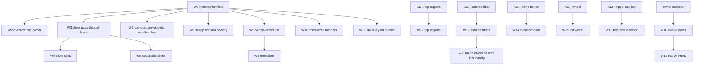

# render-object-coverage: design

- **Status:** Not started — awaiting owner approval of requirements and design
- **Date:** 2026-11-25
- **Base:** `claude/project-thread-03lo7m` @ `fcab477`
- **Requirements:** [requirements.md](requirements.md); tasks: [tasks.md](tasks.md)

Every statement about existing FLUI code was read from the file it names at `fcab477`. A name
introduced by this spec is marked *proposed* where it first appears; names not marked exist
today. What could not be checked is listed under "Unverified" at the end, not guessed in the
text.

## Shape of the work

Seventeen work items and one record (W18). An arrow is a dependency; items without one between
them run in parallel where their file sets differ ([tasks.md](tasks.md)).

Dashed items edit a frozen crate (requirements, G1).

| Item | Requirement | `flui-objects` | `flui-view` | `flui-widgets` | `flui-interaction` | Frozen crates | Other |
|------|-------------|:-:|:-:|:-:|:-:|---|---|
| W1 harness families | R1 | tests | | | | | `docs/testing.md` |
| W2 overflow clip owner | R2 | x | | | | | `docs/gaps.md` |
| W3 sliver pass-through base | R3, R4 | x | | | | | |
| W4 sliver clips | R3 | x | | x | | | |
| W5 decorated sliver | R4 | x | | x | | | |
| W6 composition widgets, overflow bar | R9 | x | | x | | | `packages/flui-material` docs |
| W7 image paint properties | R10 | x | | x | | `flui-painting`, `flui-engine` (second half) | |
| W8 varied-extent list | R5 | x | x | x | | | |
| W9 tree sliver | R6 | x | x | x | | | |
| W10 child-sized headers | R7 | x | maybe | x | | | |
| W11 sliver layout builder | R8 | x | x | x | | | |
| W12 tap regions | R12 | x | | x | x | | |
| W13 subtree filters | R11 | x | | x | | `flui-rendering`, `flui-engine` tests | `docs/gaps.md` |
| W14 inline children | R13, R14 | x | x | x | | `flui-painting` | |
| W15 list wheel | R15 | x | x | x | | `flui-rendering` | |
| W16 two-axis viewport | R16 | x | x | x | | `flui-rendering` | |
| W17 native views | R17 | x | | x | | `flui-layer`, `flui-engine`, `flui-rendering` | `flui-platform`, `flui-native`, `flui-app` |

W18 (R18) is a document change to `crates/flui-objects/ARCHITECTURE.md`.

## Rules every item follows

- **Names.** Where FLUI's object does what Flutter's does, it keeps Flutter's public name in
  Rust form (`RenderSliverClipRect`, `RenderDecoratedSliver`, `RenderSliverVariedExtentList`,
  `RenderTreeSliver`; widgets `SliverClipRect`, `DecoratedSliver`, `TreeSliver`,
  `PinnedHeaderSliver`), so a reader who knows the term finds it. Where the design departs, the
  name says what the FLUI thing is (`RenderSliverWheel`, `RenderTwoAxisViewport`). Constructors
  that can fail are `try_new`, description builders have bare names, a context is `ctx`
  (ADR-0325). A public enum is `#[non_exhaustive]` unless its closure is the decision.
- **Placement.** One concept, one module, beside the file it grew out of
  (`crates/flui-objects/src/sliver/`, `layout/`, `proxy/`, `text/`, `image/`). No new file joins
  `sliver_persistent_header.rs` or `render_object_harness.rs`, which already hold several.
- **Geometry.** A sliver's geometry is built by `SliverGeometry::new` or `with_extents` and the
  `with_*` builders. Non-finite geometry is never published: an authored value that could be
  non-finite is refused at its constructor or becomes a layout error.
- **Catalog.** `docs/extending.md`: implement in `flui-objects`, register in
  `RENDER_OBJECT_TYPES`, add `harness_*` rows, record a non-obvious decision in "Mapping
  decisions" of `crates/flui-objects/ARCHITECTURE.md`.
- **Frame path.** No `async`, no lock on per-node state, no process-global state. A delegate
  that runs in layout is an `Rc<dyn Trait>` with a `should_relayout` comparison, as
  `SliverGridDelegate` is.

## W1. The harness reads its families from more than one file

`crates/flui-objects/tests/render_object_harness.rs` is one test target of 15,905 lines
(`autotests = false`). Its guard `catalog_covers_every_render_object_name` reads the file with
`include_str!("render_object_harness.rs")`, so a row counts only if it is in that file. Eleven
tasks of this spec add rows; with one file they all own it.

- **Shape.** Family modules under `crates/flui-objects/tests/harness/` *(proposed)*, declared
  from the root with `#[path]` as `harness_snapshot.rs` is today. The guard reads the root and
  each family file (`include_str!` per file, listed once in a `const` beside the `mod` lines),
  so a module that is declared but not listed fails the guard. Existing rows stay where they
  are; only new families use files of their own.
- **What each later task still edits in the root.** One line in `RENDER_OBJECT_TYPES`, and the
  first task of a family adds its `mod` line, its guard entry and its `family_*` test. These
  are one-line, order-insensitive edits; a rebase resolves them mechanically.
- **Document.** `docs/testing.md` says the manifest holds "all 81 exported render types"; the
  list has 106 entries. The sentence links the list and drops the number (AGENTS.md, "One
  source per fact").
- **Alternative: one test target per family.** Each target links the whole crate and its GPU
  test support again; `flui-widgets` moved the other way for that reason (its `Cargo.toml`
  comment on `autotests`). Rejected.
- **Alternative: leave one file.** Every task then lists the same file as owned, which "One
  writer per file set" forbids. Rejected.

## W2. The overflow answer has one owner

`layout/stack.rs`, `wrap.rs`, `fitted_box.rs`, `animated_size.rs` and
`constraints_transform_box.rs` each keep `has_visual_overflow: bool`, reset it at the start of
`perform_layout`, and clip in `paint` when it is set and the clip behaviour is not `Clip::None`.
None overrides `describe_approximate_paint_clip`, so semantics and input regions are not cut.
The gap entry names the cure: "one owner, written when layout commits".

- **Shape.** `OverflowClip` *(proposed, `pub(crate)`, `layout/overflow_clip.rs`)* holds the
  committed answer: no overflow, or the rectangle to clip to. It has one writer,
  `commit(overflows, size)`, called as the last statement of a layout that succeeds, and one
  reader, `clip(clip_behavior) -> Option<Rect<f64>>`. There is no `reset`: a layout that fails
  or returns early has not called `commit`, and the previous answer stands with the previous
  geometry.
- **Readers.** `paint` pushes `ctx.with_clip_rect` only for `Some`;
  `describe_approximate_paint_clip(child_slot, size)` returns the same value for every child.
  The bool field and its reset are deleted from the six objects in the same change.
- **Hit testing** is unchanged: the box already rejects a point outside its own size.
- **Breaks.** None in public API; the field is private.
- **Alternative: compute the overflow in each reader from the children's geometry.** No stored
  state, but paint, semantics and regions each repeat a walk the layout already did, and
  `RenderAnimatedSize` and `RenderFittedBox` decide overflow from values only layout sees.
  Rejected.
- **Why the spec takes the gap.** W4, W9, W15 and W16 each report a clip that paint, hit
  testing and semantics must agree on. `OverflowClip` is the form they copy; building it first
  keeps four new objects from each growing a flag.

## W3. Seam: the sliver pass-through base

Six slivers pass layout through to one child by hand (`sliver_semantics.rs`,
`sliver_ignore_pointer.rs`, `sliver_opacity.rs`, `sliver_offstage.rs`,
`sliver_animated_opacity.rs`, `sliver_constrained_cross_axis.rs`): `Arity = Single`,
`ParentData = SliverPhysicalParentData`, `SliverGeometry::ZERO` without a child, otherwise the
child's geometry under the same constraints, and a hit test at the child's layout offset. W4,
W5 and W11 add four more.

- **Shape.** A private module `sliver/pass_through.rs` *(proposed)* with the two rules as
  functions the proxies call from their own `perform_layout` and `hit_test`, and
  `sliver/max_paint_rect.rs` *(proposed)* with `MaxPaintRect`: the rectangle W4 and W5 both
  need, computed from the constraints and the committed geometry at the end of layout and kept
  by the object (the form `OverflowClip` sets). Its rule, read from Flutter's
  `RenderSliver.getMaxPaintRect`:
  - empty for zero geometry;
  - main-axis length is the maximum paint extent, and where that is infinite, the scroll offset
    plus the remaining cache extent plus the cache origin, so the rectangle is finite;
  - leading edge is minus the scroll offset clamped to
    `0..=scroll_extent - max_scroll_obstruction_extent`;
  - reversed axis directions measure from the trailing edge.
- **Migration.** The six existing proxies move to the functions in the same change, with no
  behaviour change (their harness rows are the check).
- **Alternative: a generic `RenderSliverProxy<B>` with a behaviour trait,** as `RenderClip<S>`
  is generic over its shape. The six objects differ in which hooks they override (paint
  effects, semantics, hit testing, cross-axis constraints), so the behaviour trait would
  re-declare most of `RenderSliver` with defaults, and every public name would become an alias
  the export guard must special-case. Rejected: two shared rules do not pay for a second trait.
- **Alternative: leave them hand-written.** Ten copies of the childless rule. Rejected.

## W4. Sliver clips

- **Shape.** `RenderSliverClip<S: ClipGeometry>` *(proposed, `sliver/sliver_clip.rs`)*, reusing
  the sealed `ClipGeometry` of `proxy/clip.rs`, with aliases `RenderSliverClipRect =
  RenderSliverClip<Rect<f64>>` and `RenderSliverClipRRect = RenderSliverClip<RRect>`, the shape
  parameters `RenderClipRect` and `RenderClipRRect` use. `Arity = Single`, `ParentData =
  SliverPhysicalParentData`. `ClipOverlapBehavior { None, FollowEdge, PreserveShape }`
  *(proposed)* beside it. The generic root joins the three the export guard already excludes.
- **Layout.** Pass-through (W3), then the clip is committed: `MaxPaintRect`, with its leading
  edge moved by the overlap origin when the behaviour is not `None`. Flutter's
  `getClipOriginForOverlap`, transcribed: with `flexible = max(0, inside_extent -
  max_scroll_obstruction_extent)`, the origin is `flexible - scroll_offset` clamped to
  `-min(flexible, scroll_offset) ..= max(0, overlap)`. The behaviour tests of R3 are the
  contract, not this formula.
- **Paint.** `ctx.with_clip_rect` or `with_clip_rrect` around `paint_child`, as the carousel
  clips each item; nothing when the child is invisible or the clip is empty.
  `PreserveShape` builds the rounded shape for the moved rectangle; `FollowEdge` on a rounded
  clip squares the moved edge.
- **Hit test.** A point outside the clip is rejected before the child is asked.
- **Semantics, regions.** `describe_approximate_paint_clip` returns the committed clip.
- **Widgets.** `SliverClipRect::new(sliver)` and `SliverClipRRect::new(border_radius, sliver)`
  with `.clip_behavior(..)` and `.overlap_behavior(..)`
  (`crates/flui-widgets/src/scroll/`).
- **Shape versus rectangle.** `ClipGeometry::default_for_size` builds a shape at the origin; the
  sliver clip builds it for the clip's size and applies it under the clip's origin. If that
  needs a method on `ClipGeometry`, the trait is in `flui-objects` and sealed, so the method is
  added there.
- **Alternative: two hand-written objects,** as Flutter has. They differ only in the shape;
  `RenderClip<S>` already made that a parameter. Rejected.

## W5. Decorated sliver

- **Shape.** `RenderDecoratedSliver` *(proposed, `sliver/sliver_decorated.rs`)* with a
  `BoxDecoration`, a `DecorationPosition` (the enum of `proxy/decorated_box.rs`) and
  `anti_alias`, pass-through layout, and a paint that calls `decoration.paint(ctx.canvas(),
  rect, DecorationPaintOptions::with_anti_alias(..))` over `MaxPaintRect`, before or after the
  child. Hit testing and semantics are the child's.
- **Widget.** `DecoratedSliver::new(decoration, sliver).position(..)`.
- **No alternative considered:** the object is `RenderDecoratedBox` with a different rectangle.

## W6. Composition widgets and the overflow bar

- **`BlockSemantics`** *(proposed, `crates/flui-widgets/src/semantics/`)* builds a `Semantics`
  with `block_previous_siblings`. No render object: ADR-0226 made the barrier a property of the
  configuration, and `RenderSemanticsAnnotations` carries it. The sentences "no
  `BlockSemantics`" in `crates/flui-widgets/src/navigator/page_route.rs`,
  `crates/flui-widgets/tests/modal_route.rs` and `packages/flui-material/src/drawer.rs` are
  corrected in the same change.
- **`SliverVisibility`** *(proposed, `scroll/sliver_visibility.rs`)* composes `SliverOffstage`,
  `SliverOpacity` (whose render object has `always_include_semantics`), `SliverIgnorePointer`
  and a replacement sliver, with the builder methods `Visibility` has (`maintain_state`,
  `maintain_animation`, `maintain_size`, `maintain_semantics`, `maintain_interactivity`).
  Flutter has a private render object for it; FLUI has every part as a sliver proxy already.
- **`RenderOverflowBar`** *(proposed, `layout/overflow_bar.rs`)*, `Arity = Variable`,
  `ParentData = BoxParentData` (what `RenderWrap` uses). Children are laid out unconstrained in
  width; if their widths plus spacing fit the maximum width they form a row aligned by the
  main-axis alignment, otherwise a column with `overflow_spacing`, `overflow_alignment` and a
  vertical direction. Intrinsics follow the same branch (the row's when it fits at that width),
  and the dry layout is the layout without placement. No baseline. Widget `OverflowBar`.
  Flutter keeps this object private; FLUI exports it because `flui-widgets` cannot reach a
  private type of another crate.

## W7. `RenderImage` paint properties

`RenderImage::paint` calls `self.placement.paint(ctx.canvas(), rect, image, natural, None,
None)`; the two `None`s are `filter: Option<ColorFilter>` and `paint: Option<&Paint>`.

- **Ungated half.** `color: Option<Color>` with `color_blend_mode` becomes `ColorFilter::Mode`
  in the `filter` argument; `opacity` becomes the alpha of the `Paint` argument. Both are
  setters on `RenderImage` that mark paint, and builder methods on `Image`.
- **Gated half.** `invert_colors` must apply after the tint. `ColorFilter` has `Mode`, `Matrix`
  and the two gamma variants and no composition, and a tint in an arbitrary blend mode followed
  by an inversion is not one `Matrix`. `filter_quality` is carried by `DrawOp::Texture` but not
  by the image ops, and the engine samples images linearly. Both need `flui-painting` (a
  composed `ColorFilter`, and `filter_quality` on the `#[non_exhaustive]`
  `ImageRegionPlacement` payload, which keeps `DrawOp` within its asserted size) and
  `flui-engine` (the sampler). They ship together after the freeze, so `RenderImage` never has
  a property that works alone and fails in combination.
- **Alternative for inversion: wrap the image in W13's subtree filter.** It allocates a layer
  for what is a per-draw colour operation. Rejected unless the ADR of W13 lands first and the
  composed `ColorFilter` is refused.
- **Breaks.** None; new setters.

## W8. Varied-extent list

- **Shape.** `RenderSliverVariedExtentList` *(proposed, `sliver/sliver_varied_extent_list.rs`)*
  joins `LazyMultiBoxRender` (`Arity = Variable`, `ParentData =
  SliverMultiBoxAdaptorParentData`), paired with `pub type SliverVariedExtentList =
  SliverMultiBoxAdaptor<RenderSliverVariedExtentList>` in `flui-view`, as the four existing
  lazy slivers are. Its `Config` holds an `Rc<dyn ItemExtentDelegate>`.
- **The delegate** *(proposed, `sliver/item_extent.rs`, in `flui-objects`)*:
  `fn extent(&self, index: usize, dimensions: &ItemExtentDimensions) -> f64` and
  `fn should_relayout(&self, old: &dyn ItemExtentDelegate) -> bool`, the shape of
  `SliverGridDelegate`. `ItemExtentDimensions` has the viewport main-axis extent and the
  cross-axis extent, and deliberately not the scroll offset or the preceding scroll extent
  Flutter's `SliverLayoutDimensions` has: with them an answer changes on every scroll and
  cannot be kept. `LazyMultiBoxRender::create` takes the count as `usize`, so the count is
  always known and Flutter's `null` answer ("no such item") has no use.
- **Offsets.** `ExtentIndex` *(proposed, `pub(crate)`, `sliver/extent_index.rs`)*: the running
  sums of the answers, filled once per delegate and dimensions, searched by bisection. The
  first layout asks the delegate for every item (O(n), once); later layouts are O(log n). A
  change of delegate (`should_relayout`), of dimensions or of count refills from the first
  affected index. Refused answers (non-finite, negative) become a layout error that names the
  index.
- **Why not `Virtualizer`.** It is the index of *measured* extents over an estimate, and it
  answers a measurement with an anchor correction; here every extent is authored and exact.
  It also has no operation for a change in the middle (`set_count` appends or truncates), which
  W9 needs, and `flui-rendering` is frozen.
- **Layout, paint, hit test.** The window walk, child requests (`request_child_build`), the
  retain band (`emit_retain_band`), pinned children (`PinnedChildren`, ADR-0265) and the bound
  on children built in one layout are those of `sliver_fixed_extent_list.rs`, with the index
  arithmetic replaced by `ExtentIndex`. The task extracts what the two lists share into the
  existing `virtualized_band.rs` rather than copying it.
- **Widgets.** `SliverVariedExtentList` (builder and delegate) and a `ListView` constructor
  beside `ListView::builder`.
- **Mapping decision to record:** the delegate's dimensions omit the scroll offset.
- **Alternative: keep Flutter's dimensions and walk from zero.** O(n) per layout; the defect
  R5 pins. Rejected.
- **Alternative: estimate unasked extents, as `RenderSliverList` does.** Then the scroll extent
  moves as the user scrolls, which is the one thing a caller chooses this list to avoid.
  Rejected.

## W9. Tree sliver

- **Shape.** `RenderTreeSliver` *(proposed, `sliver/sliver_tree.rs`)* holds the W8 core (the
  shared walk and an `ExtentIndex`) and joins `LazyMultiBoxRender`. Flutter extends the list by
  inheritance; here both objects own the same private core.
- **Rows.** The lazy family's parent data type is fixed by the trait, so a row's depth cannot
  live there as Flutter's `TreeSliverNodeParentData.depth` does. The `Config` holds an
  `Rc<dyn TreeRowDelegate>` *(proposed)*: `extent(index, dimensions)`, `depth(index)`, and
  `should_relayout`. `TreeIndentation` *(proposed)* is a newtype over logical pixels per level
  with `try_new` refusing a negative or non-finite value; Flutter's
  `TreeSliverIndentationType` (standard, none, custom) becomes two constants and the
  constructor.
- **Layout.** A row is laid out with the cross-axis extent left after its indent and placed at
  the cross-axis start plus the indent, so in a right-to-left context it indents from the
  right. All four axis directions work; Flutter asserts `AxisDirection.down`.
- **Expand and collapse.** The widget owns the tree and its flattened row list; a toggle
  changes the count and bumps the placement generation. The slide of the rows below uses the
  lazy family's `Placement` (`LazyMultiBoxRender::set_placement`), which the animated list
  already drives. The rows being revealed are clipped: the object keeps, per animating
  segment, the rectangle below the parent row in the coordinates rows are painted in (layout
  offset minus scroll offset), and paints the segment under `ctx.with_clip_rect`, reporting it
  through `describe_approximate_paint_clip` for those children.
- **Semantics.** The widget wraps each row in a `Semantics` carrying level, position, set size
  and expanded state; the render object adds none.
- **Widget.** `TreeSliver` *(proposed)* with a node type, a controller for expand and collapse,
  a row builder and the indentation. Keyboard traversal follows the focusable list (ADR-0265).
- **Alternative: a column of nested lists.** Not lazy across nodes. Rejected.
- **Alternative: Flutter's `activeAnimations` map inside the render object.** A second
  placement mechanism beside `Placement`. Rejected unless `Placement` cannot express the reveal
  (see "Unverified").

## W10. Child-sized headers

The four persistent headers of `sliver_persistent_header.rs` take explicit minimum and maximum
extents and share `PersistentHeaderCore`; the floating ones are
`RenderSliverFloatingHeaderBase<M: FloatingHeaderMode>`. Flutter's three newer headers are the
same three behaviours with extents measured from children.

- **Shape.** Three objects in a new module `sliver/child_sized_header.rs` *(proposed)*, reusing
  the core's geometry rules with a measured extent in place of the authored one:
  - `RenderPinnedHeaderSliver` *(proposed)*: `Single`. The child is laid out with an unbounded
    main axis; its main-axis size is the scroll extent, the maximum paint extent and the
    scroll obstruction; paint origin is the overlap; paint extent is the child's extent capped
    by the remaining paint extent minus the overlap.
  - `RenderSliverResizingHeader` *(proposed)*: up to three children by slot (child, minimum
    prototype, maximum prototype). Prototypes are laid out, never painted or hit, and
    `visits_child_for_semantics` is false for them. Without a maximum prototype the maximum is
    the child's dry size (`measure_box_child`). The child is laid out between the minimum and
    `max(minimum, maximum - shrink)`; the scroll obstruction is the minimum.
  - `RenderSliverFloatingHeader` *(proposed)*: `Single`, the floating state of
    `RenderSliverFloatingHeaderBase` (effective scroll offset, snap through
    `FloatingHeaderSnapConfiguration` and `SnapCommand`) with the child's extent as the maximum
    and zero as the minimum.
- **What moves.** The floating state machine is lifted out of
  `RenderSliverFloatingHeaderBase` into a private type both families own, in its own file;
  `sliver_persistent_header.rs` shrinks, and its public names do not change.
- **Widgets.** `PinnedHeaderSliver::new(child)`, `SliverResizingHeader::new(child)` with
  `.min_extent_prototype(..)` and `.max_extent_prototype(..)`, `SliverFloatingHeader::new(child)`
  with `.snap_mode(..)`. Whether the resizing header needs an element of its own for three
  slots or fits an existing multi-slot element decides whether `flui-view` is touched.
- **Alternative: add a "measure the child" mode to the existing persistent headers.** They are
  `Single` and rebuilt during layout through `HeaderShrinkCell`; prototypes need more slots and
  no rebuild. One object would carry two arities' worth of rules. Rejected.

## W11. Sliver layout builder

- **Shape.** `RenderSliverLayoutBuilder` *(proposed, `sliver/sliver_layout_builder.rs`)*, a
  pass-through sliver (W3) that, before laying out its child, hands its `SliverConstraints` to
  a cell implementing `BuildDuringLayoutCell`, the seam of ADR-0017 that `RenderLayoutBuilder`
  and `LayoutConstraintsCell` use for boxes. `SliverConstraintsCell` *(proposed)* sits beside
  `LayoutConstraintsCell`.
- **Element and widget.** `flui_view::element::layout_builder::LayoutBuilder` is the box form.
  The task either makes that element generic over the protocol or adds the sliver twin beside
  it, whichever leaves one implementation of the rebuild rule. Widget `SliverLayoutBuilder`.
- **Fractional padding.** Flutter's `_RenderSliverFractionalPadding` pads a sliver by a
  fraction of the viewport so a page view can centre its end pages. FLUI composes it:
  `SliverLayoutBuilder` reads `viewport_main_axis_extent` and builds a `SliverPadding`.
  `PageView` gains `pad_ends(bool)`, and the sentence in `page_view.rs` that lists centring as
  missing is corrected.
- **Alternative: a `RenderSliverFractionalPadding` object.** No build during layout, one more
  exported object for one caller. Kept as the fallback if the rebuild shows in a page view's
  scroll profile.

## W12. Tap regions

Flutter's `RenderTapRegionSurface` wraps the application, caches the hit-test result of each
pointer, and on a down or up event compares it with a registry of `RenderTapRegion`s. FLUI's
hit path is owned by the driver, a `PointerTarget` is data, and a render object's handler does
not see the path. What a render object can do is mark its entry: `RenderBox::metadata()`
returns a `HitMetadata`, and the gesture binding already reads one kind of it on the path
(`FirstClickTarget`, `crates/flui-interaction/src/binding/mod.rs`).

- **Shape.**
  - `flui-interaction`: `TapRegionRegistry` *(proposed)*, owned by a presentation, holding the
    mounted regions (id, group, enabled, consumes outside taps, callbacks); `TapRegionId` and
    `TapRegionGroup` minted by `IdMint`. On a pointer down and up the binding collects the
    `TapRegionMember` metadata on the hit path and tells the registry, which calls inside and
    outside callbacks through `flui_foundation::panic::commit` with its borrow released
    (ADR-0287).
  - `flui-objects`: `RenderTapRegion` *(proposed, `interaction/tap_region.rs`)*, a proxy box
    whose `metadata()` is its `TapRegionMember` and which joins the hits below it
    (`joins_hits_below`), so a region under another is still on the path. No surface render
    object: the registry is not in the render tree.
  - `flui-widgets`: `TapRegionSurface` provides the registry to its subtree; `TapRegion`
    registers in `create_state` (the state is born bound) and holds a guard whose `Drop`
    removes it. Flutter's `groupId: Object?` becomes `TapRegionGroup`.
- **Consuming an outside tap.** The registry, told of a down outside a consuming region,
  claims the pointer in the gesture arena so no detector under it acts. Flutter does this with
  a placeholder arena member.
- **Accessibility.** An activation is classified by whether the target's render object is in
  the region's subtree. Whether a consuming region can also stop the action is a question for
  the ADR; Flutter cannot.
- **Pages.** A region does not hear outside taps while its page is not current.
- **ADR.** Cross-crate, and it gives the binding a second kind of metadata to read, so it is
  recorded ("ADRs this spec needs").
- **Alternative: a surface render object that caches hit results,** as Flutter has. It needs
  the path inside a pointer handler, which the protocol does not carry
  (`crates/flui-rendering/ARCHITECTURE.md`, "The hit-test path is driver-owned"), so it means a
  frozen-crate change. Rejected.
- **Alternative: a global pointer listener that tests the region's rectangle.** Wrong under an
  overlay, a clip or a transform: R12's first test. Rejected.

## W13. Subtree filters

`ColorFilterLayer` and `ImageFilterLayer` exist in `flui-layer` and `flui-engine` lowers both.
Paint has no way to ask for one: `FragmentScope` has shader mask, backdrop filter, annotated
region, leader and follower scopes, and `PaintEffects` has opacity, clip and transform.

- **Shape (recommended).** `PaintEffects` gains a filter, as its own documentation anticipates
  ("a future filter or mask (once those fields exist)"). `RenderColorFiltered` and
  `RenderImageFiltered` *(proposed, `proxy/`)* are proxies whose `paint_effects` returns it;
  hit testing and layout are the child's. An effect is pure in the object and its size, so the
  retained scene can patch a filter change without repainting the child.
- **Nesting.** Today the order is opacity, clip, transform. The ADR fixes where the filter
  sits; the recommendation is opacity, filter, clip, transform, so a blur is not cut by the
  object's own clip and fades as a whole.
- **Alternative: `PaintContext::with_color_filter` and `with_image_filter` scopes,** like
  `with_shader_mask` and `with_backdrop_filter`. Consistent with the two effects that exist as
  scopes, and free in nesting, but a scope is inside the object's paint, so a change of filter
  repaints the subtree's fragment.
- **Gate.** Either form edits `flui-rendering`; the readback rows are engine tests.
- **Widgets.** `ColorFiltered::new(filter, child)`, `ImageFiltered::new(filter, child)` with
  `.enabled(bool)`.

## W14. Seam: inline children

Today `RenderParagraph` and `RenderEditable` are `Arity = Leaf`. `InlineSpan` is
`Text(Arc<TextSpan>) | Placeholder(PlaceholderSpan)`, but `TextSpan.children` is
`Vec<TextSpan>`, so a placeholder can only be the root. Measurement emits U+FFFC for a
placeholder and shapes it as a glyph; `ParagraphSpec` has no inline boxes, and
`parley_text/shape.rs` drops `PositionedLayoutItem::InlineBox`. `PlaceholderDimensions` exists
as a type and nothing consumes it. Parley is 0.13.0 and supports inline boxes.

The seam is designed once and both text objects use it.

- **Span tree (`flui-painting`, breaking).** `TextSpan.children` becomes `Vec<InlineSpan>`.
  Every constructor and walker of the tree in the workspace moves in the same change
  (`rg 'children' crates/flui-painting/src/typography`, then the callers the compiler names).
- **Shaping (`flui-painting`).** A placeholder keeps one position in the text (U+FFFC stays in
  the logical string, so offsets, selection and published text runs do not shift), is not
  shaped as a glyph, and is passed to Parley as an inline box with the measured size and
  baseline. `TextPainter` takes the dimensions per placeholder before layout and returns the
  box rectangles after it, in placeholder order; a placeholder cut by truncation has none.
- **`InlineBoxes`** *(proposed, `pub(crate)`, `crates/flui-objects/src/text/inline_boxes.rs`)*:
  the one owner of the relation between child slots and placeholders. Per child: its
  placeholder, and a rectangle or "not placed", written when layout commits. Paint, hit
  testing, `apply_paint_transform`, `visits_child_for_semantics` and the dry measurements all
  read it; there is no nullable offset in parent data as in Flutter's `TextParentData`.
- **Layout.** Two passes inside one `perform_layout`: each child is laid out under a loose
  constraint whose maximum width is the paragraph's; for `PlaceholderAlignment::Baseline` (and
  only then) its baseline is read; the text is laid out with those dimensions; children are
  placed at their rectangles. `Arity` becomes `Variable`, `ParentData` the box offset data.
- **Intrinsics and dry layout.** Children are measured dry (`compute_dry_layout`,
  `compute_dry_baseline`); the paragraph's intrinsic widths include their widths.
- **Paint and hit test.** Text first, then placed children in order, each read from the table.
  Flutter stops at the first child without an offset, which is the same thing only while
  truncation cuts a suffix; FLUI does not depend on that.
- **Semantics.** The paragraph's node keeps its text; placed children's nodes are its children
  and take their place by ADR-0226's reading order. Selection treats a placeholder as one
  position, and copied text omits it.
- **No implicit scaling.** Flutter wraps a `WidgetSpan`'s child in a render object that scales
  it by a linear factor of the text scaler. ADR-0183 made text sizing non-linear, so there is
  no one factor. An inline child reads the ambient sizing itself, like any other widget.
- **Widgets (`flui-widgets`).** `InlineSpan` lives in `flui-painting` and cannot hold a view.
  A span builder *(proposed)* produces the span tree and the ordered child list together
  (`Text::rich` and `RichText` take its result), so the number of placeholders and the number
  of children agree by construction. `RichText` mounts a multi-child element; with no inline
  child it has no children and behaves as today.
- **`RenderEditable`.** The same `InlineBoxes`, with the caret and selection geometry taking a
  placeholder as one position and the caret beside one taking the line's height. How a field's
  controller introduces a placeholder into edited text is a widget question outside this seam.
- **ADR.** The span tree change, the placement of measurement, and the scaling rule are
  cross-crate and hard to reverse.
- **Alternative: a separate widgets-layer span tree** that lowers to the painting one. Two
  trees to keep in step. Rejected.
- **Alternative: children passed beside the span tree by index.** The two can disagree; it is
  the state the builder exists to make unrepresentable. Rejected.
- **Alternative: lay text out around floats in the widget layer** (a `Wrap` of text runs and
  widgets). Loses line breaking across runs, bidi and selection. Rejected.

## W15. List wheel

Flutter's `RenderListWheelViewport` is a box that is its own viewport: it owns a scroll offset,
creates and destroys children during layout through a child manager, and paints each under a
cylinder transform. FLUI's lazy children exist only for slivers: `request_child_build` and
`emit_retain_band` are on the sliver layout context, and the element is
`SliverMultiBoxAdaptor`.

- **Shape (recommended): a sliver.** `RenderSliverWheel` *(proposed, `sliver/wheel/`)* joins
  `LazyMultiBoxRender` and sits alone in an ordinary viewport built by `ListWheelScrollView`.
  - *Extents.* Like the carousel, whose scroll extent is its strip plus the viewport: the wheel
    reports `(count - 1) * item_extent + viewport_extent` and places item `i` so that its
    centre is at the viewport's centre when the scroll offset is `i * item_extent`. The scroll
    range is then exactly `0 ..= (count - 1) * item_extent` with no anchor.
  - *Geometry.* `WheelGeometry` *(proposed)* owns the arithmetic: the item at an offset, the
    offset of an item, and for an item its angle on the cylinder. Its parameters are validated
    newtypes (`try_new`): diameter ratio, perspective (above 0, at most 0.01, Flutter's
    bounds), squeeze, off-axis fraction, magnification, off-centre opacity.
  - *Layout.* Children in the window are requested, laid out at the item extent and full
    cross-axis width, and for each the object records its transform, its opacity and whether
    it lies in the magnified band, in a per-item table like the carousel's. Items beyond a
    quarter turn are laid out but not recorded as drawable.
  - *Paint, hit test, semantics.* All three read the table. Paint draws each item under
    `with_transform` (and `with_opacity` for the off-centre ones); the hit test maps the point
    through the inverse of the same transform; the semantics rectangle goes through the
    object's paint-transform hook.
  - *The hook (frozen crate).* `RenderBox` has `apply_paint_transform`; `RenderSliver` has
    `hit_test_transform` and `child_main_axis_position` but no per-child paint transform. The
    wheel needs one forwarded hook on `RenderSliver`, defaulting to today's behaviour.
  - *Magnifier.* The centre band draws magnified and the rest on the cylinder; an item
    crossing the band's edge is drawn in both parts, each under its clip. Whether one child
    may be painted twice in one paint is unverified (see below).
- **Looping.** The item count is a `usize`, so the wheel cannot use negative indices as
  Flutter does. A looping wheel is two wheel slivers around the viewport's `center` with the
  viewport's `anchor` at 0.5: the forward one shows items `0, 1, 2, …` modulo the count and
  the reverse one `-1, -2, …`, and `WheelGeometry` owns the half-item shift between the two
  forms' offsets. This is the least settled part of the design; the ADR decides it.
- **Scrolling.** A fixed-extent controller and physics that settle on an item belong to the
  widget (`crates/flui-widgets/src/scroll/`), beside the page view's.
- **Alternative: a box viewport as in Flutter.** It needs lazy children on the box layout
  context and a second lazy element: a second form of the request strategy, in a frozen crate.
  If W16's typed key lands first, a wheel keyed by a signed index becomes possible on that
  seam, and looping becomes simple; the ADR weighs this against the sliver.
- **Alternative: an eager wheel** (all children built). Fine for a 12-item picker, wrong for a
  date wheel of thousands. Rejected as the only form.

## W16. Seam: the two-axis viewport

Flutter's `RenderTwoDimensionalViewport` is abstract: it owns two offsets, asks a delegate for
the child at a `ChildVicinity`, and leaves `layoutChildSequence` to a subclass. FLUI's request
strategy is keyed by `usize` and retains one contiguous band.

- **The contract (ADR, frozen crate).** Lazy children are requested by a typed key. The
  request strategy and its element are made generic over the key: the lazy slivers use a
  `usize`, the two-axis viewport a `Vicinity { column, row }` *(proposed)*. The retain set
  becomes a set the key type describes: a band for `usize`, a small list of vicinity
  rectangles for a grid (the visible region plus pinned rows and columns). Pinned children
  (ADR-0265) take the key type too.
- **Shape.** `RenderTwoAxisViewport<L: TwoAxisLayout>` *(proposed, `flui-objects`,
  `sliver/viewport/two_axis.rs`)*, a `RenderBox`. `TwoAxisLayout` *(proposed)* is the policy Flutter
  leaves to a subclass: given the viewport size, both offsets and the cache extent, it requests
  children by vicinity, lays each out, places it, and returns the content extent on each axis.
  The viewport reports the extents to its two scroll positions
  (`apply_content_dimensions`), commits an `OverflowClip` (W2), paints in the policy's paint
  order and hit-tests in the reverse of it. One policy ships with it so the object has a
  harness row and a widget: a grid of uniform cells.
- **Widget.** `TwoAxisScrollView` *(proposed)*, which owns two scroll positions and decides
  how a diagonal drag is split. Table and tree views are layouts on top, outside this spec.
- **Alternative: a second request seam for boxes,** leaving the sliver one alone. Two
  implementations of the build-during-layout rule, the retain rule and the pinned rule.
  Rejected.
- **Alternative: map a vicinity to a `usize` row-major and use today's seam.** No frozen-crate
  change, but the column count must be known and fixed, and one contiguous band between the
  first and last visible cell retains every column of every row between them. Rejected for
  wide tables; acceptable as a stopgap only if the owner wants a table before the freeze ends.
- **Alternative: a lazy column of lazy rows sharing one horizontal position.** A viewport per
  row, no shared column geometry, no pinned column. Rejected.

## W17. Seam: native views

Not designed here; the gap says it needs an owner decision. What the ADR must settle, and the
shape this spec recommends it consider:

- **One render object.** `RenderPlatformView` *(proposed)* for every host, not one per OS as in
  Flutter: OS types stay in `flui-native` (ADR-0082, ADR-0151), and the object holds a typed
  id from the contract crate.
- **Placement is scene data.** Paint records a placement node (id, rectangle, clip, transform)
  in the retained scene. After the scene is applied the host reads the placements and moves the
  OS views in the same turn. There is no resize handshake spanning frames in layout, which is
  the source of the two issues Flutter's source cites.
- **Two compositions.** A view rendered into a texture rides `RenderTexture` and
  `TextureRegistry`, which exist; a view composited by the OS needs the placement node and a
  rule for what the GPU surface draws under it. The texture path is the first stage.
- **Input and semantics.** Whether the OS view takes input itself or FLUI forwards it through
  the gesture arena, and how a foreign accessibility tree joins the published one, per host.
- **`RenderWebImage`** is the web host's case of the same seam (an `` element for an image
  the canvas may not read) and waits for it.

## Covered by a different design

Each stays; R18 records it in "Mapping decisions" with what the FLUI form does not reach.

| Flutter object | FLUI form | Not reachable in FLUI |
|----------------|-----------|-----------------------|
| `RenderSemanticsGestureHandler` | `GestureDetector` publishes tap and long press as semantics actions (`on_click`, `on_show_context_menu`) on its one element (ADR-0322); a drag has a keyboard and screen-reader alternative through `GestureAlternatives` (ADR-0216) | A bare drag detector that a screen reader's scroll action drives as a synthesized drag. Deliberate |
| `RenderNestedScrollViewViewport`, `RenderSliverOverlapAbsorber`, `RenderSliverOverlapInjector` | `CollapsingHeader` and the nested scroll channel (ADR-0209): the header sits above its body, never over it | Header slivers of an outer scroll view shared with several inner ones; inner content scrolling under a translucent pinned header |
| `RenderPerformanceOverlay` | A runtime-composed scene node (`UiRuntime::set_performance_overlay`, `AppConfig.show_performance_overlay`) | The overlay as a widget placed by layout; Flutter's bar-chart rendering |
| `RenderBlockSemantics` | The sibling barrier of ADR-0226 on `RenderSemanticsAnnotations`, and W6's widget | Nothing |

## Second tier: Flutter's private render objects

| Flutter | Decision | Where |
|---------|----------|-------|
| `ColorFiltered`, `ImageFiltered` | New render objects | W13 |
| `SliverLayoutBuilder` | New render object | W11 |
| `PinnedHeaderSliver`, `SliverFloatingHeader`, `SliverResizingHeader` | New render objects | W10 |
| `OverflowBar` | New render object | W6 |
| `SliverVisibility` | Composition | W6 |
| `_RenderSliverFractionalPadding` | Composition | W11 |
| `Magnifier` | Exists as `RawMagnifier` | — |
| `OverlayPortal`, `SnapshotWidget`, `SliverPrototypeExtentList`, `SizeChangedLayoutNotifier`, `_RenderSliverEnsureSemantics`, `_RenderExclusiveMouseRegion`, `_RenderCompositionCallback`, `_RenderScrollSemantics`, `_RenderSemanticsClipper` | Out of scope | [requirements.md](requirements.md), "What is not here" |

## What the catalogs need from the render layer

For material and cupertino widgets FLUI does not have yet. "Existing" means a catalog task is
not blocked on this spec.

| Catalog widget | Primitive it needs | State |
|----------------|--------------------|-------|
| `CupertinoPicker`, date and time pickers | The wheel | W15 |
| `Slider`, `RangeSlider`, `CupertinoSlider` | A leaf box with custom paint and its own hit slop | Existing |
| `Badge`, `SegmentedButton`, `ToggleButtons`, `CupertinoSegmentedControl` | Custom multi-child layout and paint | Existing |
| `AlertDialog` and `CupertinoAlertDialog` action rows | `OverflowBar` | W6 |
| `DropdownButton`, menus, search anchors | Popup routes (existing) and outside-tap dismissal | W12 |
| Text fields that dismiss on an outside tap | `TapRegion` | W12 |
| Chips inside a text field, rich text with icons | Inline children | W14 |
| `BottomSheet`, `Drawer` semantics | `BlockSemantics` | W6 |
| `SliverAppBar` variants, `CupertinoSliverNavigationBar` | Persistent headers (existing), child-sized headers | W10 |
| `CupertinoSliverRefreshControl` | Existing slivers | Existing |
| `DataTable` with many columns, `TableView` | The two-axis viewport | W16 |
| Maps, web views, video players | Native views | W17 |

## ADRs this spec needs

Each is written and accepted before the tasks it blocks. Titles are statements, as the existing
records are; numbers are the next free ones when written.

| Title | Question | Options | Blocks |
|-------|----------|---------|--------|
| The gesture binding classifies a tap against the regions on its hit path | Who decides whether a pointer event is inside or outside a tap region, and how a region consumes an outside tap, including a screen reader's activation | Binding reads hit metadata (recommended); a surface render object with the path in its handler; a global listener testing rectangles | W12 |
| A subtree filter is a paint effect | Where a colour or image filter sits in paint and in what order with opacity, clip and transform | A `PaintEffects` field (recommended); paint scopes like the shader mask | W13, second half of W7 |
| A paragraph lays out the boxes its spans embed | The span tree's shape, who measures an inline box and when, what intrinsics and dry layout answer, whether an inline child scales with text | `TextSpan` children are `InlineSpan`s with Parley inline boxes and no implicit scaling (recommended); a widgets-layer span tree; children beside the tree by index | W14 |
| A list wheel is a sliver, and a sliver states a per-child paint transform | Where the wheel's lazy children come from and how a looping wheel is formed | Sliver with a paint-transform hook and two halves around the centre for looping (recommended); a box viewport on the typed-key seam; an eager wheel | W15 |
| Lazy children are requested by a typed key | Whether the request strategy, its retain set and its pinned set are generic over the key, so a two-axis viewport shares them | Generic key (recommended); a second seam for boxes; row-major mapping onto `usize` | W16 |
| A native view is a scene node the host places | How a native view sits in the scene, composites with the GPU surface, takes hit tests and joins the semantics tree, per host | Placement node read by the host after the scene is applied, texture path first (recommended); per-OS render objects with an asynchronous resize; texture-only | W17 |

The varied-extent delegate's dimensions (W8) and the tree row delegate (W9) are decisions of
one crate and go to "Mapping decisions", not to an ADR.

## Open questions for the owner

1. **May a gated task start before the ADR-0304 and ADR-0305 bullets leave `docs/gaps.md`?**
   Recommendation: no, except W13, which closes an open gap with a change of a few lines to
   `PaintEffects` and uses layers the engine already lowers; grant it an exception once its
   ADR is accepted.
2. **Is the wheel a sliver or a box viewport?** Recommendation: a sliver, decided in its ADR
   after the typed-key ADR, because the second answer depends on the first.
3. **Do inline children scale with text?** Recommendation: no implicit scaling.
4. **Does the item-extent delegate lose the scroll offset?** Recommendation: yes. A list whose
   item extents depend on the scroll position is a custom sliver.
5. **Do native views enter the contract, and on which hosts first?** Recommendation: write the
   ADR first; build the texture-backed path before OS composition; start with the host the
   owner needs a web view or a video on.
6. **Names.** Recommendation: Flutter's public names where the object is the same, FLUI names
   where it is not, as in "Rules every item follows". The one near-collision is
   `RenderSliverFloatingHeader` beside the existing generic root
   `RenderSliverFloatingHeaderBase`; if that reads badly, the root is renamed in W10.

## Unverified

Stated here so nobody builds on them unread:

- **Flutter's tracker.** No issue was looked up. The only issue numbers in this spec are those
  Flutter's source cites (issues 20456 and 190833, pull request 183093). The defects in R5, R6,
  R15 and R16 were read from the source, not reproduced by running Flutter. Each task that
  pins one searches the tracker first (AGENTS.md, "Design stance").
- **The audit's count** of 80 of 103 was not recounted.
- **Input regions and the reported clip (W2).** That the input-region walk reads
  `describe_approximate_paint_clip`, as semantics does, was not traced.
- **`Placement` and the tree's reveal (W9).** That a `PlacementSlot` can express rows sliding
  out from under a parent row was not read; if it cannot, the tree keeps a reveal fraction in
  its `Config`, sampled like the other animated properties
  (`crates/flui-objects/src/animation_sample.rs`).
- **Flutter's tree row width (W9).** Whether Flutter lays a row out at the full cross-axis
  extent and shifts it, or at the reduced extent, was not read.
- **The bound on children per layout (W8).** `sliver_grid.rs` has
  `MAX_UNBOUNDED_WINDOW_CHILDREN`; its exact rule was not read.
- **Painting one child twice (W15).** Whether the retained scene admits two `paint_child`
  calls for one child in one paint. If not, the wheel magnifies whole items and the split
  item is listed in "Mapping decisions" as not reached.
- **The wheel's origin in the viewport (W15).** That a sliver can derive its paint origin in
  the viewport from `remaining_paint_extent` and `scroll_offset` under an anchored viewport.
- **Claiming a pointer for a registry (W12)** in the gesture arena, how an accessibility
  activation reaches the binding, and whether "this page is current" is readable by a widget
  (the only `is_current` found is in test access).
- **`Image`'s present builder methods (W7)** were not listed.
- **The resizing header's element (W10)** and the genericity of the layout-builder element
  (W11) were not read.
- **Two-axis scrolling (W16).** Whether two scroll positions can share one drag today.
- **`NotificationListener`.** `flui-view` has a `Notification` trait and bubbling
  (`element/notification.rs`) while `docs/gaps.md` says there is no counterpart of scroll
  notifications; the two were not reconciled, and `SizeChangedLayoutNotifier` stays out until
  they are.

## Found while reading, not this spec's work

- `crates/flui-rendering/src/virtualization/mod.rs`: the module documentation says a mid-list
  insert or delete goes through `set_count`, which appends or truncates only. A document that
  states what the code does not do; a defect fix, so the freeze admits it.
