# render-object-coverage: design

- **Status:** Not started — awaiting owner approval of requirements and design
- **Date:** 2026-11-25
- **Base:** `claude/project-thread-03lo7m` @ `fcab477`
- **Requirements:** [requirements.md](requirements.md); tasks: [tasks.md](tasks.md)
- **Work items:** [design-parity.md](design-parity.md) (W1–W18, Flutter parity),
  [design-beyond.md](design-beyond.md) (W19–W26, beyond Flutter, with what was deferred and
  rejected)

This file holds what the work items share: the shape of the work, the rules, the seams more than
one item uses, the tables, the ADR list and the decisions the owner is asked to confirm.

Every statement about existing FLUI code was read from the file it names at `fcab477`. A name
introduced by this spec is marked *proposed* where it first appears; names not marked exist
today. Statements about Flutter's tracker follow the marks of
[requirements.md](requirements.md). What could not be checked is under "Unverified", with what
would settle it.

## Shape of the work

Twenty-five work items and one record (W18), in two tiers. An arrow is a dependency; items
without one between them run in parallel where their file sets differ ([tasks.md](tasks.md)).

```mermaid
flowchart TD
    W1[W1 harness families] --> W2[W2 the shown answer]
    W1 --> W3[W3 sliver pass-through base]
    W2 --> W4[W4 sliver clips]
    W3 --> W4
    W4 --> W5[W5 decorated sliver]
    W1 --> W6[W6 composition widgets, overflow bar]
    W1 --> W7a[W7 image tint and opacity]
    W1 --> W8[W8 varied-extent list]
    W8 --> W9[W9 tree sliver]
    W2 --> W9
    W2 --> W10[W10 child-sized headers]
    W3 --> W11[W11 sliver layout builder]
    A12[ADR tap regions] --> W12[W12 tap regions]
    A13[ADR filter and group blend] --> W13[W13 subtree filters]
    W13 --> W7b[W7 image inversion and filter quality]
    A14[ADR inline boxes] --> W14[W14 inline children]
    W2 --> W14
    A16[ADR typed lazy key] --> W16[W16 two-axis viewport]
    W2 --> W16
    A16 --> A15[ADR sliver per-child transform]
    A15 --> ST[sliver per-child transform seam]
    ST --> W15[W15 list wheel]
    W2 --> W15
    OD[owner decision] --> A17[ADR native views] --> W17[W17 native views]
    W19[W19 observers]
    W8 --> W20[W20 sticky rows]
    W2 --> W20
    W1 --> W21[W21 tracks and grid]
    W2 --> W21
    W2 --> W22[W22 wrap overflow]
    W23[W23 anchored placement]
    W2 --> W24[W24 first that fits]
    ST --> W25[W25 item effects]
    W20 --> W25
    W13 --> W26[W26 blend group and mask]
    classDef gated stroke-dasharray: 5 5
    class W13,W7b,W14,W16,ST,W17,W26 gated
```



Dashed items edit a frozen crate (requirements, G1). W15 and W25 edit none and wait on the seam.

| Item | Requirement | `flui-objects` | `flui-view` | `flui-widgets` | `flui-interaction` | Frozen crates | Other |
|------|-------------|:-:|:-:|:-:|:-:|---|---|
| W1 harness families | R1 | tests | | | | | `docs/testing.md` |
| W2 the shown answer | R2 | x | | | | | `docs/gaps.md` |
| W3 sliver pass-through base | R3, R4 | x | | | | | |
| W4 sliver clips | R3 | x | | x | | | |
| W5 decorated sliver | R4 | x | | x | | | |
| W6 composition widgets, overflow bar | R9 | x | | x | | | `packages/flui-material` docs |
| W7 image paint properties | R10 | x | | x | | `flui-painting`, `flui-engine` (second half) | |
| W8 varied-extent list | R5 | x | alias | x | | | |
| W9 tree sliver | R6 | x | alias | x | | | |
| W10 child-sized headers | R7 | x | | x | | | |
| W11 sliver layout builder | R8 | x | x | x | | | |
| W12 tap regions | R12 | x | x | x | x | | `flui-runtime`, `flui-semantics` |
| W13 subtree filters | R11 | x | | x | | `flui-rendering`, `flui-engine` tests | `docs/gaps.md` |
| W14 inline children | R13, R14 | x | x | x | | `flui-painting` | |
| W15 list wheel | R15 | x | alias | x | | `flui-rendering` (the seam) | |
| W16 two-axis viewport | R16 | x | x | x | | `flui-rendering` | |
| W17 native views | R17 | x | | x | | `flui-layer`, `flui-engine`, `flui-rendering` | `flui-platform`, `flui-native`, `flui-app` |
| W19 observers | R19 | | | x | | | |
| W20 sticky rows | R20 | x | | x | | | |
| W21 tracks and grid | R21 | x | | x | | | |
| W22 wrap overflow | R22 | x | | x | | | |
| W23 anchored placement | R23 | | | x | | | |
| W24 first that fits | R24 | x | | x | | | |
| W25 item effects | R25 | x | | x | | (through the seam) | |
| W26 blend group and mask | R26 | x | | x | | `flui-layer`, `flui-engine`, `flui-rendering` | |

W18 (R18) is a document change to `crates/flui-objects/ARCHITECTURE.md` and
[gaps.md](../../../gaps.md).

## Rules every item follows

- **Names.** Where FLUI's object does what Flutter's does, it keeps Flutter's public name in
  Rust form (`RenderSliverClipRect`, `RenderDecoratedSliver`, `RenderSliverVariedExtentList`,
  `RenderTreeSliver`, `RenderTapRegion`; widgets `SliverClipRect`, `DecoratedSliver`,
  `TreeSliver`, `PinnedHeaderSliver`), so a reader who knows the term finds it. Where the design
  departs, the name says what the FLUI thing is (`RenderSliverWheel`, `RenderTwoAxisViewport`).
  A beyond-Flutter primitive takes the term its field uses (`Grid` and tracks from CSS Grid,
  "first that fits" from SwiftUI's `ViewThatFits`, placement from popup positioning libraries).
  Constructors that can fail are `try_new`, description builders have bare names, a context is
  `ctx` (ADR-0325). A public enum is `#[non_exhaustive]` unless its closure is the decision.
- **Placement.** One concept, one module, beside the file it grew out of
  (`crates/flui-objects/src/sliver/`, `layout/`, `proxy/`, `text/`, `image/`). No new concept
  joins `sliver_persistent_header.rs` (1,312 lines), `table.rs` (1,173), `flex.rs` (1,166) or
  `render_object_harness.rs`, which already hold several.
- **Geometry.** A sliver's geometry is built by `SliverGeometry::new` or `with_extents` and the
  `with_*` builders. Non-finite geometry is never published: an authored value that could be
  non-finite is refused at its constructor or becomes a layout error.
- **One answer.** What an object shows of a child (whether, under which clip, under which
  transform) is computed in layout and read everywhere else ("The shown answer" below). No
  object of this spec computes a clip or a transform in `paint`.
- **Catalog.** `docs/extending.md`: implement in `flui-objects`, register in
  `RENDER_OBJECT_TYPES`, add `harness_*` rows, record a non-obvious decision in "Mapping
  decisions" of `crates/flui-objects/ARCHITECTURE.md`.
- **Frame path.** No `async`, no lock on per-node state, no process-global state. A delegate
  that runs in layout is an `Rc<dyn Trait>` with a `should_relayout` comparison, as
  `SliverGridDelegate` is. User code a registry or an observer calls runs through
  `flui_foundation::panic::commit` with the borrow released (ADR-0287).
- **Flutter's record.** A defect listed in the requirements is answered in the design by the
  shape that avoids it or by the test that pins it. A task that finds a further report adds it
  to the requirement's table in the same change.

## Seams more than one item uses

Each is designed once here; a work item that uses one says so and adds nothing of its own.

### The shown answer

*Users: W2, W4, W9, W10, W14, W15, W16, W20, W21, W22, W24, W25, and `RenderSliverCarousel`
today.*

`crates/flui-objects/src/sliver/carousel/render.rs` already has the form: a private
`shown: Vec<Shown>` written in layout, which `paint`, `hit_test`, `visits_child_for_semantics`,
`describe_approximate_paint_clip` and `describe_semantics_clip` read. The six overflow objects
do not: each keeps `has_visual_overflow: bool`, resets it at the start of `perform_layout` and
clips only in `paint`. The gap entry names the cure: "one owner, written when layout commits".

- **Shape.** A `pub(crate)` module `crates/flui-objects/src/shown.rs` *(proposed)* with two
  types:

  ```rust
  /// One clip for every child of the object, or none.
  pub(crate) struct ChildClip { /* committed: Option<Rect> */ }

  impl ChildClip {
      /// The last statement of a layout that succeeds.
      pub(crate) fn commit(&mut self, clip: Option<Rect>);
      /// `None` when nothing overflows or `behavior` is `Clip::None`.
      pub(crate) fn clip(&self, behavior: Clip) -> Option<Rect>;
  }

  /// What is drawn of one child: an entry per drawn part, in paint order.
  pub(crate) struct Shown {
      pub(crate) slot: usize,
      pub(crate) clip: Option<Rect>,        // in the object's coordinates
      pub(crate) transform: Option<Matrix4>, // about the child's committed offset
      pub(crate) opacity: Option<f32>,
  }

  pub(crate) struct ShownChildren { /* entries: Vec<Shown> */ }

  impl ShownChildren {
      pub(crate) fn commit(&mut self, entries: impl IntoIterator<Item = Shown>);
      pub(crate) fn parts(&self) -> &[Shown];          // paint order
      pub(crate) fn shows(&self, slot: usize) -> bool;
      pub(crate) fn clip_of(&self, slot: usize) -> Option<Rect>;
      pub(crate) fn transform_of(&self, slot: usize) -> Option<&Matrix4>;
  }
  ```

  The child's offset is not in the record: it stays the committed parent-data offset, so there
  is no second copy of it to fall behind.
- **Contract.**
  1. *One writer.* `commit` is the last statement of a layout that succeeds. There is no
     `reset`: a layout that fails or returns early has not committed, and the previous answer
     stands with the previous geometry.
  2. *Readers delegate.* `paint` draws `parts()` in order, each under its clip, transform and
     opacity. `hit_test` walks `parts()` in reverse, rejects a point outside the part's clip and
     maps it through the inverse of the part's transform.
     `describe_approximate_paint_clip(slot)` returns `clip_of(slot)`;
     `visits_child_for_semantics(slot)` returns `shows(slot)`; `apply_paint_transform` applies
     `transform_of(slot)`.
  3. *Absent means not shown.* A child without a part is not painted, not hit and not
     published. There is no other place in the object that says so.
  4. *A child in two parts* (the wheel's item across the band's edge) has two entries for one
     slot. `clip_of` is the bounding rectangle of its parts' clips and `transform_of` is the
     transform of its first part; the writer puts the part holding the child's centre first.
  5. *Pure.* The readers are functions of the record and the size, and run no user code, which
     is what the pipeline's walks require of these hooks
     (`crates/flui-rendering/src/pipeline/owner/placement.rs`, module documentation).
  6. *Finite.* `commit` drops a part whose clip or transform is not finite; the child is then
     not shown, and the object's own layout decides whether that is also a layout error.
- **Which clip hook.** `describe_approximate_paint_clip` cuts semantics and input regions alike:
  the input-region walk and the presented-node walk reach it through
  `PipelineOwner::child_placement`, and the semantics walk through `child_clips_of`. An object
  overrides `describe_semantics_clip` as well only where content outside the clip must stay
  reachable to a screen reader (a scroll cache, as the viewports and the carousel do). None of
  the six overflow objects does.
- **"Is this child painted."** No object answers it. The pipeline derives it from the record of
  the last paint (`last_child_paint_orders`), so an object cannot say "painted" for a child it
  left out, which is Flutter's #196649 across eleven render objects.
- **Hit testing an overflow.** A box's hit test starts by rejecting a point outside its own
  size, so an overflowing child is hit only inside its parent's box whatever the clip. The
  record does not change that; R2 pins it and "Mapping decisions" states it.
- **The shared row.** `harness_<object>_hits_and_publishes_a_child_only_where_it_paints` is one
  generic function of the harness, called once per object with a builder for a layout that
  hides, clips or transforms a child: it compares the painted fragment's bounds, the hit result
  at sample points, the published semantics rectangle and the input regions.
- **Alternative: compute in each reader from the children's geometry.** No stored state, but
  paint, semantics and regions each repeat a walk the layout already did, and
  `RenderAnimatedSize` and `RenderFittedBox` decide overflow from values only layout sees.
  Rejected.
- **Alternative: a hook in `flui-rendering` that returns the whole per-child answer** (clip,
  transform, shown) in one call, replacing four hooks. One seam instead of a convention, but a
  frozen-crate change that every existing render object would have to follow. Rejected for this
  spec; the record is shaped so that such a hook could return it unchanged.
- **Alternative: a typed `Layout` trait whose result carries the answer** (the candidate of
  [design-beyond.md](design-beyond.md), "Deferred"). It would make the convention a type; it
  also rewrites how every multi-child box is declared. Deferred.

### A sliver states a per-child paint transform

*Users: W15, W25. Gated: three changes to `flui-rendering`, decided by one ADR.*

`RenderBox` has `apply_paint_transform`, and the erased `RenderObject::apply_paint_transform`
defaults to `paint_effects(size).transform · translate(child_offset)` with the note "Override on
RenderBox; slivers take the default". A sliver that draws a child under a transform of its own
therefore cannot tell semantics, input regions or `transform_to` about it. Three things are
missing:

1. **The hook.** `RenderSliver::apply_paint_transform` *(proposed)*, forwarded by the blanket
   implementation, defaulting to today's behaviour.
2. **Hit testing.** `RawSliverHitTestContext::push_transform` and `pop_transform` are no-ops
   today (`crates/flui-rendering/src/protocol/sliver_protocol.rs`, "Only the box protocol does
   this"). The sliver hit-test context's transform reaches the driver as the box context's
   does, so a hit entry under a transformed sliver child carries the transform.
3. **A child painted twice is walked once.** Paint admits two `paint_child` calls for one child
   (`a_render_object_painted_twice_owes_paint_on_both_paints`), and `last_child_paint_orders`
   then holds two entries for the slot. The input-region walk and the presented-node walk visit
   the child once per entry (`pipeline/owner/input_regions.rs`, `presented.rs`), so its regions
   and presented nodes are reported twice. They visit a slot once. This is a defect fix, which
   the freeze admits on its own; it lands with the seam because the wheel is its first user.

Acceptance in `flui-rendering`'s tests: `a_sliver_without_the_hook_maps_its_children_as_before`,
`a_hit_under_a_transformed_sliver_child_carries_its_transform`,
`a_child_painted_twice_reports_its_regions_once`.

Alternatives are those of the wheel's ADR ("ADRs this spec needs").

### The offset index of a lazy list

*Users: W8, W9, W20; `RenderSliverList` today.*

`flui_rendering::virtualization::Virtualizer` is the index: a run-encoded sum tree with
`new(count, default_estimate)`, `set_count`, `set_measured(index, extent, anchor)`,
`query(&ScrollWindow)`, `offset_of(index)`, `is_measured`, `invalidate_from(index)` and
`total_extent() -> Extent::{Exact, Estimated}`. `walk_virtualizer_band`
(`crates/flui-objects/src/sliver/virtualized_band.rs`) is the shared layout walk over it,
including the bound on an unbounded window (`bounded_unbounded_window`) and the hand-off to the
placement track.

- **Decision.** The varied-extent list and the tree use `Virtualizer` through its public API and
  `walk_virtualizer_band`. An authored extent enters as `set_measured(i, extent, anchor)` after
  validation. No second index is written, and no frozen crate is edited.
- **Why this is enough.** The index stores extents and derives offsets, so an item's extent is
  never recovered by subtraction (Flutter PR #192384). The walk is bounded by the index's count,
  so the delegate is never asked past it (#138912). An unknown or endless count is the case the
  index was built for.
- **What it lacks.** An insert or a removal in the middle: `set_count` appends or truncates, and
  the tree's node-level insert and remove are private. A tree toggle at row `i` therefore calls
  `invalidate_from(i)` and re-asks the rows after it, O(rows after `i`) delegate calls, each a
  field read in the widget's roster. A `splice` on `Virtualizer` would make that O(log n); it is
  a frozen-crate addition and is not in this spec.
- **Alternative: a new `ExtentIndex` of prefix sums in `flui-objects`.** Exact and simple for a
  known count; it has no answer for an unknown count, fills in O(n) user calls on the first
  layout, and is a second form of something `main` has. Rejected.

### One list of listeners for "build during layout"

*Users: W11; `LayoutBuilder` and the persistent headers today.*

ADR-0017's registry (`crates/flui-view/src/owner/layout_builder.rs`) holds
`Rc<dyn BuildDuringLayoutCell>` and is protocol-agnostic: `LayoutConstraintsCell` and
`HeaderShrinkCell` both join it. `service_layout_builders` runs between layout passes and
rebuilds, with each builder, the dirty elements under it. The sliver builder adds a cell and an
element and reuses the registry and the fixpoint unchanged, so the rule "a rebuild requested
during layout is delivered" (R8) has one implementation.

### One settle rule for a scrollable

*Users: W15; `PageView`, the carousel and `CollapsingHeader` today.*

`SnapPolicy` (`crates/flui-widgets/src/scroll/nested/snap.rs`, ADR-0209 §9) is an open trait:
`target(&self, &ScrollMetrics, velocity) -> f64`. `PageSnap`, `AnchorSnap` and `CarouselSnap`
implement it. The wheel settles through a `SnapPolicy` of its own and adds no fourth mechanism.

### One rule for a run that keeps room for an indicator

*Users: W22; `RenderToolbarItems` today.*

`crates/flui-objects/src/layout/toolbar_items.rs` finds the longest leading run of items that
fits beside an overflow button it holds back. `RenderWrap` with `max_runs` needs the same rule
for its last run. The rule moves to a private module both call; the two objects stay separate
([design-beyond.md](design-beyond.md), W22).

### Track sizing

*Users: W21; `RenderTable` today.*

`TableColumnWidth` (`crates/flui-objects/src/layout/table_column.rs`) has six forms: fixed,
flex, intrinsic, fraction, and the maximum and minimum of two. A grid's tracks are the same
problem on two axes. A `tracks` module resolves both ([design-beyond.md](design-beyond.md), W21).

## Covered by a different design

Each stays; R18 records it in "Mapping decisions" with what the FLUI form does not reach.

| Flutter object | FLUI form | Not reachable in FLUI |
|----------------|-----------|-----------------------|
| `RenderSemanticsGestureHandler` | `GestureDetector` publishes tap and long press as semantics actions (`on_click`, `on_show_context_menu`) on its one element (ADR-0322); a drag has a keyboard and screen-reader alternative through `GestureAlternatives` (ADR-0216) | A bare drag detector that a screen reader's scroll action drives as a synthesized drag. Deliberate |
| `RenderNestedScrollViewViewport`, `RenderSliverOverlapAbsorber`, `RenderSliverOverlapInjector` | `CollapsingHeader` and the nested scroll connection (ADR-0209): the header sits above its body, never over it, and each inner scrollable reaches the header through its own ancestors | Inner content scrolling under a translucent pinned header. The behaviours the connection must define are R18's table |
| `RenderPerformanceOverlay` | A runtime-composed scene node (`UiRuntime::set_performance_overlay`, `AppConfig.show_performance_overlay`) | The overlay as a widget placed by layout; Flutter's bar-chart rendering |
| `RenderBlockSemantics` | The sibling barrier of ADR-0226 on `RenderSemanticsAnnotations`, and W6's widget | Nothing |
| `RenderTapRegionSurface` | The presentation's gesture binding owns the tap-region registry (W12); no widget wraps the application | A second, nested surface with its own set of regions. No use was found for one |
| `RenderProxyBox` | A proxy implements `RenderBox` with one child; there is no base object to instantiate | Nothing |

For the nested-scroll row, the first step of the record's task reads ADR-0209 against R18's six
behaviours. What the ADR's sections say today, as far as this spec read them:

| Behaviour | ADR-0209 | State |
|-----------|----------|-------|
| Several inner scrollables, each bound by ancestry | §7: the chain is snapshotted from the scrollable's own ancestors into four inline links | Defined; a test with two kept-alive bodies under one `CollapsingHeader` is to be named or added |
| A floating header returns on an inner scroll; snap | §1 (the connection sees the inner delta first), §9 (`SnapPolicy`) | Defined for `CollapsingHeader`; for W10's floating header inside a body, R7's `a_floating_header_returns_on_a_scroll_of_its_nested_body` |
| Overscroll at the boundary | §6: `OverscrollBehavior::{Auto, Contain}` and the remainder policy | Defined; which side stretches is to be pinned by a named test |
| Fling handed across the boundary | §4: the residual goes through `post_fling` | Defined; continuity of velocity is to be pinned |
| A snapping header under a pull-to-refresh | Not found in the ADR | A gap entry unless the task finds the section |
| No hand-wired overlap pair | The connection replaces the absorber and injector | Nothing to define |

## Flutter's private render objects

| Flutter | Decision | Where |
|---------|----------|-------|
| `ColorFiltered`, `ImageFiltered` | New render objects | W13 |
| `SliverLayoutBuilder` | New render object | W11 |
| `_RenderSliverFractionalPadding` | New render object | W11 |
| `PinnedHeaderSliver`, `SliverFloatingHeader`, `SliverResizingHeader` | New render objects | W10 |
| `OverflowBar` | New render object | W6 |
| `SliverVisibility` | Composition | W6 |
| `Magnifier` | Exists as `RawMagnifier` | — |
| `SizeChangedLayoutNotifier` | Answered by a different primitive | W19 |
| `OverlayPortal`, `SnapshotWidget`, `SliverPrototypeExtentList`, `_RenderSliverEnsureSemantics`, `_RenderExclusiveMouseRegion`, `_RenderCompositionCallback`, `_RenderScrollSemantics`, `_RenderSemanticsClipper` | Out of scope | [requirements.md](requirements.md), "What is not here" |

## What the catalogs need from the render layer

For material and cupertino widgets FLUI does not have yet. "Existing" means a catalog task is
not blocked on this spec.

| Catalog widget | Primitive it needs | State |
|----------------|--------------------|-------|
| `CupertinoPicker`, date and time pickers | The wheel | W15 |
| `Slider`, `RangeSlider`, `CupertinoSlider` | A leaf box with custom paint and its own hit slop | Existing |
| `Badge`, `SegmentedButton`, `ToggleButtons`, `CupertinoSegmentedControl` | Custom multi-child layout and paint | Existing |
| `AlertDialog` and `CupertinoAlertDialog` action rows | `OverflowBar` | W6 |
| `DropdownButton`, menus, search anchors, tooltips | Popup routes (existing), outside-tap dismissal, placement against an anchor | W12, W23 |
| Text fields that dismiss on an outside tap | `TapRegion` | W12 |
| Chips inside a text field, rich text with icons | Inline children | W14 |
| Chip groups that end in "+N" | A wrap that stops | W22 |
| `BottomSheet`, `Drawer` semantics | `BlockSemantics` | W6 |
| `SliverAppBar` variants, `CupertinoSliverNavigationBar` | Persistent headers (existing), child-sized headers | W10 |
| Contact lists with section headers | Sticky rows | W20 |
| `CupertinoSliverRefreshControl` | Existing slivers | Existing |
| `DataTable` with many columns, `TableView` | The two-axis viewport | W16 |
| Adaptive navigation (rail or bar), responsive toolbars | First that fits | W24 |
| Maps, web views, video players | Native views | W17 |

## ADRs this spec needs

Each is written and accepted before the tasks it blocks. Titles are statements, as the existing
records are; numbers are the next free ones when written. The "Options" are the ones the ADR
must weigh; the first is this spec's recommendation, argued in the work item.

| Title | Question | Options | Blocks |
|-------|----------|---------|--------|
| A tap is classified against the regions on the path of its down, by the binding | Who decides inside or outside, in which phases and for which origins; how a region consumes an outside tap; how an accessibility activation is classified and stopped; how a region knows it is live; whether a down that stops a fling is a tap | The binding owns a registry, reads hit metadata on the down, caches the members on the contact's route, and the runtime classifies an activation by render ancestry; a surface render object with the path in its handler (a frozen-crate change); a global listener testing rectangles | W12 |
| A subtree's filter and its group blend are paint effects | Where a colour filter, an image filter, a group blend mode and a mask sit in paint, in what order with opacity, clip and transform, and what layer carries an isolated group | `PaintEffects` fields in the order opacity, blend, filter, clip, transform, with one new group layer for blend and mask; paint scopes like the shader mask; widgets composed from `ShaderMask` and `BackdropFilter` | W13, second half of W7, W26 |
| A paragraph lays out the boxes its spans embed | The span tree's shape; who measures an inline box and when; what identifies a placeholder; what intrinsics and dry layout answer; whether an inline child scales with text; what the editing value holds for a placeholder | `TextSpan` children are `InlineSpan`s, placeholders carry an id and are Parley inline boxes, no implicit scaling, one U+FFFC per placeholder in the editing value; a widgets-layer span tree lowered to the painting one; children beside the tree by index | W14 |
| A sliver states a per-child paint transform, and the list wheel is a sliver | Whether a sliver may transform a child and how hit testing, semantics and regions learn of it; where the wheel's lazy children come from; how a looping wheel is formed | The three-part seam above, the wheel as a sliver, looping as two slivers around the viewport's centre; a box viewport on the typed-key seam with a signed key; an eager wheel | W15, W25 |
| Lazy children are requested by a typed key | Whether the request strategy, its retain set and its pinned set are generic over the key, and who owns the key-to-child mapping | Generic key with the element owning the one mapping; a second seam for boxes; row-major mapping onto `usize` | W16 |
| A native view is a scene node the host places | How a native view sits in the scene, composites with the GPU surface, takes hit tests and joins the semantics tree, per host; the answers to R17's table | Placement node read by the host after the scene is applied, texture path first; per-OS render objects with an asynchronous resize; texture-only | W17 |

Decisions of one crate go to "Mapping decisions" of `crates/flui-objects/ARCHITECTURE.md`, not
to an ADR: the shown answer and its contract, the varied-extent delegate's dimensions, the tree's
reveal map and its reduced row extent, the hit behaviour of an unclipped overflow, the track
module, and what each beyond-Flutter object deliberately leaves out.

## Decisions for the owner

Each has one recommended answer. Approving the spec approves these; the alternatives are named
so a different answer can be given per item.

1. **May a gated task start while ADR-0304 and ADR-0305 have bullets in `docs/gaps.md`?**
   Recommended: no, with two exceptions the owner writes into `tasks.md`. The subtree filter
   (RC17) closes an open gap with one field on `PaintEffects` and layers the engine already
   lowers. The defect fix inside the sliver transform seam (a child painted twice is walked
   once) is admitted by the freeze as a defect fix; the rest of that seam waits. Alternative:
   grant the whole seam, which unblocks the wheel and the item effects at the cost of a new hook
   in a crate being rewritten under it. Alternative: no exceptions, which leaves the filter gap
   open for the length of the freeze.
2. **Is the wheel a sliver?** Recommended: yes. Lazy children exist only for slivers, the
   viewport already has a centre and an anchor for the looping form, and the seam the wheel
   needs is the one item effects need. Its cost is stated: three changes to `flui-rendering`.
   Alternative: a box viewport keyed by a signed index on the typed-key seam, which makes
   looping trivial and costs a second lazy element. The sliver's cost is more than a hook (the
   sliver hit-test context drops transforms, and a twice-painted child is walked twice), and
   the answer holds all the same: the box form needs the typed key, which is the larger
   frozen-crate change.
3. **Do inline children scale with text?** Recommended: no. Flutter's #126962 is the defect the
   implicit scale causes, and ADR-0183 leaves no single factor to apply. Alternative: an opt-in
   wrapper widget that scales its child by the ambient factor for one font size; not built
   until asked for.
4. **Does the item-extent delegate lose the scroll offset?** Recommended: yes. Flutter's #144390
   and PR #192384 are the cost of an answer that cannot be kept. A list whose extents depend on
   the scroll position is a custom sliver or an item effect (W25).
5. **Are extents known only by layout in the varied-extent list's scope?** Recommended: no.
   `SliverList` measures them on the same index, and the varied-extent list is the one whose
   extents are authored. The unknown *count* is in scope.
6. **Does a tap region need a surface widget?** Recommended: no. The binding owns the registry.
   Alternative: Flutter's `TapRegionSurface`, which lets a test or an embedded subtree scope its
   own regions and costs a path the pointer handler does not have.
7. **Does a consuming tap region stop an accessibility activation?** Recommended: yes. A
   dismissal that a pointer cannot bypass and a screen reader can is two behaviours for one
   widget. Flutter cannot do it (PR #183093).
8. **Does a down that stops a fling count as a tap for a region?** Recommended: no (#144221†).
   The ADR decides it, because the scrollable, not the region, knows the down stopped a fling.
9. **Do native views enter the contract, and on which hosts first?** Recommended: write the ADR
   first; build the texture-backed path before OS composition; start with the host the owner
   needs a web view or a video on.
10. **Which beyond-Flutter primitives are built?** Recommended: the eight of
    [design-beyond.md](design-beyond.md), in the order observers, anchored placement, first that
    fits, wrap overflow, sticky rows, tracks and grid, then the two gated ones. Each is
    independent of the others; striking one strikes its requirement, its work item and its
    tasks and changes nothing else.
11. **Names.** Recommended: Flutter's public names where the object is the same, FLUI's where it
    departs. Two near-collisions: `RenderSliverFloatingHeader` beside the existing generic root
    `RenderSliverFloatingHeaderBase` (if that reads badly the root is renamed in W10), and
    `AnchoredPlacement` beside the lazy family's `Placement`, which is the slide of a list item
    and a different concept (if that reads badly the new one is `PopupPlacement`).

## Unverified

What is still unknown, and what would settle each. Nothing below is built on unread.

- **Tracker rows marked `†`** were seen as a search result only. Reading the thread settles
  each; the task that pins one does so first and corrects the requirement's table.
- **Root causes called unconfirmed** (#153149, #171289, #127597, #54400, #38803, #161421) have
  no confirmed cause in their threads. FLUI's test pins the behaviour, not a cause.
- **Other frameworks' pitfalls** in R19–R26 and [design-beyond.md](design-beyond.md) are
  recollections of Compose, SwiftUI, CSS and Qt, not checked against their sources or trackers.
  The task of each item checks the ones it relies on before it starts.
- **A stateful shell's hidden branch (W12).** That a branch that is not shown reports
  `PageHandle::is_current() == false` or mutes `TickerMode` was not traced through
  `crates/flui-widgets/src/router/`. The test
  `a_region_on_a_branch_that_is_not_shown_hears_no_outside_tap` settles it; if neither signal
  covers the branch, the shell mutes `TickerMode` for hidden branches in the same task.
- **A merged semantics node's source (W12).** Whether `SemanticsNode::source_render_id` names
  the render object that formed the node when descendants merged into it. Reading
  `crates/flui-rendering/src/pipeline/owner/semantics.rs` at the merge settles it; the limit
  (a region below a merged node) is stated in the ADR either way.
- **Parley's inline boxes under bidi and justification (W14).** That Parley 0.13.0 reorders
  inline boxes with the bidi run they sit in and moves them when a line is justified. The rows
  of R13 settle it; a failing row is reported upstream and listed as a gap, not worked around
  with a second placement pass.
- **The editing value's offset unit (W14).** The published text runs are in bytes of the value
  (`crates/flui-rendering/src/pipeline/owner/actions.rs`, documentation); the type that holds
  the editing value and whether selection offsets are bytes or UTF-16 units was not located.
  Reading `crates/flui-widgets/src/text/controller.rs` settles it before the ADR is written.
- **The reverse growth group for a looping wheel (W15).** A sliver in the reverse group counts
  its remaining paint extent from the other edge; the arithmetic of the half-item shift between
  the two halves was not worked through. The ADR works it; the fallback is the single-sliver
  form named in W15.
- **Two sibling scroll owners sharing one contact (W16).** `ScrollOwner::begin_contact` accepts
  an explicit sequence id, and no test begins one contact on two owners. The first step of the
  two-axis widget's task writes that test.
- **An intrinsic query on a child that builds during layout (W10).** Whether
  `box_child_intrinsic` on a `LayoutBuilder` child errors, returns zero or runs the builder.
  Reading `RenderLayoutBuilder`'s intrinsics settles it; the resizing header's typed error
  covers the first two.
- **A parent-data type outside `flui-rendering` (W21).** `ParentData` is a public trait and
  `position_child` stores the offset, so `GridParentData` should be definable in
  `flui-objects`; every such type on `main` is in `flui-rendering`. The grid task's first step
  defines it and mounts one child. If it fails, the type is a one-file gated addition.
- **A mounted child that a layout skips (W24).** Whether a child that is not laid out in a pass
  leaves the pipeline consistent (its dirty flag, its stale size). Reading how the layout walk
  treats a dirty child its parent did not visit settles it; the fallback is to lay it out.
- **The engine cost of an isolated group (W26).** What an offscreen group costs in the
  retained scene, and whether damage tracking can patch a blend-mode change without redrawing
  the group. The ADR measures it with the perf scenarios of ADR-0396.
- **ADR-0209 against R18's behaviours.** The table under "Covered by a different design" was
  filled from the ADR's section headings and `CollapsingHeader`'s module documentation, not
  from tests. The record's task reads the tests.

## Found while reading, not this spec's work

- `crates/flui-rendering/src/virtualization/mod.rs`: the module documentation says a mid-list
  insert or delete goes through `set_count`, which appends or truncates only. A document that
  states what the code does not do; a defect fix, so the freeze admits it.
- `docs/testing.md` says the manifest holds "all 81 exported render types"; the list has 106
  entries. W1 fixes it.
- `crates/flui-view/src/element/notification.rs` defines seven notification types that no
  production code sends, beside the gap "No scroll notifications". They are a form with no
  users; whether they are deleted or built on is that gap's decision.
