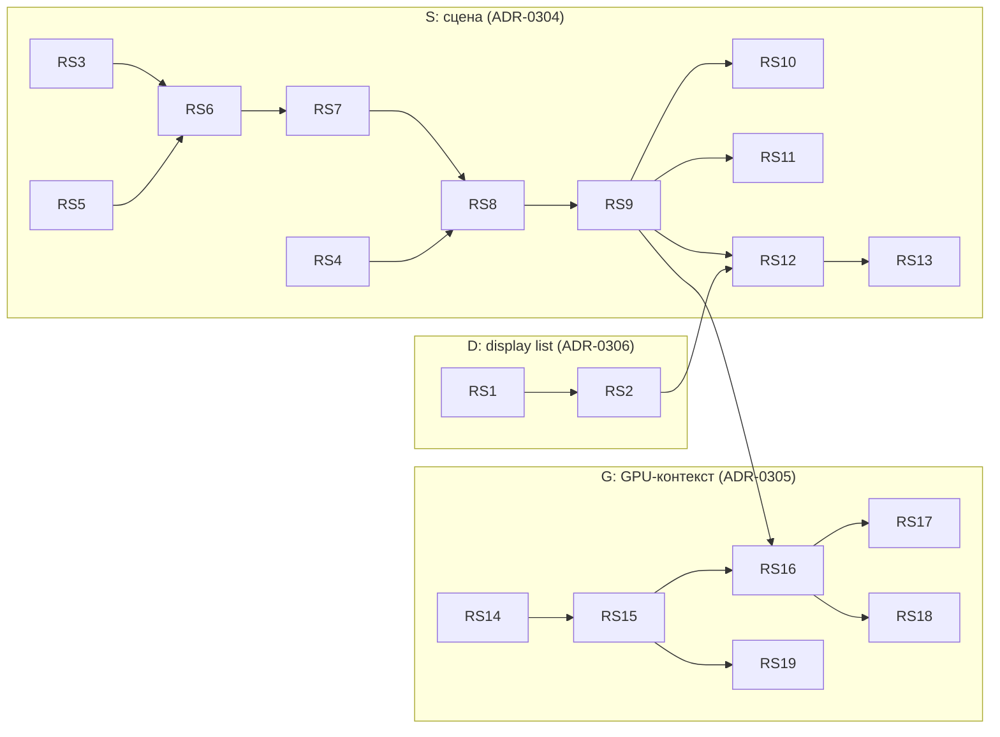

# render-scaling: дизайн стройки

Формы типов, инварианты и пути отказа заданы в ADR-0304, ADR-0305 и ADR-0306 и здесь не
повторяются. Здесь то, чего в них нет: как резать работу, чтобы `main` оставался рабочим, какие
промежуточные состояния допустимы, чем меряется каждый шаг и какие значения берут константы,
которые ADR называют гипотезами.

## Три дорожки

Дорожки D и G не зависят от S до отмеченных рёбер и строятся параллельно с ней. Внутри дорожки
задачи идут по одной, потому что соседние правят одни и те же файлы; исключение: RS3 и RS5
не пересекаются по файлам и строятся одновременно.

## Как ADR-0304 режется без большого взрыва

ADR-0304 говорит, что контракт пересекает пять крейтов и меняется как одно целое. Это верно для
итогового контракта, но не для порядка стройки. Порядок такой:

1. **Значения снизу, без потребителя (RS3–RS7).** `Region`, `read_closure`, персистентная таблица,
   `SceneVersion`, `SceneOwner::apply` с damage, журнал ожидания. Каждое значение приходит со своей
   контрактной таблицей тестов и property-тестом против `LayerDiffer`. Производственного вызова у
   `SceneOwner` до RS8 нет; это разрешённый случай «новый `pub` с названным продолжением», и
   продолжение называется в теле PR.
2. **Переключение производителя (RS8).** `PipelineOwner::run_frame` пишет патч, runtime применяет
   его и отдаёт `ScenePublication`. Движок в этом PR не меняется: полоса растра превращает версию в
   `LayerTree` функцией `SceneVersion::flatten()` и отдаёт движку прежний `Scene`. Это стоит O(сцена),
   то есть столько же, сколько сегодня стоит клон чистых границ, и убирает обход `LayerDiffer`,
   `ContentToken`, `BoundaryStamp` и сборку дерева в paint. `flatten` в этом PR не тестовая, а
   производственная функция; пункт ADR-0304 в `docs/gaps.md` называет её остатком.
3. **Переключение потребителя (RS9).** Движок обходит версию сам и отсекает узлы по
   `subtree_bounds`. `flatten` уходит за фичу `testing`, `LayerDiffer` тоже.
4. **Выигрыши поверх (RS10–RS13).** Повтор непоказанного кадра из удержанной версии, план региона
   по прямоугольникам, кэш записей, damage текстур и чтение сцены вводом.

После шага 2 дерево слоёв на кадр ещё существует, но строится в одном месте. После шага 3 его нет.
Между шагами `main` рисует то же самое: каждое переключение закрыто существующими snapshot- и
readback-наборами без перегенерации снимков, кроме RS4 (см. ниже).

## Кусок на один render-объект (RS4)

ADR-0304 §2 требует, чтобы composer запечатывал открытый прогон при смене рисующего render-объекта.
В сегодняшнем `LayerTree` это стоит дорого: пересадка захвата клонирует по картинке на лист, и
`paint/rotated_box_turn_change/inline` при N = 1 000 замедляется с 3.13 µs до 50.0 µs на update и с
478 µs до 676 µs на repaint. Читателя у кусков по владельцу до RS8 нет, поэтому RS4 сливается в
одной серии с RS8, сразу перед его производителем патчей, и их общие ворота сравнивают эти числа с
main. Снимки paint (`paint_fragment_snapshot.rs`) меняются только в границах прогонов; пиксели
readback не меняются.

## Счётчики

Каждая задача, которая вводит механизм, вводит и его счётчик в `FrameReport`
(`crates/flui-testing/src/lib.rs`, `counters()`), иначе ворота нечем мерить.

| Счётчик | Кто вводит | Что считает |
|---|---|---|
| `scene_ops` | RS8 | операции применённого патча |
| `scene_nodes_visited` | RS8 | узлы сцены, прочитанные `apply` и `flatten` (после RS9 только `apply` и отсечение) |
| `damage_rects`, `damage_full` | RS8 | прямоугольники опубликованного региона (0 для `Unchanged`) и число публикаций `Full` |
| `followers_resolved`, `scene_depth_updates`, `pending_log_folds` | RS5, RS6, RS7 | как в ADR-0304 §3, §4, §7 |
| `chunks_recorded`, `region_passes` | RS9, RS11 | записи кусков в IR и проходы региона |
| `recording_cache_hits`, `recording_cache_evictions`, `recording_cache_bytes` | RS12 | кэш записей |
| `gpu_devices`, `glyph_atlases`, `pipeline_builds` | RS14 | для G5, читаются из `GpuContext` в тестах движка |

Счётчики движка попадают в `FrameReport` через `RasterCompletion`, как сегодня попадает профиль
кадра; в headless без GPU они читаются из тестового бэкенда растра.

## Значения констант-гипотез

ADR оставляет их измерению. Стройка начинает с этих значений и меняет их только PR-ом с замером:

| Константа | Значение | Где |
|---|---|---|
| `Region::MAX` | 8 | ADR-0304 §5 |
| `full_above` | половина площади поверхности | ADR-0304 §5 |
| план `Bounds` вместо `Rects` | один прямоугольник или рамка не больше удвоенной площади региона | ADR-0304 §9 |
| журнал ожидания | 16 записей | ADR-0304 §7 |
| бюджет кэша записей | 64 МиБ на контекст, вытеснение по давности растеризации | ADR-0304 §9 |
| fanout персистентной таблицы | 32 | ADR-0304 §1 |

## Персистентная таблица (RS5)

Таблица пишется в `flui-layer` без новой зависимости (ADR-0304 §1). Форма: дерево фиксированной
высоты с fanout 32 над индексом слота `u32`, узлы под `Arc`, запись копирует путь от корня до
листа (`Arc::make_mut` на каждом уровне). Операции: `get`, `insert`, `remove`, упорядоченный обход.
Высота растёт только при выходе индекса за текущую ёмкость. Тесты: модельная проверка против
`BTreeMap` на случайных последовательностях, и проверка, что версия до записи не изменилась и делит
с версией после все нетронутые поддеревья (`Arc::ptr_eq`).

## Как ADR-0305 режется

Порядок дан в разделе Migration самого ADR; задачи RS14–RS19 повторяют его. Одно добавление:
RS14 вводит `GpuContext` и исполнитель рядом с `Renderer`, и первым потребителем делает
`HeadlessRenderer`, чтобы новый путь с первого PR шёл под `cargo xtask gpu-test` на программном
Vulkan и GL. Оконные раннеры переходят после этого, по одному PR на семейство хостов.

## Связь с соседними тредами

- Гейты `main` (счётчик аллокаций на кадр, равенство инструкций) ставит тред «Убрать хеши из кадра
  и поставить perf-гейты». Если задаче нужен гейт, которого на `main` ещё нет, она добавляет только
  свои счётчики и сценарий, а ворота включает после его появления.
- Тот же тред делает `input_regions` инкрементальными на сегодняшней структуре. RS13 переносит их
  чтение на применённую версию и не меняет правило пересчёта.
- Ночные раннеры Windows и macOS запускают GPU-readback RS11, RS12 и RS14–RS18 там, где CI Linux
  покрывает только программные адаптеры.

## Что проверяет сильная модель

Три PR несут инварианты, ошибка в которых не ловится тестами по соседству: RS5 (таблица и `apply`),
RS8 (переключение производителя) и RS15 (команды и расчёт по штампу). Их ревьюит тред «Исправить
курс и обогнать аналоги» против «Recurring defects» до слияния. Остальные сливаются по общему
правилу.
