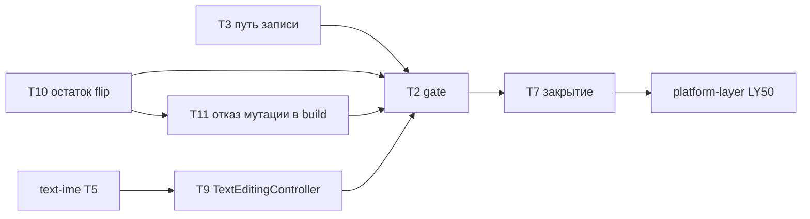

# send-flip — задачи

- **Статус:** Утверждена владельцем 2026-10-28; исполнение
- **Design:** [design.md](design.md) («Работы», «Тестовая стратегия», «Решения владельца
  2026-10-28»); требования — [requirements.md](requirements.md)
- **Итог:** из 13 задач прежнего плана сделаны T1, T6a, T6b; T4, T5, T6c, T6d, T6e сделаны в
  части, их остаток собран в T10 и T11; T8 устарела. Осталось шесть PR прямо в `main`: T3 ‖ T10,
  затем T11, T9, T2, T7. Порядок задаёт колонка «Зависит от».

## Правила исполнения

Пункты 1–7 и 9 [«Правил исполнения» platform-layer](../platform-layer/tasks.md#правила-исполнения):
задача = worktree под `.claude/worktrees/<имя>` = ветка = PR; проверки по AGENTS.md «Checking a
change» через `cargo heli`; fix-тест падает при откате исправления в изолированном checkout; ID
задач и требований — только в этом каталоге; `changelog.d/<branch-slug>.md` у каждого PR,
меняющего поверхность. Дополнительно:

- **Тесты первыми.** Первый коммит PR — тесты нового контракта, красные (по assert, trybuild
  «expected compile failure» или E0277); вывод красного прогона — в PR.
- **trybuild** на PR CI не идёт: перенесённые и новые `.stderr` проверяются локально
  (`cargo heli nextest run -p flui -E 'group(trybuild)'`) до слияния.
- **Где:** L — Linux CI; T — только cross-typecheck или `wasm32` без запуска. Нативных прогонов у
  send-flip нет: приёмку через facade даёт приложение приёмки
  ([persistence P10](../persistence/tasks.md)).

## Граф

T3 и T10 не делят файлов и идут параллельно. T9 ждёт text-ime T5 (`editable_text.rs` и
подтверждение композиции при unmount трогают тот же контроллер). Gate T2 строится последним из
кода: его список разрешённых позиций `Send` снимается с поверхности после flip и дальше только
сокращается.

## Сделано

- [x] **T1** — `AsyncDriver`/`FutureBuilder` в окончательной форме: `OwnerFrame` у UI-runtime,
  `Weak` `AsyncDriver`, `FrameWaker`, trybuild `async_driver_stays_on_its_thread`; ADR-0136 §2
  (#1496).
- [x] **T6a** — планировщик owner-local: `UpdateScheduler` `!Send`, один `PostFrameHandle`,
  ticker; ADR-0175, ADR-0182 (#1523, #1539).
- [x] **T6b** — нотификаторы foundation: раунд по снимку, первая паника — после раунда
  (ADR-0178, #1523). Алиасы `callbacks.rs` не удалены — остаток в T10.

## Сделано в части

- **T4, T5, T6c, T6d, T6e.** Supertrait и alias'ы ядра сняты (`Listenable`, `Animation<T>`,
  `CustomPainter`, делегаты, `ViewportOffset`, `Notification`, `Simulation`, `ViewKey`,
  `ListenerCallback`, `StatusCallback`, frame- и ticker-callback'и, `TimingsCallback`);
  `AnimationController` и `ScrollController` — на `Rc<RefCell>`. Остаток собран так: позиции,
  которые ещё `Send`, — T10; отказ мутации контроллера во время `build` и
  `AnimationError::MutatedDuringBuild` — T11.

## Устаревшие задачи

- **T8** (нативный smoke Notes, `cargo xtask device windows-notes`) — Notes, `two_screens`,
  `notes_flow` и `cargo xtask device` удалены. Заменена: R14 проверяет внешний consumer
  приложения приёмки ([persistence P10](../persistence/tasks.md)); нативных шагов send-flip не
  требует.
- **Ветка `send-flip/core`, рецепт перебазирования, календарь, go/no-go и отсечка 11-24** —
  сняты решением владельца 2026-10-28: остаток идёт шестью PR прямо в `main`.
- **id графа `u64` + `checked_add`** из T3 — не нужно: `next_graph_id`
  (`crates/flui-view/src/reactive/mod.rs`) id не переиздаёт, а после последнего отказывает.
  Строка `exhausted_graph_ids_are_refused_for_good` не пишется.

## Задачи

| ID | Задача | Зависит от | Крейты и файлы | Гейты | Тесты | Где |
|---|---|---|---|---|---|---|
| **T3** [P] | **Путь записи, остаток** (design (c), строки 34, 41). `UiCommand::SignalWrite` сегодня несёт `Box<dyn FnMut(&Reactive) + Send>`; станет `FnOnce(&mut EventCx) + Send` и откроет `WriterSource` presentation, выпустившей слот. Удалить `impl WriteTarget for Reactive`, `BuildContext::reactive`, публичный `BuildOwner::reactive`, `HeadlessBinding::reactive`; 41 вызов `.reactive()` (тесты, `signal_probe.rs`, бенч `signals_rebuilds.rs`) → `writer_source().write(..)` или `peek`. `LocalHistoryEntry::on_remove` из сборки — в post-frame, после сброса. Вложенный `WriterSource::write` внутри живого `EventCx` открывает свой writer и не транзакционен (ADR-0086 §5 по поправке) | — | `crates/flui-view/src/{reactive/writer.rs,context/{build_context,element_build_context}.rs,owner/build_owner.rs}`, `crates/flui-runtime/src/ui_runtime/commands.rs`, `crates/flui-testing/src/{lib.rs,widgets/signal_probe.rs}`, `crates/flui-widgets/src/navigator/{local_history,modal_route}.rs`, `crates/flui-widgets/benches/signals_rebuilds.rs`, `crates/flui-view/tests/ui/`, `changelog.d/` | clippy и nextest: `-p flui-view -p flui-runtime -p flui-testing -p flui-widgets` и зависимые; `cargo test -p flui-testing --doc`; trybuild `flui-view` локально; `testing` | R7: `local_history_removal_writes_after_the_flush`, `cross_thread_signal_write_opens_the_owner_writer_source` (таблица `owner_local_write_paths` во `flui-testing`); R8: trybuild `signal_write_through_build_context` дополнен `ctx.reactive()`, `compile_fail`-doctest `HeadlessBinding::reactive`; R12: `nested_writer_source_inside_an_event_cx`; R11: `nested_write_panics_inside_an_event_cx`. Откат: `on_remove` синхронно в сборке → первая строка теряет запись; `SignalWrite` через первую presentation → вторая видит запись не в том графе | L |
| **T10** [P] | **Остаток flip** (строки 7, 15, 21, 26, 28–30, 36–40; ослабления 22, 39). Позиции, которые ещё `Send`: `LifecycleStateCallback` (`flui-scheduler/src/frame.rs`); семь alias'ов `callbacks.rs` (удаляются, строка 15); `SemanticsActionHandler` (`flui-semantics/src/action.rs`) → `Rc`; `ScrollPhysics: Send + Sync` → `Debug`; `PhysicalClipShape`, `PhysicalClipSource` (`flui-objects/src/proxy/physical_model.rs`); `metadata()` → `HitMetadata` в `render_object.rs`, `render_box.rs` (два), `render_sliver.rs` (два), `HitTestEntry::metadata` (`flui-interaction/src/pointer/hit_test.rs`), alias `MetaDataPayload` удалён; `impl Curve + Send + Sync` → `impl Curve + 'static` в `implicitly_animated.rs`, `motion/{effects,switcher,transition}.rs`, `navigator/hero.rs` (два), `keyframes.rs`, `retarget.rs`, `curve/erased.rs`, `flui-material/src/open_container.rs`; `Arc`-внутренности → `Rc`: `CupertinoTabController` (`Arc<AtomicUsize>`), `PageView` (`page_view.rs`), `WidgetStatesController` и `WidgetStateProperty::Resolver` (`widget_state.rs`); конструкторы `CustomPaint::{painter, foreground_painter}`, `Flow::new`, `CustomSingleChildLayout::new`, `CustomMultiChildLayout::new`, `RenderSliverGrid::new` принимают `impl Trait + 'static` (хранение — приватный `Rc<dyn …>`). `ImageProvider` и `WidgetsLocalizations` остаются `Send` (решение владельца). Call sites в `packages/**`, `examples/**`, шаблонах `flui create` | — | `crates/flui-{scheduler,foundation,semantics,rendering,interaction,objects,animation,widgets}/src/**` (без `flui-widgets/src/text/controller.rs`), `packages/{flui-material,flui-cupertino}/src/**`, `examples/**`, `crates/flui-cli/src/templates`, `changelog.d/` | clippy и nextest по всем затронутым крейтам и зависимым; `cargo test -p flui-objects --test render_object_harness`; `cargo heli xtask wasm-check`; `cargo heli xtask cross-typecheck`; facade-combos | R2: `owner_local_values_fit_every_flip_position` — consumer через `flui` и через `flui-sdk`, `Rc<Cell<_>>`-реализатор или замыкание на каждую позицию (в `tests/facade_consumer.rs`); `RENDER_OBJECT_TYPES` не меняется; `cli_create::generated_*` зелёные | L + T |
| **T11** | **Контроллеры отказывают в мутации во время `build`** (R8b, строка «поведенческие изменения»). `TabController`, `CupertinoTabController`, `ScrollController`, `AnimationController` отказывают мутатору, вызванному из `build`, с `warn!` с именем контроллера; `AnimationError::MutatedDuringBuild`. `StateCell` уже отказывает в записи во время `build` (`state_cell.rs`); контроллеры отказывают так же (ADR-0086 §7) | T10 (`CupertinoTabController` на `Rc`) | `crates/flui-animation/src/{controller.rs,error.rs}`, `crates/flui-widgets/src/scroll/scroll_controller.rs`, `packages/flui-material/src/tab_controller.rs`, `packages/flui-cupertino/src/tab_scaffold.rs`, `changelog.d/` | clippy и nextest: `-p flui-animation -p flui-widgets -p flui-material -p flui-cupertino` | R8b: `controller_mutation_during_build_is_refused` (четыре строки: `flui-widgets/tests/scroll.rs`, `flui-material/tests/tabs.rs`, `flui-cupertino/tests/tab_scaffold.rs`, `flui-animation/tests/contracts/`); R7: `tab_controller_listener_writes_from_an_event_callback`. Откат: мутатор в `build` меняет значение → строка R8b; `TabController` уведомляет под borrow → R7 падает с `BorrowError` | L |
| **T9** | **`TextEditingController` owner-local.** `inner: Arc<Mutex<ControllerInner>>` (`text/controller.rs`) → `Rc<RefCell>`; `with_inner_silent` зовёт замыкание под замком — переделка с выносом состояния до вызова, не механика | text-ime T5 | `crates/flui-widgets/src/text/controller.rs`, `changelog.d/` | clippy и nextest: `-p flui-widgets -p flui-material` | `text_store_kit::assert_conforms` и модуль `text_store` в `editable_text.rs` без изменений; новая строка: `on_changed`, читающий контроллер, не получает `BorrowError` (откат — замыкание под borrow) | L |
| **T2** | **Gate `Send`-позиций** (design (d), R3, R5). Строится на загрузчике rustdoc JSON `tools/xtask/src/api_closure.rs` (`rustdoc_json`, тот же toolchain и тот же CI-джоб `doc`, что у `api-closure`). Перечисляет вхождения `Send`/`Sync` в публичной поверхности `flui` и `flui-sdk` (supertrait, bound и where, alias, поле публичного типа, синтетический auto-trait impl, impl-блок и blanket, приватный sealed supertrait, `-> impl Trait + Send`) и сверяет со списком разрешённых позиций: список снимается с поверхности после T3, T10, T11, T9 и только сокращается; лишняя запись — находка. Таблицы flip/keep с причинами (ledger ADR-0136) нет. `deny.toml [bans]`: `send_wrapper`, `fragile`, `send-cell`, `unsend`, `force-send-sync`. Скан `unsafe impl Send/Sync` через `syn` со списком для `flui-native`, `flui-hot-reload` и `tools/desktop-mcp`, в `checks` | T3, T10, T11, T9 | `tools/xtask/src/{api_closure.rs,main.rs}`, новый модуль gate в `tools/xtask/src/`, список разрешённых позиций, `deny.toml`, `.github/workflows/ci.yml` (шаг в джобе `doc`, если нужен), ADR-0089 §6 | `cargo heli test -p xtask`; `cargo heli xtask checks`; `cargo heli xtask deps`; прогон gate на `main` | `--self-test`: fixture на каждую из восьми позиций роняет gate; fixture с `send_wrapper` роняет `deps`; возвращённый `Send` в снятой позиции роняет gate на `main` | L |
| **T7** | **Закрытие.** trybuild R1: `scroll_controller_stays_on_its_thread`, `cupertino_tab_controller_stays_on_its_thread` (новый контракт), `signal_`, `writer_source_`, `writer_`, `event_cx_`, `state_cell_`, `tab_controller_stays_on_its_thread` (регрессионный guard) в `tests/ui/thread_boundary/`; consumer R4 (`cross_thread_handles_stay_sendable`), R6 (`event_setters_infer_cx_through_the_facade`), R15 (wasm consumer); строки R7 listener, status, post-frame; R11 `listener_panic_reaches_the_realm_report` через `report_contained_panic`. ADR-0086 → Accepted с поправкой §5; ADR-0091: §2–§6 Accepted, §1 `Superseded-by`; ADR-0136: непринятые разделы (ledger, `IndependentLayout`) записаны отброшенными; ADR-0027 §9 в согласии с кодом. Устаревшие строки: ADR-0091 (`render.rs:451`, строка 37), `crates/flui-rendering/ARCHITECTURE.md` (`RenderObject: Send + Sync`, около строки 1093). Changelog «было → стало» на элемент контракта | T2 | `tests/ui/thread_boundary/`, `tests/thread_boundary_ui.rs`, `tests/facade_consumer.rs`, `tests/fixtures/`, `crates/flui-testing/tests/{main.rs,owner_local_write_paths.rs}`, `crates/flui-sdk/tests/surface.rs`, `docs/adr/ADR-{0027,0086,0091,0136}-*.md`, `crates/flui-rendering/ARCHITECTURE.md`, `changelog.d/` | `cargo heli xtask checks` (docs-paths, markers); trybuild `flui` локально; `cargo heli xtask wasm-check`; `cargo heli xtask cross-typecheck`; nested-cargo группа `flui`; changelog | R1, R4, R6, R15 как выше; R7 строки listener/status/post-frame; откат «только `error!`» в `notify_listeners` → `listener_panic_reaches_the_realm_report` видит пустой отчёт; `rg "render.rs:451"` пуст вне `docs/plans` | L + T |

## Требование → тест

| R | Тест или прогон | Задача | Вид |
|---|---|---|---|
| R1 | `tests/ui/thread_boundary/*_stays_on_its_thread`: новый контракт `async_driver_` (есть), `owner_state_` (есть; `AnimationController`), `scroll_controller_`, `cupertino_tab_controller_`; guard `signal_`, `writer_source_`, `writer_`, `event_cx_`, `state_cell_`, `tab_controller_` | T1; T7 | trybuild |
| R2 | `owner_local_values_fit_every_flip_position` (через `flui` и через `flui-sdk`) | T10 | consumer |
| R3 | gate внутри джоба `doc`; `--self-test` в `cargo test -p xtask` | T2 | gate |
| R4 | `cross_thread_handles_stay_sendable`; `frame_waker_wakes_the_realm_from_a_worker` | T7; T1 | consumer, nextest |
| R5 | скан `unsafe impl` в `checks`; `cargo heli xtask deps` с банами | T2 | gate |
| R6 | `event_setters_infer_cx_through_the_facade` (guard) | T7 | consumer |
| R7 | `owner_local_write_paths`: local history, cross-thread (T3); `TabController` (T11); listener, status, post-frame (T7) | T3, T11, T7 | nextest |
| R8 | trybuild `signal_write_through_build_context` + `ctx.reactive()`; `compile_fail`-doctest `HeadlessBinding` | T3 | trybuild, doctest |
| R8b | отказ `StateCell` во время `build` (сделано, `state_cell.rs`); `controller_mutation_during_build_is_refused` (4 строки) | T11 | nextest |
| R9 | `worker_write_is_visible_on_the_next_pump`; `owner_local_future_completes_after_a_worker_wake` | T1 | nextest |
| R10 | `late_completion_after_realm_drop_drops_captures_on_the_owner` | T1 | nextest |
| R11 | `owner_callback_panic_containment` (одиночный сбой, два в конкуренции, следующая операция) для listener, status, post-frame; `nested_write_panics_inside_an_event_cx`; `listener_panic_reaches_the_realm_report` | T6a, T6b (сделано); T3; T7 | nextest |
| R12 | `notifier_reentry` (6 строк); `nested_writer_source_inside_an_event_cx` | T6b (сделано); T3 | nextest |
| R13 | `owner_local_captures_drop_once_on_the_owner_thread` (замена, unmount, teardown) | T6a, T6b (сделано) | nextest |
| R14 | clippy и nextest изменённых крейтов; `cli_create::generated_*`; внешний consumer приложения приёмки | T10, T7; persistence P10 | CI |
| R15 | `wasm_consumer_captures_rc_in_listener_and_post_frame` в `cargo heli xtask wasm-check`; `cargo heli xtask cross-typecheck` | T7 | wasm |
| R16–R18 | changelog; ревью ADR по списку; `cargo heli xtask checks` (docs-paths), `rg "render.rs:451"` | T7 | gate, ревью |

## Ход исполнения

- [x] T1 — #1496
- [x] T6a — #1523, #1539
- [x] T6b — #1523 (ADR-0178)
- [ ] T3 — путь записи, остаток
- [ ] T10 — остаток flip: код готов, ветка `send-flip/send-sweep`, ждёт проверок и ревью.
  Сняты все позиции строки T10. Отличия от строки: `ArcCurve` держит кривую в `Rc` и
  переименован в `SharedCurve`; `SnapPolicy` остаётся `Send + Sync` (ADR-0209 §9, §10);
  `PhysicalClipShape`/`PhysicalClipSource` снаружи крейта не видны (модуль `proxy` их не
  реэкспортирует), закреплять нечего; у сетки общий делегат остаётся `Rc<dyn …>` в
  `RenderSliverGrid::{with_shared_delegate, set_grid_delegate}` и `SliverGrid::over`, по значению
  его берут `new`/`list`/`GridView::builder`/`AnimatedGrid::new`; `flui::rendering` экспортирует
  `HitMetadata`. Тесты: `owner_local_values_fit_every_flip_position` в
  `tests/facade_consumer.rs` (через `flui` и `flui-sdk`),
  `owner_local_values_fit_hit_metadata_and_semantics_actions` и закрепления `!Send` в
  `flui-widgets`, `flui-interaction`, `flui-animation`; trybuild
  `owner_values_stay_on_their_thread`.
- [ ] T11 — отказ мутации контроллеров во время `build`
- [ ] T9 — `TextEditingController`
- [ ] T2 — gate
- [ ] T7 — закрытие
