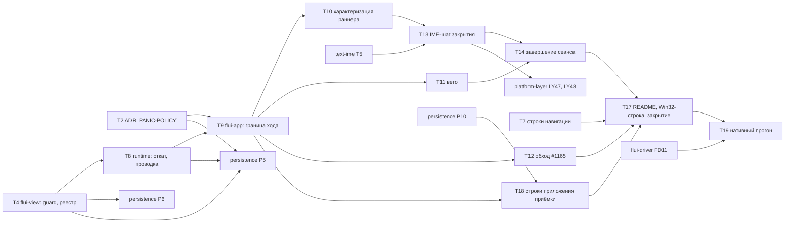

# teardown — задачи

- **Статус:** Утверждена владельцем 2026-10-28; исполнение
- **Design:** [design.md](design.md); требования — [requirements.md](requirements.md); смежная —
  [persistence/tasks.md](../persistence/tasks.md) (приложение приёмки P10, реестр сброса хоста P6)
- **Итог:** из 17 задач прежнего плана сделаны T1, T3; T5 сделана платформенной серией; T6, T15,
  T16 устарели; T8 и T14 сделаны в части. Осталось 13 задач, из них новые T18 (строки на
  приложении приёмки) и T19 (нативный прогон через лейн `os` flui-driver). Сейчас можно начинать
  T2, T4 и T7; остальное — по колонке «Зависит от».
- **Решения владельца** остаются открытыми и записаны в задачах, которых касаются: вопросы 1–4
  requirements (учёт `Drop`, бюджет выхода, внедрение паники, N) и «101 после сброса» против
  LY90, который на границе ОС отвечает или прерывает процесс.

## Правила исполнения

Пункты 1–7 и 9 [«Правил исполнения» platform-layer](../platform-layer/tasks.md#правила-исполнения):
задача = worktree под `.claude/worktrees/<имя>` = ветка = PR; проверки по AGENTS.md «Checking a
change» через `cargo heli`; fix-тест падает при откате исправления в изолированном checkout; ID
задач и требований — только в этом каталоге; `changelog.d/<branch-slug>.md` у каждого PR,
меняющего поверхность. Дополнительно:

- **Контрактные тесты под `ignore`.** T1 слил 13 тестов с `#[ignore = "contract: …"]`.
  Исполнитель снимает `ignore` со своих и переносит их строкой в таблицу семейства; это его
  доказательство. После T17 `rg 'contract:' crates` пуст.
- **Fix** падает с откатанной production-правкой; **хар.** (характеризация по design) проходит и
  на старом коде.
- **Где:** L — Linux CI; W — Windows нативно (`cargo heli nextest run -p flui-native` или
  `#[ignore]`-строка, вывод в PR); C — дочерний процесс по образцу `opaque_frame_child`
  (родитель проверяет код, маркеры порядка и отсутствие abort; исполняется в L); A — внешний
  consumer приложения приёмки (persistence P10, исполняется в L); D — нативный прогон процесса
  через лейн `os` [flui-driver](../flui-driver/tasks.md) (Windows — FD11), датированный вывод в PR.

## Граф

## Сделано

- [x] **T1** — контракт lifecycle: `CloseReason`, `CloseGuard`, `CloseHold`, `PendingClose`,
  `FlushRegistry`, `FlushHost`, `CallbackPanic`, `report_contained_panic`; 13 тестов под
  `ignore` (#1462).
- [x] **T3** — trace `native_window_destroyed` в ветке `WM_DESTROY` (#1493; сейчас
  `crates/flui-native/src/window/windows/proc.rs`).
- [x] **T5** — сделана платформенной серией: Win32 `WM_QUERYENDSESSION`/`WM_ENDSESSION`,
  `ShutdownBlockReasonCreate/Destroy` — `crates/flui-native/src/lifecycle/windows.rs`;
  `AppHandler::session_end` вместо `Platform::on_session_end` (LY45, #1926); headless
  `session_end` — `lifecycle/headless.rs`; граница паники на каждом входе ОС (LY90, #1872) и одна
  точка вызова обработчиков (LY26, #1853). Слот payload в `window_proc` устарел: его заменили
  `os_entry` LY90 и точка вызова LY26. Строка R5 (`win32_close_drains_platform_map_entry`) — в T17.

## Сделано в части

- **T8** — доставка закрытия с защёлкой и `UiRuntime::report_contained_panic` есть. Остаток —
  задача T8 ниже.
- **T14** — доставка завершения сеанса до `flui-app` есть (`runner/host.rs`,
  `answer_session_end`). Остаток — задача T14 ниже.

## Устаревшие задачи

- **T6** (Notes: `DropLedger` в `tests/fixtures/notes_flow.rs`) — Notes удалён. Строка R1 на
  приложении уходит в T18; механизм учёта `Drop` — решение владельца (вопрос 1), в T18.
- **T15** (`tools/xtask`: live-smoke на Notes, `windows-notes`) — live-smoke, `cargo xtask
  device` и Notes удалены. Заменена: T19 (лейн `os` flui-driver на пускаче приложения приёмки);
  X11 и Wayland — когда у flui-driver есть их лейн (FD16).
- **T16** (пример `notes_faults`, строка R8 в `notes_flow.rs`) — заменена: шов отказов —
  аргумент конструктора приложения приёмки (persistence P10), строка R8 — T18; внедрение паники
  в нативный процесс — решение владельца (вопрос 3), в T19.

## Задачи

| ID | Задача | Зависит от | Крейты и файлы | Гейты | Тесты | Где |
|---|---|---|---|---|---|---|
| **T2** [P] | **ADR и PANIC-POLICY** (design «ADR»). Четыре ADR teardown: граница хода владельца и терминальный выход; close guard, причины и реестр сброса; завершение сеанса (поверх `AppHandler::session_end`); drop владельца завершает наблюдение. ADR persistence из её design. `Superseded-by` в ADR-0035 и ADR-0040, отметка шага 8 в ADR-0093; в `docs/PANIC-POLICY.md` — «Callback panics and exit codes» и строка о codec-панике persistence. **Решение владельца** до слияния: «101 после сброса» (D2, R7, R12) против границы паники LY90 на входах ОС, которая отвечает ОС или прерывает процесс: какой путь даёт 101, а какой — abort | — | `docs/adr/` (пять новых, ADR-0035, ADR-0040, ADR-0093), `docs/PANIC-POLICY.md` | `cargo heli xtask checks` | ревью ADR по списку design | L |
| **T4** [P] | **`flui-view`: guard, защёлка, реестр, `detached()`.** Состояние guard (запись на причину, отпускание последнего hold — одна операция, `require_decision` держит); защёлка доставки в `LifecycleSource`; реестр (последние байты побеждают, одна запись в полёте на имя, перебазирование линии одного издателя, неудача держит байты); `TreeObserver::detached()` в `BuildOwner::drop` (#1126) | — | `crates/flui-view/src/{close_guard.rs,flush_registry.rs,lifecycle.rs,owner/build_owner.rs}`, `crates/flui-view/tests/{lifecycle_tests.rs,build_owner_tests.rs}` | clippy и nextest: `-p flui-view` и зависимые | снимает `ignore` с 12 контрактных тестов `flui-view`: восемь в `tests/lifecycle_tests.rs`, три in-src в `flush_registry.rs`, один in-src в `lifecycle.rs`; R3 `dropping_an_owner_with_an_observer_detaches_it_once` (fix); строки реестра persistence R20, R28 | L |
| **T7** [P] | **Закрытие посреди навигации** (R17): строки в существующих тестах | — | `crates/flui-widgets/tests/{navigator.rs,hero_flight.rs,modal_route.rs}` | clippy и nextest: `-p flui-widgets` | `closing_mid_transition_releases_the_route_overlay_and_hero`, `removing_the_observer_mid_flight_ends_the_flight` (#1195), `dropping_the_last_navigator_handle_after_push_clears_the_modal_registry` (#1066) | L |
| **T8** | **Остаток: откат повтора кадра и проводка.** Откат `T·2^min(k−1,6)` с потолком 1 с через очередь дедлайнов (`checked_mul`, `saturating_add`), обход отката только дискретным вводом (`flui-app/src/app/runner/retry_backoff.rs` — существующий откат GPU-восстановления, для сверки формы); проводка `close_guard()`/`flush_registry()` в `RuntimeHostServices` и `BuildOwner`; headless-хост получает реестр и настоящие `request_close`/`end_session`. **Решение владельца:** вопрос 4 requirements — N для R10 и способ мерить на виртуальных часах (design предлагает коридор 8–12 за 10 с) | T4 | `crates/flui-runtime/src/{runtime_services.rs,presentation.rs,frame_failure.rs,ui_runtime/{construct.rs,presentation_lifecycle.rs,frame_clock.rs}}`, `crates/flui-runtime/ARCHITECTURE.md`, `crates/flui-testing/src/{host.rs,widgets.rs}`, `crates/flui-testing/tests/{main.rs,headless_host.rs}` | clippy и nextest: `-p flui-runtime -p flui-testing` и зависимые; `globals` | R10: `a_repeating_paint_panic_backs_off_but_keeps_retrying`, `a_single_paint_panic_redraws_without_input`, `a_pointer_move_does_not_bypass_the_backoff`, `a_failure_streak_past_thirty_three_keeps_the_one_second_cap` (fix); `close_delivery_is_idempotent` | L |
| **T9** | **`flui-app`: граница хода владельца.** Per-task catch в диспетчере (`runner/owner_dispatch.rs`), классификация D4, терминальный слот хоста, catch вокруг `run`, `drop` UI-runtime'ов, `queued_turns` и `on_quit` под catch, шаг 7 `flush_within` до сервисов, `on_close` без `resume_unwind` (сегодня `desktop.rs` возобновляет), `resume_unwind` → 101 после сброса; Android — тот же путь (clippy); `# Panics` у `Application::run`, `run_app`. Различает маркер сброса до возобновления, не код 101. **Решение владельца:** «101 после сброса» против LY90 (см. T2) — от него зависит, какие строки R11 ждут 101, а какие abort | T2, T8 | `crates/flui-app/src/app/{application.rs,runner/{owner_dispatch.rs,desktop.rs,main_window.rs,android.rs,installed_host.rs}}`, `crates/flui-app/tests/runner_teardown.rs`, `.config/nextest.toml` (тайм-аут детских тестов) | clippy и nextest: `-p flui-app` и зависимые; `cargo heli xtask cross-typecheck`; `globals` | R6 `a_write_past_the_deadline_leaves_a_whole_file_and_exits_ok`; R7 `teardown_panic_flushes_the_registry_before_resuming` (C); R9 `a_panicking_tap_handler_reports_once_and_the_next_tap_works`, `a_panicking_post_frame_callback_reports_once_and_the_next_frame_builds` (C); R11 `user_panic_exit_code_matrix` (C); R12 `dispose_panic_on_last_window_close_resumes_after_flush` (C); R13 `capture_drop_panic_keeps_the_first_failure_and_still_flushes` (C) | L + C + T |
| **T10** [P] | **Характеризация раннера** (таблица `runner_teardown.rs`); `the_runner_sleeps_until_the_failure_retry_deadline` — fix, правка при необходимости в `runner/frame_pacing.rs`. **Решения владельца:** вопрос 1 (учёт `Drop` для R1 на уровне раннера) и вопрос 2 (бюджет выхода R4: 15 с, вывод из констант или запись в `measurements`) | T9 | `crates/flui-app/tests/runner_teardown.rs`, `crates/flui-app/src/app/runner/frame_pacing.rs` | clippy и nextest: `-p flui-app` | R1 `last_window_close_releases_the_realm_through_the_runner`; R2 `closing_with_a_pending_load_retires_the_future_once`; R4 `last_window_close_returns_ok_on_both_routes`; R10 `the_runner_sleeps_until_the_failure_retry_deadline`; R15 `close_requested_inside_a_frame_runs_once_on_the_next_turn`; R16 `a_late_completion_after_close_requests_no_frame`; R18 `a_second_close_request_tears_down_once`; R20 `device_loss_on_the_closing_frame_still_exits_ok` | L |
| **T11** [P] | **Вето с причиной.** `PendingClose` из `KeepOpen`; `CloseReason::Program` в `AppHandle::request_quit` с отложенным quit | T9 | `crates/flui-app/src/app/{close_request.rs,application_control.rs}`, `changelog.d/` | clippy и nextest: `-p flui-app` | снимает `ignore` с `a_close_request_carries_its_reason`; R23 `a_vetoed_close_disposes_nothing` | L |
| **T12** [P] | **Обход #1165.** Каждый `resume_unwind`, достижимый из `Drop` в `ui_runtime`, `owner_dispatch`, `element_tree`, `build_owner`, `scheduler`; поля `UiRuntime` с пользовательскими значениями — в `ManuallyDrop`/`Option` с явным уничтожением; итоги — в `ARCHITECTURE.md` `flui-runtime`, `flui-app`, `flui-view`, `flui-scheduler`. Эксперимент риска 1 design: ребёнок с паникой `dispose` и паникующим `Drop` future — без abort | T9 | `crates/flui-runtime/src/ui_runtime/mod.rs`, `crates/flui-app/src/app/runner/owner_dispatch.rs`, `crates/flui-view/src/{tree/element_tree.rs,owner/build_owner.rs}`, `crates/flui-scheduler/src/`, четыре `ARCHITECTURE.md`, `crates/flui-testing/tests/owner_scope.rs` | clippy и nextest: `-p flui-runtime -p flui-app -p flui-view -p flui-scheduler -p flui-testing` | R14 `user_drop_panic_inside_an_unwind_is_retained` (C); R19 `stale_handles_refuse_after_realm_drop` — строка на тип handle | L + C |
| **T13** | **IME-шаг общей доставки закрытия.** Шаг 2 доставки зовёт хук принятого закрытия text-ime (`complete_composition`), повтор в `dispose` — no-op | T10, text-ime T5 | `crates/flui-runtime/src/ui_runtime/presentation_lifecycle.rs`, `crates/flui-app/tests/runner_teardown.rs` | clippy и nextest: `-p flui-runtime -p flui-app` | R21 `closing_during_composition_commits_before_detached` (fix) | L |
| **T14** | **Остаток: завершение сеанса в `flui-app`** (S1–S6). `CloseReason::SessionEnd` доходит до guard и обработчика вето; сброс реестра в бюджете `SESSION_END_BUDGET` 3 с, порог 1 с для пользовательского кода; кэш ответа на одну пачку; `SessionEnding` для извлечённого UI-runtime | T11, T13 | `crates/flui-app/src/app/runner/{host.rs,session_controller.rs,main_window.rs}`, `crates/flui-app/src/app/close_request.rs`, `crates/flui-app/tests/runner_teardown.rs` | clippy и nextest: `-p flui-app`; `cargo heli xtask cross-typecheck` | R22 `session_end_flushes_the_registry_within_the_framework_budget`, `session_end_with_a_checked_out_realm_writes_registry_bytes_and_calls_no_user_code`; `a_cancelled_logoff_withdraws_only_the_session_entry`; `the_query_cache_ends_with_its_burst`; строки реестра persistence `session_end_during_a_write_writes_the_latest_registry_bytes`, `session_end_never_blocks_for_work_in_progress` | L |
| **T18** | **Строки teardown на приложении приёмки.** R1: закрытие после прохода Home → Note → Settings освобождает каждого владельца; R8: паника в `build` экрана заметки даёт `ErrorView`, остальные экраны работают; R23: строка со счётчиками `Drop` при вето. **Решение владельца:** вопрос 1 — механизм учёта `Drop` (debug-счётчики во фреймворке, сторожа владения в приложении, `TreeObserver`; design предлагал сторожей) | persistence P10, T9 | `tests/fixtures/acceptance_app/` (модуль строк teardown), `tests/facade_consumer.rs` (список ожидаемых строк) | clippy и nextest: `-p flui` (nested-cargo) | `acceptance_app_close_releases_every_owner_after_navigation` (R1, хар.); `a_panicking_note_build_shows_error_view_and_other_screens_work` (R8, хар.); строка R23 | A |
| **T17** | **Закрытие спеки.** README-матрица (R24: teardown на wasm не гарантирован; строки persistence о потере без вето и о wasm); Win32-строка R5 `win32_close_drains_platform_map_entry` (`#[ignore]`, реальное окно, по образцу macOS-теста из `f9271035b`); `rg 'contract:' crates` пуст | T12, T14, T18, T7 | `README.md`, `crates/flui-native/tests/contract.rs` | `cargo heli xtask checks`; `cargo heli nextest run -p flui-native --run-ignored only` на Windows | R5 (W, вывод в PR); R24 — строка README | L + W |
| **T19** | **Нативный прогон через лейн `os` flui-driver** на пускаче приложения приёмки: Alt+F4 и программный close → код 0 (R4); двойной close (R18); паника в Save — процесс жив, следующий ввод работает (R9); паника в `dispose` при закрытии → 101 (R12); `window_proc`-путь (R11); закрытие во время композиции (R21); сообщения сеанса окну и перезапуск — состояние на месте (R22). Ссылка в #1147. **Решение владельца:** вопрос 3 — как внедрить панику в нативный процесс | T17, flui-driver FD11 | шаги лейна `os` (по форме FD11), `docs/platform-parity.md`, `docs/gaps.md` | `cargo heli xtask checks` | датированный вывод каждого шага в PR | D |

## Требование → тест

| R | Тест или прогон | Задача | Вид | Где |
|---|---|---|---|---|
| R1 | `acceptance_app_close_releases_every_owner_after_navigation`; `last_window_close_releases_the_realm_through_the_runner` | T18; T10 | хар. | A, L |
| R2 | `closing_with_a_pending_load_retires_the_future_once` | T10 | хар. | L |
| R3 | `dropping_an_owner_with_an_observer_detaches_it_once` | T4 | fix | L |
| R4 | `last_window_close_returns_ok_on_both_routes`; нативный прогон | T10; T19 | хар.; fix | L, D |
| R5 | `win32_close_drains_platform_map_entry` | T17 | хар. | W |
| R6 | `a_write_past_the_deadline_leaves_a_whole_file_and_exits_ok` | T9 | fix | L |
| R7 | `teardown_panic_flushes_the_registry_before_resuming` | T9 | fix | C |
| R8 | `a_panicking_note_build_shows_error_view_and_other_screens_work` | T18 | хар. | A |
| R9 | `a_panicking_tap_handler_reports_once_and_the_next_tap_works`, `a_panicking_post_frame_callback_reports_once_and_the_next_frame_builds`; паника в Save | T9; T19 | fix | C, D |
| R10 | `a_repeating_paint_panic_backs_off_but_keeps_retrying`, `a_single_paint_panic_redraws_without_input`, `a_pointer_move_does_not_bypass_the_backoff`, `a_failure_streak_past_thirty_three_keeps_the_one_second_cap`; `the_runner_sleeps_until_the_failure_retry_deadline` | T8; T10 | fix | L |
| R11 | `user_panic_exit_code_matrix`; `window_proc`-путь | T9; T19 | fix | C, D |
| R12 | `dispose_panic_on_last_window_close_resumes_after_flush`; паника в `dispose` → 101 | T9; T19 | fix | C, D |
| R13 | `capture_drop_panic_keeps_the_first_failure_and_still_flushes` | T9 | fix | C |
| R14 | `user_drop_panic_inside_an_unwind_is_retained` | T12 | хар. | C |
| R15 | `close_requested_inside_a_frame_runs_once_on_the_next_turn` | T10 | хар. | L |
| R16 | `a_late_completion_after_close_requests_no_frame` | T10 | хар. | L |
| R17 | `closing_mid_transition_releases_the_route_overlay_and_hero`, `removing_the_observer_mid_flight_ends_the_flight`, `dropping_the_last_navigator_handle_after_push_clears_the_modal_registry` | T7 | хар. | L |
| R18 | `a_second_close_request_tears_down_once`; Alt+F4, затем программный close | T10; T19 | хар. | L, D |
| R19 | `stale_handles_refuse_after_realm_drop` | T12 | хар. | L |
| R20 | `device_loss_on_the_closing_frame_still_exits_ok` | T10 | хар. | L |
| R21 | `closing_during_composition_commits_before_detached`; прогон | T13; T19 | fix | L, D |
| R22 | `session_end_flushes_the_registry_within_the_framework_budget`, `session_end_with_a_checked_out_realm_writes_registry_bytes_and_calls_no_user_code`; сообщения сеанса окну приложения приёмки | T14; T19 | fix | L, D |
| R23 | `a_vetoed_close_disposes_nothing`; есть `a_panicking_handler_vetoes_and_stays_registered`; строка со счётчиками `Drop` | T11; T18 | хар. | L, A |
| R24 | строка README | T17 | — | — |
| — | `close_delivery_is_idempotent` (T8); контрактные тесты `flui-view` (T4); `a_cancelled_logoff_withdraws_only_the_session_entry`, `the_query_cache_ends_with_its_burst` (T14) | — | fix | L |

## Ход исполнения

- [x] T1 — #1462
- [x] T3 — #1493
- [x] T5 — платформенная серия: #1926 (LY45), #1872 (LY90), #1853 (LY26)
- [ ] T2 — ADR и PANIC-POLICY (решение владельца: 101 против LY90). Ветка `teardown/adrs`:
  ADR-0258 (граница хода и терминальный выход), ADR-0259 (close guard, причины, реестр сброса),
  ADR-0260 (завершение сеанса), ADR-0261 (drop владельца завершает наблюдение), все `Proposed`;
  `Superseded-by (on acceptance)` в ADR-0035 и ADR-0040; раздел «Callback panics and exit codes» и
  строка о codec-панике в PANIC-POLICY. Решения владельца разложены по вариантам, не выбраны:
  ADR-0258 §4 (101 против LY90: 4a слот в `os_entry`, 4b abort на входах ОС и 101 только из
  `flui-app`, 4c `exit(101)` после сброса), §6 (N: коридор, верхняя граница, точное расписание),
  §7 (бюджет выхода), внедрение паники в нативный прогон; ADR-0261 §2 (учёт `Drop`). Не сделаны:
  ADR persistence и отметка шага 8 в ADR-0093 (вне объёма этой ветки). ADR-0260 опирается на
  текущий хост: Win32 спрашивает сеанс один раз на окне-приёмнике, поэтому кэш пачки и строка
  `the_query_cache_ends_with_its_burst` (T14), вероятно, не нужны.
- [ ] T4 — `flui-view`: guard, реестр, `detached()`
- [ ] T7 — строки навигации
- [ ] T8 — остаток: откат и проводка (решение владельца: вопрос 4)
- [ ] T9 — граница хода в `flui-app`
- [ ] T10 — характеризация раннера (решения владельца: вопросы 1, 2)
- [ ] T11 — вето с причиной
- [ ] T12 — обход #1165
- [ ] T13 — IME-шаг закрытия
- [ ] T14 — остаток: завершение сеанса
- [ ] T18 — строки на приложении приёмки (решение владельца: вопрос 1)
- [ ] T17 — README, Win32-строка R5, закрытие
- [ ] T19 — нативный прогон (после flui-driver FD11; решение владельца: вопрос 3)
