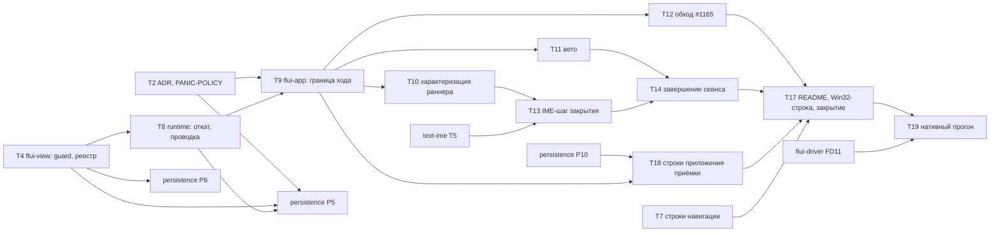

# teardown — задачи

- **Статус:** Утверждена владельцем 2026-10-28; исполнение
- **Design:** [design.md](design.md); требования — [requirements.md](requirements.md); смежная —
  [persistence/tasks.md](../persistence/tasks.md) (приложение приёмки P10, реестр сброса хоста P6)
- **Итог:** из 17 задач прежнего плана сделаны T1, T3; T5 сделана платформенной серией; T6, T15,
  T16 устарели; T8 и T14 сделаны в части. Осталось 13 задач, из них новые T18 (строки на
  приложении приёмки) и T19 (нативный прогон через лейн `os` flui-driver). Сейчас можно начинать
  T2, T4 и T7; остальное — по колонке «Зависит от».
- **Решения 2026-10-28** (по поручению владельца решены исследованием, записаны в ADR и в
  задачах, которых касаются):
  - «101 после сброса» против LY90 — ADR-0258 §4 (4b): входы ОС не меняются; приложенческая
    паника ловится в `flui-app` (§1, §2) и до входа ОС не доходит, поэтому 101 — исход того, что
    поймал `flui-app`; паника, дошедшая до входа ОС, — дефект FLUI и получает ответ входа или abort.
    Тело каждого метода `AppHandler`/`WindowHandler` в `flui-app` целиком под одним catch
    (`RunnerHandler::contained`). Строк abort в матрице кодов нет; границу проверяет
    `an_application_panic_never_leaves_a_handler` (строка на метод обработчика).
  - Вопрос 4 (N) — ADR-0258 §6 (6d): свойства против `FAILURE_RETRY_CAP` (1 с) на 60, 120 и
    240 Гц: интервалы не меньше `T` и ниже потолка не убывают; после выхода на потолок — в
    `[cap, cap + T)` в любом порядке; за десять потолков без ввода — не меньше девяти отчётов.
    Степень ограничена 10, а не 6.
  - Вопрос 2 (бюджет выхода) — ADR-0258 §7 (7b): один срок `EXIT_BUDGET` = 6 с на шаги 3–6
    порядка выхода; сброс и сервисы — свои 5 с, пулы — остаток; `EXECUTION_SHUTDOWN_GRACE`
    удаляется, `ExecutionServices::shutdown` принимает `Instant`. Сквозная граница R4 остаётся:
    сторож `EXIT_WATCHDOG` (15 с с шага 1) пишет реестр (1 с) и вызывает
    `flui_native::end_process(EXIT_CODE_HUNG)`, код 124.
  - Вопрос 3 (внедрение паники) — ADR-0258 «Confirmation»: фикстура — пример
    `acceptance_app_faults` (добавляет P10, #1952; на `main` его ещё нет), отказ — её аргумент
    (`build-panic`, `save-panic`, `dispose-panic`), шов — `Faults`, аргумент конструктора
    приложения приёмки; у пускача `acceptance_app` (тоже P10) переключателя нет.
  - Вопрос 1 (учёт `Drop`) — ADR-0261 §2 (2b): сторожа одного `DropLedger` из `flui-testing`
    (`flui::testing::DropLedger`, `DropSentinel`), один журнал на вид значений.

## Правила исполнения

Пункты 1–7 и 9 [«Правил исполнения» platform-layer](../platform-layer/tasks.md#правила-исполнения):
задача = worktree под `.claude/worktrees/<имя>` = ветка = PR; проверки по AGENTS.md «Checking a
change» через `cargo heli`; fix-тест падает при откате исправления в изолированном checkout; ID
задач и требований — только в этом каталоге; `changelog.d/<branch-slug>.md` у каждого PR,
меняющего поверхность. Дополнительно:

- **Контрактные тесты под `ignore`.** T1 слил 13 тестов с `#[ignore = "contract: …"]`.
  Исполнитель снимает `ignore` со своих и переносит их строкой в таблицу семейства; это его
  доказательство. После T17 `rg 'contract:' crates` пуст.
- **Fix** падает с откатанной production-правкой; **хар.** (характеризация по design) проходит и
  на старом коде.
- **Где:** L — Linux CI; W — Windows нативно (`cargo heli nextest run -p flui-native` или
  `#[ignore]`-строка, вывод в PR); C — дочерний процесс по образцу `opaque_frame_child`
  (родитель проверяет код, маркеры порядка и отсутствие abort; исполняется в L); A — внешний
  consumer приложения приёмки (persistence P10, исполняется в L); D — нативный прогон процесса
  через лейн `os` [flui-driver](../flui-driver/tasks.md) (Windows — FD11), датированный вывод в PR.

## Граф

## Сделано

- [x] **T1** — контракт lifecycle: `CloseReason`, `CloseGuard`, `CloseHold`, `PendingClose`,
  `FlushRegistry`, `FlushHost`, `CallbackPanic`, `report_contained_panic`; 13 тестов под
  `ignore` (#1462).
- [x] **T3** — trace `native_window_destroyed` в ветке `WM_DESTROY` (#1493; сейчас
  `crates/flui-native/src/window/windows/proc.rs`).
- [x] **T5** — сделана платформенной серией: Win32 `WM_QUERYENDSESSION`/`WM_ENDSESSION`,
  `ShutdownBlockReasonCreate/Destroy` — `crates/flui-native/src/lifecycle/windows.rs`;
  `AppHandler::session_end` вместо `Platform::on_session_end` (LY45, #1926); headless
  `session_end` — `lifecycle/headless.rs`; граница паники на каждом входе ОС (LY90, #1872) и одна
  точка вызова обработчиков (LY26, #1853). Слот payload в `window_proc` устарел: его заменили
  `os_entry` LY90 и точка вызова LY26. Строка R5 (`win32_close_drains_platform_map_entry`) — в T17.

## Сделано в части

- **T8** — доставка закрытия с защёлкой и `UiRuntime::report_contained_panic` есть. Остаток —
  задача T8 ниже.
- **T14** — доставка завершения сеанса до `flui-app` есть (`runner/host.rs`,
  `answer_session_end`). Остаток — задача T14 ниже.

## Устаревшие задачи

- **T6** (Notes: `DropLedger` в `tests/fixtures/notes_flow.rs`) — Notes удалён. Строка R1 на
  приложении уходит в T18; механизм учёта `Drop` — `DropLedger` (ADR-0261 §2), в T18.
- **T15** (`tools/xtask`: live-smoke на Notes, `windows-notes`) — live-smoke, `cargo xtask
  device` и Notes удалены. Заменена: T19 (лейн `os` flui-driver на пускаче приложения приёмки);
  X11 и Wayland — когда у flui-driver есть их лейн (FD16).
- **T16** (пример `notes_faults`, строка R8 в `notes_flow.rs`) — заменена: шов отказов —
  аргумент конструктора приложения приёмки (persistence P10), строка R8 — T18; внедрение паники
  в нативный процесс — фикстура — пример `acceptance_app_faults` (добавляет P10, #1952; ADR-0258), в T19.

## Задачи

| ID | Задача | Зависит от | Крейты и файлы | Гейты | Тесты | Где |
|---|---|---|---|---|---|---|
| **T2** [P] | **ADR и PANIC-POLICY** (design «ADR»). Четыре ADR teardown: граница хода владельца и терминальный выход; close guard, причины и реестр сброса; завершение сеанса (поверх `AppHandler::session_end`); drop владельца завершает наблюдение. ADR persistence из её design. `Superseded-by` в ADR-0035 и ADR-0040, отметка шага 8 в ADR-0093; в `docs/PANIC-POLICY.md` — «Callback panics and exit codes» и строка о codec-панике persistence. «101 после сброса» (D2, R7, R12) против LY90 решено в ADR-0258 §4: входы ОС не меняются, 101 — исход того, что поймал `flui-app` | — | `docs/adr/` (пять новых, ADR-0035, ADR-0040, ADR-0093), `docs/PANIC-POLICY.md` | `cargo heli xtask checks` | ревью ADR по списку design | L |
| **T4** [P] | **`flui-view`: guard, защёлка, реестр, `detached()`.** Состояние guard (запись на причину, отпускание последнего hold — одна операция, `require_decision` держит); защёлка доставки в `LifecycleSource`; реестр (последние байты побеждают, одна запись в полёте на имя, перебазирование линии одного издателя, неудача держит байты); `TreeObserver::detached()` в `BuildOwner::drop` (#1126) | — | `crates/flui-view/src/{close_guard.rs,flush_registry.rs,lifecycle.rs,owner/build_owner.rs}`, `crates/flui-view/tests/{lifecycle_tests.rs,build_owner_tests.rs}` | clippy и nextest: `-p flui-view` и зависимые | снимает `ignore` с 12 контрактных тестов `flui-view`: восемь в `tests/lifecycle_tests.rs`, три in-src в `flush_registry.rs`, один in-src в `lifecycle.rs`; R3 `dropping_an_owner_with_an_observer_detaches_it_once` (fix); строки реестра persistence R20, R28 | L |
| **T7** [P] | **Закрытие посреди навигации** (R17): строки в существующих тестах | — | `crates/flui-widgets/tests/{navigator.rs,hero_flight.rs,modal_route.rs}` | clippy и nextest: `-p flui-widgets` | `closing_mid_transition_releases_the_route_overlay_and_hero`, `removing_the_observer_mid_flight_ends_the_flight` (#1195), `dropping_the_last_navigator_handle_after_push_clears_the_modal_registry` (#1066) | L |
| **T8** | **Остаток: откат повтора кадра и проводка.** Откат `T·2^min(k−1,10)` с потолком `FAILURE_RETRY_CAP` (1 с, `pub const` `flui-runtime`) через очередь дедлайнов (`checked_mul`, `saturating_add`), обход отката только дискретным вводом (`flui-app/src/app/runner/retry_backoff.rs` — существующий откат GPU-восстановления, для сверки формы); проводка `close_guard()`/`flush_registry()` в `RuntimeHostServices` и `BuildOwner`; headless-хост получает реестр и настоящие `request_close`/`end_session`. Мера R10 — ADR-0258 §6 (6d): на виртуальных часах, строки 60, 120 и 240 Гц без ввода; интервалы между отчётами не меньше `T` и ниже потолка не убывают; после выхода на потолок каждый в `[FAILURE_RETRY_CAP, FAILURE_RETRY_CAP + T)`; за десять потолков — не меньше девяти отчётов | T4 | `crates/flui-runtime/src/{runtime_services.rs,presentation.rs,frame_failure.rs,ui_runtime/{construct.rs,presentation_lifecycle.rs,frame_clock.rs}}`, `crates/flui-runtime/ARCHITECTURE.md`, `crates/flui-testing/src/{host.rs,widgets.rs}`, `crates/flui-testing/tests/{main.rs,headless_host.rs}` | clippy и nextest: `-p flui-runtime -p flui-testing` и зависимые; `globals` | R10: `a_repeating_paint_panic_backs_off_but_keeps_retrying` (строка на частоту), `a_single_paint_panic_redraws_without_input`, `a_pointer_move_does_not_bypass_the_backoff`, `a_failure_streak_past_thirty_three_keeps_the_one_second_cap` (fix); `close_delivery_is_idempotent` | L |
| **T9** | **`flui-app`: граница хода владельца.** Per-task catch в диспетчере (`runner/owner_dispatch.rs`), классификация D4, терминальный слот хоста, catch вокруг `run`, `drop` UI-runtime'ов, `queued_turns` и `on_quit` под catch, срок выхода `ExitDeadline` (ADR-0258 §7: `EXIT_BUDGET` 6 с с начала сброса; сброс и сервисы — `SERVICE_SHUTDOWN_DEADLINE` 5 с; пулы — остаток до конца срока; `EXECUTION_SHUTDOWN_GRACE` удалить, `ExecutionServices::shutdown(deadline: Instant)`), `flush_within` до сервисов, `on_close` без `resume_unwind` (сегодня `desktop.rs` возобновляет), `resume_unwind` → 101 после сброса; сторож выхода (ADR-0258 §7: поток с `recv_timeout(EXIT_WATCHDOG)` 15 с с шага 1, при срабатывании — лог шага, `FlushHost::flush_within(now + 1 с)` с его потока, `flui_native::end_process(EXIT_CODE_HUNG)`, код 124; `FlushHost` — `Clone`, `Send + Sync`; `end_process` — `TerminateProcess`/`_exit`, новая функция `flui-native`); Android — тот же путь (clippy); `# Panics` у `Application::run`, `run_app`. Различает маркер сброса до возобновления, не код 101. Входы ОС не меняются (ADR-0258 §4): тело каждого метода `AppHandler`/`WindowHandler` в `flui-app` (`RunnerHandler`, `WindowRoutes`) целиком под `contained(failed, body)`, паника классифицируется по §2 и не выходит из метода; ни одна строка R11 не ждёт abort | T2, T8 | `crates/flui-app/src/app/{application.rs,runner/{owner_dispatch.rs,host.rs,window_routes.rs,desktop.rs,main_window.rs,android.rs,installed_host.rs}}`, `crates/flui-runtime/src/execution.rs`, `crates/flui-view/src/flush_registry.rs` (`FlushHost: Clone`), `crates/flui-native/src/` (`end_process`), `crates/flui-app/tests/runner_teardown.rs`, `.config/nextest.toml` (тайм-аут детских тестов) | clippy и nextest: `-p flui-app -p flui-runtime` и зависимые; `cargo heli xtask cross-typecheck`; `globals` | R6 `a_write_past_the_deadline_leaves_a_whole_file_and_exits_ok`; R7 `teardown_panic_flushes_the_registry_before_resuming` (C); R9 `a_panicking_tap_handler_reports_once_and_the_next_tap_works`, `a_panicking_post_frame_callback_reports_once_and_the_next_frame_builds` (C); R11 `user_panic_exit_code_matrix` (C), `an_application_panic_never_leaves_a_handler` (строка на метод обработчика и строка на метод с паникой в маршрутизации `flui-app`, fix); R4 `a_hung_service_and_compute_job_end_within_the_exit_budget` (fix: старый код ждёт 5 + 5 + 5 с), `a_blocking_destructor_ends_the_process_with_the_hung_code` (C, fix: старый код не выходит); R12 `dispose_panic_on_last_window_close_resumes_after_flush` (C); R13 `capture_drop_panic_keeps_the_first_failure_and_still_flushes` (C) | L + C + T |
| **T10** [P] | **Характеризация раннера** (таблица `runner_teardown.rs`); `the_runner_sleeps_until_the_failure_retry_deadline` — fix, правка при необходимости в `runner/frame_pacing.rs`. R1 на уровне раннера — сторожа `DropLedger` (ADR-0261 §2) в пробном дереве; R4 — возврат `Ok` в пределах `EXIT_BUDGET` (ADR-0258 §7) | T9 | `crates/flui-app/tests/runner_teardown.rs`, `crates/flui-app/src/app/runner/frame_pacing.rs` | clippy и nextest: `-p flui-app` | R1 `last_window_close_releases_the_runtime_through_the_runner`; R2 `closing_with_a_pending_load_retires_the_future_once`; R4 `last_window_close_returns_ok_on_both_routes`; R10 `the_runner_sleeps_until_the_failure_retry_deadline`; R15 `close_requested_inside_a_frame_runs_once_on_the_next_turn`; R16 `a_late_completion_after_close_requests_no_frame`; R18 `a_second_close_request_tears_down_once`; R20 `device_loss_on_the_closing_frame_still_exits_ok` | L |
| **T11** [P] | **Вето с причиной.** `PendingClose` из `KeepOpen`; `CloseReason::Program` в `AppHandle::request_quit` с отложенным quit | T9 | `crates/flui-app/src/app/{close_request.rs,application_control.rs}`, `changelog.d/` | clippy и nextest: `-p flui-app` | снимает `ignore` с `a_close_request_carries_its_reason`; R23 `a_vetoed_close_disposes_nothing` | L |
| **T12** [P] | **Обход #1165.** Каждый `resume_unwind`, достижимый из `Drop` в `ui_runtime`, `owner_dispatch`, `element_tree`, `build_owner`, `scheduler`; поля `UiRuntime` с пользовательскими значениями — в `ManuallyDrop`/`Option` с явным уничтожением; итоги — в `ARCHITECTURE.md` `flui-runtime`, `flui-app`, `flui-view`, `flui-scheduler`. Эксперимент риска 1 design: ребёнок с паникой `dispose` и паникующим `Drop` future — без abort | T9 | `crates/flui-runtime/src/ui_runtime/mod.rs`, `crates/flui-app/src/app/runner/owner_dispatch.rs`, `crates/flui-view/src/{tree/element_tree.rs,owner/build_owner.rs}`, `crates/flui-scheduler/src/`, четыре `ARCHITECTURE.md`, `crates/flui-testing/tests/owner_scope.rs` | clippy и nextest: `-p flui-runtime -p flui-app -p flui-view -p flui-scheduler -p flui-testing` | R14 `user_drop_panic_inside_an_unwind_is_retained` (C); R19 `stale_handles_refuse_after_the_runtime_drops` (новый) — строка на тип handle; R3 `a_close_that_holds_a_failure_never_detaches` (новый, ADR-0261 §1: закрытие с удержанным сбоем не роняет владельца и не зовёт `detached()`) | L + C |
| **T13** | **IME-шаг общей доставки закрытия.** Шаг 2 доставки зовёт хук принятого закрытия text-ime (`complete_composition`), повтор в `dispose` — no-op | T10, text-ime T5 | `crates/flui-runtime/src/ui_runtime/presentation_lifecycle.rs`, `crates/flui-app/tests/runner_teardown.rs` | clippy и nextest: `-p flui-runtime -p flui-app` | R21 `closing_during_composition_commits_before_detached` (fix) | L |
| **T14** | **Остаток: завершение сеанса в `flui-app`** (S1–S6). `CloseReason::SessionEnd` доходит до guard и обработчика вето; сброс реестра в бюджете `SESSION_END_BUDGET` 3 с, порог 1 с для пользовательского кода; кэша ответа нет (ADR-0260: одно окно-приёмник, один вопрос на фазу); `SessionEnding` для извлечённого UI-runtime | T11, T13 | `crates/flui-app/src/app/runner/{host.rs,session_controller.rs,main_window.rs}`, `crates/flui-app/src/app/close_request.rs`, `crates/flui-app/tests/runner_teardown.rs` | clippy и nextest: `-p flui-app`; `cargo heli xtask cross-typecheck` | R22 `session_end_flushes_the_registry_within_the_framework_budget`, `session_end_with_a_checked_out_runtime_writes_registry_bytes_and_calls_no_user_code`; `a_cancelled_logoff_withdraws_only_the_session_entry`; строки реестра persistence `session_end_during_a_write_writes_the_latest_registry_bytes`, `session_end_never_blocks_for_work_in_progress` | L |
| **T18** | **Строки teardown на приложении приёмки.** R1: закрытие после прохода Home → Note → Settings освобождает каждого владельца; R8: паника в `build` экрана заметки даёт `ErrorView`, остальные экраны работают; R23: строка со счётчиками `Drop` при вето. Учёт `Drop` — ADR-0261 §2: `flui_testing::DropLedger` и `DropSentinel` (`Send + Sync`, атомарные счётчики, без `static`), один журнал на вид значений (состояния, слушатели контроллеров, страницы маршрутов, futures); приложение приёмки сажает сторожей в эти значения | persistence P10, T9 | `crates/flui-testing/src/drop_ledger.rs` (новый; реэкспорт `flui::testing`), `crates/flui-testing/tests/main.rs`, `tests/fixtures/acceptance_app/` (модуль строк teardown), `tests/facade_consumer.rs` (список ожидаемых строк) | clippy и nextest: `-p flui-testing`, `-p flui` (nested-cargo); `xtask testing` | `drop_ledger_counts_each_sentinel_once`; `acceptance_app_close_releases_every_owner_after_navigation` (R1, хар.: все `live()` = 0 после закрытия и > 0 до); `a_panicking_note_build_shows_error_view_and_other_screens_work` (R8, хар.); строка R23 | A |
| **T17** | **Закрытие спеки.** README-матрица (R24: teardown на wasm не гарантирован; строки persistence о потере без вето и о wasm); Win32-строка R5 `win32_close_drains_platform_map_entry` (`#[ignore]`, реальное окно, по образцу macOS-теста из `f9271035b`); `rg 'contract:' crates` пуст | T12, T14, T18, T7 | `README.md`, `crates/flui-native/tests/contract.rs` | `cargo heli xtask checks`; `cargo heli nextest run -p flui-native --run-ignored only` на Windows | R5 (W, вывод в PR); R24 — строка README | L + W |
| **T19** | **Нативный прогон через лейн `os` flui-driver.** Строки доказывают то, что видит пользователь настоящего окна и чего headless-строки не видят; что паника не уходит из обработчика, доказывает `an_application_panic_never_leaves_a_handler` (T9), отдельной строки «путь `window_proc`» нет. На пускаче `acceptance_app`: (1) Alt+F4 и программный close → код 0 в пределах `EXIT_BUDGET` (R4); (2) Alt+F4, затем программный close → один teardown, код 0 (R18); (3) закрытие во время композиции IME (R21); (4) сообщения сеанса окну и перезапуск — состояние на месте (R22). На фикстуре `acceptance_app_faults` с аргументом: (5) `save-panic`: настоящий клик по «Save note» → процесс жив, следующая настоящая клавиша работает (R9); (6) `dispose-panic`: экран заметки открыт, Alt+F4 → код 101 и текст паники в stderr, не `0xC0000409` (R12); (7) `build-panic`: переход на экран заметки → видно `ErrorView`, окно отвечает на ввод, другие экраны открываются (R8). Код выхода читается из `gone { kind: process, exit }`. Оба примера добавляет persistence P10 (#1952), на `main` их ещё нет; шов — `Faults`, аргумент конструктора приложения приёмки; у `acceptance_app` переключателя нет. Ссылка в #1147 | T17, flui-driver FD11, persistence P10 | шаги лейна `os` (по форме FD11), `docs/platform-parity.md`, `docs/gaps.md` | `cargo heli xtask checks` | датированный вывод каждого шага в PR | D |

## Требование → тест

| R | Тест или прогон | Задача | Вид | Где |
|---|---|---|---|---|
| R1 | `acceptance_app_close_releases_every_owner_after_navigation`; `last_window_close_releases_the_runtime_through_the_runner` | T18; T10 | хар. | A, L |
| R2 | `closing_with_a_pending_load_retires_the_future_once` | T10 | хар. | L |
| R3 | `dropping_an_owner_with_an_observer_detaches_it_once`; `a_close_that_holds_a_failure_never_detaches` | T4; T12 | fix; хар. | L |
| R4 | `last_window_close_returns_ok_on_both_routes`; `a_hung_service_and_compute_job_end_within_the_exit_budget`, `a_blocking_destructor_ends_the_process_with_the_hung_code`; нативные строки 1 | T10; T9; T19 | хар.; fix; fix | L, C, D |
| R5 | `win32_close_drains_platform_map_entry` | T17 | хар. | W |
| R6 | `a_write_past_the_deadline_leaves_a_whole_file_and_exits_ok` | T9 | fix | L |
| R7 | `teardown_panic_flushes_the_registry_before_resuming` | T9 | fix | C |
| R8 | `a_panicking_note_build_shows_error_view_and_other_screens_work`; нативная строка 7 (`build-panic`) | T18; T19 | хар. | A, D |
| R9 | `a_panicking_tap_handler_reports_once_and_the_next_tap_works`, `a_panicking_post_frame_callback_reports_once_and_the_next_frame_builds`; нативная строка 5 (`save-panic`) | T9; T19 | fix | C, D |
| R10 | `a_repeating_paint_panic_backs_off_but_keeps_retrying`, `a_single_paint_panic_redraws_without_input`, `a_pointer_move_does_not_bypass_the_backoff`, `a_failure_streak_past_thirty_three_keeps_the_one_second_cap`; `the_runner_sleeps_until_the_failure_retry_deadline` | T8; T10 | fix | L |
| R11 | `user_panic_exit_code_matrix` (ни одна строка не ждёт abort), `an_application_panic_never_leaves_a_handler` (тотальный catch метода обработчика) | T9 | fix | C, L |
| R12 | `dispose_panic_on_last_window_close_resumes_after_flush`; нативная строка 6 (`dispose-panic`) → 101 | T9; T19 | fix | C, D |
| R13 | `capture_drop_panic_keeps_the_first_failure_and_still_flushes` | T9 | fix | C |
| R14 | `user_drop_panic_inside_an_unwind_is_retained` | T12 | хар. | C |
| R15 | `close_requested_inside_a_frame_runs_once_on_the_next_turn` | T10 | хар. | L |
| R16 | `a_late_completion_after_close_requests_no_frame` | T10 | хар. | L |
| R17 | `closing_mid_transition_releases_the_route_overlay_and_hero`, `removing_the_observer_mid_flight_ends_the_flight`, `dropping_the_last_navigator_handle_after_push_clears_the_modal_registry` | T7 | хар. | L |
| R18 | `a_second_close_request_tears_down_once`; нативная строка 2 | T10; T19 | хар. | L, D |
| R19 | `stale_handles_refuse_after_the_runtime_drops` (новый) | T12 | хар. | L |
| R20 | `device_loss_on_the_closing_frame_still_exits_ok` | T10 | хар. | L |
| R21 | `closing_during_composition_commits_before_detached`; нативная строка 3 | T13; T19 | fix | L, D |
| R22 | `session_end_flushes_the_registry_within_the_framework_budget`, `session_end_with_a_checked_out_runtime_writes_registry_bytes_and_calls_no_user_code`; нативная строка 4 | T14; T19 | fix | L, D |
| R23 | `a_vetoed_close_disposes_nothing`; есть `a_panicking_handler_vetoes_and_stays_registered`; строка со счётчиками `Drop` | T11; T18 | хар. | L, A |
| R24 | строка README | T17 | — | — |
| — | `close_delivery_is_idempotent` (T8); `drop_ledger_counts_each_sentinel_once` (T18); контрактные тесты `flui-view` (T4); `a_cancelled_logoff_withdraws_only_the_session_entry` (T14) | — | fix | L |

## Ход исполнения

- [x] T1 — #1462
- [x] T3 — #1493
- [x] T5 — платформенная серия: #1926 (LY45), #1872 (LY90), #1853 (LY26)
- [x] T2 — ADR и PANIC-POLICY — #1950: ADR-0258 (граница хода и
  терминальный выход), ADR-0259 (close guard, причины, реестр сброса), ADR-0260 (завершение
  сеанса) и ADR-0261 (drop владельца завершает наблюдение) — `Accepted (2026-10-28)`, не
  реализованы; ADR-0262 (persistence: документы поверх байтового хранилища, codec-паника
  `Panicked { during: CodecStep, message }`, набор фич R34, стек Router) — `Proposed`, с
  `Supersedes (on acceptance)` ADR-0093 шаг 8 и парной отметкой в ADR-0093; `Superseded-by` в
  ADR-0035 и ADR-0040; раздел «Callback panics and exit codes» и абзац о codec-панике в
  PANIC-POLICY; `crates/flui-runtime/ARCHITECTURE.md` о панике, покидающей dispatch, сверен с
  ADR-0258. Пять открытых решений приняты исследованием 2026-10-28 (шапка): §4 — 4b с тотальным
  catch метода обработчика, §6 — 6d, §7 — 7b и сторож выхода (15 с, код 124), внедрение паники —
  фикстура `acceptance_app_faults` (P10, #1952), ADR-0261 §2 — 2b. ADR-0261 §1 сверен с формой
  T4 (#1953: наблюдатель остаётся в слоте, `notify_detached`; закрытие с удержанным сбоем
  владельца не роняет). Кэш ответа сеанса убран из T14 и таблицы (ADR-0260). Имена тестов без
  «realm» (GLOSSARY). Проверка: `cargo heli xtask checks` 2026-10-28 на этой ветке — зелёная
  (heli r8140, 70 с).
- [x] T4 — `flui-view`: guard, реестр, `detached()` — #1953; 12 контрактных тестов — строки `close_guard_matrix`, `flush_registry_matrix`, `lifecycle_subscription_matrix`; R3, persistence R20, R28
- [x] T7 — строки навигации: три строки R17 в таблице `navigation_teardown` (`crates/flui-widgets/tests/contracts.rs`); характеризация, на текущем коде проходят. Зубы проверены: без `finish_all` в `HeroController::did_detach` падают строки навигатора и hero. `cargo test -p flui-widgets --test widgets_it` 2026-10-29 — 70 из 70, clippy `-p flui-widgets --all-targets -D warnings` чистый
- [ ] T8 — остаток: откат и проводка (мера R10 — ADR-0258 §6). Откат повтора — #1975 (строки R10 в `flui-testing`; свап корня в виджетном харнессе ждёт дедлайн повтора). Проводка — следующий PR: у каждой презентации свой `CloseGuardSource`, guard лежит в возможностях её собственного `BuildOwner` (у каждой презентации свой `WidgetsBinding`), поэтому ключ — `PresentationId`, и ремаунт корня guard не теряет; `RuntimeHostServices::with_flush_registry`/`with_close_vetoes`; `UiRuntime::{close_refused, withdraw_close, settle_close_guards}`; headless `request_close`/`end_session` (`SESSION_END_BUDGET` 3 с); в `flui-app` удержанный guard оставляет закрытие до вопроса обработчику, отпущенное закрытие ставится в очередь окна, занятый хост оставляет settle на следующий ход; реестр сброса хоста пишет через I/O-пул. Тесты: таблица `close_guard_hosting` (4 строки, в т.ч. `each_window_of_one_runtime_holds_its_own_close`, `a_guard_survives_a_root_remount`), строка `a_held_guard_keeps_the_close_before_the_handler_is_asked` в `close_request_matrix`; зубы проверены (с `close_refused` = false строки падают). Временное: строки набора раннера `flui_app::testing` открывают вторичное окно `Isolated`, а не главное — headless не открывает главное окно без поверхности; offscreen-поверхность главного окна — дизайн к T10
- [ ] T9 — граница хода в `flui-app` (входы ОС не меняются, ADR-0258 §4; срок выхода — §7). Сделано
  (один PR после T8): набор раннера `flui_app::testing` (`HeadlessRun`, `ExitReport`,
  `TeardownStep`); `ExitDeadline` (6 с; реестр сброса пишется до сервисов, шаг
  `TeardownStep::Flush`; пулы на одном сроке, `ExecutionServices::shutdown(Instant)`); сторож выхода
  (15 с, `EXIT_CODE_HUNG` 124, `flui_native::end_process`); терминальный слот хоста (паника на
  выходе и из `Platform::run` ждёт сброса и возобновляется, 101); per-operation containment в
  `flui-runtime` (сбой операции владельца отчитан один раз, хвост FIFO исполняется; терминальны
  только закрытие последней презентации последнего runtime и сбой после закрытия владельца);
  тотальный catch методов `RunnerHandler` и `WindowRoutes` (паника держится в слоте, цикл
  выходит); кадр — исключение: сбой отвечается `FrameOutcome::Failed` (`#[non_exhaustive]`),
  платформа считает его прошедшим кадром и не разматывает стек, сбой не терминален; контракт
  долга применения дисплея — в `flui-runtime` (`a_failed_wake_keeps_the_display_owed`). Строки:
  R4 `a_hung_service_and_compute_job_end_within_the_exit_budget`,
  `a_blocking_destructor_ends_the_process_with_the_hung_code` (ребёнок `runner_exit_codes`); R7
  `teardown_panic_flushes_the_registry_before_resuming`; R11
  `an_application_panic_never_leaves_a_handler` (11 строк: `AppHandler` ready, quit_requested,
  reopen, exit_policy, wake_deadline и все шесть методов `WindowHandler`; 10 падают, когда catch
  возобновляет панику); `a_failed_frame_is_contained_and_the_fifo_tail_runs`;
  `a_failed_frame_counts_and_does_not_unwind`. Зубы проверены. Временное: строки набора
  открывают вторичное окно `Isolated` (offscreen главного окна — дизайн к T10); сброс доказан
  маркером `TeardownStep::Flush`, а не байтами на диске (`Persisted` — заглушка до persistence).
  Остаток T9: R6, R9, R11 `user_panic_exit_code_matrix`, R12, R13, строки с паникой в
  маршрутизации `flui-app`.
  - [ ] Строки `AppHandler::session_end` и `AppHandler::host_notice` в
    `an_application_panic_never_leaves_a_handler`: headless не даёт внедрить панику приложения в
    `answer_session_end` и в подписчика системного уведомления; нужен шов (ответ сеанса через
    маршрут, как `route_quit`, и подписчик уведомлений в наборе раннера).
- [x] T10 — характеризация раннера. Главное окно открывается и на headless: окно рисует
  `WindowRenderer` (crate-private: `RasterBackend` + `DeviceRecovery` + `DisplayColorFollow` +
  задержка кадра), которого строит `WindowRenderers` цикла; production — wgpu `Renderer` без
  изменения поведения, набор раннера — `StandInRenderer` (`flui_app::testing`: кадры,
  `lose_device`, `fail_recoveries`, `is_released`). `HeadlessRunHandle::renderer`,
  `HeadlessRunHandle::wake_deadline`; `run_owner_turn` задаёт вопрос выхода, который ход
  попросил задать снова, как цикл рабочего стола. `flui_testing::DropLedger`/`DropSentinel`
  (ADR-0261 §2). Таблица `runner_close` (`crates/flui-app/tests/runner_close.rs`, восемь
  строк): R1 `last_window_close_releases_the_runtime_through_the_runner`; R2
  `closing_with_a_pending_load_retires_the_future_once`; R4
  `last_window_close_returns_ok_on_both_routes`; R10
  `the_runner_sleeps_until_the_failure_retry_deadline`; R15
  `close_requested_inside_a_frame_runs_once_on_the_next_turn`; R16
  `a_late_completion_after_close_requests_no_frame`; R18
  `a_second_close_request_tears_down_once`; R20
  `device_loss_on_the_closing_frame_still_exits_ok`. Зубы: без `failure_retry_at` в
  `UiRuntime::next_wake` падает R10; без вопроса выхода в `run_owner_turn` падает R15 (закрытие
  из кадра закрывает окно, но цикл не выходит). Правки `frame_pacing.rs` не понадобилось.
  - [ ] Находка: на headless потерянное устройство, чьё восстановление не удаётся, крутит
    кадры синхронно без конца: `SubmitVerdict::DeviceLost` ставит повтор кадра сразу, а
    headless доставляет запрос кадра в том же drain. На рабочем столе это кадр на каждый vsync
    до восстановления. R20 закрывает окно в том же кадре и не зависит от этого; решение —
    отдельно.
- [x] T10 — характеризация раннера (учёт `Drop` — ADR-0261 §2; R4 — `EXIT_BUDGET`)
- [x] T11 — вето с причиной. `CloseRequest::reason` несёт причину; `KeepOpen` обработчика
  записывает `PendingClose` (`CloseGuardSource::record`), паника обработчика не записывает
  ничего. `AppHandle::request_quit` спрашивает каждую presentation с `Program` на ходу владельца
  (`drive_program_quit`); при вето quit ждёт презентации с записью: выполнение записи или уход
  окна — согласие, `stay_open` (`SettledClose::declined`) или отказ без записи — отмена. Закрытие
  окна старше записи quit (`make_due`). Фатальные выходы — `Ingress::quit_now` без вопроса.
  ADR-0259 §4 уточнён. Доказательство: `close_request_matrix`
  (`a_close_request_carries_its_reason`, `a_kept_open_close_is_recorded_for_its_reason`),
  `lifecycle_tests::a_window_close_outranks_a_recorded_quit`, `runner_close` (R23
  `a_vetoed_close_disposes_nothing`, `a_refused_quit_waits_for_the_record_then_exits`,
  `a_quit_the_window_stays_open_for_is_cancelled`). Зубы: без записи в ожидание quit падают
  строки quit, без `record` в `consult` — R23 и строки quit.
- [ ] T12 — обход #1165
- [ ] T13 — IME-шаг закрытия
- [ ] T14 — остаток: завершение сеанса
- [ ] T18 — строки на приложении приёмки (`DropLedger` в `flui-testing`, ADR-0261 §2)
- [ ] T17 — README, Win32-строка R5, закрытие
- [ ] T19 — нативный прогон (после flui-driver FD11; фикстура `acceptance_app_faults`, ADR-0258)
