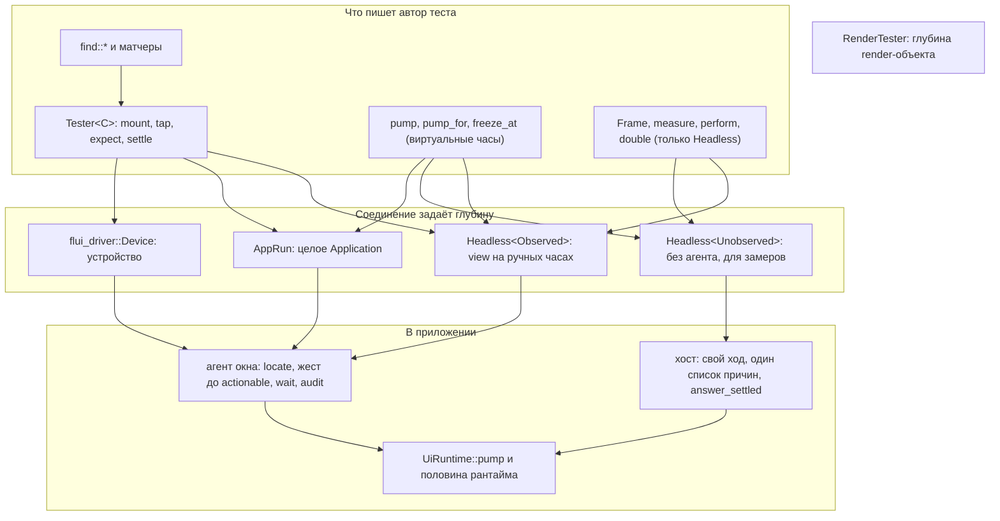

# testing-platform: дизайн

- **Статус:** утверждён владельцем 2026-11-24
- **Решение:** [ADR-0400](../../../adr/ADR-0400-a-test-is-one-tester-over-a-connection-and-every-claim-has-one-instrument.md).
  Формы типов и правила записаны там; этот документ задаёт карту модулей, порядок стройки, числа и
  опыты, которые решают то, чего чтение кода решить не могло. Число опыта, меняющее решение,
  записывается в ADR-0400, когда оно снято.
- **Требования:** [requirements.md](requirements.md); задачи: [tasks.md](tasks.md)

## Как выбирали

Три проекта писались независимо, каждый из своей школы: линия Flutter (`flutter_test` 3.50.1),
школа драйверов (Playwright, Compose, XCUITest) и «от утверждений к инструментам». Авторы
разбирали проекты друг друга, красная команда разбирала все три, после правок был второй раунд,
затем судья сверил спорные утверждения с кодом. Все три школы сошлись на одном ядре: один `Tester`
над абстракцией цели, словарь которого уже есть в протоколе агента. Основой взят проект линии
Flutter. От «утверждений» взяты таблица утверждений, `Find<One>`/`Find<Many>`, `Settled` и цель
без агента для замеров. От школы драйверов взяты методы протокола, на которые рантайм сейчас не
отвечает, и один вычислитель `Settled` на всех целях. Затем шесть независимых читателей разобрали
дизайн до кода; их находки закрыты в ADR-0400: у состояния «устоялось» один владелец, жест
отвечает агент, отказы теста держит один отчёт, снимки сверяются на названном адаптере.

Отвергнуто всеми: второй, программный рендерер для золотых снимков, proc-макрос `#[flui::test]`,
поиск по типу, вычисление матчеров на стороне теста.

## Картина



Тип над деревом один. Глубину выбирает соединение, а не другой тип: сценарий
`fn s<C: Connection>(t: &mut Tester<C>)` идёт на любой цели; `pump_for` и `freeze_at` есть только
там, где часы виртуальные, а `frame()`, `measure()`, `perform()` и `double()` только у
`Tester<Headless<_>>`, так что сценарий для устройства, который до них дотянулся, не компилируется.

## Один тест, шаг за шагом

```rust
let mut t = Tester::mount(counter());
t.tap(&find::button("Increment"));
t.expect(&find::id("count"), value("1"));
t.settle().golden(golden!("counter_one"));
```

1. **Монтирование.** `Headless<Observed>` строит свой закрытый хост, отдаёт окно агенту до
   присоединения корня и показывает два кадра: семантика публикуется со второго. Значения `Tester`
   до показанного кадра не существует.
2. **Поиск и действие.** `find::button(..)` это описание, которое разрешается заново при каждом
   использовании. `tap` пишет шаг в журнал с местом вызова и отправляет агенту одно действие.
   Агент находит элемент (ноль совпадений даёт `NotFound` с ближайшими кандидатами, два и больше
   дают `Ambiguous` со всеми), проверяет actionability на границе каждого кадра, пока элемент не
   простоит два кадра на месте, и вводит событие в том же ходе, где проверка прошла, по
   границам этого кадра. Headless тем временем гонит ходы хоста, как при ожидании. Глагол
   заканчивается ходом владельца, который разбирает то, что поставили его кадры, так что отказ
   приписан этому шагу.
3. **Ожидание.** `value("1")` опускается в `Condition::Matches`. Условие вычисляет рантайм
   приложения. Хост после каждого хода собирает один список причин (половина рантайма и своя) и
   отдаёт его рантайму (`answer_settled`). Headless двигает виртуальные часы к следующему
   пробуждению, таймеры приложения включая, пока рантайм не ответит или не пройдёт `limit`
   виртуального времени (столько же, сколько прождало бы устройство) или 10 000 ходов без сдвига
   часов. Если условие ложно, а все оставшиеся причины снимает только тест (фоновая работа, которую
   он держит), ожидание сразу кончается `WaitEnd::Idle` и называет их. Причина `Outside` (ответ
   платформы в пути) и хост без своей половины (`Absent`) держат ожидание до `limit`.
4. **Проверки неподвижного кадра.** На виртуальных часах `settle()` или `freeze_at(after)`
   возвращает `Settled`, единственного получателя `golden` и `audit`. Золотой снимок рендерит
   дерево слоёв этого кадра продуктовым рендерером через шов `golden::Rasterize` и сравнивает
   точно на названном адаптере, один раз, без повторов. На устройстве `wait_settled()` отвечает
   номером кадра и `SettleScope`, а пиксели проверяют предикаты драйвера с заявленным допуском.
5. **Чтения глубины виджета.** `t.frame().geometry::<RenderPadding>(&find::id("pad"))` разрешает
   локатор тем же вызовом агента, отбирает render-объекты под элементом по `TypeId`, требует ровно
   один и копирует значение наружу.
6. **Отказ.** Обычная форма паникует в месте вызова, `try_`-двойник возвращает `TestError` с
   диагнозом. Первый отказ, мягкие отказы и «вызов мог выполниться» держит один отчёт `Tester`.
7. **Завершение.** `finish()` или `Drop` на чистом отчёте: устояться (на виртуальных часах, с
   пределом; повторяющаяся причина замораживает кадр на пределе и называется), аудит этого кадра,
   размонтирование корня при живых окне и рантайме, дропы, освобождение аренды ввода и двойников,
   ходы, пока в списке есть то, что поставили освобождение и размонтирование, `DropLedger`, пустой
   список причин, закрытие окна, один `TestReport`. Если `Tester` отравлен или жива `TestError`
   (ошибка идёт к вызывающему через `?`), `Drop` только освобождает и ничего не проверяет. У
   устройства завершение делает `Connection::finish`: отпускает ввод обоих владельцев и называет
   проверки, которые прочесть не может, `cannot_verify`.

Замер, в цели `perf` крейта:

```rust
let mut t = Tester::mount_unobserved(labels(1_000), TestWindow::default());
let cost = t.measure(|t| { label.set("b"); t.pump(); });
BASELINES.hold("label_change_kept", &cost);
```

`Tester::measure` зовёт `flui_testing::perf::measure` (ADR-0396 §1; её строит TP4, сейчас её нет),
а окно сбора остаётся
`#[inline(never)] fn perf_measured` с тем же именем, по которому собирает `callgrind` в задании
`perf-gates`. Ввод в замере идёт через `perform` с точкой из типизированного чтения: агента в
замеряемых кадрах нет.

## Карта модулей

`flui-testing`: 26 плоских модулей становятся одиннадцатью группами.

| Группа | Что в ней | Откуда |
|---|---|---|
| `scenario` | `Tester`, соединения `Headless`, `find`, матчеры, `gesture`, `checks`, отчёт и диагноз, завершение, `TestWindow`, `WindowSpec` и `WindowControl` | `tester.rs`, `host.rs` и `host/*` (становятся закрытыми), `find.rs`, `replay.rs` (остаётся построитель жестов `Gesture`), `recording/` (запись `HostInput` по ADR-0215 и её воспроизведение), `agent_service.rs`, `window_commands.rs`, `portal_exports.rs` |
| `frame` | `Frame`, `RenderGeometry`, `DrawList`, `LayerOutline` | новое; заменяет чтения `widgets.rs` |
| `audit` | наборы правил над правилами `flui-semantics`, проверка движения | `motion.rs`, `motion/` |
| `perf` | `Baselines`, `measure`, `Cost` | `perf/`; `measure` новая (ADR-0396 §1), `FrameReport` остаётся в корне крейта, где его называет ADR-0396 |
| `heap` | `CountingAllocator`, `HeapCounts`, `heap::sites` | `heap.rs` без изменений |
| `doubles` | `MemoryStorage` и его удержания, реэкспорт двойников швов | `storage.rs`, `clipboard.rs`, `primary_selection.rs` (уходят в крейты, владеющие швом) |
| `ownership` | `DropLedger` | `drop_ledger.rs` |
| `fixture` | `Constrain`, `SharedSignal` | `widgets/shared_signal.rs`, новое |
| `golden` (фича) | `Goldens`, `GoldenName`, шов `Rasterize`, `goldens.toml` с названным адаптером, точное сравнение | новое; метрика, хранилище и кодек приходят из `flui-painting` (фичи `pixels` и `codec`), растеризацию даёт фича `testing` `flui-engine` через фасад, потому что кит в ярусе K ниже движка |
| `model` (фича) | `Model`, реэкспорт стратегий | новое |
| `conformance` (фича, не в фасаде) | наборы для авторов бэкендов и хранилищ | `backend_conformance*`, `window_conformance.rs`, `window_handler.rs`, `text_store_kit*`, `text_store_host.rs`, `ownership.rs`, `gesture_alternatives.rs`, `a11y.rs` без `A11yQuery` |

Удаляется: `widgets.rs` и `widgets/` (`LaidOut`, `Harness`, пробы), пять типов сценариев из
`replay.rs`, `A11yQuery`, `control_cost.rs`, `tester::FRAME`, `Expectation`, свой цикл ожидания в
`Tester`, копия удержанных клавиш `held_keys`. Тесты самого хоста из `crates/flui-testing/tests`
становятся модульными тестами кита, потому что `HeadlessHost` закрыт.

Киты слоёв (правило «один кит на слой» остаётся): `flui_rendering::testing` держит `RenderTester`
и стратегии ограничений и размеров; `flui_view::testing` получает `Recorder<V>` вместо `ProbeRoot`,
`StateCreations` и копий `Probe`; `flui_runtime::testing` получает один `TestSink` вместо
`ScriptedSink` и `HeadlessSink`; двойники буфера обмена и первичного выделения уходят в
`flui_interaction::testing`; `flui_app::testing` даёт `AppRun`. Тесты приветствия, кадрирования и
испорченных строк агента говорят строками с `flui_runtime::agent::Session` в тестах
`flui-runtime`, который владеет этим разговором.

`flui-driver`: `Driver` становится `Device: Connection` (одна запущенная цель, её дорожки и
соединение). Остаются `Launch` без headless, дорожки, `os_input`, трасса, снятие кадров и сборка
жеста для пути `os`. Уходят `window.rs`, `expect.rs`, `compose.rs` (жесты синтетического и
семантического путей отвечает агент), `scenario.rs` и `WindowSpec` (проверку окна делает
`Tester::attach`), `steps.rs` (журнал `Tester`), закрытый `trait Connection` (его место занимает
`flui_protocol::client::Connection`), `connection/in_process.rs`, `report.rs` (уходит в протокол),
`pixels/{metric,baseline,codec}` (уходят в `flui-painting`), фича `headless` и ребро к
`flui-testing`. `flui-cli` теряет свой клиент агента и говорит через `Device`.

Фасад `flui::testing`: `Tester`, `TestWindow`, `WindowSpec`, `Find`, `find`, матчеры, `gesture`,
`Frame`, `Settled`, `TestError`, `TestReport`, `scenarios!`, `audit`, `perf`, `heap`, `doubles`,
`ownership`, `fixture`, `Recorder`, `rendering::RenderTester`, фичи `golden` и `model`. Фичи
`device` нет: цель `device` крейта берёт `flui-driver` dev-зависимостью. `flui test` получает
`--goldens`, `--bless`, `--seed`, `--report`, `--perf`, `--device`.

## Числа

Исходные числа в [requirements.md](requirements.md); арифметика предсказаний ниже.

| Ворота | Сейчас | Цель |
|---|---|---|
| T1. Типы, которые монтируют дерево и управляют им | 7 | 2 (`RenderTester`, `Tester<C>`) с четырьмя соединениями |
| T2. Публичные функции сценариев | 345 в ките и 51 в драйвере | около 110 |
| T3. Семейства поиска, словари ввода, словари ожиданий | 3, 4, 3 | 1, 1, 1 |
| T4. Копии `Probe`, рукописные `pump`/`advance`/`tick`/`settle` в тестах | 20 и 6, 80 | 0, 0 |
| T5. Методы протокола без ответа рантайма | 7 | 2 (оба снимка кадра остаются за хостом с рендерером) |
| T6. Строки кита под фичами по умолчанию | 27 054 | около 15 800 |
| T7. Ключи perf-файлов, сдвинувшиеся при переносе на `measure` | 0 | 0 у сценариев, которые и были без агента; у перешедших с агента только убывание, названное по ключу |
| T8. Элементы с маркером `ADR-0400: moves to Tester` | растёт до TP4, потом только падает | 0 |

T6: 27 054 − 3 401 (`widgets`) − 188 (`control_cost`) − около 600 (`A11yQuery`) − около 1 040
(`replay` за вычетом жестов) − 8 709 (за фичей `conformance`) + около 2 700 нового. Граф линковки
теста не меняется, выигрыша времени линковки дизайн не обещает.

## Опыты до размножения

Каждый опыт решает число, от которого зависит форма или порядок. Задача, которая его ставит,
указана в [tasks.md](tasks.md).

| Опыт | Что меряем | Что решает |
|---|---|---|
| E1. Время пилота | `nextest -p flui-cupertino` до и после переноса 55 мест, три прогона | медиана выше 1,25× останавливает размножение: `Headless` отвечает на `locate` внутри `call` без хода |
| E2. Равенство замеров | `measure` против `pump_report` и против прежнего `Tester` на всех perf-файлах | у сценариев без агента 0 сдвинувшихся ключей; у перешедших с агента каждый ключ только убывает, PR называет убыль по ключу; рост любого ключа это дефект |
| E3. Цена подключённого агента | аллокации и счётчики кадра, `Observed` против `Unobserved` | при нуле на всех ключах `Unobserved` из дизайна убирается, и это записывается в ADR-0400 |
| E4. Один список причин | таблица по строке на `UnsettledReason` через settle хоста и `wait(Settled)`, с `cleared_by` | расхождений 0; обе стороны устаиваются на одном состоянии; удержанная работа не будит цикл |
| E5. Детерминизм снимков | 30 снимков по 100 раз на образе CI и на двух поколениях процессора, один поток растеризатора | отличающихся байтов 0; иначе измеренная граница пишется в `goldens.toml` как допуск этого адаптера и в ADR-0400 §6 |
| E6. Чтения без кадра | сколько тестов на `Tester` меняют результат, когда чтение перестаёт гнать `pump(ZERO)` | больше 10 выносится в свой PR перед TP3 |
| E7. Якоря типизированных чтений | 191 вхождение семейства `find_by_render_type` (67 `find_by_render_type`, 36 `try_find_by_render_type`, 88 `find_all_by_render_type`, определения включены; `rg -c` по `crates` и `packages`) по классам: один под корнем, один под локатором, нужен ключ, нужен порядковый | если «нужен ключ» меньше 10 %, локатор по ключу в протокол не входит; решение записывается в ADR-0400 |
| E8. Паритет ввода | одна `ActionSequence` на вид жеста через инъекцию агента, через платформенный путь и через строку таблицы соответствия | 0 расхождений в журнале событий |
| E9. Проверки по умолчанию | сколько из 4 833 тестов не проходят аудит `Unnamed` и проверки завершения в режиме «только отчёт» | меньше 2 % чинится или получает причину; больше 5 % сужает умолчание до монтирования через оболочку приложения |
| E10. Время шага снимков в PR | шаг на 30 снимков в один поток | больше 3 минут оставляет в PR 5 снимков, остальное на `main` |

## Риски и что остаётся открытым

- Около 1 000 мест каталога переходят с прямого чтения конвейера на `locate` через агента. Цену
  покажет E1; запасной путь не меняет API.
- Монтирование показывает два кадра там, где `lay_out` показывал один; период кадра становится
  16,667 мс вместо 16 мс, и утверждения, считавшие кадры, переписываются во времени.
- Золотые снимки проверяются на одном названном адаптере. Автор на macOS или Windows видит
  `CannotVerify` и сверяет в CI; смена растеризатора в образе CI переснимает все снимки отдельным
  PR, в котором меняются только `goldens.toml` и картинки.
- У `AppRun` нет `Frame`, `measure` и снимков: рантайм раннера живёт в thread-local, а рендерер у
  него подставной. Стоимость самого раннера (регистрация плагинов, цикл) инструмента не получает.
- Чтение это ход без кадра: оно применяет команды, поставленные с прошлого хода, так что состояние
  между двумя чтениями одного `Frame` может измениться, хотя геометрия остаётся одного кадра.
- На устройстве половины хоста нет, пока нативный раннер не собирает её; до тех пор его ожидания
  держатся до предела и не кончаются `WaitEnd::Idle`, а ответ несёт `SettleScope::RuntimeOnly`.
- TP5, TP18, TP20 и TP21 трогают крейты, которые `AGENTS.md` пока открывает только задачам
  render-scaling; правило их не закрывает, пока они меняют лишь тестовую поддержку этих крейтов
  (условия в [tasks.md](tasks.md)).
- У матчеров нет отрицания, кроме `gone` и `disabled`: в `Condition` его нет. Такое утверждение
  читается и проверяется в Rust без ожидания.
- Сколько из примерно 119 структур-двойников сливается, зависит от импортов каждого шва; ниже 60
  дизайн не обещает.

## Чего не строим

Иерархию binding и глобальный binding; зоны fake-async и `async`-тела тестов; сон по настенным
часам в воротах; нажатие по координатам с предупреждением; поиск по типу или по строке вида;
язык шаблонов для рисования; программный рендерер для снимков; допуск по умолчанию; контраст по
пикселям; `takeException`; вычислитель матчеров в процессе теста; копию состояния ввода агента в
тесте; proc-макрос теста; новый крейт.
