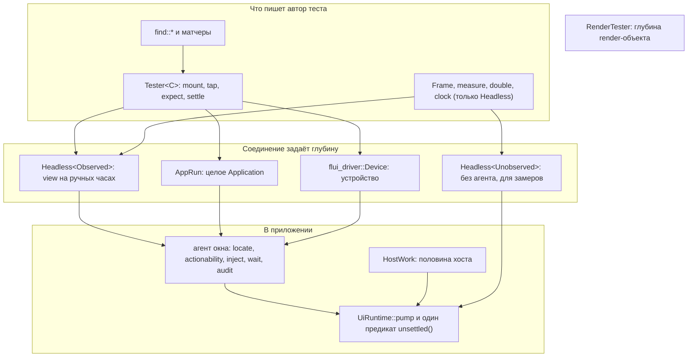

# testing-platform: дизайн

- **Статус:** черновик 2026-11-24; ждёт утверждения владельцем
- **Решение:** [ADR-0400](../../../adr/ADR-0400-a-test-is-one-tester-over-a-connection-and-every-claim-has-one-instrument.md).
  Формы типов и правила записаны там; этот документ задаёт карту модулей, порядок стройки, числа и
  опыты, которые решают то, чего чтение кода решить не могло.
- **Требования:** [requirements.md](requirements.md); задачи: [tasks.md](tasks.md)

## Как выбирали

Три проекта писались независимо, каждый из своей школы: линия Flutter (`flutter_test` 3.50.1),
школа драйверов (Playwright, Compose, XCUITest) и «от утверждений к инструментам». Авторы
разбирали проекты друг друга, красная команда разбирала все три, после правок был второй раунд,
затем судья сверил спорные утверждения с кодом. Все три школы сошлись на одном ядре: один `Tester`
над абстракцией цели, словарь которого уже есть в протоколе агента. Основой взят проект линии
Flutter. От «утверждений» взяты таблица утверждений, `Find<One>`/`Find<Many>`, `Settled` и цель
без агента для замеров. От школы драйверов взяты методы протокола, на которые рантайм сейчас не
отвечает, и один вычислитель `Settled` на всех целях.

Отвергнуто всеми: второй, программный рендерер для золотых снимков, proc-макрос `#[flui::test]`,
поиск по типу, вычисление матчеров на стороне теста.

## Картина



Тип над деревом один. Глубину выбирает соединение, а не другой тип: сценарий
`fn s<C: Connection>(t: &mut Tester<C>)` идёт на любой цели, а `frame()`, `measure()` и `double()`
существуют только у `Tester<Headless<_>>`, так что сценарий для устройства, который до них
дотянулся, не компилируется.

## Один тест, шаг за шагом

```rust
let mut t = Tester::mount(counter());
t.tap(&find::button("Increment"));
t.expect(&find::id("count"), value("1"));
t.settle().golden(golden!("counter_one"));
```

1. **Монтирование.** `Headless<Observed>` строит свой закрытый хост, отдаёт окно агенту до
   присоединения корня и показывает два кадра: семантика публикуется со второго. Значения `Tester`
   до показанного кадра не существует.
2. **Поиск и действие.** `find::button(..)` это описание, которое разрешается заново при каждом
   использовании. `tap` пишет шаг в журнал с местом вызова, зовёт `semantics.locate` (ноль
   совпадений даёт `NotFound` с ближайшими кандидатами, два и больше дают `Ambiguous` со всеми),
   затем `element.actionability`, и только после этого ввод уходит тем же путём, что на устройстве.
   Запрос к агенту это один ход владельца без кадра и без сдвига часов.
3. **Ожидание.** `value("1")` опускается в `Condition::Matches`. Условие вычисляет рантайм
   приложения. Headless подаёт кадры, пока вызов держится, и после каждого хода читает
   `UiRuntime::unsettled(now)`. Если список пуст, а условие ложно, отказ приходит сразу (`Idle`), а
   не через таймаут. На устройстве то же условие вычисляет приложение на своих часах.
4. **Проверки устоявшегося кадра.** `settle()` возвращает `Settled`, единственного получателя
   `golden` и `audit`. Золотой снимок рендерит дерево слоёв последнего кадра продуктовым
   рендерером и сравнивает точно, один раз, без повторов.
5. **Чтения глубины виджета.** `t.frame().geometry::<RenderPadding>(&find::id("pad"))` разрешает
   локатор тем же вызовом агента, отбирает render-объекты под элементом по `TypeId`, требует ровно
   один и копирует значение наружу.
6. **Отказ.** Обычная форма паникует в месте вызова, `try_`-двойник возвращает `TestError` с
   диагнозом.
7. **Завершение.** `Drop` или `finish()`: мягкие отказы, аудит последнего кадра, размонтирование,
   дропы, освобождение агента и двойников, проверка `DropLedger`, проверка пустоты предиката, один
   `TestReport`.

Замер, в цели `perf` крейта:

```rust
let mut t = Tester::mount_unobserved(labels(1_000), TestWindow::default());
let cost = t.measure(|t| { label.set("b"); t.pump(); });
BASELINES.hold("label_change_kept", &cost);
```

## Карта модулей

`flui-testing`: 26 плоских модулей становятся десятью группами.

| Группа | Что в ней | Откуда |
|---|---|---|
| `scenario` | `Tester`, соединения `Headless`, `find`, матчеры, `gesture`, `checks`, диагноз, завершение, `TestWindow` и `WindowControl` | `tester.rs`, `host.rs` и `host/*` (становятся закрытыми), `find.rs`, `replay.rs` (остаётся построитель жестов), `recording/` (сериализация шагов журнала), `agent_service.rs`, `window_commands.rs`, `portal_exports.rs` |
| `frame` | `Frame`, `RenderGeometry`, `DrawList`, `LayerOutline` | новое; заменяет чтения `widgets.rs` |
| `audit` | наборы правил, проверка движения | `motion.rs`, `motion/` |
| `perf` | `Baselines`, `measure`, `Cost`, `FrameReport`, `heap`, `heap::sites` | `perf/`, `heap.rs`, `FrameReport` из `lib.rs` |
| `doubles` | `MemoryStorage` и его удержания, реэкспорт двойников швов | `storage.rs`, `clipboard.rs`, `primary_selection.rs` (уходят в крейты, владеющие швом) |
| `ownership` | `DropLedger` | `drop_ledger.rs` |
| `fixture` | `Constrain`, `SharedSignal` | `widgets/shared_signal.rs`, новое |
| `golden` (фича) | `Goldens`, `GoldenName`, точное сравнение, метрика и кодек | новое; `flui-driver/src/pixels/{metric,baseline,codec}` |
| `model` (фича) | `Model`, реэкспорт стратегий | новое |
| `conformance` (фича, не в фасаде) | наборы для авторов бэкендов и хранилищ | `backend_conformance*`, `window_conformance.rs`, `window_handler.rs`, `text_store_kit*`, `text_store_host.rs`, `ownership.rs`, `gesture_alternatives.rs`, `a11y.rs` без `A11yQuery` |

Удаляется: `widgets.rs` и `widgets/` (`LaidOut`, `Harness`, пробы), пять типов сценариев из
`replay.rs`, `A11yQuery`, `control_cost.rs`, `tester::FRAME`, `Expectation`, свой цикл ожидания в
`Tester`.

Киты слоёв (правило «один кит на слой» остаётся): `flui_rendering::testing` держит `RenderTester`
и стратегии ограничений и размеров; `flui_view::testing` получает `Recorder<V>` вместо `ProbeRoot`,
`StateCreations` и копий `Probe`; `flui_runtime::testing` получает один `TestSink` вместо
`ScriptedSink` и `HeadlessSink`; двойники буфера обмена и первичного выделения уходят в
`flui_interaction::testing`; `flui_app::testing` даёт `AppRun`.

`flui-driver` оставляет `Driver`, `Launch` без headless, дорожки, `os_input`, трассу, снятие
кадров, добавляет `Device: Connection` и теряет `window.rs`, `expect.rs`, `connection/in_process.rs`,
`report.rs` (уходит в протокол), метрику пикселей, фичу `headless` и ребро к `flui-testing`.
`flui-cli` теряет свой клиент агента.

Фасад `flui::testing`: `Tester`, `TestWindow`, `Find`, `find`, матчеры, `gesture`, `Frame`,
`Settled`, `TestError`, `TestReport`, `scenarios!`, `audit`, `perf`, `doubles`, `ownership`,
`fixture`, `Recorder`, `rendering::RenderTester`, фичи `golden`, `model`, `device`. `flui test`
получает `--goldens`, `--bless`, `--seed`, `--report`, `--perf`, `--device`.

## Числа

Исходные числа в [requirements.md](requirements.md); арифметика предсказаний ниже.

| Ворота | Сейчас | Цель |
|---|---|---|
| T1. Типы, которые монтируют дерево и управляют им | 7 | 2 (`RenderTester`, `Tester<C>`) с четырьмя соединениями |
| T2. Публичные функции сценариев | 345 в ките и 51 в драйвере | около 110 |
| T3. Семейства поиска, словари ввода, словари ожиданий | 3, 4, 3 | 1, 1, 1 |
| T4. Копии `Probe`, рукописные `pump`/`advance`/`tick`/`settle` в тестах | 20 и 6, 80 | 0, 0 |
| T5. Методы протокола без ответа рантайма | 7 | 2 (оба снимка кадра остаются за хостом с рендерером) |
| T6. Строки кита под фичами по умолчанию | 27 054 | около 15 800 |
| T7. Ключи perf-файлов, сдвинувшиеся при переносе на `measure` | 0 | 0 |
| T8. Маркеры `gaps.md#one-tester` на модулях тестов | растёт до TP4, потом только падает | 0 |

T6: 27 054 − 3 401 (`widgets`) − 188 (`control_cost`) − около 600 (`A11yQuery`) − около 1 040
(`replay` за вычетом жестов) − 8 709 (за фичей `conformance`) + около 2 700 нового. Граф линковки
теста не меняется, выигрыша времени линковки дизайн не обещает.

## Опыты до размножения

Каждый опыт решает число, от которого зависит форма или порядок. Задача, которая его ставит,
указана в [tasks.md](tasks.md).

| Опыт | Что меряем | Что решает |
|---|---|---|
| E1. Время пилота | `nextest -p flui-cupertino` до и после переноса 55 мест, три прогона | медиана выше 1,25× останавливает размножение: `Headless` отвечает на `locate` внутри `call` без хода |
| E2. Равенство замеров | `measure` на `Unobserved` против `pump_report` на всех perf-файлах | допустимо 0 сдвинувшихся ключей |
| E3. Цена подключённого агента | аллокации и счётчики кадра, `Observed` против `Unobserved` | при нуле на всех ключах `Unobserved` из дизайна убирается |
| E4. `HostWork` из вычислителя | таблица из десяти причин через `pump_until_settled` и `wait(Settled)` | 20 строк из 20 названы, занятых заимствований 0; причина с занятым заимствованием переносит своё состояние в общую запись |
| E5. Детерминизм снимков | 30 снимков по 100 раз на образе CI и на двух поколениях CPU | отличающихся байтов 0; иначе цель `golden` идёт строго в один поток |
| E6. Чтения без кадра | сколько тестов на `Tester` меняют результат, когда чтение перестаёт гнать `pump(ZERO)` | больше 10 выносится в свой PR перед TP3 |
| E7. Якоря типизированных чтений | 249 мест `find_by_render_type` по классам: один под корнем, один под локатором, нужен ключ, нужен порядковый | если «нужен ключ» меньше 10 %, локатор по ключу в протокол не входит |
| E8. Паритет ввода | одна `ActionSequence` на вид жеста через инъекцию агента и через платформенный путь | 0 расхождений в журнале событий |
| E9. Проверки по умолчанию | сколько из 4 833 тестов не проходят аудит `Unnamed` и проверки завершения в режиме «только отчёт» | меньше 2 % чинится или получает причину; больше 5 % сужает умолчание до монтирования через оболочку приложения |
| E10. Время шага снимков в PR | шаг на 30 снимков в один поток | больше 3 минут оставляет в PR 5 снимков, остальное на `main` |

## Риски и что остаётся открытым

- Около 1 000 мест каталога переходят с прямого чтения конвейера на `locate` через агента. Цену
  покажет E1; запасной путь не меняет API.
- Монтирование показывает два кадра там, где `lay_out` показывал один; период кадра становится
  16,667 мс вместо 16 мс, и утверждения, считавшие кадры, переписываются во времени.
- Золотые снимки проверяются на одном программном адаптере. Автор на macOS или Windows видит
  `CannotVerify` и сверяет в CI или в закреплённом образе; обновление Mesa переснимает все снимки
  одним PR.
- У `AppRun` нет `Frame` и `measure`: рантайм раннера живёт в thread-local. Стоимость самого
  раннера (регистрация плагинов, цикл) инструмента не получает.
- Чтение это ход без кадра: он применяет команды, поставленные с прошлого хода, так что состояние
  между двумя чтениями одного `Frame` может измениться, хотя геометрия остаётся одного кадра.
  Паника поставленной команды всплывает из чтения и приписывается ходу, а не шагу, который её
  поставил.
- На устройстве и у `AppRun` половины хоста в предикате нет, пока раннер не реализует `HostWork`;
  до тех пор отчёт говорит `settle_scope: runtime`.
- У матчеров нет отрицания, кроме `gone` и `disabled`: в `Condition` его нет. Такое утверждение
  читается и проверяется в Rust без ожидания.
- Сколько из примерно 119 структур-двойников сливается, зависит от импортов каждого шва; ниже 60
  дизайн не обещает.

## Чего не строим

Иерархию binding и глобальный binding; зоны fake-async и `async`-тела тестов; ожидание по
настенным часам; нажатие по координатам с предупреждением; поиск по типу или по строке вида;
язык шаблонов для рисования; программный рендерер для снимков; допуск по умолчанию; контраст по
пикселям; `takeException`; вычислитель матчеров в процессе теста; proc-макрос теста; новый крейт.
