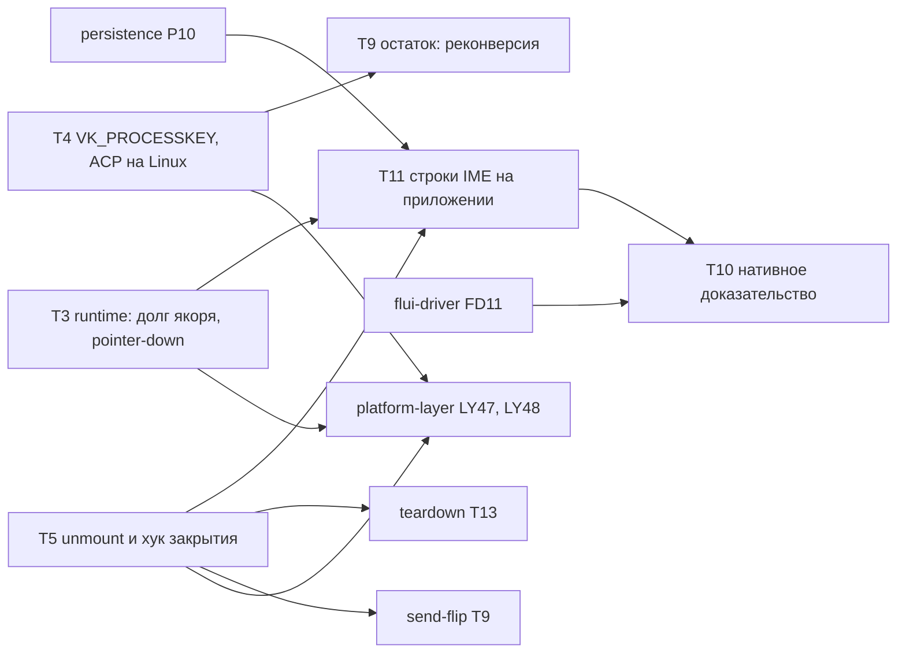

# text-ime — задачи (уровень 1)

- **Статус:** Утверждена владельцем 2026-10-28; исполнение
- **Design:** [design.md](design.md) (W1–W11; решения владельца 2026-10-28 — в шапке);
  [requirements.md](requirements.md); закрытие во время композиции — [teardown/tasks.md](../teardown/tasks.md)
  T13; приложение приёмки — [persistence/tasks.md](../persistence/tasks.md) P10
- **Итог:** из 10 задач прежнего плана сделаны T1, T2a, T2b, T4, T6; T5, T9 сделаны в части;
  T7 и T8 устарели. Осталось пять задач: T3, T5 и T9 можно начинать сейчас, параллельно; новая
  T11 (строки IME на приложении приёмки) после P10, T3, T5; T10 — нативное доказательство после
  flui-driver.

## Правила исполнения

Пункты 1–7 и 9 [«Правил исполнения» platform-layer](../platform-layer/tasks.md#правила-исполнения):
задача = worktree под `.claude/worktrees/<имя>` = ветка = PR; проверки по AGENTS.md «Checking a
change» через `cargo heli`; fix-тест падает при откате исправления в изолированном checkout; ID
задач и требований — только в этом каталоге; `changelog.d/<branch-slug>.md` у каждого PR,
меняющего поверхность. Дополнительно:

- **Тесты первыми.** Первый коммит PR — тесты, красные по assert; вывод — в PR.
- **Win32.** CI на Windows не исполняет: изменение `flui-native` под Windows требует
  `cargo heli nextest run -p flui-native` на Windows, вывод в PR. Чистая часть платформенного
  файла — `pub(crate)` модуль рядом, исполняемый на Linux (AGENTS.md, Definition of Done).
- **Где:** L — Linux CI; W — Windows нативно, вывод в PR; A — внешний consumer приложения приёмки
  (исполняется в L); D — нативный прогон через лейн `os` [flui-driver](../flui-driver/tasks.md)
  (Windows — FD11), датированный вывод в PR.

## Граф

## Сделано

- [x] **T1** — спайк TSF прошёл 2026-10-06 (ветка `text-ime/tsf-spike` @ `4e14cba8c`); его
  модуль вошёл в хост (#1460).
- [x] **T2a** — контракт store: `settle` в `LockArbiter`, канал отказа `CommitGate`,
  `committed_text`, поколение контроллера; ADR-0142 (#1458).
- [x] **T2b** — контракт хоста: `TextStoreHost` на owner-потоке, `complete_composition`,
  `Abandoned`, удаление `active_store`; ADR-0135 (#1460, #1465).
- [x] **T6** — Win32 production: TSF в настоящих окнах, подтверждение композиции до потери
  ввода (#1497); `OnLayoutChange` на перемещение и DPI — R13 (#1774); `TextInputPurpose` и
  input scope (#1805); `GetText` читает только запрошенное (#1821). Код —
  `crates/flui-native/src/text/windows/tsf/`, геометрия — модуль `geometry` в
  `text/windows/mod.rs`.
- [x] **T4** — `VK_PROCESSKEY` в пути клавиатуры Win32 (R11); перевод ACP — модуль `acp` в
  `text/windows/`, его таблицы на Linux (R14, R18) (#1955).

## Сделано в части

- **T5** — подтверждение при blur, pointer-down на поле и вставке есть (#1497). Остаток —
  T5 ниже: unmount (R8; `dispose` сегодня только отсоединяет) и хук принятого закрытия.
- **T9** — R13, R14 (Win32), R19, F4 закрыты в T6; Linux-строка R20 — ответ `TS_IAS_QUERYONLY` из выделения в модуле `acp`. Остаток — Win32-строка реконверсии R20 на Windows, T9 ниже.

## Устаревшие задачи

- **T7** (строки Notes и consumer: `tests/fixtures/notes_flow.rs`, `examples/two_screens/`,
  `external_notes_showcase_runs_through_the_facade`) — Notes удалён. Заменена: T11 на
  приложении приёмки (persistence P10).
- **T8** (`cargo xtask device windows-ime`, шаг R22 в `windows-notes`) — `cargo xtask device`
  удалён (#1827). Заменена: T10 через лейн `os` flui-driver.
- **Календарь, go/no-go 2026-11-20 и предусловия по датам** — сняты; порядок задаёт колонка
  «Зависит от».

## Задачи

| ID | Задача | Зависит от | Крейты и файлы | Гейты | Тесты | Где |
|---|---|---|---|---|---|---|
| **T3** [P] | **Runtime: долг якоря, gate и pointer-down вне поля** (ADR-0142 п. 4–6). Якорь коммита, пропущенный размотанным кадром, — долг UI-runtime, гасится на следующем ходе владельца (выпитый inbox, фоновый pump, pump), неудачный wake его не стирает (п. 5). Gate открыт, только пока UI-runtime в слоте и не ведёт кадр; вход платформы при извлечённом UI-runtime получает асинхронный lock, пользовательский код не исполняется (п. 6). Pointer-down в presentation вне поля с композицией подтверждает её до обработчиков события (п. 4; случай «Save note» R6) | — | `crates/flui-runtime/src/ui_runtime/{frame.rs,pump.rs,input.rs}`, `crates/flui-runtime/src/ui_runtime/tests/presentation_text_input.rs`, `changelog.d/` | clippy и nextest: `-p flui-runtime` и зависимые | F8 `a_grant_deferred_by_a_panicking_frame_runs_without_another_frame`; `tsf_entries_while_the_realm_is_checked_out_run_no_user_code`; R6 runtime-строка: pointer-down вне поля подтверждает до обработчика. Откат — строки падают | L |
| **T4** [P] | **Остаток: `VK_PROCESSKEY` и ACP на Linux CI.** `VK_PROCESSKEY` не даёт ни символа, ни именованной клавиши (ADR-0069) — чистая функция в `input/keys.rs`, вызов из пути клавиатуры Win32 (сегодня только `tsf/probe.rs`). Перевод ACP (позиции UTF-16, флаги lock, коды ошибок) выносится из `tsf/document.rs` в модуль под `#[cfg(any(windows, test))]` рядом с `geometry` в `text/windows/`, без типов `windows`; `document.rs` зовёт его | — | `crates/flui-native/src/input/keys.rs`, `crates/flui-native/src/input/windows/`, `crates/flui-native/src/text/windows/{mod.rs,tsf/document.rs,tsf/probe.rs}`, новый модуль перевода ACP в `text/windows/` | clippy и nextest: `-p flui-native` (Linux) и на Windows; `cargo heli xtask cross-typecheck` | R11 `a_processkey_keydown_produces_no_key`; R14 `split_surrogate_offsets_are_invalid_positions`; R18 `reads_outside_a_lock_answer_no_lock`, `a_lock_inside_the_frame_answers_async`, `lock_flags_and_errors_translate_to_tsf_codes` — на Linux; Win32-тесты `tsf/tests.rs` зелёные на Windows до и после переноса | L + W |
| **T5** [P] | **Остаток виджета: unmount и хук закрытия** (R8, F5; ADR-0142 п. 4, 6). `dispose` подтверждает видимую композицию на месте без `on_changed`, затем отсоединяет store и контекст TSF; теряется только правка IME, не применённая до отсоединения; дальнейшие lock-запросы — `Detached`. Хук принятого закрытия presentation: подтверждение до guard; вызов из общей доставки закрытия — teardown T13. Сброс формы во время композиции убирает preedit | — | `crates/flui-widgets/src/text/editable_text.rs`, `crates/flui-runtime/src/ui_runtime/presentation_lifecycle.rs`, `crates/flui-widgets/tests/editable_text.rs` (модуль `text_store`), `packages/flui-material/tests/`, `changelog.d/` | clippy и nextest: `-p flui-widgets -p flui-material -p flui-runtime` | R8 `a_conversion_queued_for_an_unmounted_field_is_dropped`, строка unmount с подтверждением; F5 `an_accepted_close_commits_the_preedit_before_the_guard`; откат «`dispose` только отсоединяет» → строка unmount теряет preedit | L |
| **T9** | **Остаток: реконверсия** (R20). Запрос реконверсии не меняет документ и не паникует; `TF_IAS_QUERYONLY` отвечает из выделения | T4 | `crates/flui-native/src/text/windows/{tsf/document.rs,tsf/tests.rs}`, модуль перевода ACP | clippy и nextest: `-p flui-native` на Linux и на Windows | `query_only_insert_answers_from_the_selection` (L); `reconversion_requests_leave_the_document_unchanged` (W) | L + W |
| **T11** | **Строки IME на приложении приёмки** (R1, R3, R4, R6, R8, R23). События — `PlatformInput::Ime` через facade, поле Title редактора; consumer требует каждую строку `... ok` | persistence P10, T3, T5 | `tests/fixtures/acceptance_app/` (модуль строк IME), `tests/facade_consumer.rs` | clippy и nextest: `-p flui` (nested-cargo) | `ime_preedit_is_underlined_at_the_caret_and_hides_it_on_request` (R1); `ime_commit_inserts_the_conversion_and_notifies_once` (R3: `toukyou` → `東京` → Save → `東京` в списке); строка отмены (R4); `pointer_down_mid_composition_commits_before_the_save_handler` (R6); `route_change_mid_composition_commits_the_preedit_into_the_draft` (R8). Откат хунка T3 или T5 роняет свою строку | A |
| **T10** | **Нативное доказательство** через лейн `os` flui-driver на пускаче приложения приёмки (D4): ромадзи через виртуальные клавиши, Space, Enter → `東京` по UIA; Esc-отмена; клик «Save note» во время композиции (R6); Alt+Tab и возврат (R7); Ctrl+A, Ctrl+C, Ctrl+V в Title через UIA `ValuePattern` (R22, #1065); гейт окна кандидатов: кандидаты видны в полосе ±1 строка под полем, у нижнего края — над полем; новый IME Win11 рисует их в cloaked-окне `TextInputHost.exe`, которое перечисление top-level окон не находит, поэтому гейт — снимок около поля или UIA по элементам TextInputHost (факты спайка в design); снимок прикладывается, отрицательный контроль на `4915054c8` падает (R24). Microsoft IME ja-JP обязательно, zh-CN Pinyin и «previous version» желательно; 100 %, 150 % и второй монитор. Язык не установлен — «не проверено», не PASS. Запись в `docs/platform-parity.md` (дата, SHA, сборка Windows, версия IME) | T11, flui-driver FD11 | шаги лейна `os` (по форме FD11), `docs/platform-parity.md`, `docs/gaps.md` | `cargo heli xtask checks` | датированный вывод каждого шага и отрицательного контроля в PR | D |

## Требование → тест

| R/F | Тест | Уровень | Задача |
|---|---|---|---|
| R1 | `ime_preedit_is_underlined_at_the_caret_and_hides_it_on_request` | приложение приёмки | T11 |
| R2 | `a_composition_update_replaces_the_whole_preedit_and_places_the_caret` | Win32-unit | T6 (сделано) |
| R3 | `ime_commit_inserts_the_conversion_and_notifies_once` | приложение приёмки | T11 |
| R4 | `cancelled_composition_keeps_the_committed_text_without_on_changed` (+ строка приложения) | виджет | T5 (сделано в #1497), T11 |
| R5 | `composition_over_a_selection_replaces_the_selection` | kit v2 | T2a (сделано) |
| R6 | `pointer_down_mid_composition_commits_before_the_save_handler`; `pointer_down_inside_the_composing_field_commits`; runtime-строка | приложение; виджет; runtime | T11; сделано; T3 |
| R7 | шаг Alt+Tab | нативный | T10 |
| R8 | `route_change_mid_composition_commits_the_preedit_into_the_draft`; `a_conversion_queued_for_an_unmounted_field_is_dropped` | приложение; виджет | T11; T5 |
| R9 | `autovalidation_ignores_a_whitespace_preedit_until_commit` | material | сделано (T2a, #1497) |
| R10 | `paste_and_undo_mid_composition_commit_first`; `a_refused_termination_still_commits_before_paste`; `the_enter_that_commits_does_not_submit` | виджет | сделано (#1497) |
| R11 | `a_processkey_keydown_produces_no_key` | Linux | T4 |
| R12 | `screen_rects_follow_scale_and_round_outwards` | Linux | T1/T6 (сделано) |
| R13 | `scroll_move_and_dpi_change_send_layout_change_before_the_next_query` | Win32-unit | T6 (сделано, #1774) |
| R14 | `split_surrogate_offsets_are_invalid_positions`; `astral_and_cluster_commits_count_utf16` | Linux; Win32-unit | T4; сделано |
| R15 | `rtl_commit_in_an_ltr_field_keeps_logical_order_and_a_rect` | виджет | сделано (#1497) |
| R16 | `a_window_activates_the_thread_manager_and_a_focused_field_gets_a_document` | Win32-unit | T6 (сделано) |
| R17 | `field_focus_moves_the_tsf_document_focus`; `focus_gain_and_loss_reach_the_store_host` | Win32-unit; виджет | сделано |
| R18 | `the_bridge_reproduces_the_kit_conversion_script`; `reads_outside_a_lock_answer_no_lock`; `a_lock_inside_the_frame_answers_async`; `lock_flags_and_errors_translate_to_tsf_codes` | Win32-unit; Linux | сделано; T4 |
| R19 | `ime_window_messages_reach_the_default_procedure` | Win32-unit | сделано |
| R20 | `reconversion_requests_leave_the_document_unchanged`; `query_only_insert_answers_from_the_selection` | Win32-unit; Linux | T9 |
| R21 | `failed_activation_falls_back_to_wm_char_and_warns_once` | Win32-unit | T6 (сделано) |
| R22 | шаг копирования и вставки в Title | нативный | T10 |
| R23 | строки R1, R3, R4, R6, R8 через `acceptance_app_runs_through_the_facade` | приложение приёмки | T11 |
| R24 | гейт окна кандидатов + отрицательный контроль на `4915054c8` | нативный | T10 |
| F1 | `a_grant_for_a_replaced_document_answers_unexpected` | Win32-unit + виджет | сделано |
| F2 | `on_changed_runs_after_the_lock_is_released`; `set_text_from_on_changed_lands_after_the_commit` | виджет | сделано (T2a, #1497) |
| F3 | `a_panicking_on_changed_keeps_the_commit_and_reports_through_the_realm`; `a_panic_after_the_grant_returns_ok_and_the_queue_drains` | виджет; Win32-unit | сделано |
| F4 | `a_full_deferred_queue_answers_fail_and_recovers_after_the_anchor` | Win32-unit | сделано |
| F5 | `closing_the_window_mid_composition_releases_tsf_objects_in_order`; `an_accepted_close_commits_the_preedit_before_the_guard` | Win32-unit; runtime | сделано; T5 |
| F6 | масштаб в `screen_rects_follow_scale_and_round_outwards` + строка DPI в R13 | Linux; Win32-unit | сделано |
| F7 | `tsf_reentry_from_terminate_composition_commits_once`; `on_changed_unfocus_inside_request_lock`; `a_nested_slot_entry_answers_unexpected` | Win32-unit | сделано |
| F8 | `a_grant_deferred_by_a_panicking_frame_runs_without_another_frame` | runtime | T3 |

Имена тестов — из design. «Сделано» означает сделанную задачу (аудит 2026-10-28), а не имя:
строки сделанных задач вошли в код под своими именами, и из названных здесь в коде есть только
`composition_over_a_selection_replaces_the_selection`, `screen_rects_follow_scale_and_round_outwards`,
`focus_gain_and_loss_reach_the_store_host` и `on_changed_runs_after_the_lock_is_released`.
Исполнитель T4, T5 или T9 первым коммитом сверяет по коду строки своего требования; поведение,
которого в коде не окажется, переходит в его задачу, а не теряется.

## Ход исполнения

- [x] T1 — спайк 2026-10-06; #1460
- [x] T2a — #1458
- [x] T2b — #1460, #1465
- [x] T6 — #1497, #1774, #1805, #1821
- [x] T3 — runtime: долг якоря, gate, pointer-down вне поля. П. 4 (pointer-down): press в любой
  точке presentation подтверждает композицию до удержания и hit-test; pointer-ввод, отправленный
  из этого коммита, отбрасывается. П. 5 (долг якоря): `UiRuntime::pay_owed_anchor` в начале
  `drain_owner_inbox`, `pump_background` и `pump` (кадр идёт и после неудачного долга), запрос
  wake, пока долг не погашен, отказ из gate через тот же долг. П. 6 (gate на время lease):
  `CommitGate::set_checked_out` ставит `RuntimeLease`, gate тогда пропускает только
  `CommitGate::owner_entry`, которым `TextInputOwner` оборачивает свои входы; якорь в конце lease
  (`UiRuntime::finish_checkout`). Строки: `a_grant_deferred_by_a_panicking_frame_runs_without_another_frame`
  (F8), `a_failed_anchor_stays_owed_and_asks_for_a_wake`,
  `a_failure_parked_by_a_platform_grant_reaches_the_next_owner_turn`,
  `a_press_outside_the_field_commits_the_composition_before_its_handlers` (R6, runtime),
  `a_checked_out_gate_admits_only_owner_calls`,
  `a_platform_entry_while_the_runtime_is_checked_out_runs_no_owner_code` (вместо
  `tsf_entries_while_the_realm_is_checked_out_run_no_user_code`); каждая падает по assert при
  откате своего хунка. Живой прогон TSF во вложенном цикле сообщений — на Windows (Ваня), в T10
- [x] T4 — остаток: `VK_PROCESSKEY`, ACP на Linux CI; #1955 (зонд и ручной прогон IME не выполнялись)
- [x] T5 — остаток: unmount и хук закрытия; #1958. `dispose` снимает composing range на месте
  (`end_composition`), если поле держит клиента, и перестаёт сообщать правки в `on_changed`;
  хук — `UiRuntime::commit_composition_for_close` (вызов из доставки закрытия — teardown T13);
  сброс формы пишет начальное значение поверх preedit. Строки:
  `a_conversion_queued_for_an_unmounted_field_is_dropped`,
  `unmounting_a_composing_field_commits_the_preedit_once` (pull/push × фокус/после blur, повторный
  unmount), `an_accepted_close_commits_the_preedit_before_the_guard`,
  `a_reset_mid_composition_removes_the_preedit` (в `crates/flui-widgets/tests/form.rs`, рядом с
  остальными строками композиции формы). Красные по assert на `df3d56dd6`, зелёные после;
  проверено на Windows 2026-10-28
- [ ] T9 — остаток: реконверсия; L-часть — ответ `TS_IAS_QUERYONLY` в модуле `acp` (`acp::insert_at_selection`), `query_only_insert_answers_from_the_selection` зелёный на Linux, clippy `-p flui-native --target x86_64-pc-windows-msvc --all-targets` чистый; W-строка `reconversion_requests_leave_the_document_unchanged` написана (кейс «reconversion requests» в `tsf/tests.rs`, clippy под Windows чистый), ждёт прогона `-p flui-native` на Windows
- [ ] T11 — строки IME на приложении приёмки
- [ ] T10 — нативное доказательство (после flui-driver FD11)
