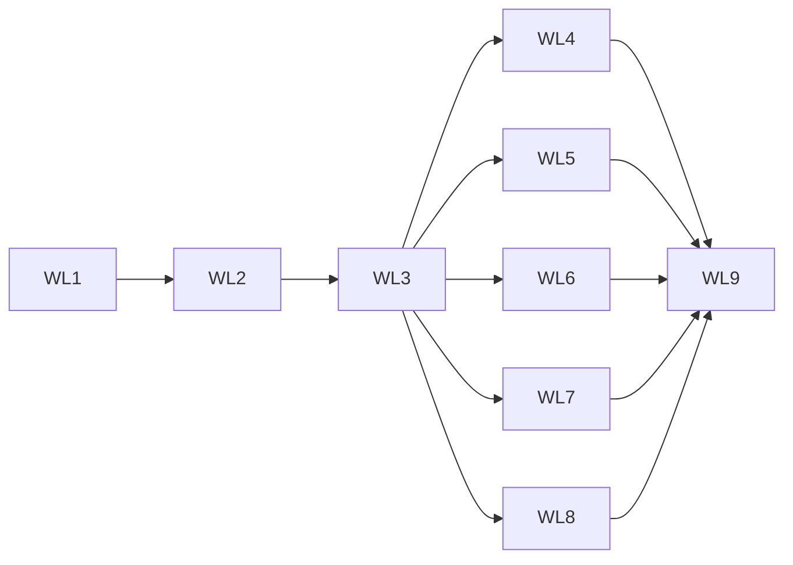

# Window lifecycle — задачи

- **Статус:** черновик, решения владельца приняты 2026-10-18
- **Дата:** 2026-10-18
- **Design:** [design.md](design.md); требования — [requirements.md](requirements.md); ADR —
  [ADR-0237](../../../adr/ADR-0237-window-state-and-host-notices.md)
- **База:** `main` @ `eb0f4903c`
- **Итог:** 9 задач в 7 PR, 5 из них `[P]`; ≈ 38 инженеро-дней; критический путь 20 дней
  (11 дней до headless-acceptance первого PR)

## Правила исполнения

Задача = worktree (`cargo xtask worktree new platform/<slug>`) = PR. Перед PR: `cargo fmt --all`,
`cargo heli clippy -p <crate> --all-targets -- -D warnings` для каждого изменённого крейта и его
зависимых (`cargo xtask affected --worktree`), `cargo heli nextest run -p <crate>`, `cargo xtask
checks`; wasm — `cargo xtask wasm-test`. Тест пишется первым и падает без производственного хунка;
каждая строка таблицы показывает это откатом в изолированном checkout. Имена тестов без номеров
задач и требований. Каждая задача добавляет `changelog.d/<branch-slug>.md` и обновляет строки
`docs/platform-parity.md` и `docs/gaps.md` в пределах своей ОС (✅ — только по R40; иначе 🟡). Где:
L — Linux CI; W — Windows нативно на машине владельца; A — Android по `adb`; B — Chrome; WSL — WSL
Ubuntu 24.04 (Xorg dummy, weston); X — Xvfb в CI.

**Первый PR — WL1–WL3 вместе:** контракт, хост и потребители land одним PR; бэкенды в нём
получают оболочки над тем, что уже умеют (D-1 удаляет старые методы, поэтому их реализации
переезжают в `apply`/`state` в том же PR), так что `main` не хуже прежнего. Дальше PR 2–6 независимы
друг от друга; PR 7 — живые прогоны и документы.

## Граф зависимостей

## Задачи

| ID | Задача | Требования | Зависит | P | Где | Дн | Статус |
|---|---|---|---|---|---|---|---|
| WL1 | PR 1. Контракт, ADR, `WindowStateCell`, headless, удаление второго trait'а, оболочки бэкендов | R1–R4, R7, R10, R12, R36, R37 | — | — | L | 5 | не начата |
| WL2 | PR 1. Хост: `WindowHandle`, `WindowControl`, очередь команд, опции создания, `HostNotice` и `LifecycleHandle::subscribe_notices`, конец сессии через `OwnerPlatform` | R5, R6, R8, R9, R13, R21–R25 | WL1 | — | L | 4 | не начата |
| WL3 | PR 1. Потребители: `WindowPlacement` и `PlacementKeeper`, подрезка кэшей, инвалидация после `Wake`, conformance-набор | R16–R20, R26, R27, R39 | WL2 | — | L | 2 | не начата |
| WL4 | PR 2. Windows: команды, `WM_GETMINMAXINFO`, создание скрытым, показ по первому кадру, чтение `GetWindowPlacement`, конец сессии, сон, блокировка, память, `persistent_key` | R11, R14, R15, R33, D-10 | WL3 | [P] | L, W | 6 | не начата |
| WL5 | PR 3. macOS и iOS: чтение режима, команды, `NSWorkspace`, блокировка, `dispatch` memory pressure, `NSTerminateLater`; iOS memory warning и terminate | R32, R34 | WL3 | [P] | L (типы) | 4 | не начата |
| WL6 | PR 4. Linux: команды и чтение через winit, X11 `_NET_WM_STATE`, показ по первому кадру X11/Wayland, logind, PSI, `persistent_key` | R14, R35 | WL3 | [P] | L, X, WSL | 6 | не начата |
| WL7 | PR 5. Android: видимость, выполнение, фокус раздельно; `LowMemory` и `lastTrimLevel`; `SaveState` | R28, R29 | WL3 | [P] | L, A | 3 | не начата |
| WL8 | PR 6. Web: `freeze`/`resume`, `pagehide`, потеря контекста WebGL/WebGPU, `fullscreenchange` | R30, R31 | WL3 | [P] | L, B | 3 | не начата |
| WL9 | PR 7. Проба, живые прогоны, parity/gaps, issues `needs-mac`, changelog | R38, R40 | WL4–WL8 | — | W, A, B, WSL, X | 3 | не начата |

## Карточки

**WL1. Контракт.** `flui-platform-api`: новый модуль `window_state.rs` — `WindowState`,
`WindowGeometry`, `WindowMode` (новый), `SizeConstraints`, `WindowRevision`,
`WindowRevisionExhausted`, `WindowCapabilities`, `WindowCommand` (+ `validate`),
`WindowCommandError`, `WindowControl`; `PlatformWindow::{state, capabilities, apply,
on_state_changed}`; удаление методов и вариантов `WindowEvent` по D-1; `WindowOptions` +
`position`, `mode`, `normal_geometry`; `DisplayInfo::persistent_key`. `flui-platform`:
`shared/window_state.rs` (`WindowStateCell`), удаление `src/window.rs` (второй trait,
`WindowBuilder`, `WindowManager`) и `macos/window_manager.rs`; Windows, macOS, winit, Web, Android,
iOS переводят свои существующие реализации на `state`/`apply` без новых возможностей (ёмкости —
только то, что уже работало). Headless (D-20): `MockWindow` на ячейке, `with_window_capabilities`,
`HostLimits`. ADR-0237 в PR спеки — Proposed; этот PR делает его Accepted. Тесты:
`window_state_contract`, `window_command_validate` (M). Проверка: `cargo heli nextest run -p
flui-platform-api` и `-p flui-platform`, clippy для `--target x86_64-unknown-linux-gnu`,
`aarch64-apple-darwin`, `aarch64-linux-android`, `wasm32-unknown-unknown`.

**WL2. Хост.** `flui-platform-api`: `HostNotice`, `SessionEndRequest`, `SessionEndBlock`,
`MemoryPressureLevel`, перенос `SessionEndPhase`/`SessionEndAnswer`. `flui-platform`:
`OwnerPlatform::{on_session_end, on_host_notice}` и то же на `SharedPlatform`; headless
`simulate_session_end` реально доходит до хука (снять `#[ignore]` с
`simulated_session_end_reaches_the_hook`), `simulate_host_notice`. `flui-view`: `WindowHandle`,
`WindowSubscription`, `WindowClosed`, `LifecycleContext::window()` (с `compile_fail` doctest),
`LifecycleHandle::subscribe_notices`, удаление `did_have_memory_pressure`, `did_request_app_exit`,
`handle_memory_pressure`. `flui-runtime`: доставка уведомлений в презентации. `flui-app`:
реализация `WindowControl` над `HostWindow`, очередь, вычерпывание до кадра, `WindowRequest` с
ручкой, `AppConfig::{with_position, with_mode}`, исправленный `From<&AppConfig> for
WindowOptions`, агрегат `SessionEndBlock` по презентациям. `flui-sdk`: переэкспорты и строки
`tests/surface.rs`. Тесты: `window_handle_contract`, `host_notice_delivery` (без кэшей),
`config_to_options_keeps_every_field`.

**WL3. Потребители.** `flui-platform-api`: `WindowPlacement` (`encode`, `decode`, `resolve`),
`PlacementError`, `ResolvedPlacement`. `flui-app`: `PlacementKeeper`, `AppConfig::restore_placement`,
запись на закрытии/`SessionEnded`/с ограничением частоты; инвалидация `DisplaySource` и ячеек после
`Wake`. `flui-runtime`: `MemoryTrim` получатели в `RuntimeServices`; `flui-assets` синхронный
`trim(level)`; `flui-painting` подрезка кэша раскладки; `flui-engine` сообщение подрезки на
raster-поток. `flui-testing`: `window_conformance` (набор R39). Тесты: `placement_resolve`,
`placement_keeper`, `host_notice_delivery` (строки с кэшами, `Wake`), `window_conformance` на
headless.

**WL4. Windows.** `platforms/windows/window.rs`: создание без `WS_VISIBLE`, `resizable`
(`WS_THICKFRAME`/`WS_MAXIMIZEBOX`), `WM_GETMINMAXINFO` с ограничениями в физических пикселях текущего
DPI, начальные позиция и режим через `SetWindowPlacement` (с `rcNormalPosition` из
`normal_geometry`), показ в `reveal_after_first_frame` командой режима; `apply` для всех команд;
`state` из `GetWindowPlacement`, `GetWindowRect`, `IsIconic`/`IsZoomed`, `GetWindowTextW`;
инвалидация по `WM_WINDOWPOSCHANGED`, `WM_SETTEXT`, `WM_STYLECHANGED`. `preferences/receiver.rs`
(скрытый top-level приёмник): `WM_QUERYENDSESSION`/`WM_ENDSESSION` с
`ShutdownBlockReasonCreate`/`Destroy`, `WM_POWERBROADCAST`, `WTSRegisterSessionNotification` +
`WM_WTSSESSION_CHANGE`; `CreateMemoryResourceNotification` + `RegisterWaitForSingleObject` с
пробуждением владельца. `windows_display.rs`: `persistent_key` = `monitorDevicePath`. Тесты: модель
ограничений в физических пикселях (M), `cargo heli nextest run -p flui-platform` нативно на W
(`contract.rs` с дочерним процессом).

**WL5. macOS и iOS.** macOS: `state` из `NSWindow` (`frame`, `isZoomed`, `isMiniaturized`,
`styleMask` fullscreen, `title`, `contentMinSize`/`contentMaxSize`), `apply` всех команд,
инвалидация по `windowDidMove`/`DidResize`/`DidMiniaturize`/`DidEnterFullScreen`/…; `NSWorkspace`
наблюдатели (`willPowerOff`, `willSleep`, `didWake`), distributed `com.apple.screenIsLocked`/
`Unlocked`, `dispatch_source` memory pressure; `applicationShouldTerminate:` → `NSTerminateLater` при
`Block`; `persistent_key` = UUID. iOS: `didReceiveMemoryWarning` → `Critical`,
`applicationWillTerminate` → `SessionEnded`. Тесты — только clippy для `aarch64-apple-darwin` и
`aarch64-apple-ios`; WL9 заводит issue `needs-mac` с шагами живой проверки.

**WL6. Linux.** `platforms/winit/window.rs`: `apply` через winit (D-19), `state` из winit плюс X11
`_NET_WM_STATE`/`WM_STATE` через `x11rb` на соединении display source; `winit/platform.rs`:
`with_visible(false)` и показ по первому кадру на X11, отсутствие буфера до первого кадра на
Wayland; `linux/` модуль уведомлений: logind через `zbus` (`PrepareForSleep`, `PrepareForShutdown`,
`Lock`/`Unlock` текущей сессии, delay-inhibitor), PSI-триггеры на потоке-наблюдателе с
пробуждением владельца; `persistent_key` для X11 и Wayland. Тесты: `x11_window_state_parse` (M),
модель PSI-строк (M), `live-smoke` на Xvfb с чтением режима (X).

**WL7. Android.** `platforms/android/mod.rs`: D-17, модель событий как чистая функция
`MainEvent` → сигналы (M); JNI `getMyMemoryState` на `LowMemory`/`Pause`/`Stop`/`Resume`; `SaveState`
→ `SessionEnded`. `flui-app/src/app/runner/android.rs`: удалить вывод жизненного цикла из фокуса.
Тесты: `android_lifecycle_mapping` (M); живой прогон на A.

**WL8. Web.** `platforms/web/events.rs`/`window.rs`: `freeze`/`resume`, `pagehide`,
`fullscreenchange` → инвалидация ячейки; холст `webglcontextlost` (`preventDefault`) и
`webglcontextrestored`, `GPUDevice.lost` → флаг потери и пробуждение; `runner/web.rs` запускает
`recover` по флагу сразу. Тесты: `web_page_lifecycle` через `cargo xtask wasm-test`.

**WL9. Живые прогоны и документы.** Проба `crates/flui-platform/examples/window_lifecycle.rs`
(R38): печать снимка, ёмкостей и уведомлений; клавиши — команды R6; запуск conformance-набора.
Facade-пример для восстановления положения (нужен `flui-app`). Протокол прогонов по design
«Живые прогоны»; строки parity и gaps по R40; issue `needs-mac` на macOS и iOS шаги; статусы спеки
«завершена».

## Требование → тест

| R | Тест или прогон | Задача | Где |
|---|---|---|---|
| R1–R3 | `window_state_contract` | WL1 | L |
| R4, R10 | `window_command_validate` | WL1 | L |
| R5 | `compile_fail` doctest `LifecycleContext::window` | WL2 | L |
| R6, R8, R9 | `window_handle_contract` | WL2 | L |
| R7 | `window_state_contract`, `window_conformance` | WL1, WL3 | L |
| R11 | живой прогон (тянуть край) | WL4, WL9 | W, WSL |
| R12 | `window_state_contract` (строка fullscreen), живой прогон | WL1, WL9 | L, W |
| R13 | `config_to_options_keeps_every_field` | WL2 | L |
| R14, R15 | `first_reveal` тесты раннера, живой прогон | WL2, WL4, WL6, WL9 | L, W, WSL |
| R16, R18–R20 | `placement_resolve` | WL3 | L |
| R17 | `placement_keeper`, живой прогон | WL3, WL9 | L, W |
| R21, R22, R25, R27 | `host_notice_delivery` | WL2, WL3 | L |
| R23, R24 | `host_notice_delivery`, `simulated_session_end_reaches_the_hook`, живой прогон | WL2, WL4, WL9 | L, W |
| R26 | `host_notice_delivery` (строка `Wake`), живой прогон | WL3, WL9 | L, W |
| R28, R29 | `android_lifecycle_mapping`, живой прогон | WL7, WL9 | L, A |
| R30, R31 | `web_page_lifecycle`, живой прогон | WL8, WL9 | L, B |
| R32, R34 | clippy для Apple целей, issue `needs-mac` | WL5, WL9 | L |
| R33 | `cargo heli nextest run -p flui-platform` нативно, живой прогон | WL4, WL9 | W |
| R35 | `x11_window_state_parse`, `live-smoke`, живой прогон | WL6, WL9 | L, X, WSL |
| R36 | весь headless-набор | WL1–WL3 | L |
| R37 | сборка, `rg "trait Window\b"` пусто | WL1 | L |
| R38–R40 | проба, `window_conformance`, документы | WL3, WL9 | все |

## Владельцы общих файлов

- `crates/flui-platform-api/src/platform_window.rs`, `window.rs`, `window_state.rs` — WL1; после PR 1
  бэкенд-задачи их не меняют (новая ёмкость — правка спеки).
- `crates/flui-platform/src/traits/owner.rs` — WL2.
- `crates/flui-app/src/app/runner/desktop.rs`, `first_reveal.rs` — WL2; WL4 и WL6 меняют только
  свои бэкенды.
- `docs/platform-parity.md`, `docs/gaps.md` — каждая задача только свои колонки; итог — WL9.

## Критический путь

WL1 (5) → WL2 (4) → WL3 (2) → WL4 или WL6 (6) → WL9 (3) ≈ 20 дней последовательно; с
параллельными WL4–WL8 общий объём ≈ 38 дней.
